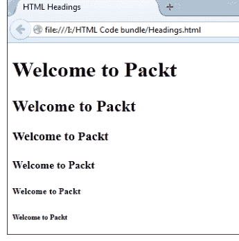
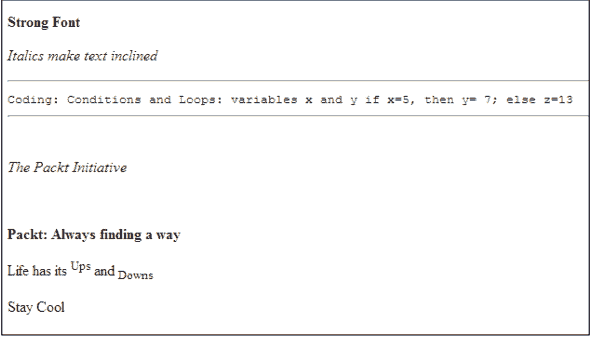

## 标题

标题标签用于区分网页的标题与其他内容。存在层级关系，这意味着 <h1> 中的内容是最重要的，而 <h6> 中的内容是最不重要的。

让我们现在看一个代码示例以便更好地理解：

```
<!DOCTYPE html>
<html>
<head>
<title> HTML Headings </title>
</head>
<body>
<h1>Welcome to Packt</h1>
<h2>Welcome to Packt</h2>
<h3>Welcome to Packt</h3>
<h4>Welcome to Packt</h4>
<h5>Welcome to Packt</h5>
<h6> Welcome to Packt </h6>
</body>
</html>
```

代码执行后的输出如下：



代码执行后的输出如下：



从输出中，你可以看到 `<strong>` 用于表示重要内容，而 `<i>` 用于斜体字体。`<code>` 标签定义计算机代码文本，而 `<em>` 用于描述重要内容。`<b>` 标签用于粗体文本。`<sup>` 和 `<sub>` 标签用于定义上标和下标。上标和下标基本上是那些比正常行型小且略高于或低于它的数字或单词。包含注释是一个良好的实践，可确保代码易于阅读。在 HTML 中，注释位于尖括号之间并带有感叹号，如以下代码所示：

```
<!-- Comments help aspiring newbies -->
```

注释不会在浏览器中显示。
