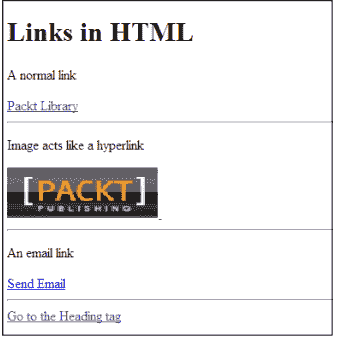
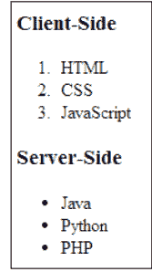

## 链接

HTML 中的锚标签 (`<a>`) 用于定义超链接。**超链接** 可以是一个元素，它会带你到特定位置，无论是网站还是同一文档中的其他位置或其他文档中的位置。我们使用 `href` 属性与 `<a>` 标签一起指定链接目标。

让我们看以下代码以便更好地理解：

```
```html
<!DOCTYPE html>
<html>
<head>
<title> Links </title>
</head>
<body>
<h1 id="packt"> Links in HTML </h1>
<p> A normal link </p>
<a href="http://packtlib.packtpub.com">Packt Library</a>
<br><hr>
<p> Image acts like a hyperlink </p>
<a href="http://www.packtpub.com/">

</a>
<br><hr>
<p> An email link </p>
<a href="mailto:xyz@packt.com">Send Email</a>
<hr>
<a href="#packt"> Go to the Heading tag </a>
</body>
</html>
```
```

代码执行后的输出如下：



代码执行后的输出如下：



如果你观察代码和输出，与 Client-Side 标题相关的 <ol> 下列出的项目具有编号的项目符号，而与 Server-Side 标题相关的 <ul> 下列出的项目则为普通项目符号。每个项目都列在 <li> 和 </li> 标签之间。
