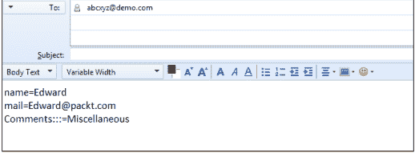

## 表单

表单用于收集用户输入，例如姓名、年龄、性别和电子邮件地址，通过文本、单选按钮和复选框等方式。输入随后会被发送到服务器端进行处理。最常用的表单属性是 name、action、target 和 enctype（读作 encryption）。

表单输入类型有多种，例如文本字段、密码、单选按钮、复选框和提交按钮。在 <form> 标签之间，你可以指定 action 属性，告诉表单其内容将被发送到何处（主要是用于处理的服务器端脚本）。我们使用 method 属性告知表单数据将如何发送；通常默认为 GET，但你也可以使用 POST 和其他方法。

GET 方法的一个例子是搜索引擎结果，你可以在网页地址栏中看到你在搜索框中输入的信息。POST 方法用于敏感数据，其中表单数据对用户不可见，从而确保高度安全性。

让我们看以下代码以便更好地理解：

```
<!DOCTYPE html>
<html>
<body>
<h1> Motorbike Customer requirement </h1>
```

在同一网页上，我们定义了另一个表单。让我们看一下代码示例中的以下行：

```
<form action="MAILTO:abcxyz@demo.com" method="post" enctype="text/plain">
```

我们定义了 action，反馈将通过电子邮件发送给电子邮件地址为 abcxyz@demo.com 的相关人员。我们使用了 POST 方法和纯文本作为加密类型。随后，我们将输入类型定义为文本，并分配了一个值，该值将显示在文本框中以帮助用户了解需要输入哪些信息。

之后，我们为反馈字段定义了一个文本区域，因为我们有多行输入。在此示例中，我们为文本区域分配了 5 行和 40 列。之后，我们创建了 **Send** 和 **Reset** 按钮。**Reset** 按钮将清除你在字段中输入的信息。假设我们输入 Edward 作为姓名，Edward@packt.com 作为电子邮件地址，并在评论字段中输入 Miscellaneous。

> 请记住，你需要拥有 Microsoft Outlook 或 Mozilla Thunderbird 等电子邮件客户端才能使用此功能。在此示例中，我们使用了 Mozilla Thunderbird 作为电子邮件客户端。

当你点击 **Send** 时，你可以看到以下输出：


