## 1 时间序列分析概述

## 时间序列分析概述

**时间序列分析**是一个技术领域，拥有非常多的技术选择，需要根据你想要解决的业务问题和时间序列的性质来仔细选择。在本章中，我们将探讨时间序列的不同类别，并揭示处理此类数据时可能遇到的独特挑战。

到本章结束时，你将了解如何识别自己所拥有的时间序列数据类型，并选择最佳方法来进行时间序列分析（取决于你想揭示的见解），你还会了解 **Amazon Forecast**、**Amazon Lookout for Equipment** 和 **Amazon Lookout for Metrics** 可以帮你解决哪些用例，以及它们不适合哪些用例。

你还将拥有一个可靠的时间序列技术、**Amazon Web Services (AWS)** 服务和开源 **Python** 包工具箱，除了本书详细描述的三种托管服务之外，你还可以利用它们。数据科学家也会发现这些工具是他们的时间序列**探索性数据分析（EDA）**工具箱的绝佳补充。

在本章中，我们将涵盖以下主要主题：

- 什么是时间序列数据集？
- 识别时间序列的不同类别
- 为时间序列数据添加上下文
- 了解常见的时间序列挑战
- 选择分析方法
- 典型的时间序列用例

## 技术要求

阅读本章内容不需要具备 **Python** 或 **R** 等语言的实际操作经验。但对于更懂技术的读者，我们将介绍一些技术考虑因素（如可视化、转换和预处理）以及你可以利用的 Python 语言包来应对这些问题。此外，你还可以打开以下 GitHub 仓库中的 **Jupyter notebook**，自行跟随并尝试：https://github.com/PacktPublishing/Time-series-Analysis-on-AWS/blob/main/Chapter01/chapter1-time-series-analysis-overview.ipynb。

虽然是否使用上述 notebook 跟随本章内容是可选的，但这将帮助你建立直觉，了解本入门章节描述的时间序列技术可以提供哪些见解。

## 什么是时间序列数据集？

从数学角度看，时间序列是按**时间顺序**排列的数据点的**离散序列**。让我们依次看这个定义中的突出术语，如下所示：

- **序列：** 时间序列是数据点的序列。每个数据点可以取一个值（通常是二进制、整数或实数值）。
- **离散：** 尽管系统测量的现象可以是连续的（室外温度是一个连续变量，因为时间当然可以覆盖整个实数轴），但时间序列数据是由系统按一定间隔捕获数据点而生成的（例如，温度传感器可以每 5 分钟进行一次新的温度读数）。测量间隔通常是规则的（数据点将在时间上等距分布），但更多时候，它们并不规则。


- **按时间顺序：** 数据点的序列天然地按时间排序。如果对时间序列数据进行分析，你通常会观察到，在时间上相近的数据点之间的关联性，比相隔较远的观测值之间的关联性更强。这种自然排序意味着，任何时间序列模型通常都试图从给定序列的过去值中学习，而不是从未来值中学习（这在试图预测时间序列的未来值时显而易见，但对其他用例仍然非常重要）。

**机器学习（ML）和人工智能（AI）** 在利用新技术方面取得了巨大成功，这些技术包括**专用处理单元**（如**图形处理单元，即GPU**）、**高速网络通道**和**海量存储容量**。**云计算**等范式转变在普及此类技术的获取方面发挥了重要作用，使得新型架构得以巨大飞跃，并立即应用于生产工作负载中。

在这一背景下，时间序列似乎从这些进步中获益要少得多：是什么让时间序列数据如此特殊？我们可能会认为时间序列数据集只是一个带时间索引的表格数据集：这将是一个大错误。在数据集中引入时间作为变量，意味着你正在处理时间性的概念：现在，基于数据集中每一行的时间戳，可以呈现出模式。现在，让我们来看看你可能会遇到的不同类型的时间序列。

## 识别不同类型的时间序列

在本节中，你将熟悉不同类型的时间序列。对于任何ML从业者来说，很明显，单张图像不应像视频流那样处理，并且检测图像上的异常需要足够高的分辨率才能捕获该异常。来自某个特定主题的多张图像（例如，花椰菜的图片）对于教会ML系统关于南瓜（或就此而言，飞机）的视觉特征并没有什么用处。由于视觉是我们人类的感官之一，这可能显而易见。然而，我们将在本节和下一节（专门讨论时间序列特有的挑战）中看到，同样的差异也适用于不同的时间序列。

时间序列数据涉及四种不同类型，如下所述：

- **单变量时间序列数据**
- **连续多变量数据**
- **基于事件的多变量数据**
- **多重时间序列数据**

### 单变量时间序列数据

*单变量时间序列*是单个随时间变化的值所构成的序列。

这样的序列可以是发电厂的**千瓦时（kWh）**能量输出、单只股票的收盘价，或法国巴黎测得的日平均气温。

以下截图展示了某户家庭的能耗片段：

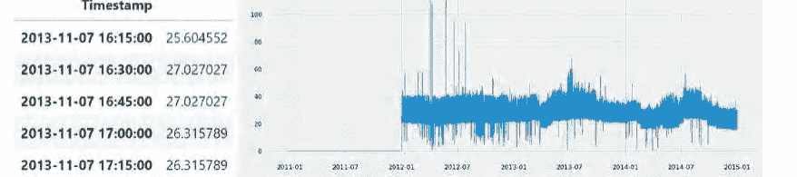

图1.1 – 单变量时间序列的前几行和折线图，捕捉某户家庭的能耗

单变量时间序列可以是*离散的*：例如，你可能只有股票市场收盘价的每日单一值。在这种情况下，如果你想要更高的分辨率（比如小时级数据），你最终会得到每天重复24次的相同值。

就此而言，温度似乎更接近*连续*变量：你可以按任意频率读取读数，并且只要有数据点，就可以预期会有一定程度的变化。然而，你会受到温度传感器读取频率的限制（家庭气象站每5分钟一次，主要气象站每小时一次）。出于实际目的，大多数时间序列确实是离散的，因此本章前面提到了这个定义。

本书中描述的三种服务（*Amazon Forecast*、*Amazon Lookout for Equipment* 和 *Amazon Lookout for Metrics*）可以处理单变量数据，以执行各种用例。

### 连续多变量数据

*多变量时间序列数据集*是同一时刻发出的多值向量值的序列。在这类数据集中，每个变量既可以单独考虑，也可以放在由其他变量整体构成的上下文中考虑。当复杂的关系统治着这些变量随时间演化的方式时，就会出现这种情况（想想通过基于物理的方程联系在一起的几个工程变量）。

工业资产（如炼钢中使用的电弧炉）全天候运行，并在其整个生命周期中产生由传感器捕获的时间序列数据。理解这些连续的时间序列对于通过执行适当的维护活动来防止非计划停机风险至关重要（这一领域被广泛称为**预测性维护**）。此类资产的操作员必须处理有时以高频率生成的数千个时间序列（以10毫秒采样率收集数据并不少见），每个传感器都在测量一个物理量。不应单独考虑每个时间序列的关键原因是，这些物理量中的每一个通常都通过或多或少的复杂物理方程与所有其他物理量相联系。

以离心泵为例：这种泵将电机提供的旋转能转化为流体的位移。流体在通过这样的泵时，同时获得额外的速度和压力。根据欧拉泵方程，离心泵叶轮产生的扬程由以下表达式导出：

$$H = \frac{1}{2g}(u_2^2 - u_1^2 + w_2^2 - w_1^2 + c_2^2 - c_1^2)$$

在上述表达式中，各项含义如下：

- *H* 是扬程。
- *u* 表示圆周速度矢量。
- *w* 表示相对速度矢量。
- *c* 表示绝对速度矢量。
- 下标1表示输入变量（对这种泵也称为进口）。例如，*w_1* 是进口相对速度。
- 下标2表示输出变量（在处理此类资产时也称为圆周变量）。例如，*w_2* 是圆周相对速度。
- *g* 是重力加速度，是一个取决于泵所在纬度的常数值。

描述这种离心泵的多变量时间序列数据集可以包括 *u_1*、*u_2*、*w_1*、*w_2*、*c_1*、*c_2* 和 *H*。所有这些变量显然都通过支配该特定资产的物理定律联系在一起，不能单独视为单变量时间序列。

如果你知道这台特定泵何时处于良好状态、何时进行过维护操作，或何时正在经历异常事件，你还可以在时间序列中添加一个额外的列来捕获此状态：你的多变量时间序列随后可以被视为一个相关数据集，可能有助于尝试预测泵的状况。你将在*为时间序列数据添加上下文*一节中找到关于标签和相关时间序列数据的更多详细信息和示例。

Amazon Lookout for Equipment，本书描述的三种服务之一，能够对此类多变量数据集执行异常检测。

### 基于事件的多变量数据

在某些情况下，数据会跨多种运行模式连续记录：飞机经历飞行员执行的不同机动动作序列，生产线连续生产不同批次的产品，或旋转设备（如电机或风扇）根据需求以不同速度运行。

多变量时间序列数据集可以跨多个片段或事件收集，如下所示：

- 每次飞机飞行都可以记录来自数百个传感器的时间序列数据集，并与飞行员执行的一系列动作相匹配。当然，一架给定的飞机将经历几个重叠的维护周期，每次飞行都不同，而且飞机部件本身会经历自然老化过程，这可能因经历数百次连续飞行的疲劳而产生额外的应力和行为变化。

- 一家美容护理工厂在同一条生产线上生产多种不同的产品（多种类型和品牌的洗发水和沐浴露），中间通过原位清洁流程进行分隔，以确保某一产品不被前一产品污染。每个批次都与不同的配方、不同的原材料和不同的物理特性相关联。尽管设备和工艺时间序列是连续记录的，并且可以被视为按时间索引的单流变量，但它们可以按与之关联的批次进行分段。

在某些情况下，必须将多变量数据集与额外的上下文关联起来，以理解时间序列的给定片段可能关联到哪种运行模式。如果需要考虑的情况数量相当少，则可以使用诸如 Amazon Lookout for Equipment 之类的服务对此类数据集执行异常检测。


## 多时间序列数据

你可能还会遇到这样的情况：拥有多个时间序列数据，但它们并不构成多元时间序列数据集。这些情况指的是，你有多个相互独立的信号，每个信号都可以被视为一个单一的单变量时间序列。尽管完全独立这一点可能因具体情境而有争议，但考虑不同单变量序列之间潜在的关系并不会带来额外的洞见。

以下是此类情况的一些示例：

- **多只股票市场的收盘价：** 对于任何一家特定公司而言，其股票交易可能同时受到外部因素（例如，一场全球大流行迫使整个国家进入居家隔离状态）和内部决策（董事会决议；领导层的战略举措；**研发（R&D）**团队交付的重大创新）的影响。每只股票的价格并不必然受到其他公司股价（竞争对手、合作伙伴、在同一市场运营的组织）的影响。
- **在线零售商店多种产品的已售商品：** 尽管某些产品可能具有相关性（例如春天温度回升时夏季服装销量增加），但它们之间并不会相互影响，只是恰好表现出相似的行为。

将多个时间序列作为真正的多元时间序列数据进行分析和处理是很困难的，因为触发看似关联行为的机制大多数时候来自外部因素（例如夏天临近，对许多夏季相关商品产生类似影响）。然而，现代神经网络能够同时在所有项目上训练全局模型：这使得它们能够发现数据集中未提供的关联和上下文，从而比本质上属于局部（专注于单变量）的传统统计模型达到更高的准确度。

我们稍后将看到，Amazon Forecast（用于使用局部和全局模型进行预测）和 Amazon Lookout for Metrics（用于单变量业务指标的异常检测）是 Amazon 提供的能够处理此类数据集的服务的好例子。

## 为时间序列数据添加上下文

简单来说，ML 模型学习新事物主要有三种方式，如下所述：

- **监督学习（SL）**：使用**输入数据**和**标签**（或目标）来训练模型。标签的提供方式就像教练为学习新动作的学生提供指导一样。训练模型以逼近输入数据和标签之间的关系，就是一种监督方法。
- **无监督学习（UL）**：当使用 **ML** 来发现并**提取给定数据集中可能存在的潜在关系**时，会使用这种方法。在这种情况下，我们仅对输入数据进行操作，无需提供任何标签或输出数据。不过，我们可以使用标签来评估某个无监督模型在捕捉现实方面的表现有多好。
- **强化学习（RL）**：要使用 RL 训练模型，我们需要构建一个能够向智能体发送反馈的环境。然后，我们让智能体在该环境中运行（使用一组**动作**），并根据环境为响应每个动作而提供的**反馈**做出反应。我们不再拥有固定的训练数据集，而是拥有一个环境，它会针对智能体的动作**作为反应**发送输入样本（反馈）。

无论你处理的是单变量、多变量还是多元时间序列数据集，你可能都需要提供额外的**上下文**：位置、批次的唯一**标识（ID）**编号、用于特定批次的配方中的组件、飞行员在飞机飞行测试期间执行的动作序列等等。单变量和多元时间序列的相同值序列在不同上下文中可能导致不同的解释（例如，我们是在巡航还是起飞；我们是在生产一批洗发水还是沐浴露？）。

所有这些额外的上下文都可以以*标签*、**相关时间序列**或**元数据**的形式提供，这些信息会根据你使用的 ML 类型而有所不同。让我们来看看这些上下文可能是什么样子。

## 标签

**标签**可用于监督学习（SL）场景，其中 ML 模型使用输入数据（我们的时间序列数据集）和输出数据（标签）进行训练。在监督方法中，训练模型就是学习输入数据和标签之间近似关系的过程。让我们回顾一下在时间序列数据集中可能遇到的一些标签示例，如下所示：

- **美国国家航空航天局（NASA）**向社区提供了一个被广泛使用的基准数据集，其中包含以循环次数测量的涡扇发动机剩余使用寿命：每台发动机（在下表中由`unit_number`标识）的健康状况通过多个传感器进行测量，并在每次飞行（或循环）后提供读数。为每台发动机记录的多变量数据集可以用每个循环结束时已知或估算的剩余使用寿命（`rul`）进行标记（这是下表中的最后一列）。在此，每个单独的时间戳都由一个标签（以循环次数测量的剩余寿命）来表征：

| unit_number | cycle | setting_1 | setting_2 | setting_3 | sensor_1 | sensor_2 | sensor_21 | rul |
|---|---|---|---|---|---|---|---|---|
| 0 | 1 | 1 | -0.000700 | -0.000400 | 100.000000 | 518.670000 | 641.820000 | 23.419000 | 191 |
| 1 | 1 | 2 | 0.001900 | -0.000300 | 100.000000 | 518.670000 | 642.150000 | 23.423600 | 190 |
| 2 | 1 | 3 | -0.004300 | 0.000300 | 100.000000 | 518.670000 | 642.350000 | 23.344200 | 189 |
| 3 | 1 | 4 | 0.000700 | 0.000000 | 100.000000 | 518.670000 | 642.350000 | 23.373900 | 188 |
| 4 | 1 | 5 | -0.001900 | -0.000200 | 100.000000 | 518.670000 | 642.370000 | 23.404400 | 187 |
| 5 | 1 | 6 | -0.004300 | -0.000100 | 100.000000 | 518.670000 | 642.100000 | 23.366900 | 186 |
| 6 | 1 | 7 | 0.001000 | 0.000100 | 100.000000 | 518.670000 | 642.480000 | 23.377400 | 185 |
| 7 | 1 | 8 | -0.003400 | 0.000300 | 100.000000 | 518.670000 | 642.560000 | 23.310600 | 184 |
| 8 | 1 | 9 | 0.000800 | 0.000100 | 100.000000 | 518.670000 | 642.120000 | 23.406600 | 183 |
| 9 | 1 | 10 | -0.003300 | 0.000100 | 100.000000 | 518.670000 | 641.710000 | 23.469400 | 182 |

图 1.2 – NASA 涡扇发动机剩余使用寿命

- ECG200 数据集是另一个被广泛用作时间序列分类基准的时间序列数据集。人类心跳期间记录的电活动可以标记为**正常**或**缺血**（心肌梗死），如下面的截图所示。每个完整的时间序列都由一个标签来表征：

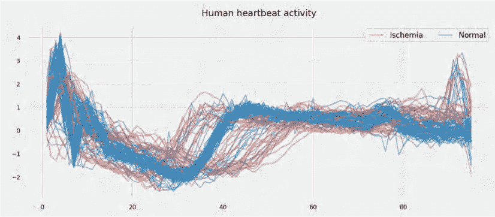

图 1.3 – 100 名患者的心跳活动（ECG200 数据集）

- **Kaggle** 也提供了一些有意思的时间序列数据集。其中一个包含来自水泵的传感器数据，并带有已知的时间范围，指示水泵何时损坏以及何时正在维修。在以下案例中，标签以时间范围的形式提供：

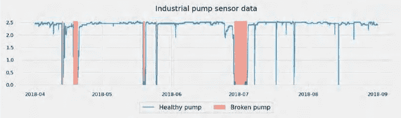

图 1.4 – 展示健康和损坏时间范围的水泵传感器数据

正如你所看到的，标签可用于表征时间序列的单个时间戳、时间序列的一部分，甚至整个时间序列。

## 相关时间序列

相关时间序列是与分析目标时间序列并行演化的附加变量。让我们看几个例子，如下所示：

- 在制造工厂生产不同批次产品的情况下，一个关键信号是唯一的批次 ID，它可以与时间序列数据的开始和结束时间戳进行匹配。
- 伦敦多个家庭的用电量可以与多种天气数据（温度、风速、降雨量）进行匹配，如下面的截图所示：

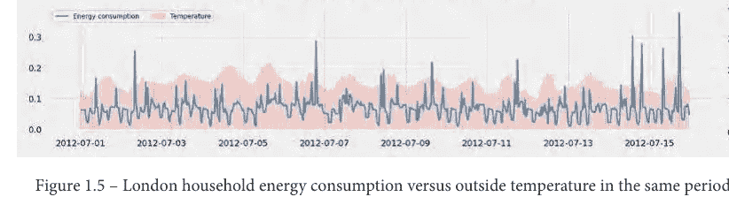

图 1.5 – 同期伦敦家庭能源消耗与室外温度对比

- 在水泵数据集中，不同传感器的数据可以被视为水泵健康变量的相关时间序列数据，该变量可以取值为 0（水泵健康）或 1（水泵损坏）。

## 元数据

当你的数据集是多变量的或包含多个时间序列时，每个序列都可以与不依赖于时间的参数相关联。让我们在这里更详细地了解一下：

- 在前面提到的制造工厂示例中，每批产品可能都不同，与每个批次 ID 相关联的元数据可能是用于制造该特定批次的配方。


对于伦敦家庭能耗，每个时间序列都与一个家庭相关联，而该家庭又可以进一步关联到其房屋面积、居住人数、类型（独栋房屋或公寓）、建造时间、地址等信息。下面的截图列出了该数据集中若干家庭的部分元数据：例如，我们可以看到，有27户家庭属于ACORN-A类别，该类别的房屋有2个卧室：

|  | 主要类别 | 类别 | 参考 | ACORN-A | ACORN-B | ACORN-E |
|---|---|---|---|---|---|---|
| 668 | 购物 | 家具与配件商店 | 高档 | 214.000000 | 209.000000 | 139.000000 |
| 778 | 休闲时间 | 兴趣与爱好 | 慈善/志愿工作 | 122.000000 | 122.000000 | 46.000000 |
| 47 | 住房 | 房屋面积 | 床位数：2 | 27.000000 | 28.000000 | 124.000000 |
| 182 | 营销渠道 | 未来回应 | 手机短信 | 105.000000 | 105.000000 | 126.000000 |
| 159 | 营销渠道 | 已接收渠道 | 传单 - 门投或报纸 | 102.000000 | 105.000000 | 98.000000 |
| 51 | 住房 | 房屋价值 | 房屋价值不超过10万 | 13.000000 | 17.000000 | 48.000000 |
| 175 | 营销渠道 | 未来回应 | 在街头或p...分发的传单/样品 | 101.000000 | 101.000000 | 113.000000 |
| 148 | 交通 | 公共交通可达性等级 | 6a | 101.394793 | 8.309678 | 176.905736 |
| 285 | 数字 | 互联网使用类型：笔记本电脑或PC | 电视节目投票（例如《X Factor》、St... | 72.000000 | 88.000000 | 84.000000 |
| 38 | 住房 | 房屋类型 | 半独立式房屋 | 56.000000 | 70.000000 | 66.000000 |

图1.6 – 伦敦家庭元数据节选

现在你已经了解了如何通过标签、相关时间序列和元数据等附加上下文来进一步描述时间序列，接下来让我们深入探讨分析时间序列数据时常见的一些挑战。

## 了解常见的时间序列挑战

时间序列数据是一种非常紧凑的方式，用于编码被测现象的多尺度行为：这也是与表格数据集、声学数据、图像或视频相比，需要采用根本不同的方法的关键原因。多变量数据集由于多个信号之间可能存在潜在的隐含关系，又增加了一层复杂性。

本节将重点介绍机器学习从业者必须学会应对的关键挑战，以便成功发现隐藏在时间序列数据中的洞察。

这些挑战可能包括以下方面：

- 技术挑战
- 可视化挑战
- 行为挑战
- 缺失的洞察与上下文

## 技术挑战

除了时间序列数据之外，上下文信息也可以存储为单独的文件（或数据库中的表）：这包括标签、相关时间序列或所测项目的元数据。相关时间序列与你的主要时间序列数据集需要考虑的问题相同，而标签和元数据通常存储为单个文件或数据库表。我们不会重点关注这些内容，因为它们不会带来与常规表格数据集不同的任何挑战。

## 时间序列文件结构

当你发现一个新的时间序列数据集时，在应用你最喜欢的机器学习方法之前，首先要做的是了解你需要对其应用哪种类型的处理。该数据集实际上可能以多个文件的形式存在，你需要将它们组装起来以获得完整的概览，其结构可以是以下几种方式之一：

- **按时间范围：** 每月一个文件，每个文件包含所有传感器。在下面的截图中，第一个文件覆盖绿色区域（2018年4月），包含每个传感器的所有数据（从sensor_00到sensor_09），第二个文件覆盖红色区域（2018年5月），第三个文件覆盖紫色区域（2018年6月）：

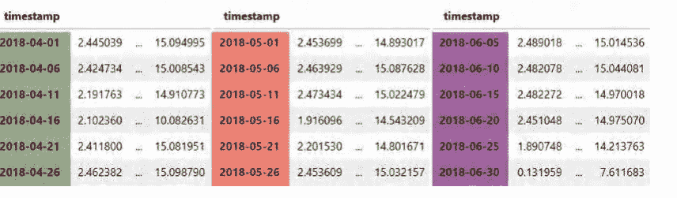

图1.7 – 按时间范围划分的文件结构（示例：每月一个文件）

- **按变量：** 在完整时间范围内，每个传感器一个文件，如下图所示：

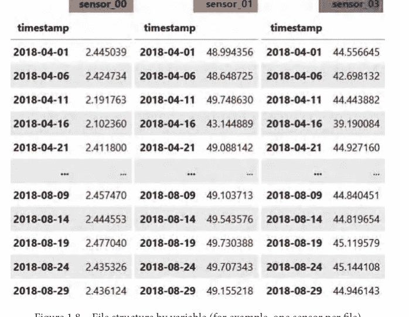

图1.8 – 按变量划分的文件结构（例如，每个文件一个传感器）

或者，你可以同时使用时间范围和变量，如下所示：

| sensor_00 | sensor_00 | sensor_00 |
|---|---|---|
| 时间戳 | 时间戳 | 时间戳 |
| 2018-04-01 2.445039 | 2018-05-01 2.453699 | 2018-06-05 2.489018 |
| 2018-04-06 2.424734 | 2018-05-06 2.463924 | 2018-06-10 2.482078 |
| 2018-04-11 2.191763 | 2018-05-11 2.473434 | 2018-06-15 2.482272 |
| 2018-04-16 2.102360 | 2018-05-16 1.916096 | 2018-06-20 2.451048 |
| 2018-04-21 2.411800 | 2018-05-21 2.201530 | 2018-06-25 1.890748 |
| 2018-04-26 2.462382 | 2018-05-26 2.453609 | 2018-06-30 0.131959 |

| sensor_01 | sensor_01 | sensor_01 |
|---|---|---|
| 时间戳 | 时间戳 | 时间戳 |
| 2018-04-01 48.994356 | 2018-05-01 46.821613 | 2018-06-05 48.589806 |
| 2018-04-06 48.648725 | 2018-05-06 47.957542 | 2018-06-10 48.960924 |
| 2018-04-11 49.748630 | 2018-05-11 47.265340 | 2018-06-15 48.966964 |
| 2018-04-16 43.144889 | 2018-05-16 47.198777 | 2018-06-20 48.912819 |
| 2018-04-21 49.088142 | 2018-05-21 46.929590 | 2018-06-25 46.205716 |
| 2018-04-26 46.729395 | 2018-05-26 49.044607 | 2018-06-30 36.330060 |

图1.9 – 按变量和时间范围划分的文件结构（例如，每个月和每个传感器各一个文件）

当你处理多个时间序列（无论是独立的还是多变量的）时，你可能希望将它们组装到一个表中（如果你使用**Python pandas**，则为DataFrame）。当每个时间序列存储在单独的文件中时，你可能会遇到时间戳不对齐的问题，如下例所示：

| sensor_00 |  | sensor_01 |  | sensor_02 |  |
|---|---:|---|---:|---|---:|
| **时间戳** |  | **时间戳** |  | **时间戳** |  |
| **2018-04-01** | 2.445039 | **2018-04-01** | 47.950337 | **2018-04-01** | 52.096718 |
| **2018-04-06** | 2.424734 | **2018-04-03** | 49.848134 | **2018-04-08** | 51.030574 |
| **2018-04-11** | 2.191763 | **2018-04-05** | 50.218519 | **2018-04-15** | 45.722312 |
| **2018-04-16** | 2.102360 | **2018-04-07** | 46.951843 | **2018-04-22** | 53.278153 |
| **2018-04-21** | 2.411800 | **2018-04-09** | 49.127994 | **2018-04-29** | 51.743657 |
| **2018-04-26** | 2.462382 | **2018-04-11** | 51.358596 | **2018-05-06** | 52.873434 |
| **2018-05-01** | 2.453699 | **2018-04-13** | 48.911794 | **2018-05-13** | 52.524503 |
| **2018-05-06** | 2.463929 | **2018-04-15** | 46.597627 | **2018-05-20** | 50.782725 |
| **2018-05-11** | 2.473434 | **2018-04-17** | 42.765348 | **2018-05-27** | 53.944845 |
| **2018-05-16** | 1.916096 | **2018-04-19** | 42.595530 | **2018-06-03** | 52.533945 |

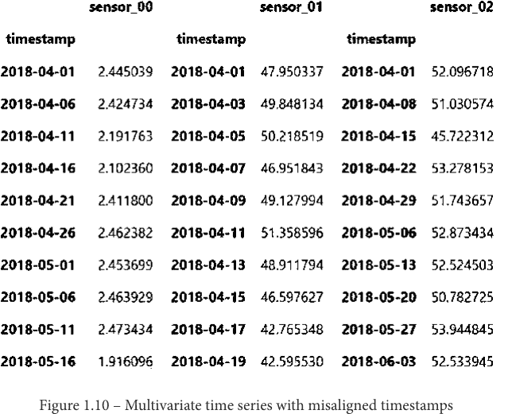

你可以采用三种方法，具体取决于你后续实际的处理和学习流程。你可以选择以下方式之一：

- *将每个时间序列保留在各自带有原始时间戳的文件中。* 这使你的数据集保持原样，但在将其输入到机器学习系统时，你将不得不考虑更灵活的数据结构。
- *将所有时间序列重采样到共同的采样率，并通过将每个时间序列作为一列插入表中来拼接不同文件。* 这样做更易于操作和处理，但你将不再使用原始数据。此外，如果你的上下文数据也提供时间戳（例如，用于区分每一个制造批次），你将必须将它们考虑在内（一种方法可以是先将数据切片为每个批次的时间序列，然后在第二步中重采样并组装数据集）。
- *合并所有时间序列，并对合并阶段产生的每个缺失值进行向前填充（请参见下图中的所有NaN值）。* 这个过程计算密集度更高，尤其是当你的时间戳不规则时：

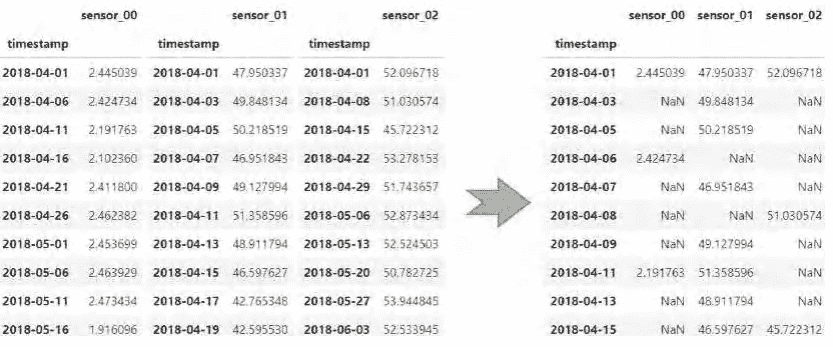

图1.11 – 合并时间戳不对齐的时间序列

## 存储注意事项

用于存储时间序列数据的格式本身可能各不相同，各有其优点或挑战。下面的列表介绍了常见格式以及可以帮助处理这些格式的Python库：

- **逗号分隔值（CSV）：** 在存储时间序列数据时，这是最常见但不幸的是效率最低的格式之一。如果你需要多次读取或写入时间序列数据（例如在EDA期间），强烈建议将CSV文件转换为另一种更高效的格式。在Python中，你可以使用pandas（`read_csv` 和 `to_csv`）以及NumPy（`genfromtxt` 和 `savetxt`）读写CSV文件。
- **Microsoft Excel（XLSX）：** 在Python中，你可以使用pandas（`read_excel` 和 `to_excel`）或专用库（如openpyxl或xlsxwriter）读写Excel文件。在撰写本文时，Microsoft Excel单个文件最多只能包含1,048,576行（2的20次方）。当你的数据集跨越多个文件且需要将它们合并以进行进一步处理时，坚持使用Excel可能会产生日后难以定位的错误。与CSV一样，如果你计划在数据集的生命周期内多次打开和写入数据集，强烈建议将数据集转换为另一种格式。


- **Parquet**：这是一种非常高效的列式存储格式。**Apache Arrow** 项目维护着多个库，这些库在处理超大型文件时表现出色。写入一个 5 **吉字节（GB）** 的 CSV 文件可能需要长达 10 分钟，而相同数据量以 Parquet 格式存储大约只占 3.5 GB，并且只需 30 秒就能完成写入。在 Python 中，可以使用 `pyarrow.parquet` 模块来管理 Parquet 文件和数据集。
- **分层数据格式 5（HDF5）**：HDF5 是一种二进制数据格式，专门用于存储海量数值数据。它允许你在磁盘上对数 TB 级别的数据集进行切片，只将需要的数据加载到内存中，因此是进行数据探索的绝佳格式。在 Python 中，你可以使用 pandas（`read_hdf` 和 `to_hdf`）或 h5py 库来读写 HDF5 文件。
- **数据库**：你的时间序列也可能存储在通用型数据库中（使用标准**结构化查询语言（SQL）**进行查询），或者存储在专为时间序列设计的数据库中，如 **Amazon Timestream** 或 **InfluxDB**。列式数据库或可扩展的键值存储（如 **Cassandra** 或 **Amazon DynamoDB**）也可以使用，同时可以利用一些反模式来高效地存储和查询时间序列数据。

## 数据质量

与其他任何类型的数据一样，时间序列也可能受到多种数据质量问题的困扰。**缺失数据**（或非数值 NaN 值）可以通过不同的技术进行填充，包括：

- **用整个时间序列的均值或中位数替换缺失数据点**：`fancyimpute`（`http://github.com/iskandr/fancyimpute`）库中包含一个 `SimpleFill` 方法，可以处理此任务。
- **在使用平均值替换缺失数据点之前，先采用一个合理大小的滚动窗口**：`impyute` 模块（`https://impyute.readthedocs.io`）包含多种对时间序列有用的方法，比如 `moving_window` 正是为此设计的。
- **用最后一个已知值向前填充缺失的数据点**：当数据源采用某种压缩方案时（例如 **OSIsoft PI** 这样的工业历史数据库系统可以对其收集的传感器数据进行压缩，仅在值变化时才记录一个数据点），这可能是一种有用的技术。pandas 库中包含诸如 `Series.fillna` 之类的函数，你可以通过它决定是向后填充、向前填充，还是用常量值替换缺失值。
- **你也可以在两个已知值之间插值**：结合重采样以对齐多变量情况下的每个时间戳，可以得到一个稳健且完整的数据集。你可以使用 `pandas` 提供的 `Series.interpolate` 方法来实现这一点。

对于所有这些情况，我们强烈建议绘制并比较原始和结果时间序列，以确保这些技术不会对时间序列的整体行为产生负面影响：例如，数据插补（尤其是插值）可能会使异常值更难被发现。

> **重要说明**
>
> 是否填充零散的缺失值并非强制性的，这取决于你想要执行的分析——例如，零散的缺失值可能不会影响你理解趋势或预测时间序列未来值的能力。事实上，如果你想进行预测，错误地填充零散的缺失值（例如，使用常量值（比如零）来填补时间序列中的空洞）可能会使模型产生偏差。如果你想要执行异常检测，缺失值可能实际上与异常的根本原因相关（意味着当异常即将发生时，值缺失的概率更高）。填充这些缺失值可能会掩盖你试图检测或预测的现象本身。

关于时间戳，还会出现其他质量问题：一个容易解决的问题是时间戳应保持单调递增。当时间戳未沿着时间序列递增时，你可以使用诸如 `pandas.DataFrame.sort_index` 或 `pandas.DataFrame.sort_values` 之类的函数来正确地对数据集进行重新排序。

**重复的时间戳**也可能出现。当它们与重复值相关联时，使用 `pandas.DataFrame.duplicated` 将帮助你定位并移除这些错误。当采样率小于或等于一小时时，你可能会看到具有不同值的重复时间戳：这在夏令时变更时可能会发生。在一些国家，时间在夏季开始时向前拨快一小时，在秋季中期再拨回——例如，巴黎（法国）时间通常是**中欧时间（CET）**；在夏季月份，巴黎使用**中欧夏令时（CEST）**。不幸的是，这通常意味着你必须彻底丢弃所有重复的值，除非你能够将时间戳替换为包含它们实际所指时区的等效时间戳。

### 大规模数据质量

在需要大规模处理海量数据的生产系统中，你可能必须利用诸如 Dask、Vaex 或 Ray 等分布式和并行化框架。此外，你可能需要完全脱离 Python：在这种情况下，诸如 AWS Glue、AWS Glue DataBrew 和 Amazon Elastic MapReduce（Amazon EMR）等服务将为你提供一个托管平台，以便使用 Apache Spark、Flink 或 Hive 等运行数据转换管道。

## 可视化挑战

通过读取和显示时间序列数据集的前几条记录来快速查看时间序列，有助于确保格式符合预期。然而，通常情况下，你会想要可视化时间序列数据，这将引领你进入一个活跃的研究领域：如何将时间序列数据集转换为相关的视觉表示。

以下是一些你可能会遇到的关键挑战：

- 绘制大量数据点
- 防止关键事件被任何重采样平滑掉
- 并行绘制多个时间序列
- 从海量时间序列中获取视觉线索
- 揭示长时间序列中的多尺度行为
- 在时间序列上映射标签和元数据

让我们来看看可以用于应对这些挑战的不同技术和策略。

## 使用交互式库绘制时间序列

原始时间序列数据通常使用折线图进行可视化：你可以很容易地通过 Microsoft Excel 或 Jupyter notebook 实现这一点（例如，借助 Python 中的 matplotlib 库）。然而，将长时间序列加载到内存中进行绘制可能会生成庞大的文件，即使在性能强大的机器上，渲染图像也可能很困难或耗时。此外，渲染出的图形可能包含的数据点数量超过屏幕所能显示的像素数。这意味着你喜欢的可视化库的渲染引擎会对时间序列进行平滑处理。那么，如果你的信号的重要特征恰好被平滑掉了，你如何确保不会错过它们呢？

另一方面，你可以将时间序列切片到更合理的时间范围。然而，这可能会导致你对季节性、需要处理的异常值或在分析范围之外的某些时间范围内可能存在的缺失值得出不恰当的结论。

这时，**交互式可视化** 就派上了用场。使用这种工具，你可以加载时间序列，缩小以纵览全局，放大以聚焦细节，并平移滑动窗口以“放映”你的时间序列，同时完全掌控浏览过程！对于 Python 用户，诸如 `plotly`（`http://plotly.com`）或 `bokeh`（`http://bokeh.org`）之类的库是不错的选择。

## 并行绘制多个时间序列

当你需要绘制多个时间序列并理解它们彼此之间的演变关系时，根据你想同时可视化和显示的信号数量，你有多种选择。并行绘制多个时间序列的最佳表示方式是什么？实际上，不同的时间序列可能具有不同的可能值范围，而在折线图上我们只有两个轴。

如果你只有少量时间序列，任何静态或交互式折线图都可以胜任。如果两个时间序列的值范围不同，你可以为其中一个分配一个次要轴，如下面的截图所示：

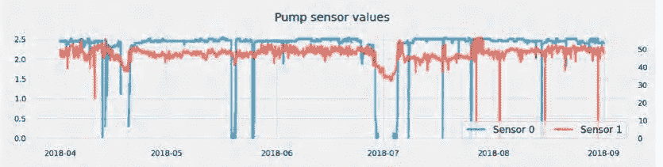

图 1.12 – 可视化少量图表

如果你有超过两个但少于 10 到 20 个且取值范围相似的时间序列，你可以在同一上下文中为每个时间序列分配一个折线图。此时图形还不会过于拥挤，并且这将使你能够检测到任何水平位移（当所有信号同时经历突然的显著变化时）。如果每个时间序列的取值范围彼此差异很大，一个解决方案是通过缩放将它们全部归一化到 `0.0` 到 `1.0` 之间（例如）。`scikit-learn` 库包含了一些 ML 从业者熟知的方法，专门用于实现此目的（请查看 `sklearn.preprocessing.Normalizer` 或 `sklearn.preprocessing.StandardScaler` 方法）。


下面的截图展示了可视化中等数量的图：

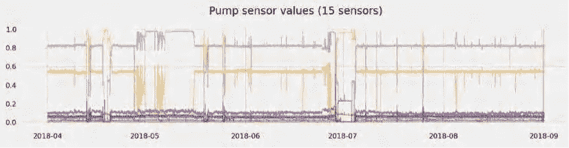

图1.13 – 可视化中等数量的图

即使这个图有点过于拥挤，难以聚焦每个信号的细节，我们已经可以指出一些感兴趣的时段。

现在假设你有*数百个*时间序列。是否可以并行可视化数百个时间序列，以识别多变量数据集中的共同行为？将所有序列绘制在单个图表上会使其过于拥挤，而且肯定无法使用。将每个信号绘制在自己的折线图中会占用过多的空间，并且无法让你发现多个信号同时受到影响的时段。

这时**带状图**就派上了用场。如下面的截图所示，将单线图转换为带状图会使信息更加紧凑：

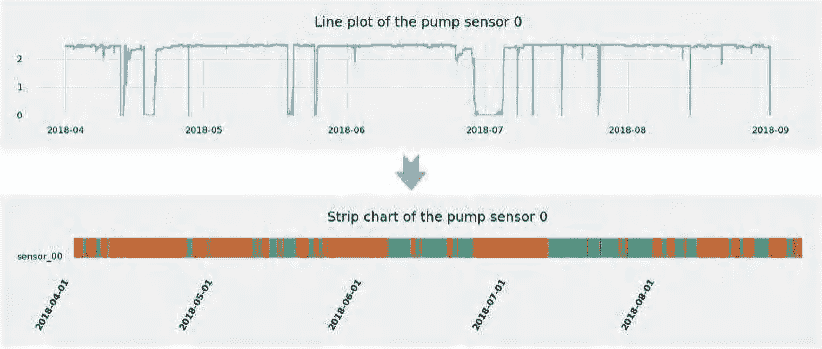

图1.14 – 从折线图到带状图

## 实现多尺度探索

如果你有非常长的时间序列，你可能希望发现比常见的周、月或年季节性更难捕捉的有趣时间模式。如果能够调整查看时间序列的时间尺度以及起始点，检测模式就会更容易。一种出色的多尺度可视化是 **Pinus 视图**，如这篇论文所述：`http://dx.doi.org/10.1109/TVCG.2012.191.`

该论文作者的方法对时间尺度和起始点均不做假设。这使得识别复杂系统的潜在动态变得更加容易。

## 行为挑战

每个时间序列在一系列测量中都编码了多种潜在行为。存在趋势或季节性吗？它是混沌随机游走吗？它是否在连续时间段内表现出显著的偏移？根据使用场景的不同，我们希望发现并分离非常特定的行为，同时舍弃其他行为。

在本节中，我们将回顾什么是时间序列平稳性和电平偏移，如何发现这些现象，以及如何处理它们。

### 平稳性

如果某个时间序列的统计均值和方差恒定，并且当我们取该序列的一段在时间轴上平移时，其协方差与时间无关，则该时间序列被认为是平稳的。

某些使用场景需要使用参数化方法：这类方法认为底层过程具有一种可以用少量参数描述的结构。例如，**自回归积分滑动平均（ARIMA）**方法（详见*第7章，改进和扩展你的预测策略*）是一种用于预测时间序列未来值的统计方法：与所有参数化方法一样，它假设时间序列是平稳的。

如何判断你的时间序列是否非平稳？有几种技术和统计检验（如 **Dickey-Fuller 检验**）。你也可以使用**自相关图**。自相关度量给定时间序列中数据点之间的相似性，作为它们之间时间滞后的函数。

你可以在这里看到一些自相关图的示例：

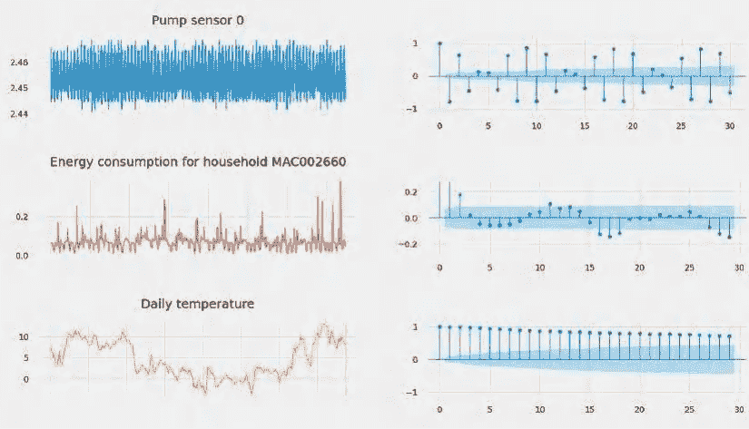

这种图可用于以下目的：

- **检测季节性：** 如果自相关图呈正弦形状，并且你可以在图中找到一个周期，这将给出季节的长度。季节性确实是时间序列值的周期性波动。这在*图1.16*中的第二个图中可以看到，在第一个图（泵传感器数据）中也有一定程度体现。
- **评估平稳性：** 平稳的时间序列的自相关图会迅速下降到零（如能耗时间序列的情况），而非平稳过程的自相关图则会缓慢下降（参见*图1.16*中的每日温度信号）。
- **去除季节性效应：** 差分也可应用于季节性效应。如果你的时间序列包含周周期成分，那么移除1周前的值（1周的滞后差分）将有效地从时间序列中去除这种效应。

### 电平偏移

**电平偏移**是一个事件，它会在某个时间点触发时间序列统计分布的偏移。时间序列的均值、方差或相关性可能会突然偏移。这种情况在单变量和多变量数据集中都可能发生，并且可能与时间序列所测量的潜在行为变化有关。例如，工业资产可以有多种运行模式：当机器从一种运行模式切换到另一种运行模式时，这可能会在仪器传感的数据中触发电平偏移。

电平偏移可能对预测时间序列值或在数据集中正确检测异常的能力产生非常负面的影响。这是模型性能在预测时突然开始漂移的关键原因之一。

`ruptures` Python 包提供了各种变点检测算法的全面概述，这些算法有助于发现和分割时间序列信号，如下所示：

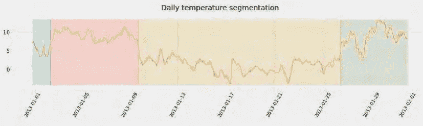

图1.18 – 使用二元分割方法在天气温度上检测到的分段

通常不适合尝试从数据集中移除电平偏移：正确检测它们将帮助你为用例组装最佳的训练和测试数据集。它们也可以用于标记时间序列数据集。

## 缺失的洞察和上下文

大多数时间序列数据用例的一个关键挑战是缺少上下文：我们可能需要一些标签来将时间序列数据的某一部分与底层运行模式、活动或是否存在异常关联起来。你可以使用手动或自动的方法来标记数据。

### 手动标记

你的第一个选择是手动标记时间序列。你可以在 **Amazon SageMaker Ground Truth**（`https://docs.aws.amazon.com/sagemaker/latest/dg/sms-custom-templates.html`）上构建自定义标记模板，或安装诸如以下的开源包：

- **Label Studio**（`https://labelstud.io`）：这个开源项目在2021年5月发布了1.0版本，是一个通用标记环境，恰好包含时间序列注释功能。它可以原生连接到存储在 **Amazon S3** 中的数据集。
- **TRAINSET**（`https://github.com/geocene/trainset`）：这是一个非常轻量级的标记工具，专门用于时间序列数据。
- **Grafana**（`https://grafana.com/docs/grafana/latest/dashboards/annotations`）：Grafana 带有原生注释工具，可以直接从图表面板或通过其**超文本传输协议（HTTP）应用程序编程接口（API）**使用。
- **Curve**（`https://github.com/baidu/Curve`）：在撰写本书时已被归档。

在时间序列数据上提供可靠的标签通常需要**领域专家（SME）**投入大量精力，而他们可能没有足够的时间来执行此任务。因此，自动化标记过程可能是一个值得研究的选项。

### 自动标记

你的第二个选择是对数据集执行自动标记。根据你的用例，可以通过不同方式实现。你可以执行以下操作之一：

- 你可以使用变点检测算法来检测不同的活动、模式或运行范围。`ruptures` Python 包是探索变点检测算法的绝佳起点。
- 你还可以利用无监督异常评分算法，例如 **scikit-learn 隔离森林**（`sklearn.ensemble.IsolationForest`）、来自 **Amazon SageMaker** 的内置 **Random Cut Forest** 算法（`https://docs.aws.amazon.com/sagemaker/latest/dg/randomcutforest.html`），或构建基于自编码器架构的自定义**深度学习（DL）**神经网络。
- 你还可以对时间序列进行变换（参见下一节中的不同分析方法）：表格、符号或图像技术将让你对时间序列进行聚类，并识别可能感兴趣的标签。


根据数据的动态特性和复杂性，自动标注实际上可能需要额外的验证来确认生成标签的质量。自动标注可用于启动手动标注流程，使用预标注数据供人工操作员确认。

## 选择分析方法

到目前为止，我们已经了解了不同类型的时序相关数据集，并列出了在处理这些数据时可能遇到的关键挑战。在本节中，我们将描述可以用来分析时序数据的不同方法。

## 使用原始时序数据

当然，执行时序分析的第一种也是主要方式是直接使用原始时间序列本身，而不进行任何激进的转换。这种方法的最大好处是，在开始实际分析之前，你需要对时序数据集进行的前期处理工作量有限。

我们可以用这些原始时序做什么？我们可以利用 *Amazon SageMaker* 并利用以下内置算法：

- **Random Cut Forest**：该算法是 **scikit-learn Isolation Forest algorithm** 的一个稳健变种，可以为你的每个数据点计算异常分数。它将每个时间序列视为单变量序列，无法从多个或多变量时间序列中学习任何关系或全局行为。
- **DeepAR**：这种概率预测算法非常适合当你拥有数百个不同的时间序列，可以利用它们来预测未来值的情况。不仅该算法可以为你提供点预测（在特定预测时域上的若干个单一值），它还可以预测不同的分位数，从而更轻松地回答诸如：*给定 80% 的置信水平（例如），我的时间序列在不久的将来会取什么边界值？* 的问题。

除了这些内置算法之外，你当然也可以将自己喜欢的包带到 Amazon SageMaker 来执行各种任务，例如预测（通过引入 `Prophet` 和 `NeuralProphet` 库）或变化点检测（例如使用 `ruptures` Python 包）。

本书中我们专门用一部分篇幅介绍的以下三个 AWS 服务也假设你将提供原始时序数据集作为输入：

- **Amazon Forecast**：用于执行时序预测
- **Amazon Lookout for Equipment**：用于提供异常事件预警，可用于改进预测性维护实践
- **Amazon Lookout for Metrics**：用于检测异常并帮助进行 **root-cause analysis (RCA)**

其他开源包和 AWS 服务可以处理转换后的时序数据集。让我们现在来看看你可以对时序应用的不同转换。

## 将时序汇总为表格数据集

你可以对时序数据集应用的第一类转换是通过用一些表征其特征的指标替换每个时间序列来压缩它。你可以手动完成，例如取时间序列的均值和中位数或计算标准差。这种方法的主要目标是通过将一系列数据点转换为一个或多个指标来简化时序分析。一旦汇总，你的洞察就可以用于支持你的 EDA 或在有新的传入时序序列时构建分类管道。

如果你知道想要构建哪些特征，可以手动执行此汇总，或者你可以利用以下 Python 包：

- `tsfresh`: (http://tsfresh.com)
- `hctsa`: (https://github.com/benfulcher/hctsa)
- `featuretools`: (https://www.featuretools.com)
- `Cesium`: (http://cesium-ml.org)
- `FATS`: (http://isadoranun.github.io/tsfeat)

这些库可以接受多个时间序列作为输入，并为每个序列计算数百甚至数千个特征。一旦你拥有了传统的表格数据集，你就可以应用通常的 ML 技术来执行降维、发现特征重要性，或运行分类和聚类技术。

通过使用 Amazon SageMaker，你可以访问已适配以受益于云端可扩展性的知名算法。在某些情况下，它们已从头重写以实现线性可扩展性，使其在庞大数据集上实用！以下是其中一些：

- **Principal Component Analysis (PCA)**：该算法可用于对获得的数据集进行降维（https://docs.aws.amazon.com/sagemaker/latest/dg/pca.html）。
- **K-Means**：这是一种无监督算法，其中每一行对应一个单一时间序列，每个计算出的属性都用于计算时间序列之间的相似度（https://docs.aws.amazon.com/sagemaker/latest/dg/k-means.html）。
- **K-Nearest Neighbors (KNN)**：这又是受益于可扩展实现的另一种算法。一旦你的时间序列被转换为表格数据集，你就可以将问题表述为分类或回归问题并利用 KNN（https://docs.aws.amazon.com/sagemaker/latest/dg/k-nearest-neighbors.html）。
- **XGBoost**：这是许多数据科学家的瑞士军刀，是一种用于在表格数据集上执行监督分类和回归的知名算法（https://docs.aws.amazon.com/sagemaker/latest/dg/xgboost.html）。

你也可以利用 Amazon SageMaker 并引入自定义预处理和建模方法，如果内置算法不符合你的目的。一些有趣的方法可能是更通用的降维技术（例如 **Uniform Manifold Approximation and Projection (UMAP)** 或 **t-distributed stochastic neighbor embedding (t-SNE)**）以及其他聚类技术，例如 **Hierarchical Density-Based Spatial Clustering of Applications with Noise (HDBSCAN)**）。一旦你拥有了表格数据集，你也可以应用神经网络方法进行分类和回归。

## 使用成像技术

时间序列也可以转换为图像；这使你能够利用非常丰富的计算机视觉方法和架构。你可以利用 pyts Python 包来应用本章中描述的转换（https://pyts.readthedocs.io），特别是 pyts.image 子模块。

一旦你的时间序列被转换为图像，你就可以利用许多技术来学习它，例如以下内容：

- 使用 **convolutional neural networks** (CNN) 架构学习有价值的特征并在 Amazon SageMaker 上构建此类自定义模型，或使用其内置的 **image classification** 算法。
- 利用 **Amazon Rekognition Custom Labels** 快速构建模型，可快速对图像转换过程所突出的不同行为进行分类。
- 使用 **Amazon Lookout for Vision** 执行异常检测并对代表时序中捕获的潜在问题的图像进行分类。

让我们现在来看看我们可以对时序应用的不同转换，以及它们能让你捕捉到其底层动态的哪些内容。我们将深入探讨以下内容：

- **Recurrence plots**
- **Gramian angular fields**
- **Markov transition fields (MTF)**
- **Network graphs**

## Recurrence plots

复现是指时间序列返回到之前访问过的值的时间。复现图说明了时间序列处于相同位置——即相同值——的时间戳对的集合。每个点可以取 0 或 1 的二进制值。复现图有助于理解时间序列的动态特性，而这种复现与动态非线性系统密切相关。复现图被使用的示例可见于此处：

然后，Gram 矩阵计算如下：

```
$$G=\begin{bmatrix}\cos(\varphi_1+\varphi_1)&\cos(\varphi_1+\varphi_2)&\cdots&\cos(\varphi_1+\varphi_n)\\\cos(\varphi_2+\varphi_1)&\cos(\varphi_2+\varphi_2)&\cdots&\cos(\varphi_2+\varphi_n)\\\vdots&\vdots&\ddots&\vdots\\\cos(\varphi_n+\varphi_1)&\cos(\varphi_n+\varphi_2)&\cdots&\cos(\varphi_n+\varphi_n)\end{bmatrix}$$
```

让我们按如下方式绘制之前三个时间序列的 Gramian angular fields：

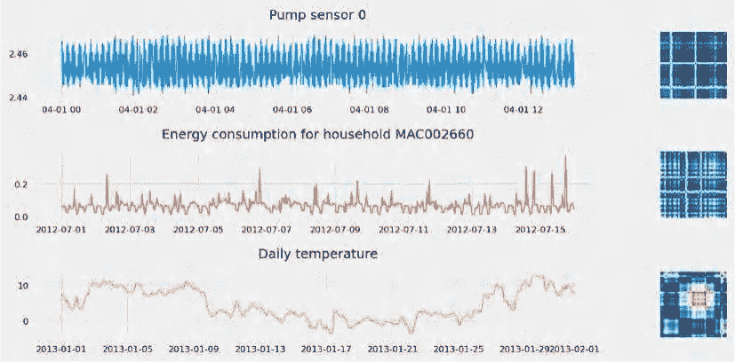

与之前的表示（复现图）相比，Gramian angular fields 对于重度周期信号（例如下面的泵信号）不太容易产生白噪声。此外，每个点取一个实值，而不限于 0 和 1（因此是彩色图片，而不是复现图可能产生的灰度图）。

## MTF

MTF 是一种可视化技术，用于突出时序的行为。要构建 MTF，你可以使用 `pyts.image` 模块。在幕后，对你的时间序列应用的转换如下：

- 对时间序列进行离散化以及其可能取的不同值。
- 构建马尔可夫转移矩阵。
- 计算从一个时间戳到所有其他时间戳的转移概率。
- 将转移概率重新组织为 MTF。
- 计算聚合 MTF。


下面的截图显示了与之前相同的三个时间序列的MTF：

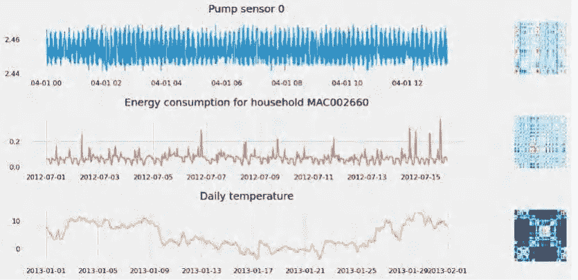

图1.21 – 使用MTF揭示时间序列行为

如果你对这种表示能带来的洞察感兴趣，欢迎通过这个GitHub仓库深入了解：`https://github.com/michaelhoarau/mtf-deep-dive`。你也可以在以下文章中详细阅读相关内容：`https://towardsdatascience.com/advanced-visualization-techniques-for-time-series-analysis-14eeb17ec4b0`

## 模块化网络图

从MTF（参见上一节）中，我们可以生成一个图$G = (V, E)$：顶点$V$与时间索引$i$之间存在直接映射。由此，有两种值得关注的编码方式：流编码或模块度编码。下面更详细地描述这两种方式：

- **流编码：** 这种表示有助于我们观察大量信息流发生在何处。

  我们利用从$T0$到$TN$的颜色渐变，将时间的流动映射到顶点，为网络图中的每个节点着色。

  我们使用MTF权重为顶点之间的边着色。

- **模块度编码：** 模块度是网络分析中识别特定局部结构的重要模式。这是在时间序列分析中我觉得最有用的编码方式。

我们将模块标签（连同社区ID）映射到每个顶点，每个社区附带一种特定颜色。

我们将顶点大小映射到聚类系数。

我们将边颜色映射到目标顶点的模块标签。

要从MTF构建网络图，可以使用`tsia` Python包。你可以在以下GitHub仓库中查看以Jupyter notebook形式提供的深入分析：https://github.com/michaelhoarau/mtf-deep-dive。

网络图根据MTF按以下过程构建：

- 我们计算时间序列的MTF。
- 我们以该时间序列作为输入来构建网络图。
- 我们计算划分和模块度，并将这些信息编码到网络图表示中。

再次，让我们取之前处理过的三个时间序列，构建它们对应的网络图，如下所示：

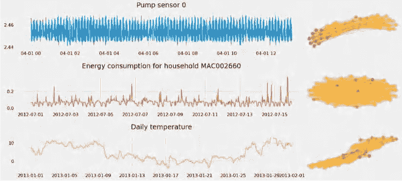

图1.22 – 使用网络图理解时间序列的结构

一旦有了网络图，你就可以构造许多特征。你可以使用这些特征来构建时间序列的数值表示（嵌入）。可以从网络图中导出的特征包括：

- 直径
- 平均度数和平均加权度数
- 密度
- 平均路径长度
- 平均聚类系数
- 模块度
- 划分数量

所有这些参数都可以借助networkx和python-louvain模块计算得出。

## 符号变换

时间序列也可以离散化为文本序列：这是一种符号方法，因为我们将原始实数值转换为符号字符串。一旦你的时间序列被成功地表示为这样的符号序列（这可以作为你序列的嵌入），你就可以利用许多技术从中提取洞察，包括以下这些：

- 你可以将嵌入用于索引用例：给定查询时间序列的嵌入，你可以测量它与数据库中嵌入集合的距离，并返回最接近的匹配项。
- 符号方法将实值数据序列转换为离散数据，这开辟了可能的技术领域——例如，使用后缀树和马尔可夫链来检测新颖或异常行为，使其成为异常检测用例的一种合适技术。
- Transformer和自注意力在**自然语言处理（NLP）**领域引发了巨大进步。由于时间序列和自然语言在顺序性质上有时被认为很接近，我们看到Transformer架构在时间序列分类和预测中的实现越来越成熟。

你可以利用pyts Python包来应用本章描述的变换（https://pyts.readthedocs.io），并使用Amazon SageMaker将前述架构作为自定义模型来实现。现在让我们看看可以应用于时间序列的不同符号变换。在本节中，我们将深入探讨以下内容：

- **词袋表示（BOW）**
- **符号傅里叶近似袋（BOSS）**
- **用于时间序列分类的词语提取（WEASEL）**

## 词袋表示（BOW和SAX-VSM）

BOW方法在时间序列上应用滑动窗口，并使用**符号聚合近似（SAX）**将每个子序列转换为一个词。SAX将时间序列简化为任意长度的字符串。这是一个两步过程：首先通过**分段聚合近似（PAA）**进行降维，然后将得到的简化时间序列离散化为SAX符号。你可以利用`pyts.bag_of_words.BagOfWords`模块来构建以下表示：

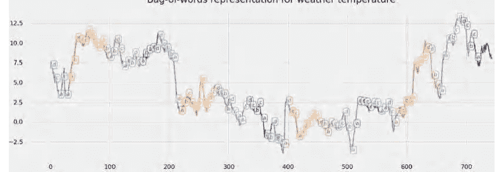

图1.23 – 使用SAX变换时间序列的示例

BOW方法可以修改为利用**词频-逆文档频率（TF-IDF）**统计量。TF-IDF是一种反映给定词在语料库中重要程度的统计量。SAX-VSM（向量空间模型中的SAX）使用该统计量，将其与符号在时间序列中出现的次数联系起来。你可以利用`pyts.classification.SAXVSM`模块来构建这种表示。

## 符号傅里叶近似袋（BOSS和BOSS VS）

BOSS表示使用BOW方法的基于结构的表示，但将PAA/SAX替换为**符号傅里叶近似（SFA）**。也可以在BOSS模型的基础上，将其与TF-IDF模型结合。与SAX-VSM的情况类似，BOSS VS使用该统计量，将其与符号在时间序列中出现的次数联系起来。你可以利用`pyts.classification.BOSSVS`模块来构建这种表示。

本节到此结束，现在你应该已经对时间序列分析方法的丰富性有所了解。有了这个认识，我们将看看如何应用这些新知识来解决不同的基于时间序列的用例。

## 典型时间序列用例

到目前为止，我们已经介绍了在处理时间序列数据时需要面对的许多不同类型的考虑因素、挑战和分析方法。但是，我们能用时间序列做什么呢？我们能从中获得什么样的洞察？认识到分析目的，是设计合适的数据准备方法或理解分析所得洞察如何被最终用户使用的关键一步。例如，从时间序列中移除离群值可以改进预测分析，但会使任何异常检测方法失去意义。

在以下典型用例中，时间序列数据集扮演着重要（甚至是最重要）的角色，这些用例包括：

- **预测**
- **异常检测**
- **事件预警**（异常预测）
- **虚拟传感器**
- **活动检测**（模式分析）
- **质量预测**
- **设定点优化**

在本书接下来的三个部分中，我们将重点关注预测（使用Amazon Forecast）、异常检测（使用Amazon Lookout for Metrics）以及多变量事件预警（使用Amazon Lookout for Equipment输出检测到的异常，然后随时间对其进行分析，以构建异常预警通知）。

本章的其余部分将概述你还可以利用时间序列数据实现的其他目标。虽然你可以组合使用本书介绍的AWS服务来实现解决这些问题所需的部分内容，但一个好的经验法则是：这些操作并非直截了当，其他方法可能让你更快获得洞察。


## 虚拟传感器

又称为 **软传感器**，这类模型用于利用 ML 模型推断物理测量的计算。某些恶劣环境可能不适合安装实际物理传感器。在其他情况下，没有可靠的物理传感器来测量你感兴趣的物理特性（或根本不存在物理传感器）。最后但同样重要的是，有时你需要实时测量来管理你的流程，但只能每天获得一次测量。

虚拟传感器使用多元时间序列（所有其他可用传感器）来产生当前或预测值，用于你无法直接获取的测量值，以有用的粒度。

在 AWS 上，你可以执行以下操作：

- 使用 Amazon SageMaker 中的 *DeepAR* 内置算法构建自定义模型（https://docs.aws.amazon.com/sagemaker/latest/dg/deepar.html）
- 利用 GluonTS 库中的 DeepAR 架构或 DeepVAR 架构（DeepAR 的多元变体）（http://ts.gluon.ai），该库由 AWS 开源并维护

## 活动检测

当你拥有单变量或多变量时间序列的片段时，你可能希望执行一些模式分析以推导出导致它们的确切动作。这对于基于手机捕获的加速度计数据进行人类活动识别非常有用（运动移动应用程序能够自动判断你是在骑自行车、步行还是跑步），或通过分析脑电波数据来理解你的意图。

许多 DL 架构可以处理此基元发现任务（长短期记忆 (**LSTM**）、CNN 或两者的组合）：替代方法让你可以将时间序列转换为表格数据或图像以应用聚类和分类技术。所有这些都可以在 Amazon SageMaker 上作为自定义模型构建，或通过使用该服务中可用的一些内置可扩展算法，例如以下：

- PCA: https://docs.aws.amazon.com/sagemaker/latest/dg/pca.html
- XGBoost
- 图像分类

如果你选择将时间序列转换为图像，你也可以利用 Amazon Rekognition Custom Labels 进行分类，或利用 Amazon Lookout for Vision 执行异常检测。

一旦你拥有现有的活动数据库，你也可以利用索引方法：在这种情况下，构建时间序列的符号表示将允许你将其用作嵌入以查询数据库中相似的时间序列，甚至是同一时间序列的过去片段，如果你想发现潜在的重复基元。

## 预测质量

想象一下，你有一个流程，最终会产生质量可能因流程执行情况而异的产品或服务。这通常发生在制造生产线上，设备传感器、流程数据和其他表格特征可以被测量并与成品的实际质量相匹配。

然后，你可以使用所有这些时间序列来构建预测模型，尝试预测当前批次的产品是否会达到适当的品质等级，或者是否需要返工或作为废料丢弃。

**循环神经网络 (RNNs)** 传统上是为解决此用例而构建的。根据你对可用数据集的塑造方式，你可能能够使用 Amazon Forecast（使用预测的产品质量或等级作为要预测的主要时间序列，并将所有其他可用数据作为相关时间序列）或 Amazon Lookout for Equipment（将不良产品质量视为异常，你希望尽可能提前预警）。

## 设定点优化

在流程工业中（将原材料转化为成品的行业，如洗发水、铝卷或家具），设定点是流程变量的目标值。想象一下，你需要将流体的温度保持在 50°C；那么，你的设定点就是 50°C。流程测量的实际值可能不同，流程控制系统的目标是确保流程值达到并保持在期望的设定点。

在这种情况下，你可以利用流程的时间序列数据来优化结果：例如，产生的废物数量、使用的能源或水量，或从质量角度产生更高等级产品的机会（有关更多详细信息，请参阅之前的预测质量用例）。基于期望的结果，你可以然后使用 ML 方法来推荐设定点，以确保你实现目标。

处理此精细优化问题的潜在方法包括以下：

- **偏最小二乘法 (PLS)** 和 **稀疏 PLS**
- 基于 DL 的 **模型预测控制 (MPC)**，它结合了基于神经网络的控制器和 RNN 来复制 MPC 的动态行为。
- 通过 **Q 学习 (Q-learning)** 进行容错控制的 RL

此类模型的预期输出是控制流程的每个参数的设定点值。所有这些方法都可以在 Amazon SageMaker 上作为自定义模型构建（它还提供 RL 工具包和环境，以防你想利用 Q-learning 来解决此用例）。

## 总结

尽管每个时间序列看起来都一样（按时间索引的表格数据集），但选择合适的工具和方法来构建时间序列问题对于成功利用 ML 发现业务洞察至关重要。

阅读完本章后，你将了解时间序列如何大不相同，并且应该很好地掌握可帮助从时间序列数据集中得出洞察的预处理、转换和分析技术家族。你还对可以在你的努力中利用的不同 AWS 服务和开源包有一个概述。阅读完本章后，你现在可以认识到该领域是多么丰富，以及你拥有处理和分析时间序列数据的众多选择。

在本书接下来的三个部分中，我们将通过利用托管服务来抽象掉其中大部分选择和选项，这些服务将为你完成大部分繁重工作。然而，掌握这些概念以培养对底层发生情况的正确理解至关重要。这也有助于你在处理新用例时做出正确的选择。

我们将从我们想要用时间序列预测解决的最流行的时间序列问题开始，使用 Amazon Forecast。
