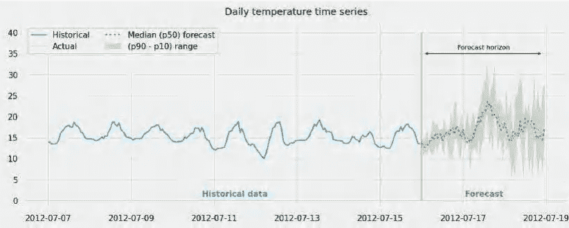
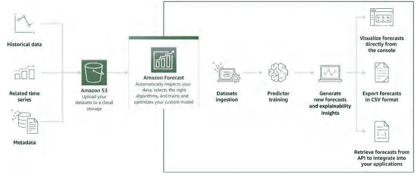

## 2 Amazon Forecast 概述

**时间序列预测** 是一种非常流行且广泛使用的技术，可为各种业务利益相关者提供洞察。虽然预测的值可以原样使用（例如，当你使用电子表格公式为财务规划实践提供数据并预测 **业务单元 (BU)** 的结果以告知适当的业务发展决策时），但它们通常是实现目标的手段：预测随后成为为其他模型或业务流程提供动力的关键齿轮（预测产品需求以优化制成品的生产）。

时间序列预测在 **机器学习 (ML)** 和 **人工智能 (AI)** 变得如此普遍之前就已经存在。在本书中，你将利用通过 ML 构建的多个服务：这些技术通常在有大量数据可用时或数据之间的关系变得无法仅用电子表格处理时表现最佳。当零售商作为其供应链规划的一部分构建需求预测时，**库存单位 (SKUs)** 和位置组合的数量通常以百万计，使得利用最新的 AI 技术变得很有价值。

**Amazon Forecast** 是我们将在本书中详细探讨的第一个 **Amazon Web Services (AWS)** 托管服务。到本章结束时，你将了解如何构建适合 Amazon Forecast 的预测问题，并准备深入本书的下一章，以培养构建第一个预测所需的关键步骤的扎实理解。

在本章中，我们将涵盖以下主要主题：

- 我们可以用预测解决哪些类型的问题？
- 什么是 Amazon Forecast？
- Amazon Forecast 如何工作？
- 选择合适的应用

### 技术要求

跟随本章内容不需要 **Python** 或 **R** 等语言的动手经验。然而，我们强烈建议你在 **AWS 控制台** 中跟随操作，从那里可以访问 Amazon Forecast 服务。

如果你已经拥有 AWS 账户，你可以连接到 AWS 控制台，点击顶部搜索栏，输入 `Forecast`。在 **服务** 部分，点击 **Amazon Forecast** 以打开服务控制台的登陆页面。

如果你没有 AWS 账户，你需要在登录控制台之前创建一个。要创建 AWS 账户，请按以下步骤操作：

1. 打开 `https://portal.aws.amazon.com/billing/signup` 并按照在线说明进行操作。你将接到电话以获取注册验证码。

2. 创建 **身份和访问管理 (IAM)** 管理员用户：当你创建 AWS 账户时，你会获得一个根用户账户，可完全访问账户中的所有 AWS 资源。强烈建议遵循创建个人 IAM 用户的最佳实践。要创建此类安全用户，请参阅 IAM 服务文档中的 *Creating your first IAM admin user and user group* 部分，网址为 `https://docs.aws.amazon.com/IAM/latest/UserGuide/getting-started_create-admin-group.html`。

你现在准备好使用 Amazon Forecast 了！


## 我们可以用预测解决哪些类型的问题？

**预测**是一门尽可能准确地预测时间序列未来值的科学，它基于所有可用信息（包括所关注时间序列本身的历史值、其他相关时间序列，以及任何可能影响预测的事件的知识）。读完前一章后，你可能会理解为什么它也可以被视为一门艺术！

预测是许多活动所需的常规任务：大多数时候，预测是达到目的的手段，而不是其本身的目标——引言中提到的财务规划除外，尽管你也可以说财务规划也是确保良好业务决策的一种手段。以下是一些可以通过预测实现更好业务成果的场景示例：

- 预测产品的未来需求，以*决定工厂需要生产多少以及何时生产*。如果未能预测到某个地区的高需求，可能会导致错失收入机会；而在另一个地区生产过多产品则会增加库存并提高资金成本。
- 预测数百家门店中数千种商品的销售情况，*以便零售商知道应在门店或仓库储备多少库存*，从而服务本地客户或减少配送延迟和成本。
- 按小时级别预测家庭用电需求，以便能源供应商能够*在维持电网平衡的同时做出最经济的电力交易决策*。
- 通过预测交易数量来*改善劳动力规划*（银行柜台的业务办理量；超市收银台的客流量……）。
- 预测更换零件的需求，以便规划人员能够*提前订购零件*，作为预测性维护规划的一部分。
- 基于安装在工业设备子系统上的传感器数据，在给定置信水平下提供设备故障概率。与更换零件预测相关联，该预测结果有助于工厂管理者*优化库存，限制被动维护的影响，并强化其预测性维护实践*。
- 预测公司网站的流量，以*扩展底层基础设施*，并预测向受众提供内容的相关成本。
- 预测内存、**中央处理器（CPU）、输入/输出（I/O）**吞吐量、存储及其他运行负载，以便**Amazon Redshift**（用于托管数据仓库）或**Amazon DynamoDB**（NoSQL数据库）等云服务能够*配置并扩展其底层基础设施*。

简而言之，任何预测活动的输出对于确保各项运营持续顺利运行或采取适当行动都至关重要。有些活动易于预测，而有些则只是纯粹的随机游走（新值取随机数，似乎与先前值没有任何关联，例如股价的演变）。在决定对时间序列进行预测时，你应该评估以下几点是否适用：

- **你有足够的数据可用：** 要获得良好预测所需的数据量，既取决于你所使用的算法类型，也取决于时间序列的底层动态特性。
- **你了解影响因素：** 即你对影响时间序列演变方式的底层因素的理解程度。

在真实系统中使用预测时，你还应该评估*预测结果影响其环境行为的可能性有多大*。下面举几个示例：

- 如果能源供应商预测某个城市的能源消耗，这很可能对该城市的实际用电量没有影响。
- 另一方面，如果你向同一城市的所有家庭提供未来几天的个人用电量预测，他们可能会调整自己的行为以减少消耗（例如，调低暖气温度以减少能源浪费并省钱）。这会让你的能源预测效果变差，但你却实现了减少当地居民能源消耗的业务目标。
- 作为一家大型金融机构，如果你向客户提供股市投资建议，你就会影响这个市场，并对另一个部门可能试图预测的股价定量分析产生影响。

换句话说，*理解你的预测在多大程度上会成为自我实现的预言*，是确保预测及其所处环境整体动态稳定性的关键。此外，理解这一点有助于你解释预测模型性能退化时的表现。在早期阶段，可以通过**A/B测试**方法向最终用户提供预测（例如，在一段时间内向城市的一部分发送能源预测）：这将使你能够衡量预测对整个动态系统的影响，并构建更好的性能指标。

既然你已经了解了预测可以解决哪些类型的问题，那么让我们花些时间来正确地构建一个给定的预测问题。

## 构建你的预测问题

正如*第1章《时间序列分析概述》*中所暗示的，处理时间序列数据的问题有多种构建方式，而预测只是其中一种类型。顾名思义，Amazon Forecast 适用于解决**预测问题**：即你想知道*会发生什么、何时发生*，以及——可能的话——*为什么发生*的问题。

时间序列广泛存在于许多领域和场景中，预测问题随处可见。在机器学习中，预测是最难解决的问题之一（毕竟，我们是在尝试预测未来！），而决定走这条路可能十分困难——甚至不可能——这取决于可用数据所包含的实际预测能力。下面举两个预测并非最佳路径的示例：

- 你经营着一项视频点播服务，并且希望根据用户过去的观看记录和收集到的兴趣信息，预测他们接下来可能观看的内容。你可以对数据进行结构化处理，尝试预测后续的观看行为，从而在个性化首页上向用户展示这些节目。尽管这种方法信息量丰富（它确实考虑了时间维度），但由于你的时间序列会非常稀疏（每个用户每天至多只有几个数据点），很难高效地解决。*这类问题更适合用推荐引擎来解决*（例如，查看**Amazon Personalize**以了解更多关于如何构建推荐引擎的细节）。
- 你经营着一家洗发水生产工厂，并且想要预测生产中任意一批产品的质量。在生产线上，你收集产品配方、构成化学配方的原材料特性，以及你在生产线各设备上配置的设定值所对应的工艺参数。你可以利用所有这些时间序列来尝试预测特定批次的质量；然而，其基本假设是，所收集的时间序列和表格数据中包含的预测能力足以预测你所关注的缺陷是否会出现。

这些缺陷可能源于环境条件（工厂的湿度；外部温度；降雨量；原材料供应商；操作员输入的错误编程序列）。这类问题或许更适合被构建为异常检测问题：在这种情况下，像 Amazon Lookout for Equipment 这样的服务（这将是本书第3部分《使用 Amazon Lookout for Equipment 检测多元时间序列中的异常行为》的重点）可能更适合提供你所寻找的见解。

在确定预测确实是你想要用来解决问题的方案之后，你需要在预测项目的早期阶段解决几个问题，如下所示：

- 你想预测什么？
- 可用数据的频率是什么（小时、天、月……）？
- 期望的预测时间范围是什么？
- 你需要多频繁地进行预测？
- 预测工作的预期输出是什么？
- 你将如何评估预测的准确性？
- 预测输出后续将如何被使用？

此外，一项关键任务显然是收集、整理和准备构建预测模型所需的历史数据。你还需要识别同时可知的相关数据是否能为你的模型提供一定的统计效力，以提高预测准确性；作为时间序列预测实践者，你可能使用过格兰杰因果检验等方法，来验证给定的时间序列是否可用于预测另一个时间序列。

收集和准备这些相关数据将是在构建模型之前的额外步骤。你可能还需要收集和准备时间序列之间与时间无关的关系（例如层级关系，如某些地点位于同一区域，某些商品属于同一产品组，或某些商品具有相同的颜色）。


下面的截图总结了预测问题的范围：



图 2.1 – 时间序列预测组件

让我们深入了解此截图的几个关键领域，如下所示：

- **历史数据：** 历史数据是时间序列中用于训练预测模型的部分。在图 2.1 中，这是位于图表左侧的常规折线图。
- **历史数据频率：** 历史时间序列数据可以按规则或不规则的采样率获取。如果您的原始数据不是规则采样，或其频率与预测粒度不同，您可能需要将数据聚合到所需的单位。在零售中，每次产品销售发生时都会被记录，但并非每种产品每天都销售，从而导致稀疏的时间序列，并出现与销售发生日期相对应的尖峰。按周或月度汇总每个产品的销售额将平滑原始信号。
- **预测期：** 这是您可以期望的预测长度。通常以所需单位的时间步数来衡量，该单位可能与原始时间序列不同。如果您希望预测结果为每日数据，并且需要未来一周的预测，您的采样单位将是日级别，预测期将为 7 天。
- **预期输出：** 您可以请求一个时间点预测。在图 2.1 所示的图中，这是位于预测期内的虚线，它有助于回答此类问题：*到明天时间序列的值会是多少？* 预测还可以一次为多个时间步发出一个值。这有助于回答诸如：*未来一周时间序列每天取值是多少？* 您的预测也可能被期望一组可能值的组织或系统使用；在这种情况下，您将用概率预测替换点值，概率预测在每个预测时间步发出一个可能值的范围（在上图中，这由围绕中位数预测的区域图表示，该中位数预测用虚线表示，并以所请求分位数（本例中为 p10 和 p90）的下界和上界为边界）。

您现在已经知道如何构建一个良好的预测问题，那么让我们将这一新知识应用到 Amazon Forecast 吧！

## 什么是 Amazon Forecast？

**Amazon Forecast** 是 AWS 云平台上可用的 AI/ML 托管服务之一。灵活准确的预测在许多业务领域都是关键，用于预测需求并确保相应地储备库存或原材料，或预测等待时间并确保柜台人员配备到位。虽然如今所有组织都在使用某种形式的预测流程，但传统方法无法利用我们可用的日益增多且复杂的时间序列信号。

**托管服务**是指最终用户只需提供数据并配置一些参数以满足需求的服务。所有其他任务，*被视为无差异的繁重工作*，均由服务代表用户执行。这包括所有基础设施管理的自动化：作为 Amazon Forecast 用户，您无需配置和管理**虚拟机（VMs）**、配置用户账户、管理安全性、在请求量增加时规划可扩展性、停用未使用的资源等。

对于 **AI/ML 托管服务**，一些*数据准备、摄取任务和模型管理活动也在幕后进行*，使您能够主要专注于要解决的问题。Amazon Forecast 是一种可扩展的托管服务，可自动化整个**端到端（E2E）**预测流水线，从数据摄取到模型部署和预测服务。该服务还会在幕后处理数据准备。Amazon Forecast 可以执行以下操作：

- 填充数据集中的缺失值，同时允许您自定义用于替换这些值的参数。
- 准备时间序列，使其可被多种算法摄取——Amazon Forecast 可以准备时间序列序列以馈入**深度学习（DL）**模型，或生成多个随机序列以为**非参数时间序列（NPTS）**等专有算法输出概率预测。
- 根据数据集选择最佳算法——Amazon Forecast 可以使用 AutoML 在统计预测算法（如**自回归积分滑动平均（ARIMA）**、**指数平滑（ETS）**、NPTS 或 Prophet）与更先进且需要大量数据的基于神经网络的架构（如 DeepAR+ 或**卷积神经网络-分位数回归（CNN-QR）深度神经网络（DNN）**）之间自动选择。您将在*第 5 章，自定义预测器训练*中概览 Amazon Forecast 使用的不同算法及其各自的优缺点。
- 对数据进行分段，并自动为每个数据段应用最佳的算法集成。
- 借助概率预测生成提供置信区间——传统算法仅输出点预测（通常是均值）和置信区间，而这依赖于对数据分布的强假设。
- 提供可解释性分数，帮助您了解哪些因素在哪个时间段内影响了特定项目的预测。
- 为您的每个时间序列管理多个局部统计模型——使用 ARIMA、ETS、NPTS 或 Prophet 在 100 个时间序列上训练意味着您必须自行管理 100 个模型。Amazon Forecast 可以透明地为您管理所有这些模型，并让您在推理后轻松地将所有预测一次性导出为单个**逗号分隔值（CSV）**文件，就好像它只是一个模型一样。
- 在多个时间窗口上执行模型评估，并在单个 CSV 文件中一次性为所有时间序列数据提供评估结果，该文件可被常规电子表格或**商业智能（BI）**可视化软件解读。Amazon Forecast 代表您使用回测技术（您将在*第 5 章，自定义预测器训练*中深入了解此功能以及如何根据您的需求进行自定义）。
- 在评估和选择最佳模型时自动计算多个准确度指标，包括传统的点预测指标（如**加权绝对百分比误差（WAPE）**）以及概率预测的无偏误差指标（即**加权分位数损失（wQL）**）。您将在*第 4 章，使用 AutoML 训练预测器*中了解这些准确度指标的详细内容。
- 执行超参数优化以找到训练模型的最佳参数。
- 添加内置特征（如公共节假日或天气数据）以提高预测准确度。在相关情况下，Amazon Forecast 还会提供滞后值等特征来捕捉数据集中的季节性。例如，如果您的样本按小时频率采集，Amazon Forecast 将把最近 1、2 和 3 天的值馈送给 DeepAR+ 等算法，这些算法可以从这些额外信息中受益，从而构建更准确的模型。

基于 *Amazon.com* 使用的相同技术，Amazon Forecast 深入挖掘了 Amazon 在预测技术方面积累的丰富经验，并将其提供给每一位开发人员和数据科学家。它是一种完全托管的服务，使用统计和基于 DL 的算法来提供准确的时间序列预测。尽管机器学习从业者或数据科学家能够利用其技能来改进服务结果并充分利用它，但 Amazon Forecast 并不要求任何机器学习经验，即可基于您的历史数据提供未来的时间序列预测。

Amazon Forecast 还包含了深度学习的最新进展，提供深度学习算法（即 **DeepAR+** 和 **CNN-QR**），这些算法能够学习更复杂的模型，并适用于可能需要为数百万时间序列构建预测、处理冷启动场景或轻松构建假设分析场景的情况。Amazon Forecast 还能够自动对您的数据进行分段，并构建一个模型集成，在您无需额外繁重分析的情况下提高预测准确性。

到目前为止，您已经了解了如何构建预测问题，以及 Amazon Forecast 服务如何帮助您解决此问题。您现在将了解 Amazon Forecast 的工作原理，这将为您提供成功将该服务应用于业务问题的关键。

## Amazon Forecast 是如何工作的？

为了构建预测模型，Amazon Forecast 涉及以下概念和资源：

- **数据集：** 数据集是承载数据的容器。Amazon Forecast 算法使用这些数据集来训练其模型。每个数据集由模式定义，您可以通过该模式定义列及其类型。Amazon Forecast 包含多个具有预定义模式的领域，可帮助您快速入门。
- **数据集组：** Amazon Forecast 算法可以利用多个数据集来训练模型。数据集组是一个容器，它将一组用于共同训练预测模型的数据集打包在一起。


- **特征化**：特征化配置允许你指定参数来转换数据。你可以在此为数据集中的不同变量指定空值填充策略。
- **算法**：Amazon Forecast 提供多种算法，包括统计算法（ARIMA、ETS、Prophet 和 NPTS）以及深度学习算法（DeepAR+ 和 CNN-QR）。在训练时选择 AutoML 可以免去用户对算法选择的困扰，同时也让更专业的从业者能够自行选择和配置算法。
- **训练参数**：部分算法可通过提供特定的超参数值进行进一步定制。所有算法通用的另一个训练参数是预测范围（forecast horizon）。
- **配方**：配方是多种要素的组合：一种算法、一个特征化配置以及评估参数。
- **预测器**：这是一个已训练的模型。要创建预测器，你需要提供数据集组和预测配方（配方中包含算法，不过你也可以让 Amazon Forecast 替你选择算法并以 **AutoML** 模式运行）。**AutoPredictor** 功能让 Amazon Forecast 构建一个算法集成，以更好地适应数据可能包含的不同分段。
- **指标**：Amazon Forecast 使用多种准确率指标来评估服务内置的预测器，并帮助你选择最适合生成满足业务需求的预测结果的预测器。这些指标通过一种回测技术进行评估，你可以配置该技术将数据划分为训练集和测试集。
- **预测结果**：你可以基于现有预测器运行推理（即生成新的预测）来产生预测结果。Amazon Forecast 输出概率预测，而非均值点预测——例如，Amazon Forecast 可以告诉你，你的时间序列实际值有 10% 的可能性低于模型预测值。默认情况下，预测会以 10%、50% 和 90% 的概率生成，为你的明智决策提供更多洞察。
- **可解释性洞察**：在机器学习中，可解释性让你更好地理解数据集中的不同属性如何影响预测结果。借助 Amazon Forecast，你可以请求预测可解释性洞察——该功能既会在仪表板中展示，也会以可下载报告的形式提供，帮助你理解数据集的不同特征如何影响单个时间序列的预测结果，以及这些影响发生在哪些时间点。

现在，我们来看看这些概念是如何集成到 Amazon Forecast 的典型工作流程中的。

## Amazon Forecast 工作流程概述

任何预测过程都涉及两个步骤，如下所示：

1. 我们首先回顾历史数据，建立基线并发现可能延续到未来的趋势。
2. 然后利用这些趋势来预测时间序列数据的未来值。

如下图所示，Amazon Forecast 提供了一种完成这两个步骤的方法：



图 2.2 – Amazon Forecast 概述

让我们深入分析此图，说明使用 Amazon Forecast 所需经历的各个步骤，具体如下：

- **将数据上传并摄取到服务中**——这将在下一章中详细说明。Amazon Forecast 可以使用存放在 Amazon **简单存储服务（S3）**中的数据，S3 是一种可扩展的数据存储基础设施，用于存储任何类型的对象和数据集。在摄取时，Amazon Forecast 会检查你的数据并识别出在训练时有用的有价值特征。
- **训练预测器**，如*第 4 章“使用 AutoML 训练预测器”*中所述。根据获得的性能，你可以对数据摄取和训练步骤进行多次迭代，以达到期望的性能。在底层，Amazon Forecast 可以使用多种算法训练多个模型，为每个模型选择最佳参数，进行优化，并选出最准确的模型。
- 一旦你有了满意的预测器，就可以开始**生成新的预测结果**，这些结果也将是时间序列（但根据你要求的预测长度，它们可能只包含一个数据点）。当你要求 Amazon Forecast 生成预测时，它实际上会部署并托管你的模型，以便你可以一次性导出所有预测。
- 如果你启用 **AutoPredictor** 模式，Amazon Forecast 还会允许你生成可解释性洞察，你可以在控制台**用户界面（UI）**中可视化这些洞察。你还可以选择下载 CSV 格式的详细报告。

如果不介绍该服务定价模型的关键驱动因素，那么对 Amazon Forecast 工作流程的理解就不够完整。在下一节中，你将把工作流程的不同步骤与 Amazon Forecast 的定价维度对应起来。

## 定价

与许多 AWS 服务一样，你只需按使用量付费，无需预先承诺。尽管构建一个**概念验证（PoC）**的服务成本极低——尤其是如果你能享受免费套餐的话——但使用 Amazon Forecast 实现预测流水线时，仍有四个维度需要考虑，如下所示：

- **存储**：数据经过摄取和准备，以确保 Amazon Forecast 获得最快的训练时间。存储按服务中摄取的每**吉字节（GB）**计费。
- **训练时长**：每次你基于数据训练新的自定义模型时，都会按训练小时数计费。
- **生成的预测数据点**：你按服务生成的每 1,000 个预测数据点计费。一个预测数据点是唯一时间序列数量、分位数数量以及预测范围内时间点的组合。
- **预测解释**：你还需要为服务生成的任何解释付费，这些解释用于说明数据集中不同属性或相关变量对预测结果的影响。

如果你是在某个账户中首次使用 Amazon Forecast，你可以使用免费套餐，允许你免费使用该服务 2 个月。在此期间，如果你使用以下内容，则不会收费：

- **存储**：每月少于 10 GB
- **训练时长**：每月少于 10 小时
- **生成的预测数据点**：每月少于 100,000 个预测数据点

AWS 服务开发者会不懈努力地降低服务的运营成本，而且价格会定期下调。在本书编写时，这些组件的价格如下：

- **存储**：每 GB 0.088 美元。
- **训练时长**：每小时 0.24 美元。
- **生成的预测**：前 100,000 个数据点每 1,000 个预测起价为 2.00 美元。之后价格会根据分级定价表递减。

有关最新定价，你可以查看 Amazon Forecast 定价页面：

```
https://aws.amazon.com/forecast/pricing/
```

到目前为止，你已经了解了如何发现并构建一个合适的预测问题，也学习了 Amazon Forecast 的工作原理。现在，你已经准备好深入了解如何选择最能从 Amazon Forecast 功能中获益的应用程序。

## 选择合适的应用程序

你已经成功地将机器学习项目定义为一个预测问题，并收集了一些历史时间序列数据集。Amazon Forecast 是否能够很好地提供所需的洞察？让我们回顾一些考虑因素，帮助你了解 Amazon Forecast 是否适合你的预测场景，具体如下：

- 延迟要求
- 数据集要求
- 用例要求


总而言之，通读这些需求将帮助您确定 Amazon Forecast 最适合解决哪些问题。您也会明白在哪些情况下它不太可能是合适的方案。您将获得一些指引，了解需要如何调整您的问题框架，使其与 Amazon Forecast 的原生能力相匹配。

### 延迟要求

使用 Amazon Forecast，*训练必须在云端进行*——如果您的数据不在 Amazon S3 等云存储中，第一步就是将其传输到那里。

在预测时，*推理也将在云端进行*——您需要将最新数据发送到云端，训练好的模型（预测器）将生成并存储在云端。由于推理在云端进行，您将依赖本地系统与互联网之间的网络延迟。如果您需要近乎实时的预测结果来为工厂中的优化算法提供输入，Amazon Forecast 很可能不是合适的选择，您应该考虑构建自定义预测模型并部署在边缘端（例如，利用 Amazon SageMaker 及其 **Edge Manager** 功能在本地机器上编译、部署和管理机器学习模型）。

### 数据集要求

尽管 Amazon Forecast 包含一些已成功用于小数据集的统计方法，但从业务**投资回报率（ROI）**的角度来看，具有密集时间序列的大数据集可能更有价值。

当您拥有至少*数百条时间序列*（该服务可扩展到数百万条不同的时间序列）和*较长的历史时期*用于训练（理想情况下，每条时间序列超过 1,000 个数据点）时，服务中包含的底层深度学习算法才能开始发挥优势。

Amazon Forecast 采用的更高级算法还能够捕捉多个相关时间序列之间以及共享的非时间相关属性之间的关系。

根据您时间序列数据的可用长度，您实际可以请求的最大预测视界也会受到限制。该视界为 500 个时间步长或数据集长度的三分之一中较小的一个。以下两个示例可说明这一点：

- 如果您的历史时间序列以每日为粒度包含 1,000 天的数据（1,000 个时间步长），则最大预测视界为 333 天。
- 如果您的历史时间序列包含 1,000 天的数据，但以小时为粒度（24 x 1,000 = 24,000 个时间步长），则最大预测视界为 500 小时（如果您决定保持每个时间步长 1 小时的相同采样率）。

Amazon Forecast 是一项单变量预测服务——包含目标指标的目标数据集只能包含一个要预测的字段。如果您有 multivariate 数据集并希望并行预测多个字段，则必须使用 Amazon Forecast 构建多个单独的模型。根据您的用例，这可能不合适，因为不同变量之间的依赖关系可能包含预测所有这些变量未来值的有价值见解。

最后但同样重要的是，您的数据必须具有兼容的时间间隔——虽然 Amazon Forecast 可以处理时间间隔从 1 分钟到 1 年的数据集，但更常见的间隔是小时、天和周。*高频数据集*（例如，以 10 毫秒采样率收集的传感器数据）要求您将数据聚合到至少 1 分钟。如果您关注的是快速事件的预测，这不是合适的方法（我认为预测公式可能不是正确的选择）。在另一个极端，*长时间段*——例如环境科学中的数十年——将导致数据集的稀疏性，这可能会产生低质量的预测。

### 用例要求

在本章中，您已经阅读了多个预测示例。您也看到了 Amazon Forecast 为您完成了多少繁重的工作。然而，有些情况和用例并不适合 Amazon Forecast，例如：

- **小数据**：类似于财务规划的用例，您需要根据过去 3 年（36 个数据点）的数据预测公司未来 5 年的月度收入。
- **数据稀疏的长时期**：这通常会产生小数据。
- **随机游走**：随机过程，如股市指数，其未来值受外部因素严重影响，仅凭历史数据几乎没有（甚至没有）预测能力。
- **高频数据**：采样率低于 1 分钟甚至低于 1 秒的数据集不适合 Amazon Forecast。
- **多变量数据**：虽然 Amazon Forecast 可以利用相关时间序列数据的见解来预测单变量数据，但该服务并非为并行预测多个相互依赖的时间序列而构建的。

### 摘要

Amazon Forecast 是一项在云端运行的 AI/ML 托管服务，提供一站式解决方案来解决许多预测问题。

在本章中，您学习了如何将问题构建为预测问题，并了解了 Amazon Forecast 服务操作的关键概念（例如数据集、预测器、预测和可解释性见解）。

本章对于帮助您深入理解哪些应用程序适合使用 Amazon Forecast 解决非常重要。您还了解了如何改进预测问题构建方法，以便最大程度地受益于该服务为您提供的所有无差别繁重工作。

在下一章中，我们将通过创建数据集组并摄取一些时间序列数据来创建我们的第一个预测项目。
