## 创建项目并摄取数据

在上一章中，我们确定了一个感兴趣的**预测**问题。在本章中，我们将深入研究使用 Amazon Forecast 并加载一个包含伦敦数千户家庭能源消耗的数据集。该数据集由 Kaggle 公开发布，您可以选择自行准备，也可以使用已准备好的数据集来加速您的学习进程。

在本章结束时，您将对该数据集有很好的理解，并知道如何将其**摄取**到服务中。

在本章中，我们将涵盖以下主要主题：

- 理解数据集组的组件
- 为预测目的准备数据集
- 创建 Amazon Forecast 数据集组
- 在 Amazon Forecast 中摄取数据

### 技术要求

无需具备 **Python** 或 **R** 等语言的实践经验即可理解本章内容。但是，我们强烈建议您在连接到自己的 AWS 账户并打开 Amazon Forecast 控制台的情况下阅读本章，以便在您这边执行不同的操作。

要创建 AWS 账户并登录 Amazon Forecast 控制台，您可以参考*第 2 章“Amazon Forecast 概述”*中的技术要求。

在本书的配套 GitHub 仓库中，您会找到一个笔记本，它将展示从现在开始我们要使用的数据集的详细准备步骤。*此准备步骤是可选的*，您仍然可以继续阅读本章。在首次阅读时，我建议您从以下链接下载准备好的数据集：

```
https://packt-publishing-timeseries-on-aws-michaelhoarau.s3-eu-west-1.amazonaws.com/part1-amazon-forecast/energy_consumption.zip
```

从这里，您可以登录 AWS 控制台并跟随本章操作，无需编写任何代码。

在后续阅读时，您可以随意查看准备代码，以了解如何准备可供 Amazon Forecast 使用的数据集。您会在本书的配套 GitHub 仓库中找到包含所有准备步骤的笔记本：

```
https://github.com/PacktPublishing/Time-series-Analysis-on-AWS/blob/main/Chapter03/chapter3-dataset-preparation.ipynb
```

该笔记本将帮助您理解构建成功模型所需的格式。您需要从 Kaggle 下载原始数据集：准备笔记本将详细说明创建 Kaggle 账户和下载数据所需的所有步骤。

### 理解数据集组的组件

在 Amazon Forecast 中创建数据集时，您可以指定其类型。它可以是以下之一：

- 必需的**目标时间序列**
- 可选的**相关时间序列**
- 可选的**元数据**数据集


## 为预测准备数据集

在本章以及本部分其余章节中，我们将重点分析一个能源消耗数据集。我们要解决的问题如下：

*预测伦敦某家庭接下来一个月的每日用电量。*

在本节中，我们将详细说明以下步骤：

1. 将原始数据集准备成 Amazon Forecast 可直接使用的格式。如果你已按照本章开头“技术需求”部分提到的内容下载了现成数据集，*此部分为可选*，你可以直接进入第二步。
2. 将准备好的 CSV 文件上传到 Amazon **简单存储服务（S3）** 进行存储：Amazon S3 允许你存储文件，并常被用作许多 AWS 服务（如 Amazon Forecast）的文件数据存储库。
3. 授权 Amazon Forecast 访问你在 Amazon S3 中的数据：这一步是可选的，因为你可以让 Amazon Forecast 在导入新数据时自动完成授权。不过，自行授权能让你更好地控制授权相关设置，并有助于在今后使用 Amazon Forecast 时排查权限错误。

### 准备原始数据集（可选）

在本节中，我们将逐步完成不同的准备步骤，把伦敦家庭用电量数据集（可从 Kaggle 获取）的原始数据处理成可供 Amazon Forecast 摄取和使用的格式。

当你基于新数据集构建预测模型时，可能会与心仪的数据科学家团队合作，帮助你从原始数据中提取和分离相关信息。接着，你会与数据工程团队合作，将这些准备步骤自动化，以便向训练好的模型持续提供新数据。

初次阅读时，你可以跳过这个更进阶的小节，直接下载已准备好的数据集（参见本章开头的*技术需求*部分），然后跳到*授权 Amazon Forecast 访问你的 S3 存储桶（可选）*部分，直接在 AWS 控制台中继续操作。

### 收集数据集

我们将使用的数据集是托管在 Kaggle 上的伦敦智能电表数据集：

```
https://www.kaggle.com/jeamindev/smart-meters-in-london
```

该数据集包含 2011 年 11 月至 2014 年 2 月期间伦敦超过 5,500 户抽样家庭的能耗读数。智能电表仅测量电力消耗，不追踪任何其他能源。数据集中还包含来自 Acorn 的客户细分分类信息（Acorn 是一种细分工具，用于将英国人口划分为非常详细的人口统计类型）。关于 Acorn 细分的更多细节，你可以在其网站上找到详细用户指南：

```
https://acorn.caci.co.uk/downloads/Acorn-User-guide.pdf
```

### 数据集概览

该数据集共有 19 个文件，但我们只会使用以下几个：

- `informations_households.csv`：该文件是数据集的主要索引和入口点。它包含客户细分类别，并告诉你在哪些文件中可以找到用电数据。例如，由 **MAC0002543** 标识符引用的家庭属于 **ACORN-E** 细分，其用电量可以在名为 `block_12.csv` 的文件中找到。

| 索引 | LCLid | stdorToU | Acorn | Acorn_grouped | 文件 |
|---:|---|---|---|---|---|
| 2 | MAC000002 | Std | ACORN-A | Affluent | block_0 |
| 3 | MAC003613 | Std | ACORN-A | Affluent | block_0 |
| 4 | MAC003597 | Std | ACORN-A | Affluent | block_0 |
| 5 | MAC003579 | Std | ACORN-A | Affluent | block_0 |
| 6 | MAC003566 | Std | ACORN-A | Affluent | block_0 |

*图 3.1 – 伦敦家庭索引文件概览*

- `acorn_details.csv`：该文件包含每个家庭细分的详细信息。经过预处理后，这些数据将进入我们的项目元数据数据集。

| ID | 主要类别 | 类别 | 参考 | ACORN-A | ACORN-B | ACORN-E |
|---:|---|---|---:|---:|---:|---:|
| 714 | 社区安全 | 英格兰犯罪调查 | 学校纪律缺失 | 89.000000 | 96.000000 | 90.000000 |
| 499 | 数字化 | 经常在网上研究 | 活动/电影/戏剧门票 | 116.000000 | 129.000000 | 134.000000 |
| 212 | 金融 | 信用卡 | 总是全额还清信用卡账单 | 180.000000 | 167.000000 | 124.000000 |
| 116 | 教育 | 英格兰：KS1 结束时的小学生 | 数学达到预期水平 | 106.000000 | 105.000000 | 103.000000 |
| 810 | 休闲时间 | 晚间去酒吧用餐 | 价值 | 97.000000 | 100.000000 | 111.000000 |
| 675 | 购物 | 高街零售商 | H&M | 51.470695 | 114.117308 | 116.712311 |
| 311 | 数字化 | 社交媒体活动（至少每周一次） | 访问产品/品牌的资料/粉丝页面 | 91.000000 | 95.000000 | 122.000000 |
| 130 | 健康 | 行为与生活方式 | 我对自己的生活水平非常满意 | 125.000000 | 124.000000 | 100.000000 |
| 707 | 环境 | 行动 | 很少让手机充电器插在插座上 | 109.000000 | 109.000000 | 95.000000 |
| 532 | 数字化 | 在互联网上购买 | 地方政府服务 | 108.000000 | 109.000000 | 124.000000 |

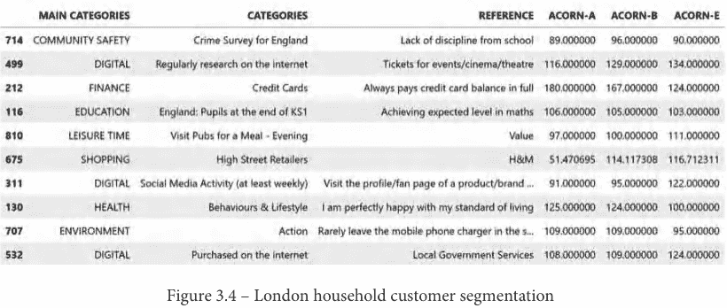

### 准备目标时间序列数据集

由于我们使用的能耗数据集与 Amazon Forecast 的任何预定义域都不匹配，因此我们将使用 CUSTOM 域。使用 CUSTOM 域时，Amazon Forecast 期望 CSV 文件包含以下字段：

- `timestamp`：能耗数据以 30 分钟为粒度提供。我们将对该数据集进行重采样，使其变为每日数据。
- `item_id`：在本场景中，它对应家庭 ID（MACxxxxxxx 编号）。
- `target_value`：在每个时间戳上与给定家庭（`item_id`）关联的值。这就是我们的用电量（千瓦时）。

准备原始用电数据所需的不同步骤如下：

1. 读取 `informations_households.csv` 文件，仅保留与特定客户细分关联的家庭 ID（Acorn 字段必须不是 ACORN-U，ACORN-U 表示*未知*细分）。我们确实希望在元数据数据集中利用部分 Acorn 细分数据。
2. 遍历每个选中的家庭 ID，打开关联的 `block_XX.csv` 文件（位于 `halfhourly_dataset.zip` 压缩包内），并整合出一个*能源数据框*，其中包含每个家庭在可用时间段内的能耗数据。
3. 将能源数据框重采样为一天粒度（原始数据为 30 分钟粒度）。我们稍后使用的相关数据集是一小时粒度，而 Amazon Forecast 要求两个数据集具有相同的基础频率。我们还会将相关数据集重采样为一天粒度，以确保能耗数据频率与伦敦天气数据一致。
4. 将分析范围限制在 2012-07-01 至 2013-06-30（一整年的数据）：这将减少训练时间以及你想在数据集上运行的任何处理或可视化工作耗时。这还会留出从 2013-07-01 到可用时间结束（2014-02-28）的整段数据，作为我们的模型从未见过的测试数据集。

> 深入探索……
> 作为练习，你可以使用完整数据集（而不是一年数据）运行本教程，并比较在训练集中加入更多历史数据后预测性能如何变化。你还可以选择更细的粒度，最小到一小时。

最终数据集是一个 CSV 文件，结构如下：

| 索引 | item_id | timestamp | target_value |
|---:|---|---:|---:|
| 0 | MAC000003 | 2012-07-01 | 12.359 |
| 1 | MAC000003 | 2012-07-02 | 12.775 |
| 2 | MAC000003 | 2012-07-03 | 11.584 |
| 3 | MAC000003 | 2012-07-04 | 12.700 |
| 4 | MAC000003 | 2012-07-05 | 13.724 |
| ... | ... | ... | ... |
| 1301432 | MAC005562 | 2013-06-26 | 7.466 |
| 1301433 | MAC005562 | 2013-06-27 | 10.738 |
| 1301434 | MAC005562 | 2013-06-28 | 11.128 |
| 1301435 | MAC005562 | 2013-06-29 | 9.363 |
| 1301436 | MAC005562 | 2013-06-30 | 9.491 |

*图 3.5 – 准备好的目标时间序列数据集*

每个家庭都对应一个 item_id 值，其时间范围在 2012-07-01 至 2013-06-30 之间。目标值对应实际消耗的能源。


没有额外的预测 **属性** 可用。对能源供应商而言感兴趣的属性可能是每个家庭的邮政编码：由于多个家庭共享相同的邮政编码，这将允许在项目级别请求预测（为每个家庭获取预测）或在此聚合级别获取预测（在邮政编码级别获取能源消耗预测）。

## 准备相关时间序列数据集

在相关时间序列数据集中，我们将定位我们的天气数据（参见之前的 *图 3.3 – 伦敦天气数据摘录*）。出于能源消耗预测目的，我们将保留以下字段：温度、风速和湿度。

由于我们选择了 **CUSTOM** 域，Amazon Forecast 对相关时间序列的预期模式将包含以下字段：`item_id`、`timestamp`、`temperature`、`wind_speed` 和 `humidity`。

> **重要说明**
> 
> *每个 item_id 必须拥有自己的相关时间序列。* 例如，必须为每个时间戳提供家庭 **MAC002543** 的温度，并且必须由家庭 **MAC005556** 提供另一组温度。在实际情况中，这些温度可能略有不同，因为每个家庭可能根据其位置关联到不同的气象站。在本教程中，我们将复制相同的数据并简化问题，假设只有一个气象站覆盖整个伦敦大都市区。

在提取感兴趣的特征并为每个家庭复制它们之后，最终的相关时间序列数据集将如下所示：

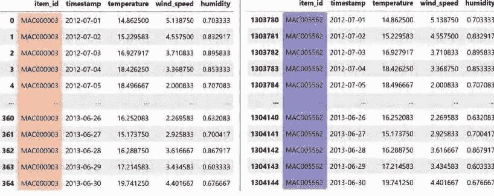

图 3.6 – 已准备好的相关时间序列数据集

如预期，前述图示显示了每个天气时间序列如何为每个家庭重复：在此图的左侧，您可以看到可链接到 **MAC000003** 家庭的相关时间序列数据的摘录，右侧则可以看到链接到 **MAC005562** 家庭的数据。

> **重要说明**
> 
> 目标数据集中的所有项目都必须包含在相关时间序列数据中。在我们的案例中，这意味着目标时间序列中存在的每个家庭都必须拥有自己的相关时间序列集。如果不是这样，则在此数据集组上训练的任何模型 *仅会基于同时存在于两个数据集中的家庭构建*。

## 准备项目元数据数据集

项目元数据数据集是可选的。提供时，Amazon Forecast 仅期望此 CSV 文件中存在 `item_id` 字段。您可以自由选择要提供的任何额外列的名称。

`acorn_details.csv` 文件为每个客户细分提供了超过 800 个特征。元数据数据集除了 `item_id` 字段外最多只能包含 9 个字段。在筛选可用类别时，您可能会建立一种直觉，认为其中一些可能与家庭能源消耗有关。一个方法可以是选择与您的直觉相符的类别（或如果您有访问权限，则由主题专家提供！）并将其添加到您的项目元数据数据集中。然后，您可以构建一个有和没有此数据的模型，以评估它们对提供更好的能源消耗预测是否有价值（如果有的话）。

对于本次练习，我们任意保留了以下内容：

- 地理位置：英格兰、北爱尔兰、苏格兰或威尔士。
- 家庭：1、2、3-4 或 5+ 人居住在家庭中。
- 在家工作。

准备元数据所需的步骤如下：

- 1. 从原始的 `acorn_details.csv` 文件中，我们将只保留所需的类别（*家庭规模、地理位置*）并将 *通勤* 类别限制为 *主要在家或从家工作* 细分。
- 2. 我们将家庭 ID 与适当的客户细分（ACORN-{x}）合并。

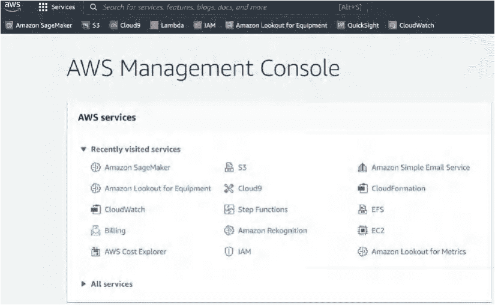

图 3.8 – AWS 控制台主页

- 2. 在控制台的左上角，您将看到一个 **Services** 下拉菜单，其中显示所有可用的 AWS 服务。在 **Storage** 部分，查看 **S3** 服务并点击其名称以进入 S3 控制台。如果您使用的是全新账户，您的存储桶列表可能仍为空。

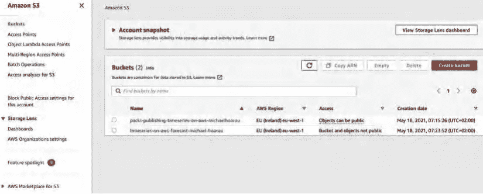

图 3.9 – Amazon S3 控制台登陆页面

- 3. 从这里，您将点击位于存储桶列表部分顶部的 **Create bucket** 按钮。您将被带到存储桶创建页面。

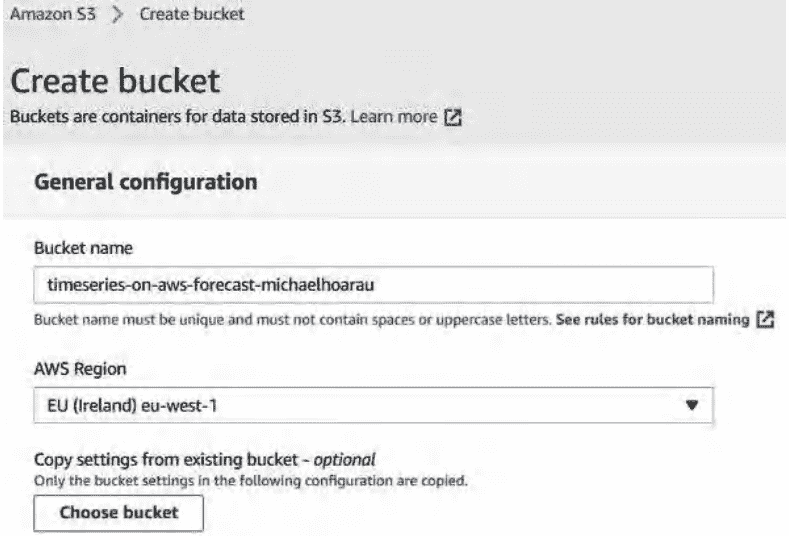

图 3.10 – Amazon S3 存储桶创建表单

- 4. 为您的存储桶选择一个名称。此名称必须在整个 S3 服务中唯一。我将我的命名为 `timeseries-on-aws-forecast-michael-hoarau`。这应该足够唯一。

- 5. 选择 Amazon Forecast 将从中获取您的数据的 AWS 区域。我为我的选择了欧洲（爱尔兰）区域。

> **重要说明**
> 
> 在撰写本书时，Amazon Forecast 仅在以下区域可用：美国东部（弗吉尼亚北部）、美国东部（俄亥俄）、美国西部（俄勒冈）、亚太地区（孟买）、亚太地区（首尔）、亚太地区（新加坡）、亚太地区（悉尼）、亚太地区（东京）、欧洲（法兰克福）和欧洲（爱尔兰）。请确保您选择其中一个区域来创建存储桶，否则您将无法将数据摄取到 Amazon Forecast 中。

6. 您可以将所有其他字段保持为默认值并点击 **Create bucket**。您将被带回 S3 主页，您应该在存储桶列表中看到您新创建的存储桶。窗口顶部会出现一条绿色消息，确认您的存储桶已成功创建。


图 3.11 – Amazon S3 存储桶创建成功消息

您的 Amazon S3 存储桶现已创建，我们可以在此位置开始上传我们的 CSV 文件。

## 将数据集上传到 Amazon S3

要上传数据集，请完成以下步骤：

- 1. 点击您在 S3 主页上出现的存储桶列表中刚刚创建的存储桶的名称：

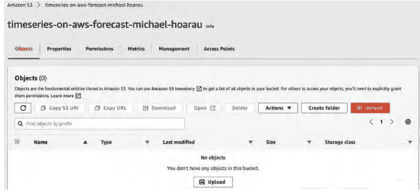

图 3.12 – 来自您新存储桶的 Amazon S3 空对象列表

此页面列出了此存储桶中可用的所有对象：目前为空。

2. 从这里，点击对象列表顶部的 Upload 按钮。您将被带到上传页面，您可以点击 Add files 按钮或将从之前下载的归档中解压的 CSV 文件拖放。

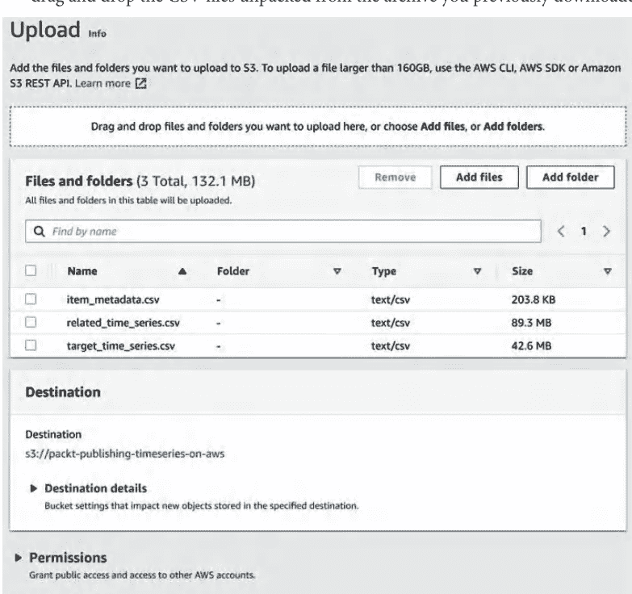

图 3.13 – 在 Amazon S3 上上传能源消耗数据集

3. 将所有其他字段保持为默认值，滚动到屏幕底部，然后点击 Upload 开始上传文件。这些文件总计 132 MB，具体取决于您的互联网上传带宽，可能需要一段时间。传输进行中时会显示上传状态页面。

4. 完成后，您可以点击 Exit 按钮返回到存储桶根目录的对象列表。

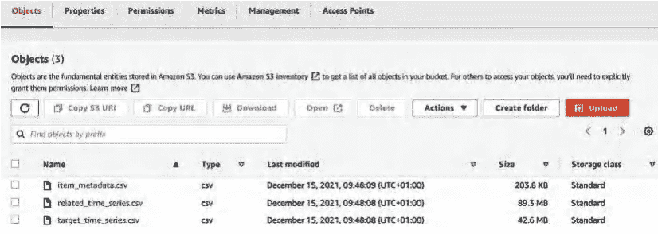

图 3.14 – 能源消耗数据集上传完成

上传完成后，您应该在对象列表中看到三个 CSV 文件，每个数据集类型一个。

- 5. 点击每个数据集名称并复制粘贴其 S3 URI（其在 Amazon S3 中的地址）。

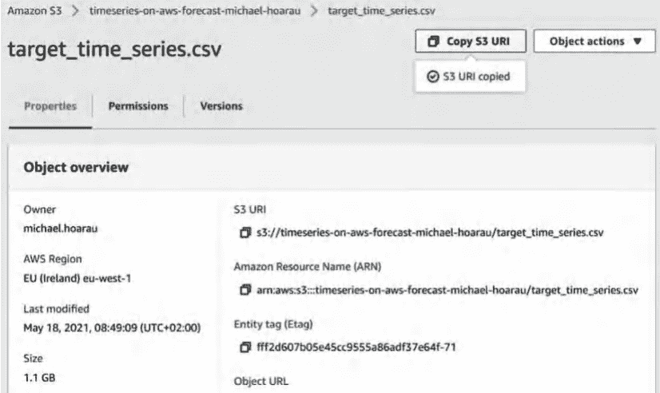

图 3.15 – 能源消耗数据集 S3 URI

在我们的案例中，Amazon S3 中对象的 S3 URI 采用以下格式：

```
s3://BUCKET_NAME/FILENAME
```

- 5. 在最后一个部分（**Select your use case**），选择 **Allows Amazon Forecast to access data in S3**。

- 6. 点击 **Next** 按钮，直到到达最后一步（**Review**）：为您的角色提供名称和描述（我将其命名为 `AmazonForecastEnergyConsumption`）。

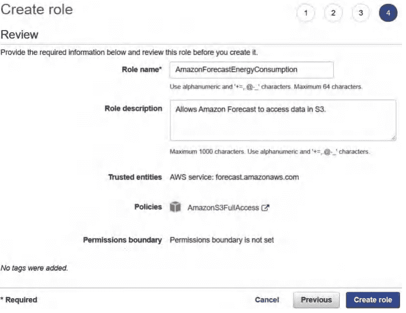

*图 3.17 – IAM 角色创建 – Review 步骤*

- 7. 点击 **Create role**：您的角色已创建，您将看到角色的摘要。在此屏幕顶部，您将看到角色 ARN（**Amazon Resource Name**）字段：复制此 ARN 并粘贴到方便的地方。我们在将数据摄取到服务中时需要它。

当 Amazon Forecast 尝试读取您刚刚上传到 S3 的数据集时，它将使用我们刚刚创建的角色向 IAM 请求权限。您现在可以准备将数据集摄取到 Amazon Forecast 中了。


3. 在此页面上，你可以点击屏幕右侧的“查看数据集组”按钮，或者点击左上角的汉堡图标（三条水平线）打开左侧面板，在其中点击“数据集组”。你将进入一个页面，列出你的 AWS 账户中可见的所有数据集组。如果你是第一次使用该服务，列表将是空的。

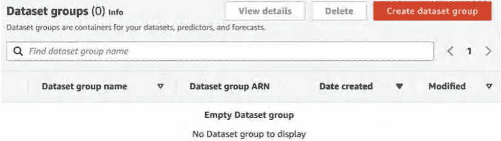

图 3.19 – Amazon Forecast 数据集组列表

4. 点击“创建数据集组”：

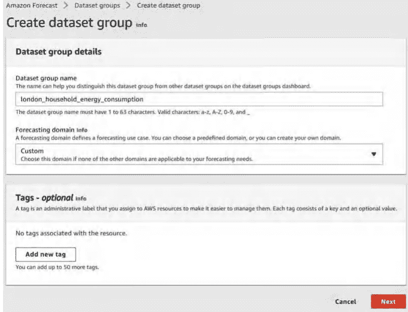

图 3.20 – Amazon Forecast 数据集组创建界面

- 5. 在此屏幕上，你只需为数据集组命名（我们将其命名为 `london_household_energy_consumption`）并选择一个预测域。如前所述，我们将使用 **CUSTOM** 域。请注意，域是在数据集组级别定义的。之后与该数据集组关联的每个数据集都将拥有相同的域：你不能为目标时间序列设置 CUSTOM 域，同时为相关时间序列设置 **RETAIL** 域。

- 6. 然后，点击 **下一步** 创建目标时间序列数据集（这是 **CUSTOM** 域中唯一必需的数据集）。

数据集组将创建完成，你会进入目标时间序列数据摄取界面。

## 将数据导入 Amazon Forecast

我们将逐个摄取这三个数据集，以构建一个完整的数据集组：一个我们要预测的目标数据集、一个相关时间序列数据集，以及一个项目元数据集。

## 摄取目标时间序列数据集

在数据集组创建结束时，你会自动进入目标时间序列数据集创建流程。如果你在数据集组创建后停止了流程，并希望稍后从 Amazon Forecast 主页访问此摄取界面，只需点击你的数据集组名称即可查看此仪表板。

## 仪表板信息

## 概览

## 导入数据

需要数据集来训练预测器，预测器随后用于生成预测。

## 训练预测器

训练预测器，这是 Amazon Forecast 在您的数据集上训练的自定义模型，包含底层基础设施。

## 生成预测

使用训练好的预测器生成预测。

## 探索洞察

探索并识别影响预测的属性。洞察为您的预测提供可解释性。

目标时间序列数据

导入

项目元数据

导入

相关时间序列数据

导入

预测器训练

开始

预测生成

开始

洞察生成

探索洞察

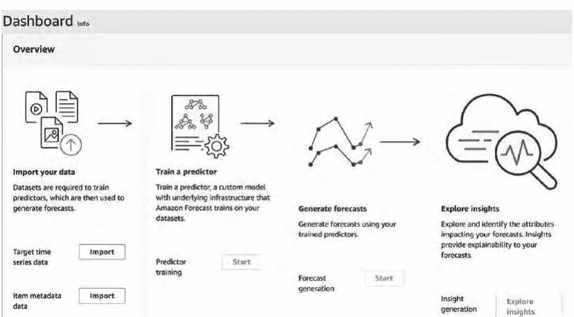

# 图 3.21 – 初始数据集组仪表板

从这里，你可以点击“目标时间序列数据”标签旁边的“导入”按钮。要创建目标时间序列数据集，你需要提供数据集详细信息和导入详细信息。

## 配置数据集详细信息

我们将目标数据集命名为 `energy_consumption_data`，因为它只包含每个家庭的能耗。其余参数如下：

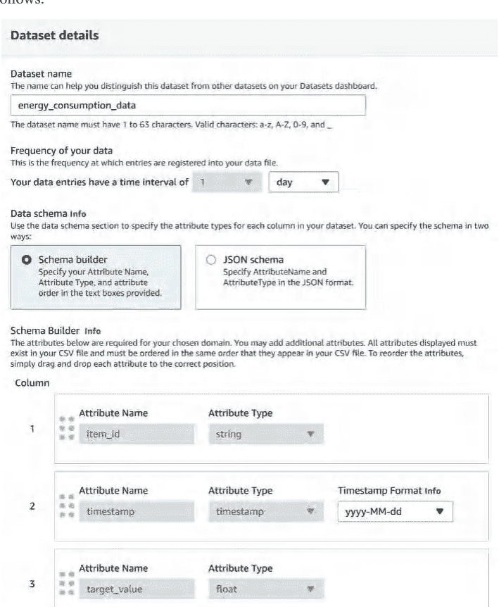

图 3.22 – 目标数据集详细信息

配置数据集时，必须定义以下内容：

- *频率*：数据在文件中的记录频率。频率可以通过两个下拉列表设置，一个定义时间间隔的单位（可以是分钟、小时、天、周、月或年），另一个定义单位数量（仅在选择分钟间隔时适用）。例如，你的时间序列可以每 15 分钟或每月记录一次数据。在我们的案例中，我们选择 1 天。

- *数据模式*：此模式最初会填充你在创建数据集组时选择的域所必需的字段。你只能配置时间戳格式，可以是 `yyyy-MM-dd HH:mm:ss`（示例：`2021-05-19 07:00:00`）或 `yyyy-MM-dd`（`2021-05-19`）。如果你为间隔频率选择了小时或分钟，则必须选择长格式（`yyyy-MM-dd HH:mm:ss`）。对于我们的每日数据集，我们选择 `yyyy-MM-dd`。

在拖放式模式构建器中，你可以使用每个属性名称旁边的拖动手柄重新排列字段。

> **重要说明**
>
> 字段的排列顺序 *必须与* CSV 文件中的顺序 *一致*。

你可以通过点击模式构建器底部的“添加属性”按钮来添加其他属性。每个新属性都需要名称和类型。

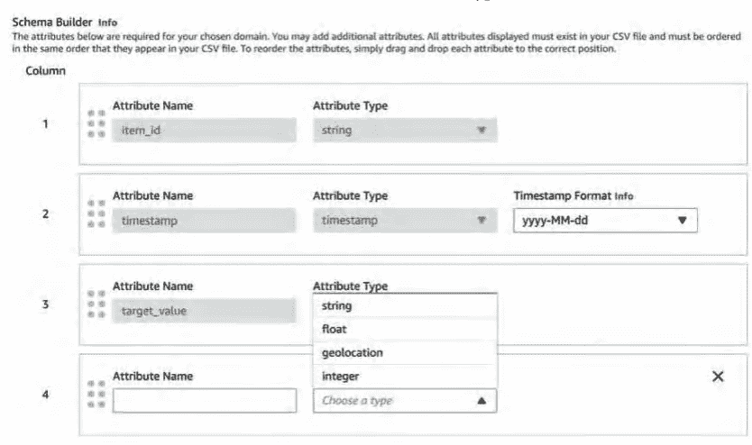

图 3.23 – 使用模式构建器添加属性

属性可以有以下类型：string、float、integer 或 geolocation。
Amazon Forecast 使用地理位置将你的位置与内部天气数据功能进行匹配。在撰写本文时，地理位置属性只能接受欧洲、美国（不包括夏威夷和阿拉斯加）、加拿大、南美和亚太地区的所在地。要获取 Amazon Forecast 支持的最新地理位置列表，你可以参考天气索引文档：

```
https://docs.aws.amazon.com/forecast/latest/dg/weather.html#geolocation-bounds
```

地理位置格式可以是邮政编码（仅限美国地区）或纬度/经度十进制度（适用于所有位置）：

- 邮政编码必须通过指定 `US_#####` 后跟五位邮政编码来输入（`US_98121`）。在撰写本文时，仅支持美国邮政编码。

- 纬度/经度必须是遵循以下格式的字符串：`##.####_##.####`（例如，`47.4922_-2.3639` 用于存储纬度为 47.4922、经度为 -2.3639 的位置）。

作为模式构建器的替代方案，你还可以选择 JSON 模式，并以 JSON 格式指定所有属性（必填和可选属性）。请注意，时间戳格式必须在 JSON 规范下方的独立控件中进行配置。

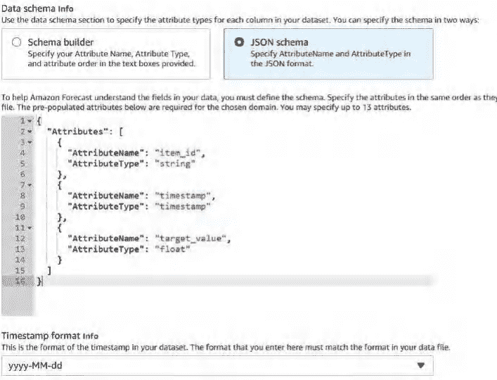

图 3.24 – 以 JSON 格式指定模式

在本教程中，你可以保留模式构建器中的默认值和字段顺序

## 配置数据集导入详细信息

在 **数据集导入详细信息** 界面，你可以填写以下字段：

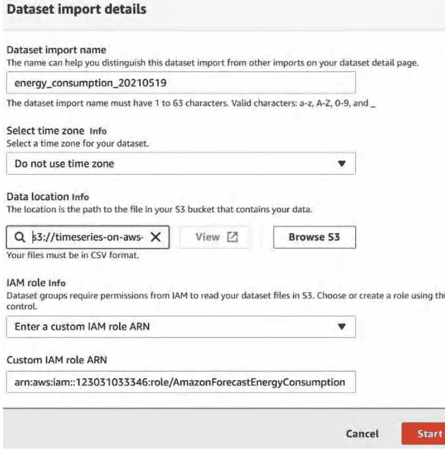

图 3.25 – 指定导入详细信息

你需要执行以下操作：

- 为你的导入提供一个 *名称*。这将帮助你区分不同的导入任务。我们将其命名为 `energy_consumption_20210519`（我添加了一个时间戳，以了解导入时间）。

> **重要说明**
> 请注意，*连续的导入任务不会聚合*：当你使用数据集训练预测器时，只会考虑最近的一次导入。

- 输入你之前将 CSV 文件上传到 Amazon S3 时复制的 *目标时间序列* 的 S3 URI。

- 选择 **输入自定义 IAM 角色 ARN**，并粘贴你之前在 IAM 服务中创建的 `AmazonForecastEnergyConsumption` 角色的 ARN。ARN 的格式应为 `arn:aws:iam::<ACCOUNT-NUMBER>:role/AmazonForecastEnergyConsumption`，其中 `<ACCOUNT-NUMBER>` 需要替换为你的 AWS 账户号码。

完成后，你可以点击 **开始** 来启动摄取流程。你的摄取流程随即开始。

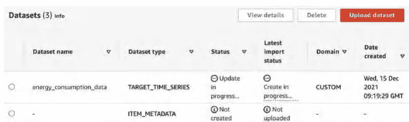

图 3.26 – 目标时间序列摄取正在进行

如果你点击数据集名称，可以查看状态以及预计的剩余摄取时间。如果你犯了错误，并且不想等待流程结束再重新启动，你也可以停止或删除摄取。

## 摄取相关时间序列

让我们回到数据集组仪表板：我们可以看到目标时间序列数据已激活。

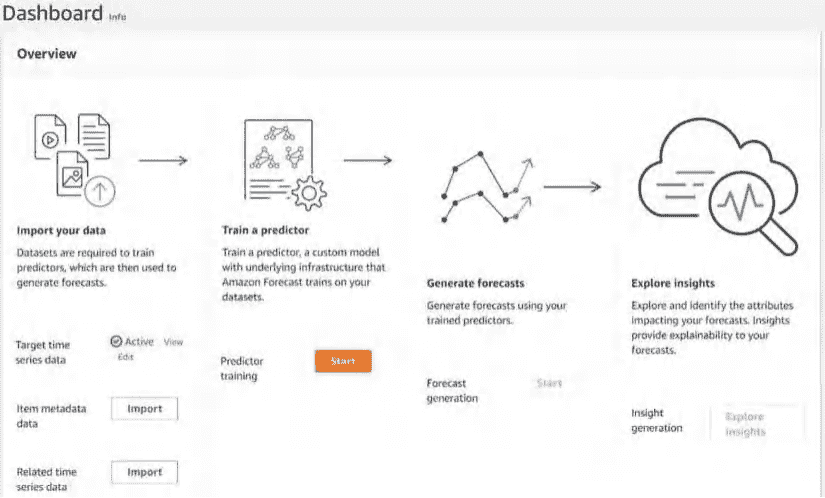

图 3.27 – 目标时间序列已摄取

> **重要说明**
>
> 在你的情况下，数据集摄取可能仍在进行中，但你无需等待一个摄取任务结束即可开始另一个任务。多个摄取任务可以并行运行。

在上一个界面中，你可以点击 **相关时间序列数据** 标签旁边的 **导入** 按钮。要创建相关时间序列数据集，你需要提供与目标时间序列数据集相同的详细信息。我们将使用以下信息进行配置：

- *数据集名称：* `london_weather_data`（因为相关时间序列是天气数据）。
- *数据频率：* 1 天。
- *数据集导入名称：* `london_weather_20210519`。


- **数据位置：** 在此处输入相关时间序列的 S3 URI，该 URI 是你在将 CSV 文件上传到 Amazon S3 时之前复制的。
- **IAM 角色：** 选择 **输入自定义 IAM 角色 ARN** 并粘贴你在 IAM 服务中之前创建的 AmazonForecastEnergyConsumption 角色的 ARN。ARN 的格式应为 `arn:aws:iam::<ACCOUNT-NUMBER>:role/AmazonForecastEnergyConsumption`，其中 `<ACCOUNT-NUMBER>` 需要替换为你的 AWS 账户号码。

在 **Schema Builder** 中，你必须遵守与 CSV 文件中标题相同的顺序。

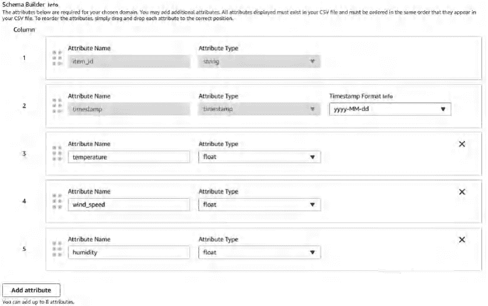

图 3.28 – 相关时间序列架构定义

完成后，你可以点击 **Start** 开始摄取过程。你的摄取过程开始了。

如果点击你的数据集名称，你可以获取状态以及摄取剩余的预计时间。你也有能力停止或删除摄取，如果你犯了错误并且不想等待过程完成后再重新启动它。

## 摄取元数据

让我们回到我们的数据集组仪表板：过了一段时间后，你会看到你的目标和相关时间序列数据集都已激活。

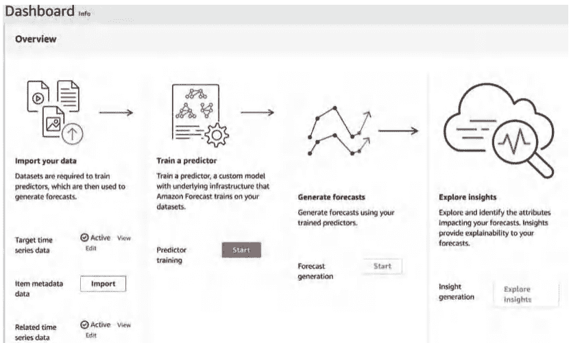

图 3.29 – 目标和相关时间序列已摄取

如前所述，你的可能仍在进行中，但即使如此，你也可以启动一项元数据摄取作业（可以并行运行多个摄取作业）。

从之前的屏幕中，你可以点击 Item metadata 数据标签旁边的 Import 按钮。要创建你的相关时间序列数据集，你需要提供与目标时间序列数据集相同的信息。我们将使用以下信息来配置它：

- *数据集名称：* `household_segment`（因为元数据涉及与每个家庭相关的客户细分）。
- *数据集导入名称：* `household_segment_20210519`。
- *数据位置：* 在此处输入项目元数据的 S3 URI，该 URI 是你在将 CSV 文件上传到 Amazon S3 时之前复制的。

- *IAM 角色：* 选择 **输入自定义 IAM 角色 ARN** 并粘贴你在 IAM 服务中之前创建的 AmazonForecastEnergyConsumption 角色的 ARN。ARN 的格式应为 `arn:aws:iam::<ACCOUNT-NUMBER>:role/AmazonForecastEnergyConsumption`，其中 `<ACCOUNT-NUMBER>` 需要替换为你的 AWS 账户号码。

在 **Schema Builder** 中，你必须遵守与 CSV 文件中标题相同的顺序，并且所有属性类型都将设置为字符串：`geography_england`、`geography_northern_ireland`、`geography_scotland`、`geography_wales`、`family_1_person`、`family_2_persons`、`family_3_4_persons`、`family_5_more_persons`，以及 `transport_work_from_home`。

完成后，你可以点击 **Start** 开始摄取过程。你的摄取过程开始了。

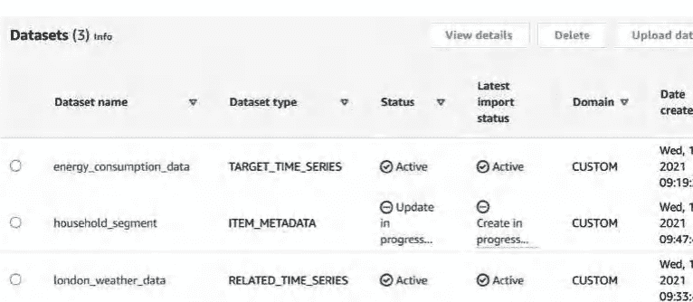

图 3.30 – 元数据摄取进行中

如果点击你的数据集名称，你可以获取状态以及摄取剩余的预计时间。你也有能力停止或删除摄取，如果你犯了错误并且不想等待过程完成后再纠正并重新启动它。

## 背后发生了什么？

你可能想知道在将 CSV 文件摄取到 Amazon Forecast 数据集时背后发生了什么。正如你所注意到的，这个过程比单纯的数据传输花费的时间更长。当你从 Amazon S3 触发摄取时，Amazon Forecast 将代表你执行许多操作，包括以下内容：

- 部署从 S3 传输数据的必要 AWS 基础设施
- 将数据加载到服务中
- 检查数据并修复缺失值
- 如有需要执行时间聚合

某些算法（例如 DeepAR+）还会构建额外的滞后特征：**滞后值** 是来自过去时期的值。例如，如果你的数据具有每小时频率，Amazon Forecast 还会为过去 1、2 和 3 天生成滞后值。如果你的数据具有每日频率，滞后值来自之前的 1、2、3 和 4 周（基本上是过去一个月每周）和前一年。这使 Amazon Forecast 能够更好地捕捉与时间序列频率一致的季节性模式。

作为一名数据科学家，如果你曾经不得不准备稳健的时间序列序列来为诸如 **LSTM 深度学习架构** 之类的循环神经网络提供输入，你知道这个过程有多繁琐、容易出错且耗时。一旦你的数据符合 Amazon Forecast 要求的 CSV 格式，服务就会代表你处理所有这些繁重的工作。

此外，在幕后，Amazon Forecast 还会自动部署（并清理）执行所有这些步骤所需的资源。

## 总结

在本章中，你了解了 Amazon Forecast 在训练模型时需要如何组织数据集。你还对我们将在本部分预测中使用的整个数据集有了良好的理解，并获得了 Amazon Forecast 的首次实践经验，因为你学习了如何创建一个预测项目（在服务术语中称为数据集组）以及如何将你的 CSV 文件摄取到适当的数据集中。你还学习了如何使用一些相关服务，例如 Amazon S3（我们存储 CSV 数据集的地方）和 AWS IAM（我们在其中定义角色以安全地向 Amazon Forecast 授予访问你数据的权限）。

阅读完本章后，你将对 Amazon Forecast 需要的不同数据集的结构方式有良好的理解。我建议你花时间了解服务如何使用每种类型的数据集，以及每个文件实际期望哪些字段。

在下一章中，我们将训练我们的第一个预测器并在伦敦能源消耗数据集上评估其性能。
