## 4 使用 AutoML 训练预测器

## 使用 AutoML 训练预测器

在 *第 3 章，创建项目和摄取你的数据* 中，你学习了如何准备从公共数据源获得的原始数据集并以适合 **Amazon Forecast** 的格式摄取它。此外，你创建了你的第一个预测项目（在服务中称为数据集组）并用三个数据集填充了它。这些数据集包括你想要预测的时间序列本身，以及几个相关时间序列，这些序列直观上将为你要训练的模型提供一些预测能力。

在本章中，你将使用这些已摄取的数据集在 Amazon Forecast 中训练预测模型；该构造称为 **Predictor**。之后，你将学习如何配置训练以及每种配置对训练持续时间和结果质量可能产生的影响。到本章结束时，你还将对评估仪表板有扎实的理解。

在本章中，我们将涵盖以下主要主题：

- 使用你的数据集训练预测器
- Amazon Forecast 如何利用自动化机器学习
- 理解预测器评估仪表板
- 导出和可视化你的预测器回测结果

## 技术要求

跟随本章内容不需要在 **Python** 或 **R** 等语言方面的实践经验。然而，我强烈建议你在连接自己的 AWS 账户并打开 Amazon Forecast 控制台以在你的端运行不同操作的同时阅读本章。

要创建 AWS 账户并登录 Amazon Forecast 控制台，你可以参考第 2 章 *Amazon Forecast 概述* 的 *技术要求* 部分。

## 使用你的数据集训练预测器

到第 3 章 *创建项目和摄取你的数据* 结束时，你已在名为 `london_household_energy_consumption` 的数据集组中摄取了三个数据集，如下所示：

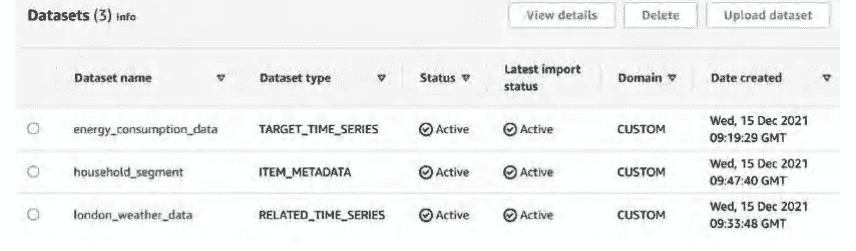


从这里开始，你将使用这三个数据集训练一个预测器。为此，请在 Amazon Forecast 主页上，定位右侧的 **View dataset groups** 按钮并点击它。然后，点击你项目的名称。这将显示你的数据集组的仪表板。从这里，点击 **Predictor training** 标签下的 **Start** 按钮：

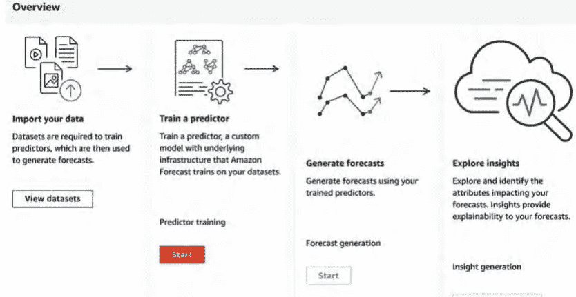

图 4.2 – 伦敦家庭数据集组仪表板

这将带你进入预测器配置屏幕。前两个部分用于预测器的设置：在本章中，你只会修改其中几个参数，而其他参数将在第 5 章《Customizing Your Predictor Training》中进一步探讨：


图 4.3 – 基本预测器设置

供参考，请查看以下截图：

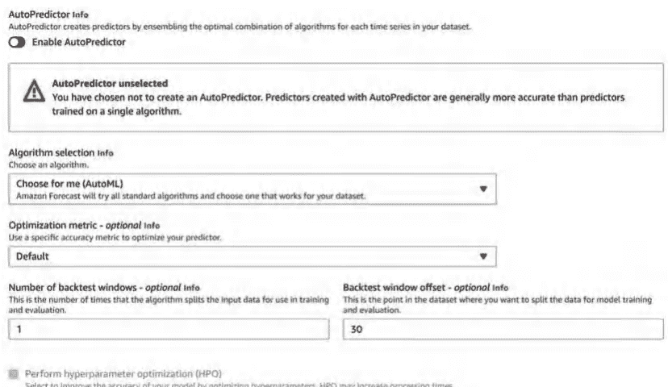

图 4.4 – 基本预测器设置

将所有其他参数保持其默认值，因为你将在第 5 章《Customizing Your Predictor Training》中稍后探索它们。

> **重要说明**
>
> 在撰写本书时，AutoPredictor 选项尚不可用。当时，Amazon Forecast 会对数据集中的所有时间序列应用单一算法。你将在第 5 章《Customizing Your Predictor Training》中发现，当数据集的不同部分具有显著不同的行为时，这可能不是一个好的选择。
>
> 借助 AutoPredictor 选项，Amazon Forecast 现在可以为数据集中的每个时间序列自动组装最佳算法组合。一般来说，这会创建比单一算法更准确的预测器，并且现在已成为配置新预测器时的默认选项。
>
> 另外，在选择 AutoPredictor 路径时，你还可以启用可解释性，以允许 Amazon Forecast 在预测时提供对其所做预测的更多见解。AutoPredictor 还带有内置的重新训练功能，这使得在底层数据集更新时重新训练预测器变得更容易。可解释性功能和重新训练功能均不适用于旧版预测器（使用 AutoPredictor 禁用训练的预测器）。

滚动到预测器创建屏幕底部并点击 **Start** 按钮。你的预测器将开始训练：


图 4.5 – 你的第一个预测器开始训练

你可以在数据集组仪表板上点击 **View predictors** 按钮来检查预测器训练的进度。

随后，Amazon Forecast 会为你提供剩余的预计时间，并允许你在想要更改训练参数或削减训练时间过长的预测器的训练成本时停止训练，如以下截图所示：

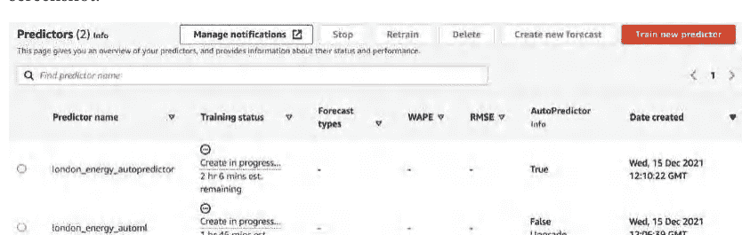

图 4.6 – 预测器训练正在进行中

> **重要说明**
>
> 当你停止训练作业时，预测器不会被删除：你仍然可以预览其元数据。此外，你无法恢复已停止的作业。

另外，你还可以选择将标准预测器升级为 AutoPredictor（你可以在 **AutoPredictor** 列中看到）。

一旦你的预测器训练完成，你的数据集组的 **Predictors** 列表将更新为训练后模型的各项关键特征（例如，预测类型、**WAPE** 指标和 **RMSE** 指标）：

> **重要说明**
>
> 在 AutoML 中运行每个算法时，Amazon Forecast 使用每个算法的默认参数。你将在 *第 5 章《Customizing Your Predictor Training》* 中看到，你可以通过调整其超参数来自定义某些算法，而 AutoML 不提供此选项。你必须在自动模型选择（使用 AutoML）和手动选择算法的超参数优化之间做出选择。

## 了解预测器评估仪表板

当你点击训练模型列表中为你的数据集组提供的预测器名称时，你将获得一个详细的概览屏幕，在此你可以更好地了解模型的品质。该屏幕也作为训练配置的提醒。在本节中，我们将详细查看此屏幕的不同部分，包括以下内容：

- Predictor overview
- Predictor metrics
- Predictor backtest results

### Predictor overview

**Predictor overview** 部分是预测器详情页面的第一个部分：

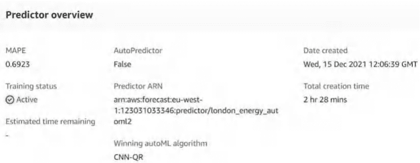

图 4.9 – 结果页面：Predictor overview

你可以在此部分找到三种类型的信息：

- *Training parameters*：这些提醒你预测器是如何训练的。例如，你可以检查训练此特定预测器时 **AutoPredictor** 是否设置为 `True` 或 `False`。
- *Training results*：
  - **MAPE**：**平均绝对百分比误差（MAPE）** 是预测模型（在我们的例子中，MAPE 值为 **0.6923**）的性能指标之一。
  - **Winning AutoML algorithm**：如果 **AutoML** 设置为 `True`，此字段将告诉你哪个底层算法表现更好。**CNN-QR** 是你在 *第 5 章《Customizing Your Predictor Training》* 中将详细了解的六种算法之一。
- *Predictor attributes*：
  - **Predictor ARN**：当你使用 API 并希望精确指向特定预测器时很有用。这是一个唯一标识符（**ARN** 代表 **Amazon Resource Name**）。
  - **Date created**：这是你创建预测器并开始训练过程的日期。
  - **Total creation time**：训练我的预测器花费了 **2 hr 28 mins**。这将在计费周期结束时用于计算我的账单的训练时间。
  - **Estimated time remaining**：**Estimated time remaining** 字段仅在预测器进行中时填充。一旦预测器处于活动状态，此字段将变为空。

> **重要说明**
>
> 为了训练预测器，Amazon Forecast 会配置并使用被认为有必要在合理时间内交付结果的资源。在此训练期间，可能会并行使用多个计算实例：训练时间将乘以此实例数量以计算训练的总成本。

### Predictor metrics

预测器页面上的下一个感兴趣的部分是 **Predictor metrics**。此部分显示每个回测窗口和每个算法的预测器指标。当预测器使用 AutoML 训练时，默认情况下部分会以获胜算法的结果打开（在我们的例子中为 **CNN-QR**）：

#### Predictor metrics info

CNN-QR (Winner) ▼ Export backtest results

| Metric | Value |
|---|---|
| Weighted Absolute Percentage Error (WAPE) | 0.2256 |
| Root Mean Squared Error (RMSE) | 3.2962 |
| Mean Absolute Percentage Error (MAPE) | 0.6923 |
| Mean Absolute Scaled Error (MASE) | 3.7655 |

#### Weighted quantile loss values (wQL)

| Average wQL | wQL[0.1] | wQL[0.5] | wQL[0.9] |
|---|---|---|---|
| 0.1477 | 0.0991 | 0.2256 | 0.1185 |

图 4.10 – 结果页面：算法指标

使用此部分右上角的下拉菜单，你可以选择要查看结果的算法。如前所述，我们的预测器对每个算法获得了以下结果：

| Algorithm | wQL[0.1] | wQL[0.5] | wQL[0.9] | WAPE | RMSE |
|---|---|---|---|---|---|
| CNN-QR (Winner) | 0.0993 | 0.2254 | 0.1183 | 0.2254 | 3.2904 |
| Deep_AR_Plus | 0.1100 | 0.2353 | 0.1253 | 0.2364 | 3.4374 |
| ARIMA | 0.1196 | 0.2456 | 0.1430 | 0.2456 | 3.6026 |
| Prophet | 0.1243 | 0.2636 | 0.1305 | 0.2617 | 3.8997 |
| NPTS | 0.1107 | 0.3329 | 0.1813 | 0.3618 | 5.1994 |
| ETS | 0.1636 | 0.2856 | 0.2084 | 0.2865 | 4.6343 |

图 4.11 – 比较算法指标

当 AutoML 启用时，Amazon Forecast 会选择在每种预测类型下提供最佳平均 wQL 值的算法（当你使用默认分位数时，这些为 0.1、0.5 和 0.9）。在上表中，CNN-QR 的平均 wQL 值为：

```
(0.0993 + 0.2254 + 0.1183) / 3 = 0.1477
```

第二好的算法是 Deep_AR_Plus，其平均 wQL 值为：

```
(0.1100 + 0.2353 + 0.1253) / 3 = 0.1569
```

那么，这些指标是如何计算的？如何解读它们？如何知道一个值是否好？要了解有关指标的更多详细信息，请前往第 7 章《Improving and Scaling Your Forecast Strategy》。你将找到一个专门的章节，详细说明这些指标的来龙去脉以及如何使用它们。


请注意，针对几个 `item_id` 时间序列可视化预测值及相关指标，对于把握全局并补充上述高层次聚合分析至关重要。在下一节中，我们将导出实际的回测结果，并为几个家庭绘制图表。

## 导出并可视化预测器的回测结果

在本节中，你将探索如何通过导出和可视化回测结果，来了解你所训练预测器的性能表现。我首先会解释什么是回测，然后展示如何导出并可视化与预测器相关的结果。

在 **Predictor metrics** 部分，你可能已经注意到该部分右上角有一个 **Export backtest results** 按钮，如下图所示：

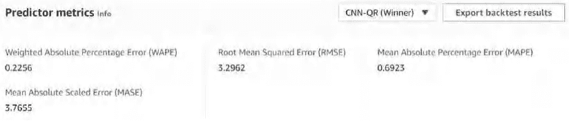

图 4.12 – 结果页面：预测器指标

在点击此按钮之前，让我们先在下一节中定义什么是**回测**。

## 什么是回测？

回测是一种用于面向时间序列的机器学习技术，用于在训练期间调整模型参数并生成准确度指标。为了执行回测，Amazon Forecast 会将你提供的数据拆分为两个数据集：

- **训练数据集**，用于训练模型
- **测试数据集**，用于对测试集内的数据点生成预测

然后，Amazon Forecast 通过比较测试集中预测值与实际值的接近程度，计算前面提到的各种准确度指标。在下图中，你可以看到单个回测窗口是如何定义的：

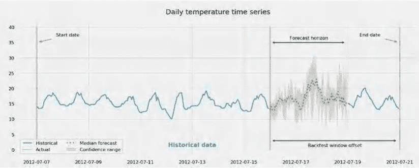

图 4.13 – 定义回测窗口长度

在上图中，你可以看到 Amazon Forecast 如何拆分你的数据集，以从历史数据中构建训练数据集，并从预测视界内的数据中构建测试数据集。请注意，在上图中，预测视界比回测窗口宽度短：回测窗口宽度用于定义预测视界起始的时间分割点。在这种情况下，只有回测窗口内的一部分数据被用来构建测试数据集。如果你希望测试数据集尽可能多地利用数据，则必须将回测窗口宽度设置为等于预测视界（这也是 Amazon Forecast 建议的默认值）。

为了训练你的第一个预测器，我们将回测参数保留为默认值。具体如下：

- *回测窗口数量*为 1。
- *回测窗口长度*等于预测视界。如果你记得清楚的话，我们选择了 30 天的视界，因此默认回测窗口长度也设置为 30。你可以调整此值，让 Amazon Forecast 使用比预测视界更大的回测窗口。但是，回测窗口长度不能小于所请求的预测视界。

在*第 5 章，自定义预测器训练*中，你将学习如何调整这些参数以提高预测准确度。

## 导出回测结果

现在，让我们点击 **Export backtest results** 按钮。你将进入以下 **Export details** 界面：

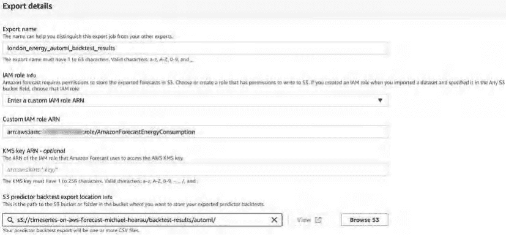

图 4.14 – 回测结果的导出详情

> **重要说明**
> 
> 在 AutoML 模式下，回测结果仅适用于获胜算法。

如上面的截图所示，你需要填写以下参数：

- **Export name：** `london_energy_automl_backtest_results`
- **IAM role：** 选择 **Enter a custom IAM role ARN**，并粘贴你在*第 3 章，创建项目并导入数据*中于 IAM 服务里创建的 `AmazonForecastEnergyConsumption` 角色的 ARN。提醒一下，ARN 的格式应为`arn:aws:iam::<ACCOUNT-NUMBER>:role/AmazonForecastEnergyConsumption`，其中 `<ACCOUNT-NUMBER>` 需要替换为你的 AWS 账号 ID。
- **S3 predictor backtest export location：** 我们将结果导出到与存放待导入数据集相同的位置。填写以下 S3 URL：`s3://<BUCKET>/backtest-results/automl/`。其中，`<BUCKET>` 应替换为你在*第 3 章，创建项目并导入数据*中创建的存储桶名称。我的存储桶名为 `timeseries-on-aws-forecast-michael-hoarau`，我希望导出回测结果的完整 URL 将是 `s3://timeseries-on-aws-forecast-michael-hoarau/backtest-results/automl/`。

点击 **Start** 按钮以启动回测结果导出。窗口顶部会出现一条蓝色横幅，提示你预测器回测导出正在进行中。此过程最长可能需要 15 到 20 分钟，之后我们可以前往 Amazon S3 控制台收集结果。

在 AWS 控制台的左上角，你会看到一个 **Services** 下拉菜单，其中显示所有可用的 AWS 服务。在 **Storage** 部分中，找到 **S3** 服务并点击其名称以导航至 S3 控制台。点击你上传数据集所用的存储桶名称以查看其内容：

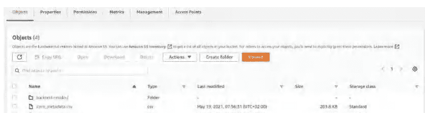

图 4.15 – Amazon S3 上的回测结果位置

在此界面上，你会看到一个 `backtest-results/` 文件夹。点击它，然后点击 `automl` 文件夹名称。在此文件夹中，你会找到一个 `accuracy-metrics-values` 文件夹和一个 `forecasted-values` 文件夹。

接下来，我们将查看这两个文件夹中的内容。

## 回测预测概览

在 backtest-results/ 文件夹的 S3 列表中，点击 forecasted-values/ 文件夹。你会进入一个包含多个 CSV 文件的目录：

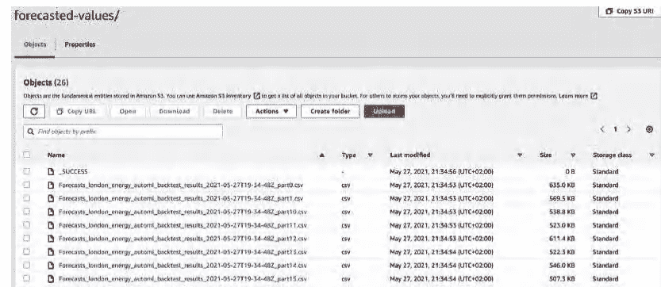

图 4.16 – 存储在 Amazon S3 上的回测预测结果

每个 CSV 文件的名称都遵循以下模式：

```
Forecasts_<export_name>_<yyyy-mm-ddTHH-MM-SSZ>_part<NN>
```

这里，export_name 是你为回测导出作业选择的标签，后跟时间戳标签（导出生成的时间）和部分编号标签。

每个 CSV 文件都包含一部分 item_id（在我们的案例中对应的是家庭 ID）的回测结果。在我们使用的数据集中，有略多于 3500 个家庭，Amazon Forecast 生成了 25 个文件（从 part0 到 part24），每个文件包含大约 140 个家庭的回测结果。

点击第一个 CSV 文件旁边的复选框，然后点击 **Download**。此操作会将 CSV 文件下载到本地，你可以使用 Excel 等任何电子表格软件打开它，或使用你喜欢的编程语言处理它。我将用 Excel 打开此文件，并为几个家庭绘制这些文件中可用的不同时间序列。点击以下链接下载我的 Excel 文件并跟随我的分析：https://packt-publishing-timeseries-on-aws-michaelhoarau.s3-eu-west-1.amazonaws.com/part1-amazon-forecast/london_energy_automl_backtest_results.xlsx

原始数据位于第一个选项卡（raw）中，如下所示：

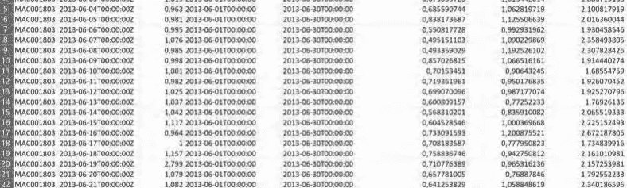

图 4.17 – 回测结果的原始数据

Amazon Forecast 生成的不同列如下：

- item_id：此列包含每个家庭的 ID。
- timestamp：对于每个家庭，数据点数量与回测窗口长度相同（如预测器训练参数中所配置）。若预测频率为 1 天，回测窗口长度为 30，则最终会有 30 个数据点。这些列中的时间戳将包含每个家庭 30 天的数据。
- target_value：这是已知历史时间序列数据中观测到的实际值。我们的预测会与此值进行比较，以计算模型在给定数据点上的误差。
- backtest_window_start_time 和 backtest_window_end_time：这是回测窗口的开始和结束时间。训练时，你最多可以请求五个回测窗口（我们将在第 5 章，自定义预测器训练的高级配置中介绍）。所有回测窗口的回测结果都将可用。
- p10、p50 和 p90：这些是训练时请求的每种预测类型的值。你最多可以请求五种预测类型，它们都会作为单独的列出现在此文件中。


现在，让我们导航到 Excel 文件的第二个标签页（名为**分析**）：该标签页利用第一个标签页中的原始数据，绘制出在回测窗口获得的预测结果，并与实际数据进行比较：

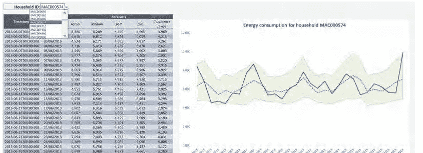

图 4.18 – 回测分析标签页

使用左上角的下拉菜单选择要分析的家庭。该家庭的回测结果会随之更新，右侧的图表也会反映出这一变化。让我们放大查看回测图表：

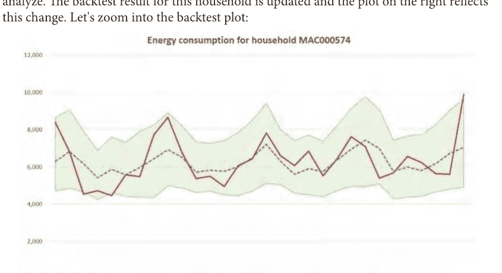

图 4.19 – 回测分析图表

在此图表中，你可以看到三类信息：

- 粗实线表示*实际*能源消耗。
- 虚线表示*预测值*：即中位数预测（也称为预测类型 0.5 或 p50）。这种预测类型估计的值有 50% 的时间低于观测值。
- *80% 置信区间*以中位数预测周围的阴影区域表示。该置信区间的下界是 p10 预测（实际值预计有 10% 的时间低于该值），上界是 p90 预测（实际值预计有 90% 的时间低于该值）。

你可以自由地进一步探索，选择不同的家庭，查看回测结果是什么样的。

## 回测精度概览

在 `backtest-results/` 文件夹的 S3 列表中，点击 `accuracy-metrics-values/` 文件夹。你将进入一个目录，其中包含一系列 CSV 文件，文件名遵循以下模式：`Accuracy_<export_name>_<yyyy-mm-dd'T'HH-MM-SSZ>_part<NN>`。其中，`export_name` 是你为回测导出作业指定的名称标签，后面跟着时间戳标签（导出生成的时间）和部分编号标签：

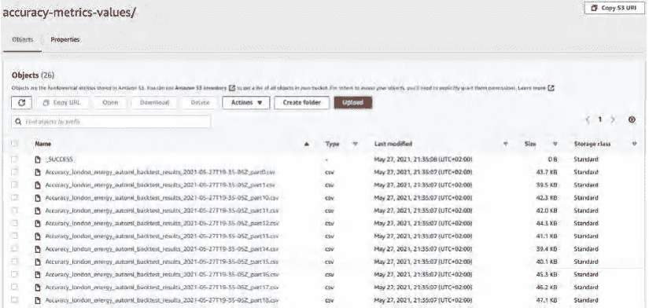

图 4.20 – 存储在 Amazon S3 上的回测精度结果

对于每条 item_id 时间序列，你会找到针对以下内容计算的指标：

- 每个回测窗口（我们最多可以有五个，这将在此文件中为每条 item_id 时间序列生成五行）
- 汇总（这是所有请求的回测窗口的平均值，即上图中灰色的区域）

为每个家庭计算的指标与控制台中显示的相同：每种预测类型的加权分位数（如果你保留了默认参数，则为 wQL [0.1]、wQL [0.5] 和 wQL [0.9]）、RMSE 和 WAPE。

## 本章小结

恭喜！在本章中，你使用 Amazon Forecast 训练了你的第一个预测器。你学会了如何使用默认训练参数配置预测器，并深入掌握了如何通过 wQL、WAPE 或 RMSE 等不同指标来评估训练好的预测器。此外，你还学会了如何下载训练模型的评估结果，以便使用你最喜欢的电子表格工具精细分析预测器的结果。

在下一章中，你将学习如何利用 Amazon Forecast 提供的所有灵活性来定制和进一步增强你的预测器，以更好地适应你的数据。

## 技术要求

阅读本章内容不需要具备 **Python** 或 **R** 等语言的实操经验。但是，我们强烈建议你在阅读本章时，登录你自己的 **Amazon Web Services (AWS)** 账户并打开 Amazon Forecast 控制台，以便在你自己的环境中执行各种操作。

要创建 AWS 账户并登录 Amazon Forecast 控制台，你可以参阅*第 2 章：Amazon Forecast 概述*中的*技术要求*一节。

本章内容假设你已经有一个已摄取并准备好用于训练新预测器的数据集。如果没有，我建议你按照*第 3 章：创建项目并摄取数据*中描述的详细流程进行操作。你将需要三个数据集的 **Simple Storage Service (S3)** 位置，格式如下（将 `<YOUR_BUCKET>` 替换为你选择的存储桶名称）：

- **目标时间序列**：`s3://<YOUR_BUCKET>/target_time_series.csv`
- **相关时间序列**：`s3://<YOUR_BUCKET>/related_time_series.csv`
- **项目元数据**：`s3://<YOUR_BUCKET>/item_metadata.csv`

你还需要创建 **Identity and Access Management (IAM)** 角色，以便让 Amazon Forecast 从 Amazon S3 访问你的数据。该角色的唯一 **Amazon Resource Name (ARN)** 应具有以下格式：`arn:aws:iam::<ACCOUNT-NUMBER>:role/AmazonForecastEnergyConsumption`。在这里，你需要将 `<ACCOUNT-NUMBER>` 替换为你的 AWS 账户编号。

有了这些信息，你现在就可以深入了解 Amazon Forecast 提供的更高级功能了。

## 选择算法并配置训练参数

在*第 4 章：使用 AutoML 训练预测器*中，我们让 Amazon Forecast 替我们做出所有选择，并将所有参数保留为默认值，包括算法的选择。当你采用这种方式时，Amazon Forecast 会在你的数据集上应用它所知道的所有算法，并通过查看哪种算法在你的回测窗口中取得最佳的平均**加权绝对百分比误差（WAPE）**指标来选择获胜者（如果你保留了要使用的优化指标的默认选择）。

在撰写本章时，Amazon Forecast 已知晓六种算法。当你对哪种算法能在你的数据集上产生最佳结果没有明确想法时，AutoML 过程非常有用。AutoPredictor 设置还为你提供了灵活性，可以轻松尝试**集成**技术，让 Amazon Forecast 为数据集中的每条时间序列设计出最佳的算法组合。然而，这两个过程都可能相当耗时，因为它们实际上会训练和评估多达六个模型，最终只选择一个算法（对于 AutoML）或为每条时间序列选择这些算法的组合（对于 AutoPredictor）。

一旦你对 Amazon Forecast 有了一些经验，你可能希望缩短这种训练时间（这将为你节省时间和训练成本），并直接从服务中可用的算法中选择正确的算法。

当你打开 Amazon Forecast 控制台创建新的预测器并禁用 AutoPredictor 设置时，你会在**算法选择**下拉菜单中看到以下选项：

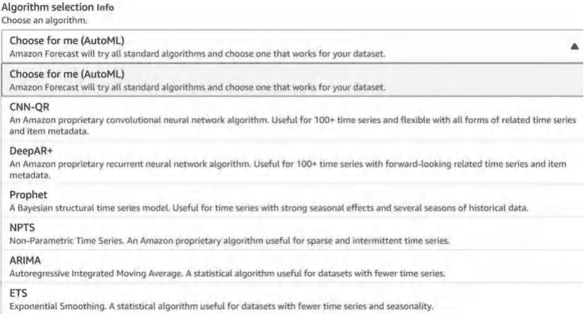

图 5.1 – 手动选择算法

在本章中，我们将深入探讨以下每种算法：

- **指数平滑（ETS）**
- **自回归积分滑动平均（ARIMA）**
- **非参数时间序列（NPTS）**
- **Prophet**
- **DeepAR+**
- **卷积神经网络-分位数回归（CNN-QR）**

对于每一种算法，我都会提供一些理论背景，帮助你理解这些算法最擅长捕捉的行为。我还会给出一些提示，说明你的用例何时适合使用某种给定的算法。

## ETS

ETS 代表**误差、趋势和季节性（Error, Trend, and Seasonality）**：ETS 属于统计算法中的指数平滑家族。当时间序列数量较少（少于 100 条）时，这些算法表现良好。

指数平滑背后的思想是使用给定时间序列中所有先前值的加权平均来预测未来值。这种方法通过捕捉最重要的模式，并忽略那些对未来值预测可能不太相关的更细粒度结构或快速变化，来近似给定的时间序列。

Amazon Forecast 的 ETS 实现通过利用多个平滑层来执行指数平滑，同时考虑时间序列数据中的趋势和季节性。

### 理论背景

趋势和季节性成分本质上可以是加法或乘法的：如果我们在冬季多消耗 50% 的电力，那么季节性就是**乘法**的。另一方面，如果我们在黑色星期五多卖出 1,000 本书，那么季节性就是**加法**的。

让我们将 y_t 称为初始时间序列的原始值，并在加法趋势和季节性的情况下分解不同的平滑层，如下所示：

1. 我们首先对时间序列应用**移动平均（MA）**。如果 W 是滚动窗口的宽度，y_t 是时间序列的不同时间步，那么在时间 t 计算的 MA 将给出时间 t+1 的预测值 F_{t+1}，其公式如下：

$$F_{t+1} = MA_t = \frac{y_{t-W+1} + y_{t-W+2} + \cdots + y_{t-1} + y_t}{W}$$


2. MA 步骤对滚动窗口宽度内每个先前的时间步赋予相同的权重（权重）。添加一个平滑常数会使近期值获得更高权重，同时降低窗口宽度选择的影响。让我们称我们的平滑常数为 α：该值介于 0 和 1 之间，将作为一个参数告诉我们的模型我们希望多快地遗忘时间序列的先前值。这也可以称为基线因子，因为它用于建模我们的预测将具有的**基础行为**。在下面的公式中，你会注意到先前的时间步现在是以指数递减的权重进行加权的。时间 t+1 时的预测基线可以从前一时间步的序列水平 Lₜ 推导得出：

**Fₜ₊₁ = Lₜ**
**Lₜ = α yₜ + (1 − α) Lₜ₋₁**
**Fₜ₊₁ = α yₜ + α(1 − α) yₜ₋₁ + α(1 − α)² yₜ₋₂ + …**

3. 当我们的时间序列中存在**趋势成分**时，以上方法效果不佳：为此，我们添加一个趋势平滑参数，通常称为 β，以类似的方式应用于我们序列中相继时间步之间的差值。β 也介于 0 和 1 之间。这就产生了双重指数平滑，且 k 周期后的点预测可以从前一时间步的序列水平和序列斜率 Lₜ 和 Bₜ 两者推导得出，如以下公式所示：

**Fₜ₊ₖ = Lₜ + k · Bₜ**
**Lₜ = α yₜ + (1 − α) · (Lₜ₋₁ + Bₜ₋₁)**
**Bₜ = β · (Lₜ − Lₜ₋₁) + (1 − β) · Bₜ₋₁**

4. 如果我们的信号还包含额外的**高频（HF）**信号，例如**季节性成分**，我们需要添加第三个指数平滑参数，通常称为 γ，并称其为季节性平滑参数（也介于 0 和 1 之间，如 α 和 β）。如果 m 表示用于捕捉我们新的 k 周期后点预测的季节数，则现在可以使用三重指数平滑推导得出，使用前一时间步的序列水平 Lₜ、序列斜率 Bₜ 和季节成分 Sₜ，如下所示：

**Fₜ₊ₖ = Lₜ + k · Bₜ + Sₜ₊ₖ₋ₘ**
**Lₜ = α (yₜ − Sₜ₋ₘ) + (1 − α) · (Lₜ₋₁ + Bₜ₋₁)**
**Bₜ = β · (Lₜ − Lₜ₋₁) + (1 − β) · Bₜ₋₁**
**Sₜ = γ · (yₜ − Lₜ₋₁ + Bₜ₋₁) + (1 − γ) · Sₜ₋ₘ**

5. ETS 算法在时间序列存在趋势时也能够应用**阻尼**参数 φ。在计算多个周期后（换句话说，在预测数个时间步的预测范围时），我们对每个预测期使用历史时间序列末尾确定的相同斜率。对于较长的预测期，这可能显得不现实，我们可能希望随着预测范围的增加而减弱检测到的趋势。考虑到该阻尼参数（严格介于 β 和 1 之间），之前的方程变为以下形式：

**Fₜ₊ₖ** = Lₜ + (1 + φ + ⋯ + φᵏ⁻¹) · Bₜ + Sₜ₊ₖ₋ₘ
**Lₜ** = α(yₜ − Sₜ₋ₘ) + (1 − α) · (Lₜ₋₁ + Bₜ₋₁)
**Bₜ** = β · (Lₜ − Lₜ₋₁) + (1 − β) · Bₜ₋₁
**Sₜ** = γ · (yₜ − Lₜ₋₁ + Bₜ₋₁) + (1 − γ) · Sₜ₋ₘ

## Amazon Forecast 中的实现

当 Amazon Forecast 使用 ETS 训练模型时，它使用 R forecast 包中可用的 ets 函数的默认参数。这意味着所有 ets 参数都会自动估计。此外，Amazon Forecast 还会根据以下标准自动选择模型类型：

- 是否有趋势或季节性
- 趋势和季节性的加性或乘性
- 是否应用阻尼

所有这些选择都对你来说是抽象的：在幕后运行多个模型并选择最佳模型。

Amazon Forecast 将为你的数据集中可用的每个时间序列创建一个局部模型。在我们一直在运行的能源消耗示例中，每个家庭的用电量将作为单个 ETS 模型进行建模。

如果你想更深入地了解不同的指数平滑方法（包括考虑阻尼时方程的细节，以及乘性趋势和季节性），这些参数是如何自动计算的，以及自动选择的是哪种变体，我建议你深入研究 Rob Hyndman 等人的这篇论文：*A state space framework for automatic forecasting using exponential smoothing methods.* 这篇论文的持久链接如下：https://doi.org/10.1016/S0169-2070(01)00110-8。

## ARIMA

与 ETS 一样，ARIMA 是另一种非常知名且灵活的统计预测模型家族。ARIMA 是 ARMA 模型家族的推广，其中 ARMA 用两个多项式描述一个时间序列：一个用于自回归，另一个用于 MA。

尽管所有这些模型家族都涉及输入许多参数并计算系数，但 Amazon Forecast 利用 Comprehensive R Archive Network（CRAN）上可用的 forecast R 包中的 auto.arima 方法。该方法对不同 ARIMA 参数的可能值进行搜索，以识别该家族的最佳模型。

### 理论背景

让我们称 yₜ 为我们初始时间序列的原始值，并按如下方式分解估计 ARIMA 模型所需的各个步骤：

1. 我们首先通过使用差分使时间序列平稳。在统计学中，该变换应用于非平稳时间序列以消除非恒定趋势。在 Amazon Forecast 的 ARIMA 实现中，差分应用于一次（一次差分 yₜ'）或两次（二次差分 yₜ''），这也是模型被称为集成的原因（ARIMA 中的 I 代表 integrated）。公式如下：

yₜ' = yₜ − yₜ₋₁
yₜ'' = yₜ' − yₜ₋₁' = yₜ − 2·yₜ₋₁ + yₜ₋₂

2. 然后我们使用此差分数据构建一个自回归（AR）模型，该模型规定我们的预测线性依赖于先前的时间步和一个随机项。让我们称 Yₜ（大写 Y）为算法集成步骤后获得的差分数据（Yₜ 将为 yₜ' 或 yₜ''，取决于上一步骤中保留的差分阶数）。阶数为 p 的 AR 模型可以写成先前项的函数以及系数 φ₁ 到 φₚ 的一系列，如以下公式所示：

Yₜ = c + εₜ + φ₁Yₜ₋₁ + φ₂Yₜ₋₂ + ⋯ + φₚYₜ₋ₚ

3. 一旦我们有了 AR 模型，我们就使用 MA 模型来捕捉我们的预测对当前和先前随机项值的依赖性。阶数为 q 的 MA 模型可以写成序列均值 μ 的函数以及应用于随机误差项 ε_t 到 ε_{t-q} 的参数 θ₁ 到 θ_q 的列表，如以下公式所示：

$$Y_t = \mu + \varepsilon_t + \theta_1\varepsilon_{t-1} + \cdots + \theta_q\varepsilon_{t-q}$$

4. 将差分后的 AR 模型和 MA 模型结合起来，我们得到 ARIMA 模型的以下估计：

$$Y_t = c + \varepsilon_t + \varphi_1Y_{t-1} + \varphi_2Y_{t-2} + \cdots + \varphi_pY_{t-p} + \theta_1\varepsilon_{t-1} + \cdots + \theta_q\varepsilon_{t-q}$$

## Amazon Forecast 中的实现

当 Amazon Forecast 使用 ETS 训练模型时，它使用 R `forecast` 包中可用的 `arima` 函数的默认参数。Amazon Forecast 还使用 `auto.arima` 方法，该方法对参数空间进行搜索以自动找到你的数据集的最佳 ARIMA 参数。这包括探索以下范围的值：

- 差分次数
- AR 阶数
- MA 阶数

这意味着所有这些 `arima` 参数都会自动估计，并且模型类型也会自动选择：所有这些选择都对你来说是抽象的，因为在幕后运行多个模型，并选择最佳模型。

Amazon Forecast 将为你的数据集中可用的每个时间序列创建一个局部模型。在我们一直在运行的能源消耗示例中，每个家庭的用电量将作为单个 ARIMA 模型进行建模。

如果你想更深入地了解 ARIMA 的自动参数选择，我建议你深入研究 Hyndman 和 Khandakar 的这篇论文：*Automatic Time Series Forecasting: The forecast Package for R*。这篇论文的持久链接如下：https://doi.org/10.18637/jss.v027.i03。


## NPTS

一个简单的预测器是一种算法，它使用过去观察到的值之一作为下一个时间步长的预测，如下所述：

- 一个朴素预测器将紧邻的前一个观测值作为下一个时间步长的预测。
- 一个季节性朴素预测器将过去季节的观测值作为下一个时间步长的预测。

NPTS 属于这种简单预测器的类别。

### 理论背景

正如刚才提到的，NPTS 属于简单预测器的类别。然而，它并不使用固定的时间索引作为最后一个值：相反，它随机采样过去的某个值来生成预测。通过多次采样，NPTS 能够生成一个预测分布，Amazon Forecast 可以用它来计算预测区间。

让我们称 $y_t$ 为我们初始时间序列的原始值，t 的范围从 0 到 T − 1，T 是我们想要交付预测 $\hat{y}_T$ 的时间步，如下所示：

$$\hat{y}_T = y_t$$

而时间索引 t 实际上是从采样分布 $q_T$ 中采样的。NPTS 使用以下采样分布：

$$q_T(t)=\frac{e^{-\alpha|T-t|}}{\sum_{t'=0}^{T-1}e^{-\alpha|T-t'|}}$$

这里，$\alpha$ 是一个核权重超参数，应根据数据进行调整，有助于控制权重衰减的程度。这使得 NPTS 能够以更高的概率采样最近的过去值，而不是遥远过去的观测值。

该超参数可以取 0 到无穷大的值。以下是这些极值含义：

- 当 $\alpha$ 为 0 时，所有权重都是均匀的：这导致了 **气候学预测器**。预测值是从过去中均匀采样的，仅考虑给定时间序列可能取值的统计分布，而不考虑 **当前行为** 的动态影响。
- 如果 $\alpha$ 设置为无穷大，你将得到 **朴素预测器**，它总是预测最后观测到的值。

一旦你为下一步生成了预测，你可以将此预测包含在你的过去数据集中并生成后续预测，同时赋予 NPTS 采样过去预测数据的能力。

如果你想深入了解该算法以及更一般地了解间歇性数据预测，可以深入阅读以下文章：

- *GluonTS: Probabilistic Time Series Models in Python* (https://arxiv.org/pdf/1906.05264.pdf)
- *Intermittent Demand Forecasting with Renewal Processes* (https://arxiv.org/pdf/2010.01550.pdf)

让我们现在看看该算法在 Amazon Forecast 中的实现方式。

### Amazon Forecast 中的实现

以下是 NPTS 算法允许你选择的几个关键参数：

- `context_length`: 这是 NPTS 用于进行预测的过去数据点数量。默认情况下，Amazon Forecast 使用训练范围内的所有点。
- `kernel_type`: 这是用于定义权重以采样过去观测值的方法。此参数可以是 `uniform` 或 `exponential`。默认值是 `exponential`。
- `exp_kernel_weights`: 当你选择 `exponential` 核类型时，你可以指定 α 参数来控制对过去值应用指数衰减的速度。该参数的默认值是 0.01。此参数应始终为正数。
- 你还可以选择仅采样过去的季节，而不是从所有可用观测值中采样。此行为由 `use_seasonal_model` 参数控制，可以设置为 `True`（默认值）或 `False`。

当使用季节性模型时，你还可以通过将 `use_default_time_features` 参数设置为 `True` 来请求 Amazon Forecast 自动提供并使用取决于预测粒度的时间特征。假设，例如，你的数据以小时级提供：如果此参数设置为 `True`，并且你想为下午 3 点给出预测，那么 NPTS 算法将只采样过去也在下午 3 点发生的观测值。

## Prophet

Prophet 是一种预测算法，由 Facebook 于 2017 年 2 月开源。

### 理论背景

Prophet 算法类似于具有四个组成部分的广义加性模型，如下所示：

$$y(t) = g(t) + s(t) + h(t) + \varepsilon_t$$

这里适用以下内容：

- $g(t)$ 是趋势函数：趋势使用分段逻辑增长模型进行建模。Prophet 还允许通过自动变化点选择来改变趋势（例如，每月定义一个变化点）。逻辑增长模型使用容量 $C(t)$（以事件数量衡量的最大市场规模）、增长率 $k$ 和偏移参数 $m$ 定义，如下所示：

  $$g(t) = \frac{C(t)}{1 + e^{-k(t-m)}}$$

- $s(t)$ 表示周期性变化，例如 yearly 或 weekly 季节性分量。如果 $P$ 是你期望时间序列具有的常规周期（$P = 365.25$ 表示 yearly 季节性效应，$P = 7$ 表示 weekly 周期），则可以定义一个近似的任意平滑季节性效应，如下所示：

  $$s(t) = \sum_{n=1}^{N} \left( a_n cos\left(\frac{2\pi n t}{P}\right) + b_n sin\left(\frac{2\pi n t}{P}\right) \right)$$

  默认情况下，Prophet 对 yearly 季节性使用 N = 10，对 weekly 季节性使用 N = 3。

- $h(t)$ 表示假日或更一般地，持续 1 天或多天的非规则事件的影响。当你决定使用假日补充功能时，Amazon Forecast 会将假日列表馈送到此字段（请参阅本章后面包含假日和天气数据的部分）。

- $\varepsilon_t$ 是一个误差项，说明模型未涵盖的所有内容。

如果你想了解更多关于 Prophet 的理论细节，可以阅读 Facebook 发表的原始论文，链接如下：https://peerj.com/preprints/3190/。

### Amazon Forecast 中的实现

Amazon Forecast 使用 Prophet 的 Python 实现中的 Prophet 类，并使用所有默认参数。

Amazon Forecast 将为你的数据集中可用的每个时间序列创建一个本地模型。在我们一直在运行的能源消耗示例中，每个家庭的用电量将作为单个 Prophet 模型进行建模。

如果你想更深入地了解 Prophet 默认参数选择的影响，我建议你阅读以下链接提供的全面 Prophet 文档：`https://facebook.github.io/prophet/`。

## DeepAR+

我们一直在回顾的经典方法——例如 ARIMA、ETS 或 NPTS——为数据集中提供的每个时间序列拟合一个单一模型。然后它们使用这些模型中的每一个为所需的时间序列提供预测。在某些应用中，你可能有数百或数千个并行演变的相似时间序列。这将是电子商务网站上每个产品的销售单位数量或能源供应商服务的每个家庭的用电量的情况。对于这些情况，利用从多个时间序列联合学习全局模型可能提供更准确的预测。这就是 DeepAR+ 所采用的方法。

### 理论背景

DeepAR+ 是一种用于 univariate 时间序列预测的有监督算法。它使用 **循环神经网络 (RNNs)** 和大量时间序列来训练单个全局模型。在训练时，对于摄入目标时间序列数据集的每个时间序列，DeepAR+ 会生成多个序列（时间序列片段），这些序列在原始时间序列中有不同的起点，以提高模型的学习能力。

底层理论细节超出了本书的范围：如果你想了解更多关于 DeepAR 算法的理论细节，可以执行以下操作：

- 你可以前往此 YouTube 视频，了解如何将人工神经网络适应于数据序列（例如时间序列）：`https://www.youtube.com/watch?v=WCUNPb-5EYI`。该视频是关于 ML 和 **人工神经网络 (ANNs)** 的更大课程的一部分。
- 你可以阅读原始发表论文，_DeepAR: Probabilistic Forecasting with Autoregressive Recurrent Networks_ 作者 David Salinas、Valentin Flunkert、Jan Gasthaus，链接如下：`https://arxiv.org/abs/1704.04110`。


- Amazon Forecast 文档中的 DeepAR+ 部分非常详细，并配有大量插图。你可以直接访问此链接：https://docs.aws.amazon.com/forecast/latest/dg/aws-forecast-recipe-deeparplus.html。

## 在 Amazon Forecast 中的实现

以下是 DeepAR+ 算法允许你选择的关键参数：

- `context_length`：这是 DeepAR+ 用于预测的过去数据点数量。通常，该值应等于预测范围。DeepAR+ 会自动从目标时间序列数据中馈入滞后值，因此你的上下文长度可以远小于数据集中存在的季节性。
- `number_of_epochs`：在机器学习中，学习过程会遍历训练数据一定次数。每次遍历称为一个周期（epoch）。`number_of_epochs` 对训练时间有直接影响，其最佳取值取决于数据集大小和 `learning_rate` 参数。
- `likelihood`：Amazon Forecast 生成概率预测并提供分布的分位数。为此，DeepAR+ 根据你的数据行为使用不同的似然函数（可视为“噪声”模型）来估计不确定性。默认值是 Student-T（适用于实值数据或稀疏尖峰数据）。其他可能的值包括 beta（0 到 1 之间的实值）、deterministic-L1（生成点预测而非概率预测）、gaussian（适用于实值数据）、negative-binomial（适用于非负数据，如计数数据）或 piecewise-linear（适用于灵活分布）。

DeepAR+ 还允许你自定义学习参数，具体如下：

- `learning_rate`：在基于机器学习的算法中，学习率用于定义每次迭代时尝试达到损失函数最优值的步长。学习率越大，新学到的信息覆盖过去学习内容的速度就越快。设置学习率需要在以下两者之间进行权衡：移动过快可能会错过模型参数的最优值，移动过慢则会使学习过程过长。DeepAR+ 的默认值为 0.001。
- `max_learning_rate_decays`：机器学习模型的学习可能是非线性的。在过程开始时，你可以更快地探索并保持较高的学习率，而当接近感兴趣的最优值时，可能需要降低学习速度。该参数定义了训练期间学习率将被衰减的次数。默认情况下禁用（0）。例如，如果将此参数设置为 3，并在 100 个周期上训练模型，那么学习率将在第 25、50 和 75 个周期后各衰减一次（共 3 次衰减事件）。
- `learning_rate_decay`：该参数定义了触发衰减时用于乘以当前学习率的因子。此衰减将应用由 `max_learning_rate_decays` 参数定义的次数。默认值为 0.5。在前面的示例中，3 次衰减事件发生在 100 个周期的训练过程中，如果 `learning_rate` 参数从 0.1 开始，那么它将在第 25 个周期后降至 0.05，在第 50 个周期后降至 0.025，在第 75 个周期后降至 0.0125。

模型的架构可以通过以下两个参数进行自定义：

- DeepAR+ 的 RNN 模型的隐藏层可以通过层数（`num_layers`）进行配置，每一层可以包含一定数量的**长短期记忆（LSTM）**单元（`num_cells`）。
- `num_averaged_models`：在给定的训练过程中，DeepAR+ 可能会遇到若干整体性能相近但在单个时间序列层面精度不同的模型。DeepAR+ 可以对不同的模型行为进行平均（集成），以利用多达五个模型的优势。

## CNN-QR

CNN-QR 采用了与 DeepAR+ 类似的方法，它也构建一个全局模型，联合从多个时间序列中学习，以提供更准确的预测。

### 理论背景

CNN-QR 是一个**序列到序列（Seq2Seq）**模型，它使用大量时间序列来训练一个单一的全局模型。简而言之，这种模型测试在给定编码序列条件下，预测能够在多大程度上重构解码序列。它使用分位数解码器来做出多时域概率预测。

基于写作时可用的算法，我扩展了此表，添加了一些其他相关标准。下表根据你的时间序列数据集的特征，总结了你可以利用的最佳算法选项：

| 标准 | CNN-QR | DeepAR+ | Prophet | NPTS | ARIMA | ETS |
|---|---|---|---|---|---|---|
| 接受历史相关时间序列 | ✓ | ✗ | ✗ | ✗ | ✗ | ✗ |
| 接受前瞻性相关时间序列 | ✓ | ✓ | ✓ | ✗ | ✗ | ✗ |
| 接受物品元数据 | ✓ | ✓ | — | ✗ | ✗ | ✗ |
| 接受天气指数 | ✓ | ✓ | ✓ | ✗ | ✗ | ✗ |
| 适用于稀疏数据集 | ✓ | ✓ | ✗ | ✓ | ✗ | ✗ |
| 执行 HPO | ✓ | ✓ | ✗ | ✗ | ✗ | ✗ |
| 允许覆盖默认超参数值 | ✓ | ✓ | ✗ | ✓ | ✗ | ✗ |
| 适用于假设分析 | ✓ | ✓ | ✗ | ✗ | ✗ | ✗ |
| 适用于冷启动场景 | ✓ | ✓ | ✗ | ✗ | ✗ | ✗ |
| 适用于最多 10 个时间序列 | ✗ | ✗ | ✗ | ✓ | ✓ | ✓ |
| 适用于最多 100 个时间序列 | ✗ | ✗ | ✗ | ✓ | ✓ | ✓ |
| 适用于数百个或更多时间序列 | ✓ | ✓ | ✗ | ✗ | ✗ | ✗ |
| 适用于包含 300 个以上数据点的时间序列 | ✓ | ✓ | ✓ | ✓ | ✗ | ✗ |
| 适用于短时间序列（每个时间序列少于 300 个数据点） | ✗ | ✗ | ✓ | ✗ | ✓ | ✓ |
| 局部模型（每个时间序列拟合一个模型） | — | — | ✓ | ✓ | ✓ | ✓ |
| 全局模型 | ✓ | ✓ | — | — | — | — |

图 5.2 – 算法选择速查表

现在，让我们在这个汇总表的基础上进一步深入探讨每种算法的一些具体细节，如下所示：

- **ARIMA、ETS 和 NPTS：** 这些算法的计算强度相当低，可以为你的预测问题提供稳健的基线。
- **ARIMA：** ARIMA 算法的参数不能通过 HPO 过程进行调优，因为 Forecast R 包中的 `auto.arima` 方法会负责识别最合适的参数。
- **NPTS：** Amazon Forecast AutoML 有时会选择 NPTS，即使你明知道它并不是最合适的选择。这是因为你的数据在某种粒度下可能显得稀疏：如果你使用 AutoML 训练预测器，它可能会选择 NPTS，即便你有数百个单独的时间序列，而**深度神经网络（DNN）**能更好地从中学习。要让 AutoML 选择具有更大学习容量的算法，一种方法是以更粗的粒度聚合数据（例如，将每小时数据求和以构建每日数据集）。
- **Prophet：** 该算法非常适合在不同尺度上表现出多种强季节性行为，并且包含较长时间段的数据集（对于小时、日或周数据，最好至少一年）。Prophet 还非常擅长捕捉以不规则间隔发生且事先已知的重要节假日的影响（例如日期不固定的年度体育赛事）。如果你的数据集包含大段缺失值或大量异常值、具有非线性增长趋势，或在接近极限时出现值饱和，那么 Prophet 也是一个极好的选择。

现在，你已经知道如何选择适合业务需求的算法，接下来让我们看看如何自定义每种算法，并覆盖我们在上一章训练第一个预测器时保持默认的参数。

## 利用 HPO

训练机器学习模型是一个寻找参数以帮助模型更好地处理真实数据的过程。当你没有使用 Amazon Forecast 等托管服务来训练自己的模型时，会遇到以下三类参数：

- **模型选择参数：** 这些是你必须固定的参数，以选择最适合数据集的模型。例如，在这一类别中，你会找到 ETS 算法中的 α、β、γ 和 φ 参数。Amazon Forecast 实现了这些算法，以确保对于 ETS 和 ARIMA，自动探索是默认行为，这样你就不必自己为这些参数寻找最佳值。对于其他算法（如 NPTS），Amazon Forecast 提供了良好的默认参数，但你也可以根据对数据集的内在了解灵活地调整它们。
- **系数：** 这些是在模型训练期间拟合到你的数据中的值。这些系数可以是神经网络的权重和偏置，也可以是 ARIMA 的 MA 部分的 θ₁ 到 θ_q 系数。一旦这些值拟合到你的训练数据上，它们的值就定义了你的模型，而这组值构成了 Amazon Forecast 在 `Predictor` 构造中保存的主要工件。
- **超参数：** 这些参数控制学习过程本身。训练**深度学习（DL）**模型的迭代次数（周期）或学习率就是你可以调整以优化训练过程的超参数示例。


## 使用 HPO 训练 CNN-QR 预测器

在本节中，我们将使用*第4章“使用 AutoML 训练预测器”*中找到的优胜算法来训练第二个预测器。提醒一下，优胜算法是 CNN-QR，我们取得了以下性能：

| 评估类型 | 测试窗口开始 | 测试窗口结束 | 项目数 | wQL[0.1] | wQL[0.5] | wQL[0.9] | WAPE | RMSE |
|---|---:|---:|---:|---:|---:|---:|---:|
| 回测窗口 | Sat, 01 Jun 2013 00:00:00 GMT | Mon, 01 Jul 2013 00:00:00 GMT | 3573 | 0.0993 | 0.2254 | 0.1183 | 0.2254 | 3.2904 |

图5.3 – AutoML 下的优胜算法性能

要训练一个新的预测器，请登录 AWS 控制台，导航到 Amazon Forecast 控制台，并点击**查看数据集组**按钮。在那里，你可以点击在*第3章“创建项目并导入数据”*中创建的数据集组的名称。如果你需要提醒如何浏览 Amazon Forecast 控制台，请查阅该章。现在你应该位于数据集组的仪表盘上，接下来点击**训练预测器**按钮，如下面的截图所示：

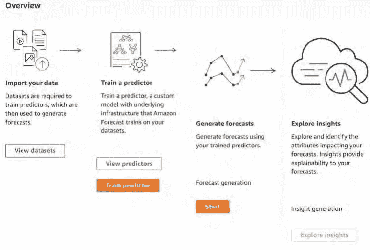

图5.4 – 数据集组初始仪表盘

点击“训练预测器”按钮后，将打开以下屏幕，让你自定义预测器设置：

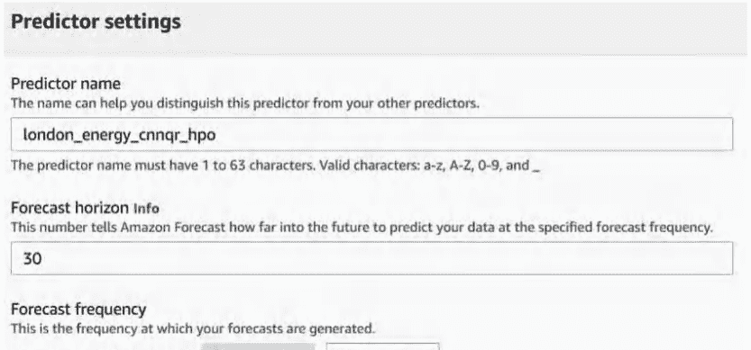

图5.5 – 预测器设置

对于“预测器设置”选项，我们将填写以下参数：

- **预测器名称：** `london_energy_cnnqr_hpo`。
- **预测频率：** 我们将保持与之前相同的频率，这也是导入数据的原始频率。让我们将此参数设置为1天。
- **预测范围：** 30。由于所选的预测频率为1天，这意味着我们希望训练一个模型，使其能够生成未来30天数据点的等效数据。我们想比较初始预测器与这个新预测器的性能，所以让我们保持相同的范围，以使这种比较更有意义。
- **预测分位数：** 将设置保留为默认值，定义三个分位数：0.10、0.50和0.90。我们将在本章后面详细说明此设置。

在下一部分中，禁用 AutoPredictor 切换开关，并在“算法选择”下拉菜单中选择 CNN-QR。

点击“执行超参数优化（HPO）”。出现一个名为“HPO 配置”的新部分，你可以在其中决定希望 Amazon Forecast 为 CNN-QR 的不同可调超参数探索的值范围。此配置必须以 JavaScript 对象表示法（JSON）格式编写。

让我们将以下 JSON 文档输入 **HPO 配置** 小部件：

```json
{
  "ParameterRanges": {
    "IntegerParameterRanges": [
      {
        "MaxValue": 360,
        "MinValue": 60,
        "ScalingType": "Auto",
        "Name": "context_length"
      }
    ]
  }
}
```

通过此配置，我们告诉 Amazon Forecast，我们希望它探索由以下潜在值定义的超参数空间：

- `context_length` 将在 MinValue=60 天和 MaxValue=360 天之间变化。
- HPO 过程还将自动尝试四种不同的*相关数据集*配置：不使用相关数据集（NONE）、使用全部相关数据集（ALL）、仅使用包含历史值的相关数据集（HISTORICAL）、或使用同时包含历史值和未来值的相关数据集（FORWARD_LOOKING）。
- 它还将自动尝试两种不同的*项目元数据*配置：不使用元数据（NONE）或使用全部元数据（ALL）。

在**训练参数**部分，为了便于比较，我们将轮数（epochs）保留为100（与 AutoML 过程使用的默认值相近），如下所示：

```json
{
  "epochs": "100"
  [...]
}
```

将所有其他参数保留为默认值，然后点击**创建**，通过 HPO 过程开始训练我们的新预测器。我们的预测器将以**创建进行中**状态创建，如下图所示：

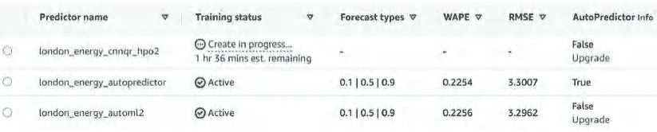

图5.6 – 使用 HPO 进行 CNN-QR 预测器训练（进行中）

一段时间后（就我而言，不到2小时），我们的新预测器训练完成，可以投入使用，如下所示：

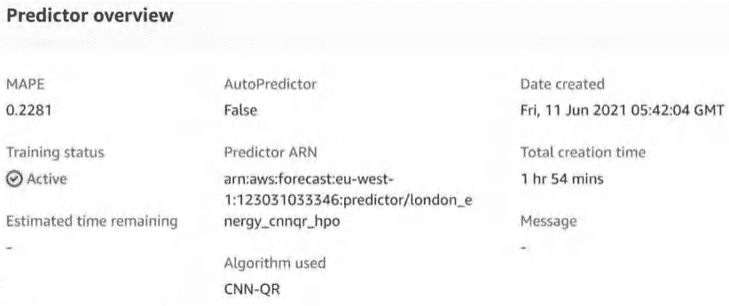

图5.7 – 训练完成的 CNN-QR 预测器

在你的情况下，**平均绝对百分比误差（MAPE）** 指标可能略有不同，但会接近你在这里看到的数字。你可以看到，在我的例子中，我获得的 **MAPE** 值为 **0.2281**，这与 AutoML 过程中获得的值（**0.2254**）极其接近。正如*什么是 HPO？*部分所解释的，这些微小差异源于贝叶斯过程的随机性。

你现在知道如何为预测器训练配置 HPO 了。然而，并非所有算法都可以通过此过程进行微调，也并非所有参数都可以定义为带探索范围的目标。在下一部分中，我们将看看每种算法有哪些选项。

## 通过 HPO 介绍可调超参数

当你知道哪种算法能为你的数据集带来最佳结果时，你可能希望使用 HPO 来确保充分利用该算法。让我们看看每种算法有哪些可行方案，如下所示：

- **ETS**：Amazon Forecast 中不提供 HPO。不过，该服务利用 `forecast` R 包中 `ets` 模块的默认参数；后者有一个名为 `model` 的参数，默认设置为 `ZZZ`。在这种情况下，会自动选择 `model` 参数，以提供性能最佳的 ETS 模型。
- **NPTS**：NPTS 不提供 HPO。要训练不同类型的 NPTS 模型，可以在同一数据集组上使用不同的训练参数训练单独的预测器。
- **ARIMA**：Amazon Forecast 中不提供 HPO。不过，Amazon Forecast 利用 `forecast` R 包中的 `auto.arima` 模块：该包使用自动预测过程来识别产生最佳性能的 ARIMA 参数，并且最终选择的 ARIMA 模型实际上已经过优化。
- **Prophet**：Prophet 不提供 HPO。
- **DeepAR+**：DeepAR+ 提供 HPO，并且在此过程中可以使用和调整以下参数：`context_length` 和 `learning_rate`。
- **CNN-QR**：为此算法选择 HPO 时，将在优化过程中调整以下参数：`context_length`、是否使用**相关时间序列**数据，以及是否使用**项目元数据**。

总之，HPO 是适用于深度学习模型（DeepAR+ 和 CNN-QR）的过程。其他算法无法利用 HPO。既然你已经知道如何覆盖 Amazon Forecast 所用算法的默认超参数，我们将继续了解如何使用更强大的回测策略来提高预测质量。

## 强化你的回测策略

在机器学习中，**回测**是预测中常用的一种技术，用于为学习过程提供两个数据集，如下所示：

- **训练数据集**，模型将在此数据集上进行训练
- **测试数据集**，我们将在此数据集上评估模型在训练阶段未见过的数据上的性能

提醒一下，以下是 Amazon Forecast 中回测的不同要素，如*第4章“使用 AutoML 训练预测器”*所述：

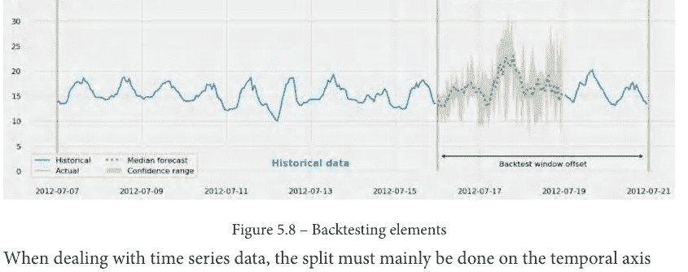

图5.8 – 回测要素

在处理时间序列数据时，切分主要应在时间轴上进行（其次是在项目总体上进行），以防止数据从过去泄漏到未来。这对于使你的模型足够稳健、能够应对实际生产数据至关重要。

默认情况下，当你保持默认参数不变（选择 AutoML 或手动选择算法时），Amazon Forecast 会使用一个长度等于预测范围的回测窗口。然而，提供多个起点以消除预测对预测开始日期的依赖是一种良好做法。当你选择多个回测窗口时，Amazon Forecast 会计算你的模型在每个窗口的评估指标，并取平均值。多个回测窗口还有助于处理每个时期不同水平的变异性，如下所示：

当您希望在不使用 AutoPredictor 设置的情况下创建新预测器时，回测策略的配置将在**预测器设置**部分进行，如下图所示：

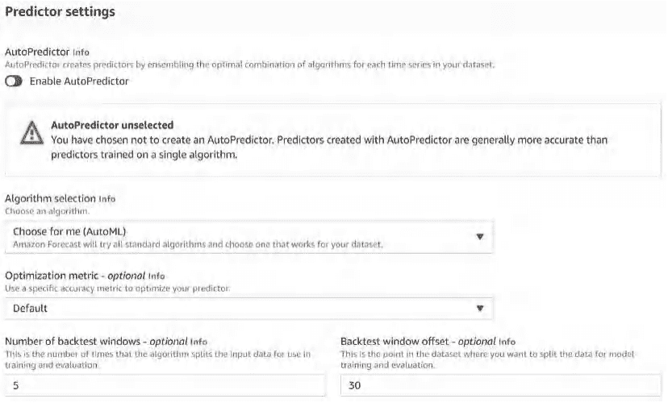

图 5.10 – 新预测器的回测配置

做出算法选择后，您可以从以下选项中进行选择：

- **回测窗口数量：** 此数字范围从 1 到 5。
- **回测窗口偏移量：** 这是窗口的宽度。默认情况下，它等于预测时间范围，并且具有相同的单位。

让我们使用以下参数创建一个新预测器：

- **预测器名称：** `london_energy_cnnqr_backtest`
- **预测时间范围：** 30（天）
- **算法选择：** 手动
- **算法：** CNN–QR
- **回测窗口数量：** 5
- **回测窗口偏移量：** 30

将所有其他参数保留为默认值，并点击**开始**以使用这些设置创建一个新预测器。经过大约一个小时的训练后，您可以查看该新预测器的准确性指标，如下图所示：

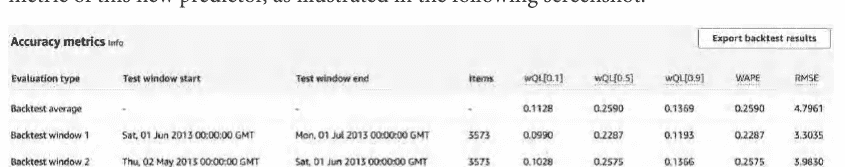

图 5.11 – 回测准确性指标

您会注意到，Amazon Forecast 会为每个回测窗口计算准确性指标，并给出这些指标在五个窗口上的平均值。您可能会注意到指标会因回测窗口的不同而出现一些波动：这可以很好地指示您的时间序列在不同时间范围内的变异性，您可以在这些不同时间段对数据进行更彻底的调查，以尝试理解这些波动的原因。

您现在知道如何自定义回测策略以使训练更加稳健。接下来，我们将了解如何通过添加 Amazon Forecast 提供的特征（即节假日和天气数据）来自定义数据集的特征。

## 包含节假日和天气数据

在撰写本书时，Amazon Forecast 包含两个内置数据集，它们作为工程化特征提供，您可以将其用作**补充特征**：**节假日**和**天气**指数。

### 启用节假日特征

此补充特征包含 66 个国家的国家节假日数据集。您可以在创建新预测器时启用此特征：在预测器创建页面上，向下滚动到可选的“补充特征”部分，然后打开“启用节假日”按钮，如下图所示：

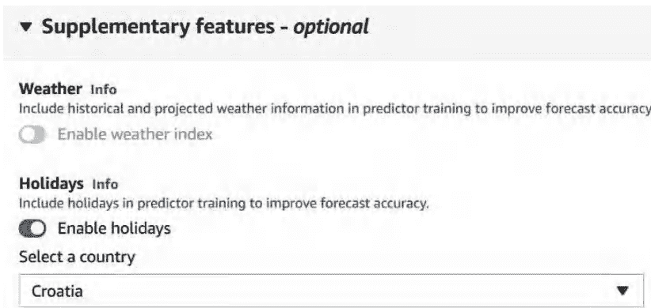

图 5.12 – 启用节假日补充特征

启用后，会出现一个下拉列表，让您选择希望启用节假日的国家。请注意，您只能选择一个国家：您的整个数据集必须属于这个国家。如果您的数据集包含多个国家，并且希望考虑不同的节假日，您必须按国家拆分数据集，并为每个国家训练一个预测器。

选择此参数后，Amazon Forecast 将分别训练包含此参数和不包含此参数的模型：将根据模型的性能指标保留最佳配置。

### 启用天气指数

此补充特征包括覆盖全球 7 个区域的 2 年历史天气数据和 2 周未来天气信息，如下所示：

- 美国（不包括夏威夷和阿拉斯加），纬度范围为 24.6 到 50.0，经度在 -126.0 到 -66.4 之间
- 加拿大，纬度范围为 41.0 到 75.0，经度从 -142.0 到 52.0
- **欧洲**，纬度范围为 34.8 到 71.8，经度从 -12.6 到 44.8
- **南美洲**，纬度范围为 -56.6 到 14.0，经度从 -82.2 到 -33.0
- **中美洲**，纬度范围为 6.8 到 33.20，经度从 -118.80 到 -58.20
- **非洲与中东**，纬度范围为 -35.60 到 43.40，经度从 -18.8 到 58.20
- **亚太地区**，纬度范围为 -47.8 到 55.0，经度从 -67.0 到 180.60

要在 Amazon Forecast 中使用天气数据，您需要执行以下操作：

- 确保您的数据集仅包含属于一个单一区域的数据（例如，您所有的数据都必须与位于欧洲的地点相关联）。如果您的数据包含多个区域，则必须为每个区域创建一个数据集，并为每个区域训练一个预测器。
- 向数据集添加地理定位信息。
- 在创建和摄取目标数据集时包含地理定位属性。
- 创建预测器时选择 AutoPredictor 或 AutoML，或手动选择算法。

### 向数据集添加地理定位信息

一旦您拥有仅包含单一区域（**美国、加拿大、欧洲、中美洲、非洲与中东或南美洲**）数据的数据集，就必须向数据集添加位置特征。此特征可以是以下之一：

- 邮政编码（如果您的位置在美国（US））。该列必须遵循以下格式：US，后跟下划线字符（_），然后跟 5 位邮政编码。例如，US_98121 是一个有效的邮政编码。
- 十进制格式的纬度和经度坐标，两个坐标之间用下划线字符（_）分隔——例如，47.61_-122.33 是一个有效的字符串。如果您输入精度更高的原始值，Amazon Forecast 会将其四舍五入到最接近的 0.2 度。此格式适用于所有区域。

我们的家庭用电量数据集来自伦敦，伦敦的坐标分别为 51.5073509（纬度）和 -0.1277583（经度）。如果我们想向数据集添加天气数据，可以在数据集中添加一列名为 `location` 的列，并为每一行（因为我们所有的住户都位于该城市）将其值设置为 51.5073509_-0.1277583。

### 重要提示

如前所述，天气指数仅适用于过去 2 年。如果您想练习使用此特征，请确保天气数据的可用性与时间序列数据的记录时间兼容。如果您的时间序列数据包含 2018 年 7 月 1 日之前的数据点，`weather_index` 参数将在用户界面（UI）中被禁用。

### 包含地理定位属性

在将目标时间序列数据摄取到数据集组时，您将有机会选择位置类型属性。请按照以下步骤操作：

1. 登录 AWS 管理控制台后，打开 Amazon Forecast 控制台，然后点击“查看数据集组”按钮。
2. 在显示的数据集组列表屏幕上，选择一个空数据集组（或创建一个全新的数据集组：如果您需要有关创建和配置新数据集组的指导，可以参阅第 3 章“创建项目并摄取数据”）。
3. 当您进入数据集组仪表板时，点击“目标时间序列数据”标签旁边的“导入”按钮。您将进入数据摄取向导。
4. 在“架构构建器”部分，点击“添加属性”，将属性命名为 `location`，并为“属性类型”值选择地理定位，如下所示：

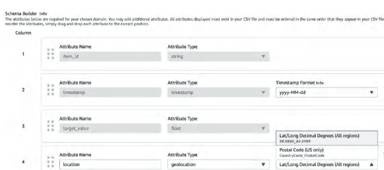

图 5.13 – 使用位置信息摄取数据

5. 对于**地理定位格式**选项，您可以在**纬度/经度十进制度数**或**邮政编码**（如果您的位置数据在美国）之间进行选择。

然后您可以继续摄取过程，如*第 3 章“创建项目并摄取数据”*所述。如果您还有其他数据集，也可以将它们摄取到相关时间序列数据集和项目元数据数据集中。然后，您可以基于此数据集组训练新的预测器。

### 使用天气指数创建预测器

一旦您拥有包含位置信息的数据集组，就可以在基于此数据集创建新预测器时启用**天气**指数特征，如下所示：

1. 在 Amazon Forecast 控制台上，点击**查看数据集组**以显示现有数据集组列表，然后选择一个已摄取包含位置信息的数据集的数据集组。
2. 在导航窗格中，选择**预测器**，然后点击**训练新预测器**。
3. 在预测器创建页面上，向下滚动到可选的**补充特征**部分，然后打开**启用天气指数**按钮，如下图所示：

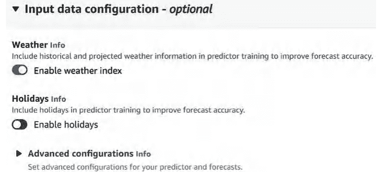

图 5.14 – 启用天气补充特征

当您准备好训练预测器时，点击预测器创建屏幕底部的**创建**按钮，即可开始使用天气数据训练预测器。


选中此参数后，Amazon Forecast 将训练一个包含该参数和不包含该参数的模型：系统会根据模型的性能指标，为每个时间序列保留最佳配置。换句话说，如果在回测期间，向给定时间序列补充天气数据并未提高准确率，Amazon Forecast 将针对该特定时间序列禁用天气特征。

现在你已经清楚地了解如何在预测策略中考虑天气数据和节假日数据。在下一章中，你将看到如何让 Amazon Forecast 对你自己的数据集中的特征进行预处理。

## 实现特征化技术

Amazon Forecast 允许你通过填充缺失值来自定义转换输入数据集的方式。原始数据中存在缺失值是非常常见的，并且会深刻影响预测模型的质量。实际上，每当目标时间序列或相关时间序列数据中缺少一个值时，真实观测值就不可用，因而无法评估历史数据的真实分布。

尽管值缺失的原因可能有很多，但 Amazon Forecast 提供的特征化流程假设你无法基于领域专业知识自行填充这些值，并且缺失值确实存在于你导入服务的原始数据中。例如，如果我们绘制标识符（ID）为 MAC002200 的家庭的能耗图，可以看到数据集末尾有一些值缺失，如下面的截图所示：

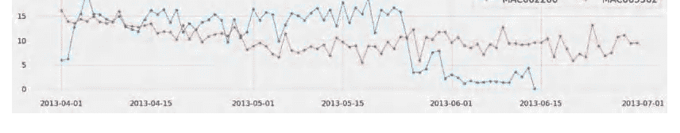

图 5.15 – MAC002200 家庭能耗的缺失值

由于我们在处理一个家庭的能耗数据，这种行为很可能与该住户离开了这栋房屋有关。下面看看如何配置 Amazon Forecast 的行为来处理这类情况。

## 配置特征化参数

当你希望创建新预测器时，对缺失值处理方式的配置位于 **预测器详细信息** 部分的 **高级配置** 设置中。

登录 AWS 控制台后，导航到 Amazon Forecast 控制台，点击 **查看数据集组** 按钮。在那里，你可以点击在 *第 3 章，创建项目并导入数据* 中创建的数据集组名称。现在你应该位于数据集组的仪表板上，可以在那里点击 **训练预测器**。滚动到 **预测器详细信息** 部分的底部，点击 **高级配置** 以展开更多配置。在该部分中，你会找到 **超参数优化** 配置、**训练参数** 配置（在所选算法支持时可用）以及 **特征化** 部分，如下面的截图所示：

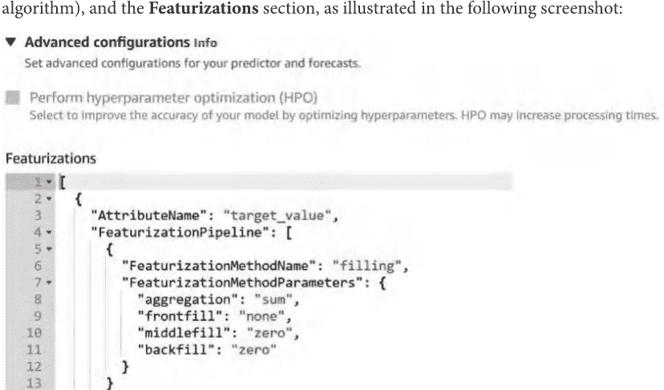

图 5.16 – 特征化配置

特征化是通过这一小段 JSON 片段进行配置的，对于你希望填充缺失值的每个属性，都会有类似的部分。

默认情况下，Amazon Forecast 只填充目标时间序列数据中的缺失值，不会对相关时间序列数据应用任何转换。你可以配置以下三个参数：

- AttributeName：它可以是目标时间序列数据的目标字段，也可以是相关时间序列数据中的某个字段。根据所选领域的不同，它可以是 demand、target_value、workforce_demand、value、metric_value 或 number_of_instances。你可以回顾目标数据集和相关数据集的架构，了解可以使用哪些值。在你一直在运行的能耗示例中，你最初选择了自定义域：该领域的目标字段是 target_value。
- FeaturizationMethodName：在撰写本书时，只有填充方法可用。该字段唯一可以取的值是 filling。
- FeaturizationMethodParameters：对于填充方法，对于相关时间序列和目标时间序列，你都可以配置两个参数（middlefill 和 backfill）。对于目标时间序列，frontfill 参数设置为 none，你还可以指定聚合参数。对于相关时间序列，你还可以通过 futurefill 参数指定在预测范围内应用的填充行为。

下面的截图说明了 Amazon Forecast 在填充缺失值时可以利用的不同处理策略：

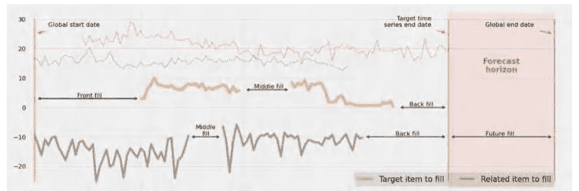

图 5.17 – 缺失值处理策略

全局开始日期是数据集中所有项目（在前面的截图中由最上面两行表示）的最早开始日期，而全局结束日期是所有项目的最晚结束日期再加上预测范围。

## 介绍特征化参数值

下表说明了这些参数根据数据集可以取的可能值：

| 参数 | 目标时间序列 | 相关时间序列 |
|---|---|---|
| `aggregation` | **sum**、avg、first、min 或 max | *不适用* |
| `frontfill` | **none** | *不适用* |
| `middlefill` | **zero**、value、median、mean、min 或 max | zero、value、median、mean、min 或 max |
| `backfill` | **zero**、value、median、mean、min 或 max | zero、value、median、mean、min 或 max |
| `futurefill` | *不适用* | zero、value、median、mean、min 或 max |

图 5.18 – 参数及其可能的值

下面让我们更详细地看看这些参数：

- **aggregation（聚合）：** 当创建预测器所需的预测频率与数据集的原始频率不同时，Amazon Forecast 会应用此参数。默认情况下，它会通过对值求和（sum）来聚合原始数据。如果你的原始数据是小时级，而你请求的是日级预测器，它会将所有可用的小时级数据相加，以构建日级数据集。你可以选择改变这一行为，要求 Amazon Forecast 用平均值（avg）替代求和，取每个考虑时段内第一个可用值（first），或取每个时段内的最小值（min）或最大值（max）。
- **填充参数：** 在适用的情况下，可用的不同填充行为包括 zero（用零替换所有缺失值）、value（用给定值替换）、median（用整个时间序列的中位数替换）、mean（用均值替换）、min 或 max（用整个时间序列的最小值或最大值替换）。

在将填充方法应用于相关时间序列时，没有默认值（因为你可以有多条预期行为不同的序列）。上表中以粗体显示的值是应用于目标时间序列数据集的默认值。

当你为某个填充参数选择 `value` 时，必须通过在该参数名称后添加 `_value` 得到的额外参数，将所需值定义为一个实数，如下所示：

- `middlefill_value` 定义了当你选择 `middlefill = value` 时的替换值。
- `backfill_value` 定义了当你选择 `backfill = value` 时的替换值。
- `futurefill_value` 定义了当你选择 `futurefill = value` 时的替换值。

在本节中，你了解了如何依靠 Amazon Forecast 对特征进行预处理，并保持一致的数据质量，以提供稳健且准确的预测。在下一节中，你将更深入地了解如何运用 Amazon Forecast 的概率预测特性来满足自己的业务需求。

## 自定义分位数以满足你的业务需求

Amazon Forecast 会在不同分位数上生成概率预测，从而在单纯的点预测之外为你提供预测区间。预测分位数（或区间）让 Amazon Forecast 能够表达每次预测的不确定性，并为你提供更多信息，供你在与预测工作相关的决策过程中参考。

正如你在本章前面看到的，Amazon Forecast 可以利用不同的预测算法：每种算法估算概率分布的方式都不同。关于概率预测背后理论背景的更多细节，你可以参考以下论文：

- *GluonTS：Python 中的概率时间序列模型* (https://arxiv.org/pdf/1906.05264.pdf)，其中提供了关于 ARIMA、ETS、NPTS 和 DeepAR+ 算法如何生成这些预测区间的一些细节。
- *多视界分位数循环预测器* (https://arxiv.org/pdf/1711.11053.pdf) 详细介绍了神经分位数模型家族（包括与 CNN-QR 相似的架构）如何在预测范围内直接预测给定时间步的同时生成这些分布。
- Prophet 算法在 Facebook 的原始论文中有详细描述，可在这里找到：https://peerj.com/preprints/3190/。

现在，让我们看看在创建新预测器时如何配置不同的预测类型。


### 配置预测类型

当你希望创建新的预测器时，可以在**预测器详细信息**部分配置希望 Amazon Forecast 生成的预测类型。默认情况下，选定的分位数为 10%（p10）、50%（中位数，p50）和 90%（p90）。配置预测器时，所需的分位数称为**预测类型**，你最多可以选择五种，包括 0.01 到 0.99 之间的任意百分位数（步长为 0.01）。你也可以选择“均值”作为预测类型。

> **重要说明**
>
> CNN-QR 无法生成均值预测，因为此类算法直接为特定分位数生成预测：当选择“均值”作为预测类型时，CNN-QR 将回退为计算中位数（p50）。

在下面的截图中，我将预测类型配置为请求 Amazon Forecast 生成均值预测和三个分位数（p10、p50 和 p99）：

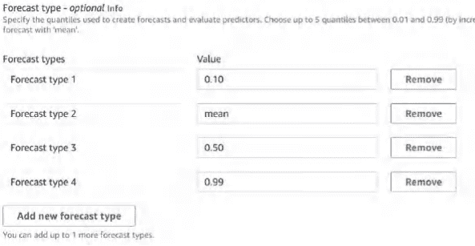

*图 5.19 – 选择要生成的预测类型*

你可以点击**移除**删除某个预测，并通过点击**添加新的预测类型**按钮请求最多五种预测类型。

> **重要说明**
>
> Amazon Forecast 会为生成的每个时间序列预测收费：每种预测类型都计为一项计费项目，而且即使你只打算使用一个分位数，也始终至少按三个分位数计费。因此，强烈建议你自定义默认分位数，以满足业务需求并利用 Amazon Forecast 的概率预测能力。

Amazon Forecast 会为每个请求的分位数计算分位数损失指标。在下面的截图中，你可以看到服务为默认生成的分位数计算的默认 wQL 指标：wQL[0.1] 是 p10 预测类型的分位数损失，wQL[0.5] 对应中位数，依此类推：

| 评估类型 | 测试窗口开始时间 | 测试窗口结束时间 | 物品数 | wQL[0.1] | wQL[0.5] | wQL[0.9] | WAPE | RMSE |
|---|---:|---:|---:|---:|---:|---:|---:|---:|
| 回测平均值 | - | - | - | 0.1128 | 0.2590 | 0.1369 | 0.2590 | 4.7961 |
| 回测窗口 1 | Sat, 01 Jun 2013 00:00:00 GMT | Mon, 01 Jul 2013 00:00:00 GMT | 3573 | 0.0990 | 0.2287 | 0.1193 | 0.2287 | 5.3059 |
| 回测窗口 2 | Thu, 02 May 2013 00:00:00 GMT | Sat, 01 Jun 2013 00:00:00 GMT | 3573 | 0.1028 | 0.2575 | 0.1366 | 0.2575 | 5.9830 |
| 回测窗口 3 | Tue, 02 Apr 2013 00:00:00 GMT | Thu, 02 May 2013 00:00:00 GMT | 3573 | 0.1591 | 0.3222 | 0.1504 | 0.3222 | 6.0529 |
| 回测窗口 4 | Sun, 03 Mar 2013 00:00:00 GMT | Tue, 02 Apr 2013 00:00:00 GMT | 3573 | 0.0976 | 0.2219 | 0.1714 | 0.2219 | 5.0981 |
| 回测窗口 5 | Fri, 01 Feb 2013 00:00:00 GMT | Sun, 03 Mar 2013 00:00:00 GMT | 3573 | 0.1056 | 0.2645 | 0.1567 | 0.2645 | 5.5431 |

*图 5.20 – 每种预测类型的分位数损失指标*

现在，让我们看看如何根据这些预测所支持的决策类型来选择合适的分位数。

### 选择预测类型

选择适合业务需求的预测类型，实际上是在过度预测的成本（产生更高的资金成本或更高的库存）与预测不足的成本（客户想要订购时产品缺货，或你无法生产成品以满足实际市场需求，从而损失收入）之间进行权衡。

在*第4章《使用 AutoML 训练预测器》*中，你已经了解了加权分位数损失（wQL）指标。提醒一下，对于给定的分位数 τ，可以通过以下公式计算该指标：

$$wQL[\tau] = 2 \cdot \frac{\sum_{i,t}[\tau \cdot \max(y_{i,t}-q_{i,t}^{(\tau)},0)+(1-\tau)\cdot\max(q_{i,t}^{(\tau)}-y_{i,t},0)]}{\sum_{i,t}|y_{i,t}|}$$

其中各项含义如下：

- $y_{i,t}$ 是针对给定 `item_id` 参数在时间 $t$ 处观测到的实际值（其中 $t$ 遍历回测周期的时间范围，$i$ 遍历所有物品）。
- $q_{i,t}^{(\tau)}$ 是针对给定 `item_id` 参数在时间 $t$ 处预测的 $\tau$ 分位数。
- $\tau$ 是一个分位数，可以取以下值之一：0.01、0.02…、0.98 或 0.99。

如果你正在制定一套稳健的疫苗策略，并希望尽快实现全球免疫，就必须不惜一切代价满足人群需求（这意味着当有人前来接种时，疫苗剂量必须可及）。为满足这种刚性需求，p99 预测可能非常有用：此预测类型预期真实值在 99% 的时间内低于预测值。如果在上述公式中使用 τ = 0.99，我们会得到以下结果：

- 对预测不足施加更大的惩罚权重：$0.99 \cdot \max(y_{i,t} - q_{i,t}^{(0.99)}, 0)$
- 对过度预测施加更小的惩罚权重：$(1 - 0.99) \cdot \max(q_{i,t}^{(0.99)} - y_{i,t}, 0)$

我们再来看另一个例子：

- 如果你经营一家服装店，你不会希望冬季商品在冬天缺货：过度备货的资金成本更低（商品大量积压库存的可能性更小），因此 p90 预测有助于防止你缺货。
- 另一方面，当夏天来临时，你可以根据 p10 预测来制定冬季服装的库存决策（也许有人会买这条保暖围巾，但在售出之前，它很有可能会在库存中存放更长时间）。

如你所见，组合不同的预测类型，你可以根据一年中的波动情况调整策略。

### 小结

在本章中，你了解了 Amazon Forecast 为你提供的多种可能性，让你可以根据自己的数据集定制预测器训练。你学习了如何选择最适合问题的算法，以及如何自定义不同参数（分位数、缺失值填充策略和补充特征的使用），以尝试改进预测模型。

在处理新业务场景或新数据集时，Amazon Forecast 的 AutoML 能力是一个关键的差异化优势。它能为你提供良好的方向指引和可靠的结果，且交付周期短。然而，要获得更高精度以满足业务需求，意味着有时你必须能够覆盖 Amazon Forecast 的决策：引导其算法选择，决定如何处理数据集的特征，或者直接选择与你的业务决策方式相匹配的预测类型，以请求一组不同的输出。

在下一章中，你将使用训练好的预测器生成新的预测（用机器学习的术语来说，我们将使用新数据在训练好的模型上运行推理）。
