## 6 生成新预测

在前两章中，你专注于训练几个预测器：首先使用 **AutoML**，让 **Amazon Forecast** 替你做出所有决策；然后自定义模型的不同方面。

在本章中，你将使用在第4章《使用 AutoML 训练预测器》中训练的 AutoML 预测器，并通过生成预测来请求新的预测结果。到本章结束时，你将能够使用训练好的预测模型，并理解如何整合新数据和生成新预测。

本章将涵盖以下主要内容：

- 生成预测
- 使用查找功能获取物品预测
- 导出并可视化你的预测
- 为你的预测生成可解释性

### 技术要求

要阅读本章内容，不需要具备 **Python** 或 **R** 等语言的实际操作经验。不过，我们强烈建议你在已连接 AWS 账户并打开 Amazon Forecast 控制台的情况下阅读本章，以便在你自己的环境中执行各项操作。

关于创建 AWS 账户并登录 Amazon Forecast 控制台，请参阅*第2章《Amazon Forecast 概述》中的“技术要求”*。

本章内容假设你已经有一个训练完成并可用于生成新预测的预测器；如果没有，我们建议你按照*第4章《使用 AutoML 训练预测器》*中详述的流程操作。一旦你拥有训练好的预测器，就可以开始生成新预测了。

### 生成预测

在*第4章《使用 AutoML 训练预测器》*和*第5章《自定义预测器训练》*中，我们重点关注了预测流程的第一步：回顾历史数据以建立基线，并发现未来可能延续的趋势。在 Amazon Forecast 中，这是通过训练预测器（即你的训练模型）来完成的。一旦你拥有可供使用的模型，就可以使用 Amazon Forecast 为时间序列生成预测：下图右侧突出显示的区域正是这一操作所在的位置：

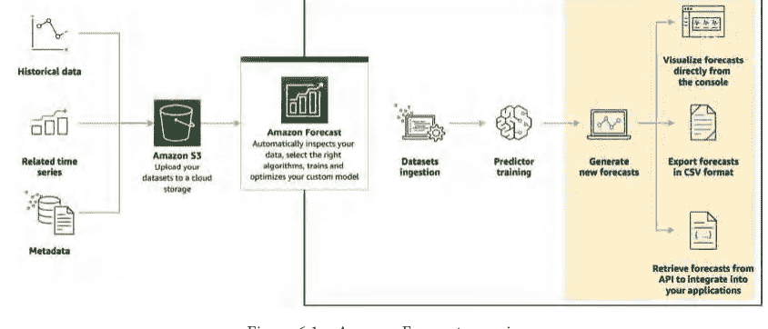

*图 6.1 – Amazon Forecast 概览*


换言之，你将使用 Amazon Forecast 在摄取数据集中最后一个可用日期之后的时间范围内生成未来值。在第 3 章“创建项目并摄取数据”中，你摄取了 2012-07-01 至 2013-06-30 的数据。现在，你将针对从 2013-07-01 开始的数据生成预测。

在下一节中，你将学习如何从训练好的预测器创建预测，以及如何用新值更新数据集，以便定期持续预测新值。

## 创建你的第一个预测

基于你在第 4 章“使用 AutoML 训练预测器”中训练的预测器，你将生成第一个预测。为此，请完成以下步骤：

1. 登录 AWS 控制台，在顶部的搜索栏中搜索 Forecast。
2. 点击 Amazon Forecast 进入服务主页。
3. 在此页面上，如上图所示，你可以点击屏幕右侧的 View dataset groups 按钮，也可以点击左上角的汉堡图标（三条水平线的那个）打开左侧面板，然后点击 Dataset groups。你将进入一个页面，其中列出了你的 AWS 账户可见的所有数据集组。由于你已经训练了一个预测器，列表中至少应包含一项：

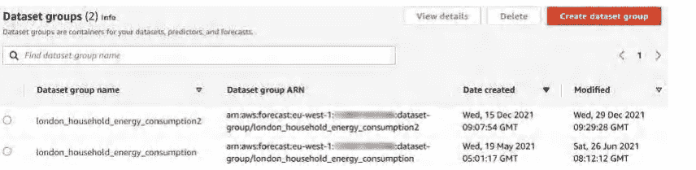

图 6.2 – Amazon Forecast 数据集组列表

4. 点击你的数据集组名称（如上图所示，我的数据集组名为 london_household_energy_consumption）。现在你已进入数据集组仪表板。点击右侧 Generate forecasts 列中的 Create a forecast。

5. 你将看到 Forecast details 屏幕：

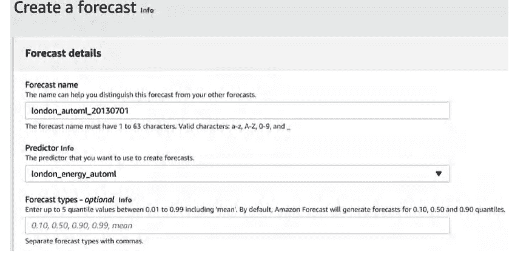

图 6.3 – 创建新预测

6. 在此屏幕上，你需要输入 Forecast name（你可以使用给定模型生成多个预测）。我们将其命名为 london_automl_20130701。如果你之前选择的数据集组只关联了一个已训练的预测器，那么用于生成预测的预测器已经自动填入。否则，你可以在 Predictor 下拉列表中进行选择。

7. 你还可以在 Forecast quantiles 字段中指定要预测的分位数。你可以将该字段保留为默认值（0.10、0.50、0.90）。

8. 向下滚动屏幕并点击 Start：你的预测生成即开始。

9. 在此步骤中，Amazon Forecast 会预配置底层必要资源，并使用你现有的数据和训练好的预测器运行推理。它还会准备推理结果，以便后续进行查询。此过程最多可能需要 40 分钟。完成后，你的屏幕会更新，显示预测状态为 Active，可供使用。

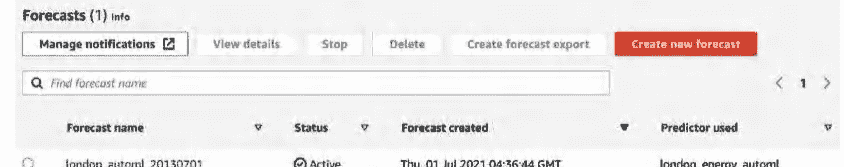

图 6.4 – 预测可随时查询

你的预测现已就绪：你可以将其导出（参见本章后面的*导出和可视化预测*）或查询（参见*使用查找获取项目预测*），以查看模型中针对数据集中的时间序列的预测结果。

## 生成后续新预测

到目前为止，你已在 2012-07-01 至 2013-06-30 期间训练了一个预测器，并为 2013-07-01 至 2013-07-30 期间生成了一个预测。

生成未来值后续预测的过程如下：

1. 当你收到 2013 年 7 月的新值时，将其添加到初始数据集中，并上传到 Amazon S3 中原始数据的相同位置。
2. 登录你的 AWS 控制台，在顶部的搜索栏中搜索`Forecast`。
3. 点击 **Amazon Forecast** 进入服务主页。
4. 在此页面上，点击屏幕右侧的 **View dataset groups** 按钮。
5. 然后在显示的数据集组列表屏幕上，点击你的数据集组名称（我的数据集组名为 `london_household_energy_consumption`）：现在你已进入数据集组仪表板。点击 **View datasets**。
6. 点击目标时间序列数据集的名称（我的数据集名为 `energy_consumption_data`）。
7. 在下一个屏幕上，向下滚动到 **Dataset imports** 部分，点击 **Create dataset import** 按钮：

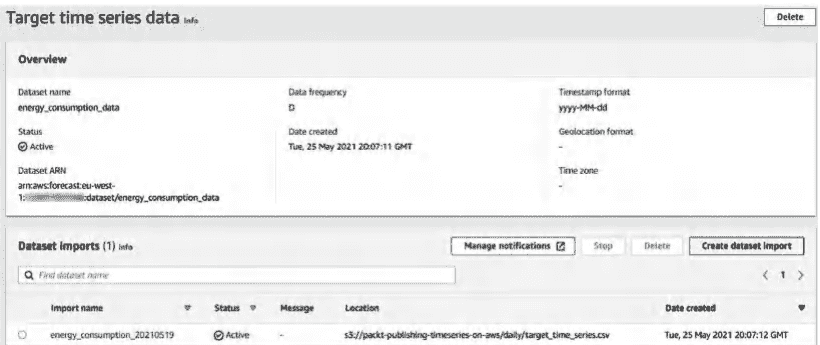

图 6.5 – 创建新的数据集导入

8. 你将进入在*第 3 章“创建项目并摄取数据”*中首次摄取数据时遇到的 **Create target time series dataset** 屏幕。许多字段现在已灰显并禁用。向下滚动到 **Dataset import details**：

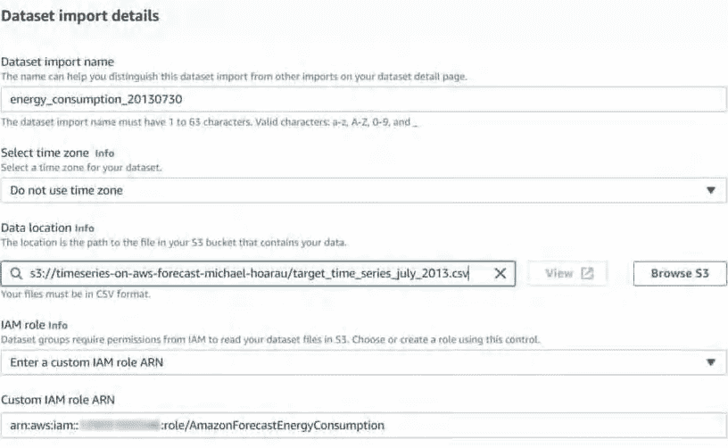

图 6.6 – 配置新的数据集导入

在此屏幕上，你需要执行以下操作：

- **I.** 为导入命名。这将帮助你在不同的导入作业之间进行区分。我们将其命名为 `energy_consumption_20130730`（我添加了新数据中最后一个可用日期的时间戳）。

> **重要说明**
> 
> 请注意，连续的导入作业不会聚合：当你使用数据集训练预测器时，只会考虑最近一次的导入。

- **II.** 输入目标时间序列的 S3 URL，即你之前在 Amazon S3 中上传新数据集的位置。

- **III.** 选择 **Enter a custom IAM role ARN**，并粘贴你之前在 IAM 服务中创建的 `AmazonForecastEnergyConsumption` 角色的 ARN。ARN 的格式应为 `arn:aws:iam::<ACCOUNT-NUMBER>:role/AmazonForecastEnergyConsumption`，其中 `<ACCOUNT-NUMBER>` 需要替换为你的 AWS 账户号码。

9. 点击此屏幕右下角的 **Start** 按钮，开始更新你的目标时间序列。对于相关的时间序列数据，你可能需要执行步骤 6 到 9 中的相同操作。

你的新目标时间序列数据和相关时间序列数据现在的范围将是 2012-07-01 至 2013-07-30（新增了一个月）。

现在你可以选择两条路径：

- *在不重新训练新预测器的情况下生成新预测：* 新预测会将你刚刚添加的新数据作为额外上下文纳入考量，但你的模型不会使用更新后的数据重新训练。如果你的数据相对其原始统计分布发生漂移的风险较低，这是推荐的做法（有关模型漂移和模型监控的更多见解，请参阅*第 7 章“改进和扩展预测策略”*）。
- *基于更新后的数据训练新预测器：* 你可以重新训练预测器，让它考虑新数据。一旦预测器重新训练完成，你就可以利用重新训练模型带来的额外上下文生成新预测。但这会花费更长时间，并产生额外的训练成本。

现在你已经知道如何从原始模型或更新后的模型生成新预测，可以开始使用你的预测了。

## 使用查找获取项目预测

当你至少有一个状态为 Active 的预测时，Forecast lookup 功能即可使用：

1. 在 Dataset groups 的仪表板中，点击右侧 Generate forecasts 列中的 Query forecast 按钮。
2. 点击 Query forecast 后，你将看到以下 Forecast lookup 查询界面：

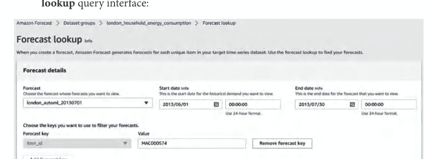

3. 在此屏幕上，你需要填写以下值：

- Forecast：你生成的某个预测的名称。我将选择 london_automl_20130701。
- Start date：开始日期必须早于你的历史数据结束日期，且不能早于历史数据结束日期减去用于训练初始预测器的预测时间范围。在你的案例中，你训练了一个预测时间范围为 30 天的预测器，历史数据结束于 2013-06-30。对于此预测，开始日期必须在 2013-06-01 00:00:00 和 2013-06-30 00:00:00 之间。使用 2013-06-01 作为开始日期，并将时间保留为 00:00:00。
- End date：结束日期必须在预测开始日期之后，并且早于预测开始日期加上预测时间范围。对于此预测，结束日期必须在 2013-07-01 00:00:00 和 2013-07-30 00:00:00 之间。使用 2013-07-30 作为结束日期，并将时间保留为 00:00:00。


**预测键：** 在你进行数据摄取时定义目标数据集的模式时（参见*第3章：创建项目并摄取数据*），你定义了一个名为 `item_id` 的目标键。你可以使用这个键来筛选你的预测。填写 `MAC000574` 以请求该特定家庭的能耗预测。

> **注意**
> 
> 如果你的目标时间序列数据中包含其他维度，这些维度也会出现在预测键中，以便你按选定的维度查询聚合预测。

4. 单击表单右下角的 **获取预测** 按钮以可视化你的预测：

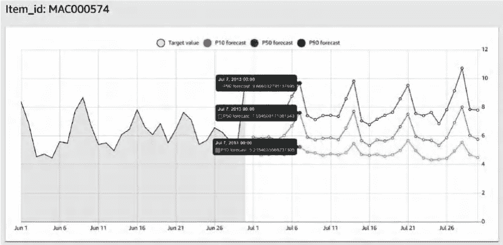

图6.8 – 家庭MAC000574的预测

5. 在此图中，你可以特别看到与 `item_id` `MAC000574` 关联的历史数据的最后一部分（左侧灰色部分），以及生成预测时所选的每个分位数（或预测类型）的预测值：

- 最下方的线是 **p10预测**。如果将鼠标悬停在第一个峰值上，你可以看到值 **5.215**，这意味着该日期的实际值有10%的概率会低于 **5.215**。
- 中间的线是 **p50预测**。如果将鼠标悬停在第一个峰值上，你可以看到值 **7.595**，这意味着该日期的实际能耗有50%的概率会低于 **7.595**。
- 最上方的线是 **p90预测**。如果再次将鼠标悬停在第一个峰值上，你可以看到值 **9.666**，这意味着该日期的实际值有90%的概率会低于 **9.666**。

6. 你也可以自由选择其他家庭ID，进一步探索模型生成的预测。

如果你想进行更深入的分析和比较，则需要导出所生成预测的数据。这就是你将在下一节中要做的事情。

## 导出并可视化预测

在本节中，你将把预测导出为CSV格式，然后在电子表格中将其可视化。

### 导出预测

要导出一个已生成预测相关的所有预测值，可以按照以下步骤操作：

- 1. 登录AWS控制台，在顶部的搜索栏中搜索 `Forecast`。
- 2. 点击 **Amazon Forecast** 进入服务主页：
- 3. 点击屏幕右侧的 **查看数据集组** 按钮。你将进入一个页面，其中列出你AWS账户下可见的所有数据集组。
- 4. 点击你训练的预测器的名称。我训练的那个叫做 **london_household_energy_consumption**。
- 5. 在左侧菜单栏中，点击 **预测** 以调出使用该数据集组生成的预测列表。
- 6. 点击你之前生成的某个预测的名称。我将点击 **london_automl_20130701**：

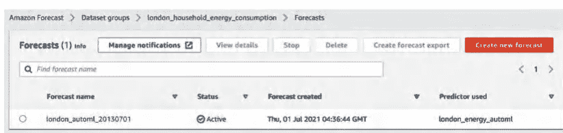

图6.9 – 可用预测列表

7. 现在你位于之前生成的预测的详情页面。在该页面的第二部分，有一个 **导出** 区域。区域标题后的数字 **(0)** 是你为此预测请求的导出次数。在该区域的右上角，点击 **创建预测导出**。

8. 你会看到一个 **导出详情** 表单：

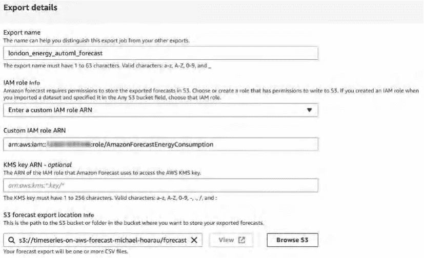

图6.10 – 创建预测导出

9. 在 **导出详情** 中，填写以下参数，其他参数保持默认值：

- **导出名称：** `london_energy_automl_forecast`。
- **IAM角色：** 选择 `Enter a custom IAM role ARN`。
- **自定义IAM角色ARN：** 粘贴你在IAM服务中先前创建的 `AmazonForecastEnergyConsumption` 角色的ARN（参见*第3章：创建项目并摄取数据*）。ARN的格式应为 `arn:aws:iam::<ACCOUNT-NUMBER>:role/AmazonForecastEnergyConsumption`，其中 `<ACCOUNT-NUMBER>` 需要替换为你的AWS账户号。

- **S3预测导出位置：** 粘贴你在*第3章：创建项目并摄取数据*中同样创建的存储桶中的S3位置。该S3路径的格式应为 `s3://BUCKET_NAME/forecasts/automl/`，其中 `BUCKET_NAME` 应替换为你的存储桶名称。

10. 点击此表单右下角的 **开始** 按钮以启动预测导出作业。你的导出创建现已开始。

过一段时间后，你的数据就会出现在之前选择的S3存储桶中。现在让我们获取这些文件并可视化其内容。

### 可视化预测结果

预测导出过程会将预测输出到Amazon S3。让我们打开该服务以收集这些结果并加以可视化：

- 1. 在AWS控制台的左上角，你会看到一个 **服务** 下拉菜单，其中显示所有可用的AWS服务。在 **存储** 部分，找到 **S3** 服务并点击其名称进入S3控制台。
- 2. 点击你用于上传数据集的存储桶名称，以查看其内容。
- 3. 在此屏幕上，你会看到一个 `forecasts/` 文件夹，点击它，然后点击 `automl` 文件夹名称。你最终会进入一个包含一系列CSV文件的目录：

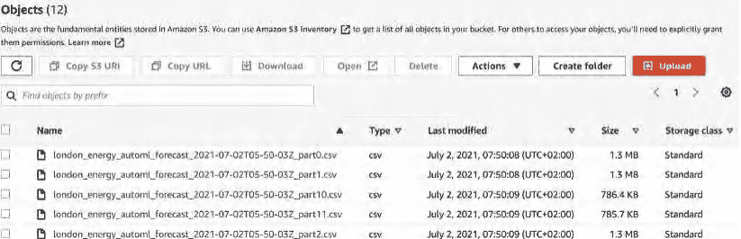

图6.11 – Amazon S3上存储的预测导出结果

每个CSV文件的名称都遵循以下模式：

```
`<export_name>_<yyyy-mm-ddTHH-MM-SSZ>_part<NN>`
```

其中 `export_name` 是你为回测导出作业选择的名称，后面是时间戳（导出生成的时间）和部件号。

为了进一步深入查看预测结果，我将所有预测文件连接在一起。点击以下链接下载我的Excel文件，并跟随我的分析：

```
https://packt-publishing-timeseries-on-aws-michaelhoarau.s3.eu-west-1.amazonaws.com/part1-amazon-forecast/london_energy_automl_forecast_results.xlsx
```

在下一节中，你将使用此文件从预测中获取有用的信息。

## 执行误差分析

你一直在使用一个包含3,573条唯一时间序列（每条对应一个家庭的用电量）的数据集来训练预测器，在前面的段落中，你下载了为这些数据生成的预测。由于你生成的预测所覆盖的期间内仍然有部分实际数据，因此你可以计算与回测评估相同的预测指标：

- 1. 打开你之前下载的文件。第一个标签页包含你的项目的时间序列：

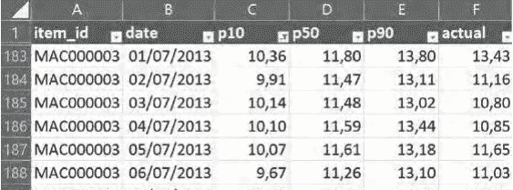

图6.13 – 预测导出结果 – 时间序列数据

特别是，对于每个 item_id，你将会看到以下内容：

- date：为了方便起见，我包含了从2013-01-01开始的历史数据副本。日期一直延伸到预测时间范围的末尾（2013-07-30）。
- p10、p50和p90：生成预测时请求的每种预测类型的值。
- actual：原始数据集中可用的时间序列实际值。

我们稍后将使用这些时间序列绘图。在第二个标签页中，你可以看到每个家庭的平均绝对百分比误差（MAPE）指标的计算结果：

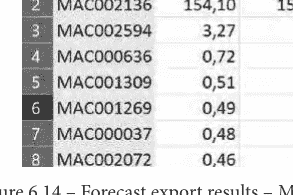

图6.14 – 预测导出结果 – MAPE指标

我已经按MAPE降序对文件进行了排序，你马上就能看到有些项目绝对值得进一步调查！

在此文件中，你会看到在3,573个项目中，有35个项目的MAPE大于或等于10%。在第4章：使用AutoML训练预测器中，你的预测器的评估仪表板提到预测器的总体MAPE为22.54%。现在你知道，超过99%的项目的预测误差小于10%。当然，根据你对预测准确性的业务敏感度，你会相应调整10%这个阈值以及分析范围。

- 2. 现在让我们将某个预测良好的随机项目（我将选择家庭ID为MAC000574，MAPE为2.44%的项目）与某个预测不良的随机项目（家庭ID为MAC000636，MAPE为72.0%的项目）进行视觉比较。下图展示了家庭MAC000574的时间序列：

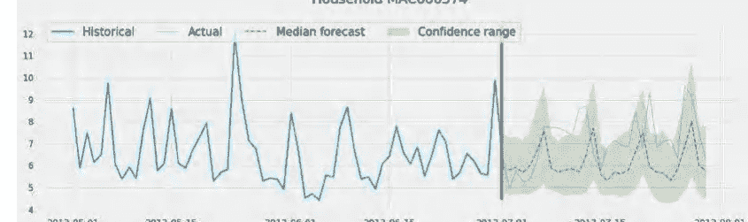

图6.15 – 良好预测示例


## 为预测生成可解释性

自本章编写以来，Amazon Forecast 还部署了一项新功能，为你的预测提供一定程度的可解释性。在上一节中，我们进行了错误分析，以了解如何提高预测准确性。在本节中，我们将探讨这一新的可解释性功能。可解释性是一组实践和能力，帮助你理解统计、机器学习或深度学习模型所做的预测。本质上，可解释性的目标是向最终用户打开可能被视为黑盒的模型。

Amazon Forecast 会计算一个特定指标（称为**影响分数**），以量化数据集中每个属性对时间序列的影响（是增加还是减少给定的预测值？）。在本节中，我们将了解如何生成此类见解，然后如何解读它们。

> **重要说明**
>
> 自本章编写以来，Amazon Forecast 已部署了 **AutoPredictor** 功能：如前几章所述，使用此功能训练预测器时，Amazon Forecast 将代表你分析数据，以集成多种算法并为每个单独的时间序列构建更好的预测。但是，根据你的数据，你可能仍然需要执行我们在本节中进行的那种错误分析：无论你在业务中选择哪种预测工具、算法和方法，这种做法始终至关重要。

> **注意**
>
> 由于此功能在编写时是一个相当新的功能，我们选择的数据集并不是探索 Amazon Forecast 提供的这些新见解输出的最佳示例。但是，我将向你展示生成和可视化这些输出的过程。如果你愿意在 Jupyter notebook 中运行 Python 代码，可以查看可解释性文档（`https://docs.aws.amazon.com/forecast/latest/dg/forecast-explainability.html`）或这份分步指南：`https://github.com/aws-samples/amazon-forecast-samples/blob/main/notebooks/advanced/Item_Level_Explainability/Item_Level_Explainability.ipynb`。

### 概述

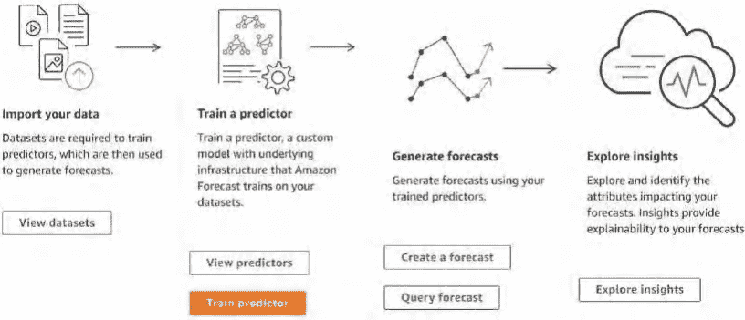

图 6.17 – 从主仪表板访问可解释性功能

5. 你将看到之前生成的见解列表。单击屏幕右上角的 **创建可解释性** 按钮。

6. 在 **创建可解释性** 屏幕上，你需要输入以下信息：

    - **可解释性名称：** `london_energy_explainability`

    - **选择预测：** 从下拉列表中选择你之前创建的预测名称。如果你在列表中没有看到你的预测，只看到 **不支持预测** 消息，这表示你的预测关联的模型未使用 AutoPredictor（P-Code）功能进行训练。你需要将旧版预测器转换为 AutoPredictor（P-Code）预测器，然后返回此屏幕以生成你的可解释性见解。

    - **时间范围详细信息：** 你可以为整个预测时间范围或特定时间范围请求可解释性。

    - **S3 位置：** 填写你之前上传的 CSV 文件的 S3 位置。此 S3 路径的格式应为 `s3://BUCKET_NAME/timeseries_explainability.csv`，其中 `BUCKET_NAME` 应替换为你的存储桶名称。

    - **IAM 角色：** 选择 `Enter a custom IAM role ARN`。

    - **自定义 IAM 角色 ARN：** 粘贴你之前在 IAM 服务中创建的 AmazonForecastEnergyConsumption 角色的 ARN（参见*第 3 章，创建项目并摄取数据*）。ARN 的格式应为 `arn:aws:iam::<ACCOUNT-NUMBER>:role/AmazonForecastEnergyConsumption`，其中 `<ACCOUNT-NUMBER>` 需要替换为你的 AWS 账户 ID。

    - **数据架构：** 此架构应与目标时间序列数据集架构相同（你应该会看到 `item_id` 及 `string` 类型已为你预先填写）。如果你有其他维度，可以在此处添加。

7. 滚动到屏幕底部，单击 **创建** 按钮以启动可解释性生成过程。

你将回到见解列表屏幕，在那里可以看到正在进行的可解释性请求。报告准备好后，你可以单击其名称进行可视化。

### 可视化预测可解释性

可解释性报告准备好后，你将在见解屏幕上看到其状态为 **活跃**：

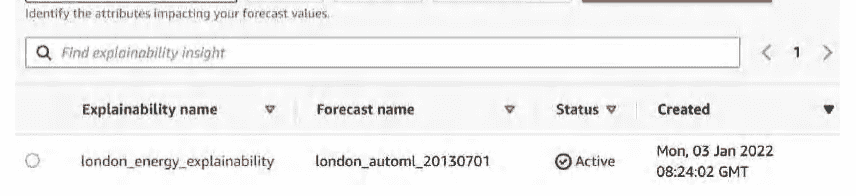

图 6.18 – 可用可解释性报告列表

单击报告名称可打开详细页面。在 **可解释性详情** 部分（你可以在其中找到报告名称、生成所需时间以及创建时间）之后，你会找到关键的部分，即 **属性增加影响分数**。此部分包括两个水平条形图：

1. 在顶部，你会看到增加所选时间序列和时间点的归一化影响分数的属性。你可以选择聚合视图来显示所有时间序列和/或所有时间点的影响分数。以下截图摘自前面提到的分步 notebook。在此截图中，你可以看到，例如，`Customer_Request` 属性的影响是 `Loss_Rate` 的两倍：

   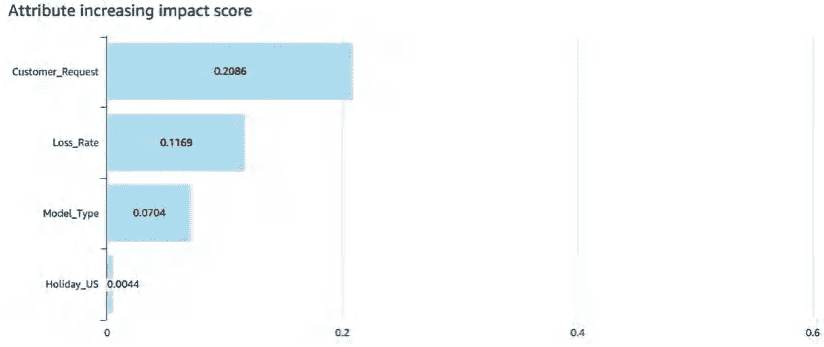

   图 6.19 – 属性增加影响分数

   > **重要说明**
   >
   > 影响分数仅衡量分数的相对影响，不能用于提高模型准确性。它们只能用于解释每个属性对给定预测值的贡献。

2. 在底部，你会看到一个类似的条形图，但仅包含降低影响分数的属性。

请注意，控制台图表仅显示*归一化*影响分数（介于 -1 和 1 之间），而直接 API 调用也可以为你提供原始影响分数（基于 Shapley 值）。原始影响分数可用于跨不同时间序列和时间点组合或比较分数。但是，当这些分数来自不同的预测时，它们无法进行比较或组合。

恭喜，借助这最后一个功能，你已到达本章的结尾！是时候总结并进入专门介绍 Amazon Forecast 的最后一章了。

## 总结

在本章中，你学习了如何生成、导出和可视化你在前几章中训练的模型的预测。你还学习了如何使用预测导出功能在时间序列级别监控预测性能（而不仅仅是通过预测器评估控制台提供的聚合级别）。

## 生成新预测

一旦模型训练完成，生成预测将成为你的关键活动。练习这一步骤非常重要，其中包含建立合理的错误分析流程。在项目级别使用错误分析确实对于了解预测可以改进的领域以及数据分布的显著变化影响其性能的领域至关重要。

在下一章中，你将建立全自动解决方案，为你完成更繁重的工作，以便你可以专注于不断提高预测准确性。你还将了解如何组合一个健全的模型监控策略的关键组件。

### 技术要求

在本章中，我们将处理更高级的主题，因此，你需要具备 Python 等语言的动手经验，才能更详细地理解。你还需要具备本书范围之外的多个 AWS 云服务的更广泛技能（例如 **AWS CloudFormation** 或 **Amazon SageMaker**）。

我们强烈建议你在连接自己的 AWS 账户时阅读本章，并打开不同的服务控制台在你这边执行不同的操作。

要创建 AWS 账户并登录 Amazon Forecast 控制台，你可以参阅*第 2 章，Amazon Forecast 概述*中的*技术要求*部分。

本章内容假定你已经训练好了一个预测器；如果没有，我们建议你按照*第 4 章，使用 AutoML 训练预测器*中介绍的详细流程操作。

本章还假定你已经从训练好的预测器生成了预测；如果你还没有，我们建议你按照*第 6 章，生成新预测*中介绍的详细流程操作。

要理解本章的最后一部分（*无服务器架构编排*），你还需要下载以下压缩包并解压：

```
https://packt-publishing-timeseries-on-aws-michaelhoarau.s3-eu-west-1.amazonaws.com/part1-amazon-forecast/energy_consumption_serverless.zip
```

### 深入探讨预测模型指标

在训练预测模型时，Amazon Forecast 将使用不同的机器学习指标来衡量给定模型和参数在预测时间序列未来值方面的优劣。在本节中，我们将详细介绍这些指标是什么、为什么重要，以及 Amazon Forecast 如何使用它们。

在*第 4 章，使用 AutoML 训练预测器*中，你训练了第一个预测器并获得了以下结果：

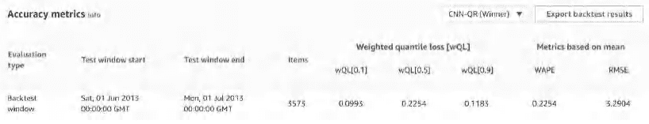

图 7.1 – 结果页面：准确性指标


使用本节右上角的下拉菜单，你可以选择想要查看结果的算法。你从第一个预测器获得的结果应该与下面类似：

|  | wQL[0.1] | wQL[0.5] | wQL[0.9] | WAPE | RMSE |
|---|---|---|---|---|---|
| CNN-QR (获胜者) | 0.0993 | 0.2254 | 0.1183 | 0.2254 | 3.2904 |
| Deep_AR_Plus | 0.1100 | 0.2353 | 0.1253 | 0.2364 | 3.4374 |
| ARIMA | 0.1196 | 0.2456 | 0.1430 | 0.2456 | 3.6026 |
| Prophet | 0.1243 | 0.2636 | 0.1505 | 0.2617 | 3.8997 |
| NPTS | 0.1107 | 0.3329 | 0.1813 | 0.3618 | 5.1994 |
| ETS | 0.1636 | 0.2866 | 0.2084 | 0.2866 | 4.6343 |

图 7.2 – 算法指标比较

在这张表格的顶部，你可以看到几个指标名称，例如 wQL[0.1]、wQL[0.5]、wQL[0.9]、WAPE 和 RMSE。这些指标是如何计算的？你如何解读它们？你如何知道一个值是好是坏？让我们深入探讨这些指标。

## 加权绝对百分比误差 (WAPE)

该准确率指标是一种计算预测算法相对于实际值（真实观测值）所产生的误差的方法。由于该指标在时间和不同物品（在我们场景中为家庭物品）上取平均，因此该指标并不区分这些物品。换句话说，WAPE 并不假设模型在哪个时间点或哪个物品上预测得更好有任何偏好。WAPE 始终为正数，数值越小，模型越好。

在给定回测窗口内推导该指标的公式如下：

WAPE = Σᵢ,ₜ |yᵢ,ₜ − ŷᵢ,ₜ| / Σᵢ,ₜ |yᵢ,ₜ|

这里，我们有如下内容：

- $y_{i,t}$ 是某个 `item_id` 在时间点 $t$ 观测到的实际值（其中 $t$ 覆盖回测时段的时间范围，$i$ 覆盖所有物品）。
- $\hat{y}_{i,t}$ 是某个 `item_id` 在时间点 $t$ 预测的平均值。

让我们看看下面的图，图中绘制了数据集中某个家庭的能耗预测值和观测值：

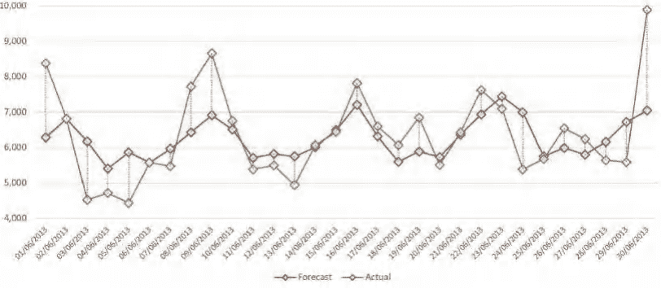

图 7.3 – WAPE 指标

在上图中，垂直虚线表示某个家庭实际值与预测值之间的差异。要计算 WAPE 指标，可以按照下面列出的步骤操作：

- 1. 取图中每条虚线的长度（每条线的长度是实际值与预测值之差的绝对值）。
- 2. 将所有长度相加，并对数据集中所有 `item_id` 求和。
- 3. 用该数字除以整个回测窗口内每个 `item_id` 的观测值之和。

这将给出一个以百分比衡量的绝对值。例如，10.0 的值可以理解为*平均而言，预测值与观测值相差 ±10%。* 读到这一点，你可能会注意到该指标的一个缺点：由于 WAPE 是百分比，在预测较小数值时，它可能会受到较大百分比误差的过度影响。此外，该指标是对称的：它不会对预测偏低或预测偏高给予更多惩罚。

请注意，绝对误差（前面公式中的分母）由你所有时间序列的全部数值之和进行归一化。如果你是一名零售商，处理多个产品的总需求，这意味着该指标更看重销售频繁的产品。从商业角度来看，对畅销产品实现更准确的预测是有意义的。在能耗用例（例如我们一直在使用的用例）中，这意味着能耗显著更高的家庭对该指标的影响更大。尽管这对于确保你通过电网输送正确的电量是合理的，但如果你想向每个家庭提供个性化建议，这可能并没有用。

## 平均绝对百分比误差 (MAPE)

与 WAPE 一样，该指标计算预测算法相对于真实观测值所产生的误差。在给定回测窗口内推导该指标的公式如下：

$$MAPE_i = \frac{1}{n} \sum_{t} \left| \frac{y_{i,t} - \hat{y}_{i,t}}{y_{i,t}} \right|$$

这里，我们有如下内容：

- $y_{i,t}$ 是某个 `item_id` 在时间点 $t$ 观测到的实际值（其中 $t$ 覆盖回测时段的时间范围，$i$ 覆盖所有物品）。
- $\hat{y}_{i,t}$ 是某个 `item_id` 在时间点 $t$ 预测的平均值。
- $n$ 是与某个 `item_id` 关联的时间序列中的数据点数量。

正如公式所暗示的，该指标受离群值影响很大：当你的时间序列随时间差异显著时，MAPE 很有用。与 WAPE 相比，MAPE 也是未归一化的，因此当你希望平等看待大值时间序列和小值时间序列时，它很有用。

## 平均绝对缩放误差 (MASE)

当你的数据集具有季节性时，该指标可以通过将季节性整合到缩放因子中来更好地捕捉时间序列的周期性属性。对给定时间序列在给定回测窗口内推导该指标的公式如下：

$$MASE_i = \frac{\frac{1}{n} \cdot \sum_t |y_{i,t} - \hat{y}_{i,t}|}{\frac{1}{n - m} \cdot \sum_{t=m+1}^{n} |y_{i,t} - y_{i,t-m}|}$$

这里，我们有如下内容：

- $y_{i,t}$ 是某个 `item_id` 在时间点 $t$ 观测到的实际值（其中 $t$ 覆盖回测时段的时间范围，$i$ 覆盖所有物品）。
- $\hat{y}_{i,t}$ 是某个 `item_id` 在时间点 $t$ 预测的平均值。
- $n$ 是与某个 `item_id` 关联的时间序列中的数据点数量。
- $m$ 是季节性值：当 $m$ 等于 1 时，此公式的分母实际上是*朴素预测方法*的平均绝对误差（该方法将上一个时间步的预测作为当前预测）。Amazon Forecast 会根据所选的预测频率来设置这个值 $m$。

当你的时间序列在不同季节的行为发生显著变化时，将该指标作为优化目标可能是有益的。该指标具有尺度不变性，因此更容易比较给定 `item_id` 时间序列的不同模型，或比较不同时间序列之间的预测准确度。

## 均方根误差 (RMSE)

与 WAPE 类似，该准确率指标也是一种计算预测器相对于实际值（真实观测值）的偏差的方法。对于 RMSE，我们会在时间和不同物品（在我们的例子中是家庭）上对平方误差取平均。该指标不会对这些进行区分，这意味着 RMSE 并不假设模型在哪个时间点或哪个物品上预测得更好有任何偏好。它始终为正数，数值越小，模型越好。

在给定回测窗口内推导该指标的公式如下：

$$RMSE = \sqrt{\frac{1}{n \times T} \sum_{i,t} (\hat{y}_{i,t} - y_{i,t})^2}$$

在前述公式的分子中，你可以看到以下内容：

- $\tau \cdot max\left(y_{i,t}-q_{i,t}^{(\tau)},0\right)$ 当预测值低于实际观测值时严格为正。该项惩罚预测偏低的情况。
- 另一方面，$(1-\tau)\cdot max\left(q_{i,t}^{(\tau)}-y_{i,t},0\right)$ 当预测值高于实际观测值时严格为正。该项惩罚预测偏高的情况。

让我们以 $wQL[0.80]$ 为例。基于前面的公式，该指标分配如下：

- 对预测偏低给予更大的惩罚权重：$0.8\cdot max\left(y_{i,t}-q_{i,t}^{(0.8)},0\right)$
- 对预测偏高给予更小的惩罚权重：$(1-0.8)\cdot max\left(q_{i,t}^{(0.8)}-y_{i,t},0\right)$

在零售中，某种产品库存不足（因产品缺货而错失收入的风险）往往比库存过剩（拥有更大库存）的成本更高。使用 $wQL[0.8]$ 来评估预测质量，可能对制定这些产品的供应相关决策更有参考价值。

另一方面，零售商可能有一些消费者很容易替代的产品。为了减少过多库存，零售商可能决定降低这些产品的库存，因为偶尔的销售损失会被库存成本的降低所抵消。在这种情况下，使用 $wQL[0.1]$ 来评估这些产品的预测质量可能更有用。

现在你已经很好地了解了 Amazon Forecast 计算哪些指标，接下来让我们看看如何利用这些知识来分析模型准确性并尝试改进它。

## 理解你的模型准确性

在数据集中，某些物品可能比其他物品更重要。在零售预测中，20% 的销售额通常产生 80% 的收入，因此你可能希望确保对畅销物品有良好的预测准确性（因为其他物品在大多数时候可能只占总销售额的很小比例）。在每个用例中，优化关键物品的准确性都很重要：如果你的数据集包含多个物品细分，正确识别它们将让你能够调整预测策略。


在本节中，我们将深入探讨你在 *第 4 章，使用 AutoML 训练预测器* 中训练的第一个预测器的预测结果。在 *第 6 章，生成新的预测* 中，我将与 *第 4 章，使用 AutoML 训练预测器* 中训练的 AutoML 模型关联的所有预测文件进行了合并。点击以下链接下载我的 Excel 文件并跟随我的分析：

```
https://packt-publishing-timeseries-on-aws-michaelhoarau.s3.eu-west-1.amazonaws.com/part1-amazon-forecast/london_energy_automl_forecast_results.xlsx
```

在以下步骤中，你将执行详细的准确性分析，以了解模型可以在哪里得到改进。作为练习，你可以自由地直接从此 Excel 电子表格或在 Jupyter notebook 中重现这些步骤，如果你习惯用 Python 代码处理数据：

- 1. 让我们为每个时间序列计算 WAPE 指标并按递减值绘制它们。我们可以观察到少数项目（少于 20 个）的 WAPE 大于 5%。


图 7.4 – WAPE 较高的家庭时间序列

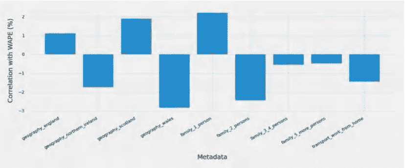

图 7.6 – 项目元数据与 WAPE 的相关性

在检测到强相关性的情况下，你可能会决定对这些群体进行分段并构建多个最适合每个分段的预测器。

- 4. 然后你可以绘制几个选定信号的实际值，并将信号在训练期间取的值与我们在测试中使用的预测窗口期间的实际值进行比较。以下是家庭 MAC000636 的能源消耗图：

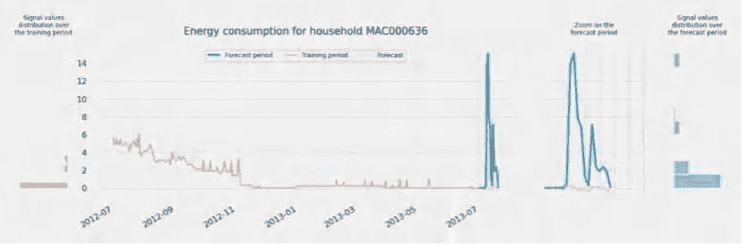

图 7.7 – WAPE 较高的家庭时间序列

在此图中，你可以发现预测（右下角几乎不可见的虚线，也在放大区域中可见）远离实际值（右侧形成高峰的粗线）的一个关键原因。这可能是因为预测器在训练时看到的数据（左侧的细线）与预测窗口期间可以观察到的情况之间存在显著的行为漂移。这进一步通过直方图突出显示，直方图展示了时间序列值在训练期间（左侧）和预测期间（最右侧）的分布。

正如你所见，时间序列数据的漂移会对你某些时间序列的模型准确性产生严重后果，这可能会对终端用户对你的预测的信任产生关键影响。在下一节中，我们将讨论如何从运营角度解决这个问题。

## 模型监控和漂移检测

正如上一节所明确指出的，除了错误分析之外，你还应确保监控数据中任何潜在的偏移。为此，你可以遵循以下流程：

- 1. 构建并存储一个数据集，其中包含你想要用于构建预测器的所有时间序列的训练数据。
- 2. 在全局层面计算数据集的统计特征（例如，值的分布的平均值、标准差或直方图）。
- 3. 在局部层面计算数据集的统计特征（针对每个时间序列）。
- 4. 使用这些初始数据集训练你的预测器并保存性能指标（wQL、MAPE 和 RMSE）。
- 5. 基于此预测器生成新的预测；你在这里只会得到预测结果，目前还没有真实数据可以与之比较。
- 6. 当新数据到来时，计算相同的统计特征并将其与训练时使用的原始值进行比较。
- 7. 现在你有了新数据，计算指标以衡量之前预测的性能并将其与这些实际结果进行比较。
- 8. 你可以将这些统计数据与预测一起显示给你的分析师，以便他们做出适当的决策。这将帮助他们更好地信任 Amazon Forecast 生成的结果。

一旦你建立了此流程，你将能够组织定期审查，以分析数据中的任何偏移或预测性能中的任何漂移，从而决定何时是修改训练数据集并重新训练新预测器的好时机。

## 无服务器架构编排

到目前为止，你一直 heavily 依赖 AWS 控制台来执行所有操作，例如训练预测器、生成预测以及查询或可视化预测结果。在本节中，你将使用 AWS Solutions Library 中的一个解决方案。

AWS Solutions Library 包含了一系列基于云的架构，用于解决许多技术和业务问题。这些解决方案经过 AWS 审核，你可以使用这些构建块来组装自己的应用程序。

你将要实现的解决方案称为 *使用机器学习改进预测准确性*，可以通过以下链接找到：

https://aws.amazon.com/solutions/implementations/improving-forecast-accuracy-with-machine-learning/

在对将在你的账户中部署的组件进行高层次概述之后，你将使用此解决方案构建与你在 *第 5 章，自定义你的预测器训练* 中构建的相同预测器。

## 解决方案概述

当你部署 *使用机器学习改进预测准确性* 解决方案时，以下无服务器环境将在 AWS 云中部署：

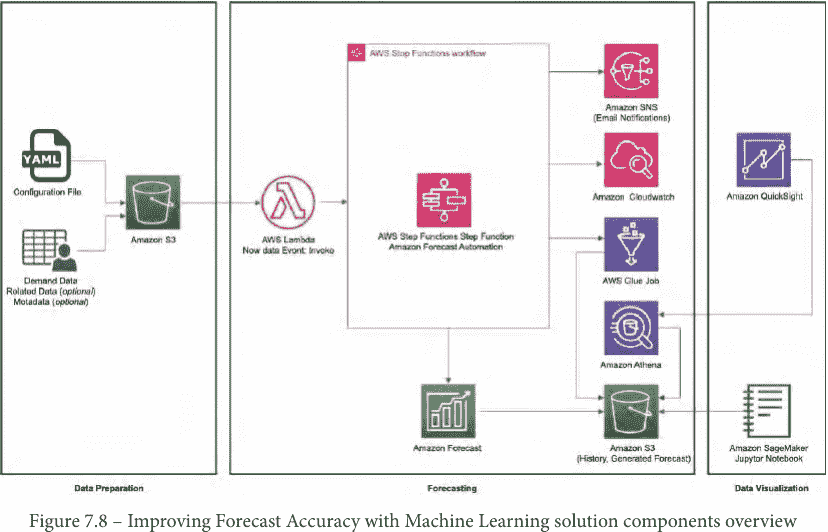

- **AWS Step Functions** 使用状态机将所有 Lambda 函数编排在一起。在下面的图中，你可以看到此状态机在运行时将经历的不同步骤：

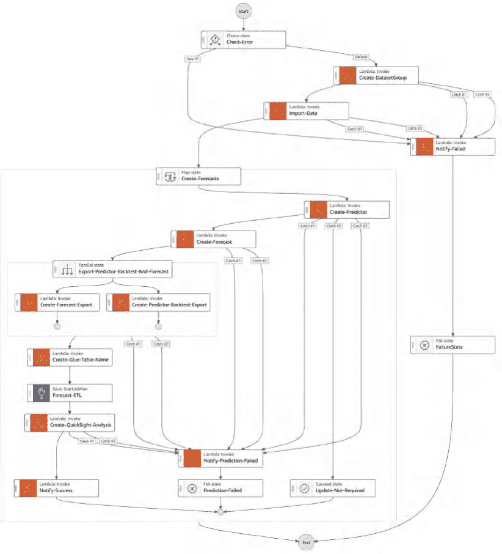

图 7.9 – 预测状态机概述

- - **Amazon Forecast** 是用于训练预测器和生成新预测的关键机器学习服务。
- - **Amazon Simple Notification Service（Amazon SNS）：** Amazon SNS 用于通过电子邮件通知你步骤函数的执行结果。

除了上述组件之外，解决方案的预测部分在内部还使用以下服务：

- - **Amazon CloudWatch：** 此服务用于记录解决方案执行的每个操作。当你的工作流失败时，这对于了解发生了什么特别有用。
- - **AWS Glue：** 此解决方案使用 AWS Glue 作业构建你的预测的聚合视图，包括原始历史数据、回测导出和预测结果。
- - **Amazon Athena：** 此服务允许你使用标准 SQL 查询查询 Amazon S3。在此解决方案中，Amazon Athena 将用于查询由之前的 AWS Glue 作业构建的聚合视图。
- - **Amazon S3：** 用于存储生成的预测。

## 数据可视化组件

解决方案部署的数据可视化组件允许你使用以下任一方式探索你的预测：

- - **Amazon SageMaker** 如果你是一名数据科学家，习惯于使用 Python 操作数据
- - **Amazon QuickSight** 如果你是一名数据分析师，更习惯于使用商业智能工具根据解决方案按预测生成的分析构建仪表板

现在你熟悉了此解决方案使用的不同组件，你将把它部署到你的 AWS 账户中。

## 解决方案部署

要将此解决方案部署到你的 AWS 账户中，你可以按照以下步骤操作：

- 1. 导航到解决方案主页 `https://aws.amazon.com/solutions/implementations/improving-forecast-accuracy-with-machine-learning/` 并向下滚动到页面中间，点击 **在 AWS 控制台中启动** 按钮。

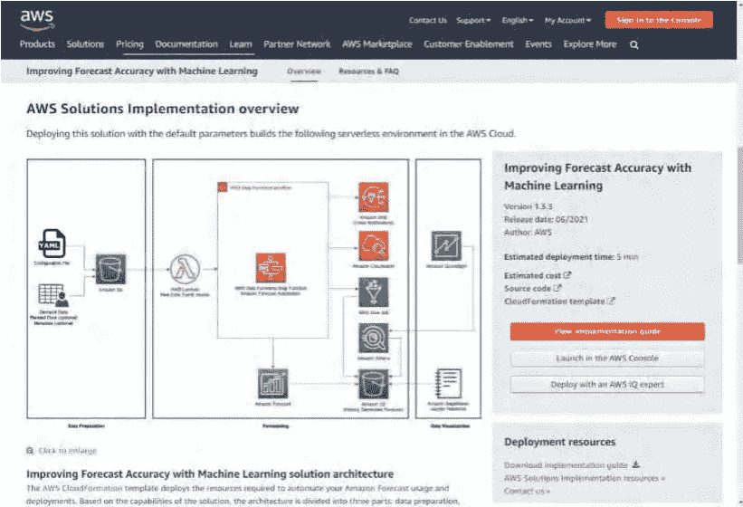

图 7.10 – AWS Solutions 主页

- 2. 你将被带到 CloudFormation 服务主页。如果你尚未登录你的账户，你必须在重定向到 CloudFormation 之前先登录。


3. CloudFormation 是一种用于通过 JSON 或 YAML 格式的模板部署任意 AWS 服务的服务。这让你可以用代码来配置服务，而不是通过点击多个服务控制台来构建一切。点击右下角的 **下一步** 按钮。

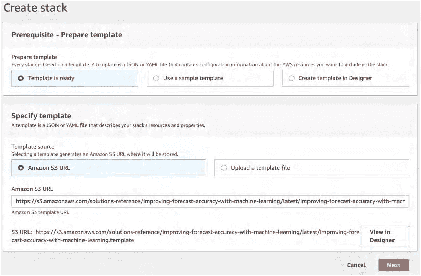

图7.11 – 创建 CloudFormation 堆栈

4. 在堆栈详细信息页面，输入堆栈名称。我给我的堆栈命名为 `energy-consumption-forecast-stack`。

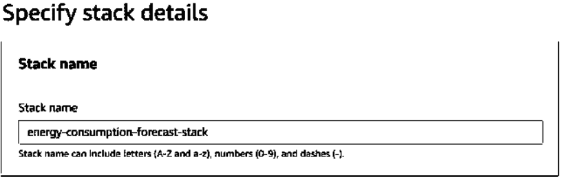

图7.12 – CloudFormation 堆栈名称

5. 在堆栈参数中，你需要在 **Email** 中填写你的电子邮件地址，将 QuickSight 可视化选项留空，并选择 **Yes** 来部署 Jupyter 笔记本。其他所有选项保持默认，然后点击 **下一步**。

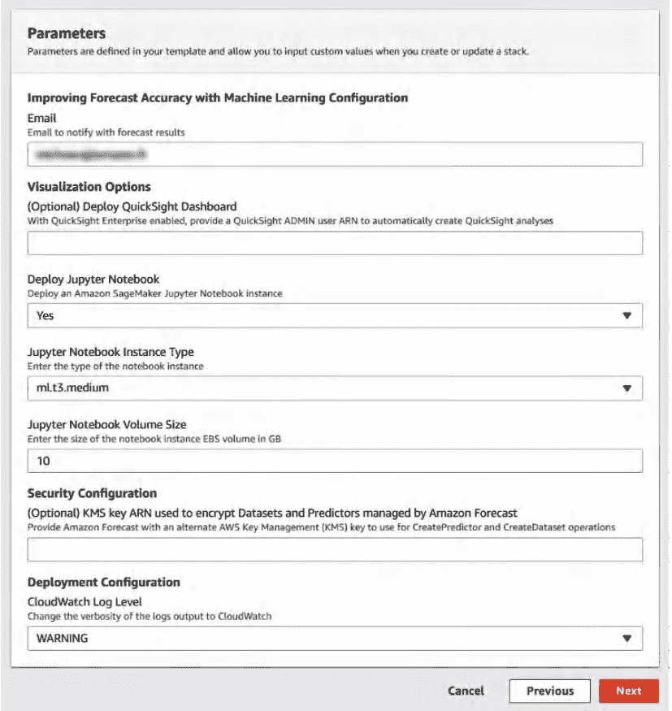

图7.13 – CloudFormation 参数

6. 在下一个屏幕上，你将有机会配置高级选项。你可以将这些值全部保留为默认值，向下滚动屏幕，然后再次点击 **下一步**。

7. 在最后一个屏幕上，你可以查看所有已选择的选项和参数，并滚动到最底部。勾选两个复选框，然后点击“创建堆栈”。

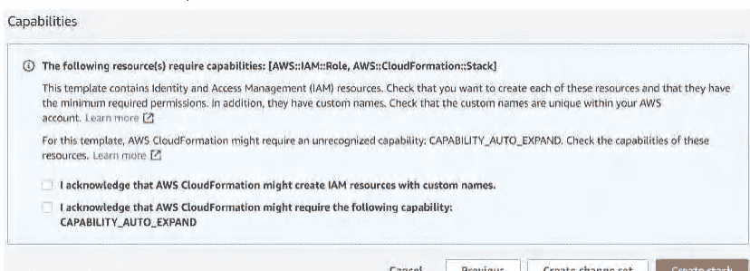

图7.14 – 创建 CloudFormation 堆栈

8. 这将带你进入 CloudFormation 堆栈创建界面，你可以在其中看到堆栈部署正在进行。

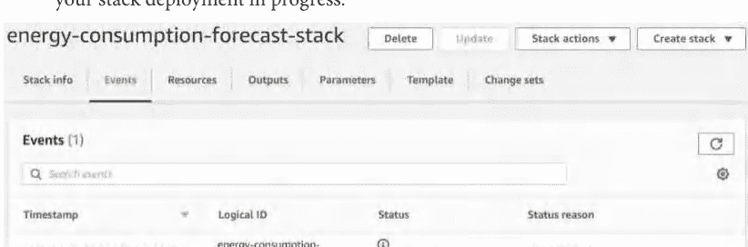

图7.15 – 堆栈创建已开始

9. 在流程结束时，你可以导航到模板部署的“输出”选项卡。记下此选项卡下的 ForecastBucketName 值。

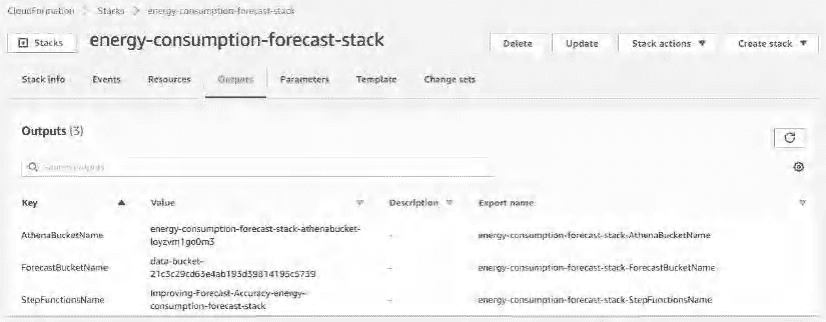

*图7.16 – CloudFormation 堆栈输出*

10. 完成 CloudFormation 堆栈创建后，你还会收到一封邮件，要求你确认订阅通知主题。该 SNS 主题将用于向你发送有关预测过程的通知。点击这封邮件中的 **确认订阅** 链接。

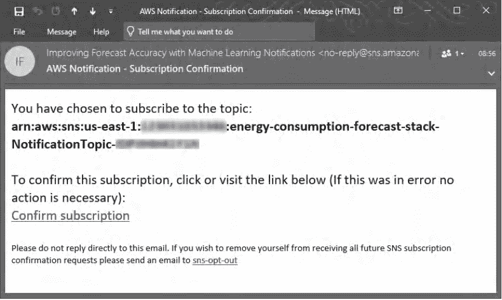

*图7.17 – 通知订阅确认*

你的解决方案现已部署完成。是时候对其进行配置，以匹配我们的能耗预测用例了。

## 配置解决方案

*使用机器学习改进预测准确度*解决方案需要通过一个 YAML 文件进行配置，你需要将该文件上传到先前记下的 S3 存储桶（*解决方案部署部分的第 9 步*）。你将使用的文件将包含一个如下配置的介绍部分：

```
Household_energy_consumption:
  DatasetGroup:
    Domain: CUSTOM
```

然后你需要配置要使用的不同数据集。以下是目标时间序列数据集的部分：

```
Datasets:
  - Domain: CUSTOM
    DatasetType: TARGET_TIME_SERIES
    DataFrequency: D
    TimestampFormat: yyyy-MM-dd
    Schema:
      Attributes:
        - AttributeName: item_id
          AttributeType: string
```

接下来，你将描述预测器的训练方式：

```
Predictor:
  MaxAge: 604800
  PerformAutoML: False
  ForecastHorizon: 30
  AlgorithmArn: arn:aws:forecast:::algorithm/CNN-QR
  FeaturizationConfig:
    ForecastFrequency: D
  TrainingParameters:
    epochs: "100"
    context_length: "240"
    use_item_metadata: "ALL"
    use_related_data: "FORWARD_LOOKING"
```

最后但同样重要的是，你需要定义你感兴趣的预测类型：

```
Forecast:
  ForecastTypes:
    - "0.10"
    - "0.50"
    - "0.90"
```

你可以在之前下载的存档文件中找到完整 YAML 文件的副本。

导航到先前记下的 Amazon S3 存储桶，并将此 YAML 文件上传到该存储桶。另外，点击“创建文件夹”并创建一个名为 train 的文件夹。你的 S3 存储桶根目录如下所示（名为 glue 的文件夹是在初始部署期间创建的，应该已经存在）：

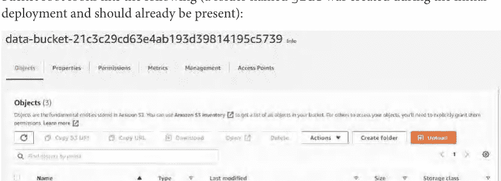

图7.18 – S3 存储桶初始配置

你的解决方案现已配置完成，可以使用了！

## 使用解决方案

部署“使用机器学习改进预测准确度”解决方案后，你现在可以开始使用它了。在本节中，你将学习如何触发和监控该解决方案运行的主要工作流，以及如何可视化结果。

### 监控工作流状态

导航到你的 S3 存储桶的 train 目录，并上传你在“数据准备组件”部分提取的三个 CSV 文件。

3. 你将进入一个页面，其中列出了你的 AWS 账户中可见的所有工作流。如果这是你第一次使用该服务，你的列表中只会包含该解决方案部署的状态机。

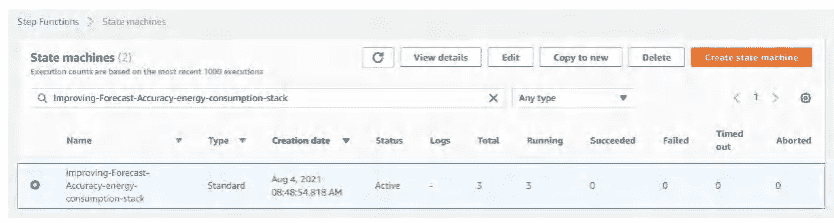

图7.20 – Step Functions 状态机列表

4. 点击 `Improving-Forecast-Accuracy-energy-consumption-stack` 链接，查看此工作流的所有执行情况。你应该会看到三个正在进行的执行，每个上传的文件对应一个。点击一个状态为 Running 的执行。

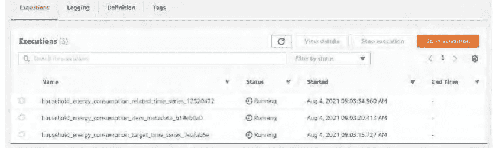

图7.21 – 状态机执行列表

5. 你将看到工作流状态，当前步骤（Import-Data）和之前成功的步骤（Check-Error 和 Create-DatasetGroup）会高亮显示。

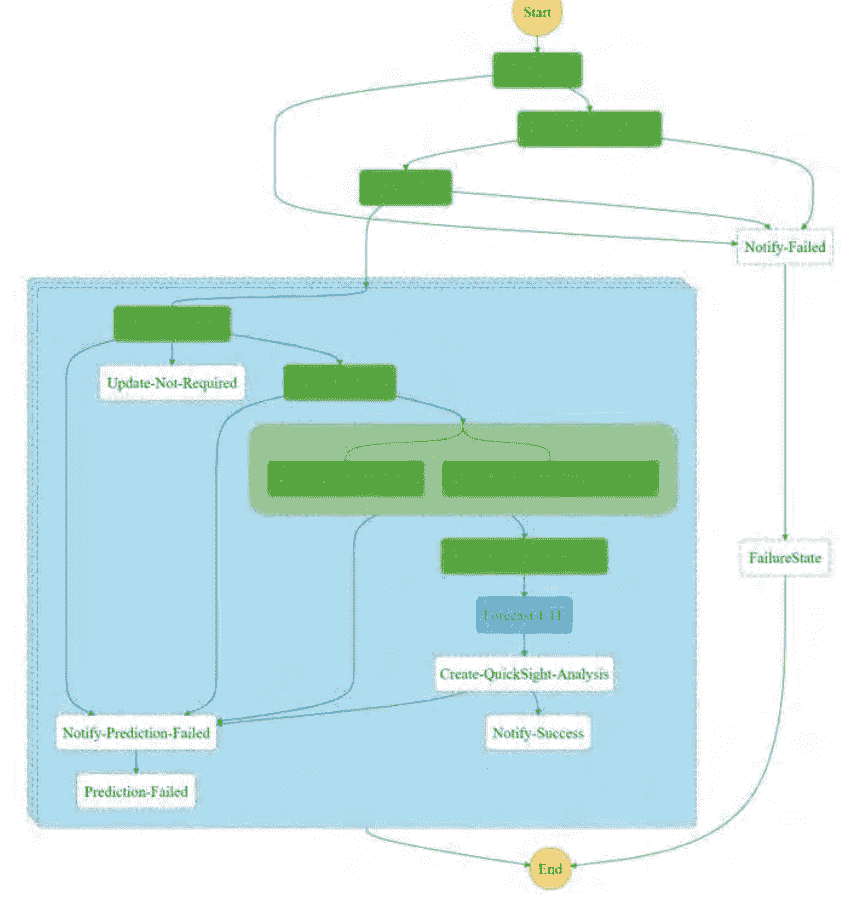

图7.22 – 当前工作流执行的图形检查器

此图实时更新，有助于调试过程中出现的任何问题。一旦你熟悉了该解决方案，通常就不再需要打开 Step Functions 控制台了。

### 可视化结果

当所有工作流成功运行后，你将收到一封电子邮件通知，然后就可以可视化你的预测器结果。请按照以下步骤操作：

- 1. 登录你的 AWS 控制台，在顶部的搜索栏中搜索 SageMaker。
- 2. 点击 **Amazon SageMaker** 进入服务主页。在此页面上，点击左侧菜单栏中的 **Notebook instances** 链接。


图7.23 – Amazon SageMaker 主页

3. 你将进入一个页面，其中列出了你的 AWS 账户中可见的所有笔记本实例。如果这是你第一次使用该服务，你的列表中只会包含该解决方案部署的笔记本实例。

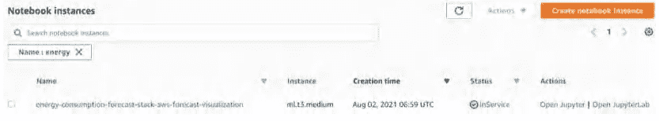

图7.24 – Amazon SageMaker 笔记本实例列表

4. 点击“打开 JupyterLab”链接以访问你的实例；你将被重定向到 JupyterLab 环境。左侧是目录结构。将你在本节开头下载的 .ipynb 文件拖放到该目录结构区域。然后，双击 `EnergyConsumptionVisualization.ipynb` 笔记本名称，在右侧的主界面中打开它。

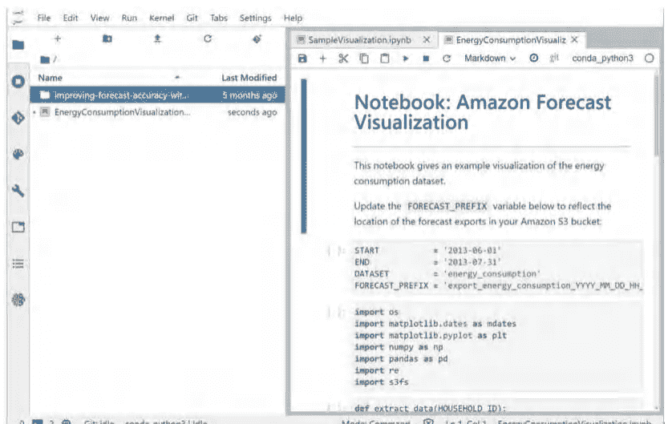

图7.25 – 使用 Jupyter 笔记本进行可视化

5. Jupyter 笔记本按顺序由多个单元格组成。更新第一个单元格，使你的代码与数据集组的名称和预测导出的位置匹配：

```
START           = '2013-06-01'
END             = '2013-07-31'
DATASET         = 'household_energy_consumption'
FORECAST_PREFIX = 'export_energy_consumption_XXXX'
```

6. 从顶部菜单栏中选择 Run，然后选择 Run all cells 来运行整个笔记本。

7. 向下滚动到笔记本底部以查看部分结果。例如，以下是 MAC001259 家庭的结果：

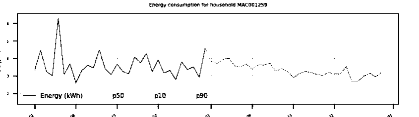

图7.26 – 可视化一个家庭的能耗

## 清理

完成此解决方案的试验后，你可以删除所有已创建的资源，以防止产生额外费用。请按照以下步骤清理你账户中的解决方案资源：

- 1. 登录你的 AWS 控制台，在顶部的搜索栏中搜索 `CloudFormation`。
- 2. 点击 **AWS CloudFormation** 进入服务主页。点击左侧菜单栏中的 **Stacks**，查看你账户中已部署的 CloudFormation 堆栈列表。

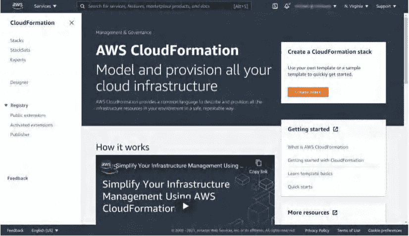

图7.27 – AWS CloudFormation 服务主页

- 3. 在 **Stacks** 表格顶部的搜索栏中，如果你没有立即找到自己的堆栈，可以输入 `energy-consumption`。


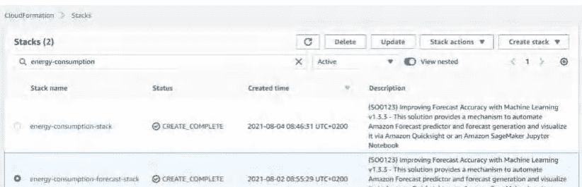

Figure 7.28 – AWS CloudFormation 堆栈列表

+   4. 选择 `energy-consumption-forecast-stack` 并点击顶部的 Delete 按钮。

删除过程开始，几分钟后，你的账户将被清理。此解决方案创建的 Amazon S3 存储桶将由该过程清空并删除。但是，如果你在实验期间创建了其他存储桶并上传了其他文件，你将需要导航到 Amazon S3 控制台并手动删除这些资源。

## Summary

在本章中，你深入了解了预测准确性指标，并学习了如何执行一些分析以更好地了解预测器的性能。特别是，你揭示了数据集中的任何行为变化（数据漂移）可能对预测练习的准确性产生的影响。你还学习了如何摆脱使用控制台，借助 AWS 验证并积极维护的无服务器解决方案，将 Amazon Forecast 结果集成到你的业务运营中。

恭喜！本章结束了专门介绍使用 Amazon Forecast 进行预测的部分。在下一章中，你将开始进入多元时间序列异常检测之旅！
