## An Overview of Amazon Lookout for Equipment

在本章中，你将了解 **Amazon Lookout for Equipment** 可以做什么，它是如何工作的，以及它更适合的应用类型。你还将大致了解如何准备你的数据集以及如何将服务结果集成到你自己的业务流程中。

与 **Amazon Forecast** 和 **Amazon Lookout for Metrics**（你将在本书最后一部分了解）一起，Amazon Lookout for Equipment 是专门针对围绕时间序列数据构建的问题的 **人工智能（AI）/机器学习（ML）托管** 服务之一。Amazon Lookout for Equipment 是一种异常检测服务，可以为工业设备和预测性维护团队提供有价值的见解。

在本章中，我们将涵盖以下主要主题：

- What is Amazon Lookout for Equipment?
- What are the different approaches to tackle anomaly detection?
- The challenges encountered with multivariate time series data
- How does Amazon Lookout for Equipment work?
- How do you choose the right applications?

### Technical requirements

无需具备 **Python** 或 **R** 等语言的动手经验即可跟随本章内容。然而，我们强烈建议你在 AWS 控制台中跟随操作，在那里你可以访问 Amazon Lookout for Equipment 服务。

如果你已有 AWS 账户，你可以连接到 AWS 控制台，点击顶部的搜索栏，并在 **Services** 部分输入 Lookout for Equipment。然后，点击 **Amazon Lookout for Equipment** 以打开服务控制台的登陆页面。

如果你没有 AWS 账户，你需要在登录控制台之前创建一个。要创建 AWS 账户并登录 Amazon Forecast 控制台，请参阅 *Chapter 2, An Overview of Amazon Forecast* 的 *Technical requirements* 部分。

现在你准备好使用 Amazon Lookout for Equipment 了！

### What is Amazon Lookout for Equipment?

Amazon Lookout for Equipment 是可在 AWS 云平台上使用的 AI/ML 托管服务之一。该服务利用你工业设备上的传感器数据，并基于该设备的特定数据自动训练无监督 ML 模型，而无需任何 ML 专业知识。Amazon Lookout for Equipment 分析你传入的传感器时间序列数据，以标记可能导致设备或制造过程出现异常或故障的早期预警信号（例如事件）。Amazon Lookout for Equipment 是 **资产无关** 的。这意味着除了时间序列数据之外，你无需提供正在监控的过程或设备的特征（例如设备的品牌和型号、时间序列数据的测量单位、资产的年龄等）即可使用该服务。

**托管服务** 是仅由终端用户提供数据并配置参数以满足其需求的服务。所有其他任务，*被认为是无差别的繁重工作*，均由服务代表用户执行。这包括所有基础设施管理的自动化。作为 Amazon Lookout for Equipment 用户，你无需配置和管理虚拟机、配置用户账户、实施安全、规划如果请求量增加时的可扩展性，或停用未使用的资源。

在 AI/ML 托管服务的情况下，一些数据准备、摄取任务和模型管理活动也在后台执行，使你能够主要专注于要解决的问题。Amazon Lookout for Equipment 是一种可扩展的托管服务，可自动化从数据摄取到模型部署和提供推理结果的端到端异常检测管道。此外，该服务在后台处理数据准备。Amazon Lookout for Equipment 可以执行以下功能：

- 它可以为你填充数据集中的 *缺失值*。
- 它可以处理 *时间戳未对齐* 的情况（即时间序列之间没有共享的通用日期时间索引）。
- 它可以 *准备时间序列*，使其可被多个算法摄取。Amazon Lookout for Equipment 可以为深度学习或适用于异常检测的统计模型准备适当的时间序列数据集。
- 它可以根据你的历史时间序列数据 *计算智能阈值*，以决定给定的数据点是否应标记为异常。许多无监督方法要求你提供污染水平，即数据集中存在的外<|message|> 


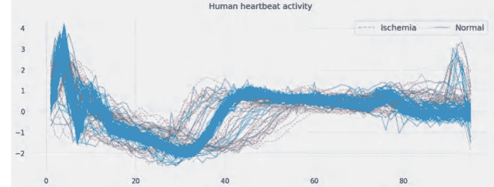

图8.3 – 100名患者的心跳活动（ECG200数据集）

在本章剩余部分，我们将重点关注单事件异常和事件范围异常，因为时间序列分类并不是Amazon Lookout for Equipment的目的。这种分类可以通过降维或不相似性技术来实现。

现在，让我们来看看可以用来构建异常检测系统的不同方法族。

## 基于模型的方法

基于模型的方法通过计算实际观测值（或多元数据集的一组观测值）与其期望值之间的距离来检测异常。观测值 y_t（在单变量情况下可以是单个值，在多元情况下可以是向量）如果与期望值 ŷ_t 的距离大于给定阈值 τ，则被视为异常。每种方法都有自己计算该阈值和给定时间序列期望值的方式。

### 估计模型

估计模型使用 y_t 的过去和未来值。基于估计模型的方法示例使用中位数或中位数绝对偏差来计算 ŷ_t。其他方法使用平滑方法（如B样条、核函数、指数加权移动平均、斜率约束和高斯混合模型 (https://doi.org/10.1109/SPW.2017.9)）对单变量时间序列数据进行建模。您可以在 https://scikit-learn.org/stable/modules/generated/sklearn.mixture.GaussianMixture.html 找到scikit-learn中高斯混合模型的实现。

孤立森林算法可以应用于整个时间序列，为每个观测值分配异常分数。然后由您定义适当的阈值，以帮助您隔离业务场景中感兴趣的异常。您可以在 https://scikit-learn.org/stable/modules/generated/sklearn.ensemble.IsolationForest.html 找到scikit-learn中孤立森林的示例实现。

在 https://docs.aws.amazon.com/sagemaker/latest/dg/randomcutforest.html 中，还可以在内置的 **SageMaker Random Cut Forest算法** 中找到孤立森林的稳健变体。

在多元场景中，自编码器是一种神经网络，它学习一组信号的正常行为，并在遇到异常时产生较大的重构误差。因此，自编码器可以被视为一种半监督方法；这是因为您只需确保模型输入的时间序列没有异常（无需精确标注每个异常）。

### 预测模型

这些模型仅使用 $y_t$ 的过去值。这类方法可用于流数据，在进行推理时未来值未知。该家族中已经设计了几种统计和神经网络方法，如下所示：

- 例如，某些方法在底层利用ARIMA模型来拟合数据并预测时间序列的期望值。
- DeepAnT是这个家族中深度学习模型的一个例子 (https://doi.org/10.1109/ACCESS.2018.2886457)。DeepAnT可用于单变量和多变量时间序列。为了同时对数据集中多个时间序列之间的时间依赖性和相关性进行建模，设计了 **上下文隐马尔可夫模型（CHMM）**。
- 极值理论被用于单变量时间序列的 **流式超阈值（SPOT）** 和DSPOT（即带漂移的SPOT）方法（请参阅 http://dx.doi.org/10.1145/3097983.3098144），以及多变量情况下的 **变分自编码器（VAEs）**。极值理论允许这些模型自动选择合适的阈值来将观测值标记为正常或异常。

## 其他异常检测方法

其他单变量和多变量方法被设计用来基于单变量和多变量数据集的不同表示（或编码）来捕获异常，如下所示：

- **基于密度的方法**：如果某个观测值在一定距离内的观测值少于 *N* 个，这类方法将其分类为离群点。在处理时间序列数据时，多位作者建议将时间序列切片为连续的滑动窗口，以考虑此类数据的时间性。
- **基于直方图的方法**：直方图技术通过将时间序列替换为具有 *B* 个区间的 *HB* 直方图来创建紧凑表示。例如，可以将连续数据点的值合并为单个值（例如它们的平均值）。
- **基于不相似性的方法**：这些多元方法被设计用于度量多元点之间的两两不相似性。例如，您可以度量每个连续向量的相似性，当不相似性高于某个阈值时，将任何点分类为异常。

## 将单变量方法用于多变量数据集

在之前的回顾中，我们提到了一些专门为多变量数据集构建的方法。然而，鉴于多变量时间序列数据集是许多单变量时间序列的集合，您也可以应用前面讨论的任何单变量方法。但请注意，多变量数据集不同信号之间的依赖关系将丢失，导致数据集从多个（可能相关的）时间序列简化为数量更少的独立单变量时间序列。

在应用您选择的单变量异常检测技术来发现多变量异常之前，可以应用降维方法来实现这一结果。

既然我们已经回顾了一些处理时间序列异常检测的方法，接下来我们将重点讨论在处理多变量时间序列时可能遇到的具体挑战。

## 多变量时间序列数据所面临的挑战

您可以在多变量时间序列数据中发现单事件异常和事件范围异常。然而，问题的多变量性质也为您提供了更多上下文，您可能会开始看到一些异常，因为不同信号之间的关系开始偏离正常状态。让我们深入了解下图（也就是*图8.2*）：

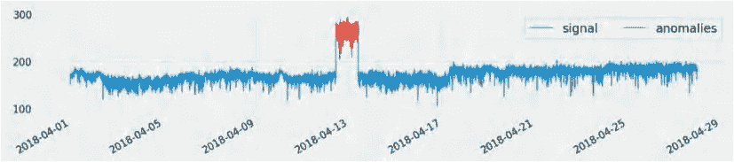

图8.4 – 事件范围异常

该信号实际上是包含51个传感器的多变量数据集的一部分，这些传感器收集水处理设施中水泵的数据。让我们将该信号与第二个信号一起绘制，如下所示：

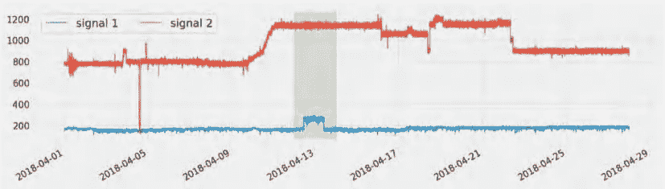

图8.5 – 多变量时间序列异常

如您所见，当添加上下文信息时，您可能不会将高亮区域标记为异常，因为当信号2（顶部）从平均值800转变为平均值1,150时，这可能是信号1（底部）的正常行为。另一方面，4月17日前后似乎发生了某些情况，因此您可能需要扩展此上下文并绘制其他信号来确认这一直觉。

如您所见，在多元环境中定义异常现在变得非常具有挑战性，因为这要求您在牢记每个信号与其他信号之间关系的同时，构建对每个单独信号的整体视图。这正是深度学习算法发现多个时间序列信号之间复杂非线性关系的能力派上用场的地方！

现在您已经准备好深入了解Amazon Lookout for Equipment如何帮助您应对所有这些挑战。

## Amazon Lookout for Equipment如何工作？

在本节中，您将首先了解该服务使用的不同概念，从而学习Amazon Lookout for Equipment的工作原理。然后，您将更深入地了解这些概念如何协同编排以构建异常检测模型。本节最后将概述该服务使用的定价模型。

### 定义关键概念

为了构建异常检测模型，Amazon Lookout for Equipment涉及以下概念和资源：

- **标签（Tags）：** 标签是时间序列的名称，可以链接到传感器、设备监控状态或过程变量。在本章中，我们将互换使用**标签（tags）**、**信号（signals）**和**传感器（sensors）**这些术语。
- **数据集（Datasets）：** 数据集是承载时间序列数据的容器。Amazon Lookout for Equipment算法使用这些数据集来训练模型。每个数据集由模式定义，您可以在其中定义时间序列标签列表。
- **组件（Components）：** 在定义数据集的数据模式时，您可以将标签分组到组件中。这是一种人为构造，对建模过程没有影响。但是，它将使您能够轻松地在与不同组件关联的传感器子集上训练模型。根据您要建模的内容，您可以使用组件级别将传感器组织为单条生产线上的不同设备，在多个设施中重新分组，或根据测量单位对其进行组织。


- **标签：** 尽管 Amazon Lookout for Equipment 仅使用无监督方法，你也可以向训练过程提供已知的时间范围，在这些范围内，你了解时间序列行为并不代表资产或过程的正常操作模式。通常，这些标签涵盖历史维护期或已知异常范围，在训练时用于对测试算法进行排名（请参阅本章中的*Amazon Lookout for Equipment 工作流概述*部分）。
- **模型：** Amazon Lookout for Equipment 可访问超过 28,000 种模型和超参数配置的组合。在根据是否存在标签来选择更适合数据集的模型时，该服务可以访问这个模型库。算法选择对你来说是完全抽象的，而且 Amazon Lookout for Equipment 背后的应用科学团队孜孜不倦地研究新的算法和组合，以丰富这个模型库。
- **调度器：** 一旦模型训练完成，你可以安排每 5、10、15、30 或 60 分钟定期执行推理。推理调度器会在选定的时间间隔唤醒，在 Amazon S3 的特定位置查找新数据，通过训练好的模型运行这些数据，并将推理结果存储回 Amazon S3，以供进一步处理。

现在，让我们看看 Amazon Lookout for Equipment 如何利用所有这些概念来训练和运行异常检测模型。

## Amazon Lookout for Equipment 工作流概述

构建无监督异常检测过程涉及两个步骤：

1. 我们首先查看历史时间序列，以模拟设备或过程正常行为，正如这些数据所表征的那样。这确立了资产的基线。
2. 然后，我们利用这一知识将多元时间序列之间关系的任何偏差标记为异常。

如下图所示，Amazon Lookout for Equipment 提供了一种方法来处理上述两个步骤：

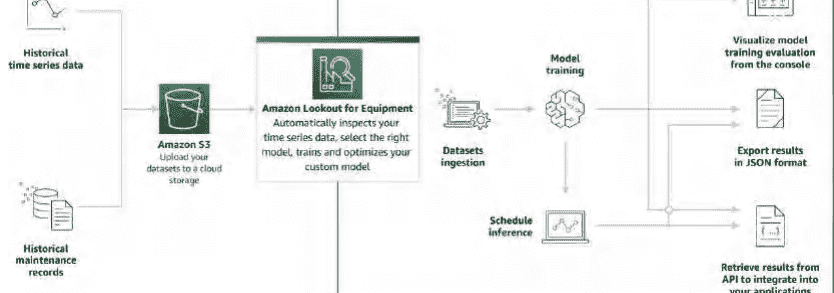

图8.6 – Amazon Lookout for Equipment 概览

让我们深入分析此图，解释使用 Amazon Lookout for Equipment 必须经历的不同步骤：

- **将数据上传并摄取到服务中**：这将在*第9章，创建数据集并摄取数据*中详细说明。Amazon Lookout for Equipment 可以使用位于 **Amazon Simple Storage Service (S3)** 中的数据，这是一种可扩展的数据存储基础设施，用于存储任何类型的对象或数据集。在摄取时，Amazon Lookout for Equipment 会检查你的数据，并返回任何可能妨碍异常检测模型正常训练的错误（例如，与数据集模式相关的信号缺失，或值过少的信号）。
- **训练模型**，如*第10章，训练和评估模型*所述：根据所获得的性能，你可以多次迭代数据摄取和训练步骤，以达到期望的性能。
- 一旦你拥有满意的模型，就可以开始*为其安排推理*。当你配置并启动调度器时，Amazon Lookout for Equipment 会定期唤醒调度器，为其提供新可用的数据。推理结果将返回到 Amazon S3 以进行进一步的后处理。

你现在应该对如何利用此服务将其集成到你自己的异常检测系统有了高层次的了解。你需要的最后一条信息是清晰理解定价模型，以便更好地优化使用此服务的方式。

## 定价

与许多 AWS 服务一样，你只需按使用量付费，无需预先承诺。尽管构建**概念验证**的服务成本极低（尤其是如果你可以利用免费套餐的话），但在使用 Amazon Lookout for Equipment 运营异常检测管道时，需要考虑三个维度。如下所示：

- **存储：** Amazon Lookout for Equipment 会摄取并准备数据，以确保最短的训练时间。存储按服务中摄取的用于训练模型的历史数据每 GB 计费。用于推理的数据不收取摄取费用。
- **训练小时数：** 每次基于你的数据训练新的自定义模型时，按照训练小时数计费。Amazon Lookout for Equipment 将提供适当数量的计算资源，以并行训练多个模型并更快地选择最佳模型。例如，如果模型在一小时内准备好，且服务配置的计算资源是基线的 4 倍，则实际计费的小时数将等同于实际配置的计算资源数量（即 4 小时）。
- **推理小时数：** 无论配置的频率如何，调度器每运行一小时的推理即为计费一小时。推理费用向上取整到最近的小时。

如果这是你首次在某个账户中使用 Amazon Lookout for Equipment，你可以使用免费套餐，免费使用该服务 1 个月。在此期间，如果使用以下服务，你不会被收费：

- **存储：** 少于 50 GB 的历史数据摄取量
- **训练小时数：** 少于 250 个训练小时
- **推理小时数：** 少于 168 小时的计划推理

AWS 服务开发人员不懈努力降低服务的运营成本，价格下调经常发生。在撰写本文时，这些组件的定价如下：

- **存储：** 每 GB 0.20 美元
- **训练小时数：** 每小时 0.24 美元
- **推理小时数：** 每小时 0.25 美元

如需最新的定价，你可以查看 Amazon Lookout for Equipment 定价页面：

```
https://aws.amazon.com/lookout-for-equipment/pricing/
```

以上定价概述是我对 Amazon Lookout for Equipment 介绍的结尾。在下一节中，你将了解你的应用程序需要满足哪些不同要求，才能成功利用此服务的能力。

## 如何选择正确的应用程序？

你已经成功地将机器学习项目定义为异常检测问题，并收集了一些历史时间序列数据集。那么，Amazon Lookout for Equipment 是否是提供所需见解的理想选择？让我们回顾一些考虑因素，以帮助你确定 Amazon Lookout for Equipment 是否适合你的异常检测场景：

- 延迟要求
- 数据集要求
- 用例要求

### 延迟要求

使用 Amazon Lookout for Equipment，*训练必须发生在云端*。如果你的数据不在 Amazon S3 等云存储中，第一步是将其传输到那里。

在预测时，*推理也将在云端进行*。你需要将最新数据发送到云端，训练好的模型也将生成并存储在云端。由于推理在云端进行，你将依赖本地系统与互联网之间的网络延迟。如果你需要近乎实时的异常检测来为工厂中的优化算法提供数据，那么 Amazon Lookout for Equipment 可能是错误的选择，你应该考虑构建自定义异常检测模型，将其部署在边缘（例如，利用 **Amazon SageMaker** 及其 **Edge Manager** 功能在本地机器上编译、部署和管理机器学习模型）。

### 数据集要求

要训练模型，你的所有时间序列信号需要有*至少180天的数据*。此外，你可能还想评估模型。我们建议至少有 9 个月到 1 年的数据，以便使用 Amazon Lookout for Equipment 轻松训练和评估异常检测模型。如果某些时间序列缺失数据过多，你可能会触发错误，因为可用于训练模型的数据少于 180 天。

*过多缺失数据*也会在摄取时阻塞流程。如果你为过去的维护期或已知异常期提供带标签的时间范围，也需要考虑这些范围，因为训练和评估期间都会从数据中移除这些时间段。每个信号在训练期和评估期都必须至少存在 50% 的数据。

最后但同样重要的是，你的数据必须具有*兼容的时间间隔*。尽管 Amazon Lookout for Equipment 可以处理保留原始采样率的数据集，该服务可以将数据从 1 秒到 1 小时间隔进行重采样，最常见的间隔是 1 分钟或 5 分钟。高频数据集（例如以 10 毫秒采样率收集的传感器数据）需要你聚合数据，以确保训练数据在 6 个月内低于 150 万行（如前所述，最小范围是 6 个月）。

另一方面，如果你的用例仅提供高于 1 小时间隔的采样率，Amazon Lookout for Equipment 可能难以发现早期预警事件，因为这种频率会切断服务用于检测有用事件的许多弱信号。

### 用例要求

在本章的整个内容中，你阅读了多个异常检测示例。此外，你看到了 Amazon Lookout for Equipment 为你承担了多少繁重工作。然而，有些情况和用例并不适合 Amazon Lookout for Equipment：

- **单变量数据：** Amazon Lookout for Equipment 在能够通过查看多个相互关联的时间序列数据建立基线关系时，才能发挥最佳效果。


- **设备并非持续运行：** Amazon Lookout for Equipment 专为以连续运行设备及低工况变异性为特征的工业流程而构建。如果您的流程使用工业旋转机械（如涡轮机、压缩机、电动机和泵），Amazon Lookout for Equipment 很可能是一个理想选择。如果您的流程是间歇性运行的（例如，大部分时间停放的汽车、手动操作的设备，或工况变化极大的 CNC 机床），则这些流程所采集的内在时间序列的预测能力较难被 Amazon Lookout for Equipment 有效捕捉。一般而言，正常操作的变化越多，此类服务对您的系统进行建模的难度就越大。
- **批处理流程：** 将批处理数据构建为可供 Amazon Lookout for Equipment 使用的格式，是一项额外的预处理步骤，需要适当的领域专业知识来指导特征工程。批处理流程并不适合直接使用 Amazon Lookout for Equipment。但是，如果您的特征工程能够跨多条生产线、多种产品和多个工厂进行扩展，则可以将此步骤自动化，并将这些计算字段输入到 Amazon Lookout for Equipment 中。
- **数据不足6个月：** 必须至少提供6个月的历史流程和设备数据，才能训练 Amazon Lookout for Equipment 模型。如果您想评估训练后的模型，可能还需要额外几周的数据。
- **当已知异常不可用时：** 如果您想评估该服务捕捉对业务流程非常重要的异常的能力，则需确保此类异常的实例至少出现在评估时间段内（理想情况下同时出现在训练和评估时间段内）。如果您知道存在某些异常，但无法精确标注，仍可使用该服务来帮助您更精确地识别它们。

现在，您应该对如何构建异常检测问题以充分利用 Amazon Lookout for Equipment 有了良好的理解。此外，您还可以利用本节来了解如何丰富现有数据集，以成功使用此服务（例如，标注异常时间段、添加更多传感器或提取更长时间段的数据）。

## 总结

Amazon Lookout for Equipment 是在云端运行的 AI/ML 托管服务。它利用多种算法对多元数据集执行异常检测，同时抽象化您在构建自定义模型时需要做出的所有机器学习决策（例如，*如何设置阈值以实际捕捉我感兴趣的异常？*）。

该服务也是完全无监督的。这意味着您无需花费宝贵的时间来标注海量的多元时间序列数据。Amazon Lookout for Equipment 使构建可应用于每个单独资产的模型群变得简单。这使服务能够学习每个资产在一年中根据其制造、操作和维护方式形成的特定行为。

在本章中，您了解了多元异常检测可以采取的多种方法，以及 Amazon Lookout for Equipment 为您应对的挑战。您还了解了该服务操作的关键构建块，并且应该清楚哪些应用程序是使用 Amazon Lookout for Equipment 的理想候选者。

在下一章中，我们将通过创建数据集并摄取一些时间序列数据来创建我们的第一个异常检测项目。

- 生成 JSON 架构
- 创建数据摄取作业
- 了解常见的摄取错误和解决方法

## 技术要求

无需具备 Python 或 R 等语言的实践经验即可跟随本章内容。但是，我们强烈建议您在连接到自己的 AWS 账户并打开 Amazon Lookout for Equipment 控制台的情况下阅读本章，以便在您这边执行不同的操作。

要创建 AWS 账户并登录 Amazon Lookout for Equipment 控制台，您可以参考第2章“Amazon Forecast 概述”中的技术要求。

在本书随附的 GitHub 代码库中，您会找到一个笔记本，它将向您展示准备我们将要从现在开始使用的数据集的详细步骤。此准备是可选的，以便跟随本章内容。在首次阅读时，我建议您从以下链接下载准备好的数据集：

```
https://packt-publishing-timeseries-on-aws-michaelhoarau.s3.eu-west-1.amazonaws.com/part2-amazon-lookout-for-equipment/lookout-for-equipment.zip
```

在那里，您可以登录 AWS 控制台并跟随本章内容操作，无需编写一行代码。

在后续阅读中，请随意浏览准备代码，以了解如何准备一个可供 Amazon Lookout for Equipment 使用的数据集。您会在本书随附的 GitHub 代码库中找到包含所有这些准备的笔记本：

```
https://github.com/PacktPublishing/Time-series-Analysis-on-AWS/blob/main/Chapter09/chapter9-preparing-l4e-dataset.ipynb
```

此笔记本将帮助您了解构建成功模型所需的预期格式。

## 为异常检测目的准备数据集

在训练异常检测模型之前，您需要准备一个多元时间序列数据集。在本节中，您将学习如何准备此类数据集，以及如何允许 Amazon Lookout for Equipment 访问它。

## 准备数据集

我们将使用的数据集是 Kaggle 上数据集的一个清理版本，可在以下位置找到：

https://www.kaggle.com/nphantawee/pump-sensor-data/version/1

此数据集包含泵损坏以及泵在标称条件下运行时的已知时间范围。为了使此数据集能够被输入到 Amazon Lookout for Equipment，请执行以下步骤：

- 1. 下载原始时间序列数据集。此数据包含5个月的数据，采样率为1分钟，并包含几个感兴趣的事件。原始数据集范围从 **2018-04-01** 到 **2018-08-31**。

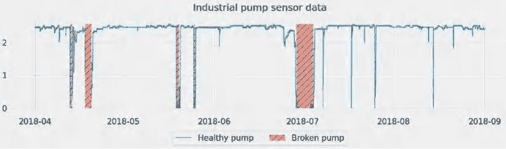

图 9.1 – 工业泵数据集概览

- 2. Amazon Lookout for Equipment 要求至少6个月的数据才能训练模型。为了获得足够长的时间段，同时还有一些异常可供验证，我应用了一个新的日期时间索引，使用相同的数据点数和开始日期，但应用了5分钟的采样率。这产生了相当于25个月的数据，范围从 **2018-04-01** 到 **2020-05-04**。

- 3. 使用 `machine_status` 列来识别泵损坏的时间范围。我将这些范围整理成一个 DataFrame，包含每个事件的开始和结束日期时间。

|   | start               | end                 |
|---|---------------------|---------------------|
| 0 | 2018-05-30 01:30:00 | 2018-06-03 08:15:00 |
| 1 | 2018-06-24 14:25:00 | 2018-07-06 09:40:00 |
| 2 | 2018-11-27 04:25:00 | 2018-12-02 17:50:00 |
| 3 | 2018-12-26 14:25:00 | 2018-12-29 16:55:00 |
| 4 | 2019-06-19 01:55:00 | 2019-07-19 05:10:00 |
| 5 | 2019-08-03 12:50:00 | 2019-08-04 16:20:00 |
| 6 | 2019-10-30 09:55:00 | 2019-10-31 16:15:00 |

图 9.2 – 异常范围概览

4. 两个传感器也缺失了大量数据（sensor_15 和 sensor_50）。为了本教程的目的，我从数据集中完全移除了这两列。

5. 为每个传感器创建一个单独的 CSV 文件，并将它们各自置于一个专用文件夹中。最终，获得的数据集结构如下所示：

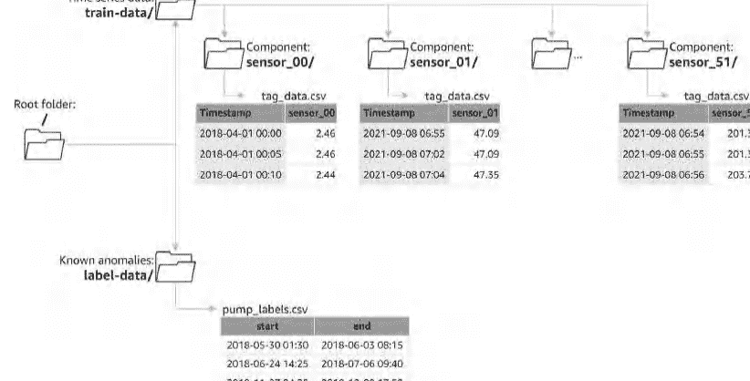

图 9.3 – 泵数据集结构概览

无需其他特定的预处理，您现在将把这个准备好的数据集上传到 Amazon Lookout for Equipment 可以访问的位置。

## 将您的数据上传到 Amazon S3 进行存储

您可以直接从以下位置下载我准备好的存档：

```
https://packt-publishing-timeseries-on-aws-michaelhoarau.s3.eu-west-1.amazonaws.com/part2-amazon-lookout-for-equipment/lookout-for-equipment.zip
```

下载此存档并解压缩。您应该得到以下内容：

- 50 个 CSV 文件（位于 train-data 文件夹中），包含 50 个传感器的时间序列数据
- 一个 CSV 文件（名为 pump_labels.csv，位于 label-data 文件夹中），包含已知异常预期时段的标签数据


- 一个 JSON 文件（名为 `schema.txt`），其中包含你稍后创建数据集时要使用的 schema。

在下一节中，你将创建一个 Amazon S3 存储桶，将数据集上传到那里，并授权 Amazon Lookout for Equipment 访问这些数据。

## 创建 Amazon S3 存储桶

准备好数据集后，让我们在 Amazon S3 上创建一个存储桶，并将数据上传到其中：

1. 如果你已经完成了本章开头的*技术要求*前置条件，那么你应该已经登录到 AWS 控制台；否则，打开你常用的浏览器并登录 AWS 控制台。

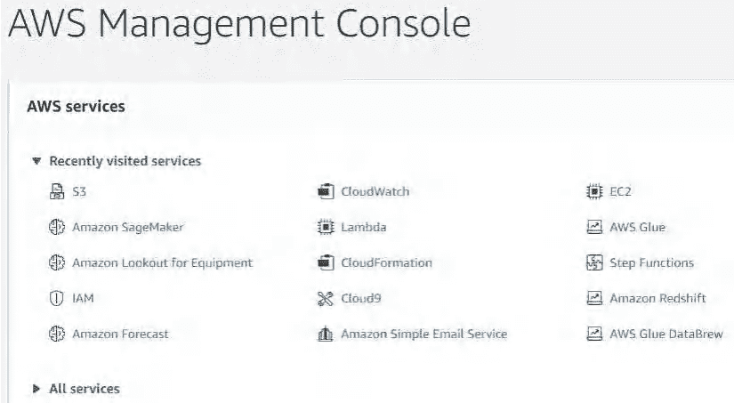

图 9.4 – AWS 控制台主页

2. 在控制台的左上角，你会看到一个**服务**下拉菜单，其中会显示所有可用的 AWS 服务。在**存储**部分，找到**S3**服务并单击其名称以进入 S3 控制台。

3. 在这里，我们将单击存储桶列表部分顶部的**创建存储桶**按钮。

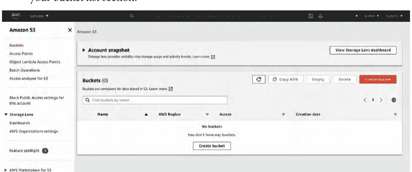

图 9.5 – Amazon S3 控制台起始页

4. 你将进入存储桶创建页面。

### 常规配置

**存储桶名称**：`timeseries-on-aws-lookout-equipment-michaelhoarau`

存储桶名称必须唯一，且不能包含空格或大写字母。请参阅存储桶命名规则。

**AWS 区域**：EU (Ireland) eu-west-1

**从现有存储桶复制设置** - 可选：仅复制以下配置中的存储桶设置。选择存储桶。

图 9.6 – Amazon S3 存储桶创建表单

5. 为你的存储桶选择一个名称。该名称在整个 S3 服务中必须唯一。我将我的命名为 `timeseries-on-aws-lookout-equipment-michaelhoarau`。这应该足够唯一了。

6. 选择一个 AWS 区域，Amazon Lookout for Equipment 将从该区域获取你的数据。我为我的存储桶选择了**欧洲（爱尔兰）**区域。

> **重要说明**
>
> 在撰写本书时，Amazon Lookout for Equipment 仅在以下区域可用：美国东部（弗吉尼亚北部）、亚太地区（首尔）和欧洲（爱尔兰）。请确保你选择其中一个区域来创建存储桶，否则你将无法将数据导入 Amazon Lookout for Equipment。

7. 你可以将所有其他字段保留默认值，并单击**创建存储桶**。你将返回 S3 主页，并应该在存储桶列表中看到你新创建的存储桶。窗口顶部的一条绿色消息也会确认你的存储桶已成功创建。

你的 Amazon S3 存储桶现已创建，你可以开始将文件上传到此位置。

## 将数据集上传到 Amazon S3

要上传数据集，请完成以下步骤：

1. 在 S3 主页上的存储桶列表中，单击你刚创建的存储桶的名称。

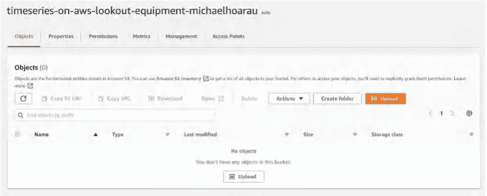

图 9.7 – 你的新存储桶中的 Amazon S3 空对象列表

此页面列出了此存储桶中所有可用的对象；目前它是空的。

2. 在这里，单击对象列表顶部的**上传**按钮。你将进入上传页面，可以在其中单击**添加文件**按钮，或拖放从你之前下载的压缩包中解压出的所有 CSV 文件。这些文件应位于名为 `train-data` 和 `label-data` 的两个目录中。你可以直接将这两个文件夹拖放到浏览器窗口中。你不需要上传 `schema.txt` 文件。

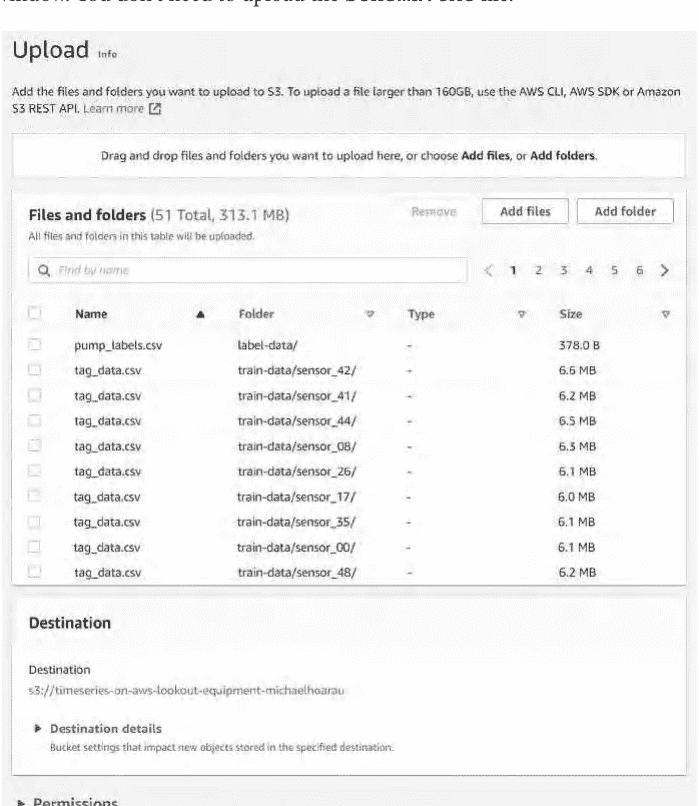

图 9.8 – 在 Amazon S3 上上传工业泵数据集

3. 将所有其他字段保留默认值，滚动到屏幕底部，并单击**上传**开始上传文件。总共有 313 MB，具体时间取决于你的互联网上传带宽。传输过程中会显示上传状态页面。

4. 完成后，你可以单击**退出**按钮返回存储桶根目录下的对象列表。

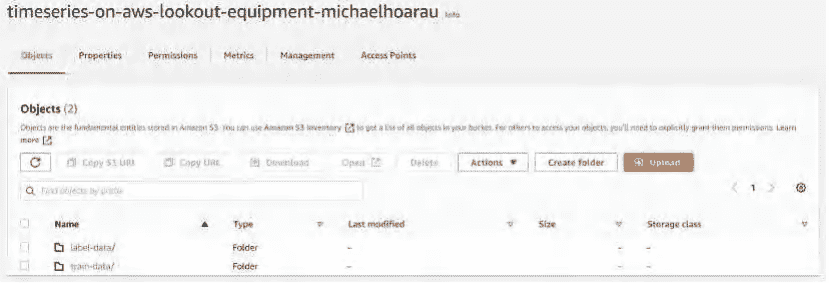

图 9.9 – 工业泵数据集上传完成

上传完成后，你应该会在对象列表中看到两个文件夹，一个用于标签数据，另一个（`train-data`）包含你将用于训练模型的时间序列传感器数据。

5. 单击每个文件夹名称并复制它们的 S3 URI（它们在 Amazon S3 中的地址），以便稍后访问（例如，粘贴到桌面上的记事本中）；这些文件夹在 Amazon S3 中的 S3 URI 格式如下：

```
s3://BUCKET_NAME/FOLDER_NAME/
```

例如，我的 `train-data` 文件夹的 S3 URI 如下：

```
s3://timeseries-on-aws-lookout-equipment-michaelhoarau/train-data/
```

我们在导入数据时需要 `train-data` 链接，在训练新模型时需要 `label-data` 链接。现在，让我们将此 S3 存储桶的访问权限授予 Amazon Lookout for Equipment。

## 授予 Amazon Lookout for Equipment 访问你的 S3 存储桶的权限（可选）

默认情况下，不同 AWS 服务之间实施的安全机制会禁止 Amazon S3 以外的任何服务访问你的数据。在你的账户中，你可以上传、删除或移动刚刚创建的存储桶中的数据。然而，Amazon Lookout for Equipment 是一项不同的服务，因此无法访问这些数据。我们需要指定它能够访问此存储桶中的任何数据。

你可以在导入步骤中直接从 Amazon Lookout for Equipment 控制台配置此访问权限。但是，如果你想更深入地控制账户内创建的角色和不同访问权限，可以阅读本节。否则，可以跳过此节，稍后再回来。

要允许 Amazon Lookout for Equipment 服务访问你的 S3 存储桶，我们将使用 AWS **身份和访问管理（IAM）** 服务创建一个专用的 **IAM 角色**：

1. 在控制台的左上角，单击**服务**下拉菜单，并搜索**安全、身份与合规**部分。单击 IAM 服务名称以进入该服务控制台。
2. 在左侧面板菜单中，单击**角色**，然后在此屏幕左上角单击**创建角色**按钮。
3. 在**创建角色**屏幕上，选择 **AWS 服务** 作为可信实体类型。

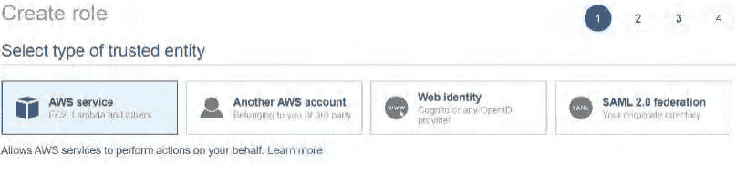

图 9.10 – IAM 角色创建 – 可信实体类型选择

4. 在下一部分（**选择用例**）中，找到 **SageMaker** 并单击该服务名称。

> **说明**
>
> 并非所有 AWS 服务都会出现在这些现成的用例中，这就是我们使用 Amazon SageMaker（另一个 AWS 托管服务）的原因。在接下来的步骤中，我们将调整所创建的角色，以便专门为 Amazon Lookout for Equipment 进行配置。

5. 单击**下一步**按钮，直到到达最后一步（**审核**）。为你的角色提供名称和描述（我将其命名为 `LookoutEquipmentIndustrialPumpDataAccess`）。

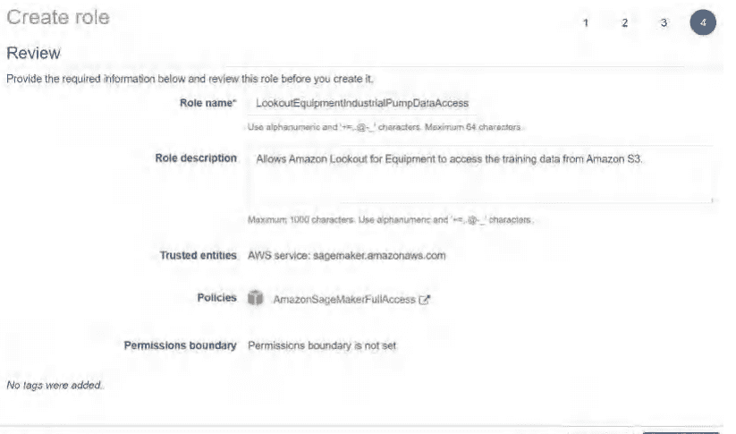

图 9.11 – IAM 角色创建 – 审核步骤

6. 单击**创建角色**。你的角色已创建，并会显示角色的摘要。在此屏幕顶部，你会看到一个**角色 ARN（Amazon 资源名称）**字段。复制此 ARN 并粘贴到方便的地方。将数据导入服务时会用到它。

你将返回账户中可用的角色列表。在搜索栏中，搜索你刚创建的角色，并从返回的结果中选择它。

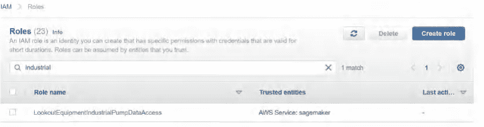

图 9.12 – 选择你的 IAM 访问角色

7. 单击 **AmazonSageMakerFullAccess** 托管策略最右侧的叉号，以移除此角色的权限（我们只需要此角色具有访问 Amazon S3 数据的权限）。

8. 单击**添加内联策略**，然后切换到 **JSON** 选项卡。然后用以下文档填写策略（将存储桶名称更新为你之前创建的那个）：

```
{
  "Version": "2012-10-17",
  "Statement": [
    {
      "Effect": "Allow",
      "Action": [
        "s3:ListBucket",
        "s3:GetObject",
        "s3:PutObject"
      ],
      "Resource": [
        "arn:aws:s3:::<YOUR-BUCKET>/*",
        "arn:aws:s3:::<YOUR-BUCKET>"
      ]
    }
  ]
}
```

9. 为你的策略命名（例如，`LookoutEquipmentS3Access`），然后单击**创建策略**。

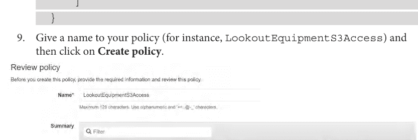

图 9.13 – 查看 S3 访问策略


10. 在“信任关系”（Trust relationships）选项卡上，选择“编辑信任关系”（Edit trust relationship）。

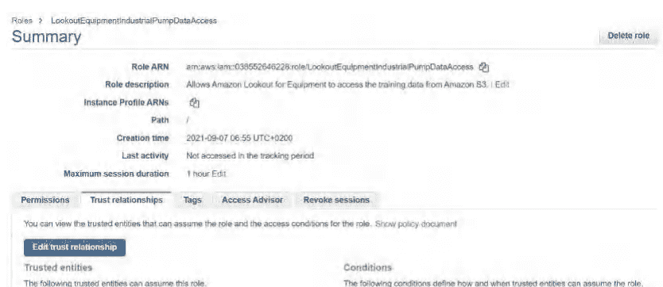

图9.14 – 编辑信任关系

11. 在策略文档下，将整个策略替换为以下文档，然后点击右下角的“更新信任策略”（Update trust policy）按钮：

```
{
    "Version": "2012-10-17",
    "Statement": [
        {
            "Sid": "",
            "Effect": "Allow",
            "Principal": {
                "Service": "lookoutequipment.amazonaws.com"
            },
            "Action": "sts:AssumeRole"
        }
    ]
}
```

当 Amazon Lookout for Equipment 尝试读取您刚刚上传到 S3 的数据集时，它将使用我们刚刚创建的角色向 IAM 请求权限：

- 信任策略允许 Lookout for Equipment 承担此角色。
- 内联策略指定 Lookout for Equipment 有权列出并访问您之前创建的 S3 存储桶中的对象。

现在，您可以将数据集导入 Amazon Lookout for Equipment 了。

## 创建 Amazon Lookout for Equipment 数据集

如第8章《Amazon Lookout for Equipment 概述》所述，数据集是一种方便组织存储为 CSV 文件的时间序列数据的方式。这些文件存放在 Amazon S3 存储桶中，并按不同文件夹进行组织。

每个数据集都是一个容器，可以包含一个或多个将标签（tags）组合在一起的组件。在 S3 中，每个组件将通过一个文件夹实现。您可以根据工业设备自身的组织方式来使用数据集和组件组织传感器数据。

例如，您可以使用数据集级别存储来自某个工厂的所有标签，然后使用每个组件对与给定生产线（跨多台设备）或给定设备相关的所有标签进行分组。

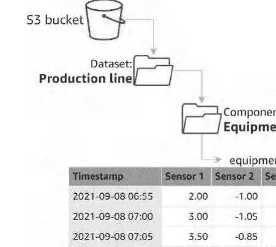

图9.15 – 文件夹结构：工厂/设备

在此配置中，每个组件在同一个 CSV 文件中包含多个传感器。根据传感器数据的生成方式，您可能需要对齐所有时间戳，以便所有传感器数据可以合并到共享一个时间戳列的单个 CSV 文件中。

另一种方案是将每个设备对应一个数据集，然后将每个传感器存储在其自己的组件中。

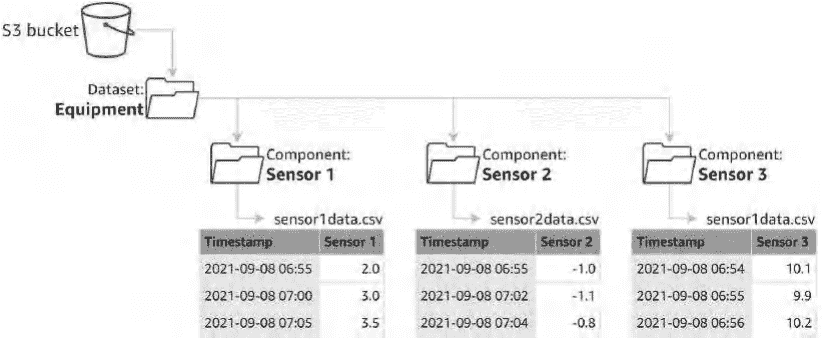

图9.16 – 文件夹结构：设备/传感器

在此配置中，每个传感器的时间戳无需对齐。Amazon Lookout for Equipment 将在导入时为您处理这种时间戳对齐。

对于工业泵数据集，在本教程中您将使用前面描述的第二种格式，以避免任何预处理的需要。要使用 Amazon Lookout for Equipment 创建您的第一个异常检测项目，请完成以下步骤：

- 1. 登录您的 AWS 控制台，并在顶部的搜索栏中搜索 Lookout for Equipment。

2. 点击 **Amazon Lookout for Equipment** 进入服务主页。

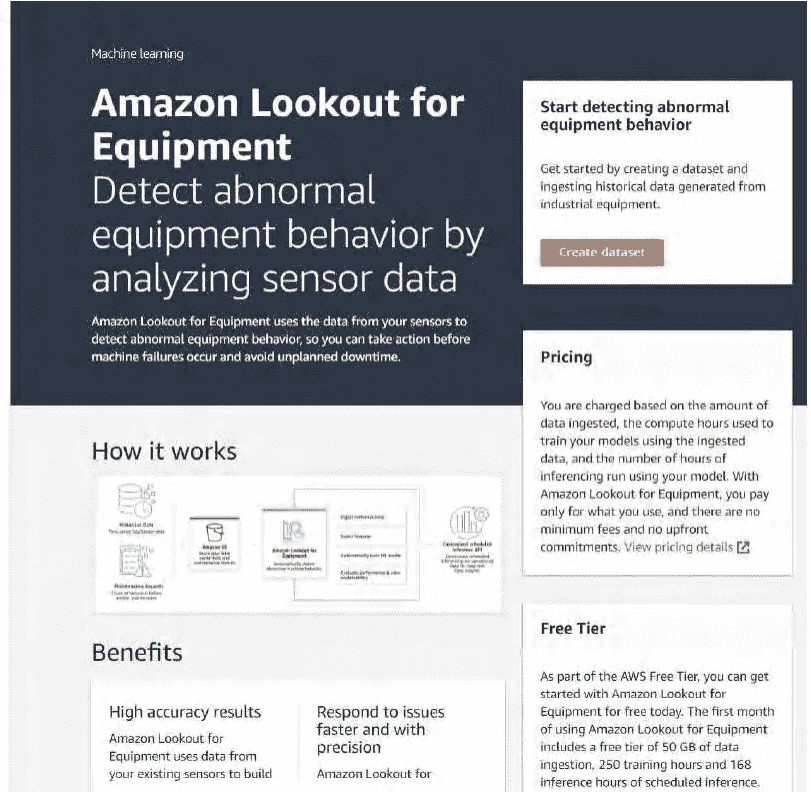

图9.17 – Amazon Lookout for Equipment 主页

3. 在此页面上，您可以点击屏幕右侧的 **创建数据集**（Create dataset）按钮，或者点击左上角的汉堡图标（三根水平线图标）打开左侧面板，然后在其中点击 **数据集**（Datasets）。您将进入一个页面，其中列出了您 AWS 账户中可见的所有数据集。如果是第一次使用该服务，列表将为空，您可以点击列表右上角的 **创建数据集** 按钮进入数据集创建页面。

4. 在此屏幕上，您需要给数据集命名（我们将其命名为 `industrial-pump`）并定义数据架构。在本章开头的“初始技术要求”段落中下载的数据集压缩包中，我提供了一个 schema.txt 文件。打开该文件，将其内容复制并粘贴到数据架构小部件中。

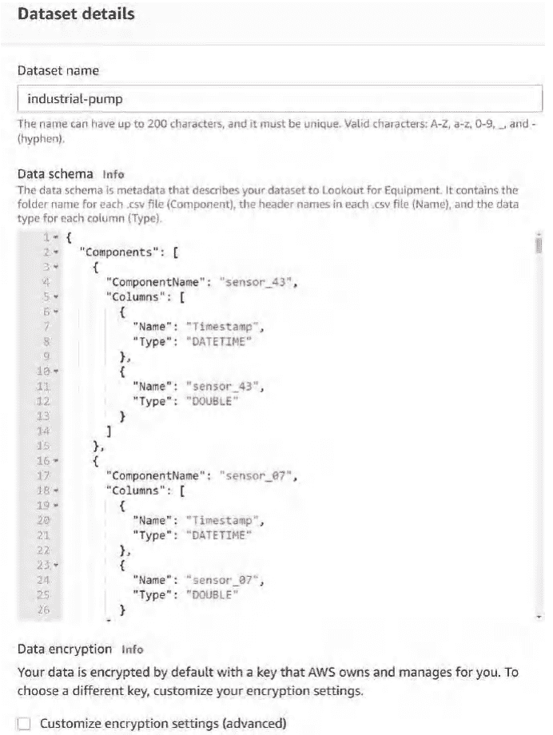

图9.18 – 数据集创建详情

5. 向下滚动到屏幕底部，点击 **创建**（Create）以创建数据集。

数据集创建完成后，您将进入数据集仪表板。在实际导入数据之前，我们先暂停一下，看看数据集架构。

## 生成 JSON 架构

要在 Amazon Lookout for Equipment 中创建数据集，您需要描述其中包含的传感器列表。为此，您需要编写一个 JSON 格式的数据架构。在本节中，您将学习如何手动编写一个，以及如何自动生成一个。

### 数据集架构结构

描述 Amazon Lookout for Equipment 数据集的数据架构是一个 JSON 字符串，格式如下：

```
{
    "Components": [
        {
            "ComponentName": "string",
            "Columns": [
                { "Name": "string", "Type": "DOUBLE" | "DATETIME" },
                ...
                { "Name": "string", "Type": "DOUBLE" | "DATETIME" }
            ]
        },
        ...
    ]
}
```

此 JSON 字符串的根项（Components）列出了数据集的所有组件。然后，每个组件都是一个字典，包含以下内容：

- 组件的名称，以字符串形式表示（ComponentName）。
- 此组件中所有列的列表（Columns）。
- 组件的每一列都是一个字典，包含列的名称（Name）及其类型，类型可以是 DOUBLE 或 DATETIME。后者专门用于数据集的时间戳列。

从头开始编写这样的架构可能难以保证正确，尤其是对于包含几十个甚至几百个信号、并在多个组件之间共享的数据集。在下一节中，我将展示如何以编程方式生成数据架构文件。

### 使用 CloudShell 生成架构

手动从头构建架构是一项非常容易出错的工作。在本节中，您将使用 CloudShell 服务运行一个脚本，该脚本会根据您提供的 S3 路径自动构建此架构。让我们按照以下说明进行操作：

- 1. 登录您的 AWS 控制台。
- 2. 在控制台右上方，确保区域选择器设置为 Amazon Lookout for Equipment 可用的区域之一：欧洲（爱尔兰）、美国东部（弗吉尼亚北部）或亚太地区（首尔）。

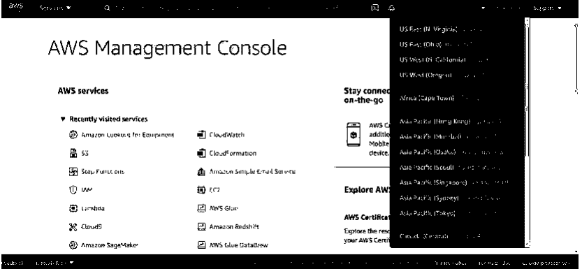

图9.19 – AWS 控制台区域选择器

- 3. 选择区域后，点击区域选择器左侧不远处的 **CloudShell** 图标。


图9.20 – 定位 CloudShell 图标

- 4. 点击 CloudShell 图标后，浏览器中会打开一个新标签页。如果您尚未打开 CloudShell 会话，应会看到一条蓝色横幅，提示您的环境正在准备中。一分钟后，您的环境即可就绪，并出现一个 Linux 命令提示符。

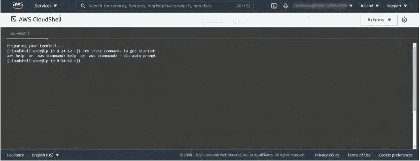

图9.21 – 您的 CloudShell 环境已就绪！

- 5. 现在，在此终端中运行以下命令（不要忘记将 `<<YOUR_BUCKET>>` 替换为您自己的存储桶名称）：

```
```bash
python3 -m pip install --quiet s3fs pandas
wget https://github.com/PacktPublishing/Time-Series-Analysis-on-AWS/blob/main/Chapter09/create_schema.py
python3 create_schema.py
s3://<<YOUR_BUCKET>>/ train-data/
```
```

几秒钟后，此脚本将输出一个以 { "Components":.... 开头的长 JSON 字符串。现在，当您需要基于此时间序列数据集创建数据集时，就可以复制此字符串。

> **注意**
> 运行上述代码中的第一行后，您可能会看到一些关于 pip 依赖项的错误消息。您可以忽略它们，并运行数据集生成脚本。

您已经了解了如何创建 Lookout for Equipment 数据集以及如何使用脚本生成架构。现在，让我们将实际数据导入数据集中。

## 创建数据导入任务

数据集创建完成后，系统会自动将您带到数据集仪表板。

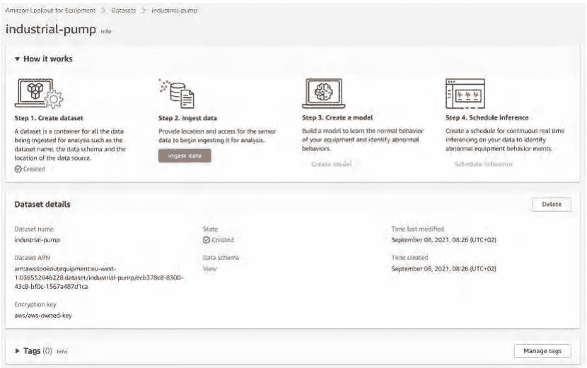

图9.22 – 创建后的数据集仪表板


从这里，您可以点击 **Step 2** 栏目中的 **Ingest data** 按钮，开始配置数据摄取作业。

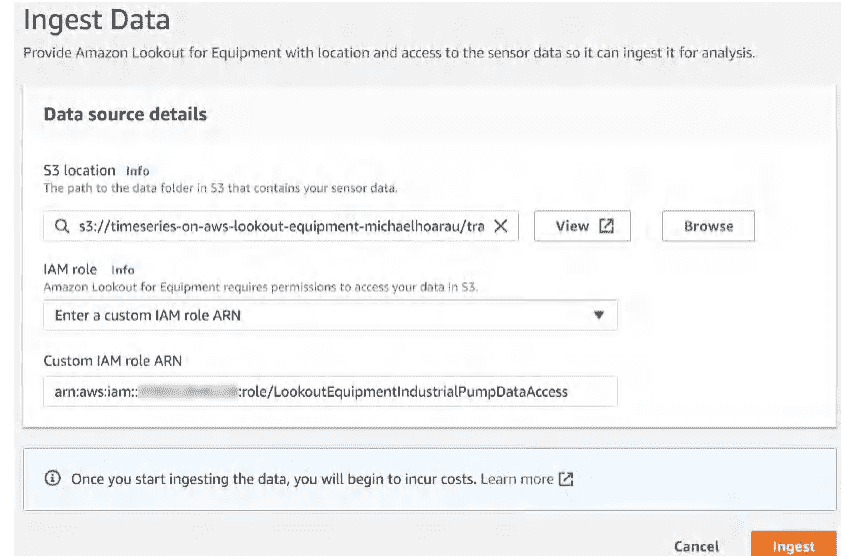

图 9.23 – 数据摄取作业配置

配置摄取时，您必须定义的作业详细信息如下：

- **S3 location**：训练数据所在的 S3 位置，其中包含时间序列。在 *Uploading your dataset to Amazon S3* 一节的 *step 5* 中，您复制了训练数据的 S3 URI。将其粘贴到此字段中。
- 在 **IAM role** 字段中，选择 **Enter a custom IAM role ARN**，并粘贴您之前在 IAM 服务中创建的 AmazonForecastEnergyConsumption 角色的 ARN。ARN 的格式应为 `arn:aws:iam:::<ACCOUNT-NUMBER>:role/LookoutEquipmentIndustrialPumpDataAccess`，其中 `<ACCOUNT-NUMBER>` 需要替换为您的 AWS 账户号。

完成后，您可以点击 **Ingest** 开始摄取过程。您的进程将启动，根据要摄取的数据量（以 GB 计），大约需要 5-6 分钟。在摄取过程中，Amazon Lookout for Equipment 会检查您的数据，为您执行一些缺失值填充，对齐时间戳，并准备时间序列序列，以便服务能够运行多种算法在训练时使用这些数据。

## 了解常见的摄取错误及解决方法

摄取数据时，Amazon Lookout for Equipment 会执行多项检查，可能导致摄取失败。发生这种情况时，您可以返回数据集仪表板，点击 **View data source** 按钮。然后您将访问您执行的所有摄取作业的列表。

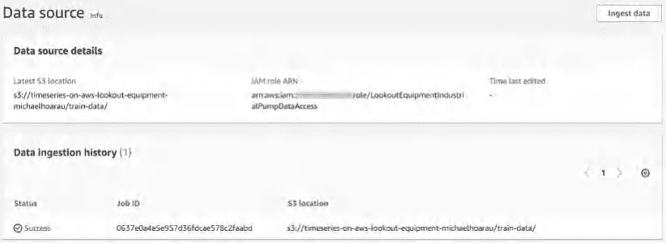

图 9.24 – 数据摄取历史记录

此界面列出了您执行的所有摄取作业。当摄取失败时，**Success** 图标会被 **Failed** 图标替换，您可以将鼠标悬停在其上以查看失败原因。与您的数据集相关的错误来源主要有三种。其中两种可能在摄取时发生，而最后一种只会在您训练模型时触发：

- 时间序列数据的 S3 位置不正确。
- 找不到某个标签/传感器的数据文件。
- 某个传感器中的缺失值过多。

让我们逐一探讨这些问题。

如果某个时间序列在选定的训练范围内完全为空（100% 缺失值），模型将无法训练。发生这种情况时，您有以下几种选择：

- 如果是数据生成问题，请重新生成数据，上传到 S3，然后重新尝试摄取。
- 如果您非常了解生成此数据的过程，并且知道如何填充这些值，您可以更新该传感器的时间序列，上传到 S3，然后重新尝试摄取。
- 如果您想完全移除该信号，您需要删除您的数据集，构建一个不包含该传感器数据的新模式，使用新模式创建新数据集，然后重新尝试摄取。

现在您已经了解了数据集可能遇到的关键问题，是时候结束本章，进入有趣的部分——训练和评估模型了！

## 总结

在本章中，您学习了在使用 Amazon Lookout for Equipment 训练异常检测模型之前，应该如何组织数据集。您还了解了我们将在接下来的几章中使用的数据集，并执行了训练模型所需的首要任务，即创建数据集并将时间序列数据摄取到其中。

借助本章内容，您现在应该了解在此阶段可能出现的问题，并掌握摄取时可能发生的主要错误的一些提示。

在下一章中，我们将训练和评估我们的第一个异常检测模型。
