## 10 训练和评估模型
训练和评估模型

在上一章中，您熟悉了一个多变量工业水泵数据集，并学习了如何使用 **Amazon Lookout for Equipment** 配置数据。您还将数据集摄取到服务中，并了解了此步骤中可能出现的主要错误。

在本章中，您将使用之前准备和摄取的数据集来训练多变量异常检测模型。您将学习如何配置模型训练，以及每个参数对结果的影响。您还将了解可能增加训练时长的关键因素。在本章末尾，我们将逐步介绍评估和诊断仪表板，让您正确了解输出质量。

在本章中，我们将涵盖以下主要内容：

- 使用数据集训练模型
- 组织模型
- 选择良好的数据分割
- 评估训练好的模型

## 技术要求

要学习本章内容，无需具备 **Python** 或 **R** 等语言的实践经验。但我们强烈建议您在连接到 AWS 账户并打开 Amazon Lookout for Equipment 控制台的情况下阅读本章，以便在您的终端执行不同操作。

要创建 AWS 账户并登录 Amazon Lookout for Equipment 控制台，您可以参考 *第 2 章“Amazon Forecast 概述”* 中的 *技术要求* 部分。

## 使用数据集训练模型

在上一章中，您创建了一个 Amazon Lookout for Equipment 数据集，并将第一个时间序列数据集摄取到其中。现在您已准备好训练 **异常检测模型**。

## 训练异常检测模型

要使用 Amazon Lookout for Equipment 训练异常检测模型，请按照以下步骤操作：

- 1. 登录您的 AWS 控制台，在顶部的搜索栏中搜索 `Lookout for Equipment`。
- 2. 点击 **Amazon Lookout for Equipment** 进入服务主页。

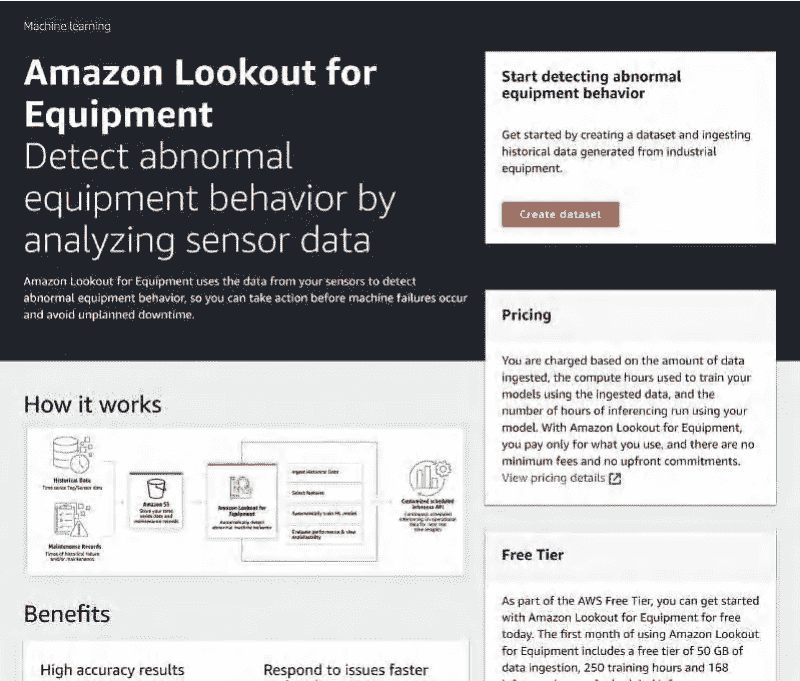

图 10.1 – Amazon Lookout for Equipment 主页

- 3. 在此页面上，您可以点击左上角的汉堡图标（三条水平线的那个）打开左侧面板，然后点击 **Datasets**。您将进入一个页面，列出 AWS 账户中可见的所有数据集。您应该会看到之前创建的数据集（我们将其命名为 `industrial-pump`）。点击您的数据集名称：

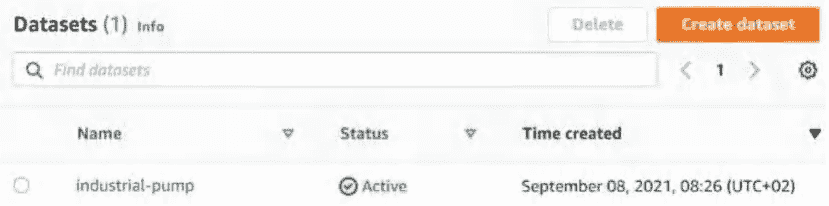

图 10.2 – 数据集列表

4. 这将带您进入数据集仪表板，您可以点击 **Create model** 按钮：

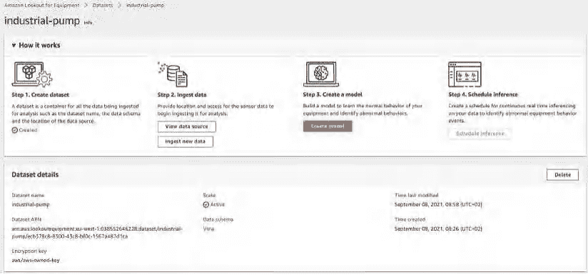

图 10.3 – 数据集详细信息

5. 模型创建表单包含几个部分。让我们逐一详细说明。**Model details** 部分允许您为模型输入名称，并选择可选的加密密钥以访问数据。保持 **Customize encryption settings** 复选框未选中，并在 **Model name** 中输入 `pump-anomaly-detection-model`：

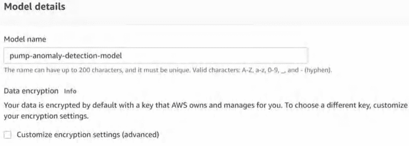

图 10.4 – 模型创建详细信息

- 6. 下一部分允许您选择要用于训练模型的 **Fields**。在这种情况下，您将使用所有字段。为此，您需要点击表头中的复选框 (1)，通过分页控件浏览每一页 (2)，并确保每页上的表头复选框都已选中：

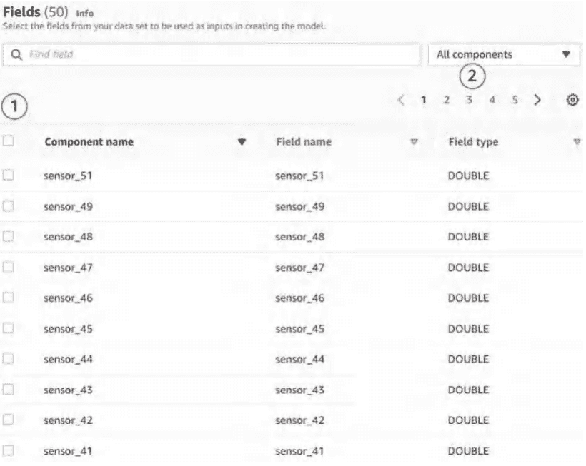

图 10.5 – 模型创建字段

7. 下一部分 **Historical maintenance events** 将允许您将 Amazon Lookout for Equipment 指向您的标签 CSV 文件。配置此参数时，您必须定义标签数据的 S3 位置，其中包含时间序列数据。点击 **Browse** 查找您的标签数据位置：

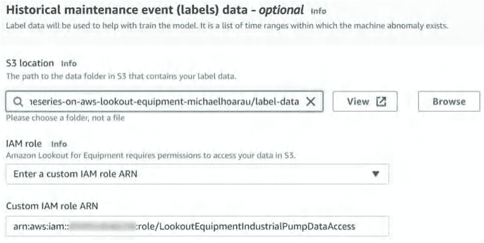

图 10.6 – 选择历史异常事件文件

在出现的弹出窗口中，点击 **label-data** 文件夹名称：

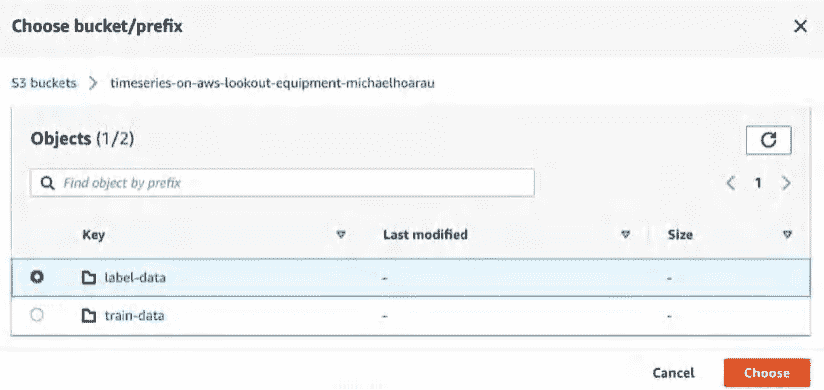

图 10.7 – 选择 label-data 的位置

然后，选择 **输入自定义 IAM 角色 ARN** 并粘贴使用 IAM 服务在 *第 9 章，创建数据集并摄取您的数据* 中创建的 `LookoutEquipmentIndustrialPumpDataAccess` 角色的 ARN。ARN 的格式应为 `arn:aws:iam::<ACCOUNT-NUMBER>:role/LookoutEquipmentIndustrialPumpDataAccess`，其中 `<ACCOUNT-NUMBER>` 需要替换为您的 AWS 账户号码。

> **重要说明**
> 
> 尽管您经常会看到此历史事件文件被称为 *标签文件*，但这种称呼与 Amazon Lookout for Equipment 使用的机器学习算法类型无关，因为它们都是完全 *无监督* 的。要了解有关此标签文件如何使用更详细信息，请查看本章稍后的 *历史事件文件如何使用？* 部分。

- 8. **训练和评估设置** 部分将让您定义服务对数据进行下采样的时间分割和采样率：

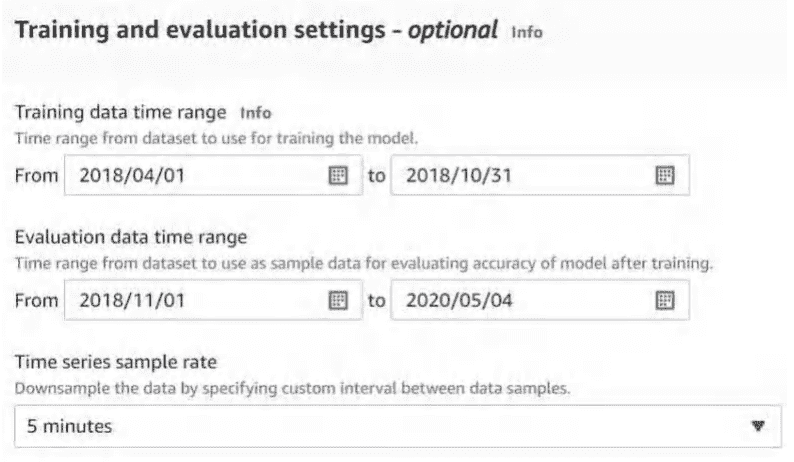

图 10.8 – 定义训练和评估分割

配置此部分时，您必须定义以下内容：

- a) **训练数据时间范围：** 这是服务用于训练模型的时间范围。对于我们的工业泵数据集，您可以使用 `2018/04/01` 到 `2018/10/31`。

> **重要说明**
> 
> 在撰写本书时，训练范围至少必须为 90 天。如果您的训练范围短于此，训练过程将失败。

- b) **评估数据时间范围：** 这是服务用于评估已训练模型的时间范围。对于我们的数据集，您可以使用 `2018/11/01` 到 `2020/05/04`。

- c) **时间序列采样率：** 您可以选择使用数据集的原始采样率，也可以要求 Amazon Lookout for Equipment 使用自定义间隔对数据进行下采样，间隔可在 1 秒到 1 小时之间。让我们使用 5 分钟。

> **重要说明**
> 
> 采样率选择会影响训练时间——采样率越小，训练所需时间越长。然而，对时间序列数据进行重采样也起到了滤波器的作用，会将数据的最高频率滤除。如果您要查找的异常事件位于这些较高频率中，选择过于粗糙的采样率会将其滤除，Amazon Lookout for Equipment 找到它们的难度会更大。如果您有 6 到 12 个月的数据，5 分钟或 10 分钟的重采样率是一个合理的起点。根据训练时间和模型评估结果，您可以重新训练具有不同采样率的模型并比较输出。

- 9. 最后一个感兴趣的部分是可选的 **停机时间检测** 部分。我们在本示例中不会使用此部分。请参阅本章稍后的 _深入了解停机时间检测功能_ 部分，以获取有关此部分的更多详细信息。

- 10. 滚动到页面底部并单击 **创建** 按钮。您的模型训练将被启动。

您现在应该有正在进行的训练：根据数据集的大小和您配置的参数，训练第一个 Amazon Lookout for Equipment 异常检测模型所需的时间应少于 1 小时。在此期间，您可以阅读有关历史事件和停机传感器如何使用的方式。

## 历史事件文件如何使用？

作为提醒，您的历史事件文件（或标签文件）如下所示：

|   | start               | end                 |
|---|---------------------|---------------------|
| 0 | 2018-05-30 01:30:00 | 2018-06-03 08:15:00 |
| 1 | 2018-06-24 14:25:00 | 2018-07-06 09:40:00 |
| 2 | 2018-11-27 04:25:00 | 2018-12-02 17:50:00 |
| 3 | 2018-12-26 14:25:00 | 2018-12-29 16:55:00 |
| 4 | 2019-06-19 01:55:00 | 2019-07-19 05:10:00 |
| 5 | 2019-08-03 12:50:00 | 2019-08-04 16:20:00 |
| 6 | 2019-10-30 09:55:00 | 2019-10-31 16:15:00 |

图 10.9 – 异常范围概览

此标签文件为 Amazon Lookout for Equipment 提供了过去事件的洞察。虽然服务使用的所有算法都是无监督的，但 Amazon Lookout for Equipment 使用这些 *可选* 标签来更准确、更高效地训练其模型。利用其超过 28,000 种参数和算法组合的库，Amazon Lookout for Equipment 可以使用此标签文件找到在这些时间窗口内发现异常行为的最佳模型。

Amazon Lookout for Equipment 如何使用此数据？让我们看第一行并看看它的解释方式：

- - 第二个时间戳（**2018-06-03 8:15:00**）可以是维护事件或有人注意到异常行为的时间。
- - 第一个时间戳（**2018-05-30 1:30:00**）表示异常行为预计开始的时间。

## 深入了解停机时间检测功能

此可选部分让您可以告诉 Amazon Lookout for Equipment 它可以使用哪些传感器来判断设备正在进行停机。当您的设备有长时间的停机期（定期或不定期）时，通常需要删除这些时期的信号，因为它们与查找任何异常无关。

创建新模型时，停机时间检测部分位于屏幕底部，在标签定义部分之前：

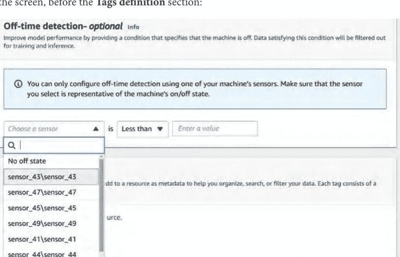

图 10.12 – 停机时间检测功能

要使用此功能，只需填写以下字段即可：

- - **传感器：** 此下拉列表将填充您为此模型选择的字段列表。每个传感器都将具有组件名称\标签名称的标签，如用于训练模型的对应数据集的模式中所定义。在我们的例子中，我们将每个传感器放在同名组件中，并且下拉列表中的每个项目都有重复的标签（例如，sensor_43\ sensor_43）。

- - **规则：** 规则可以是 `less than` 或 `greater than`。
- - **值：** 输入整数或浮点值。

假设您的设备是一台旋转机器，并且 `sensor_43` 测量转速，单位为 RPM。您知道任何转速 *小于 100 RPM* 意味着您的设备已关闭或正在关闭。要告诉 Amazon Lookout for Equipment 此信息，您将通过编写一条规则来配置 **停机时间检测** 部分，说明 `sensor_43\sensor_43` `less than 100 RPM`。

一旦满足条件，满足该条件的所有数据都将被丢弃以训练模型。同样，在推理时，满足此条件的所有数据都将被过滤掉。

现在您知道了标签数据和停机时间检测功能如何用于训练异常检测模型，让我们来看一下您可以组织模型集合的不同方式。

## 模型组织最佳实践

Amazon Lookout for Equipment 在给定的 AWS 账户中包含以下层级结构：

- - **数据集** 是层级结构中的最高级别；数据集由在创建时定义的不可变数据模式定义。
- - 在定义数据模式时，不同的标签可以 regrouped 为不同的 **组件**：组件必须与您 S3 训练数据集中的一个文件夹匹配。
- - 每个数据集可用于训练多个 **模型**，并且每个模型可以使用数据集中所有传感器（按模式定义）或仅选择其中的一部分。
- - 此层级结构的最低级别是 **传感器** 时间序列（也称为 **标签**、**信号** 或 **字段**）。

> **注意**
> 此层级结构中更高一级的是 AWS 账户/用户。虽然设置适当的权限需要更多工作，但您可以构建一个解决方案，其中多个 AWS 账户可根据其地理位置等因素在您的组织中使用 Amazon Lookout for Equipment。

根据根级别或你的工业数据组织方式，你可以用不同方式使用此层级结构：

- 如果你有多个站点/工厂/车间：
  - 将一个工厂的所有数据存储在数据集级别；一个数据集最多可包含跨所有组件的 3,000 个传感器。你将拥有与工厂数量一样多的<|message|> 数据集。
  - 使用组件来重新分组不同生产区域或生产线上的传感器。一个数据集最多可包含 3,000 个组件。
  - 使用特定的标签命名约定来识别给定生产区域/线内的不同设备。
  - 一个模型随后可以使用来自一个组件的所有传感器（生产线异常）或与给定设备相关联的标签的子选择。一个模型一次最多可使用 300 个传感器。
- 如果你专注于单一工厂：
  - 如果你少于 3,000 个信号，你可以将所有时间序列存储在单个数据集中。如果不是，你可以使用数据集级别来存储与不同生产区域或生产线相关联的传感器数据。
  - 使用组件来重新分组给定设备的传感器。
  - 为感兴趣的每个组件构建一个模型（取决于你想要监控的设备）或为整个数据集构建模型，如果你想监控给定流程或生产线。
- 如果你专注于单一设备：
  - 使用数据集存储该单一设备的所有数据。
  - 使用组件来建模该设备的不同子系统。
  - 为每个组件构建模型（以监控单个子系统）或为整个数据集构建模型（以同时监控该设备）。

请注意，如果你拥有的数据量允许，我建议不要根据不同时期拆分你的数据（一个数据集用于 2021 年，另一个用于 2020 年，等等），因为这将阻止你跨不同时期构建模型。当你创建新模型时，你可以定义训练开始和结束日期，以及评估开始和结束日期。然后你可以使用 AWS 标签机制来存储时间，或在你的模型命名约定中添加日期时间字符串以便轻松识别。

现在你已经了解了组织数据集的不同方式，让我们来看看如何选择训练和评估数据之间的最佳划分。

## 在训练和评估之间选择良好的数据划分

当你在训练和评估期间之间选择数据划分时，你需要考虑以下约束或建议：

- 首先要考虑的约束是训练范围内*至少需要 90 天*。在撰写本文时，Amazon Lookout for Equipment 认为它至少需要此期间来建模工业设备的正常运行行为。这种物理行为与传感器数据收集的粒度无关。
- 理想情况下，训练范围应包含你的流程或设备的全部正常运行行为。如果一种新行为仅在评估范围内出现，那么 Amazon Lookout for Equipment 将其标记为异常的可能性很高。

> **重要说明**
> 
> 请确保你的某些传感器中没有严重的水平偏移（例如，长时间停止工作的传感器）；虽然这更多与如何选择构建模型的良好信号有关，但我们建议你删除显示长时间停机时间的任何信号，因为这会使你更难选择一个包含两种行为的训练/评估划分。
> 
> 此外，虽然故障传感器是你可能想要纠正的异常，但你不希望这些故障损害你捕获更复杂设备或流程异常的能力。

- 此外，如果可能，你的训练范围应包含一些异常的发生（在时间上精确界定或不精确）。
- 一旦你为此预留了最小量的训练数据（至少 180 天，尽可能多的正常运行模式，以及一些异常），你就可以开始定位划分以开始评估范围。理想情况下，此评估范围将包含一些已知异常，以便你可以评估 Amazon Lookout for Equipment 检测到的事件的相关性。

一旦你训练了模型并在生产中使用它，你的设备或流程可能会显示新的正常操作模式（新是指在训练时未见过）。正如我们之前讨论的，Lookout for Equipment 可能会将这些时期标记为异常。为防止这种情况发生，你需要更新你的训练数据集并调整你的训练/评估划分，以确保在模型训练期间捕获新的正常模式。

现在你知道了如何划分数据集，让我们来看看 Amazon Lookout for Equipment 在评估训练模型时提供的见解。

## 评估训练模型

一旦模型训练完成，你可以通过查看评估结果来评估其相关性。在本节中，我们将执行以下操作：

- 提供模型评估仪表板的概述
- 深入研究模型性能部分以及如何解释它
- 深入研究事件诊断部分以及如何解释它

让我们从评估仪表板概述开始。

### 模型评估仪表板概述

要访问任何给定模型的此仪表板，请按照以下步骤操作：

1. 登录你的 AWS 控制台，并在顶部的搜索栏中搜索 `Lookout for Equipment`。
2. 点击 **Amazon Lookout for Equipment** 进入服务的首页。
3. 在此页面上，你可以点击左上角的汉堡图标（带三条水平线的那个）打开左侧面板，在其中点击 **Datasets**。你将进入列出 AWS 账户中所有可见数据集的页面。你应该能看到之前创建的数据集（我们将其命名为 `industrial-pump`）。点击你的数据集名称。
4. 这将带你进入数据集仪表板，在那里你可以点击 **View models** 按钮：

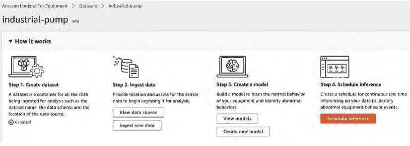

*Figure 10.13 – Dataset dashboard when at least one model has been trained*

5. 你将看到基于此数据集的所有训练模型列表。在你的情况下，你应该只有一个，所以点击其名称以访问此模型的仪表板。

6. 训练模型仪表板分为四个部分：

I. 模型详细信息部分告诉你，其中包括模型的名称、创建日期以及训练所需的时间：

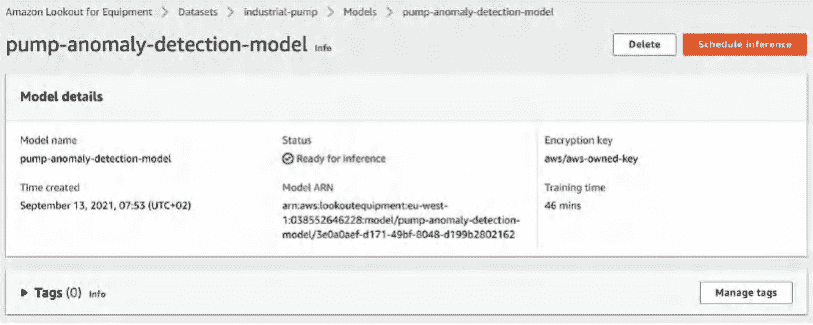

*Figure 10.14 – Trained model dashboard – Model details*

II. 模型性能概述部分。这将在本章后面的 *Interpreting the model performance dashboard's overview* 部分中更详细地介绍：

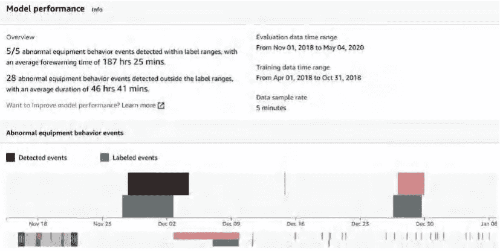

Figure 10.15 – Trained model dashboard – Model performance

III. 单个事件诊断，它展开了你在先前检测到的事件条形图上点击的检测到的异常相关的详细信息。你将在本章后面的 *Using the events diagnostics dashboard* 部分了解更多关于此的信息：

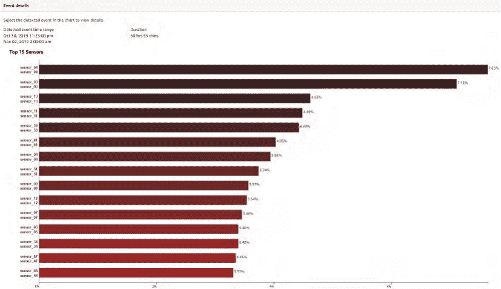

Figure 10.16 – Trained model dashboard – Event details

IV. 最后一个部分包含你为训练此模型而选择的传感器的提醒，以及它是否使用了包含已知历史事件的标签数据：

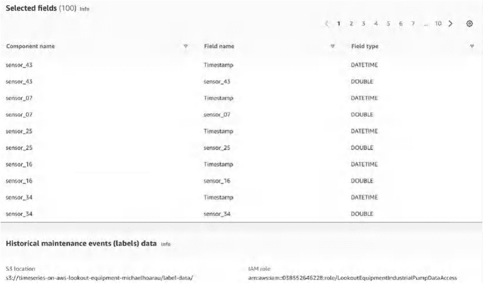

*Figure 10.17 – Trained model dashboard – Model configuration reminders*

现在你了解了 Amazon Lookout for Equipment 训练的模型的输出，让我们深入研究模型性能和事件诊断部分，看看如何从中得出有意义的见解。

## 解释模型性能仪表板的概述

模型性能仪表板的这一部分包含以下信息：

- Amazon Lookout for Equipment 捕获了多少已知异常事件（作为历史事件文件提供）。**异常事件**如果 Amazon Lookout for Equipment 触发至少一次异常检测，则被认为已检测到。在我们的案例中，我们在历史异常事件文件中提到了五个事件，所有这些都被检测到了。
- Amazon Lookout for Equipment 在每个已知历史事件（标签文件的一部分）之前需要多长时间才能检测到某些内容。该度量是对评估期间内所有已知事件的平均值，并标记为 **平均预警时间**。

- 在标签范围之外检测到多少个事件，以及它们的平均持续时间。
- 包含已知事件和检测到的事件的条形图。条形图包含整个评估期的整体视图，并且有一个滑块可用于放大任何感兴趣区域。放大的区域将出现在顶部：

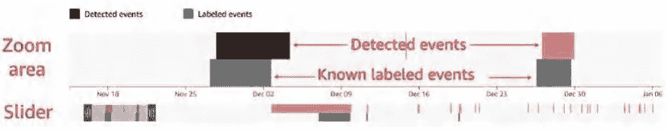

*Figure 10.18 – Trained model dashboard – Detected events*

在大多数工业环境中，异常检测的准确性很难评估，因为精确的历史异常可能未被捕获。传统上，在机器学习中，任何在已知事件之外检测到的事件都可以被视为误报。在工业异常检测中，此类事件可能是以下几种情况之一：

- **误报**；即查看所有检测到的事件的平均持续时间并将其与给定事件进行比较，如果该事件看起来是偶发或孤立的，则可以帮助将其过滤掉。
- **前兆事件**，如果该事件被丢弃，可能会导致设备或流程异常。建立仅在事件频率和/或平均持续时间保持在某一阈值以上时才采取反应的程序，可以帮助指导您车间操作员、流程工程师或可靠性团队的调查工作。
- **未知事件** —— 换句话说，是标签文件中未捕获的历史事件的事件。重新检查当时发生了什么情况可以帮助您判断该事件是否相关。
- **未知的正常运行模式。** 这也可能是 Amazon Lookout for Equipment 在训练期间未看到的正常行为。

接下来，我们将了解如何使用事件诊断仪表板。

## 使用事件诊断仪表板

如果 Amazon Lookout for Equipment 在评估期间检测到任何事件，您可以在模型性能条形图中单击其中任何一个，以展开顶部信号对该事件的贡献幅度。在模型评估仪表板的事件详细信息部分顶部，您将看到以下内容：

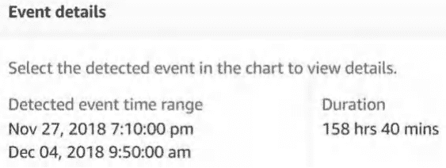

Figure 10.19 – Event details

在此标题中，您可以找到所选事件的时间范围和持续时间。传感器重要性图表在这些事件详细信息之后绘制为水平条形图：

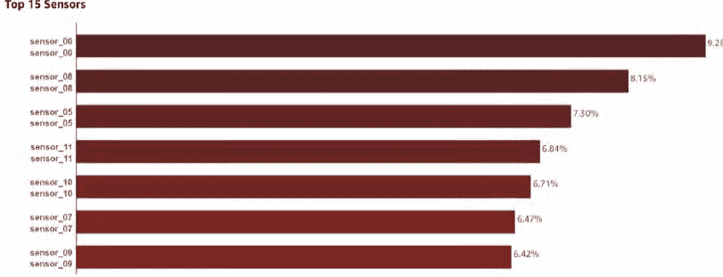

Figure 10.20 – Event details – Top sensors

该图表最多显示 15 个传感器。对于每个传感器，您可以看到以下内容：

- 组件和传感器的名称作为左侧每个水平条的标签。
- 一个水平条，按递减幅度显示贡献最大的传感器。
- 右侧的百分比数字，表示根据 Amazon Lookout for Equipment 的说法，给定传感器对检测到的事件的贡献程度。

> **Note**
> 
> 尽管该图表显示的传感器不超过 15 个，但 Service API 允许您以编程方式查询数据集中存在的每个传感器的传感器重要性。

如果您将每个传感器的总贡献相加，您会发现贡献为 100%。这意味着您可以轻松比较任何传感器的贡献与每个传感器贡献相等的情况。让我们以我们的工业泵数据集为例。该数据集包含 50 个传感器。对于任何给定事件，如果每个传感器的贡献相同，则传感器重要性应为 100% / 50 = 2%。在 *Figure 10.20* 中，您可以看到 **sensor_00** 的贡献幅度为 9.28%，明显高于 2% 的平均值。此外，您还可以看到，前 7 个传感器（共 50 个）对该特定事件的贡献幅度已超过 50%。如果您希望维护团队专注于工业环境中的正确位置，这些知识非常有用。

由于这种差异在统计学上是显著的，您可能会发现开始调查此传感器所连接的设备或流程步骤很有趣。

您可以使用这些原始信息以多种方式得出更多见解来管理您的设备或流程：

- 如果您使用数据架构组件根据流程步骤、设备部件或子系统对传感器进行分组，您可以汇总其特征重要性并按组件进行分组。然后，您可以构建另一个水平条形图，显示每个组件相对于任何所选事件的重要性。
- 您还可以绘制每个标签的传感器重要性随时间的变化。这种类型的图表可以帮助您了解哪些信号 consistently 是事件组的顶级贡献者，并提供更稳健的见解，您可以在异常调查中利用这些见解。

此外，演变图可以直观地显示不同模式，有经验的流程工程师可以帮助您利用这些模式进行异常分类。以下屏幕截图显示了另一个数据集的传感器演变图示例：

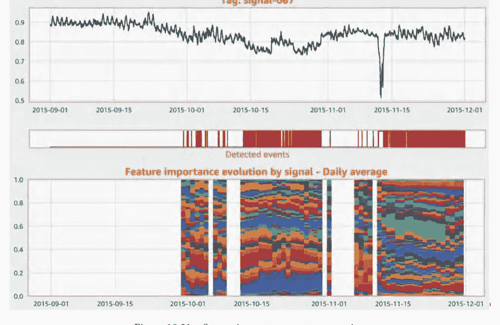

Figure 10.21 – Sensor importance post-processing

> Note
> 要了解有关如何构建此类仪表板的更多信息，请查看第 12 章《Reducing Time to Insights for Anomaly Detections》。

在前面的屏幕截图中，从上到下，您可以看到以下内容：

- 一个给定信号的线图。您很容易看到在 11 月 15 日之前不久出现了一个下降，看起来发生了异常。
- Amazon Lookout for Equipment 检测到的事件的条形图。您可以看到它在实际异常之前触发了一些事件，并且这些事件最早出现在 10 月中旬。对当时设备的调查可能有助于防止 11 月 15 日的异常。
- 特征重要性随时间演变。传感器贡献仅在检测到事件时可见。在这里，您可以很容易地看到在异常之前、期间和之后检测到的事件的模式非常不同。

正如您所见，学习如何后处理 Amazon Lookout for Equipment 的输出可以产生丰富的见解，有助于促进对制造流程或工业设备的积极检查或维护。

## Summary

在本章中，您学习了如何使用 Amazon Lookout for Equipment 训练您的第一个异常检测模型。使用您在上一章中创建的数据集，您能够配置和训练模型。

本章您学到的关键要点之一是 Amazon Lookout for Equipment 如何利用提供的可选标签。虽然该服务在内部仅使用无监督模型，但这些标签范围用于对最擅长在这些范围内找到异常行为的模型进行排名。

最后但同样重要的是，我们深入探讨了如何阅读训练模型的评估仪表板，以及超越服务提供的原始结果有多么宝贵。

在下一章中，您将学习如何使用训练好的模型对新数据进行定期安排的推理。
