## Scheduling Regular Inferences

在上一章中，您训练了一个模型并可视化了它在评估期间能够检测到的事件。一旦 **Amazon Lookout for Equipment** 训练了模型，您就可以配置并启动一个推理调度程序，让它定期运行您的数据。调度程序将定期唤醒，在 Amazon S3 上的某个位置查找 CSV 文件，打开正确的文件，并使用训练好的模型运行它们以预测新数据中是否存在异常事件。此过程称为 **inference**。

在本章中，您将学习如何管理此类调度程序以及如何使用获得的预测。换句话说，您将学习如何使用已部署的模型版本并在生产中使用它。

在本章中，我们将涵盖以下主要主题：

- 使用训练好的模型
- 配置调度程序
- 为推理准备数据集
- 提取推理结果


## 技术要求

阅读本章内容不需要具备 **Python** 或 **R** 等语言的实践经验。不过，我们强烈建议您在阅读本章时连接自己的 AWS 账户，并打开 Amazon Lookout for Equipment 控制台，以便自行执行各项操作。

如需创建 AWS 账户并登录 Amazon Lookout for Equipment 控制台，您可以参考 *第 2 章“Amazon Forecast 概述”* 中的技术要求。

## 使用训练好的模型

下图说明了 Amazon Lookout for Equipment 在推断时的工作方式：

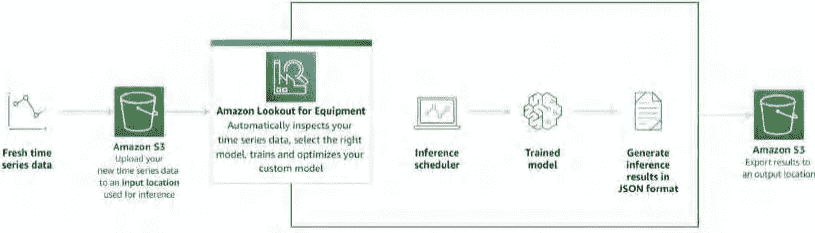

图 11.1 – 推断调度器概览

让我们深入了解该流水线的各个步骤：

- **1.** 生成新的时间序列：根据您的使用场景，您可能直接从设备上收集新的传感器数据，或者直接访问诸如*历史记录系统*之类的软件。
- **2.** 与训练时一样，您需要将这些新数据推送到 Amazon S3 上的某个位置（您将在后面的*配置调度器*一节中了解该位置的配置方式）。
- **3.** 您的推断调度器将被配置为定期运行（例如，每五分钟或每小时一次）。每次运行时，它都会查找新数据，并针对您训练好的模型运行这些数据。一旦模型生成新结果，调度器就会以 JSON 格式存储这些结果。
- **4.** 每次调度器运行结束时，推断结果将存储在 Amazon S3 上的另一个位置，您可以在此处检索结果并进一步进行后处理。

一旦您从某个模型获得推断结果，就可以将其用于填充商业智能仪表板，或将其作为通知发送回面向工艺工程师或车间操作员的移动应用程序。数据科学家也可以将这些洞察作为特征，用于后续构建的其他机器学习模型。

现在您已经对如何在您自己的推断流水线中使用 Amazon Lookout for Equipment 调度器有了高层次的理解，接下来让我们看看如何通过 AWS 控制台实际配置一个调度器。

## 配置调度器

在*第 9 章“创建数据集并摄入数据”*中，您在 Amazon Lookout for Equipment 中准备并摄入了时间序列数据。在*第 10 章“训练和评估模型”*中，您使用数据集训练了一个新的异常检测模型。在本节中，您将使用这个训练好的模型来安排定期推断。

在模型训练完成后配置新的调度器，您需要执行以下操作：

- 准备您的 Amazon S3 存储桶，其中包含调度器将使用的输入和输出位置。
- 配置并启动您的调度器。

让我们逐一详细了解。

### 配置调度器

现在您的 S3 存储桶已准备好，您可以为 Amazon Lookout for Equipment 配置新的推断调度器。为此，您需要执行以下步骤：

- **1.** 登录您的 AWS 控制台，在顶部的搜索栏中搜索 `Lookout for Equipment`。
- **2.** 点击**Amazon Lookout for Equipment**进入服务主页。

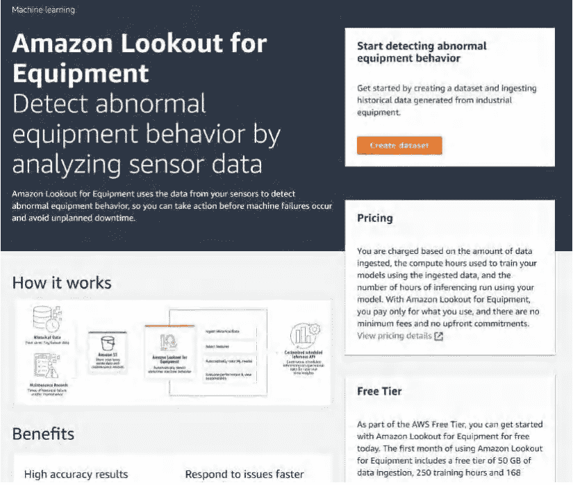

图 11.5 – Amazon Lookout for Equipment 主页

- **3.** 在此页面上，您可以点击左上角的汉堡包图标（带有三条水平线的那个）打开左侧面板，然后点击**数据集**。您将进入一个页面，列出您的 AWS 账户中可见的所有数据集。您应该会看到之前创建的数据集（我们将其命名为 `industrial-pump`）。点击您的数据集名称。

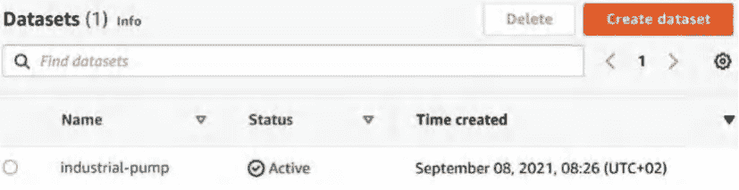

图 11.6 – 数据集列表

- **4.** 这将带您进入数据集仪表板，您可以在其中点击**计划推断**按钮：

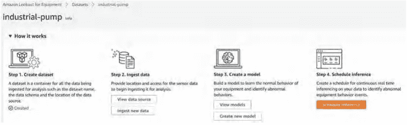

图 11.7 – 数据集详细信息

- **5.** 调度器配置表单包含多个部分。让我们逐一详细了解。在第一部分中，您将为调度器输入一个推断调度器名称（例如 `pump-scheduler`），选择要对哪个模型运行推断（`pump-anomaly-detection-model`），以及输入数据的 S3 位置。配置此参数时，您需要输入之前创建的输入目录的 S3 位置（您可以手动填写 S3 路径，也可以点击**浏览**进行查找）。

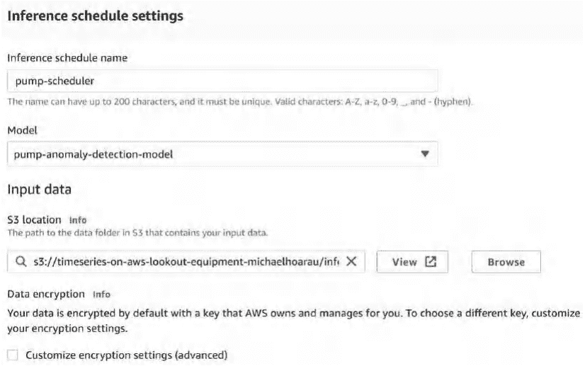

图 11.8 – 调度器配置总体设置

- **6.** 在下一部分中，您将指定调度器应如何预期输入数据的格式。

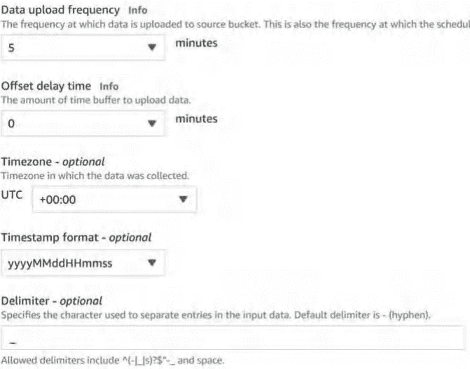

图 11.9 – 调度器输入数据格式

在我们的案例中，您将设置以下参数：

- 使用 `5 分钟` 的数据上传频率。
- 将预期的时间戳格式设置为 `yyyyMMddHHmmss`。
- 将分隔符设置为下划线字符 `_`。
- 将所有其他参数保留为默认值。

> **注意**
> 
> 您可以指定新数据时间戳所记录的时区。为避免复杂的调试，我建议尽可能只在 UTC 时区工作，并确保您的数据生成流水线强制执行这一设置。

- **9.** 您将返回模型仪表板。在模型详细信息部分下，点击**推断计划**选项卡以打开调度器仪表板。

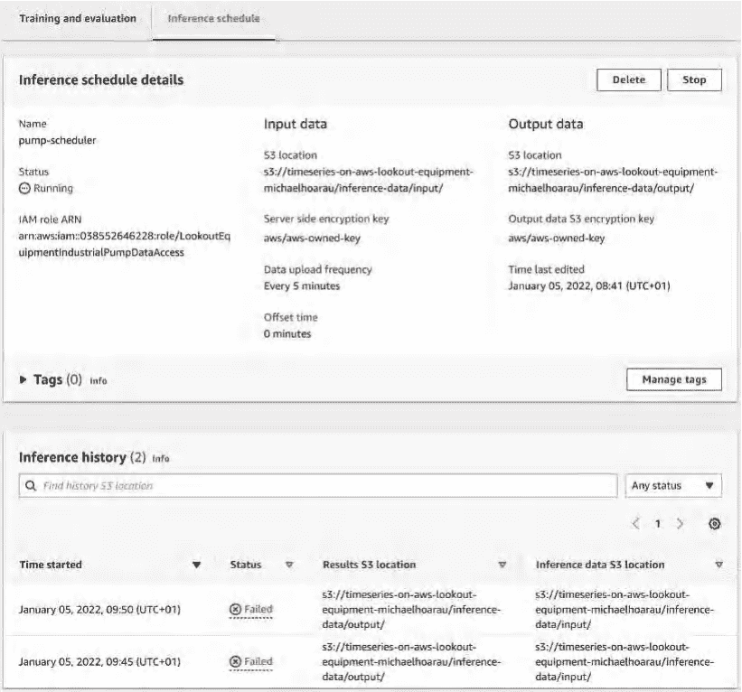

图 11.12 – 推断调度器仪表板

请注意，几分钟后（由于我们将调度器配置为每 5 分钟运行一次，因此至少需要 5 分钟），您将在此仪表板的**推断历史**部分看到一些失败的推断执行。这完全正常，因为该调度器监视的输入位置尚未推入新数据。现在让我们生成一些合适的输入数据！

## 准备用于推断的数据集

Amazon Lookout for Equipment 推断计划按紧凑的时间表运行。您刚刚配置了一个每 5 分钟运行的调度器。假设您刚刚在 `10:38` 完成了此配置。那么调度器接下来运行的时间将是 `10:40`、`10:45`、`10:50`……直到您停止该调度器。在本节中，您将执行以下操作：

- 了解调度器唤醒时会发生什么。
- 使用 CloudShell 准备一些可供调度器处理的推断数据。

### 了解计划推断过程

假设您的调度器在 `2021 年 9 月 24 日 10:40` 唤醒。该调度器将首先在您的输入位置查找所有文件名中包含与此时间对应的时间戳的 CSV 文件：`20210924104000`。

由于我们在数据集中定义了 50 个组件，因此调度器将期望找到 50 个遵循相同命名方案的 CSV 文件。

> **重要说明**
> 
> 如果某个组件在给定时间戳没有值，调度器仍会查找该组件的文件。您需要为该组件放置一个空文件（仅包含标题，没有其他行），以防止调度器执行失败。
> 
> 另请注意，如果某个组件在给定时间戳没有值，Amazon Lookout for Equipment 将根据前一个时间戳中找到的最后一个现有值，对该组件的传感器值进行前向填充。在撰写本文时，此前向填充过程最多可回溯 12 小时。

一旦 Amazon Lookout for Equipment 找到这些文件，它将打开这些文件并查找时间戳介于上一次调度器执行到当前执行之间的新数据。例如，打开 `sensor_43_20210924104000.csv` 文件时，它将*仅*提取时间戳在 `2021-09-24 10:35:00` 至 `2021-09-24 10:40:00` 之间的行。其他所有行都将被丢弃。

> **重要说明**
> 
> 考虑到某些数据可能会从一个 CSV 文件流向另一个 CSV 文件，Amazon Lookout for Equipment 会为每个组件打开三个文件：与唤醒时间对应的文件（在前面的示例中为 `10:40`），前一个文件（对应 `10:35`），以及后一个文件（对应 `10:45`）。它将在这三个文件中查找具有适当时间戳（仍然介于 `2021-09-24 10:35:00` 和 `2021-09-24 10:40:00` 之间）的行，并丢弃其余所有内容。

如您所见，要正确测试您之前配置的调度器，您需要生成一些 CSV 文件，其中包含与调度器执行时间精确对应的时间戳。这就是您将要使用 CloudShell 中运行的脚本生成的内容。


### 准备推理数据

手动准备推理数据是一项极易出错的工作。在本节中，你将使用 CloudShell 服务运行一个脚本，该脚本会为你生成这些数据并将其推送到 Amazon S3。让我们按照以下说明进行操作：

- 1. 登录你的 AWS 控制台。
- 2. 在控制台的右上角，确保**区域选择器**位于 Amazon Lookout for Equipment 可用的区域之一：欧洲（爱尔兰）、美国东部（弗吉尼亚北部）或亚太地区（首尔）。

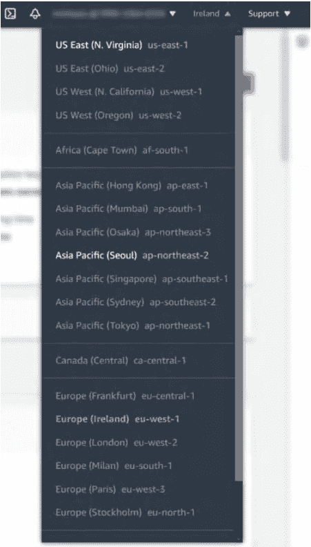

图11.14 – AWS 控制台区域选择器

- 3. 选择区域后，点击区域选择器左侧不远处的 **CloudShell** 图标。

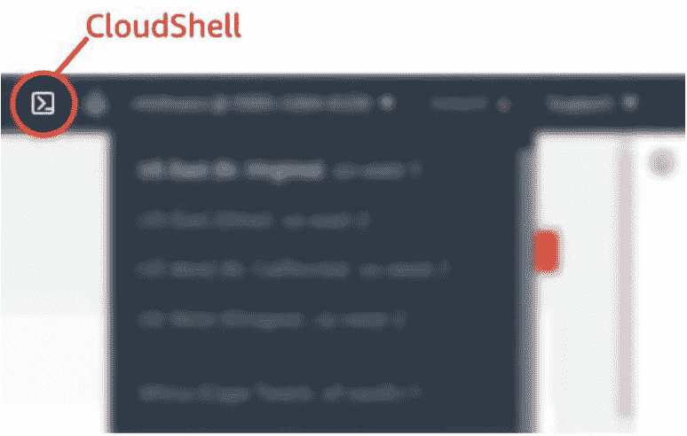

图11.15 – 定位 CloudShell 图标

- 4. 点击 **CloudShell** 图标时，浏览器会打开一个新标签页。如果你尚未打开 CloudShell 会话，应该会看到一条蓝色横幅，提示你的环境正在准备中。一分钟后，你的环境即可就绪，并会显示一个 Linux 命令提示符。

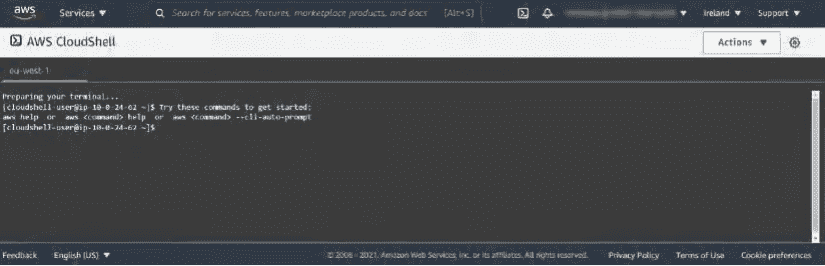

图11.16 – 你的 CloudShell 环境已就绪！

- 6. 你可以让调度程序运行三次（因为*步骤5*中的生成器会生成足够 15 分钟使用的推理数据），然后再停止它（这样就不会产生调度程序的使用费用）。为此，在调度程序仪表板的右上方，只需点击该部分的 **停止** 按钮即可。

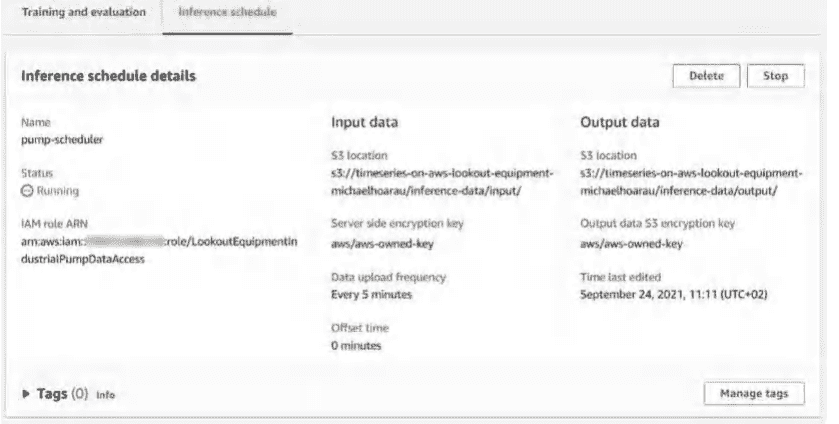

图11.18 – 停止调度程序

至此，你已经成功运行了一个调度程序。现在，让我们看看如何下载并可视化结果。

### 提取推理结果

在上一节中，你让调度程序运行了三次。任何成功推理的结果都将存储在本章开头配置的 S3 输出位置。让我们下载其中一个文件并查看其内容：

- 1. 登录你的 AWS 控制台。
- 2. 在控制台的左上角，你会看到一个 **服务** 下拉菜单，其中显示所有可用的 AWS 服务。在 **存储** 部分，找到 **S3** 服务并点击其名称进入 S3 控制台。

- 3. 导航到你的存储桶，然后进入 `inference-data`，最后进入 `output`。每次推理执行都会创建一个以调度程序唤醒时的时间戳命名的新目录。

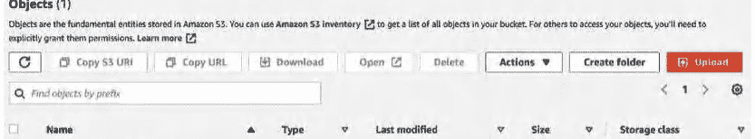

图11.19 – 推理调度程序输出内容

- 4. 在此目录中，你会找到一个名为 `results.jsonl` 的文件。这是一个 JSON Lines 文件。点击其旁边的复选框，然后点击 **下载** 按钮。

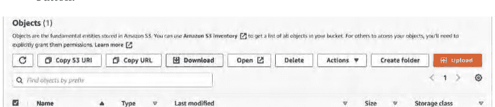

图11.20 – 推理调度程序 JSON Lines 结果文件

- 5. 文件下载到本地计算机后，使用文本编辑器打开它来检查其内容：

```json
{
  "timestamp": "2021-09-24T10:30:00.000000",
  "prediction": 1,
  "prediction_reason": "ANOMALY_DETECTED",
  "diagnostics": [
    {"name": "sensor_43\\sensor_43", "value": 0.08642},
    {"name": "sensor_07\\sensor_07", "value": 0.00526},
    {"name": "sensor_25\\sensor_25", "value": 0.00049},
    [...]
    {"name": "sensor_42\\sensor_42", "value": 0.11554}
  ]
}
```

该文件中的每一行都是一个完整的 JSON 对象，包含以下字段：

- `timestamp`：发送给已训练模型以获得相应预测的数据点的时间戳。
- `prediction`：此字段的值要么是 1（检测到异常），要么是 0（未检测到异常）。
- `prediction_reason`：这是 `prediction` 字段的文本对应形式。在撰写本书时，该字段只能取 `ANOMALY_DETECTED` 或 `NO_ANOMALY_DETECTED` 这两个值。

> **注意**
> 
> `prediction_reason` 和 `prediction` 字段以不同格式提供了相同的信息。最初只提供了 `prediction` 字段。后来添加了 `prediction_reason` 字段，以便与未来要部署的功能向前兼容。例如，服务未来可能会提供有关异常分类的更多见解。这些信息将以文本格式提供，而 `prediction` 字段将保持 0 和 1 的值。如果你打算根据是否存在异常来自动化工作流，我建议使用 `prediction` 字段，而不是 `prediction_reason`。

- `diagnostics`：当检测到异常行为且预测值为 1 时，此字段将包含一个诊断列表。`diagnostics` 字段是一个列表，其中包含传感器名称以及每个传感器在指示异常行为时的贡献权重。对于每个传感器，有两个字段可用：`name` 字段（包含传感器名称及其所附着的组件）和 `value` 字段（包含传感器对预测值的贡献）。

调度程序的每次运行都会生成一个单独的 `results.jsonl` 文件。你可以将所有文件拼接起来，构建实时仪表板以显示检测到的最新事件，也可以在预测值为 1 时触发通知。在*第12章，缩短异常检测的洞察时间*中，你将看到一个示例，演示如何以更用户友好的方式可视化这些结果，从而加速与任何异常检测系统相关的决策过程。

### 总结

在本章中，你学习了如何使用训练好的模型来调度定期推理。你学习了如何准备 S3 存储桶，以及如何配置推理调度程序来监视该存储桶。

本章还帮助你理解调度程序被唤醒时执行的操作顺序；当你需要准备输入数据以便其能被正确检测和使用时，这一点至关重要。你还学习了推理结果的存储位置，以及如何解读这些结果。

在下一章中，你将深入探讨如何解读 Amazon Lookout for Equipment 异常检测模型的结果，并减少处理这些洞察所需的时间。
