## 缩短异常检测的洞察时间

在前几章中，你学习了如何准备多变量数据集、如何训练和评估异常检测模型，以及如何配置推理调度程序。为了充分利用 Amazon Lookout for Equipment，你可以与数据工程师或数据科学家合作，他们将帮助你改进模型性能，并在结果的后处理方面更进一步。

本章的主要目标是为你指出可视化并监控模型的正确方向。这对于检测任何可能触发重新训练或进一步调查的漂移非常有价值。此外，你将学习如何构建自动化管道，这对于尽可能快速迭代至关重要，而无需手动浏览多个控制台屏幕。

在本章中，我们将介绍以下主要主题：

- 提高模型的准确性
- 处理模型诊断
- 监控模型
- 使用无服务器架构编排流程的每个步骤

### 技术要求

阅读本章内容不需要具备 Python 或 R 等语言的实际操作经验。但是，我们强烈建议你阅读本章时连接到自己的 AWS 账户，并打开不同的 AWS 服务控制台，以便自己执行各项操作。

要创建 AWS 账户并登录 Amazon Lookout for Equipment 控制台，你可以参考第2章《Amazon Forecast 概述》中的技术要求。

### 提高模型的准确性

在第10章《训练和评估模型》中，你训练了一个异常检测模型，并在评估期间可视化输出。根据你的业务目标，有几个方面你可能希望改进所获得的结果：

- 误报过多：根据实际情况评估 Amazon Lookout for Equipment 触发的事件后，你可能会发现一些误报事件并希望将其丢弃。
- 漏报过多：在某些情况下，你可能会知道一些在评估期间未被检测到的异常事件。
- 没有预警或预警时间过短：有时，异常虽然被检测到，但为时已晚，你希望获得更长的预警时间，以便最终用户有足够的时间采取适当的缓解措施。

减少这些情况的发生将提高最终用户对服务所提供洞察的信任度，并增加你从中获得的附加价值。每种情况、每台设备或每个工业过程都各不相同，你可能需要与领域专家密切合作来改进异常检测模型。以下是我在改进异常检测/预测模型时发现有用的一些调查研究方向：

- 减少信号数量
- 利用停机时间条件
- 选择最佳信号

让我们首先来看看如何减少用于训练模型的信号数量。


## 减少信号数量

Amazon Lookout for Equipment 可以使用多达 300 个信号构建模型。然而，使用的时间序列信号越多，就越有可能产生一些多变量噪声，从而使机器学习模型难以捕捉什么是正常工况，什么是给定过程的正常变异性。

如果你一开始就用许多信号进行训练，请识别 Amazon Lookout for Equipment 仪表板的信号排名中频繁出现的信号，并尝试仅使用排名前 15 或 30 的信号进行训练。在下面的截图中，你可以看到排名前 12 的信号对一个持续超过 50 小时的特定事件有 50% 的贡献。查看评估期间内的其他重要事件，将有助于你选出那些在每次检测到事件时都会反复出现的信号。

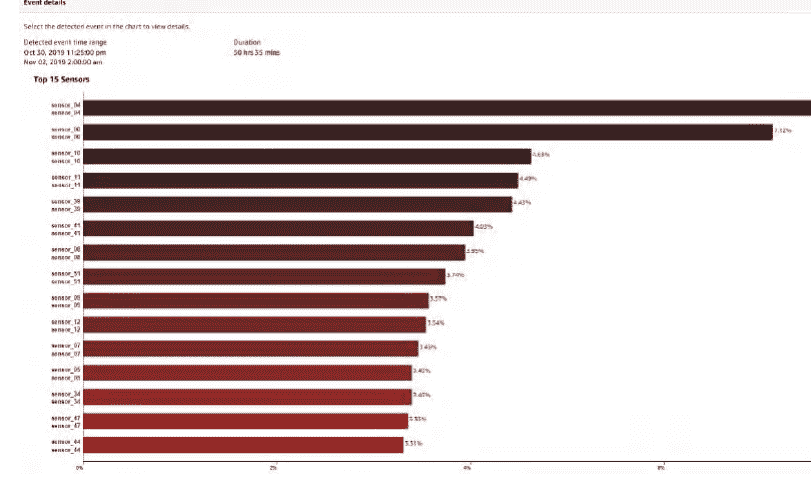

图 12.1 – 训练模型仪表板 – 事件详情

你也可以只保留特征重要性高于平均水平的信号。如果你有 50 个信号，那么 100% / 50 = 2% 实际上就是每个信号在对任意给定事件做出同等贡献时应有的特征重要性。任何贡献显著高于 2% 的信号都是为模型第二版保留的良好候选信号。

## 利用停机时间条件

在训练模型时，Amazon Lookout for Equipment 允许你选择一个信号来识别某个过程或某台设备何时处于停机状态，如下图所示：

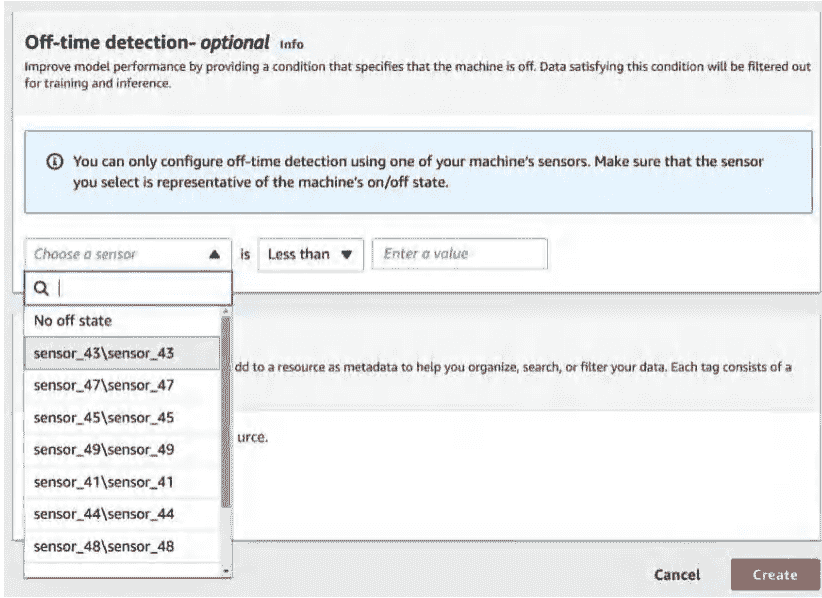

图 12.2 – 停机时间检测功能

配置此参数时，Lookout for Equipment 会从这些时间段中移除信号，因为它们与发现任何异常无关。如果在训练时保留这些数据，资产或流程停机的时间段很可能会被标记为异常，最终你会得到大量误报。

## 选择最佳信号

并非所有时间序列信号在异常检测方面都具有良好的预测能力。请绘制并可视化那些对你最重要事件贡献最大的信号。尤其要注意支持以下行为的信号：

- **大量缺失值：** 这可能表明传感器故障或数据收集问题。虽然这可能是值得调查的实际情况，但在训练新模型时，你可能会希望丢弃这些传感器。
- **恒定值：** 这种情况与前述情况非常相似。具有恒定值的信号不会为建模增加任何价值。然而，如果此类信号将来开始出现不同的演变，Amazon Lookout for Equipment 很容易识别出来。如果你确信这种情况不会发生，可以考虑丢弃这类信号。
- **分类数据：** 在大多数异常检测场景中，如果类别不平衡，会触发许多误报。我建议不要直接使用这些信号。你可能希望将它们用于额外的预处理，或设计感兴趣的新特征。
- **混沌行为：** 某些测量值可能杂乱无章，没有容易捕捉的稳定行为。这类信号会引入大量噪声，使异常检测器难以将正常与异常分开。考虑丢弃这些信号。
- **单调递增：** 这可能表示诸如运行时长之类的测量值，或与资产已运行的时间相关。我建议你避免使用这类传感器。
- **季节性数据：** 某些信号可能受季节性的影响。在这种情况下，请确保在训练期间包含足够的数据，以呈现完整的周期。例如，如果你的数据显示出年度季节性，请考虑至少训练一年以捕捉这种行为。
- **水平偏移：** 当评估期间显示的*正常*运行模式与训练期间不同时，Amazon Lookout for Equipment 很可能会触发大量异常。考虑更改训练/评估划分，以捕捉其他感兴趣的运行模式。

一旦你对已丢弃的信号感到满意，就可以训练一个新模型，同时使用大部分训练时段并将评估时段缩短至 1 天（这是撰写本书时可设置的最小值）。这将确保你的模型在推理时使用最新鲜的数据构建。

## 处理模型诊断

当你使用 Amazon Lookout for Equipment 训练异常检测模型时，可以可视化在评估期间获得的结果。这些结果可在控制台中查看，你也可以查询 API 以集成并进一步后处理这些结果，满足你自己的需求。

在推理时，推理调度器从 Amazon S3 上的输入位置读取新数据，并将模型结果输出到输出位置。每次推理执行都会创建一个以调度器唤醒时间戳命名的新目录，每个目录包含一个 JSON Lines 格式的文件。在第 11 章“安排定期推理”中，你已经学习了如何定位、下载和解释这些文件中包含的结果。

在本节中，你将使用一个 CloudFormation 模板，该模板将部署一个 CloudWatch 仪表板，用于可视化 Amazon Lookout for Equipment 的训练和推理结果。随后你将了解如何使用这些仪表板。本节的最后部分将专门讨论如何利用这些仪表板从 Lookout for Equipment 的原始结果中获取更多见解。

## 部署基于 CloudWatch 的仪表板

作为第一步，请确保你已登录 AWS 控制台。完成此操作后，根据你使用 Amazon Lookout for Equipment 的 AWS 区域，你可以单击以下链接之一启动部署过程：

- 美国东部（弗吉尼亚北部）：https://tinyurl.com/vp3da3t2
- 欧洲（爱尔兰）：https://tinyurl.com/vj3kcdx5
- 亚太地区（首尔）：https://tinyurl.com/44e4ua48

单击上述链接之一后，你将被带到 **AWS CloudFormation** 控制台的 **创建堆栈** 屏幕。要继续部署，请按照以下步骤操作：

1. 首先，单击第一个屏幕底部的 **下一步**。
2. 在参数页面上，你需要填写以下内容：

- **堆栈名称**：我们将堆栈命名为 `LookoutEquipmentDashboard`。
- **SnapshotBucket**：用于收集仪表板快照和临时文件的存储桶名称。请记住，你的存储桶名称必须在 AWS 云的所有账户中唯一。如果在部署时收到提示存储桶已存在的错误，请在所选名称末尾添加一个随机字符串。
- **SnapshotRuns**：推理仪表板快照的拍摄和电子邮件发送频率（每日或每周）。
- **TargetEmail**：接收快照的电子邮件地址。

3. 目标电子邮件地址必须在 **Amazon Simple Email Service (SES)** 中注册。为此，请执行以下步骤：

I. 在浏览器中打开一个新标签页或窗口，导航到 SES 控制台。你可以使用任意 AWS 控制台页面顶部的 **服务** 下拉菜单，在 **业务应用** 部分中搜索 **Amazon Simple Email Service**。

II. 在左侧菜单中，单击 **已验证身份**，然后单击 **创建身份**。

III. 选择 **电子邮件地址**，并填写你要使用的地址。单击 **创建身份**。

IV. 你很快会在收件箱中收到一封电子邮件：单击其中的链接以验证你的地址。

4. 注册电子邮件地址后，返回到包含 CloudFormation 参数的标签页，单击 **下一步** 按钮。

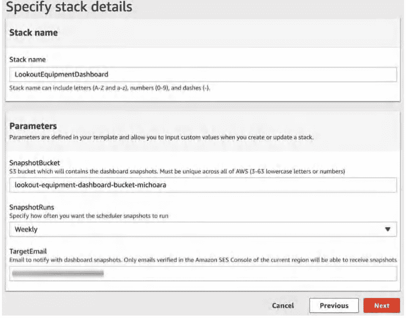

图 12.3 – Lookout for Equipment 仪表板部署参数

5. 下一页使用默认值即可。单击 **下一步** 进入 **查看** 页面。再次滚动到底部，选中该框以允许模板创建新的 IAM 资源，然后单击 **创建堆栈**。

6. CloudFormation 将花费几分钟时间代表你创建所有资源。完成后，在堆栈名称旁边（CloudFormation 控制台左面板）你会看到绿色的 CREATE_COMPLETE 消息，表示部署已完成，如下图所示：


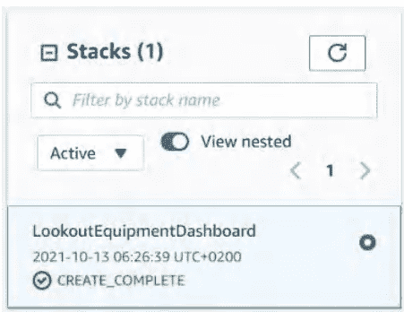

图 12.4 – 模板已部署

部署完成后，以下资源将已部署到您的账户中。

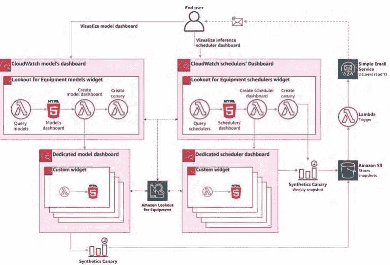

图 12.5 – Lookout for Equipment 仪表板部署概览

模板部署完成后，您可以立即开始使用。

## 使用 Lookout for Equipment 仪表板

模板部署完成后，使用屏幕左上角的 **Services** 下拉菜单打开 AWS 服务列表。在 **Management & Governance** 部分查找 **CloudWatch** 服务，并单击其名称进入其控制台。在那里，单击左侧菜单栏上的 **Dashboards** 链接。这将带您进入一个页面，其中列出了您在账户中可以访问的所有 CloudWatch 仪表板，如下面的屏幕截图所示。您应该会找到两个新仪表板，用于可视化您的 Amazon Lookout for Equipment 模型和调度器。

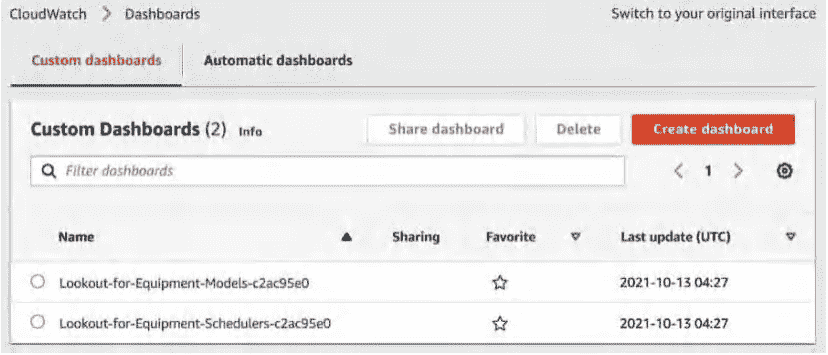

*图 12.6 – 新增的 CloudWatch 仪表板*

您可以使用名称以 **Lookout-for-Equipment-Models** 开头的仪表板来管理账户中在 Amazon Lookout for Equipment 中训练的模型。另一个仪表板可让您对账户中配置的任何调度器执行相同操作。

## 使用模型仪表板

单击名称以 **Lookout-for-Equipment-Models** 开头的仪表板。这将打开一个汇总了您账户中所有模型的仪表板。

> **重要说明**
> 
> 此仪表板使用 **CloudWatch Custom Widget** 功能，该功能在后台调用 Lambda 函数以显示自定义图表。首次打开此类仪表板时，您会看到一条警告消息，询问您在执行这些函数之前是否信任它们。单击仪表板右上角的 **Execute them all** 按钮运行这些函数并绘制组件内容。

默认情况下，仅显示过去 3 个月内训练的最后 50 个模型，如下所示：

| 数据集 | 模型 | 训练状态 | 模型仪表板 |
|---|---|---|---|
| chiller | chiller-model | SUCCESS | Create | View |
| deep-dive-demo-expander | deep-dive-demo-expander-model | SUCCESS | Create | View |
| demonstration | demonstration-model | SUCCESS | Create | View |
| equipment-asset1 | model-asset1-63b165be-b431-4ce8-94fd-8bed71b21e33 | FAILED | No model found |
| equipment-asset2 | model-asset2-2f959ce3-c6e8-49f8-9d91-c36f7a24b4d1 | FAILED | No model found |
| my_dataset | my_model | SUCCESS | Create | View |
| - | my_model2 | SUCCESS | Create | View |
| - | my_model3 | FAILED | No model found |

图 12.7 – Lookout for Equipment 模型仪表板

> **重要说明**
> 请确保您在创建模型的同一 AWS 区域中运行此 CloudWatch 仪表板。

您可以使用屏幕右上角的日期选择器来限制显示的模型。此日期选择器将使用模型训练日期来筛选要显示的模型。在此组件中，您的模型信息将按以下方式显示：

- 第一列将列出您账户中当前 AWS 区域的所有*数据集*。
- *模型名称*列在第二列中。如果多个模型使用同一数据集构建，则数据集名称将在它们之间共享，且不会重复。
- 在第三列中，*训练状态*可让您了解此模型是否成功训练。只有成功训练才能使用第四列中的操作。

- 最后一列为您提供两种可对成功训练的模型执行的操作：
  - 您可以请求为已训练模型*创建特定仪表板*。这将为此模型创建一个新的 CloudWatch 仪表板，并且还会配置并启动一个 **CloudWatch Synthetics** canary，该 canary 会将仪表板截图发送到您部署 CloudFormation 模板时配置的电子邮件地址。专用模型仪表板和 Synthetics 创建可能需要几秒钟。然后，模型列表仪表板将刷新，**View** 按钮将启用。
  - 当给定模型存在仪表板时，**View** 按钮将启用（此时 **Create** 按钮将禁用）。单击此按钮可导航到该模型专属的 CloudWatch 仪表板。

当您单击任何已训练模型的 **View** 按钮时，您将进入另一个专门用于该模型的 CloudWatch 仪表板。每个此类仪表板都会预配置多个组件：

- 模型详细信息
- 检测到的异常
- 聚合信号重要性
- 信号重要性演变

要了解有关通过这些组件获得的洞察的更多信息，请参阅*后处理检测到的事件结果以构建更深入的洞察*部分。

## 使用调度器仪表板

在 CloudWatch 仪表板主页上，单击名称以 **Lookout-for-Equipment-Schedulers** 开头的仪表板：这将打开一个汇总了您账户中所有调度器的仪表板。与模型仪表板一样，默认情况下仅显示当前 AWS 区域中过去 3 个月内创建的最后 50 个调度器，如下面的屏幕截图所示：

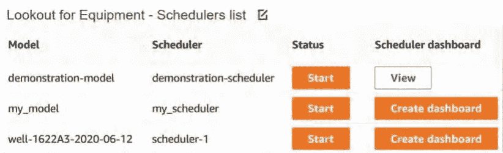

图 12.8 – Lookout for Equipment 调度器仪表板

在此仪表板中，您可以 **Start** 或 **Stop** 调度器。

> **重要说明**
> 请记住，运行调度器会产生费用：不要忘记停止您不再使用的调度器。

与已训练模型的评估类似，您也可以请求创建专门用于调度器的特定仪表板。创建调度器仪表板时，您还会创建一个 CloudWatch Synthetics canary，该 canary 会每周（或每天）将仪表板截图发送到您部署 CloudFormation 模板时配置的电子邮件地址。此 canary 默认配置为每周一上午 6:00 UTC 运行（如果您选择每日选项，则在每个工作日上午 6:00 UTC 运行）。

CloudWatch 专用仪表板和 Synthetics canary 可能需要几秒钟来创建，然后调度器列表仪表板将刷新，**View** 按钮将启用。

当您单击现有推理调度器的 **View** 按钮时，您将进入另一个专门用于该调度器的 CloudWatch 仪表板。已预配置两个组件：

- 调度器详细信息
- 上次执行诊断

在下一部分中，您将了解可以从这些组件获得的洞察。

## 后处理检测到的事件结果以构建更深入的洞察

在本节中，您将了解通过后处理 Amazon Lookout for Equipment 提供的原始结果可以获得的洞察类型。

### 模型详细信息

此组件仅提醒您数据集名称、训练周期和评估周期，如下面的屏幕截图所示：

pump-anomaly-detection-model | 模型详细信息

| 数据集 | 训练开始 | 训练结束 | 评估开始 | 评估结束 |
|---|---|---|---|---|
| industrial-pump | 2018-04-01 00:00:00 | 2018-10-31 00:00:00 | 2018-11-01 00:00:00 | 2020-05-04 00:00:00 |

图 12.9 – 模型详细信息示例

### 检测到的异常

检测到的异常会在所选模型的评估期间显示。组件顶部的下拉菜单可让您选择要在“检测到的异常”色带上方绘制的信号，以帮助您将特定时间序列行为与 Amazon Lookout for Equipment 检测到的实际事件关联起来。

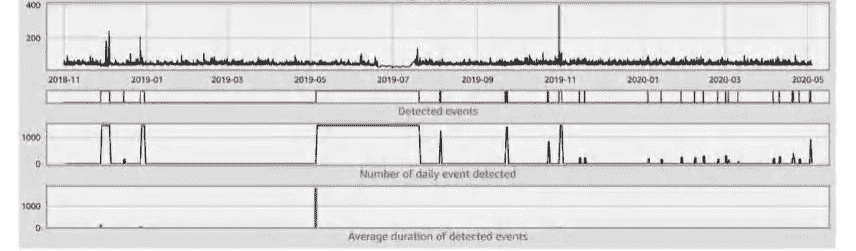

图 12.10 – 检测到的异常示例

此组件还绘制以下内容：

- 检测到的每日事件数：在某些情况下，您会看到事件数量在达到最大值之前逐渐增加。这可能是未来潜在异常的一个良好指标。
- 检测到事件的平均持续时间。

### 聚合信号重要性

此水平条形图汇总了*评估期间*最多 15 个信号的平均重要性。

虽然 Amazon Lookout for Equipment 的原生控制台允许您单击每个检测到的事件以绘制相关的信号重要性，但此图可让您了解在检测到任何事件时，是否存在对相同传感器的系统性偏向。

在下面的屏幕截图示例中，您可以看到 **sensor_51** 对检测到的事件的平均贡献远高于其他信号。绘制此信号将帮助您理解为什么该特定传感器有如此大的贡献。这也可能表明该传感器行为噪声较大，应将其移除，以训练出更稳健的模型。

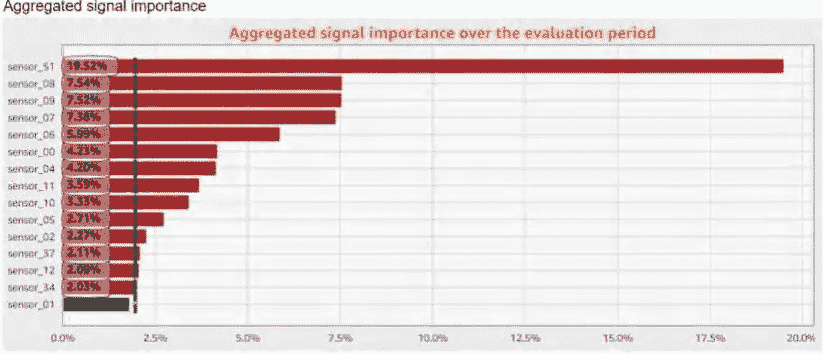

图 12.11 – 聚合信号重要性示例


垂直虚线（位于前一截图中约 2% 的位置）表示如果每个信号对检测到的每个异常的贡献都相等时，每个信号的重要性值。 这里示例的数据集有 50 个信号。 如果每个信号的贡献方式相同，它们各自的排名大约为 1/50 = 2.0%。 我们现在可以说，前 5 个信号的较高贡献绝对具有统计显著性。

高于黑色虚线的每个信号将显示红色条，而其他信号将显示绿色条。

## 信号重要性演变

最后一个小部件绘制了每个信号的特征重要性随时间的变化。 当检测到大量事件时，该图可能会变得非常拥挤。 在此阶段，特征重要性按日汇总，以便更好地理解每个信号的动态，如以下截图所示：

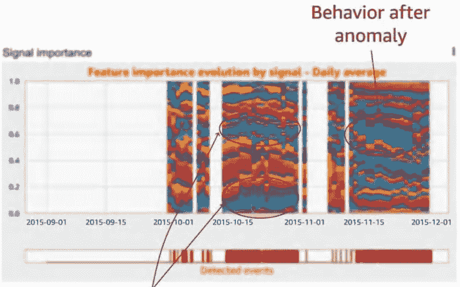

图 12.12 – 信号重要性演变示例

在前面的截图中你可以看到以下内容：

- 在 2015-10-15 至 2015-11-01 的期间内，你可以看到与最后期间不同的动态。
- 此小部件将帮助你了解是否可以将信号贡献的关系与不同类型的故障相匹配。 将其用作导致异常分类的高质量特征，将有助于你进一步减少最终用户分析时间。

## 调度程序详情

此小部件提醒你调度程序的名称以及其配置方式。

它还详细说明了它期望的输入（用于运行推理的输入 CSV 文件的格式和位置）。 当你遇到调度程序似乎找不到你的新数据的问题时，这会很有用。

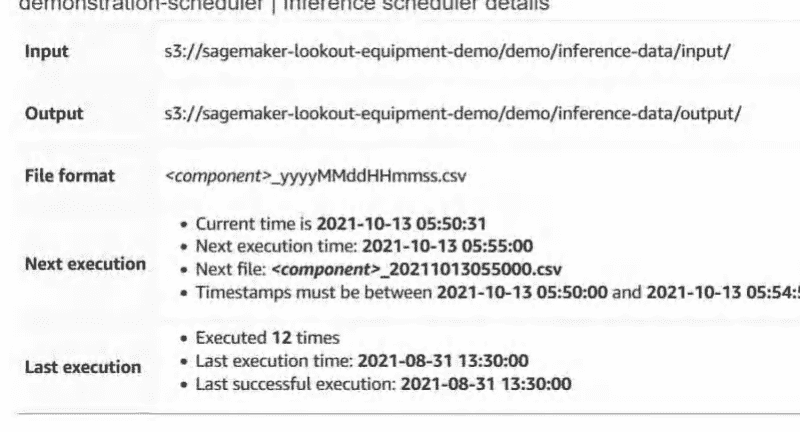

图 12.13 – 调度程序详情示例

## 最后一次执行诊断

此小部件显示了 Amazon Lookout for Equipment 捕获的最后一次异常的信号排名，如以下截图所示：

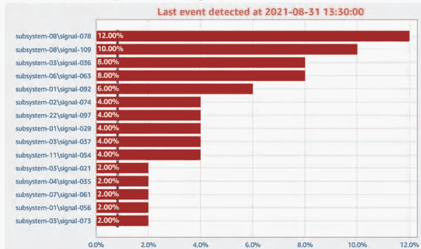

图 12.14 – 最后一次执行诊断示例

有了这些仪表板，你现在可以快速可视化你的 Lookout for Equipment 结果，并得出有价值的见解，以帮助你改进监控资产或流程的方式。 让我们现在来看一下你可以利用的最佳实践，以监控你的模型并在模型部署后检测任何漂移。

## 监控你的模型

你还应确保监控数据中任何潜在的偏移。 为此，你可以遵循以下流程：

- 1. 构建并存储一个数据集，其中包含你想要用于构建异常检测模型的所有时间序列的训练数据。
- 2. 计算每个时间序列的统计特征（例如，平均值、标准差以及值分布的直方图）。
- 3. 使用这些初始数据集训练你的模型并保存性能指标（它们捕捉你感兴趣的异常的程度如何）。
- 4. 当新数据到来时，计算相同的统计特征并将其与训练时使用的原始值进行比较。
- 5. 你可以将这些统计数据显示在预测旁边，供你的分析师做出适当的决策。 这将有助于他们更好地信任 Amazon Lookout for Equipment 生成的结果。 特别是，可视化从训练到推理时间的潜在分布偏移，将有助于确定模型是否应使用新的、最新的数据重新训练，或者是否必须从流程角度进行实际调查。

一旦你建立了此流程，你将能够组织定期审查，以分析数据中的任何偏移或异常检测模型的性能漂移，从而决定何时是修改训练数据集并重新训练新模型的好时机。

自动化你的训练流程将是使此持续改进任务尽可能无痛的关键。 在下一节中，你将配置一个管道，该管道将能够自动编排此流程。

## 使用无服务器架构编排流程的每个步骤

在前面的章节中，你主要使用 Amazon Lookout for Equipment 控制台，大多手动构建每个步骤。 在本节中，你将学习如何构建一个自动工作流，它将负责所有这些步骤，并在完成时通知你。 你将实现并部署以下截图中显示的组件：

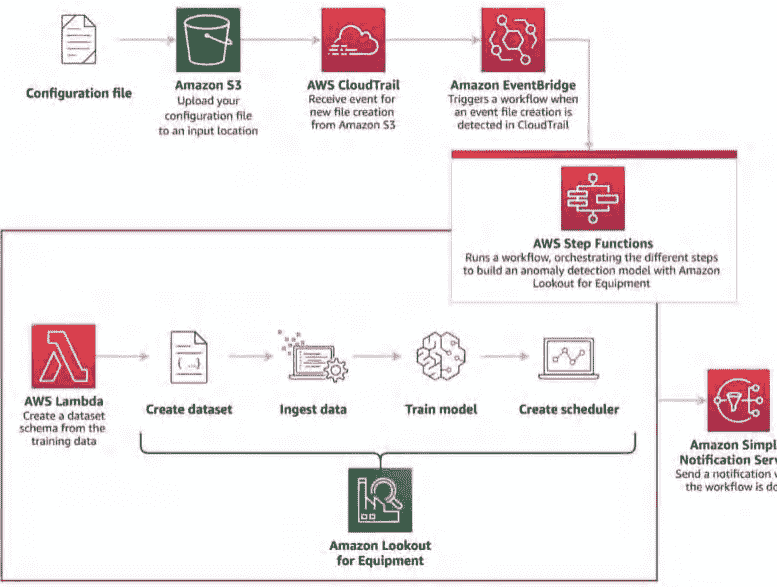

图 12.15 – Amazon Lookout for Equipment 自动化图

为此，我们将重点关注此架构图的每个关键部分的实施。 具体来说，我们将深入研究以下内容：

- 1. 首先，你将了解 **AWS Step Functions** 编排服务。
- 2. 然后你将构建 Step Functions 工作流的关键组件（利用 **AWS Lambda** 函数并编排不同的 **Amazon Lookout for Equipment** 任务）。
- 3. 为了自动触发你的工作流，你需要了解其他 AWS 云服务。 我们将对 **AWS CloudTrail** 和 **Amazon EventBridge** 进行高层次描述，并配置它们以在包含训练数据的 Amazon S3 存储桶中上传新文件时自动触发你的 Step Functions 工作流。
- 4. 最后，你将使用 **Amazon Simple Notification Service**，它将在你的工作流完成时（成功或不成功）向你发送电子邮件。

你将有机会自行实现这些组件的大部分，以便你很好地理解每个组件以及它们如何相互配合。

## 组装和配置 AWS 组件

在本节中，你将学习如何构建和配置每个服务以自动化你的异常检测训练工作流。 让我们首先概述你将需要使用的不同服务（除 **Amazon Lookout for Equipment** 和 **Amazon S3** 之外，你已经熟悉这两个服务）：

- **AWS Step Functions**：这是一种低代码可视化工作流服务，你可以使用它来编排 AWS 服务并自动化任何业务流程。 使用此服务，你可以管理故障、服务集成，并专注于你的业务逻辑。 你将使用此服务来编排构建数据集、训练模型和配置推理调度程序所需的各个步骤。
- **AWS Lambda**：这是一种计算服务，让你无需配置和管理任何底层服务或基础设施即可运行代码。 你将编写一个 Lambda 函数，该函数将根据位于 Amazon S3 存储桶中的实际训练数据构建数据集模式。
- **AWS CloudTrail**：此服务监控并记录你在所有基础设施和服务中的账户活动。 它记录每个 API 调用，以便你可以对其做出反应。 你将配置一条跟踪以监控你的 S3 存储桶，并在新配置文件文本文件上传到存储桶根目录时触发事件。
- **Amazon EventBridge**：此无服务器事件总线使使用由你的应用程序或任何 AWS 服务生成的事件连接事件驱动应用程序变得容易。 你将使用 EventBridge 在此工作流发生状态更改时触发你的工作流或发送通知。
- **Amazon Simple Notification Service：** 此消息服务可用于在应用程序之间或在应用程序和人员之间发送消息。 你将使用此服务在训练和部署工作流发生状态更改时发送通知。

有了此概述，你现在可以安全地进入自动化之旅的第一步：组装模型训练和部署工作流。

## 构建异常检测工作流

让我们现在构建自动化架构的以下部分：

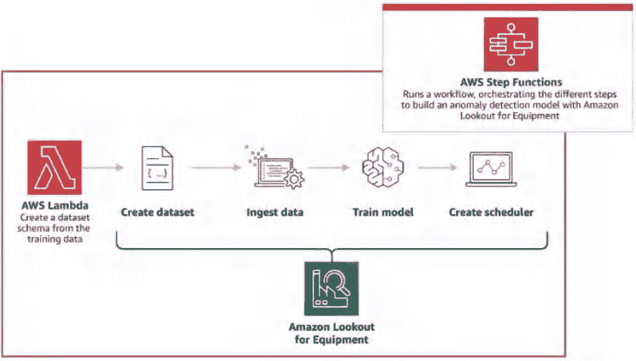

图 12.16 – 自动化管道，重点关注 Step Functions

首先，我们需要创建 Lambda 函数，该函数将用于构建数据模式以在 Amazon Lookout for Equipment 中创建数据集。 作为输入，步骤函数将接收数据的位置，并且该位置将传递给 AWS Lambda 函数。 此 Lambda 函数需要与 Amazon Lookout for Equipment 相同的对位于 S3 中的数据的访问权限。 让我们首先更新你的访问角色。


## 更新访问角色

你需要更新在*第9章，创建数据集并摄取数据*中创建的IAM角色，然后需要创建Lambda函数。要完成所有这些，请按照以下步骤操作：

- 1. 如果你已经完成了本章开头的*技术要求*前置条件，你应该已经登录到AWS控制台；否则，打开你喜欢的浏览器并登录AWS控制台。
- 2. 在控制台左上角，你会看到一个**服务**下拉菜单，显示所有可用的AWS服务。在**安全、身份与合规**部分，找到**IAM**服务，点击其名称进入IAM控制台。在左侧菜单栏中，点击**角色**菜单，然后在右侧列表中搜索你的`LookoutEquipmentIndustrialPumpDataAccess`角色。

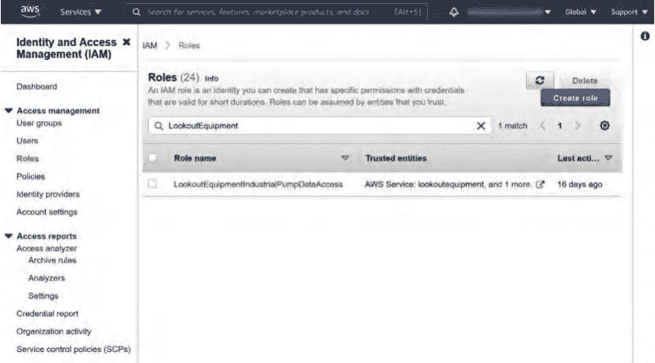

图12.17 – IAM角色列表

3. 点击你的角色名称，然后点击**信任关系**选项卡。接着，点击**编辑信任关系**按钮。

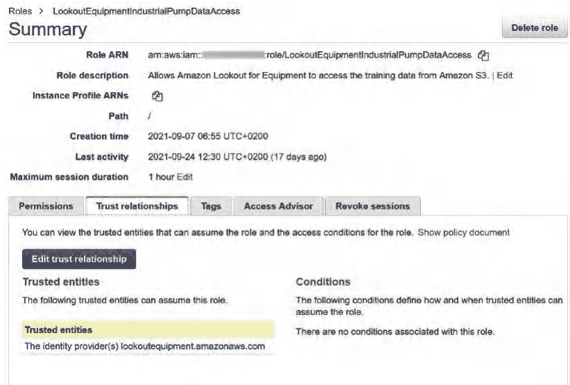

图12.18 – IAM角色信任关系列表

4. 使用以下代码更新你的角色中的策略文档。注意必须允许额外的服务（lambda.amazonaws.com）承担此角色并访问你在Amazon S3中的数据：

```
{
    "Version": "2012-10-17",
    "Statement": [
        {
            "Sid": "",
            "Effect": "Allow",
            "Principal": {
                "Service": [
                    "lookoutequipment.amazonaws.com",
                    "lambda.amazonaws.com"
```

2. 接下来，你将从零开始编写一个新函数（名为create-lookout-equipment-schema），并在函数创建页面上填写以下字段：

- - **函数名称**：我们将此函数命名为create-lookout-equipment-schema。
- - **运行时**：你将使用**Python 3.9**。
- - 选择**使用现有角色**作为**执行角色**。
- - 在**现有角色**下拉列表中，选择你之前更新的LookoutEquipmentIndustrialPumpDataAccess角色。

在这个屏幕的右下角，你会找到一个**创建函数**按钮；点击它进入下一页。

3. 在下一页，**代码源**部分的右上角有一个**上传来源**下拉列表。点击它并选择**Amazon S3位置。**

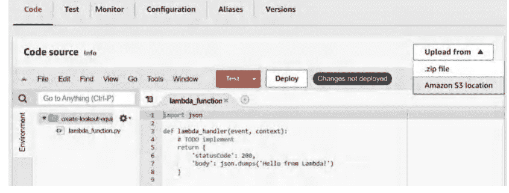

图12.20 – 从Amazon S3上传Lambda函数

4. 在出现的窗口中，输入以下URL，指向此函数将运行的代码，然后点击**保存**按钮：

```
s3://packt-publishing-timeseries-on-aws-michaelhoarau/part2-amazon-lookout-for-equipment/create-lookout-equipment-schema.zip
```

> **重要说明**
> 使用此zip包创建Lambda函数时，请确保与初始S3存储桶位于同一区域。否则，你会看到区域相关错误。

5. 然后你会回到Lambda函数的**代码**选项卡，源代码应该已更新。点击**配置**选项卡，然后点击右上角的**编辑**按钮。

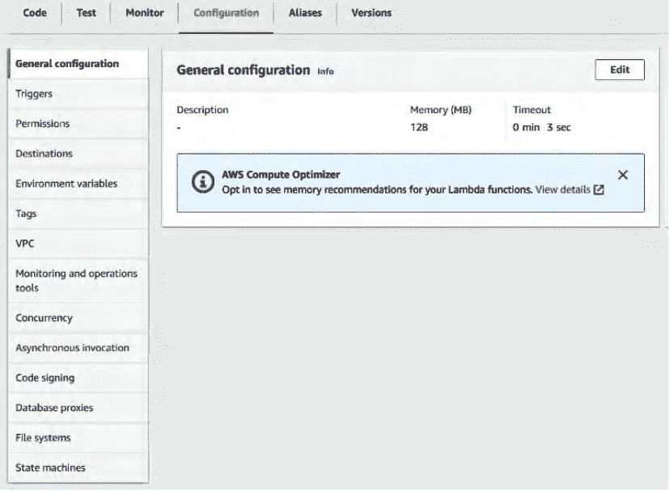

图12.21 – Lambda函数配置

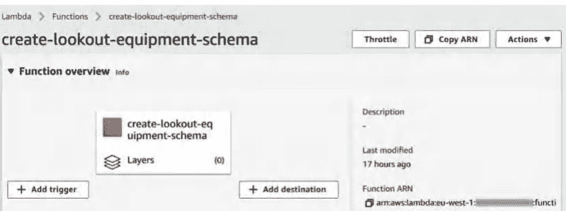

图12.23 – Lambda函数概览

我们现在已经配置了Lambda函数，现在可以配置实际工作流了。

## 构建工作流

我们将使用AWS Step Functions服务构建实际工作流。为此，请按照以下步骤操作：

- 1. 使用屏幕左上角的**服务**下拉菜单调出AWS服务列表。在**应用程序集成**部分，找到Step Functions服务，点击其名称进入AWS Step Functions控制台。点击窗口左上角的汉堡菜单（三条水平线），然后点击**状态机**选项卡，最后点击**创建状态机**按钮。

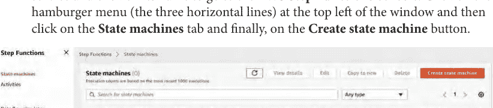

图12.24 – 状态机列表

2. 在**定义状态机**屏幕上，选择顶部的**以代码编写工作流**，并选择**标准**类型。

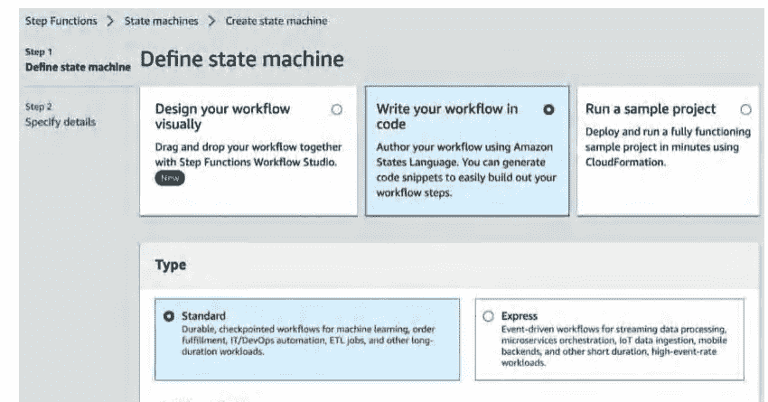

图12.25 – 状态机定义

3. 下载以下文件：
https://packt-publishing-timeseries-on-aws-michaelhoarau.s3.eu-west-1.amazonaws.com/part2-amazon-lookout-for-equipment/lookout-equipment-automation-step-function.json

4. 打开上述文本文件，搜索以下字符串：<<LAMBDA ARN>>。将此字符串替换为你之前复制的Lambda函数的ARN（在Lambda函数定义末尾）。

5. 将文本文件的全部内容（包含更新后的Lambda函数ARN）复制到状态函数的**定义**区域。右侧的工作流会更新为状态机的实际流程。

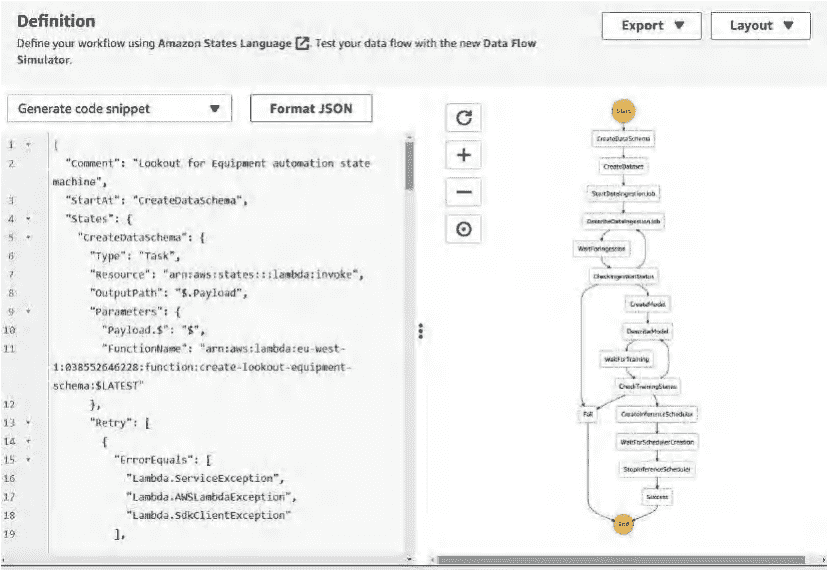

图12.26 – 状态机定义

- 6. 点击右下角的**下一步**按钮。这将出现第二个屏幕，你可以在其中为工作流指定其他详细信息。
- 7. 在下一个屏幕上，你可以为状态机指定名称。我将其命名为`LookoutEquipmentAutomationPipeline`。保持所有其他字段为默认值，然后点击屏幕底部的**创建状态机**按钮。

8. 这将带你进入一个显示新建状态机详细信息的屏幕。点击顶部的**在IAM中编辑角色**按钮，更新状态机使用的角色，使其能够调用Amazon Lookout for Equipment API函数。

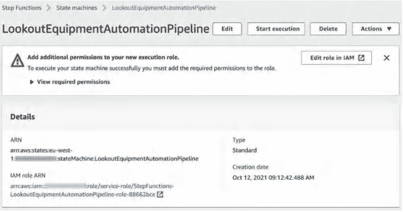

图12.27 – 状态机详细信息

9. AWS Step Functions服务创建的默认角色将具有调用Lambda函数的能力，但无权调用Amazon Lookout for Equipment API（提醒一下，出于安全原因，AWS服务只拥有你明确授予的权限）。在角色的**权限**选项卡上，点击**附加策略**。

## 摘要

角色 > StepFunctions-LookoutEquipmentAutomationPipeline-role-88662bce

角色ARN arn:aws:iam::...role/service-role/StepFunctions-LookoutEquipmentAutomationPipeline-role-88662bce

角色描述 编辑

实例配置文件ARN

路径 /service-role/

创建时间 2021-10-12 09:12 UTC+0200

上次活动 在跟踪期内未访问

最长会话时长 1小时 编辑

权限 信任关系 标签 访问顾问 撤销会话

权限策略（已应用2个策略）

附加策略 添加内联策略

策略名称 策略类型

LambdaInvokeScopedAccessPolicy-8642dfa0-fb5b-4117-9ada-a544de57b53d 托管策略

XRayAccessPolicy-591f0c43-eb51-42cc-acb5-cc7e9fd32e4 托管策略

图12.28 - 状态机默认角色定义

10. 在屏幕顶部的**筛选策略**字段中搜索LookoutEquipment字符串，并选中AmazonLookoutEquipmentFullAccess旁边的复选框。然后，点击位于屏幕底部的**附加策略**按钮：

筛选策略 LookoutEquipment 显示2条结果

策略名称 类型 用途

AmazonLookoutEquipmentFullAccess AWS托管 权限策略（4）

AmazonLookoutEquipmentReadOnlyAccess AWS托管 无

取消 附加策略

图12.29 - 向状态机角色附加新策略

在本节中，你完成了以下任务：

- 1. 你更新了已用于访问Amazon S3数据的角色，以允许Lambda函数承担该角色。
- 2. 然后，你创建了一个Lambda函数，用于创建有效的、可由Amazon Lookout for Equipment使用的数据模式，以创建新数据集。
- 3. 接着，你在AWS Step Functions中创建了一个状态机（或工作流），用于编排自动化管道中的不同步骤。
- 4. 最后，你确保工作流拥有调用Lambda函数和Amazon Lookout for Equipment API方法所需的所有权限。

你现在将设置一个自动触发器，以响应上传到S3存储桶的新文件：此触发器将启动你刚刚定义的工作流。

## 配置自动触发器

我们现在将构建自动化管道的以下部分：

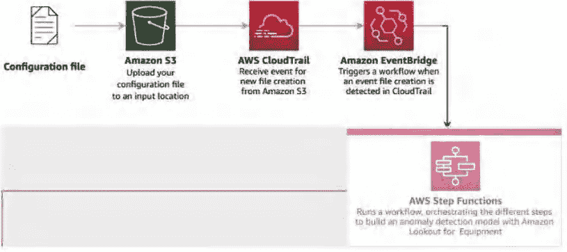

图12.30 – 自动化管道，重点展示触发器步骤


您已经有一个Amazon S3存储桶，一直在用它存储训练和推理数据。接下来，我们要在AWS CloudTrail中创建一个跟踪（trail），用于记录该存储桶中发生的每一个事件。为此，请按照以下步骤操作：

- 1. 使用屏幕左上角的**服务**下拉菜单，调出AWS服务列表。在**管理与治理**部分，找到**CloudTrail**服务并点击其名称以进入其控制台。在服务仪表板中，点击**创建跟踪**按钮。
- 2. 对于**跟踪名称**，输入`LookoutEquipmentAutomationS3Event`。
- 3. 如果您不想对跟踪的日志文件进行加密，请取消选中**日志文件SSE-KMS加密**复选框（如果您想加密，则必须提供加密密钥）。向下滚动，点击**下一步**按钮。
- 4. 在创建跟踪的第二步，取消选中**管理事件**复选框，并选中**数据事件**复选框。

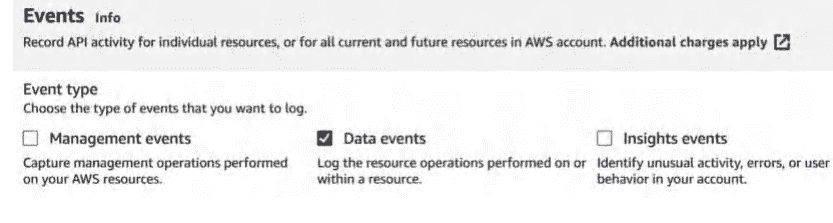

图12.31 – 为新建跟踪选择事件类型

- 2. 给您的规则起一个名称：`LookoutEquipmentPipelineTrigger`。

- 3. 在**定义模式**部分，选择**事件模式**单选按钮，然后选择**按服务预定义模式**。在**服务提供方**字段中选择**AWS**，在**服务名称**中选择**Simple Storage Service (S3)**，在**事件类型**中选择**对象级操作**：

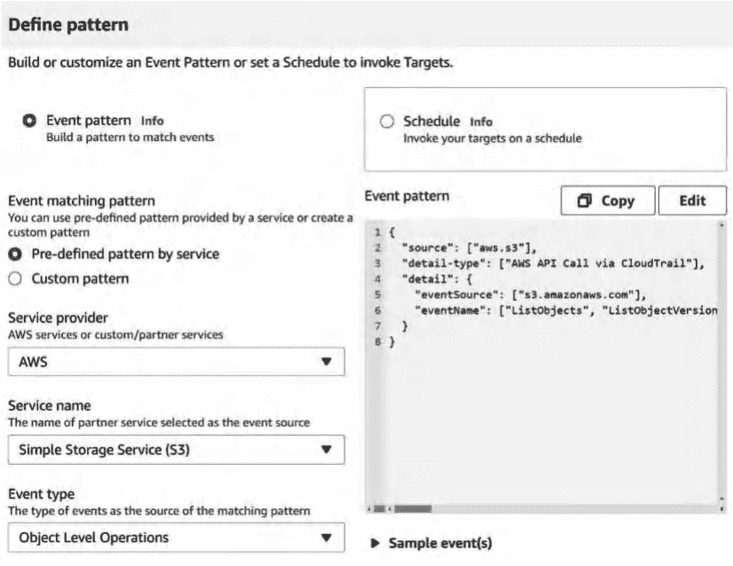

图12.33 – EventBridge模式定义

- 4. 选择**特定操作**单选按钮，并从下拉列表中选择**PutObject**操作。然后，选择**按名称指定存储桶**，并填写您的存储桶名称（我的是`timeseries-on-aws-lookout-equipment-michaelhoarau`）。

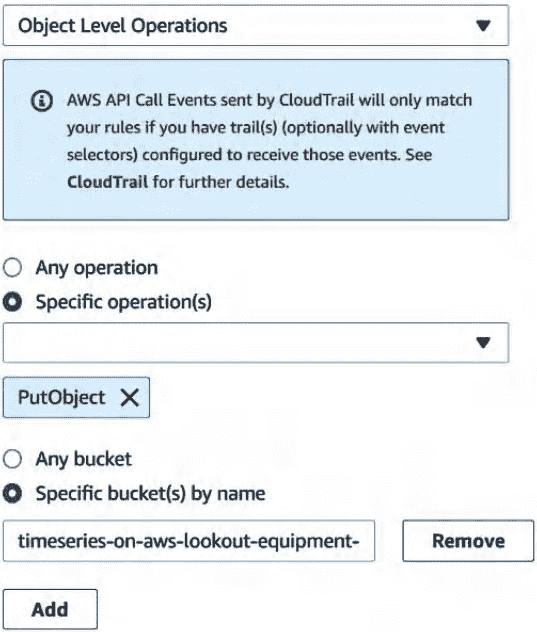

图12.34 – 要捕获的EventBridge操作

- 5. 向下滚动到屏幕的**选择目标**部分。在**目标**中选择**Step Functions状态机**，并在**状态机**下拉菜单中选择`LookoutEquipmentAutomationPipeline`。保持所有其他参数不变（包括新角色的创建）。

选择目标

当事件与您的事件模式匹配或计划被触发时，选择要调用的目标（每条规则最多5个目标）。

目标

当事件与您的事件模式匹配或计划被触发时，选择要调用的目标（每条规则最多5个目标）。

Step Functions状态机

状态机

LookoutEquipmentAutomationPipeline

配置输入

为此特定资源创建新角色

Amazon_EventBridge_Invoke_Step_Functions_1104444295

使用现有角色

了解有关EventBridge基于身份的策略的更多信息。

重试策略和死信队列

添加目标

图12.35 – EventBridge目标选择

- 6. 向下滚动到屏幕底部并点击**创建**按钮。

您的触发器现已就绪。最后一步是在状态机完成后设置通知。

## 配置通知

现在，我们将构建架构的最后一部分——通知服务配置。要完成这项最后任务，您将再次使用Amazon EventBridge，在每次工作流状态变化时向其发送消息到Amazon Simple Notification Service（SNS）队列。为此，您可以执行以下操作：

- 1. 使用屏幕左上角的**服务**下拉菜单，调出AWS服务列表。在**应用程序集成**部分，找到**Simple Notification Service**并点击它进入其控制台。在服务主页上，将**主题名称**设置为`LookoutEquipmentWorkflowStatusUpdate`，然后点击**下一步**按钮。

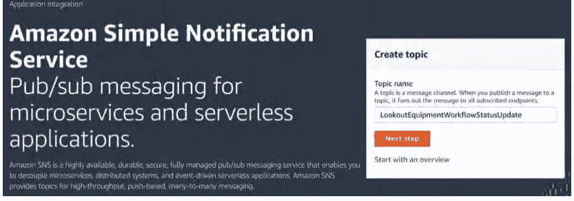

图12.36 – 创建新的SNS主题

- 2. 在下一个屏幕上，将所有字段保留为默认值，向下滚动到页面底部，点击**创建主题**按钮。您的主题将创建完成，并显示摘要仪表板。在**订阅**部分，点击**创建订阅**。

- 3. 在**创建订阅**屏幕的**详细信息**部分，将**协议**设为**电子邮件**，将**端点**设为您的电子邮件地址。

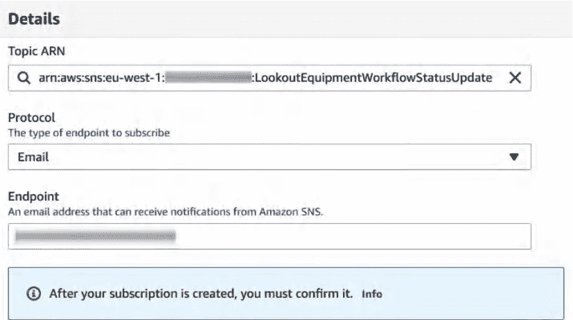

图12.37 – 为现有SNS主题创建订阅

- 4. 向下滚动并点击**创建订阅**按钮。几秒钟后，您将收到一封主题为*AWS Notification – Subscription Confirmation*的电子邮件。点击您将在该消息中找到的**确认订阅**链接：您的电子邮件地址现已订阅此SNS主题。这意味着发送到此主题的任何消息都将投递到您的电子邮件地址。

现在您的通知投递已配置完成，您将返回Amazon EventBridge，将您的工作流状态变化连接到该主题。为此，请按照以下步骤操作：

- 1. 使用屏幕左上角的**服务**下拉菜单，调出AWS服务列表。在**应用程序集成**部分，找到**Amazon EventBridge**服务并点击其名称进入其控制台。在服务主页上，点击**创建规则**按钮。
- 2. 为您的规则指定**名称**：`LookoutEquipmentPipelineStatusChange`。

- 3. 在**定义模式**部分，选择**事件模式**单选按钮，然后选择**按服务预定义模式**。在**服务提供方**中选择**AWS**，在**服务名称**中选择**Step Functions**，在**事件类型**中选择**Step Functions执行状态更改**。然后，选择**特定状态机ARN**，并输入您之前创建的工作流的ARN。该ARN格式如下：`arn:aws:states:eu-west-1:<<ACCOUNT_ID>>:stateMachine:LookoutEquipmentAutomationPipeline`，其中`<<ACCOUNT_ID>>`是您的AWS账户ID。

- 4. 向下滚动到屏幕的**选择目标**部分。在**目标**中选择**SNS主题**，并在**主题**下拉菜单中选择`LookoutEquipmentWorkflowStatusUpdate`。保持所有其他参数不变（包括新角色的创建）。

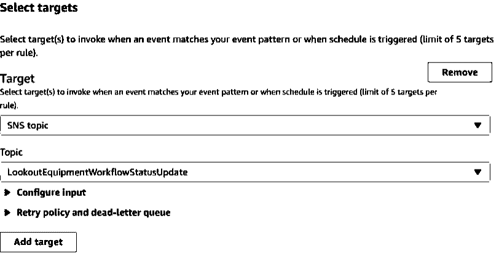

*图12.38 – 事件目标定义*

- 5. 点击页面底部的**创建**按钮来创建您的事件。

您的通知现已准备好触发。让我们测试您的管道！

## 测试管道

您的自动化管道已就绪——让我们测试吧！打开您喜欢的文本编辑器，在其中写入以下内容：

```json
{
    "train_prefix": "train-data/",
```

- 6. 检查您的电子邮件。您应该会收到两条新消息，一条在工作流开始运行时收到，另一条在工作流完成时收到。

> 注意
> 我们没有自定义通知电子邮件的内容：对于非开发人员来说，它们相当普通，因为您会收到原始通知，是实际的JSON负载。在实际面向业务用户的生产系统中，您可能需要自定义这些电子邮件，使其更用户友好。您可以在Amazon EventBridge中定义目标时展开**配置输入**部分来实现这一点。在那里，您可以选择**输入转换器**，将此JSON原始数据转换为实际的英文句子。

祝贺您完成本部分的学习！现在，您已经拥有了为工业时间序列自动化整个异常检测管道所需的所有工具！

## 总结

在专门介绍Amazon Lookout for Equipment的最后一章中，您学习了如何构建仪表板，以获取模型和推理结果的详细可视化。您还构建了第一个自动化管道，让AWS编排服务为您完成所有繁重工作，而您可以专注于模型结果。

本章对于理解如何改进异常检测模型以及如何自动化大多数任务以尽可能快速迭代尤为重要。

在下一章中，您将切换到另一个异常检测托管服务，但该服务面向业务指标而非工业时间序列：Amazon Lookout for Metrics。


