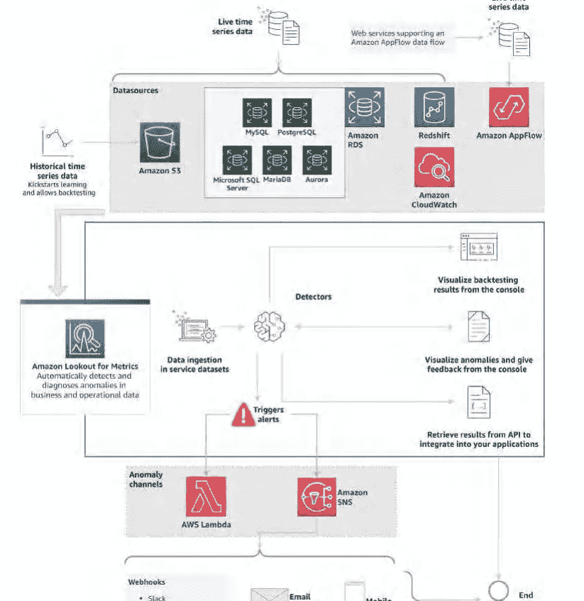
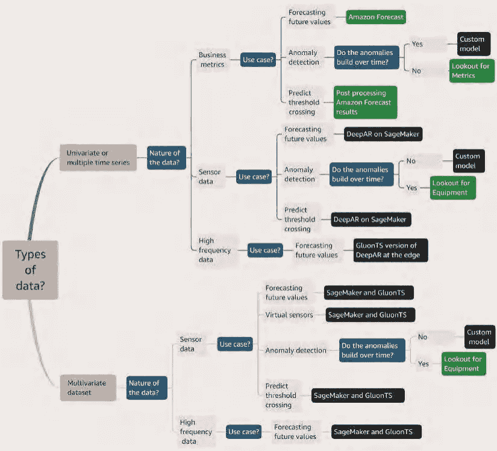

## 13 Amazon Lookout for Metrics 概述

在本章中，你将了解 Amazon Lookout for Metrics 的设计目标、工作原理以及最适合使用它的场景。学完本章后，你还将熟练掌握 Amazon Lookout for Metrics 所处理的底层概念（数据源、数据集、检测器、告警和异常）。

与 Amazon Forecast 和 Amazon Lookout for Equipment 一样，Amazon Lookout for Metrics 是 AWS 的人工智能（AI）/机器学习（ML）托管服务之一，专门解决围绕时间序列数据展开的问题。Amazon Lookout for Metrics 是一项异常检测服务，专门用于发现和诊断业务指标与运营指标中的离群值。

在本章中，我们将介绍以下主要内容：

- 识别不同类型的异常
- 什么是 Amazon Lookout for Metrics？
- Amazon Lookout for Metrics 是如何工作的？
- 识别适合监控的指标
- 在 Lookout for Equipment 与 Lookout for Metrics 之间进行选择

### 技术要求

学习本章内容不需要具备 **Python** 或 **R** 等语言的实操经验。不过，我们强烈建议你在 AWS 控制台中跟随操作，从那里你可以访问 Amazon Lookout for Metrics 服务。

如果你已经有 AWS 账号，可以连接到 AWS 控制台，点击顶部的搜索栏，在服务区域输入 `Lookout for Metrics`，然后点击 **Amazon Lookout for Metrics**，打开服务控制台的着陆页。

要创建 AWS 账号并登录 Amazon Lookout for Metrics 控制台，你可以参考*第 2 章 Amazon Forecast 概述*中的*技术要求*部分。

现在你应该已经准备好使用 Amazon Lookout for Metrics 了！但在我们深入了解该服务的概述之前，让我们先来看看在业务指标中检测异常所面临的挑战。

### 识别不同类型的异常

在深入了解 Amazon Lookout for Metrics 之前，我建议你先阅读一些定义。如果你需要复习时间序列数据中不同类型的异常是什么样的，可以阅读*第 8 章 Amazon Lookout for Equipment 概述*开头的*解决异常检测问题的不同方法有哪些？*一节。这段内容将概述我们在时间序列数据中可以找到的异常类型，并描述我们从零开始构建自定义离群值或异常检测系统时可以使用的不同方法。

如果你访问 Amazon Lookout for Metrics 主页（https://aws.amazon.com/lookout-for-metrics），你会看到它使用机器学习技术自动检测异常，这些异常被定义为偏离常态的离群值。Amazon Lookout for Metrics 会在实时或准实时单变量时间序列数据中寻找偏差。这个描述中的关键词是**离群值**。在统计学中，离群值是一个与其他观测值显著不同的值。不过，并非所有离群值都是异常：

- **离群值可以是异常：** 如果你正在监控电子商务网站上多个产品的销售数据，并看到盛夏时节保暖围巾的销量突然飙升，你可以放心地认为这不是正常行为。仅基于这一个孤立的数据点，就决定在一年中的这个时候增加围巾库存，可能不是一个合理的决策。

- **离群值可以是预期值：** 在前面的电子商务网站示例中，你可能会看到许多产品在圣诞节前或感恩节前后的销量飙升。这些销售值可能与通常销售数据的中位数显著不同，但它们是符合预期的。如果你向 ML 模型提供足够的数据（数年），它可能会开始学习这种特殊行为，并且不会对其做出反应。相反，如果某一年的感恩节前后你的销量没有飙升，这很可能会被称为离群值（而且绝对是异常！）。

- **离群值可以属于不同的群体：** 假设你在销售智能气象站，人们可以把它放在花园或阳台上。你还提供了一款移动应用程序，客户可以从中查看城市中每个气象站的温度（以及其他数据）。如果你在法国的秋季，你会预期早晨的日间温度在 5°C 到 10°C 之间。如果你看到某些位置的温度在 20°C 到 22°C 之间，离群值检测系统一定会发现它们。然而，经过调查后，你可能会发现一些客户把气象站放在孩子的卧室里，以确保孩子感觉舒适。在这种情况下，这些值既不是离群值也不是异常，它们只是样本的一部分（在室内使用气象站的客户），与其余群体（在室外使用气象站的客户）不同。

Amazon Lookout for Metrics 会检测离群值，并为你提供可解释性工具，帮助你在考虑这些不同可能情况的基础上，就离群值和异常做出决策。现在让我们深入了解 Amazon Lookout for Metrics 的功能。

### 什么是 Amazon Lookout for Metrics？

**Amazon Lookout for Metrics** 是 AWS 云平台上可用的 AI/ML 托管服务之一。该服务可在你的实时数据中发现异常，帮助你定位其根本原因，并通过收集你的反馈持续改进。该服务会连接你的数据源，并允许你创建检测器来监控数据源中的值。Amazon Lookout for Metrics 会随着时间推移不断加深对你数据的理解，以更好地捕获异常。你可以让服务从连接数据源时开始分析的实时数据中学习（这段训练时间可能从几分钟到一天不等），也可以提供一些历史训练数据来启动学习过程。在底层，Lookout for Metrics 可以利用多种算法，并根据你的数据选择最佳算法。

**托管服务**是指最终用户只需提供数据并配置一些参数以满足自身需求的服务。所有其他任务（*被视为无差异的繁重工作*）都由服务代表用户执行。这包括所有基础设施管理的自动化。作为 Amazon Lookout for Metrics 用户，你无需预置和管理虚拟机、配置用户账户、处理安全问题、在请求量增加时规划可扩展性，也无需停用未使用的资源。

对于 AI/ML 托管服务，一些数据准备、摄取任务和模型管理活动也会在底层执行，这使你能够主要专注于要解决的问题。Amazon Lookout for Metrics 是一种可扩展的托管服务，可自动化从数据摄取到模型部署的整个端到端异常检测流水线，并提供推理结果。该服务还负责底层的数据准备。Amazon Lookout for Metrics 可以代你执行以下功能：

- *选择最佳算法*：以你的数据特征为依据。你的数据是独一无二的，单一一种异常检测算法无法适用于所有类型的数据。Amazon Lookout for Metrics 会学习你的数据行为（是稀疏、尖峰还是有季节性？），并根据这些特征选择合适的算法和模型参数。
- *执行超参数调优*：当所选算法需要时，为你找到最佳参数。
- *准备时间序列*：使时间序列能够被多种算法摄取。Amazon Lookout for Metrics 可以准备时间序列数据，以馈送到一系列统计和深度学习模型。


- *自动考虑人机交互反馈*，即终端用户在将异常标记为正确或不正确时提供的反馈。人工反馈会实时反映到 Amazon Lookout for Metrics 模型中。通过自动化此步骤并提供纳入反馈的简便方法，Amazon Lookout for Metrics 降低了警报疲劳或漏检异常的风险。
- *无需手动再训练决策：* Amazon Lookout for Metrics *会自动决定* 代表你对模型进行再训练。再训练过程是自动化的，当模型检测到需要时会自行再训练。这不需要任何人工干预，让你有更多时间分析结果，并就 Amazon Lookout for Metrics 的见解提供及时反馈。这种动态工作方式使 Amazon Lookout for Metrics 能够适应业务或运营数据中不断变化的周期，发现并匹配季节性趋势变化以减少误报，并随着时间推移提高准确性。
- *生成根因分析报告*，以提供用户可反馈的可操作结果。

既然你已经充分了解 Amazon Lookout for Metrics 能为你做什么，让我们深入探讨该服务的工作原理。

## Amazon Lookout for Metrics 的工作原理

在本节中，你将首先了解该服务所涉及的不同概念，从而学习 Amazon Lookout for Metrics 的工作原理。然后，你将更深入地了解这些概念如何协同编排以构建**检测器**（Lookout for Metrics 对异常检测模型的称呼）。本节最后将概述该服务使用的定价模型。

## 关键概念定义

为了构建能够在数据中发现异常的模型，Amazon Lookout for Metrics 使用以下概念和资源：

- **检测器：** Amazon Lookout for Metrics 训练机器学习模型来检测数据中的离群点。在此服务中，此类模型称为*检测器*。检测器持续从数据中学习，从而更好地理解正常行为及任何预期可变性。
- **数据源：** 数据源是一种提供时间序列数据的服务，检测器可对其进行分析。每个数据源必须提供带时间戳的记录，每条记录同时包含指标和（可选）维度（这两个概念的定义见本列表后续内容）。Amazon Lookout for Metrics 可以连接多个 AWS 服务，以及能够与 **Amazon AppFlow** 集成的第三方服务（Salesforce 和 Google Analytics 就是两个例子）。
- **数据集：** 检测器连接到数据源后，它会摄取你的数据副本并准备进行分析。Amazon Lookout for Metrics 摄取的数据存储在*数据集*中。检测器分析实时连续数据以检测异常，同时从历史数据中学习你的数据行为。数据集将包含历史数据和连续数据。
- **度量：** 数据集中的每一行称为一条**记录**，一条记录可以包含多个称为**字段**的键值对（或带标签的值）。要与 Lookout for Metrics 配合使用，数据集必须至少具有*一个时间戳字段*和至少*一个待监控字段*。被监控的字段称为**度量**。
- **维度：** 在选择数据集中哪个字段适合作为度量进行监控时，你还可以选择最多五个附加字段，用于根据这些附加字段的值对度量进行分组。这些字段称为*维度*。假设你正在监控某个产品在全国范围内的销售额：`sales number` 将作为你的度量。如果选择另一个包含销售所在城市的字段，`city` 将成为维度，使 Lookout for Metrics 能够将 `sales number in Paris`、`sales number in New York` 等作为要监控的独立时间序列。
- **指标：** 将检测器连接到数据源后，你必须选择某些字段作为数据集的度量，并选择其他一些字段作为维度。度量和维度的每种组合都称为一个*指标*。在上一个示例中，`sales number in Paris` 和 `sales number in New York` 就是指标。
- **严重性分数：** 当 Amazon Lookout for Metrics 检测到异常时，它会使用*严重性分数*对其进行排序。该分数是 0 到 100 之间的数字，表示某个指标值偏离预期范围的程度。
- **警报：** 当检测器发现异常时，你可以触发警报，其目标可以是 **Amazon Simple Notification Service (SNS)** 主题中的通知，也可以是使用 **AWS Lambda** 函数进行更复杂的处理。当异常的严重性分数超过某个阈值（你可以配置该阈值）时，就会发送此警报：警报将包含异常记录，你可以使用自己选择的编程语言（通过 AWS Lambda）处理它，或者将其连接到支持与此服务进行 webhook 集成的任何 Amazon SNS 订阅者（例如 Slack）。
- **反馈：** 当检测器检测到异常时，它会创建包含异常详细信息的报告。这些详细信息包括所有具有意外值的指标，并将它们打包在 Amazon Lookout for Metrics 控制台中。在那里，你可以针对每个相关指标提供反馈，说明该异常的相关程度。该反馈会立即集成到模型中以提升其准确性。

现在，我们来看看 Amazon Lookout for Metrics 如何使用所有这些概念来训练和运行异常检测模型。

## Amazon Lookout for Metrics 工作流概览

你无需向 Amazon Lookout for Metrics 提供任何历史标签，即可开始检测数据集中的异常：该服务可以立即以无监督方式开始检测，仅使用你的新实时数据（模型在线训练，并随着从数据源观察到的数据越来越多而持续学习）。如果你有历史数据，则可以将历史数据提供给 Amazon Lookout for Metrics 来引导训练。此外，当检测到第一批异常时，服务会切换到半监督模式，询问你对检测到异常的反馈，并将你的回答反馈给服务，以逐步改进模型。

下图说明了 Amazon Lookout for Metrics 如何协同编排所有这些任务：



图 13.1 – Amazon Lookout for Metrics 概览

让我们深入这幅示意图，解释使用 Amazon Lookout for Metrics 需要经历的不同步骤：

- 1. 将你的数据连接到 Amazon Lookout for Metrics 可用作数据源的服务，无论是用于历史数据还是实时数据：
  - A. 你的*历史数据*可以推送到 Amazon S3。如果你想使用历史数据来引导 Amazon Lookout for Metrics 模型训练，则只能使用 Amazon S3 作为数据源来构建检测器。
  - B. 你的*实时时间序列数据*可以存储在 Amazon **关系数据库服务（RDS）**托管的数据库中，也可以来自 Amazon Redshift（AWS 的数据仓库服务）。你还可以使用来自 AWS 日志服务（Amazon CloudWatch）的指标，或从 Amazon AppFlow 收集数据。后者可以连接到你的某个支持 Amazon AppFlow 数据流的业务应用程序。

> **注意**
> 
> 在撰写本书时，支持 Amazon AppFlow 数据流的兼容业务应用程序如下：Amplitude、Dynatrace、Google Analytics、Infor Nexus、Marketo、Salesforce、ServiceNow、Singular、Trendmicro、Vevea 和 Zendesk。

- 2. 一旦数据在你选择的数据源中可用，你就可以使用 Amazon Lookout for Metrics 连接到该数据源，配置度量和维度（即定义要监控的指标），然后启动检测器。根据度量的粒度，Amazon Lookout for Metrics 可能需要最多一天时间才能理解你的数据行为并开始检测异常。
- 3. 一旦检测器看到足够多的数据，它就会开始发送你可审查的异常：你可以直接通过服务控制台提供反馈，以便 Amazon Lookout for Metrics 通过人机交互的持续改进流程改进其检测器。服务控制台还将通过提供根因分析，让你进一步调查异常，从而在异常触发时迅速采取更好的行动。
- 4. 你还可以配置警报以接收通知，或通过分别将 Amazon SNS 或 AWS Lambda 连接为 Amazon Lookout for Metrics 警报的目标来触发应用程序自动化流程。

现在，你应该对如何将该服务集成到自己的异常检测实践中有了高层次的理解。最后一块拼图是了解定价模型，以便你能更好地优化使用该服务的方式。


## 定价

与许多 AWS 服务一样，您只需按使用量付费，无需预先承诺。尽管构建概念验证的成本极低（尤其是如果您能利用免费套餐），但使用 Amazon Lookout for Metrics 实现异常检测管道只需考虑一个维度：检测器在给定月份分析的指标数量。无论您的指标分析频率如何，您都需要付费：无论您的指标是每小时还是每天发布一次数据，您都只需为单个指标付费。

如果这是您首次在某个账户中使用 Amazon Lookout for Metrics，您可以享受免费套餐，该套餐允许您免费使用该服务一个月。在此期间，分析最多 100 个指标将不收取任何费用。

AWS 服务开发人员不懈努力降低服务的运营成本，价格也会定期下调。在撰写本书时，您的 Amazon Lookout for Metrics 使用量按以下分级价格计费：

- 前 1,000 个指标：每个指标 $0.75
- 从 1,001 到 5,000 个指标：每个指标 $0.50
- 从 5,001 到 20,000 个指标：每个指标 $0.25
- 从 20,001 到 50,000 个指标：每个指标 $0.10
- 超过 50,000 个指标后的每个指标按 $0.05 计费。

如需了解最新定价，您可以访问 Amazon Lookout for Metrics 定价页面：https://aws.amazon.com/lookout-for-metrics/pricing/。

请注意，根据您使用 Amazon Lookout for Metrics 的方式，可能会产生其他费用。例如，如果您执行以下任何操作，就会产生费用：

- 使用 Amazon SNS 创建警报。
- 使用 AWS Lambda 函数创建自定义操作。
- 使用 AWS AppFlow 将数据导入 Lookout for Metrics 数据集。

有关这些服务定价模式的更多详细信息，请查看它们各自的定价页面：

- Amazon SNS：https://aws.amazon.com/sns/pricing/
- AWS Lambda：https://aws.amazon.com/lambda/pricing/
- AWS AppFlow：https://aws.amazon.com/appflow/pricing/

此定价概述结束了我对 Amazon Lookout for Metrics 的介绍。在下一节中，您将了解您的应用程序需要满足哪些不同要求，才能成功利用此服务的功能。

## 识别适合监控的指标

您已成功将机器学习项目定义为异常或离群值检测问题，并且可能已经收集了一些历史时间序列数据集。Amazon Lookout for Metrics 是否是提供您所需洞察的理想选择？让我们回顾一些注意事项，以帮助您了解 Amazon Lookout for Metrics 是否适合您的异常检测场景，具体如下：

- 数据集要求
- 用例要求

### 数据集要求

与许多其他 AI 服务（无论是否在 AWS 内）不同，Amazon Lookout for Metrics 可以在没有任何数据点的情况下启动：在获得足够信息执行冷启动检测之前，您不会收到任何检测到的异常（例如，如果您的数据按日间隔，您需要等待至少 14 天才能开始接收来自 Amazon Lookout for Metrics 的推理结果），但您可以开始构建管道和应用程序，而无需像其他 AI 服务那样等待足够的数据来训练模型。

此外，Amazon Lookout for Metrics 在底层利用了多种算法（从简单的统计模型到更依赖数据的深度学习模型），当您拥有足够的数据时，服务会自动从简单算法切换到更复杂的算法。

Amazon Lookout for Metrics 是一种单变量服务：每个指标单独监控，每个检测器最多可监控五个指标。每个检测器都会生成可操作的结果，并提供根因分析，帮助您在异常发生时发现这些指标之间的关系。

如果您需要分析超过五个指标，则需要构建多个检测器。如果您拥有多变量数据集，并且知道异常可能基于多个变量之间不断演变的关系而产生，那么 Amazon Lookout for Metrics 将无法捕获此类事件。

### 用例要求

- **使用日志文件作为输入：** 尽管日志文件高度基于时间，但将自由格式的文本日志文件用作 Lookout for Metrics 的数据源并不是一个好的选择。您需要预处理数据，并将其结构化为 Amazon Lookout for Metrics 可识别的输入格式（例如，位于 Amazon S3 中的 CSV 或 JSON Lines 文件），才能检测到某些内容。您还需要将自由格式文本预处理为易于处理的事件：例如，您可能能够捕获诊断代码来替代自由格式文本。
- **异常预测：** Amazon Lookout for Metrics 可以检测实时数据中的异常。但是，它无法通过根据近期模式预测异常可能发生的时间来提供异常预测。
- **随时间累积的异常：** 某些异常会逐渐出现并随时间推移而变得重要。Amazon Lookout for Metrics 可以检测在数小时或数天内发生的异常。如果您监控的指标在数周甚至数月内逐渐恶化，该服务将难以捕捉这种行为。

您现在应该对如何构建异常检测问题以利用 Amazon Lookout for Metrics 有了很好的理解。您还可以使用本节来识别如何丰富现有数据集以成功使用此服务（例如，在数据准备期间将自由格式文本文件转换为诊断代码，或以合适的时间间隔聚合数据）。

## 在 Lookout for Equipment 和 Lookout for Metrics 之间进行选择

本书第一部分专门介绍 Amazon Forecast，第二部分则聚焦于 Amazon Lookout for Equipment。本章帮助您开启了 Amazon Lookout for Metrics 之旅。除了这三种 AI/ML 托管服务之外，AWS 云平台还提供了许多选项来处理您的时间序列数据并从中获取有价值的洞察。以下思维导图以细粒度级别展示了这些不同选项：



图 13.2 – AWS 上时间序列的简化思维导图

现在您已经对前面提到的三种托管服务有了或多或少的深入了解，让我们看看有助于您在这三者之间进行选择的不同决策点：

1. 如果您拥有*多变量*数据集，并希望执行*异常检测*或预测，请使用 **Amazon Lookout for Equipment**。
2. 如果您拥有*单变量*或*多个时间序列*，请执行以下操作：
   A. 如果您想*预测*业务指标，请使用 **Amazon Forecast**。
   B. 如果您想执行*异常检测*（非预测），则使用 **Amazon Lookout for Metrics**。如果您的*异常随时间累积*，请尝试 **Amazon Lookout for Equipment**，尽管该服务在处理多变量数据集时会表现出色。
3. 对于*任何其他用例*，您可能需要组合多个服务，或利用您可以在 **Amazon SageMaker** 平台上构建的其他算法、库和模型。

如果您想更详细地查看此思维导图，并了解其他用例以及其他 AWS 服务和库的更多细节，可以通过以下链接下载详细的高分辨率思维导图：

```
https://packt-publishing-timeseries-on-aws-michaelhoarau.s3.eu-west-1.amazonaws.com/time-series-on-AWS-decision-tree.png
```

## 总结

Amazon Lookout for Metrics 是一种 AI/ML 托管服务，可以检测数据集中的离群值，并提供根因分析，帮助您从单变量或多个时间序列数据中收集洞察。

在本章中，您学习了如何构建适合 Amazon Lookout for Metrics 的异常检测问题，并了解了该服务使用的关键概念（数据集、检测器、指标、度量和维度）。本章对于帮助您深入理解哪些应用程序适合使用 Amazon Lookout for Metrics 解决非常重要。我们还讨论了如何改进您的异常检测框架方法，以最大程度地受益于此服务为您提供的无差别繁重工作。

在下一章中，我们将把 Amazon Lookout for Metrics 连接到数据集，并配置我们的第一个检测器。


