## 创建并激活检测器

在上一章中，我们确定了在处理以单变量时间序列形式呈现的业务或运营指标时，所关注的异常检测问题类型。在本章中，我们将深入使用 **Amazon Lookout for Metrics** 处理一个电子商务数据集，该数据集包含一年内浏览量和收入的演变情况。该数据集由 **亚马逊云服务** 在 Amazon Lookout for Metrics 公共示例存储库中公开托管：

```
https://github.com/aws-samples/amazon-lookout-for-metrics-samples/blob/main/workshops/RI2021/ml_ops/datasets
```

到本章结束时，你将对该数据集有很好的理解，并知道如何将其导入 Amazon Lookout for Metrics，以及如何将其用于回测和实时检测。

在本章中，我们将涵盖以下主要主题：

- 准备用于异常检测的数据集
- 创建检测器
- 添加数据集并连接数据源
- 理解回测模式
- 配置告警

### 技术要求

要学习本章内容，无需具备 **Python** 或 **R** 等语言的实践经验。但是，我们强烈建议你在连接到自己的 AWS 账户并打开 Amazon Lookout for Metrics 控制台的情况下阅读本章，以便在你这边执行不同的操作。

如果你已有 AWS 账户，可以连接到 AWS 控制台，点击顶部的搜索栏，在服务部分输入 `Lookout for Metrics`，然后点击 **Amazon Lookout for Metrics** 以打开服务控制台的登录页面。

要创建 AWS 账户并登录 Amazon Lookout for Metrics 控制台，你可以参考 *第2章，Amazon Forecast 概述* 中的 *技术要求* 部分。

现在你已经准备好使用 Amazon Lookout for Metrics 了！

### 准备用于异常检测的数据集

在本章和下一章中，我们将重点研究一个电子商务数据集，在其中检测潜在异常并识别一些根本原因，以帮助我们调查问题并更快地找到修复途径。

在接下来的小节中，我们将详细查看以下步骤：

1. 下载电子商务数据集，并将数据拆分为训练数据集（用于回测）和测试数据集（用于监控模拟实时数据，以了解 Amazon Lookout for Metrics 的连续模式如何工作）。
2. 将准备好的 CSV 文件上传到 **亚马逊简单存储服务（S3）** 进行存储。Amazon S3 允许你存储文件，并且经常被用作许多 AWS 服务（如 Amazon Lookout for Metrics）的文件数据存储。
3. 授权 Amazon Lookout for Metrics 访问你在 Amazon S3 中的数据。这是可选的，因为你可以让 Amazon Lookout for Metrics 在导入新数据时为你完成此操作。但这将让你更好地控制授权方面，并有助于你在未来使用 Amazon Lookout for Metrics 时调试权限错误。
4. 使用回测在数据集上训练检测器，并切换到连续模式以监控实时数据。

现在让我们开始下载数据集并了解其内容概览。

#### 收集数据集

我们将使用以下数据集作为由 AWS 在 Amazon Lookout for Metrics GitHub 示例存储库中托管的电子商务数据集：

```
https://github.com/aws-samples/amazon-lookout-for-metrics-samples/blob/main/workshops/RI2021/ml_ops/datasets/ecommerce.zip
```

解压后，该压缩包包含一个用于回测的数据集（input.csv）和一个实时文件夹，其结构方式使 Amazon Lookout for Metrics 能够理解并检测其中的异常。

> **注意**
> 在撰写本书时，演示实时数据持续到2022年2月底。该数据集由该存储库的维护者定期更新，并且应定期更新，以确保你在此处找到的演示内容保持最新。

该数据集的回测部分包含一个虚构的全球销售电子商务网站的每日浏览量和收入。所包含的数据展示了每个市场（按国家代码组织）和每个消费平台（网页、移动应用或移动网页）的浏览量和收入。回测数据从2021-01-01到2022-01-18可用。例如，以下是来自移动网页客户的美国市场收入：

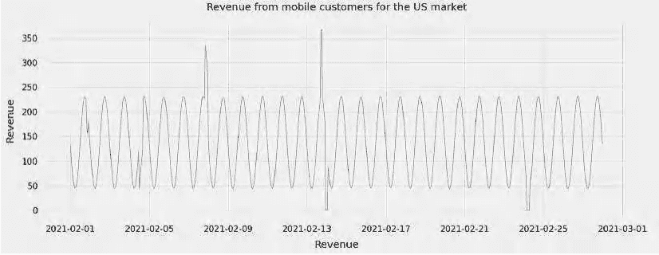

图14.1 – 美国市场移动网页客户的收入

在这个合成数据集中，你会注意到这里和那里添加了一些人为异常（例如，在前面的图中大约2021-02-07附近）。该数据集已准备好导入 Amazon Lookout for Metrics。让我们开始将其上传到 Amazon S3。

### 将数据上传到 Amazon S3 进行存储

在本节中，你将创建一个 Amazon S3 存储桶，用于在将原始数据集导入 Amazon Lookout for Metrics 之前存储它。然后你将继续实际的数据集上传。

#### 创建 Amazon S3 存储桶

有了准备好的数据集，让我们在 Amazon S3 上创建一个存储桶并按如下方式上传数据：

1. 如果你已经完成了本章开头的要求先决条件，你应该已经登录到你的 AWS 控制台，否则，打开你喜欢的浏览器并登录到你的 AWS 控制台。
2. 在控制台的左上角，你会看到一个 **服务** 下拉菜单，它将显示所有可用的 AWS 服务。在 **存储** 部分，找到 **S3** 服务并点击其名称以进入 S3 控制台。在这里，我们将点击存储桶列表部分顶部的 **创建存储桶** 按钮。
3. 你现在位于存储桶创建页面。为你的存储桶选择一个名称。该名称在整个 S3 服务中必须是唯一的。我将我的命名为 `timeseries-on-aws-forecast-michael-hoarau`。这应该足够独特了。另外，选择一个 AWS 区域，Amazon Lookout for Metrics 将从该区域获取你的数据。我为我的存储桶选择了 **欧洲（爱尔兰）** 区域。

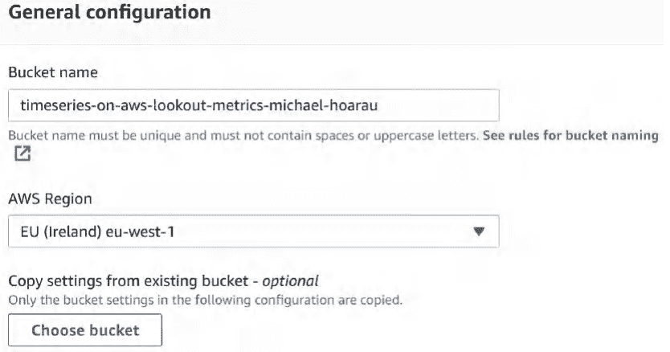

图14.2 – Amazon S3 存储桶创建表单

> **重要提示**
>
> 在撰写本书时，Amazon Lookout for Metrics 仅在以下区域可用：美国东部（弗吉尼亚北部）、美国东部（俄亥俄）、美国西部（俄勒冈）、亚太地区（新加坡）、亚太地区（悉尼）、亚太地区（东京）、欧洲（法兰克福）、欧洲（爱尔兰）和欧洲（斯德哥尔摩）。请确保选择其中一个区域来创建存储桶，否则你将无法将数据导入 Amazon Lookout for Metrics。

4. 你可以将所有其他字段保留为默认值，然后点击屏幕右下角的 **创建存储桶** 按钮。你将返回 S3 主页，并应在存储桶列表中看到你新创建的存储桶。窗口顶部的绿色消息将确认你的存储桶已成功创建。

你的 Amazon S3 存储桶现已创建，因此我们可以开始将 CSV 文件上传到此位置。

#### 将数据集上传到 Amazon S3

要上传数据集，请完成以下步骤：

1. 在 S3 主页上出现的存储桶列表中，点击你刚刚创建的存储桶的名称。此页面列出了该存储桶中可用的所有对象。如果你之前使用过它（在阅读本书前面的 *第2章，Amazon Forecast 概述* 或 *第8章，Amazon Lookout for Equipment 概述* 时），你可能已经在此列出了一些对象。否则，它将是空的，如以下截图所示：

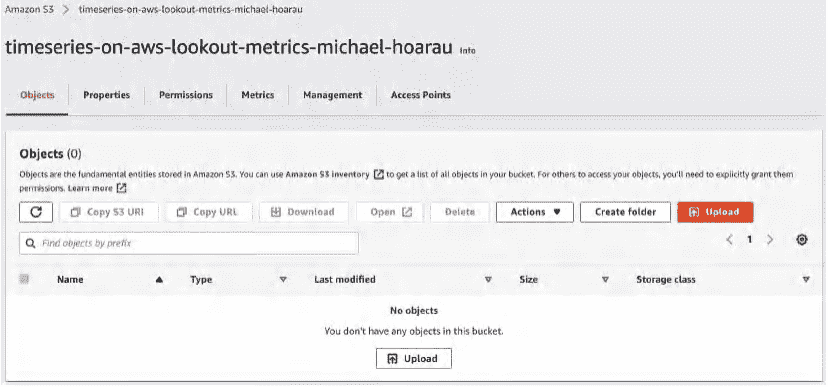

图14.3 – 新存储桶中的 Amazon S3 空对象列表


3. 在此处，点击**创建文件夹**按钮，并在**文件夹名称**字段中输入 `lookout-for-metrics`。然后，点击此页面底部的**创建文件夹**按钮。

**有关创建文件夹的信息**

使用文件夹对桶中的对象进行分组。创建文件夹时，S3 会使用您指定的名称后跟一个斜杠 (/) 创建一个对象。该对象会作为文件夹显示在控制台中。了解更多

> 您的桶策略可能会阻止文件夹的创建
> 如果您的桶策略阻止上传没有特定标签、元数据或访问控制列表 (ACL) 授权人的对象，那么您将无法使用此配置创建文件夹。相反，您可以使用上传配置上传一个空文件夹，并指定相应的设置。

**文件夹**

文件夹名称

`lookout-for-metrics /`

文件夹名称不能包含 `"/*"`。查看命名规则

**服务端加密**

> 以下设置仅适用于新文件夹对象，而不适用于其中包含的对象。

服务端加密

- 禁用
- 启用

取消 创建文件夹

*图 14.4 – 创建新文件夹以托管 Amazon Lookout for Metrics 数据*

4. 您将被带回桶的对象列表页面。点击刚刚创建的文件夹名称。然后，点击对象列表顶部的**上传**按钮。您将进入上传页面，可以点击**添加文件**按钮，也可以将之前下载的压缩包解压出的 CSV 文件拖放到此处。

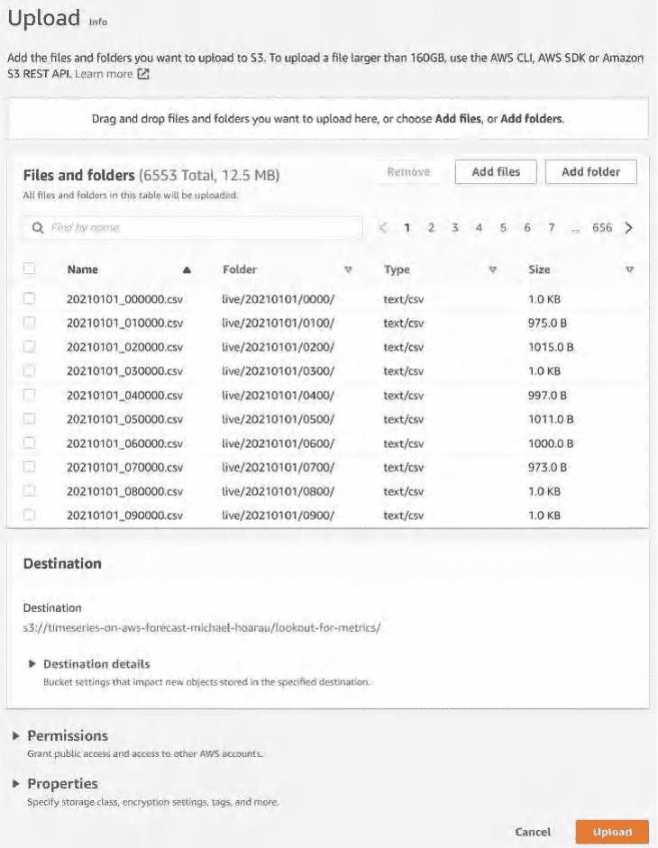

*图 14.5 – 在 Amazon S3 上上传电子商务数据集*

5. 将所有其他字段保留为默认值，滚动到屏幕底部，然后点击**上传**开始上传文件。总共有 12.5 MB 和 6,553 个文件要上传。根据您的互联网上传带宽，这可能需要一段时间。当传输进行时，会显示一个上传状态页面。

> **注意**
> 如果您觉得使用浏览器传输 6,553 个文件太慢，我建议使用 **AWS 命令行界面**来优化您的上传速度：
> `https://docs.aws.amazon.com/cli/latest/userguide/install-cliv2.html`。另一种选择是使用 **AWS CloudShell**，在您连接到控制台的同时，在浏览器中打开命令行：
> `https://docs.aws.amazon.com/cloudshell/latest/userguide/welcome.html`。

6. 完成后，您可以点击**退出**按钮返回到新创建文件夹根部的对象列表。

上传完成后，您应该在对象列表中看到两个子文件夹，一个叫 `backtest`，另一个叫 `live`。

## 授予 Amazon Lookout for Metrics 访问您的数据的权限

默认情况下，不同 AWS 服务之间强制实施的安全机制会禁止除 Amazon S3 以外的任何服务访问您的数据。在您的账户中，您可以上传、删除或移动刚刚创建的桶中的数据。但是，Amazon Lookout for Metrics 是一项不同的服务，无法访问这些数据。我们需要指定 Amazon Lookout for Metrics 可以访问此桶中的任何数据。

> **注意**
> 您可以在摄取步骤中直接从 Amazon Lookout for Metrics 控制台配置此访问权限。但是，如果您希望更多地控制账户中创建的角色和各种访问权限，可以通读本节。否则，您可以跳过它，稍后再回来。

为了启用 Amazon Lookout for Metrics 服务对您的 S3 桶的访问，我们将使用 **AWS 身份与访问管理 (IAM)** 服务按如下方式创建专用 IAM 角色：

1. 在控制台左上角，点击**服务**下拉菜单，并搜索**安全、身份与合规**部分。点击 IAM 服务名称以进入该服务控制台。

2. 在左侧面板菜单中，点击**角色**，然后点击此屏幕左上角的**创建角色**按钮。

3. 在**创建角色**屏幕上，选择 **AWS 服务**作为可信实体类型：

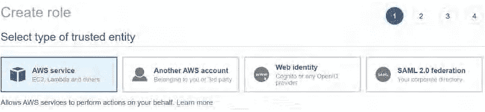

*图 14.6 – IAM 角色创建 – 选择可信实体类型*

4. 在下一部分（**选择用例**）中，找到 **Forecast** 并点击该服务名称。

5. 在最后一部分（**选择您的用例**）中，选择**允许 Amazon Forecast 访问 S3 中的数据**。

> **重要说明**
>
> 在撰写本书时，Amazon Lookout for Metrics 在 IAM 服务中还没有现成的用例。这就是为什么在前两个步骤中选择 **Forecast**。您可以稍后调整创建的角色，以匹配您要配置访问权限的服务。

6. 点击“下一步”按钮，直到到达最后一步（审查）。为您的角色命名并添加描述（我将其命名为 LookoutMetricsAccessRole）。

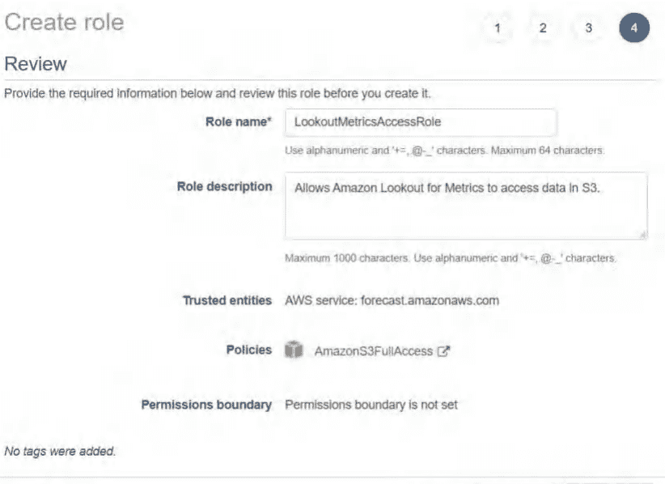

*图 14.7 – IAM 角色创建 – 审查步骤*

7. 点击“创建角色”。您的角色已创建，屏幕顶部会显示一条成功消息，您可以在其中点击角色的名称。然后您会看到角色的摘要。在此屏幕顶部，您将看到角色 ARN（Amazon 资源名称）字段。复制此 ARN 并粘贴到方便的地方。当我们把您的数据摄取到服务中时，将需要它。

8. 现在，您将调整此角色以专门限制对您的 S3 桶的访问。为此，请在**权限策略**部分找到 **AmazonS3FullAccess** 行，并通过点击右侧的 X 图标将其移除。确认框会要求您确认确实要从该角色分离此策略。点击**分离**按钮进行确认。

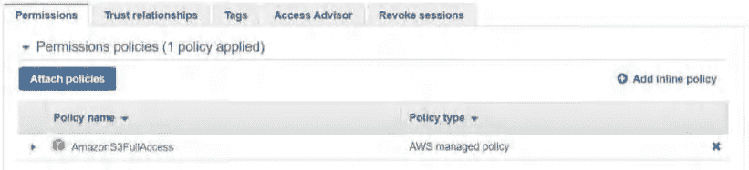

*图 14.8 – IAM 角色创建 – 分离完全访问策略*

9. 接下来，点击**添加内联策略**链接，然后点击 **JSON** 选项卡。在编辑器中复制并粘贴以下策略文档。别忘了调整 `<<YOUR-BUCKET>>` 字符串，使之与您之前创建的桶的名称匹配：

```json
{
    "Version": "2012-10-17",
    "Statement": [
        {
            "Effect": "Allow",
            "Action": [
                "s3:ListBucket",
                "s3:GetBucketAcl"
            ],
            "Resource": [
                "arn:aws:s3:::<<YOUR-BUCKET>>"
            ]
        },
        {
            "Effect": "Allow",
            "Action": [
                "s3:GetObject",
                "s3:GetBucketAcl"
            ],
            "Resource": [
                "arn:aws:s3:::<<YOUR-BUCKET>>/*"
            ]
        }
    ]
}
```

10. 向下滚动到策略定义屏幕底部，点击“审查策略”按钮。

11. 为策略命名（例如 LookoutMetricsDatasetAccess），然后点击“创建策略”。

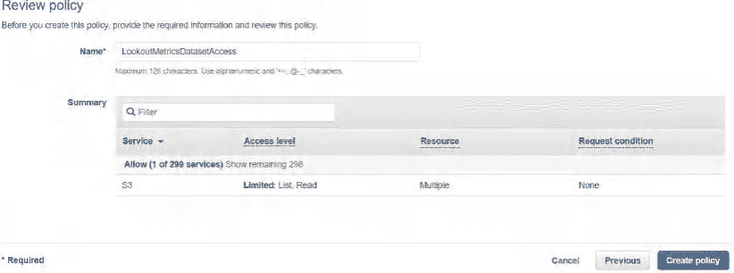

*图 14.9 – IAM 角色创建 – 添加最低权限访问策略*

12. 现在让我们调整此角色以匹配正确的服务（Amazon Lookout for Metrics 而不是 Amazon Forecast）。为此，点击“信任关系”选项卡，然后点击“编辑信任关系”按钮。在“编辑信任关系策略文档”中，粘贴以下 JSON 文档，然后点击“更新信任策略”按钮：

```json
{
    "Version": "2012-10-17",
    "Statement": [
        {
            "Sid": "",
            "Effect": "Allow",
            "Principal": {
                "Service": [
                    "sns.amazonaws.com",
                    "lookoutmetrics.amazonaws.com"
                ]
            },
            "Action": "sts:AssumeRole"
        }
    ]
}
```

13. 您的信任关系现在应如下所示：

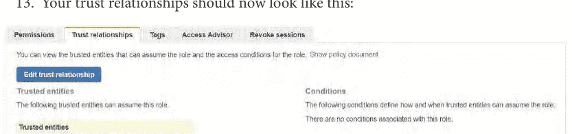

*图 14.10 – IAM 角色创建 – 更新信任关系*

当 Amazon Lookout for Metrics 尝试读取您刚刚上传到 S3 的数据集时，它将使用我们刚刚创建的角色向 IAM 请求权限。您定义的用于授予对 S3 桶访问权限的策略，就是 IAM 将用来授权 Amazon Lookout for Metrics 访问您的数据集的依据。另一方面，您定义的信任关系将允许其他服务（例如 Amazon SageMaker）为您运行 Amazon Lookout for Metrics API。您可能已经注意到，我们还在信任关系中添加了 SNS 服务。

在本章后面，您将使用 Amazon 简单通知服务（SNS）在检测到严重异常时创建通知。我们将利用此信任关系授予 Amazon Lookout for Metrics 调用 Amazon SNS API 的能力。

现在，您已准备好将数据集连接到 Amazon Lookout for Metrics。


# 创建检测器

如 *第13章，Amazon Lookout for Metrics 概述* 中所述，检测器是一个机器学习模型，用于监控您的数据集以查找异常并帮助您分析其影响。要创建您的第一个检测器，请完成以下步骤：

- 1. 登录您的 AWS 控制台，并在顶部的搜索栏中搜索 `Lookout for Metrics`。
- 2. 点击 **Amazon Lookout for Metrics** 并进入主页。

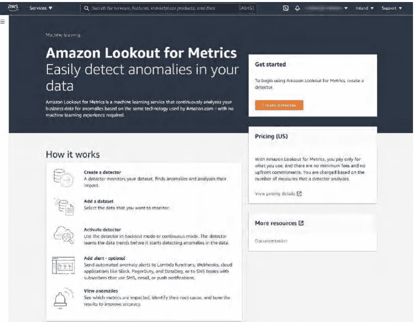

图 14.11 – Amazon Lookout for Metrics 主页

- 3. 在此页面上，您可以点击屏幕右侧的 **Create detector** 按钮，或点击左上角的汉堡图标（带三条水平线的图标）打开左侧面板，在其中点击 **Detectors**。您将进入列出您 AWS 账户中所有可见检测器的页面。如果这是您首次使用该服务，您的列表将为空（如下图所示）。点击右上角的 **Create detector** 按钮。

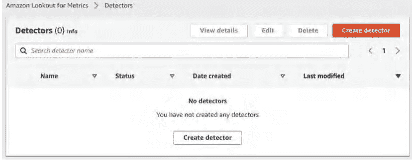

图 14.12 – Amazon Lookout for Metrics 检测器列表

4. 在提醒您检查要创建检测器的 AWS 区域后，您需要为检测器提供一个名称（我们称之为 `sales-anomaly-detector`）、一个可选的描述，以及每次分析之间的时间间隔（1 小时间隔）。将所有其他选项保持为默认值，向下滚动到屏幕底部，然后点击 **Create** 按钮。

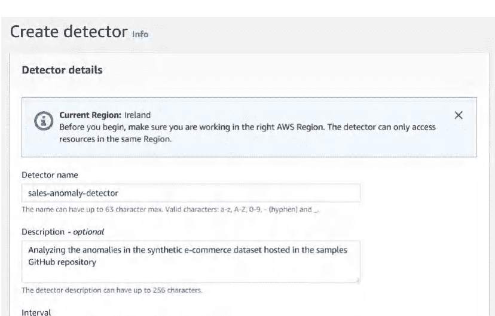

图 14.13 – Amazon Lookout for Metrics 检测器创建屏幕

您将被带到检测器仪表板屏幕，您可以在其中看到第一步已完成（**Create a detector**）。仪表板顶部绿色条带中也会显示成功消息。

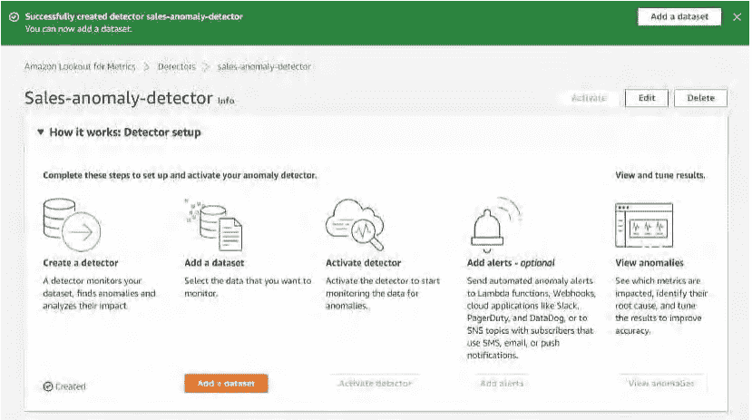

*图 14.14 – 创建时的检测器仪表板*

您的检测器现在已准备就绪并已配置，因此是时候将其连接到您的数据集以开始检测异常了！

## 添加数据集并连接数据源

我们将把数据导入 Amazon Lookout for Metrics 以开始检测其中的异常。为此，请完成以下步骤：

- 1. 在检测器仪表板上，点击 **Add a dataset** 按钮。
- 2. 在 **Basic information** 部分，只需为数据集命名（我将其命名为 `ecommerce-dataset`）。

### Basic information

**Name**

ecommerce-dataset

数据集名称必须为 1 到 63 个字符。有效字符= a-z、A-Z、0-9、-（连字符）和 _。

**Description - optional**

Description of my datasource and interval

检测器描述最多可包含 256 个字符。

**Timezone - optional**

时区用于解释您数据中的时间戳。

Choose a time zone

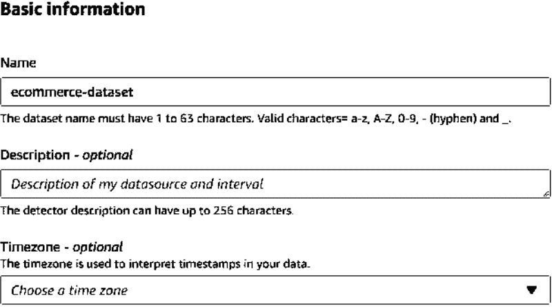

图 14.15 – 数据集基本信息

- 3. 在 **Datasource details** 部分，我们将启动回测模式以在历史数据中查找异常。为此，在 **Datasource** 下拉菜单中选择 **Amazon S3**，然后为 **Detector mode** 选择 **Backtest**。

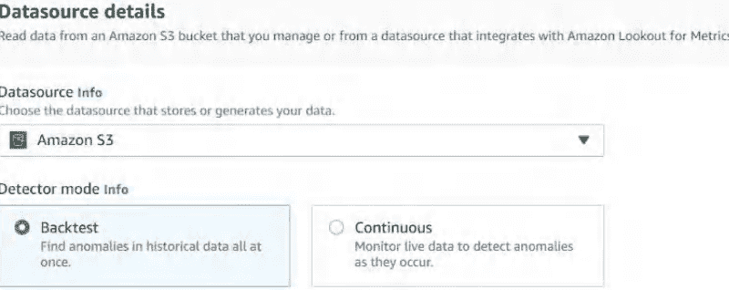

图 14.16 – 数据源详情 – 回测模式选择

## Permissions

Service role info
Amazon Lookout for Metrics 需要权限从您的存储桶读取数据。选择具有数据访问权限的服务角色，或自动创建角色。

Enter the ARN of a role

Custom service role ARN
arn:aws:iam::...:role/LookoutMetricsAccessRole

图 14.18 – 数据源详情 – 权限定义

> Note
> 作为替代方案，您也可以在此阶段直接创建合适的角色，方法是选择 Service role 下拉菜单中的 Create a role。Amazon Lookout for Metrics 会要求您指定要授予部分权限的 Amazon S3 存储桶，并会代表您创建角色。

6. 向下滚动到屏幕底部并点击 Next。Amazon Lookout for Metrics 尝试访问您的数据并验证您的数据集。验证完成后，您会看到一个成功对话框，您可以在其中点击 OK 继续。

7. 在下一页，您将把数据集的不同字段映射到 Amazon Lookout for Metrics 的度量和维度。让我们先添加两个度量（最多可有五个）。您的检测器将跟踪您 CSV 文件的这些字段以查找异常。您将把 CSV 文件的 views 和 revenue 列映射为 Amazon Lookout for Metrics 度量。对于这些字段中的每一个，您还将请求服务在所有维度上执行 SUM 聚合。

### Measures Info

Measures 是检测器跟踪异常的关键绩效指标（KPI）。

Create measures using fields from your datasource. The detector will track these measures for anomalies. You can have up to 5 measures.

Field name
views
revenue
Aggregate by
SUM
SUM
Add measure
You can add up to 3 more measures.

图 14.19 – 在数据集中定义度量

- 10. 在屏幕底部，点击 **Next** 按钮以查看您的数据源配置。如果您对数据集的配置满意，请点击 **Save and activate** 开始在此数据集中检测异常。会显示一个对话框，提醒您处于回测模式，并且在启动检测器后您将开始产生费用。在对话框中输入 `confirm`，然后点击 **Activate**。

您将被带回检测器仪表板，您可以在其中看到您处于回测模式，并且您的检测器正在从此初始数据集中学习。

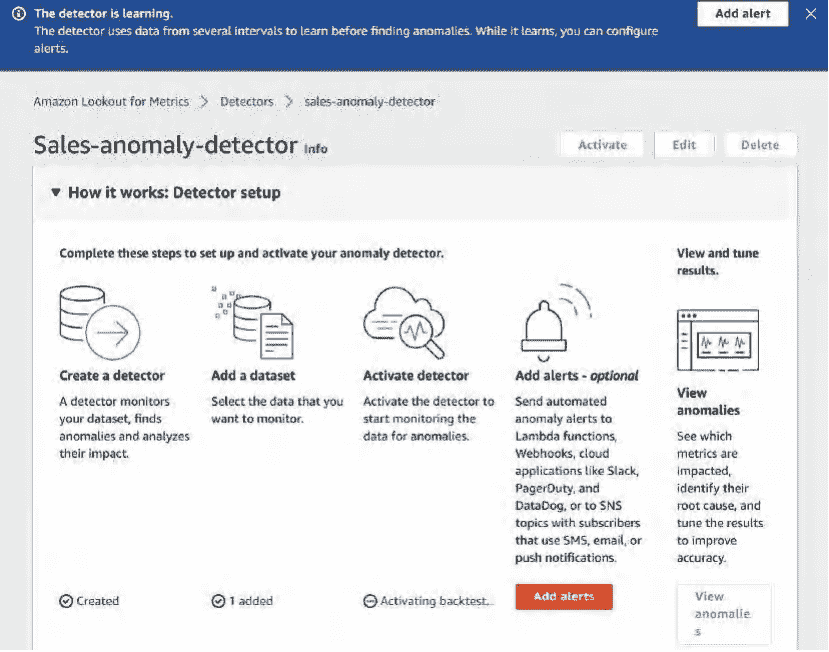

图 14.22 – 在回测模式下激活数据集

您可以看到您的检测器当前正在激活其回测模式。过一段时间后，它将切换到 **Backtest in progress** 状态，后来切换到 **Backtest complete**。可能已检测到一些异常，您将在 *第15章，查看异常并提供反馈* 中了解如何可视化它们。

## 了解回测模式

当您为回测目的添加数据集时，Amazon Lookout for Metrics 会使用它在多个间隔上分析您的数据以识别模式并了解预期变化。回测模式允许您的检测器在开始处理连续数据之前了解您的数据。当您提供历史数据时，Amazon Lookout for Metrics 会使用 70% 的数据进行学习，使用 30% 的数据运行回测。

Amazon Lookout for Metrics 可用于从历史数据中学习的数据量取决于您在添加数据集时配置的间隔。服务将仅查找最多 2,500 个之前的间隔，这些间隔必须落在特定时间范围内：

- 对于 5 分钟间隔，之前的间隔必须在最近 3 个月内。
- 对于 10 分钟间隔，此时间范围为 6 个月。
- 对于 1 小时间隔，此时间范围为 3 年。
- 对于 1 天间隔，此时间范围为 5 年。

如果您未提供历史数据而仅提供实时数据，Amazon Lookout for Metrics 将查找实时数据位置中的过去间隔。如果找到，它将使用这些数据进行学习，这将减少开始在实时数据中检测异常所需的时间。

## 配置警报

Amazon Lookout for Metrics 在您的数据中查找异常。根据检测到的异常的严重程度，服务可以向 Lambda 函数或 SNS 主题发送通知：

- **AWS Lambda**：这是一项计算服务，让您无需配置和管理任何底层服务或基础设施即可运行代码。您可以编写一个 lambda 函数来处理由 Amazon Lookout for Metrics 生成的任何事件以对检测到的异常做出反应。
- **Amazon SNS**：此消息服务可用于在应用程序之间或在应用程序和人员之间发送消息（例如，通过向最终用户发送短信）。您可以使用此服务在检测器发现值得报告的异常时发送通知。


要向检测器添加提醒，请完成以下步骤：

+   1. 打开 Amazon Lookout for Metrics 服务主页，点击左侧菜单栏中的**检测器**。然后，选择您的检测器，并点击左侧菜单栏中的**提醒**。此时您会看到为该检测器配置的提醒列表。目前该列表为空。点击屏幕右上角的**添加提醒**按钮。

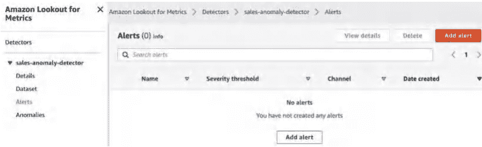

图 14.23 – 检测器的已配置提醒列表

+   2. 在**提醒详细信息**页面上，为您的提醒填写以下详细信息：

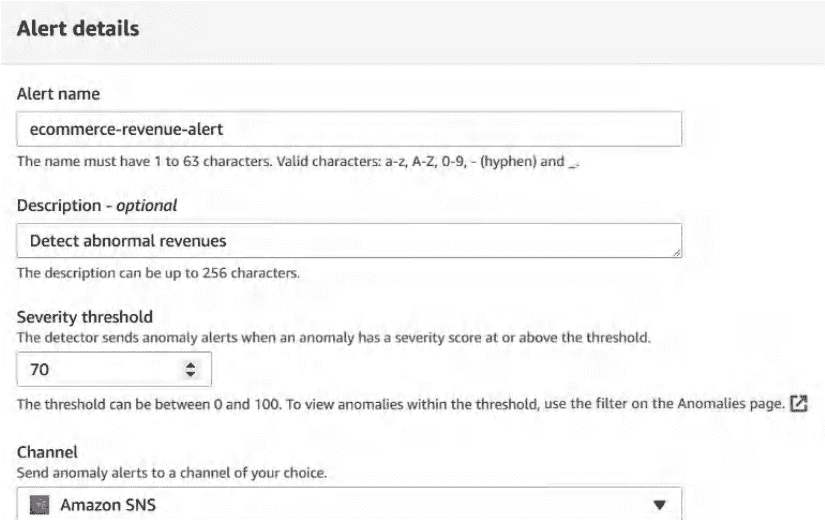

图 14.24 – 配置提醒详细信息

您需要输入以下必填信息来定义提醒：

+   - **提醒名称：** 我们将提醒命名为 `ecommerce-revenue-alert`。
+   - **严重性阈值：** 保留默认值 70%。严重性级别用于衡量检测到的异常的严重程度。在*第 15 章“查看异常并提供反馈”*中，您将有机会详细了解严重性级别。
+   - **渠道：** 您将选择 Amazon SNS 作为投递渠道。

3. 在 **SNS 主题**部分，点击**创建主题**，浏览器中会打开一个新窗口。这将打开 Amazon SNS 服务主页。点击左侧菜单栏中的**主题**，然后点击右上角的**创建主题**按钮。选择**标准**类型，并为您的主题输入名称（例如 `revenue-anomalies-topic`）。

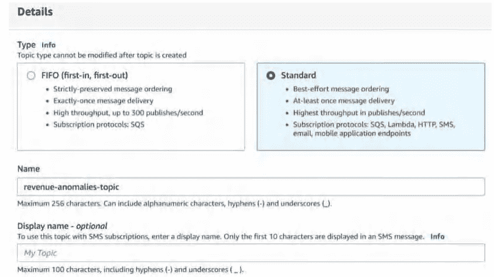

4. 将所有其他字段保留为默认值，滚动到屏幕底部，然后点击**创建主题**。您会进入主题详细信息页面。向下滚动，在**订阅**选项卡中点击**创建订阅**按钮。

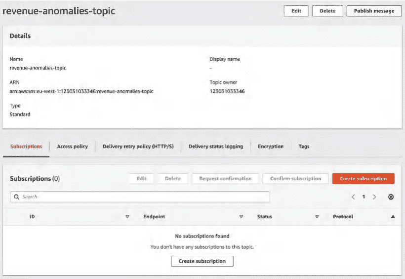

图 14.26 – Amazon SNS 主题详细信息页面

5. 在订阅创建详细信息中，为“协议”字段选择“电子邮件”，并填写您的电子邮件地址。然后，点击“创建订阅”。几分钟内您将收到一封电子邮件，您需要点击邮件中提供的链接来确认您订阅此主题。默认情况下，发布到此主题的任何消息都会发送到您的电子邮箱。

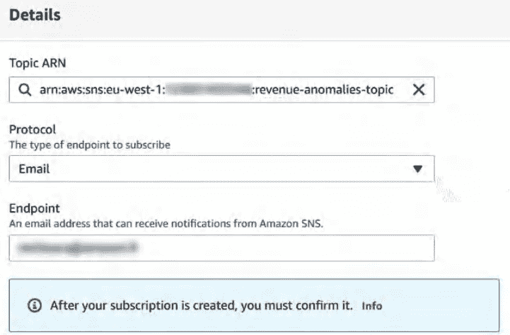

图 14.27 – Amazon SNS 主题订阅配置

6. 您的主题现已创建，您可以返回 Amazon Lookout for Metrics 提醒创建窗口。点击 SNS 主题下拉菜单旁边的刷新按钮。您现在应该能在列表中看到您的主题，并可以选择它。对于“服务角色”，选择“输入角色的 ARN”并粘贴自定义服务角色 ARN。您的角色 ARN 格式如下：`arn:aws:iam::<<YOUR-ACCOUNT-ID>>:role/LookoutMetricsAccessRole`，其中 `<<YOUR-ACCOUNT-ID>>` 将被您的 AWS 账户 ID 替换。

## SNS 主题 信息

选择一个 Amazon SNS 主题以及一个授予检测器向其发送通知权限的角色。

SNS 主题

选择当前区域中的主题，或创建一个主题。

## 服务角色 信息

选择一个可访问您的主题的服务角色，或自动创建一个角色。

自定义服务角色 ARN

图 14.28 – 为提醒选择 Amazon SNS 主题

## 注意

另外，您也可以在此阶段直接选择“服务角色”下拉菜单中的“创建角色”来直接创建合适的角色。Amazon Lookout for Metrics 会要求您指定要授予权限的 Amazon SNS 主题，并会替您创建一个角色。

+   7. 滚动到此屏幕底部，点击“添加提醒”以创建此提醒。

您的提醒已创建，您可以在检测器的提醒列表中看到它。

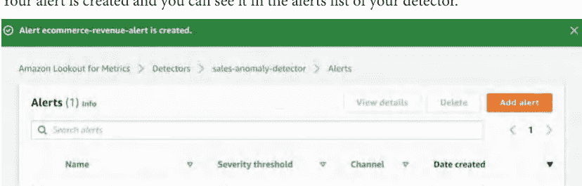

图 14.29 – 与给定检测器关联的 Amazon Lookout for Metrics 提醒

恭喜！您已成功训练了一个检测器，并配置了一个提醒，以便在检测到异常时提醒您。本章到此结束！

## 总结

在本章中，您学习了如何准备历史数据，以便 Amazon Lookout for Metrics 可以使用这些数据执行回测。您还深入了解了我们将在本部分（专门讨论异常检测）中继续使用的电子商务数据集。您还初步实践了 Amazon Lookout for Metrics，学习了如何创建检测器以及如何将其连接到数据源。您还学习了如何配置提醒，以便在检测到异常时做出响应。

本章对于理解和操作 Amazon Lookout for Metrics 使用的关键概念（检测器、数据源、提醒）至关重要。

在下一章中，您将把检测器切换到实时检测模式，并学习如何可视化检测到的异常以及向服务提供反馈。
