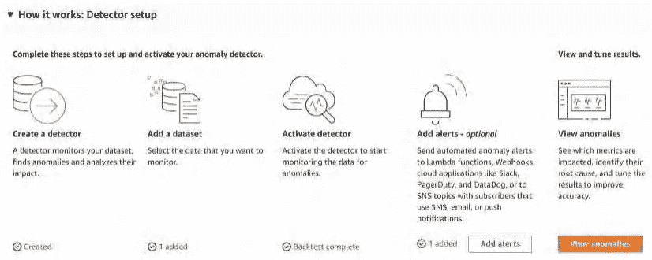
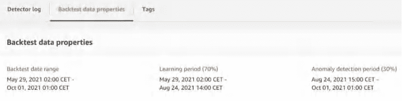
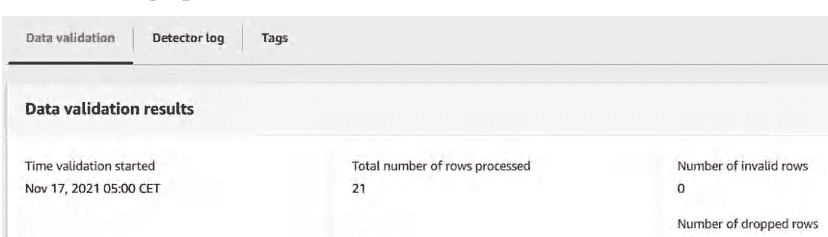
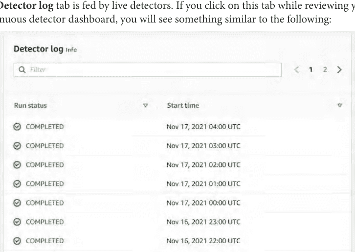
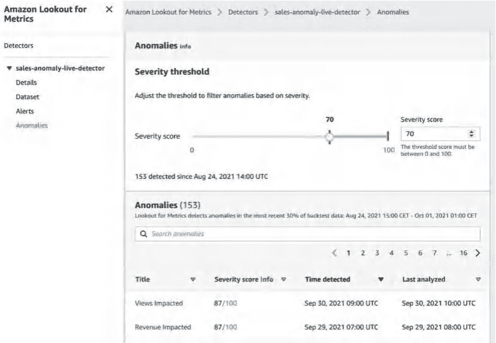
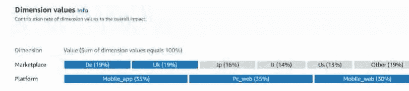

## 15 查看异常并提供反馈

## 查看异常并提供反馈

在上一章中，您使用回测模式中的历史数据配置并训练了您的第一个检测器。您还学习了如何通过将 Amazon Lookout for Metrics 与 Amazon Simple Notification Service（SNS）连接来触发提醒。在本章中，您将学习如何查看检测到的异常。

学完本章后，您将熟练掌握异常仪表板，并理解 Amazon Lookout for Metrics 用于对异常进行排序和评级的关键概念。您还将学习如何使用影响分析仪表板来提供有关检测质量的反馈。

在本章中，我们将涵盖以下主要主题：

+   - 训练持续检测器
+   - 查看来自已训练检测器的异常
+   - 与检测器交互

## 技术要求

阅读本章内容不需要具备 **Python** 或 **R** 等语言的动手经验。但是，我们强烈建议您在登录自己的 AWS 账户并打开不同的 AWS 服务控制台的情况下阅读本章，以便在您这边执行不同的操作。

要创建 AWS 账户并登录 Amazon Lookout for Metrics 控制台，您可以参考*第 2 章“Amazon Forecast 概述”*中的技术要求。

## 训练持续检测器

在上一章中，您配置了一个处于回测模式的检测器。现在您将配置同一个检测器为实时模式。您已经创建了一个角色并上传了所有必要的数据。若要查看这些步骤并确保一切就绪，您可以查看*第 14 章“创建和激活检测器”*中的检测器创建步骤。

### 以持续模式配置检测器

要构建您的实时检测器，请完成以下步骤：

+   1. 登录您的 AWS 控制台，在顶部的搜索栏中搜索 `Lookout for Metrics`。然后，点击**Amazon Lookout for Metrics**，进入服务主页。
+   
+   2. 点击屏幕右侧的**创建检测器**按钮。您将看到一个页面，列出您的 AWS 账户中可见的所有检测器。点击右上角的**创建检测器**按钮。
+   
+   3. 在提示检查您将在其中创建检测器的 AWS 区域后，系统会要求您为检测器提供名称（我们将其命名为 `sales-anomaly-live-detector`）、可选描述以及每次分析之间的时间间隔（`1小时间隔`）。将所有其他选项保留为默认值，滚动到屏幕底部，然后点击**创建**按钮。您将进入检测器仪表板页面，在这里可以看到第一步（**创建检测器**）已完成。仪表板顶部还会显示一条绿色横幅的成功消息。
+   
+   4. 点击**添加数据集**按钮。在**基本信息**部分，只需为您的数据集命名（我将我的命名为 `ecommerce-dataset`）。在**数据源详细信息**部分，我们将选择**持续**模式以查找实时数据中的异常。为此，请在**数据源**下拉菜单中选择**Amazon S3**，然后在**检测器模式**中选择**持续**：


Figure 15.1 – Datasource details – Continuous mode selection

5. 然后，您需要按以下屏幕截图所示配置实时数据格式：

Figure 15.2 – Datasource details – Continuous data configuration

使用以下信息填写这些字段：

- **Path to an object in your continuous dataset**: 如果您按照 *Chapter 14, Creating and Activating a Detector* 中的数据集上传部分操作，您实时数据的第一个文件将具有以下格式：`s3://<<YOUR-BUCKET>>/lookout-for-metrics/live/20210101/0000/20210101_000000.csv`，其中 `<<YOUR-BUCKET>>` 将被替换为您在上一章中创建的存储桶的名称。Amazon Lookout for Metrics 将尝试检测您实时数据集中每个对象的 S3 路径的共同模式。

- **Continuous data S3 path pattern**: 选择以下格式：`s3://<<YOUR-BUCKET>>/lookout-for-metrics/live/{{yyyyMMdd}}/{{HHmm}}/`.

- **Datasource interval**: 在下拉菜单中选择 `1 hour intervals`。此值必须与创建检测器时使用的间隔相匹配。

6. 我们希望此检测器能够利用历史数据的存在来更快地学习。将 Amazon Lookout for Metrics 指向您具有历史数据的输入数据集。如果您按照 *Chapter 14, Creating and Activating a Detector* 中的数据集上传部分操作，您历史数据的 S3 路径将具有以下格式：`s3://<<YOUR-BUCKET>>/lookout-for-metrics/backtest/input.csv`。使用此路径填写 **Historical data** 字段，并将所有其他参数保留为其默认值，因为它们是有效的。

7. 最后一步是指定 **Permissions**：在 **Service role** 部分选择 `Enter the ARN of a role`，然后粘贴您之前创建的角色的 ARN。您的角色 ARN 应具有以下格式：`arn:aws:iam::<<YOUR-ACCOUNT-ID>>:role/LookoutMetricsAccessRole`，其中 `<<YOUR-ACCOUNT-ID>>` 应替换为您 AWS 账户的 ID。

8. 滚动到屏幕底部并单击 **Next**。Amazon Lookout for Metrics 尝试访问您的数据并验证您的数据集。验证完成后，您会看到一个成功对话框，您可以在其中单击 **OK** 继续。

9. 在下一页，您将映射数据集的不同字段到 **Measures** 和 **Dimensions**。连续检测器的配置方式与回测模式相同：使用 `views` 和 `revenue` 作为度量（聚合方式为 **SUM**），`platform` 和 `marketplace` 作为维度，并使用 `timestamp` 作为数据集的时间戳。

10. 在屏幕底部，单击 **Next** 按钮以查看您的数据源配置。如果您对数据集的配置感到满意，请单击 **Save and activate** 开始在此数据集中检测异常。会显示一个对话框，提醒您一旦开始运行检测器，您将开始产生费用。在对话框中输入 `confirm` 并单击 **Activate**。

您的实时检测器现已准备就绪。我建议您也为其附加一个警报。您可以随意复制您在上一章末尾所执行的操作，将其应用到新的检测器上。

过一段时间后，您的检测器将被激活，并开始在您为连续检测配置的数据源的 S3 位置中搜索新文件。

## Preparing data to feed a continuous detector

当您在上一章中以回测模式配置检测器时，或当您在上一节中使用历史数据设置来配置连续检测器时，您将 Amazon Lookout for Metrics 指向了一个单一的 S3 位置，您可以在其中放置所有历史数据文件。电子商务数据集附带一个单一的 `input.csv` 文件，其中包含从 01/01/2021 到 18/01/2022 的所有数据（截至撰写时），但如果您愿意，您可以自由地将数据集结构化为多个文件。例如，您的历史数据可能按月分块：`input-2020-01.csv`（包含 2020 年 1 月的所有指标的文件），`input-2020-02.csv`，依此类推。作为提醒，这里是 `input.csv` 文件的一个摘录，该文件被检测器用于从历史数据中学习：

| platform | marketplace | timestamp | views | revenue |
|---|---|---|---|---|
| pc_web | us | 01/01/2021 00:00 | 298 | 89,4 |
| pc_web | uk | 01/01/2021 00:00 | 476 | 142,8 |
| pc_web | de | 01/01/2021 00:00 | 152 | 45,6 |
| pc_web | fr | 01/01/2021 00:00 | 405 | 121,5 |
| pc_web | es | 01/01/2021 00:00 | 113 | 33,9 |
| pc_web | it | 01/01/2021 00:00 | 153 | 45,9 |
| pc_web | jp | 01/01/2021 00:00 | 161 | 48,3 |
| mobile_web | us | 01/01/2021 00:00 | 438 | 131,4 |
| mobile_web | uk | 01/01/2021 00:00 | 536 | 160,8 |
| mobile_web | de | 01/01/2021 00:00 | 231 | 69,3 |
| mobile_web | fr | 01/01/2021 00:00 | 220 | 66 |
| mobile_web | es | 01/01/2021 00:00 | 283 | 84,9 |
| mobile_web | it | 01/01/2021 00:00 | 691 | 207,3 |
| mobile_web | jp | 01/01/2021 00:00 | 222 | 66,6 |
| mobile_app | us | 01/01/2021 00:00 | 498 | 149,4 |
| mobile_app | uk | 01/01/2021 00:00 | 218 | 65,4 |
| mobile_app | de | 01/01/2021 00:00 | 387 | 116,1 |
| mobile_app | fr | 01/01/2021 00:00 | 687 | 206,1 |
| mobile_app | es | 01/01/2021 00:00 | 197 | 59,1 |
| mobile_app | it | 01/01/2021 00:00 | 169 | 50,7 |
| mobile_app | jp | 01/01/2021 00:00 | 566 | 169,8 |

Figure 15.3 – Historical data excerpt

另一方面，*continuous detector* 在每次唤醒时都会搜索新文件以处理给定的时间间隔。您的检测器配置为按小时唤醒，因此它期望在每个小时的顶部都有一个新文件存在（考虑到您可以配置的用于处理时间的偏移）。

当您在 Amazon S3 中上传数据时使用的文件夹结构如下：

```
s3://<<YOUR-BUCKET>>/lookout-for-metrics/
live/20210101/0000/20210101_000000.csv
live/20210101/0100/20210101_010000.csv
live/20210101/0200/20210101_020000.csv
…
live/20220118/2200/20220118_220000.csv
live/20220118/2300/20220118_230000.csv
```

在此数据集中，每个 1 小时间隔的数据都存储在单个 CSV 文件中，其路径根据间隔命名。位于 `live/20210101/0000/` 路径下的文件（可以有多个）将包含 2021 年 1 月 1 日午夜开始的 1 小时间隔内生成的数据。

当您定义连续数据 S3 路径模式时，您可以让 Amazon Lookout for Metrics 通过指向给定对象来猜测应遵循哪些模式，也可以手动使用路径模板进行配置。此类模板可以包含使用双大括号配置的不同键。例如，先前描述的连续数据的路径模板如下：

```
s3://<<YOUR-BUCKET>>/lookout-for-metrics/live/{{yyyyMMdd}}/{{HHmm}}
```

这些双大括号中的字母代表 S3 路径中可能根据日期和时间而变化的部分（yyyy 代表当前四位数的年份，MM 代表一年中的双位数月份，等等）。请遵循此链接以了解可在路径模板中使用的占位符键：

```
https://docs.aws.amazon.com/lookoutmetrics/latest/dev/detectors-dataset.html#detectors-dataset-pathkeys
```

位于给定位置下的每个单独文件的结构与历史数据格式相同。它可以是 JSON Lines 或 CSV。以下是其中一个文件的完整内容：

| platform | marketplace | timestamp | views | revenue |
|---|---|---|---|---|
| pc_web | us | 17/11/2021 08:00 | 364 | 109,2 |
| pc_web | uk | 17/11/2021 08:00 | 360 | 108 |
| pc_web | de | 17/11/2021 08:00 | 600 | 180 |
| pc_web | fr | 17/11/2021 08:00 | 383 | 114,9 |
| pc_web | es | 17/11/2021 08:00 | 123 | 36,9 |
| pc_web | it | 17/11/2021 08:00 | 203 | 60,9 |
| pc_web | jp | 17/11/2021 08:00 | 313 | 93,9 |
| mobile_web | us | 17/11/2021 08:00 | 291 | 87,3 |
| mobile_web | uk | 17/11/2021 08:00 | 549 | 164,7 |
| mobile_web | de | 17/11/2021 08:00 | 340 | 102 |
| mobile_web | fr | 17/11/2021 08:00 | 812 | 243,6 |
| mobile_web | es | 17/11/2021 08:00 | 344 | 103,2 |
| mobile_web | it | 17/11/2021 08:00 | 228 | 68,4 |
| mobile_web | jp | 17/11/2021 08:00 | 151 | 45,3 |
| mobile_app | us | 17/11/2021 08:00 | 204 | 61,2 |
| mobile_app | uk | 17/11/2021 08:00 | 163 | 48,9 |
| mobile_app | de | 17/11/2021 08:00 | 589 | 176,7 |
| mobile_app | fr | 17/11/2021 08:00 | 196 | 58,8 |
| mobile_app | es | 17/11/2021 08:00 | 224 | 67,2 |
| mobile_app | it | 17/11/2021 08:00 | 113 | 33,9 |
| mobile_app | jp | 17/11/2021 08:00 | 122 | 36,6 |

Figure 15.4 – File content example for live data

此文件位于 s3://<<YOUR-BUCKET>>/lookout-for-metrics/live/20211117/0800/20211117_080000.csv 下，包含 2021 年 11 月 17 日上午 8 点至 9 点之间捕获的所有度量。让我们现在来看看 Amazon Lookout for Metrics 在检测器发现异常时如何公开结果。

## Reviewing anomalies from a trained detector

在本节中，我们将回顾 Amazon Lookout for Metrics 提供的不同仪表板，以帮助您了解检测器的状态以及它们检测到的异常。


## 检测器详细信息仪表盘

在上一章中，你在回测模式下训练了一个检测器，并且还使用连续模式构建了第二个检测器。回测作业完成后，你会看到检测器状态在仪表盘上发生变化，如下所示：



图 15.5 – 回测完成状态

在这个主仪表盘上，你可以在**激活检测器**步骤下看到**回测完成**状态。这意味着你的历史数据已经过分析。对于连续检测器（如你在上一节配置和训练的检测器），你则会看到**学习中…**，然后是**已激活**。

如果滚动到此屏幕底部，你会在**回测数据属性**选项卡下看到有关回测作业的更多详细信息：



图 15.6 – 回测作业数据属性

你在上一章用于训练检测器的历史数据始于2021年1月1日；但是，Lookout for Metrics 回测作业仅使用最多3,000个时间间隔。由于你的检测器配置为处理1小时时间间隔，这意味着回测作业考虑的日期范围将从**2021年5月29日到2021年10月1日**（*125天×24小时=3,000个时间间隔*）。在此范围内，70%用于学习数据行为（从**5月29日到8月24日**），而30%用于尝试检测一些异常（从**8月24日到10月1日**）。

以连续模式运行的检测器将具有**数据验证**选项卡，而不是**回测数据属性**选项卡：



图 15.7 – 连续模式下的数据验证

此选项卡显示连续检测器处理了多少行，以及是否有任何行无效或被丢弃。

**检测器日志**选项卡由实时检测器提供。如果在查看连续检测器仪表盘时单击此选项卡，你将看到类似以下内容：



图 15.8 – 连续检测器日志

如果文件缺失，此选项卡将显示一条错误，指出是哪个文件，以便你可以进一步调查。现在让我们看一下**异常**仪表盘。

## 异常仪表盘

当你在检测器仪表盘上（无论是回测模式还是连续模式）时，单击左侧菜单栏上的**异常**以打开**异常**仪表盘：



图 15.9 – 异常仪表盘

基于训练后的检测器对数据行为的理解，检测器会将指标中的意外变化标记为异常，这些异常将在此仪表盘上可见。在顶部，你可以看到**严重性阈值**小部件，可用于筛选你感兴趣的异常：

我们的数据集有两个维度：**市场**和**平台**。在上图中，你可以看到异常指标记录在德国（在此数据集中，市场使用两个字母表示每个国家/地区：此处DE代表德国），用户使用PC浏览器（Pc_web平台）在你的网站上导航。

对于每个维度，每个可能的值都关联一个百分比：在之前显示的异常中，检测器仅在市场维度设置为DE（德国）时检测到问题，因此关联值为100%。如果针对浏览数在多个地理区域检测到异常，Amazon Lookout for Metrics 会将它们分组，并且每个维度关联的百分比将按照异常影响每个市场的程度显示。

下面是另一个跨多个指标检测到异常的示例：



图 15.14 – 影响多个指标的异常

在此示例中，你可以看到市场维度的五个条形：德国和英国为19%，美国为13%，这意味着德国和英国的浏览数受到此特定异常的影响大于美国。当考虑平台维度时，移动应用、移动网页和桌面网页之间的均衡比率表明这是一个跨平台问题。

## 提供可读的警报

如果你在本章开头创建的实时检测器上配置了警报（有关更多详细信息，请参阅“训练连续检测器”一节），你可能已经通过电子邮件收到了一些警报，但你可能对警报的默认格式感到惊讶。警报在JSON文档中包含大量信息，这是连接应用程序的好格式，但对我们人类来说不容易阅读。以下是此类JSON文档的示例：

```
{
  "alertName": "ecommerce-revenue-alert-009a9443-d34a-41af-b782-f6e409db55c2",
  "alertEventId": "arn:aws:lookoutmetrics:eu-west-1:123456789012:Alert:ecommerce-revenue-alert-009a9443-d34a-41af-b782-f6e409db55c2:event/3bf090ef-5437-4262-920c-5-12d311c1503",
  "anomalyDetectorArn": "arn:aws:lookoutmetrics:eu-west-1:123456789012:AnomalyDetector:sales-anomaly-detector",
  "alertArn": "arn:aws:lookoutmetrics:eu-west-1:123456789012:Alert:ecommerce-revenue-alert-009a9443-d34a-41af-b782-f6e409db55c2",
  "alertDescription": null,
  "impactedMetric": {
    "metricName": "revenue",
    "dimensionContribution": [
      {
        "dimensionName": "Marketplace",
        "dimensionValueContributions": [
          {
            "dimensionValue": "DE",
            "valueContribution": 100
          }
        ]
      },
      { ...
```

为了向最终用户提供更易读的消息，我建议使用AWS托管的以下模块：

```
https://lookoutformetrics.workshop.aws/en/additional_labs/alerts.html
```

这个研讨会实验室将为你提供可部署到账户中的CloudFormation模板，以及使用Lambda函数配置Amazon Lookout for Metrics警报的逐步说明。设置完成后，检测到异常时收到的电子邮件将包含用简单英语编写的模板化电子邮件内容（而不是原始的JSON文件）。内容如下所示（我突出显示了将根据通知而更改的关键参数）：

```
An anomaly in revenue was detected on November 17 2021 at 08:00.
1 time series was impacted.
TimeSeries: 1 was impacted on the following dimensions and values:
    Marketplace - GERMANY
    Platform - PC Web
The Anomaly score was: 76.58
```

现在，每当检测器发现值得你关注的异常时，你都可以轻松做出反应。让我们看看如何向 Amazon Lookout for Metrics 提供反馈。

## 提供反馈以改进检测器

当你在“异常”仪表盘中单击某个异常，并向下滚动到详细异常概述的最后一个部分时，你可以找到图 15.15 中所示的指标图。

除了指标可视化之外，在此小部件的右上角，你还可以向 Amazon Lookout for Metrics 提供反馈，告知它德国PC网页用户的浏览数急剧增加是否相关。

将来，此检测器在确定类似异常的严重性评分时会考虑你的反馈。

## 总结

在本章中，你了解了 Amazon Lookout for Metrics 为你提供的用于分析检测器检测到的异常的工具。特别是，你学习了如何使用**异常**仪表盘，以及当检测到异常时如何向服务提供反馈。

本章对于帮助你理解如何配置连续模式下的检测器以实现实时数据监控也很重要。你还了解了如何使用补充内容，通过以人类可读的格式传递警报，使这些洞察更具可操作性，从而更易于使用服务。

这是本部分的最后一章：到目前为止，你应该对 Amazon Lookout for Metrics 有了完整的了解，并知道如何使用它对业务指标执行异常检测。

你现在已经读到了本书的结尾：我希望你喜欢发现使用不同AWS服务对时间序列数据可以做什么，并且你已经学到足够的东西来帮助你开始自己的与时间序列分析相关的AI项目。在本书中，你学习了如何使用托管AI服务，这些服务使你无需开发人员背景即可构建、训练和部署机器学习模型。如果你想更深入地实践这些服务，以及AWS在从时间序列数据中提取商业价值方面提供的其他功能，还有更多内容值得你深入研究。如果你想了解通过编程方式与这些服务交互可以做什么，请随时访问 AWS Samples GitHub 仓库（`https://github.com/aws-samples`）。


