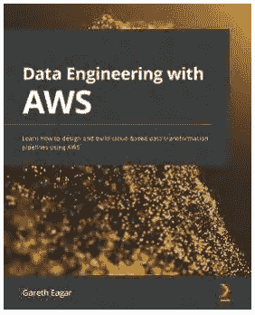
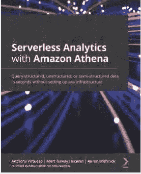

## 索引

### A

- 异常事件 278
- A/B 测试方法 50
- 活动检测 43
- 聚合信号重要性小部件 321
- 警报
  - 关于 361
  - 配置 394-399
- 算法
  - 选择 124-126
  - 选择，标准 138
- Amazon AppFlow 360
- Amazon Athena 200
- Amazon CloudWatch 200
- Amazon DynamoDB 20, 50
- Amazon Elastic MapReduce (Amazon EMR) 22
- Amazon EventBridge 327
- Amazon Forecast
  - 关于 32, 54-56, 200, 369
  - 授权，以访问 Amazon S3 存储桶 82, 83
  - 使用自动化机器学习 (AutoML) 108
  - 概念和资源 56, 57
  - 数据，摄取 86
  - 维度 59
  - 概述 165
  - 定价 59, 60
  - 场景 60
  - 摄取目标时间序列数据集 86, 87
  - 工作流，概述 58, 59
  - 使用 56
- Amazon Forecast 算法
  - 参考链接 137
- Amazon Forecast 数据集
  - 摄取 CSV 文件 98
- Amazon Forecast 数据集组
  - 创建 84-86
- Amazon Forecast，场景
  - 数据集要求 61, 62
  - 延迟要求 61
  - 用例要求 62
- Amazon Lookout for Equipment
  - 关于 32, 220, 369
  - 聚合信号重要性小部件 321, 322
  - 资产无关 220
  - 检测到的异常小部件 320, 321
  - 功能 221
  - 最后执行诊断小部件 324
  - 模型详情小部件 320
  - 定价 230
  - 提供对 S3 存储桶的访问 244-248
  - 调度程序详情小部件 323
  - 无服务器架构 326
  - 信号重要性演变小部件 322, 323
  - 工作流 228, 229
  - 工作原理 227
- Amazon Lookout for Equipment，概念
  - 组件 227
  - 数据集 227
  - 标签 228
  - 模型 228
  - 调度程序 228
  - 标签 227
- Amazon Lookout for Equipment 数据集
  - 创建 248-251
- Amazon Lookout for Equipment 异常检测场景
  - 数据集要求 232
  - 延迟要求 231
  - 用例要求 232, 233
- Amazon Lookout for Metrics
  - 关于 32, 358, 359, 369
  - 提供数据访问 379-384
  - 关键概念 359-361
  - 定价 364
  - 参考链接 357
  - 工作流 361-363
  - 工作原理 359
- Amazon Lookout for Metrics，定价
  - 参考链接 364
- Amazon Lookout for Vision 34
- Amazon QuickSight 200
- Amazon Redshift 50
- Amazon Rekognition Custom Labels 34
- Amazon Resource Name (ARN) 110, 245, 381
- Amazon S3 存储桶
  - 创建 76-79, 239-241, 374-376
  - 准备 288, 289
- Amazon S3，用于存储
  - 数据集，上传至 76, 374
- Amazon SageMaker
  - 关于 200, 369
  - 参考链接 30
- Amazon SageMaker Ground Truth 30
- Amazon Simple Email Service (SES) 313
- Amazon Simple Notification Service (Amazon SNS)
  - 关于 200, 328, 346, 361, 364, 384, 394
  - 参考链接 364
- Amazon Simple Storage Service (Amazon S3)
  - 关于 30, 58, 69, 198, 200, 229, 373
  - 数据集，上传至 79-81, 241-243, 376-379
  - 数据，上传用于存储至 238, 239
- Amazon Timestream 20
- 分析方法
  - 使用成像技术 34
  - 使用原始时间序列数据 31, 32
  - 选择 31
  - 符号变换 39
  - 将时间序列汇总为表格数据集 32, 33
- 方差分析 (ANOVA) 41
- 异常
  - 关于 222
  - 从训练好的检测器中查看 407
- 异常仪表板
  - 关于 410-412
- 异常概览部分 412
  - 维度值 412, 413
  - 指标图 414
- 异常，类型
  - 识别 356, 357
- 异常检测方法
  - 基于密度的方法 225
  - 基于不相似性的方法 225
  - 基于直方图的方法 225
- 异常检测模型
  - 训练 262-268
- 异常检测工作流，自动化管道
  - 访问角色，更新 329-331
  - 构建 328, 335-340
  - Lambda 函数，创建 331-334
- Apache Arrow 20
- Apache Spark 22
- 人工智能 (AI) 5
- 属性 67
- 自相关图
  - 关于 26
  - 检测季节性 27
  - 评估平稳性 27
- 自动化标注 30
- 自动化机器学习 (AutoML)
  - 关于 108
  - 在 Amazon Forecast 中使用 108
- 自动时间序列预测
  - 参考链接 130
- 自动化管道
  - 配置 Amazon EventBridge 342-345
  - 构建异常检测工作流 328
  - 配置自动触发 340-342
  - 配置通知 346-348
  - 测试 348-350
- AutoPredictor 功能 179
- AutoPredictor 选项 105
- 自回归 (AR) 模型 129
- 自回归积分滑动平均 (ARIMA)
  - 关于 26, 55, 129, 138, 145
  - 在 Amazon Forecast 中的实现 130
  - 理论背景 129
- 平均预警时间 278
- AWS AppFlow
  - 关于 364
  - 参考链接 364
- AWS CloudFormation 控制台 313
- AWS CloudShell
  - 参考链接 379
- AWS CloudTrail 327
- AWS 命令行界面
  - 参考链接 379
- AWS 组件
  - 组装 327
  - 配置 327
- AWS Glue 22, 200
- AWS Glue DataBrew 22
- AWS Identity and Access Management (IAM) 244, 380
- AWS Lambda
  - 关于 198, 327, 361, 394
  - 参考链接 364
- AWS Lambda 函数 364
- AWS Solutions Library 197
- AWS Step Functions 199, 327

### B

- 回测准确度
  - 概述 119-121
- 回测
  - 关于 112, 113, 146
  - 参数 113
- 回测，数据集
  - 测试数据集 112
  - 训练数据集 112
- 回测模式 394
- 回测策略
  - 强化 146-149
- 回测预测
  - 概述 116-119
- 回测结果
  - 导出 114, 115
  - 参数 114, 115
- 符号傅里叶近似符号袋 (BOSS) 40
- 词袋 (BOW) 表示 40
- 基础行为 127
- 基线因子 127
- bokeh
  - 参考链接 23
- 商业智能 (BI) 55

### C

- Cassandra 20
- Cesium
  - URL 32
- 按时间顺序，数据点的列出 5
- 气候预报器 131
- 云计算 5
- CloudShell
  - 使用，以生成模式 253, 254
- CloudWatch 基于的仪表板
  - 部署 312-315
- CloudWatch Custom Widget 功能 316
- CloudWatch Synthetics 318
- CNN-QR 预测器
  - 使用 HPO 训练 141-144
- 系数 139
- 逗号分隔值 (CSV) 文件 19, 55
  - 在 Amazon Forecast 数据集中摄取 98
- 常见摄取错误 257, 258
- 组件 227, 272
- 综合 R 档案网络 (CRAN) 129
- 上下文隐马尔可夫模型 (CHMM) 224
- 连续检测器
  - 数据，准备以供输入 405-407
  - 训练 402
- 连续模式
  - 检测器，在其中配置 402-404
- 连续多元数据 6, 7
- 卷积神经网络-分位数回归 (CNN-QR)
  - 关于 55, 56, 136, 145
  - 在 Amazon Forecast 中的实现 137
  - 参考链接 137
  - 理论背景 136
- 卷积神经网络 (CNN) 34
- Curve 30

### D

- 数据
  - 提供访问给 Amazon Lookout for Metrics 379-384
  - 在 Amazon Forecast 中摄取 86
  - 准备，以供连续检测器输入 405-407
  - 上传至 Amazon S3 以供存储 76, 238, 239
- 数据库 20
- 数据摄取作业
  - 创建 255-257
- 数据准备组件 198
- 数据质量 20-22
- 数据集
  - 关于 227, 272, 360
  - 添加 388-393
  - 收集 373, 374
  - 准备 237, 238
  - 准备，用于异常检测目的 372
  - 准备，用于推理 297
  - 上传至 Amazon S3 241-243, 376-379
  - 上传至 Amazon S3 以供存储 374
  - 用于训练预测器的 102-107
  - 用于训练模型 262
- 数据集，用于预测目的
  - 数据，上传至 Amazon S3 以供存储 76
  - 准备 69
  - 原始数据集，准备 69
- 数据集组，组件
  - 关于 66
  - 项目元数据 68
  - 相关时间序列 67, 68
  - 目标时间序列 67
- 数据集要求 365
- 数据集模式结构 252
- 数据源
  - 关于 360
  - 连接 388-393
- 数据拆分
  - 选择，训练和评估期间之间 274, 275
- 数据可视化组件
  - 关于 200
  - Amazon QuickSight 200
  - Amazon SageMaker 200
- DeepAnT 224
- DeepAR 31
- DeepAR+
  - 关于 56, 134, 145
  - 在 Amazon Forecast 中的实现 135, 136
  - 参考链接 135
  - 理论背景 134
- DeepAR 预测算法
  - 参考链接 43
- 深度学习 (DL) 30
- 深度学习 (DL) 模型 55, 139
- 深度神经网络 (DNN) 55, 138
- 基于密度的方法 225
- 检测到的异常小部件 321
- 检测器
  - 关于 359
  - 配置为连续模式 402-404
  - 创建 385-388
  - 通过提供反馈来改进 416
  - 与之交互 414
- 检测器详情仪表板 408-410
- Dickey-Fuller 检验 26
- 差分技术 28
- 维度 360
- 离散 4
- 基于不相似性的方法 225
- 域 67
- 漂移检测 196

## E

- 端到端（E2E）54
- 集成技术 125
- 轮次（epoch）135
- 误差、趋势和季节性（ETS）
  - 关于 126, 138, 145
  - 在 Amazon Forecast 中的实现 128
  - 理论背景 126-128
- 估计模型 223
- 基于事件的多变量数据 8
- 事件范围异常 222
- 事件诊断控制面板
  - 使用 280-283
- 可解释性 105
- 探索洞察功能 180
- 指数平滑（ETS）55
- 流编码 37
- 预测
  - 执行误差分析 176-178
  - 生成 164-166
  - 可视化结果 174-176
  - 生成后续预测 167-169
- 预测可解释性
  - 生成 179-182
  - 参考链接 179
  - 可视化 182, 183
- 预测
  - 用于解决问题 49-51
- 大规模预测
  - 参考链接 133
- 预测组件
  - 关于 198
  - Amazon Athena 200
  - Amazon CloudWatch 200
  - Amazon Forecast 200
  - Amazon S3 200
  - Amazon Simple Notification Service (Amazon SNS) 200
  - AWS Glue 200
  - AWS Lambda 198
  - AWS Step Functions 199
- 预测模型指标
  - 关于 186, 187
  - 平均绝对百分比误差（MAPE）189
  - 平均绝对缩放误差（MASE）190
  - 均方根误差（RMSE）190, 191
  - 加权绝对百分比误差（WAPE）187-189
  - 加权分位数损失（wQL）191, 192
- 预测问题
  - 定义 51-54

## F

- 假阳性 279
- 时间序列特征分析（FATS）
  - 参考链接 32
- featuretools
  - 网址 32
- 特征化参数
  - 配置 155, 156
  - 值 157, 158
- 特征化技术
  - 实现 154
- 反馈 361
- 字段 360
- 文件结构
  - 按时间范围 15
  - 按变量 16, 17
- Flink 22
- float 90

## G

- 预测查找功能
  - 使用 170-172
- 预测类型
  - 关于 159
  - 配置 159, 160
  - 选择 160, 161
- 免费套餐 364
- 高斯混合模型，用于检测季节性单变量网络流量中的异常值
  - 参考链接 223
- 高斯混合，scikit-learn
  - 参考链接 223
- 地理位置 90
- GluonTS，概率时间序列建模
  - 参考链接 43
- Grafana
  - 关于 30
  - 参考链接 30
- 格拉姆角场 35, 36
- 格兰杰因果关系 68
- 格兰杰因果检验 67
- 图形处理单元（GPUs）5

## H

- 层次化数据格式 5（HDF5）20
- 具有噪声的基于密度的层次空间聚类（HDBSCAN）33
- 高频（HF）信号 127
- 基于直方图的方法 225
- 历史数据库 286
- 历史事件文件
  - 使用 269, 270
- Hive 22
- 假日补充功能
  - 启用 150
- 超参数优化（HPO）
  - 关于 140
  - 系数 139
  - 超参数 139
  - 利用 139
  - 模型选择参数 139
  - 参考链接 140
  - 可调超参数 145
  - 用于训练 CNN-QR 预测器 141-144

## I

- IAM 角色 380
- 标识符（ID）154
- 图像分类算法 34
- 成像技术
  - 格拉姆角场 35, 36
  - MTF 36, 37
  - 网络图 37-39
  - 递归图 34
  - 使用 34
- 影响得分 179
- 使用机器学习提高预测准确性
  - 数据可视化组件 200
  - 预测组件 198
  - 参考链接 197
  - 可视化结果 211-213
  - 删除解决方案资源 214, 215
  - 解决方案配置 206, 207
  - 解决方案部署 201-205
  - 解决方案概述 197, 198
  - 使用解决方案 207
  - 监控工作流状态 207-211
- 使用机器学习提高预测准确性，组件
  - 数据准备组件 198
- impyute
  - 参考链接 20
- 推理
  - 关于 285
  - 准备数据集 297
- 推理数据
  - 准备 300-303
- 推理结果
  - 提取 303-305
- InfluxDB 20
- 输入数据 10
- 输入/输出（I/O）50
- 整数 90
- 交互式库
  - 使用交互式库绘制时间序列 22, 23
- 交互式可视化 23
- 孤立森林，scikit-learn
  - 参考链接 224
- 项目元数据 68

## J

- JavaScript 对象表示法（JSON）格式 142
- JSON 模式
  - 生成 252

## K

- Kaggle 12
- K 均值
  - 关于 33
  - 参考链接 33
- K 最近邻（KNN）
  - 关于 33
  - 参考链接 33

## L

- 标签
  - 关于 10, 11, 228
  - 示例 11, 12
- Label Studio
  - 关于 30
  - 网址 30
- 滞后值 98
- 上次执行诊断小部件 324
- 水平偏移 29
- 长短期记忆（LSTM）43, 136
- Lookout for Equipment
  - 关于 368
  - 与 Lookout for Metrics 对比 369
- Lookout for Equipment 控制面板
  - 使用模型控制面板 316, 317
  - 使用调度程序控制面板 318, 319
  - 使用 316
- Lookout for Metrics
  - 关于 368
  - 与 Lookout for Equipment 对比 369
- LSTM 深度学习架构 98

## M

- 机器学习（ML）5
- 托管服务 54, 220, 358
- 手动标注 30
- 马尔可夫转移场（MTF）36, 37
- 平均绝对百分比误差（MAPE）110, 144, 189
- 平均绝对百分比误差（MAPE）指标 176
- 平均绝对缩放误差（MASE）190
- 度量 360
- 元数据
  - 关于 13
  - 摄取 96, 97
- 指标
  - 确定用于监控的指标 360, 365
- Microsoft Excel (XLSX) 19
- 缺失数据
  - 填充技术 20
- 模型
  - 关于 228
  - 监控 325
  - 使用数据集训练 262
- 模型准确性 192-195
- 模型准确性改进
  - 关于 308
  - 选择最佳信号 311
  - 减少信号数量 309
  - 使用停机条件 310
- 基于模型的方法，用于处理异常检测
  - 关于 223
  - 估计模型 223, 224
  - 预测模型 224
- 模型详细信息小部件 320
- 模型诊断
  - 部署基于 CloudWatch 的控制面板 312-315
  - 后处理事件结果 320
  - 使用 Lookout for Equipment 控制面板 316
  - 处理 312
- 模型评估控制面板
  - 概述 275-278
  - 监控 196
- 模型组织
  - 最佳实践 272, 273
- 模型性能控制面板
  - 概述 278, 279
- 模型预测控制（MPC）45
- 模型选择参数 139
- 模块化编码 37
- 移动平均（MA）126
- 多个时间序列
  - 并行绘制 23-25
- 多时间序列数据 9
- 多尺度探索
  - 启用 26
- 多变量数据集
  - 与单变量方法一起使用 225
- 多变量时间序列数据
  - 挑战 226, 227
- 多元无监督符号和导数（MUSE）41

## N

- 朴素预测器 131
- 美国国家航空航天局（NASA）11, 12
- 自然语言处理（NLP）39
- 网络图 37-39
- 非参数时间序列（NPTS）
  - 关于 55, 131, 138, 145
  - 在 Amazon Forecast 中的实现 132
  - 理论背景 131, 132
- 非数字（NaN）值 20
- NumPy 19

## O

- 停机检测功能
  - 关于 271
  - 使用 271
- OSISoft PI 20
- 异常值 357

## P

- Parquet 20
- 偏最小二乘法（PLS）45
- 分段聚合近似（PAA）40
- Pinus view 26
- plotly
  - 参考链接 23
- 前兆事件 279
- 预测模型 224
- 预测
  - 导出 172-174
- 预测性维护 7
- 预测质量 44
- 预测器
  - 关于 101
  - 使用天气指数创建 153, 154
  - 使用数据集训练 103-107
- 预测器回测结果
  - 导出 112
  - 可视化 112
- 预测器评估控制面板 109
- 预测器指标 110, 111
- 预测器概述 109
- 预测器概述，类型
  - 预测器属性 110
  - 训练参数 110
  - 训练结果 110
- Amazon Lookout for Equipment 定价页面
  - 参考链接 231
- 主成分分析（PCA）
  - 关于 33
  - 参考链接 33, 43
- 概率预测
  - 参考链接 158
- 概念验证（PoC）59
- Prophet 算法
  - 关于 133, 139
  - 在 Amazon Forecast 中的实现 134
  - 理论背景 133
- Python Pandas 18
- pyts 文档
  - 参考链接 34

## Q

- 质量学习（Q-learning）45
- 分位数
  - 自定义以满足业务需求 158

## R

- 随机切割森林 30, 31
- 原始数据集
  - 收集 70
  - 准备项目元数据集 75, 76
  - 概述 70-72
  - 准备 69
  - 准备相关时间序列数据集 74, 75
  - 准备目标时间序列数据集 72-74
- 原始时间序列数据
  - 使用 31, 32
- 可读警报
  - 传递 415, 416
- 记录 360
- 递归图 34, 35
- 循环神经网络（RNN）44, 134

- 强化学习（RL）10
- 相关时间序列
  - 关于 13、67、68
  - 示例 13
- 关系型数据库服务（RDS）363
- 残差 191
- 投资回报率（ROI）61
- 根源分析（RCA）32
- 均方根误差
  - （RMSE）107、140、190、191

## S

- S3 存储桶
  - Amazon Lookout for Equipment
    - 访问，提供 244-248
- SageMaker 随机砍树算法
  - 参考链接 224
- 向量空间模型中的 SAX 40
- 计划推理过程 297-299
- 调度器
  - 关于 228
  - 配置 287-297
- 调度器详细信息小部件 323
- 模式
  - 使用 CloudShell 生成 253、254
- Scikit-Learn 孤立森林
  - 算法 30、31
- 季节性成分 127
- 基于 Loess 的季节趋势分解（STL）程序 28
- 传感器时间序列 272
- 序列 4
- 序列到序列（Seq2Seq）模型 136
- 无服务器 198
- 无服务器架构，Amazon Lookout for Equipment
  - Amazon EventBridge 327
  - Amazon Simple Notification Service 327
  - AWS CloudTrail 327
  - AWS Lambda 326
  - AWS Step Functions 326
- 无服务器架构编排 196
- 设定点优化 44、45
- 严重性评分 360
- 信号重要性演变小部件 322、323
- 信号
  - 分类数据 311
  - 混沌行为 311
  - 常数值 311
  - 电平偏移 311
  - 大量缺失值 311
  - 单调递增 311
  - 季节性数据 311
- 信号，使其平稳
  - 去除季节性影响 29
  - 去除趋势 28
- 单事件异常 222
- 软传感器 43
- 稀疏偏最小二乘法（Sparse PLS）45
- 平稳性，时间序列 26-28
- 流式峰值超过阈值（SPOT）224
- 字符串 90
- 条带图 24
- 结构化查询语言（SQL）20
- 主题专家（SMEs）30
- 监督学习（SL）10
- 补充特征 149
- 符号聚合近似（SAX）40
- 符号傅里叶近似（SFA）40
- 符号变换
  - 关于 39
  - 符号傅里叶近似符号袋（BOSS）40
  - 词袋（BOW）表示 40
  - 用于时间序列分类的词提取（WEASEL）41、42

## T

- 标签 227
- 目标时间序列 67
- 目标时间序列数据集
  - 数据集详细信息，配置 88-91
  - 数据集导入详细信息，配置 92、93
  - 摄取 86、87、94、95
- t-分布随机邻域嵌入（t-SNE）33
- 技术挑战，时间序列数据
  - 关于 15
  - 存储注意事项 19、20
  - 时间序列文件结构 15-19
- 词频-逆文档频率（TF-IDF）40
- 测试数据集 146
- 时间序列
  - 汇总为表格数据集 32、33
- 时间序列挑战
  - 关于 14
  - 行为挑战 26
  - 数据质量 20、21
  - 缺失洞察和上下文 29
  - 技术挑战 15
  - 可视化挑战 22
- 时间序列数据
  - 上下文，缺失 29
  - 上下文，添加至 10
  - 族，识别 5
  - 洞察缺失 29
- 时间序列数据集 4、5
- 时间序列预测
  - 组成部分 53、54
- 时间戳
  - 重复 21
- 训练过的检测器
  - 异常，从中查看 407
- 训练过的模型
  - 评估 275
  - 使用 286、287
- 训练数据集 146
- 训练参数
  - 配置 124-126
- TRAINSET 30
- 趋势成分 127
- tsfresh
  - URL 32

## U

- 统一流形逼近与投影（UMAP）33
- 单变量方法
  - 与多变量数据集一起使用 225
- 单变量时间序列数据 6
- 未知事件 279
- 未知正常操作模式 279
- 无监督学习（UL）10
- 用例要求 366、367
- 用例，时间序列数据集
  - 关于 42
  - 活动检测 43
  - 预测质量 44
  - 设定点优化 44、45
  - 虚拟传感器 43

## V

- 变分自编码器（VAEs）224
- 虚拟机（VMs）54
- 虚拟传感器 43
- 可视化挑战
  - 处理方法
    - 使用交互式库绘制时间序列 22、23
    - 并行绘制多个时间序列 23、25
    - 启用多尺度探索 26

## W

- 天气指数
  - 启用 150、151
  - 包含地理位置属性 152、153
  - 将地理位置信息添加到数据集 151
  - 用于创建预测器 153、154
- 加权绝对百分比误差（WAPE）124、187-189
- 加权分位数损失（wQL）55、107、108、140、191、192
- 用于时间序列分类的词提取（WEASEL）41、42

## X

- XGBoost
  - 关于 33
  - 参考链接 33

Packt.com

订阅我们的在线数字图书馆，即可完整访问超过 7,000 本图书和视频，以及行业领先的工具，帮助您规划个人发展并推进职业生涯。如需了解更多信息，请访问我们的网站。

## 为什么订阅？

- 借助来自 4,000 多名行业专业人士的实用电子书和视频，减少学习时间，增加编码时间
- 通过专为您打造的技能计划提升学习效果
- 每月免费获得一本电子书或视频
- 完全可搜索，便于快速访问重要信息
- 可复制、粘贴、打印和书签内容

您是否知道 Packt 提供每本已出版图书的电子书版本，并提供 PDF 和 ePub 文件？您可以在 packt.com 升级到电子书版本，作为印刷版图书客户，您有权获得电子书副本的折扣。如需更多详情，请通过 customercare@packtpub.com 与我们联系。

在 www.packt.com，您还可以阅读一系列免费技术文章，注册各种免费通讯，并获得 Packt 图书和电子书的独家折扣和优惠。

## 其他您可能喜欢的图书

如果您喜欢这本书，您可能对 Packt 的以下其他图书感兴趣：

### 使用 AWS 进行数据工程

ISBN：9781800560413

- 理解数据工程概念和新兴技术
- 使用 Amazon Kinesis Data Firehose 摄取流式数据
- 使用 AWS Glue Studio 优化、反规范化并连接数据集
- 使用 Amazon S3 事件触发 Lambda 进程转换文件
- 使用 Amazon Athena 对数据湖数据运行复杂 SQL 查询
- 将数据加载到 Redshift 数据仓库并运行查询
- 使用 Amazon QuickSight 创建数据可视化
- 使用 Amazon Comprehend 从数据集中提取情感数据

### 使用 Amazon Athena 进行无服务器分析

ISBN：9781800562349

- 保护并管理查询数据的成本
- 使用 Athena ML 和用户定义函数（UDFs）为报告添加高级功能
- 编写自己的 Athena 连接器以集成自定义数据源
- 使用 AWS Glue Crawlers 发现 S3 上的数据集
- 将 Amazon Athena 集成到您的应用程序中
- 设置身份和访问管理（IAM）策略以限制对 Glue 数据目录中表和数据库的访问
- 向 Athena 查询添加 Amazon SageMaker Notebook
- 掌握使用 Athena 进行 ETL 管道

## Packt 正在寻找像您这样的作者

如果您有兴趣成为 Packt 的作者，请访问 authors.packtpub.com 并立即申请。我们已与数千名开发人员和技术专业人士（就像您一样）合作，帮助他们与全球技术社区分享见解。您可以进行一般申请，申请我们正在招募作者的特定热门主题，或提交自己的想法。

## 分享您的想法

现在您已经完成了《在 AWS 上进行时间序列分析》，我们很想听听您的想法！如果您从亚马逊购买了这本书，请点击此处直接前往该书的亚马逊评论页面分享您的反馈，或者在您购买该书的网站上留下评论。

您的评论对我们和技术社区都很重要，将帮助我们确保提供优质的内容。

