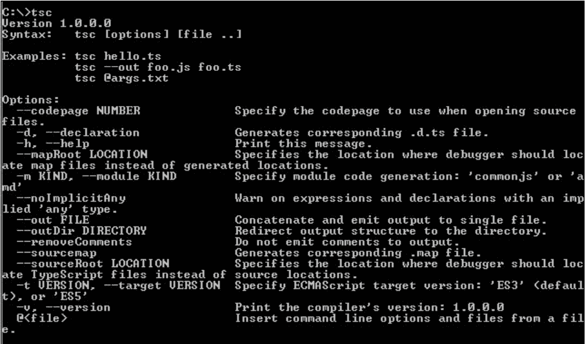
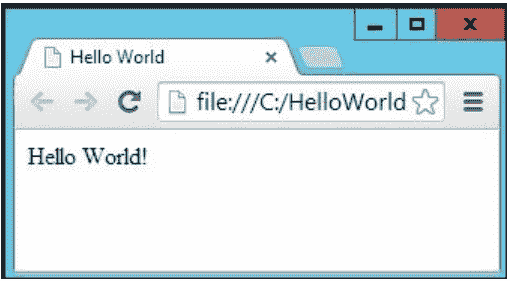
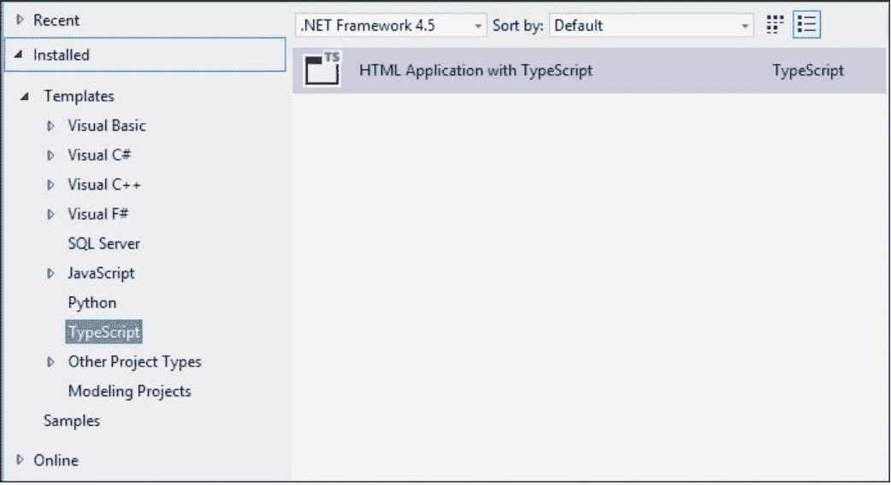
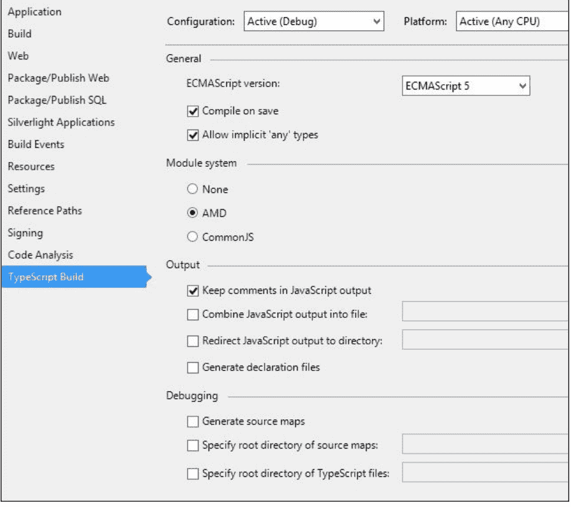

# 第 1 章. 使用 TypeScript 入门

有许多可用于创建跨平台应用程序的语言，每天都在创建此类代码应用程序。其中最常见的语言是 Java、C 和 JavaScript，每种语言都有其优点和缺点。虽然 JavaScript 易于入门，但也很容易失去控制。C 需要大量开销来创建复杂的应用程序，例如内存管理，而 Java 需要安装 Java 运行时。随着应用程序的增长和变得更加复杂，对可维护代码的需求也随之增加。

TypeScript 是一种新的开源语言，旨在使 Web 开发更轻松、更可靠。在本章中我们将：

- 了解 TypeScript 是什么
- 学习 TypeScript 如何改进 JavaScript 的基础
- 探索 TypeScript 如何使代码更易于维护
- 学习如何获取 TypeScript 编译器
- 用 TypeScript 创建我们的第一个应用程序

## TypeScript 的优势

随着硬件技术的进步，对能够不仅在单一设备上运行，而且在各种设备上运行的更先进的软件应用程序的需求也随之增加。JavaScript 是这种跨平台模型的自然解决方案，因为几乎所有现代浏览器都能够运行它。不幸的是，JavaScript 的开发范式仍然依赖于复杂的模式知识，并且调试必须在运行时进行。在 JavaScript 中创建大型应用程序可能很困难，并且以可维护的形式构建代码同样困难。TypeScript 是一个由 Microsoft 启动的开源语言项目，旨在将 JavaScript 开发提升到下一个水平。

JavaScript 最初作为解释型语言运行，在某些地方仍然如此，而现代浏览器在执行期间将其转换为机器代码。这意味着您编写的代码就是运行时使用的代码。使用解释型语言的优点是它们为开发人员提供了快速的开发模式，几乎没有开销。它们在跨平台环境中工作，因为代码不需要为部署到的每个新设备编译。解释型语言也并非没有缺点。在大多数现代实现中，JavaScript 代码必须先通过即时编译器运行，但即使有编译的帮助，语言的动态类型也使这项任务变得困难，性能可能会受损。除了性能损失之外，JavaScript 代码仍必须在测试之前部署。单个语法错误将迫使您运行应用程序，追踪问题的来源，修复它，然后再次运行应用程序，这浪费了大量时间并且可能非常令人沮丧。开发人员喜欢在出现更好的解决问题方法或需要新功能时重构代码。这种重构可能会导致应用程序的其他部分失败，而如果不进行完整的回归测试，问题可能会被忽视。要与对象交互，您必须对对象所代表的类型有深入的了解。TypeScript 旨在通过一系列对 JavaScript 语言的补充来解决这些问题，包括编译步骤和详细的错误列表。

TypeScript 是一种静态类型编译语言，可生成可在跨平台场景中使用的 JavaScript 代码。您可能在此时想：为什么我要用这种新语言重写我已有的所有应用程序？简单的答案是您不必这样做。TypeScript 只是 JavaScript 的超集，可编译为纯 JavaScript。尽管几乎所有现有的 JavaScript 代码都是有效的 TypeScript 代码，但某些部分需要进行调整以确保安全编译；然而，它们通常会提高代码质量。您可以自由地将代码类型化为强类型或弱类型，但我强烈建议完全拥抱类型系统。

JavaScript 最初被创建为脚本语言，但随着对更大应用程序的需求增长，对这些应用程序包含更多可重用组件和库的需求也随之增长。JavaScript 足够动态，可以通过某些设计模式充当函数式语言和面向对象语言。面向对象代码


其重点在于代码复用的概念，我们将在 TypeScript 的学习之旅中对此进行探讨。TypeScript 提供了丰富的对象类型和可访问性级别，这对于面向对象的开发者来说会非常熟悉。在 TypeScript 中，继承、封装和抽象都变得更加容易实现。JavaScript 侧重于函数的值和基于原型的继承，而 TypeScript 也是如此。对于习惯了基于类的继承的人来说，这可能显得有些奇怪。因此，通过使用其编译器，TypeScript 引入了来自几种不同面向对象语言的一些重要概念。这些概念如下：

- 静态类型
- 类
- 接口
- 泛型
- 模块

TypeScript 在 JavaScript 之上增加了一个静态类型层，然后通过编译器运行。编译器解析 TypeScript 代码并将其转换为纯 JavaScript。类型安全与代码编译的加入使我们能更早地发现错误，并在不部署任何一行代码的情况下消除缺陷。类和模块的引入使大型应用程序的开发变得更加容易。在类型系统中加入泛型和接口，使我们能够轻松创建可适用于各种对象的组件和库。

在此基础上，TypeScript 还引入了公共成员和私有成员的概念。如果某个对象或函数试图访问另一个对象的私有成员，编译器会识别出该代码无效，并生成构建错误。这有助于实现封装，其目的是防止 TypeScript 对象的使用者在对象自身作用域之外操作那些可能有害的方法和属性。提供可访问性级别有助于我们限制与对象进行交互的范围，甚至完全将对象隐藏起来，使其他组件或库无法访问。

## 提示

请记住，编译器输出的只是 JavaScript 代码，当它运行时，任何能够访问该对象的代码段都可以操作该对象的任何属性。

编写单元测试已成为软件开发中的常见做法。单元测试让我们作为开发者可以在重构和清理代码时，知晓自己不会破坏现有功能，从而安心操作。在 TypeScript 语言规范中加入接口的设计决策，有助于提高我们代码的可测试性。编写单元测试可以帮助我们验证小段代码块始终按预期运行。然而，随着应用程序的不断增长，我们必须传递更复杂的对象并创建更复杂的函数。这使得单独测试小段代码变得更加困难。而接口的加入让我们更容易模拟待传递的对象，并能更严格地控制测试的范围。

## 设置 IDE

要开始使用 TypeScript 编写代码，我们首先需要安装编译器。编译器可以通过 Node.js 作为独立软件包获得，也可通过 Microsoft 提供的 Visual Studio 工具获得，或者你可以直接下载编译器的源代码。在本书中，我们将使用 Visual Studio 2013 作为交互式开发环境（IDE）。Visual Studio 2013 从 Update 2 版本开始原生支持 TypeScript。对于 Visual Studio 2012，Microsoft 提供了一个扩展，可以从 TypeScript 主页（http://www.typescriptlang.org/）安装。随着 TypeScript 变得越来越普及，支持它的代码编辑器数量也在不断增加，包括 Eclipse（http://www.jetbrains.com/webstorm/）和 Notepad++（https://github.com/hansrwindhoff/ndpPluginTypescript）。

与许多现代语言一样，TypeScript 编译器本身就是用 TypeScript 编写的，这意味着它会编译成纯 JavaScript，并可在任何 JavaScript 宿主中运行。安装了 Microsoft 的工具后，你可以直接从命令行访问 TypeScript 编译器，并立即生成 JavaScript。下面的截图显示了可用的编译器选项列表及其作用。稍后我们将更深入地介绍每个选项，但现在你可以看到，这个编译器虽然非常新，却已经具备了非常强大的功能集。



如你所见，到目前为止，选项列表已经相当详尽，而且随着语言的发展，它无疑还会变得更加丰富。TypeScript 1.0 是本书所使用的语言版本，它提供的参数涵盖从指定输出文件到基于代码规则的警告等方方面面。我们将在后文讨论所有这些选项，但目前你只需要知道，你可以通过向编译器传递要编译的文件的路径来编译 TypeScript 代码。当我们开始构建更复杂的应用程序时，Visual Studio 的集成功能将为你提供一种简单的方式来设置项目中所有 TypeScript 文件的编译器选项。

## Hello World

既然我们已经安装了编译器，那就开始编写一些代码吧。如果没有“Hello World”来帮助你开始用一种新语言编写代码，这本书就算不上一本好的技术书籍。这个特定示例的代码非常简单，但我们可以用它来演示改用 TypeScript 的一些初步好处。

## 命令行编译

TypeScript 编译器不过是 JavaScript 代码；只要有 JavaScript 宿主，你就可以在任何地方编译 TypeScript。之前，我们看到提供了一个可执行文件，允许我们从命令行编译代码。我们将使用这个可执行文件来完成第一个示例，并体会到开始使用 TypeScript 是多么简单。首先，让我们在文件系统中创建一个新文件，并命名为 `HelloWorld.ts`。下面的代码创建了一个新的 HTML 段落元素，并将其文本设置为两个字符串拼接后的值：

```
```typescript
var p = document.createElement('p');
var hello: string = "Hello";
var world: string = 2;
p.textContent = hello + " " + world;

document.body.appendChild(p);
```
```

在大多数情况下，这看起来就是普通的 JavaScript。然而，如果你仔细观察 `hello` 和 `world` 变量的声明，你会发现一些新的东西。在变量名之后，你会看到它们现在被赋予了 `string` 类型。这种类型注解告诉编译器始终将 `hello` 和 `world` 变量视为字符串；但在本例中，编译器可以从它们的初始值推断出这些类型。对这两个变量的其他所有引用都可以假定，`string` 类型对象的所有属性和方法都是可访问的。这使得 IDE 能够提供智能代码补全，并且如果我们要执行编译器将无法通过的操作时，还能以可视化方式提醒我们。现在，让我们验证这段代码是否可以编译，并分析编译器输出的 JavaScript。

### 提示

#### 下载示例代码

你可以从 http://www.packtpub.com 的账户中下载所有已购买的 Packt 图书的示例代码文件。如果你在其他地方购买了本书，可以访问 http://www.packtpub.com/support 并注册，文件将直接通过电子邮件发送给你。

启动一个命令提示符实例，并浏览到你创建 `HelloWorld.ts` 文件的目录。在这里，运行编译器只需输入以下命令即可：

```
```text
tsc HelloWorld.ts
```
```

这将生成以下输出：

```
```text
C:\HelloWorld>tsc HelloWorld.ts
C:/HelloWorld/HelloWorld.ts(5,1): error TS2011: Cannot convert 'number' to 'string'.
```
```

如你所见，编译器识别到我们将 `world` 变量声明为 `string` 类型，并且


然后尝试为其分配一个数值。虽然这在 JavaScript 中是合法的，但当另一段代码期望 world 为字符串时，这可能会导致以后出现数据错误。因此，让我们回到 TypeScript 文件并修改我们分配给 world 的值，然后再次运行编译器：

```
var world: string = "World!";
```

成功！我们的代码已成功通过 TypeScript 编译器，并且它生成了一个名为 HelloWorld.js 的 JavaScript 文件。如果你打开此文件，你会发现生成的代码将被部署并在客户端上运行。正如你所见，类型注解已被从最终代码中删除，同时在我们的 TypeScript 代码和生成的 JavaScript 代码之间保持了一对一的映射，因为它们实际上并不是 JavaScript 语言规范的一部分：

```
var p = document.createElement('p');
var hello = "Hello";
var world = "World!";
p.textContent = hello + " " + world;

document.body.appendChild(p);
```

现在我们已经生成了 JavaScript，我们需要对其进行测试。我们代码尝试做的第一件事是创建一个新的 HTML 段落元素。因此，我们需要生成一个 HTML 文件来加载我们的代码并使其可供操作。然后将消息的两部分连接在一起并分配给刚刚创建的段落元素的文本值。最后，段落元素被附加到 HTML 文档的 body 中。以下 HTML 代码将加载我们生成的 JavaScript 文件：

```
<html>
<head>
    <title>Hello World</title>
</head>
<body>
    <script src="HelloWorld.js" ></script>
</body>
</html>
```

**注意**

通常，script 标签应包含在 `<head>` 标签内，而不是主 `<body>` 标签中。在这种情况下，我们的代码依赖于 DOM 为我们的代码成功执行做好准备。

在浏览器中打开 HTML 文件将导致在文档 body 加载时立即执行我们的代码。正如你在以下屏幕截图中看到的，我们的段落已添加到页面上的 HTML 中，并且显示了 Hello World！：



因此，正如你所见，创建和编译 TypeScript 应用程序与创建基本的 JavaScript 应用程序一样简单。然而，随着你开发的应用程序规模和复杂性不断增长，从命令行运行编译器将会变得繁琐。因此，让我们了解一下如何在 Visual Studio 中设置 TypeScript 项目，并在基于 Web 的项目中运行 Hello World 应用程序。

## 集成 Visual Studio

现在我们已经创建了一个简单的应用程序并发现了 TypeScript 如何生成可以部署的 JavaScript，让我们介绍一下与 Visual Studio 或 Visual Studio Express 的集成，Visual Studio Express 是 Visual Studio 的免费版本，可在 http://www.visualstudio.com/en-us/products/visual-studio-express-vs.aspx 获取。安装 TypeScript 的 Visual Studio 工具后，你将能够创建设置好使用我们新选择的语言的项目。

### 创建新项目

要创建包含 TypeScript 的新项目，请转到 **File** 菜单并导航到 **New Project**。在 **New Project** 窗口中，你会看到已安装模板的列表。现在有一个名为 **TypeScript** 的新部分；选择此部分，你将看到可用于创建 TypeScript 应用程序的所有可用项目模板。

**注意**

此模板的位置可能因安装的 Visual Studio 版本而异。如果 TypeScript 部分不可用，请使用项目模板选择器的搜索功能。

这并不意味着 TypeScript 只能添加到这些项目类型——你可以将 TypeScript 文件添加到任何现有项目。对于我们的示例，我们将使用 **HTML Application with TypeScript** 项目模板，因此让我们选择它并创建我们的新应用程序：



创建项目后你会立即注意到一些事情。首先，已经创建了一个默认的 TypeScript 文件和 HTML 文件来托管我们的新应用程序。还有一个 `web.config` 和 CSS 文件来托管你的应用程序样式。所有这些元素对你来说应该都很熟悉，除了 TypeScript 文件，它是 JavaScript 文件的替代品。

现在我们的项目已经创建，我们需要将代码移入。复制 `HelloWorld.ts` 中的代码到 `app.ts` 中，并对生成的 HTML 做同样的操作。更改 script 标签的 source 属性为 `app.js` 以引用我们代码的新位置并运行应用程序。显示的输出应该相同。

## 构建选项

Visual Studio 为 TypeScript 提供了无缝集成，并提供了大量配置选项。让我们先看看项目构建选项，了解 TypeScript 在编译时可以生成哪些不同的内容。要找到构建选项，请在解决方案资源管理器中右键单击项目并从上下文菜单中选择 Properties。正如以下屏幕截图中所示，我们能够操作大量我们之前看到的编译器选项：



从构建设置中可以看到，我们有能力更改我们希望将 TypeScript 编译成的 JavaScript 版本：ECMAScript 5 或 ECMAScript 3。

**提示**

JavaScript 现在正式称为 ECMAScript，但它仍然通常被称为其原始名称。

你还有在保存 TypeScript 文件的更改时编译 TypeScript 文件的选项。这是一个有用的选项，因为当 TypeScript 文件被编译时，它引用的所有其他 TypeScript 文件也会被编译。当只有少数文件被引用时，这是一个有用的功能，但随着应用程序的增长和依赖树变得更加复杂，你可能会遇到性能问题。允许隐式“any”类型告诉编译器如果对象的类型未给出或无法推断则不要失败。取消选中此选项是最简单的方式来强制自己完全拥抱类型系统。虽然你可能会遇到一些“any”类型不可避免的场景，但它们应该非常罕见。这可以通过提供类型注解来完成，如下所示：

```
var explicitAny: any;
```

我们也有能力更改在生成 JavaScript 代码时要使用的模块系统。我们将在后面讨论模块以及我们每个可用选项之间的差异，但了解此选项很重要，因为它可能会极大地改变我们最终代码的外观。

输出部分为编译器的最终输出提供了多种选项。注释代码是使代码可维护的非常有用的方式，但这会使 JavaScript 文件变大。这可能会在通过网络将代码下载到远程客户端时导致性能问题。由于 Visual Studio 允许我们为不同的构建配置定义不同的编译器选项，我们可以在调试时允许注释保留在输出中，同时在发布构建中删除它们。Combine JavaScript output into file 选项允许我们将所有生成的代码合并到单个输出文件中。随着项目中文件数量的增长并且需要一次一个地获取每个文件的大量网络调用，这变得非常有用。

我们也有能力更改生成的 JavaScript 的输出路径。这使我们能够在成功编译后直接将更改推送到测试环境，而无需关闭站点或手动将文件复制到部署位置。输出部分中的最后一个选项非常有趣。选中 Generate declaration files 选项将为你创建的每个类型创建声明文件。然后其他 TypeScript 文件可以引用这些声明文件以提供特定类型对象的类型定义。我们将在本书后面更深入地讨论声明文件。

最后一部分与我们希望如何调试 TypeScript 代码有关。我们有能力生成源映射以及它们应该部署到的目录。源映射为调试合并和压缩的 JavaScript 代码提供了一种方式。当调试已推送到生产环境的代码时，它们特别有帮助，因为它们创建了一种使 JavaScript 可读的方式，然而，在 TypeScript 中，它们也为我们提供了一种返回原始 TypeScript 代码的方式。最后一个选项指定 TypeScript 文件的位置；这将允许直接从 Visual Studio 进行调试。在大多数情况下，此处的默认选项就足够了。


## 摘要

本章所学内容将成为我们继续深入 TypeScript 之旅的基础。我们讨论了 TypeScript 以多种方式改进 JavaScript 开发模型。TypeScript 通过增加静态类型系统和代码补全，使大规模应用程序开发变得更容易。Visual Studio 的 IntelliSense 功能使 JavaScript 开发与 C# 和 Visual Basic 等其他语言保持一致。我们简要讨论了编译器以及它如何将 TypeScript 转换为可部署的 JavaScript，并创建了我们的第一个应用程序。之后展示的所有示例都将使用 Visual Studio；但是，请随意使用您喜欢的 IDE。在下一章中，我们将讨论 TypeScript 提供的不同语言特性以及编译器如何生成其 JavaScript 输出。
