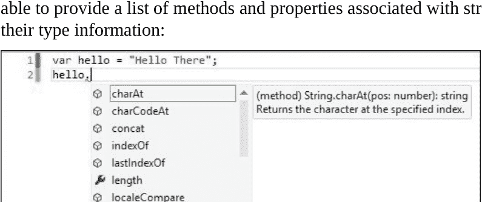
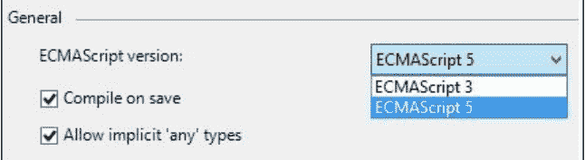
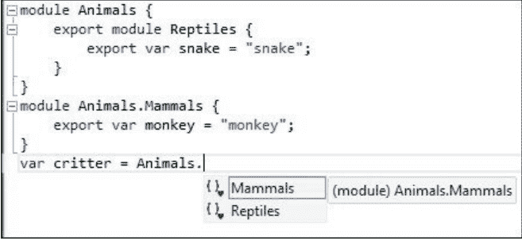

# 第 2 章 TypeScript 基础

编译语言的主要好处之一是，它们在代码最终转换为机器代码之前，为开发人员提供更简洁的语法供其使用。TypeScript 能够通过将几种不同的模式封装到语言结构中，将这一优势带到 JavaScript 开发中，从而让我们编写更好的代码。我们已经谈到了一点 TypeScript 在 JavaScript 之上添加的静态类型系统。提供的每个显式类型注解都只是会在编译期间被移除的语法糖，但在其约束被分析和任何错误被捕获之前不会被移除。在本章中，我们将深入探讨该类型系统。我们还将讨论 TypeScript 引入的不同语言结构。我们将查看这些结构如何由编译器编译为纯 JavaScript。本章将对以下每个概念进行详细阐述：

- Types
- Functions
- Interfaces
- Classes
- Enums
- Modules
- Generic types

### Types

在第 1 章《开始使用 TypeScript》中，我们编写了第一个 TypeScript 应用程序并简要浏览了静态类型系统。创建了两个变量并为其提供了静态类型注解，将其声明为字符串对象。这些类型注解对正在创建的变量施加了一组特定的约束。这些约束允许编译器和开发工具更好地协助正确使用对象。这包括对象上可用的函数、变量和属性列表。如果创建变量时未提供类型，TypeScript 将尝试从其使用的上下文中推断类型。例如，在以下代码中，我们没有显式声明变量 hello 为 string；然而，由于它是用初始值创建的，TypeScript 能够推断它应始终被视为字符串：

```typescript
var hello = "Hello There";
```

TypeScript 具有这种上下文类型化的能力，为开发工具提供了以多种方式增强开发体验的能力。类型信息允许我们的 IDE 警告我们代码中的潜在错误，或提供智能代码补全和建议。正如以下屏幕截图所示，Visual Studio 能够提供与字符串对象相关的方法和属性列表以及其类型信息：



当对象的类型未给出并且无法从其初始化中推断时，它将被视为 Any 类型。Any 类型是 TypeScript 中所有其他类型的基础类型。它可以表示任何 JavaScript 值，并且对 Any 类型的对象执行的类型检查最少。TypeScript 中存在的每种其他类型都属于以下三类之一：原始类型、对象类型或类型参数。TypeScript 的原始类型与 JavaScript 的非常相似。

TypeScript 的原始类型如下：

- **Number:** `var myNum: number = 2;`
- **Boolean:** `var myBool: boolean = true;`
- **String:** `var myString: string = "Hello";`
- **Void:** `function(): void { var x = 2; }`
- **Null:** `if (x != null) { alert(x); }`
- **Undefined:** `if (x != undefined) { alert(x); }`

所有这些类型都直接对应于 JavaScript 的原始类型，除了 void。void 类型用于表示值的缺失。返回无值的函数返回类型为 void。对象类型是你将在 TypeScript 中看到的最常见的类型，它们由对类、接口和匿名对象类型的引用组成。对象类型由一组复杂的成员组成。这些成员属于以下四类之一：属性、调用签名、构造函数签名或索引签名。本章后面，我们将开始使用 TypeScript 中的不同语言实体创建不同的对象类型。

类型参数用于引用泛型类型或调用泛型函数。类型参数用于使代码足够通用以用于多种对象，同时将这些对象限制为特定的一组约束。我们可以介绍的泛型的一个早期示例是数组。数组的存在方式与 JavaScript 中的相同，并且在其上放置了一组额外的类型约束。数组对象本身具有某些类型约束和方法，这些是作为 Array 类型的对象创建的，数组声明带来的第二条信息是数组中包含的对象的类型。有两种方法可以显式为数组键入类型；否则，上下文类型系统将尝试推断类型信息：

```typescript
var array1: string[] = [];
var array2: Array<string> = [];
```

这两种示例都是声明数组的完全合法方式。它们都生成相同的 JavaScript 输出，并且都提供相同的类型信息。第一个示例是使用 [ 和 ] 字符创建数组的简写类型文字。每个数组的结果 JavaScript 如下所示：

```typescript
var array1 = [];
var array2 = [];
```

尽管有所有类型注解和编译时检查，TypeScript 编译为纯 JavaScript，因此对应用程序的运行时速度完全不产生开销。所有类型注解都从最终代码中移除，为我们提供了更丰富的开发体验和干净的最终产品。

### Functions

如果你对 JavaScript 非常熟悉，你将非常熟悉函数的概念。TypeScript 已向参数列表以及返回类型添加了类型注解。由于对参数列表施加了新的约束，函数重载的概念也被包含在语言规范中。TypeScript 还利用了 JavaScript 的 **arguments** 对象并提供了剩余参数的语法。让我们看一下 TypeScript 中的函数声明：

```typescript
function add(x: number, y: number): number {
    return x + y;
}
```

正如你所见，我们创建了一个名为 add 的函数。它接受两个参数，两者都是 number 类型，即原始类型之一，并返回一个 number。该函数在其当前形式下很有用，但整体功能有点受限。如果我们想将第三个数字加到前两个数字上呢？那么我们必须多次调用函数。TypeScript 提供了向函数提供可选参数的方法。因此，我们现在可以修改函数以接受第三个参数 z，将其添加到前两个数字中，如下代码所示：

```typescript
function add(x: number, y: number, z?: number) {
    if (z !== undefined) {
        return x + y + z;
    }
    return x + y;
}
```

正如你所见，我们现在有一个第三个命名参数，但它后面跟着 ?。这告诉编译器此参数不是调用函数所必需的。

### 提示

可选参数告诉编译器如果在调用函数时未提供该参数，则不要生成错误。在 JavaScript 中，此编译时检查不会执行，这意味着运行时可能发生异常，因为每个缺失的参数值都为 undefined。开发人员有责任编写代码以在尝试使用它之前验证值是否存在。

因此，我们现在可以把三个数字加在一起，并且我们没有破坏任何依赖于 add 方法仅接受两个参数的先前代码。这增加了一些功能，但我认为将此代码扩展为操作多种类型会更好。我们知道字符串可以像数字一样相加，那么为什么不使用相同的方法呢？在其当前形式下，向 add 函数传递字符串将导致编译错误。我们将修改函数的定义，使其不仅接受数字，还接受字符串，如下代码所示：

```typescript
function add(x: string, y: string): string;
function add(x: number, y: number): number;
function add(x: any, y: any): any {
```


```
    return x + y;
}
```

正如你所见，现在我们有 add 函数的两个声明：一个用于字符串，一个用于数字，然后我们还有使用 any 类型的最终实现。然而，实际函数实现的签名并不包含在函数的类型定义中。尝试用数字或字符串之外的任何类型调用我们的 add 方法都会在编译时报错，但重载对生成的 JavaScript 没有任何影响。所有类型注解以及重载都会被剥离，我们最终得到的只是一个非常简单的 JavaScript 方法：

```
function add(x, y) {
    return x + y;
}
```

太好了，现在我们有了一个多用途的 add 函数，它可以接收两个值并将它们组合起来，无论是字符串还是数字。但这在整体功能上仍然显得有些局限。如果我们想把不定数量的值加在一起呢？我们将不得不反复调用我们的 add 方法，直到最终只有一个值。值得庆幸的是，TypeScript 提供了剩余参数，它本质上是一个无限制的可选参数列表。

以下代码展示了如何修改我们的 add 函数以包含一个剩余参数：

```
function add(arg1: string, ...args: string[]): string;
function add(arg1: number, ...args: number[]): number;
function add(arg1: any, ...args: any[]): any {
    var total = arg1;
    for (var i = 0; i < args.length; i++) {
        total += args[i];
    }
    return total;
}
```

剩余参数只能是函数声明中的最后一个参数。TypeScript 编译器会识别这个最终参数的语法，并生成额外的 JavaScript 代码，从函数内部可用的 arguments 对象创建一个移位数组。生成的 JavaScript 代码展示了编译器添加的循环，该循环用于创建表示我们不定参数列表的数组：

```
function add(arg1) {
    var args = [];
    for (var _i = 0; _i < (arguments.length - 1); _i++) {
        args[_i] = arguments[_i + 1];
    }
    var total = arg1;
    for (var i = 0; i < args.length; i++) {
        total += args[i];
    }
    return total;
}
```

现在，将数字和字符串相加变得非常简单，而且是完全类型安全的。如果试图混合不同的参数类型，将会出现编译错误。下面语句中的前两个是对我们的 Add 函数的合法调用；然而，第三个是非法的，因为传入的对象类型不一致：

```
```typescript
alert(add("Hello ", "World!"));
alert(add(3, 5, 9, 120, 42));
//Error
alert(add(3, "World!"));
```
```

我们对 TypeScript 的探索还处于早期阶段，但好处已经非常明显。函数中还有一些我们尚未涉及的特性，但我们需要先学习更多关于这门语言的知识。接下来，我们将讨论接口结构及其提供的好处，而这些好处完全无需额外成本。

## 接口

接口是创建大规模软件应用程序的关键部分。它们是表示任何对象复杂类型的一种方式。尽管它们非常有用，但它们在运行时完全没有影响，因为 JavaScript 不包含任何形式的运行时类型检查。接口在编译时被分析，然后从生成的 JavaScript 中省略。接口为开发者创建了一个契约，用于开发新对象或编写与现有对象交互的方法。接口是包含成员列表的命名类型。让我们看一个接口的示例：

```
interface IPoint {
    x: number;
    y: number;
}
```

如你所见，我们使用 interface 关键字来开始接口声明。然后我们给接口一个名字，以便从我们的代码中轻松引用。

### 注意

接口可以任意命名，例如 foo 或 bar，但一个简单的命名约定会提高代码的可读性。在本书中，接口将采用 I<name> 的格式，而对象类型将仅使用 <name>，例如 IFoo 和 Foo。

接口的声明体仅包含成员、函数及其类型的列表。接口成员只能是对象的实例成员。在接口声明中使用 static 关键字将导致编译错误。

接口能够从基类型继承。这种接口继承允许我们将现有接口扩展为更增强的版本，以及将多个独立的接口合并在一起。为了创建继承链，接口使用 extends 子句。extends 子句后面跟着一个逗号分隔的类型列表，该列表是接口将要合并的类型。

```
interface IAdder {
    add(arg1: number, ...args: number[]): number;
}
interface ISubtractor {
    subtract(arg1: number, ...args: number[]): number;
}
interface ICalculator extends IAdder, ISubtractor {
    multiply(arg1: number, ...args: number[]): number;
    divide(arg1: number, arg2: number): number;
}
```

在这里，我们看到了三个接口：
- IAdder，它定义了一个类型，该类型必须实现我们之前编写的 add 方法
- ISubtractor，它定义了一个名为 subtract 的新方法，任何被声明为 ISubtractor 类型的对象都必须定义该方法
- ICalculator，它同时扩展了 IAdder 和 ISubtractor，并定义了两个新方法，用于执行加法和减法器不会执行的、计算器应该负责的操作

这些接口现在可以在我们的代码中作为类型参数或类型声明被引用。接口不能直接被实例化，直接使用其类型名称来引用接口成员将导致错误。在下面的函数声明中，ICalculator 接口用于限制可以传递给函数的对象类型。编译器现在可以检查函数体并推断与 calculator 参数关联的所有类型信息，如果使用的对象未实现此接口，则会警告我们。

```
function performCalculations(calculator: ICalculator, num1, num2) {
    calculator.add(num1, num2);
    calculator.subtract(num1, num2);
    calculator.multiply(num1, num2);
    calculator.divide(num1, num2);
    return true;
}
```

关于接口定义，你需要知道的最后一点是，它们的声明是开放式的，如果它们具有相同的类型名称，将会隐式合并在一起。我们的 ICalculator 接口本可以拆分为两个独立的声明，每个声明添加自己的基类型列表和自己的成员列表。以下声明产生的类型定义与我们之前看到的声明是等价的：

```
interface ICalculator extends IAdder {
    multiply(arg1: number, ...args: number[]): number;
}
interface ICalculator extends ISubtractor {
    divide(arg1: number, arg2: number): number;
}
```

创建大规模应用程序需要灵活且可复用的代码。接口是保持 TypeScript 像普通 JavaScript 一样灵活的关键组成部分，同时又让我们能够利用编译时提供的类型检查。你的代码不必依赖于现有的对象类型，并且可以随时准备应对可能引入的任何新对象类型。TypeScript 编译器还实现了一个鸭子类型系统，允许我们在保持类型安全的同时动态创建对象。下面的示例展示了如何将未显式实现接口但包含所有必需成员的对象传递给函数：

```
function addPoints(p1: IPoint, p2: IPoint): IPoint {
    var x = p1.x + p2.x;
    var y = p1.y + p2.y;
    return { x: x, y: y }
}
//Valid
var newPoint = addPoints({ x: 3, y: 4 }, { x: 5, y: 1 });
//Error
```

```
var newPoint2 = addPoints({ x: 1 }, { x: 4, y: 3 });
```


## 定义

在 TypeScript 中创建类与创建接口本质上是相同的。让我们创建一个非常简单的 Point 类来为我们跟踪 x 和 y 位置：

```
class Point {
    public x: number;
    public y: number;
    constructor(x: number, y = 0) {
        this.x = x;
        this.y = y;
    }
}
```

正如你所见，定义一个类非常简单。使用关键字 class 然后为新类型提供一个名称。然后你为对象创建一个构造函数，可以在创建时提供任何你想要的参数。我们的 Point 类需要两个值来表示平面上的位置。

### 提示

构造函数是完全可选的。如果没有提供构造函数实现，编译器将自动生成一个不带参数并初始化任何实例成员的构造函数。

我们为属性 y 提供了一个默认值。此默认值告诉编译器生成比仅给出类型时更多的 JavaScript 语句。这也允许 TypeScript 将具有默认值的参数视为可选参数。如果未提供参数，则参数的值将被分配给你提供的默认值。这提供了一种确保你始终在操作已实例化对象的方法。最好的部分是默认值适用于所有函数，而不仅仅是构造函数。现在让我们检查 Point 类的 JavaScript 输出：

```
var Point = (function () {
    function Point(x, y) {
        if (typeof y === "undefined") { y = 0; }
        this.x = x;
        this.y = y;
    }
    return Point;
})();
```

正如你所见，一个新对象被创建并分配给一个匿名函数，该函数初始化 Point 类的定义。正如我们稍后将看到的，任何公共方法或静态成员都将被添加到内部 Point 函数的原型上。JavaScript 闭包是理解 TypeScript 的一个非常重要的概念。TypeScript 中的类、模块和枚举都编译为 JavaScript 闭包。闭包实际上是 JavaScript 语言的一种构造，它提供了一种为代码的特定段创建私有状态的方法。当创建闭包时它包含两件事：一个函数，以及函数创建时的环境状态。该函数返回给闭包的调用者，而状态在函数被调用时使用。

## 接口

让我们稍后再回到我们对接口的讨论，看看它们如何与类交互。在下一个示例中，我们将强制 `IPoint` 接口作用于 `Point` 类。类可以使用 `implements` 关键字可选地从接口继承类型信息。然后类将被要求实现接口的所有成员；否则，将发生编译错误：

```
```typescript
interface IPoint {
    x: number;
    y: number;
}
class Point implements IPoint {
    constructor(public x: number, public y = 0) {
    }
}
```
```

正如我们之前讨论的，接口纯粹是编译时构造。从此示例输出的 JavaScript 与我们刚才看到的 JavaScript 完全相同。我还偷偷加入了一种定义类上实例变量的简写方法。用 public 或 private 关键字装饰构造函数的参数会告诉 TypeScript 将这些对象视为类型的一部分而不是仅仅是初始化参数。

类不限于实现单个接口。在 `implements` 关键字之后提供以逗号分隔的接口列表允许你的类提供多种不同契约的实现。让我们通过实现第二个接口使我们的 `Point` 类更有用，如下所示：

```
```typescript
interface IPoint {
    x: number;
    y: number;
}
interface ICompare {
    Compare(p2: IPoint): number;
}
class Point implements IPoint, ICompare {
    public x: number;
    public y: number;
    constructor(x: number, y = 0) {
        this.x = x;
        this.y = y;
    }
    public Compare(p2: IPoint): number {
        var p1Val = this.x * this.x + this.y * this.y;
        var p2Val = p2.x * p2.x + p2.y * p2.y;
        var result = p1Val - p2Val;
        if (result == 0) {
            return 0;
        } else if (result > 0) {
            return 1;
        } else {
            return -1;
        }
```
```

能够在我们的类上强制执行多个接口为我们提供了在多种不同上下文中使用对象的能力。保持我们的接口简单使它们在我们的应用程序中更具可重用性。我们本可以很容易地将 Compare 方法放在 IPoint 接口上并达到相同的效果。然而，正如我们稍后将看到的，经过一些调整，任何数量的类型都可以实现 ICompare 接口，而它们不需要 x 和 y 成员。在这种情况下，Compare 方法确定每个点与原点的距离并返回一个表示哪个点更远的数字。如果执行比较的对象更远，则返回正值。如果作为参数传递的点更远，则返回负值。如果两个点与原点的距离相等，则返回零值。

## 静态和实例成员

x 和 y 都是类 Point 的实例成员；这意味着必须实例化该类型的对象才能引用它们。当调用构造函数时，值会被分配给正在创建的对象实例的属性。这些值可以是在构造函数函数内创建的新对象，也可以是作为构造函数参数传入的对象的引用。这对于某些成员来说是件好事，然而，还有其他类成员你可能希望在未创建对象时也能访问。TypeScript 通过静态成员提供了这种能力。静态成员可以通过引用命名类型随时访问。要声明静态成员，只需用 static 关键字装饰它即可：

```
class Point implements IPoint, ICompare {
    public x: number;
    public y: number;
    constructor(x: number, y = 0) {
        this.x = x;
        this.y = y;
    }
    public Compare(p2: IPoint): number {
        var p1Val = this.x * this.x + this.y * this.y;
        var p2Val = p2.x * p2.x + p2.y * p2.y;
        var result = p1Val - p2Val;
        if (result == 0) {
            return 0;
        } else if (result > 0) {
            return 1;
        } else {
            return -1;
        }
    }
    static Compare(p1: Point, p2: Point): number {
        return p1.Compare(p2);
    }
}
```

前面的 Compare 方法接收两个 Point 对象并比较它们与原点的距离以确定哪个更大。此类成员的 JavaScript 输出与在构造函数中创建的 x 和 y 属性大不相同。以下输出显示 Compare 方法被直接放在正在创建的 Point 对象上：

```
var Point = (function () {
    function Point(x, y) {
        if (typeof y === "undefined") { y = 0; }
        this.x = x;
        this.y = y;
    }
    Point.prototype.Compare = function (p2) {
        var p1Val = this.x * this.x + this.y * this.y;
        var p2Val = p2.x * p2.x + p2.y * p2.y;
        var result = p1Val - p2Val;
```

```
```typescript
if (result == 0) {
    return 0;
} else if (result > 0) {
    return 1;
} else {
    return -1;
}
};
Point.Compare = function (p1, p2) {
    return p1.Compare(p2);
};
return Point;
})();
```

我们还没有讨论 TypeScript 类的最重要部分之一，那就是实例成员函数。这些函数仅对该类型的对象实例可用，并且它们可以访问 `this` 对象，从而可以轻松访问对象的所有成员。在 JavaScript 中，有几种方法可以创建实例成员函数。它们可以在对象创建期间使用 `this` 对象直接添加到对象上，或者可以附加到对象的原型上。两者各有利弊，但通常最好将函数放在原型上而不是分配给类的每个新实例。放在静态原型上的函数实例会被反复重用，而不是随着类型的每个新实例而重新创建。这有助于减少内存消耗，并且随着应用程序的增长会提高性能。TypeScript 采用了这种将方法附加到对象实例的方法。

让我们创建一个表示平面上对象的类型。它将有三个属性：`Height`、`Width` 和 `Location`。还将有一个实例成员函数来确定对象在平面上的大小。`Location` 成员将是我们刚刚创建的 `Point` 类型：

```
```typescript
interface IBounds {
    Location: IPoint;
    Height: number;
    Width: number;
    Size(): number;
}
class Bounds implements IBounds {
    public Location: IPoint = new Point(0, 0);
    public Height: number = 0;
    public Width: number = 0;
    public Size() {
        return this.Height * this.Width;
    }
}
```
```

正如你所见，这个类不包含显式构造函数；然而，所有属性都已初始化，并且在创建类型实例时将可供使用。正如你从生成的 JavaScript 中看到的，Size 方法被放在 Bounds 对象的静态原型成员上，并且创建了一个无参数的构造函数，其中所有实例成员都被初始化：


```javascript
var Bounds = (function () {
    function Bounds() {
        this.Location = new Point(0, 0);
        this.Height = 0;
        this.Width = 0;
    }
    Bounds.prototype.Size = function () {
        return this.Height * this.Width;
    };
    return Bounds;
})();
```

## 属性

在 ECMAScript 5 中，引入了属性的概念。这使得开发人员可以为指定的实例方法创建 getter 和 setter 方法，而这些方法可以像属性一样被访问。如果你的 TypeScript 项目设置为编译 ECMAScript 5，那么你将能够使用 `get` 和 `set` 关键字来按照 ECMAScript 5 语言规范定义属性。ECMAScript 版本可以在项目属性的 TypeScript 构建部分的常规设置中更改，如下面的截图所示：



让我们修改我们的 bounds 类，将 `Height` 和 `Width` 都视为对象属性，而不是简单的实例成员，并为它们创建 getter 和 setter 方法。getter 和 setter 也会修改私有实例成员，这些成员将维护实际值。在 JavaScript 中，通常做法是用下划线作为私有实例成员的前缀，因此我们将为 Bounds 类创建 `_height` 和 `_width` 实例成员以便在内部访问。

既然我们现在有了一个可以执行某些代码的方法块，还应该提供一些值检查，以确保程序正确执行。对象的高度和宽度不应小于零，因此让我们验证分配给它们的值是否符合这一约束；如果不满足，我们将手动将该值设置为零：

```
interface IBounds {
    Location: IPoint;
    Height: number;
    Width: number;
    Size(): number;
}
class Bounds implements IBounds {
    public Location: IPoint = new Point(0, 0);
    private _height: number = 0;
    private _width: number = 0;
    public Size() {
        return this.Height * this.Width;
    }

    get Height(): number {
        return this._height;
    }
    set Height(value: number) {
        this._height = (value > 0) ? value : 0;
    }
```

```
```javascript
get Width(): number {
    return this._width;
}
set Width(value: number) {
    this._width = (value > 0) ? value : 0;
}
}
```
```

正如你所看到的，现在我们已经有了方法块来包裹对 `Height` 和 `Width` 属性的访问。这些属性仍然像实例变量一样被访问，正如你在 `Size` 方法中看到的那样，但当我们访问它们时，我们的函数块会被执行。生成的 JavaScript 在创建类型时调用 `Object.defineProperty` 方法，这已概述在 ECMAScript 5 标准中。

### 注意

虽然 ECMAScript 5 标准已被大多数浏览器广泛采用，但需要注意的是，在某些浏览器中仍然存在功能支持上的不足。以下链接中的表格概述了当前对 ECMAScript 5 标准的支持情况：[http://kangax.github.io/compat-table/es5/](http://kangax.github.io/compat-table/es5/)。

这会在原型上放置一个新对象，该对象可在该类型的所有实例上访问。以下 JavaScript 是在 TypeScript 中定义 getter 和 setter 所生成的代码：

```
```javascript
var Bounds = (function () {
    function Bounds() {
        this.Location = new Point(0, 0);
        this._height = 0;
        this._width = 0;
    }
    Bounds.prototype.Size = function () {
        return this.Height * this.Width;
    };

    Object.defineProperty(Bounds.prototype, "Height", {
        get: function () {
            return this._height;
        },
        set: function (value) {
            this._height = (value > 0) ? value : 0;
        },
        enumerable: true,
        configurable: true
    });

    Object.defineProperty(Bounds.prototype, "Width", {
        get: function () {
            return this._width;
        },
        set: function (value) {
            this._width = (value > 0) ? value : 0;
        },
```

```
enumerable: true,
    configurable: true
});
    return Bounds;
})();
```

在这段输出中还有其他一些值得注意的地方。我们创建了新的私有变量来存储属性声明所暴露的值。这些私有变量在构造函数中被添加到对象的每个实例上。这看起来有点奇怪，因为我们知道闭包可以为类的每个实例存储私有状态。私有变量需要添加到每个实例的原因是函数和属性都被附加到类的原型上。原型不会保留闭包的状态，而是依赖实际对象实例来访问其成员。

在转换为属性之后，`IBounds` 接口仍然得到支持。创建类实例后产生的类型信息只需要与接口的类型信息匹配即可通过编译。这里不区分是实例成员还是属性声明，因为它们都以相同的方式被访问。

在很短的时间内，我们已经涵盖了很多内容。类是 TypeScript 引入的最重要的概念之一，它帮助 JavaScript 转变为企业级开发平台。我们还有很多概念要介绍，包括枚举。

## 枚举

枚举是一种有用的实体，用于保存特定值，通过友好的名称引用它，以保持代码的可读性。枚举值只不过是与命名常量关联的整数。枚举的声明非常简单，然而，有趣的是它们在 JavaScript 中的生成结果。首先，让我们看一个枚举声明，然后我们再来讨论其结果：

```
```typescript
enum ShapeType {
    Rectangle,
    Circle,
    Line,
    Freehand
}
```
```

枚举类型的声明需要指定用于引用枚举的类型名称，然后函数体只是用逗号分隔的可能取值列表。从 TypeScript 的角度来看，这里没有什么特别之处。你可以像访问类的静态成员一样访问枚举值：ShapeType.Rectangle。不过，正如我之前所说，TypeScript 中枚举的真正神奇之处在于它们在 JavaScript 中的生成方式，所以让我们看一下我们枚举的输出：

```
```javascript
var ShapeType;
(function (ShapeType) {
    ShapeType[ShapeType["Rectangle"] = 0] = "Rectangle";
    ShapeType[ShapeType["Circle"] = 1] = "Circle";
    ShapeType[ShapeType["Line"] = 2] = "Line";
    ShapeType[ShapeType["Freehand"] = 3] = "Freehand";
})(ShapeType || (ShapeType = {}));
```
```

这里有相当多的 JavaScript 代码，却只是用来表示像数字映射这样简单的东西。然而，如果你更深入地观察，就会发现 TypeScript 正在创建命名常量与其映射到的数字之间的双向映射。这创造了许多有趣的访问枚举值的方式。看看下面的代码片段，思考一下输出可能是什么：

```
```javascript
alert(ShapeType[ShapeType.Rectangle]);
```
```

ShapeType 是在一个匿名函数内部创建的，该函数返回一个对象，这个对象为枚举的每个成员都赋予了这两个属性。利用 JavaScript 的动态类型系统，TypeScript 添加了一个属性，其值为成员名称的字符串形式，并将其映射到一个整数值。然后，该整数值同时作为 ShapeType 对象的一个属性添加，并映射到命名成员的字符串值。所以，如果你认为之前返回的值是命名成员的字符串表示，那么你是对的！


既然我们已经熟悉了枚举的工作原理，接下来让我们再看看枚举的各个成员。我们知道枚举表示数字和字符串之间的双向映射，那么这个数字从哪里来呢？在 ShapeType 示例中，我们刚看到每个成员都只是被赋予了一个名称，数字是由编译器生成的。这很好用，它创建了一组顺序的数字供我们访问，但如果能对这些值有更多的控制就更好了。因此，TypeScript 提供了两种可创建的枚举成员：常量成员（constant members）和计算成员（computed members）。我们之前看到的所有成员都是带有自动生成常量值的常量成员。除非为某个成员提供了常量值，否则这些数字从零开始按顺序排列。然后，枚举中所有后续成员都将与给定的数字保持连续。

计算成员仍然是命名常量，但它们映射到的整数值由表达式提供。这个表达式可以是内联表达式，也可以是对另一段代码的函数调用。你提供的表达式的唯一要求是它必须返回一个数字。正如你在下面的代码片段中所见，我们修改了之前的枚举 ShapeType，以生成一些特定的索引，并创建了一个计算成员：

```
function GetEnumValue(): number {
    return Date.now();
}
enum ShapeType {
    Rectangle = 3,
    Circle,
    Line,
    Freehand,
    Random = GetEnumValue()
}
```

正如你所看到的，我们创建了一个函数，利用 JavaScript 中可用的全局 Date 对象返回一个表示当前时间的整数。我们还把第一个常量成员设置为我们选择的整数值。当编译器解析这段代码时，枚举中的所有成员都将从这个值开始按顺序递增。现在让我们看看生成的 JavaScript，以及计算成员在运行时的样子：

```
function GetEnumValue() {
    return Date.now();
}
var ShapeType;
(function (ShapeType) {
```


```
ShapeType[ShapeType["Rectangle"] = 3] = "Rectangle";
ShapeType[ShapeType["Circle"] = 4] = "Circle";
ShapeType[ShapeType["Line"] = 5] = "Line";
ShapeType[ShapeType["Freehand"] = 6] = "Freehand";
ShapeType[ShapeType["Random"] = GetEnumValue()] = "Random";
})(ShapeType || (ShapeType = {}));
```

如你所见，提供给计算成员的表达式被直接构建到生成的枚举声明中。该表达式将在运行时计算，但仅在 ShapeType 初始化时执行。一旦表达式运行完毕，其结果将保留为 ShapeType 对象的成员。因此，在前面的示例中，只要 ShapeType 枚举驻留在内存中，ShapeType.Random 就等价于 ShapeType["Random"]。现在你可能会想，能够改变常量成员的数值序列有什么用处呢？

到目前为止，关于枚举我们还没有涉及的一点是，枚举定义可以被合并。如果将两个枚举声明放在代码的不同片段中并使用相同的类型名称，它们将作用于同一个对象。你可以在生成的 JavaScript 中枚举声明的最后一行看到这一点。如果该对象已存在，则每个新属性都会被添加到已有对象上；否则，会创建一个新对象并应用这些属性。

## 模块

模块模式在 JavaScript 开发中变得越来越流行。它提供了一种简单的方法来封装私有成员（这是 JavaScript 本身不具备的能力），并将对象隔离在全局命名空间之外。在 TypeScript 中有两种类型的模块：**内部模块**和**外部模块**。我们稍后会详细讨论它们，但暂时先只谈内部模块。

现在我们有一个内部模块，它包含两个可访问的命名类型：ShapeType 枚举和 Shape 类，以及一个不可访问的变量 origin，该变量属于模块的隔离状态。尽管我们未必需要访问 ShapeType 枚举，但它仍然必须被导出，否则代码无法编译。任何在另一个成员定义中使用的命名类型，都必须具有与该成员相同的可访问性。如果不能满足这一要求，编译将失败。访问这些类型的方式是先提供模块名称，然后是你要访问的类型。在下面的示例中，你可以看到我们创建一个新的 Shape 对象并设置其类型：

```
var shape = new Shapes.Shape();
shape.Type = Shapes.ShapeType.Circle;
```

为这个模块生成的 JavaScript 看起来与为枚举类型生成的代码非常相似。模块的所有成员都被包裹在一个闭包中，该闭包在模块加载时运行。每个导出的类型都被放置到传递给闭包的实例变量上，以便任何访问模块的人都能使用。模块也拥有与枚举相同的合并能力。这意味着你可以将代码拆分为多个文件，并在运行时将它们合并为一个对象。这种模块实现的一个缺点是无法为模块创建接口。然而，能够以你选择的任何方式组织代码，比接口能为模块带来的任何功能都更有价值。下面你可以看到 TypeScript 为定义模块而生成的 JavaScript：

```
var Shapes;
(function (Shapes) {
    var origin = new Point(0, 0);
    (function (ShapeType) {
        ShapeType[ShapeType["Rectangle"] = 3] = "Rectangle";
        ShapeType[ShapeType["Circle"] = 4] = "Circle";
        ShapeType[ShapeType["Line"] = 5] = "Line";
        ShapeType[ShapeType["Freehand"] = 6] = "Freehand";
    })(Shapes.ShapeType || (Shapes.ShapeType = {}));
    var ShapeType = Shapes.ShapeType;
    var Shape = (function () {
        function Shape() {
            this.Type = 3 /* Rectangle */;
            this.Bounds = new Bounds();
            this.Bounds.Location = origin;
        }
        return Shape;
    })();
    Shapes.Shape = Shape;
})(Shapes || (Shapes = {}));
```

到目前为止，我们只看到了一个模块的小示例，但不妨想象一下构建一个包含大量对象类型的大型应用程序。你会希望创建命名空间来组织代码，并在互不相关的代码段之间建立一层隔离。在 TypeScript 中有两种提供模块命名空间的方式：可以将模块相互嵌套，也可以将它们作为模块声明的一部分来定义。

让我们来看看定义命名空间和创建模块定义的一些不同方式。

```typescript
module Animals {
    export module Reptiles {
        export var snake = "snake";
    }
}
module Animals.Mammals {
    export var monkey = "monkey";
}
```

在本例中，我们为 Animals 模块创建了一个声明，然后在其中嵌套了另一个被导出的模块声明。此外，还有一个模块声明使用了以 . 字符分隔的多部分类型名称。这里展示的两种模块声明都是有效的。两种声明生成的 JavaScript 输出完全相同，因此选择哪种风格实际上取决于个人偏好。编译器会像开发环境一样将它们视为等价。正如下面的截图所示，访问 Reptiles 和 Mammals 命名空间的方式完全一致：



这些模块定义各自生成的 JavaScript 在结构上是相同的。然而，如果你打算在单个 TypeScript 文件中声明多个嵌套模块，最好使用展开式的嵌套声明，而不是使用快捷方式。编译器在生成 JavaScript 输出时不会尝试优化和合并模块定义。正如下面的 JavaScript 代码所示，你将会不必要地创建多个闭包来向类型对象添加对象。如果你打算按文件来划分命名空间，那么这种情况是不可避免的。

```javascript
var Animals;
(function (Animals) {
    (function (Reptiles) {
        Reptiles.snake = "snake";
    })(Animals.Reptiles || (Animals.Reptiles = {}));
    var Reptiles = Animals.Reptiles;
})(Animals || (Animals = {}));
var Animals;
(function (Animals) {
    (function (Mammals) {
        Mammals.monkey = "monkey";
    })(Animals.Mammals || (Animals.Mammals = {}));
    var Mammals = Animals.Mammals;
})(Animals || (Animals = {}));
```

可能有一些常见的对象类型或实用方法，你希望在另一个模块中能够快速访问。随着我们继续合理地对类型进行拆分，让我们创建一个用于绘图相关功能的新模块。这个模块将包含我们之前创建的 Point 类和 Bounds 类。这两个类都将被导出，因为其他模块需要能够引用它们。虽然将代码分隔到易于管理的隔离段中是一件好事，但现在每当我需要使用另一个模块中的类型时，我都必须提供完全限定名称。幸运的是，TypeScript 提供了一个与 export 关键字相反的关键字，允许我们为另一个模块的成员创建别名。import 关键字会为其他模块的导出类型创建新的局部引用。在下面的代码段中，我们将在 Shapes 模块内为 Bounds 类创建一个别名。这样我们就不必修改 Shape 类的定义，使其包含 Bounds 类型的完整命名空间。

```
module Shapes {
    import Bounds = Drawing.Bounds;
    export enum ShapeType {
        Rectangle = 3,
        Circle,
        Line,
        Freehand,
    }
    export interface IShape {
        Type: ShapeType;
        Bounds: Drawing.IBounds;
    }
    export class Shape {
        public Type: ShapeType = ShapeType.Rectangle;
        public Bounds: Drawing.IBounds = new Bounds();
    }
}
```

如你所见，这个别名既可以用作类型注解，也可以用作对象类型。生成的 JavaScript 只是将 import 关键字替换为 var，并让运行时引擎创建对导出成员的引用。但是，直接在 TypeScript 中这样做会生成编译错误。import 关键字会告知编译器不仅要检查被别名化的对象，还要检查其类型信息，以便将其用于类型声明中。

### 提示

export 关键字和 import 关键字可以结合使用，以创建可从外部访问的别名。


### 泛型对象

如果你采用 TypeScript 的目标是为客户端使用创建 API，那么泛型就是你最应该熟悉的语言构造。泛型允许框架和 API 的使用者就完成指定目标所需的具体契约达成一致，而无需了解特定的对象类型。泛型定义了 TypeScript 中对象的第三类也是最后一类类别——类型参数。正如本章前面讨论数组时所见，类型参数定义在 `<` 和 `>` 字符内部。它们可以用于接口或类定义，以便为开发时可能已知或未知的广泛对象类型创建功能。假设我们要创建一个通用的任务处理器。我们将采用最简单的实现方式，即一个串行过程，将一个通用任务列表传递给一个函数来运行它们：

```typescript
interface ITask {
    Id: number;
    Execute(): boolean;
    Error: string;
}
function ProcessTasks<T extends ITask>(tasks: T[]): T {
    for (var i = 0; i < tasks.length; i++) {
        if (tasks[i].Execute() == false) {
            return tasks[i];
        }
    }
    return null;
}
```

在此示例中，我们定义了一个接口，任务处理器将依赖该接口来顺序执行一组任务。`ProcessTasks` 的函数声明现在包含一个类型参数 `T`，它必须遵循 `ITask` 接口。该类型参数用作约束，限制可作为 `tasks` 数组一部分传入的对象，并且它将成为函数的返回类型。`tasks` 数组逐一循环，并调用 `Execute` 方法。如果 `Execute` 方法返回 `false` 值，则处理停止并返回该任务。泛型完全建立在类型注解之上，因此它们对生成的 JavaScript 没有任何影响。但是，如果未满足类型约束，则会生成编译错误。

接口和类能够围绕一个非常松散的类型定义构建更复杂的结构。提供给接口或类的类型参数可用于为声明主体内的任何成员或函数提供类型信息。在下一个示例中，我们的 `ProcessTasks` 函数已被移入一个充当处理器的类中。我们创建了一个通用接口，允许我们创建任意数量的任务处理器，并为 `ProcessTasks` 函数提供不同的实现。然后，我们看到一个类声明，它提供了自己的一组类型参数并实现了 `ITaskProcessor` 接口：

```typescript
interface ITask {
    Id: number;
    Execute(): boolean;
    Error: string;
}
interface ITaskProcessor<T extends ITask> {
    ProcessTasks(tasks: Array<T>): T;
    CurrentTask: T;
}
class TaskProcessor<T extends ITask> implements ITaskProcessor<T> {
    public CurrentTask: T = null;
    constructor() {
    }
    public ProcessTasks(tasks: T[]): T {
        for (var i = 0; i < tasks.length; i++) {
            this.CurrentTask = tasks[i];
            if (this.CurrentTask.Execute() == false) {
                return tasks[i];
            }
        }
        this.CurrentTask = null;
        return null;
    }
}
```

泛型函数和类型并不限于单个未知类型。类型参数可以是类型信息的列表，可在与该列表关联的声明块中的任何位置使用。创建类型参数列表与传递单个类型参数相同，只是每个类型用逗号分隔。此外，参数列表中创建的每个泛型类型都可在类型定义内部用作其他类型参数的基类型。下一个示例展示了这两个概念：

```typescript
interface IExample<T, U extends HTMLElement> {
    Operate<V extends U>(): T;
}
```

如你所见，这里有一个逗号分隔的泛型类型列表及它们可能具有的任何约束，而不是单个泛型类型。然后，`Operate` 函数要求一个继承自初始类型参数列表中提供的 `U` 类型的类型。
