# 第 3 章 TypeScript 编译器

在本章中，将对 TypeScript 编译器进行分析。将分解并解释编译器所理解的不同参数，以及它们如何影响生成的 ECMAScript。我们将讨论如何控制代码的生成位置，以及可能伴随我们生成的 ECMAScript 的不同文件。编译器上还有其他一些选项，可使构建和部署大型应用程序更加容易。

本章将涵盖的主题如下：

- ECMAScript 生成
- 输出控制
- 高级编译器选项

### ECMAScript 的生成

与大多数编程语言一样，ECMAScript 也在不断发展。它最初于 90 年代中期开发，用于客户端脚本编写。当前的标准是 ECMAScript 5；然而，第 6 版目前正在开发中。TypeScript 编译器提供了一系列选项来改变代码的生成方式。在本节中，我们将查看这些选项并比较结果。

### ECMAScript 版本

编写 JavaScript 代码意味着你的代码必须可移植到多种类型的客户端设备和浏览器。你可能不仅被迫支持最新版本的浏览器，还可能需要支持其任何先前版本。因此，编译器支持将你的 TypeScript 代码编译成不同版本的 ECMAScript。ECMAScript 3 是一个被广泛采用且大量使用的标准，在许多旧版浏览器中仍然存在。ECMAScript 4 在负责创建标准的组织无法就语言特性达成一致时被放弃。ECMAScript 5 是当前的标准，已被大多数现代浏览器采用。它发布于 2009 年，距第 3 版最初发布近十年。在第 2 章《TypeScript 基础》中，我们看到你可以在 Visual Studio 中轻松切换 ECMAScript 版本。当我们更改此选项时，让我们看看幕后实际发生了什么。在下面的屏幕截图中，你可以看到我们调用编译器的方式与第 1 章《TypeScript 入门》中相同，只是这次我们提供了一个额外的参数：

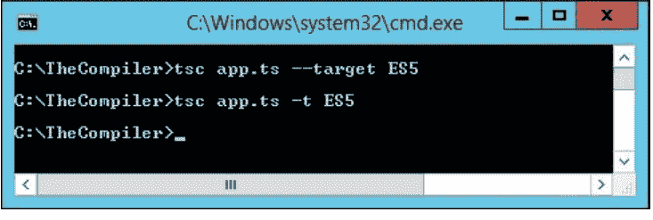

如你所见，有两种方式可以将 ECMAScript 目标版本传递给编译器：详细方法 `--target` 和简写方法 `-t`。

**提示**

如果未提供目标版本，编译器将默认使用 ECMAScript 3。因此，除非你明确使用仅在 ECMAScript 5 中定义的语言构造，否则无需提供此参数。

ECMAScript 5 最初计划是作为一个次要更新，即 ECMAScript 3.1，并且只提供一组有限的新功能，以试图保持向后兼容性。引入了严格模式，它为语言提供了一组不同的语义规则。严格模式对正常 ECMAScript 语义做出了三个主要改变：

- 某些静默错误现在会被抛出
- 强制执行允许语言引擎提供更多优化的规则
- 确保某些关键字不能被使用，以便未来的 ECMAScript 版本可以在语言规范中使用它们

虽然通过在 TypeScript 文件顶部放置 `use strict` 仍可在 TypeScript 中使用严格模式选项，但其价值已不那么显著。TypeScript 编译器已经考虑到了在严格模式下运行的 JavaScript 代码所强制执行的大多数规则。例如，如果你尝试给一个不存在或未定义的变量赋值，将生成编译错误。当你的 JavaScript 在非严格模式下运行时，这将创建一个新变量并将其放入全局作用域。如果在严格模式下运行的 JavaScript 中执行此操作，将生成引用错误。`with` 关键字在严格 JavaScript 中会产生语法错误，因为无法对声明块内的代码块进行优化。每当你尝试使用 `with` 块时，TypeScript 都会生成语法错误。TypeScript 编译器甚至会将你现有的 JavaScript 格式化为更严格的标准集合，例如，如果你编写以下代码行：

```javascript
function sayHello() {
    alert("Hello There")
}
SayHello()
```

在大多数情况下，这是合法的 JavaScript；然而，在某些情况下，需要分号来保持代码有意义。当编译器生成了这段代码时，它已识别出缺失的分号并将其添加到生成的 JavaScript 中：

```javascript
function sayHello() {
    alert("Hello There");
}
SayHello();
```

正如我们在前一章中讨论的那样，TypeScript 添加了大量当前版本 ECMAScript 所缺少的语言构造。然而，该语言将继续发展，并且新的构造将被添加到规范中。严格模式有助于防止开发人员创建使用未来版本潜在关键字的代码。严格模式下禁止的关键字是：`implements`、`interface`、`let`、`package`、`private`、`protected`、`public`、`static` 和 `yield`。如你所见，TypeScript 定义的内容与语言委员会为将来使用而保留的内容之间有相当多的重叠。我们已经讨论了 TypeScript 对 `implements`、`interface`、`private`、`public` 和 `static` 的实现。其余受严格模式限制的名称目前是 TypeScript 中的关键字；然而，任何使用它们的尝试都将导致编译错误。

如果你希望代码同时兼容 ECMAScript 3 和 5，那么实际上只有一个关键构造你应该避免，那就是 getter 和 setter。Getter 和 setter 用于定义 JavaScript 对象的属性。它们是一种特殊类型的语言构造，允许像变量一样被访问，但在内部它们被实现为函数。关于 getter 和 setter 的浏览器兼容性，可以在[第 2 章《TypeScript 基础》]中引用的表格中找到。以下代码片段展示了如何创建这些属性：

```typescript
interface IBook {
    title: string;
}
class Book implements IBook {
    private _title: string = "";
    constructor() {
```


```
}
get title(): string {
    return this._title;
}
set title(value: string) {
    if (value && value.length > 0) {
        this._title = value;
    } else {
        throw ("Invalid Book Title!");
    }
}
```

我们现在能够将为书籍设置或检索标题的过程封装在一个函数声明中。在这种情况下，一本书必须有一个标题，因此尝试将其设置为 null 或空字符串会生成异常。如果尝试在未将目标版本设置为 ES5 的情况下通过编译器运行此代码，您将收到类似于以下屏幕截图的错误：

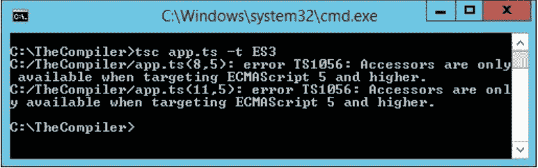

## 代码操作

编译器还有另外几个可用的选项，这些选项将决定生成的 JavaScript 代码会是什么样子。与 JavaScript 一样，TypeScript 允许在代码中放置注释。它们与 JavaScript 注释的定义方式完全相同，并且对运行时执行没有影响。注释用于解释代码段的设计目的，以便当另一位开发人员查看代码时，他们会知道发生了什么。在开发过程中逐步执行我们的代码时，这可能非常有帮助。然而，当代码部署到客户端时，这些注释是不必要的，并且会增加我们 JavaScript 文件的大小。使用 `--removeComments` 参数，我们可以确保在部署之前删除所有这些不需要的数据。考虑以下 TypeScript 代码：

//Retrieve a new random integer value
function getRandom(): number {
    return Math.floor(Math.random() * Date.now());
}
```

前述代码可以使用以下屏幕截图中显示的命令进行编译：

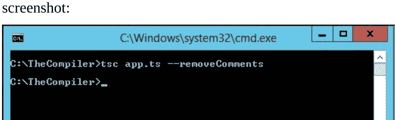

这会产生以下 JavaScript 输出：

```
function getRandom() {
    return Math.floor(Math.random() * Date.now());
}
```

在小规模上，这并不代表巨大的收益；然而，当您将应用程序扩展到数十万行代码时，这可能代表大量数据。在 JavaScript 开发中，将 .js 文件压缩成最小化文件在推送到生产环境时是常见做法。这有助于减少整体文件大小，并且对运行时速度没有影响。不幸的是，在版本 1.0 发布时，TypeScript 编译器没有此选项。希望它会在未来版本中添加，但在此期间有其他工具可用于压缩 JavaScript。RequireJS 是一个我们稍后会讨论的库，它提供了压缩 JavaScript 代码的选项。

TypeScript 编译器可用的最后一个与 ECMAScript 输出相关的参数是 module 参数。此参数告诉编译器如何为外部模块生成代码。

```
}
    CompilerExample.test = test;
})(exports.CompilerExample || (exports.CompilerExample = {}));
var CompilerExample = exports.CompilerExample;
```

正如您所见，生成的 JavaScript 非常不同；然而，我们的 TypeScript 并没有改变。

## 控制编译器输出

TypeScript 编译器在控制编译器的最终结果方面具有非常强大的功能集。编译器以可扩展的方式构建，允许我们一次编译多个源文件以及控制其输出目录或路径。我们还将讨论创建源映射以帮助我们在调试应用程序时使用。

### JavaScript 输出

到目前为止，我们只处理一次编译单个 TypeScript 文件。随着应用程序规模的增长，将我们的代码分离成可维护的片段变得非常重要。在为 C# 应用程序编写代码时，通常按类分离代码文件。JavaScript 约定在代码分段方面有所不同。如果遵循模块模式，通常将整个模块放在单个文件中；否则，代码通常根据应用程序的需求分段成相关的块。通过用空格分隔多个文件名传递给编译器，将告诉编译器解析每个文件并为每个文件生成一个 JavaScript 文件。以下屏幕截图显示了如何执行此操作：

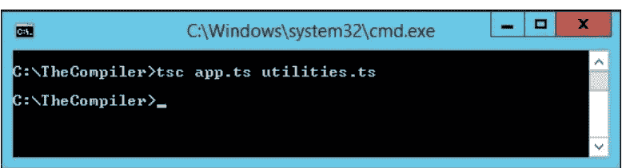

正如您所见，我们现在有两个 TypeScript 文件，每个文件都作为参数传递给编译器。运行此命令的结果将是两个 JavaScript 文件，每个文件对应一个 TypeScript 文件。可以提供的<|message|> 文件数量没有限制；然而，在某个时候，命令行将达到其缓冲区限制。我们将在不久后看到如何通过使用参数文件使这变得更容易。

TypeScript 编译器提供了两个主要选项来控制将用于运行时的 JavaScript 输出到何处。第一个选项需要一个文件夹位置来单独输出所有生成的 JavaScript 文件。正如以下屏幕截图所示，我们使用 `--outDir` 参数提供我们的位置：

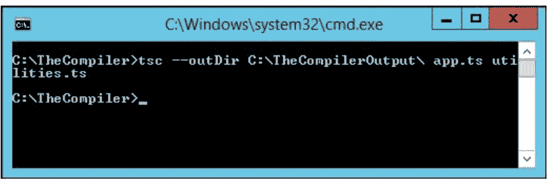

另一个选项允许我们将 TypeScript 编译成单个 JavaScript 文件。这使我们能够对应用程序进行一次 HTTP GET 请求，而不是必须进行多次请求。当应用程序规模扩大并且必须按特定顺序加载每段代码以确保正确执行时，这可能是一项非常复杂的任务。TypeScript 编译器有几种不同的方法来确保以单文件生成的代码以所有对象在需要之前存在的方式创建。确保此的最简单方法是手动按应编译的顺序提供文件。让我们看看我们的两个 TypeScript 文件以及它们如何交互：

```
function sayHello() {
    alert("Hello There");
}
function getRandom(): number {
    return Math.floor(Math.random() * Date.now());
}
```

前述代码段代表一个名为 utilities.ts 的文件，它是一组可用于执行各种不同操作的函数。下一个代码段是 app.ts，它引用了这两个函数并依赖于它们在运行时可用。

```
sayHello();
alert(getRandom());
```

如果我们将它们生成为单独的 JavaScript 文件，那么我们必须在 HTML 页面中放置多个 script 标签。script 标签必须按特定顺序提供，否则会发生引用错误，应用程序将停止工作。我们已经必须向编译器提供多个 TypeScript 文件，那么为什么不直接生成单个 JavaScript 文件并避免处理这个问题呢？以下屏幕截图显示了如何为所有生成的 JavaScript 指定单个文件位置：

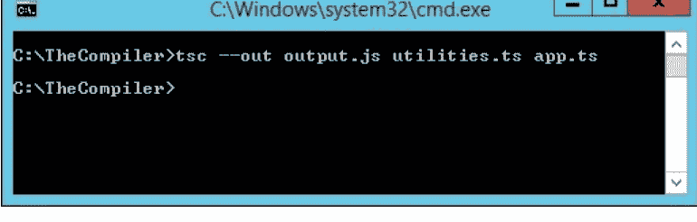

这将导致编译器生成的两个 JavaScript 文件的串联。这意味着我们的 TypeScript 文件仍必须按正确顺序提供，否则会发生引用错误。值得庆幸的是，TypeScript 提供了一种使用特定语法来确定引用图的方法来帮助控制这个问题。下一个代码段显示了如何提供对另一个 TypeScript 文件的特定引用以确保编译器保持正确的顺序：

```
/// <reference path="utilities.ts" />
sayHello();
alert(getRandom());
```

这些引用应放在 TypeScript 文件的顶部。如果没有，文件串联在一起的顺序将是错误的。编译器检查每个文件的开头并解析某些结构以确定应如何生成结果 JavaScript。一旦达到第一个执行代码块，编译器将停止查找这些语法结构。通过提供此引用，我们现在可以按任意顺序将 TypeScript 文件传递给编译器。

运行以下屏幕截图中显示的命令：

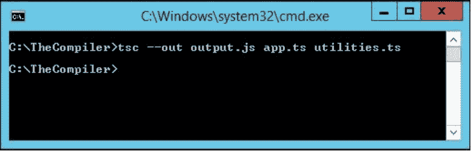

生成的 JavaScript 文件将如下所示：

```javascript
function sayHello() {
    alert("Hello There");
}
function getRandom() {
    return Math.floor(Math.random() * Date.now());
}
/// <reference path="utilities.ts" />
sayHello();
alert(getRandom());
```

正如您所见，我们的最终结果被放置在单个 output.js 文件中，并且顺序正确以确保不会抛出引用错误。两个文件可以相互引用，但不推荐这样做。如果只有一个文件引用由另一个文件实例化的对象，编译器将能够正确排序 JavaScript。否则，它将无法保证所有引用的对象在运行时可用。这不会导致编译错误，因此请注意不要创建这种情况。


## 源码映射

接下来，我们将查看源码映射以及它们如何让我们逐步调试 TypeScript 代码，而不是仅仅调试生成的 JavaScript。源码映射是一种有用的工具，用于帮助调试已经合并和压缩过的代码。TypeScript 和 Visual Studio 通过提供指向原始 TypeScript 文件的源码映射来利用这一点。`--sourcemap` 参数告诉编译器为每个生成的 JavaScript 文件生成一个映射文件。然后该映射文件用于帮助将压缩或合并后的代码的每一行段映射回更易于调试的未压缩文件。TypeScript 编译器生成的映射文件将映射指向与正在运行的代码关联的原始 TypeScript 文件。

以下屏幕截图显示了在编译期间如何生成源码映射：

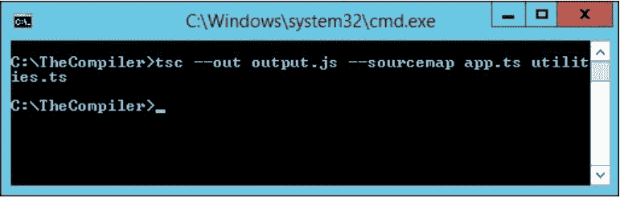

现在，我们的两个 TypeScript 文件都合并成了一个 JavaScript 文件，但如果我们想单独调试它们，我们可以。当提供 sourcemap 参数时，它会告诉编译器在每个生成的 JavaScript 文件中注入一行新代码，将调试器指向已生成的源码映射：

```
```text
//# sourceMappingURL=output.js.map
```
```

在我们的例子中，生成的映射文件名为 `output.js.map`，位于与 `output.js` 相同的目录中。该映射文件的内容如下：

```
```json
{
  "version": 3,
  "file": "output.js",
  "sourceRoot": "",
  "sources": ["utilities.ts", "app.ts"],
  "names": ["SayHello", "GetRandom"],
  "mappings": "AACA,+BAD+B;AAC/B,SAAS,QAAQ;IACbA,KAAKA,CAACA,aAAA,A,CAACA;AACxB A,CAACA;;AAED,KAAK,CAAC,SAAS,CAAC,CAAC,CAAC;ACL1B,qCAAqC;AACrC,QAAQ,CAAC,CA AC;AACV,SAAS,SAAS;IACdC,OAAOA,IAAIA,CAACA,KAAKA,CAACA,IAAIA,CAACA,MAAMA,CAA CA,CAACA,G AAGA,IAAIA,CAACA,GAAGA,CAACA,CAACA,CAACA;AACjDA,CAACA;AAED,mBAAmB;AACnB,oBAAOOB;AACpB,GAAG;AAEH,+BAA+B;AAC/B,kCAAKC;AACLC,qBAAqB;AACrB,OAAO;A ACP,2BAA2B;AAC3B,6BAA6B;AAC7B,OAAO;AACP,GAAG;AAEH,qCAAqC"
}
```
```

正如你所见，这是一个非常简单的 JSON 对象，其中包含必要的信息

## 高级选项

通过我们迄今为止看到的内容，我们可以构建和部署大型应用程序。现在，我们将查看尚未涵盖的几个剩余选项。有些只是信息性的，而其他一些可以帮助你和你的团队编写更好的 TypeScript 代码。与大多数命令行实用程序一样，TypeScript 编译器带有帮助参数，可输出编译器的所有选项。要查看所有这些选项，请使用 -h 或 --help 参数，或直接不带参数运行编译器。还有一个版本参数，可输出已安装的 TypeScript 编译器的当前版本。这可通过 -v 或 --version 参数查看。正如以下屏幕截图所示，本书是在 TypeScript 作为完整语言首次发布后立即编写的。

由于该语言是开源的，请预期会进行改进并提供新版本。

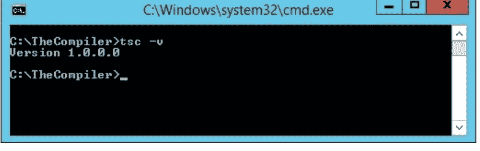

现在我们已经介绍了我们将很少使用的选项，让我们回到改进 Web 开发方式上来。如果你正在编写 Web 应用程序，你的用户可能遍布世界各地。这意味着你的应用程序可以并且可能应该支持多种语言。为了确保每个本地化字符都能正确显示，你可能必须指定一个代码页。

### 注意

代码页是一个用于表示字符编码的数字。例如，UTF-8 为 65001，而 ASCII 为 20127。

TypeScript 编译器提供 `--codepage` 参数，允许你指定结果 JavaScript 文件将包含的字符集。默认情况下，如果未提供此参数，TypeScript 编译器将使用 65001。Visual Studio 不允许指定此选项，在大多数情况下应使用 UTF-8。

我们之前谈到过 JavaScript 的严格模式以及它如何强制语言采用某些构造来帮助改进我们开发的代码。TypeScript 也有自己的严格模式，它强制我们在任何地方使用类型。如果未明确提供类型并且编译器无法推断对象的类型信息，我们可以使用编译器来警告我们。要强制执行此约束，只需在编译 TypeScript 文件时提供 `--noImplicitAny` 参数即可。在以下代码段中，你可以看到我们创建了一个类型变量 a 未知的情况。我们没有为其提供初始类型信息，并且在执行期间将其分配给多种对象类型。

```
function implicitType() {
    var a;
    a = 2;
    a = "bob";
    alert(a);
}
```

a 的最终运行时值为 "bob"；然而，这破坏了 TypeScript 旨在提供的类型安全。在以下屏幕截图中，你可以看到如何在代码中强制执行类型以及尝试编译前述代码的结果：

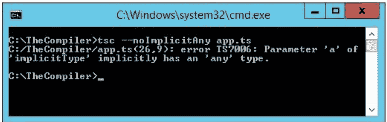

在我们的代码上强制执行类型不仅有助于确保我们编写坚实的代码，而且还将帮助任何尝试在 API 级别使用它或理解代码意图的人。强类型化我们的对象有助于他人了解他们正在处理的内容。
然而，你不想将所有 TypeScript 源文件提供给作为 API 使用你代码的任何人。出于这个原因，TypeScript 创建了另一种语言结构，它将在不提供任何实现细节的情况下向使用者提供类型信息。此类型信息被放置在声明文件中，然后可以与可在运行时使用的合并和压缩的 JavaScript 文件一起分发。在下一个代码段中，有一个可重用的模块，可以部署供任何 JavaScript 代码调用：

```
module MyNamespace {
    export interface IClass {
        Id: string;
        DoSomething();
    }
    export class MyClass implements IClass {
        constructor(public Id: string = Date.now().toString()) {
        }
        public DoSomething() {
            alert(this.Id);
        }
    }
}
```

此模块可以被知道源文件位置的其他 TypeScript 文件使用。然而，只使用 JavaScript 文件的人将无法以强类型的方式与我们的对象交互。但是，如果我们向使用者提供声明文件，他们就可以像这些对象存在于他们自己的代码库中一样使用我们的对象。要为 TypeScript 文件生成声明文件，请运行以下屏幕截图中显示的命令：

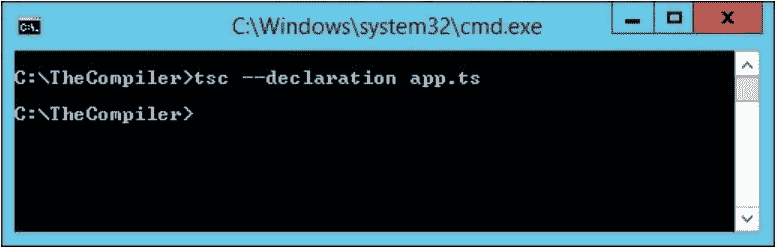

在编译过程中，我们模块的类型信息将被提取到一个新文件中，该文件将与生成的 JavaScript 文件一起输出。它将具有 `<filename>.d.ts` 的格式，并且会被任何 TypeScript 编译器视为一组类型定义。尝试在声明文件中放置执行代码将导致错误。从我们的模块生成的<|message|> 文件如下：

```
declare module MyNamespace {
    interface IClass {
        Id: string;
        DoSomething(): any;
    }
    class MyClass implements IClass {
        public Id: string;
        constructor(Id?: string);
        public DoSomething(): void;
    }
}
```

正如你所见，所有类型信息都存在，但实现细节已被省略。我们将在开始集成其他库（如 jQuery）时更详细地讨论这些内容。

最后一个编译器选项允许我们将文本文件作为参数传递给编译器。此文本文件可以包含编译器的参数列表和所有编译文件，从而使我们能够绕过命令行限制。这是命令行缓冲区限制的变通方法。在以下屏幕截图中，你可以看到已创建的文本文件来管理我们的编译参数：


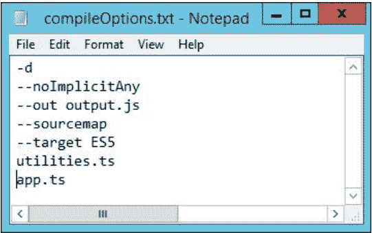

如你所见，我们现在可以将所有参数放入一个易于管理的列表中。以下截图展示了如何将此文件与编译器一起使用：

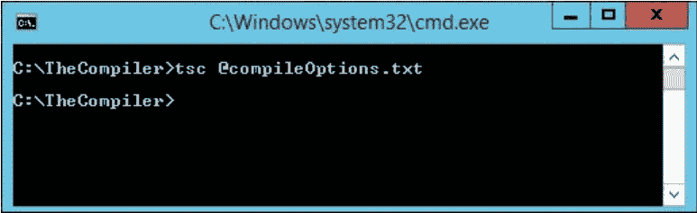

## 总结

在本章中，我们介绍了 TypeScript 编译器的各个不同参数。我们讨论了如何针对不同版本的 ECMAScript 以及选择哪种外部模块模式。源代码映射（Source maps）将非常有助于调试 TypeScript 代码，而声明文件则有助于我们部署编译后的 JavaScript，同时仍为使用 TypeScript 的开发者提供丰富的类型体验。将文件传递给编译器的能力使我们能够创建可复用的编译脚本，这比单独使用命令行更具扩展性。接下来，我们将介绍不同的构造如何将通常意义上的脚本语言转变为面向对象的语言。

## 基础知识

在深入探讨 OOP 的主要概念之前，我们先来谈谈对象是什么以及它们如何工作。对象是自包含的实体，维护一组数据成员和方法。数据成员对每个对象实例都是唯一的，方法可以直接访问这些成员。对象表示某个类类型的实例，可以创建任意数量的实例。每个实例在运行时都有不同的内存位置来存储其内部成员变量，以便区分它们。以下代码示例展示了类定义以及该类型的不同对象的创建：

```
class Shape {
    public locationX: number = 0;
    public locationY: number = 0;
    public height: number = 0;
    public width: number = 0;
    constructor() {
    }
    public draw() {
    }
    public resize(height: number, width: number) {
        this.height = height;
        this.width = width;
    }
    public move(x: number, y: number) {
        this.locationX = x;
        this.locationY = y;
    }
}

var shapeInstance = new Shape();
var otherShape = new Shape();
shapeInstance.move(30, 35);
otherShape.resize(15, 15);
```

如你所见，我们有一个简单的 Shape 类，包含几个数据成员和几个方法。然后我们可以实例化该类的多个实例，并存储对它们的引用，以便分别对它们进行操作。正如所见，我们改变了第一个对象的位置和第二个对象的大小。如果我们直接访问这些成员，shapeInstance 的 height 和 width 仍为 0，位置为 (30, 35)，而 otherShape 仍位于 (0, 0)，height 和 width 为 15。

## SOLID——面向对象设计

SOLID 是 OOP 中设计类时五项基本原则的首字母缩写。遵循这些原则将确保你的应用程序结构良好，并为未来保持足够的灵活性。让我们来看看每个字母代表什么：

- **单一职责原则（Single Responsibility Principle）：** 一个类只应有一个变更原因。如果一个类有多个职责，那么这些职责就会耦合在一起。当这种耦合发生时，其中一个职责的变更可能会破坏其他职责的功能，从而增加了风险。有关此原则的更多信息，请参考：http://www.objectmentor.com/resources/articles/srp.pdf。
- **开闭原则（Open/Closed Principle）：** 一个对象应对扩展开放，对修改关闭。这一原则是抽象的基础，我们稍后会简要讨论。本质上，你的程序应围绕一组特定的契约或抽象类来设计，随着需求变化，应通过扩展这些契约或抽象类来实现新功能。有关此原则的更多信息，请参考：http://www.objectmentor.com/resources/articles/ocp.pdf。
- **里氏替换原则（Liskov Substitution Principle）：** 一个对象应能被其子类型对象替换，而不改变程序的执行。这一原则建立在开闭原则之上，即任何子类都必须维持基类所确立的最小契约。然而，这一原则更进一步，它适用于客户端对每个对象的使用以及基类所期望的行为。有关此原则的更多信息，请参考：http://www.objectmentor.com/resources/articles/lsp.pdf。
- **接口隔离原则（Interface Segregation Principle）：** 多个针对特定客户的接口优于一个通用的接口。这一原则很重要，因为它有助于将不同的行为解耦，使客户端只需实现它们真正需要的内容。有关此原则的更多信息，请参考：http://www.objectmentor.com/resources/articles/isp.pdf。
- **依赖倒置原则（Dependency Inversion Principle）：** 依赖抽象而非具体实现。这一原则指出，应创建适当的抽象，使依赖函数可以依赖它，具体实现也将遵循它。当两者都能使用这种抽象时，随着需求变化，代码复用就会变得简单且影响最小。有关此原则的更多信息，请参考：http://www.objectmentor.com/resources/articles/dip.pdf。

在开发应用程序时牢记这些原则，将使你能够使用 JavaScript 这种过程式语言编写出面向对象的代码。

### 理解继承

继承是一个类扩展现有类功能的能力。继承为多个对象提供了一种方式，使它们可以共享一个共同的核心代码集，然后针对特定目的按需扩展或修改这些代码。以我们的 Shape 类为例，它非常简单，只有几个属性，但这些属性并没有提供关于实际表示的是什么形状的具体细节。在以下代码中，你可以看到我们将 Shape 类修改得更加通用，并使用 TypeScript 中的 extends 构造创建了一个子类：

```typescript
interface IShape {
    location: IPoint;
    move(newLocation: IPoint);
}
class Shape implements IShape {
    public location: IPoint = new Point(0, 0);
    constructor() {
    }
    public move(newLocation: IPoint) {
        this.location = newLocation;
    }
}
interface IRectangle extends IShape {
    height: number;
    width: number;
    area(): number;
    resize(height: number, width: number);
}
class Rectangle extends Shape implements IRectangle {
    public height: number = 0;
    public width: number = 0;
    constructor() {
        super();
    }
    public area(): number {
        return this.height * this.width;
    }
}
```

如你所见，我们为 Shape 类定义了一个通用接口，只实现形状对象所需的基本功能，即平面上的位置。Point 类与我们在第 2 章“TypeScript 基础”中创建的类相同。然后，一个新的接口提供了定义基本矩形形状所需的属性和方法。这个接口并非绝对必要，但定义它可以使我们在后续代码中轻松扩展或替换 Rectangle 类（如果需要）。接下来是矩形的类定义，与 IRectangle 定义一样，展示了 extends 关键字的用法。这告诉编译器 Rectangle 类是一种形状，应继承随之而来的所有属性。在构造函数内部，必须添加一行额外的代码来初始化基类实例。

#### 提示

对基类构造函数的调用必须是子类构造函数中的第一条语句，否则会产生编译时错误。

现在，每个创建的 Rectangle 对象不仅拥有 height、width 和 area 成员，还将包含由 Shape 类定义的 Location 属性和 Move 方法。这不是 JavaScript 语言中的默认构造，因此让我们快速查看编译器生成的输出，以了解这是如何实现的：

```javascript
var __extends = this.__extends || function (d, b) {
    for (var p in b) if (b.hasOwnProperty(p)) d[p] = b[p];
    function __() { this.constructor = d; }
    __.prototype = b.prototype;
    d.prototype = new __();
};
var Point = (function () {
    function Point(x, y) {
        if (typeof x === "undefined") { x = 0; }
        if (typeof y === "undefined") { y = 0; }
        this.x = x;
        this.y = y;
    }
    return Point;
})();

var Shape = (function () {
    function Shape() {
        this.location = new Point(0, 0);
    }
    Shape.prototype.move = function (newLocation) {
        this.location = newLocation;
    };
    return Shape;
})();

var Rectangle = (function (_super) {
    __extends(Rectangle, _super);
    function Rectangle() {
        _super.call(this);
        this.height = 0;
        this.width = 0;
    }
    Rectangle.prototype.area = function () {
        return this.height * this.width;
    };
    return Rectangle;
})(Shape);
```

如你所见，我们所有的类都像之前讨论的那样被创建为模块，但在生成这些模块之前，编译器会注入一段特殊的代码来处理类的扩展。TypeScript 编译器通过应用一组标准且广为人知的模式——成员添加和原型复制——为我们实现了面向对象原则。这段代码将两个对象类型作为参数。第一个参数是需要基类所有属性的子类，第二个参数是基类本身。然后，此函数遍历基类上每个可用的成员


该签名比 Box 实现中的签名更具体。要修复此问题，请将 resize 方法改为以下形式：

```typescript
public resize(height: number, width: number, depth: number = 0) {
    super.resize(height, width);
    this.depth = depth;
}
```

该参数必须是可选的，否则我们就可能破坏本章前面讨论过的里氏替换原则；但是，我们希望在未向构造函数提供该参数时，确保它有一个有效的值。因此，depth 参数被赋予了一个初始化器，而不是仅仅让它成为可选的：`depth?: number`。如果该参数不是可选的，那么当我们把应用中的任何 Rectangle 对象改为 Box 时，就会收到编译错误，如下面的代码示例所示：

```typescript
//var rect = new Rectangle();
var rect = new Box();
rect.resize(4, 3);
```

现在，我们已经开始创建一个复杂的对象树，让我们来看看目前已有的不同类之间的关系。下图展示了所有不同对象之间的**是一个**和**有一个**关系：

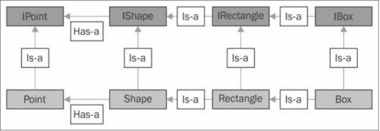

正如你所看到的，仅这几个简单的类和接口就能创建一个非常复杂的对象树。随着应用程序不断增长，这可能会变得越来越难以管理；但是，如果你遵循面向对象代码开发的指导原则，你就能相对轻松地维护你的应用程序。

```typescript
} else {
    throw "An error occurred during activation!";
}
};

request.onerror = () => {
    throw "An error occurred during activation!";
}
request.send(null);
return requestResponse;
}
}
//var activator: IActivator = new LocalActivator();
var activator: IActivator = new ServerActivator();
var isActive = activator.activateLicense();
if (isActive) {
    //Program logic
}
```

ServerActivator 类实现了我们之前声明的与 LocalActivator 相同的接口，但它会向服务器发起同步请求以获取数据，而不是在客户端执行。通常，这类请求应以异步方式发出，但是，我们需要修改 IActivator 接口以支持 Promise，或使用回调函数。

## 注意

Promise 将在 ECMAScript 6 中得到原生支持，不过有好几个库已经实现了自己的实现方案。有关 ECMAScript 6 Promise 的更多信息，请访问：http://www.html5rocks.com/en/tutorials/es6/promises/。

这两个对象的实现细节大不相同，但最终结果是一样的。两者可以互换使用，并且应用程序无需进一步修改。

## 抽象

抽象是面向对象开发中一个极其强大的概念。它包含了隐藏具体实现细节，同时提供应实现内容的高层定义的思想。在前面的例子中，我们看到了一个非常基本的抽象案例。IActivator 接口创建了处理应用程序激活这一概念所需的抽象层。LocalActivator 和 ServerActivator 类型是该抽象的具体实现。在诸如 C# 等其他编程语言中，类可以将特定成员声明为抽象成员。这会强制基类型的任何子类提供该成员的具体实现。在下面的代码片段中，你将看到一个 C# 示例：

```csharp
public abstract class AbstractBaseClass
{
    protected bool isActive = false;
    public AbstractBaseClass()
    {
    }
    public abstract bool CheckStatus();
}

public class ConcreteClass : AbstractBaseClass
{
    public ConcreteClass()
    {
    }
    public override bool CheckStatus()
    {
        return this.isActive;
    }
}
```

基类为名为 CheckStatus 的方法提供了声明，但并未提供实现。实现被强制由 ConcreteClass 类型提供，然而基类中可用的成员对该实现也是可用的。CheckStatus 方法上的 abstract 关键字告诉编译器，AbstractBaseClass 的所有子类必须实现该方法，否则将产生编译错误。AbstractBaseClass 上的 abstract 关键字将导致编译器在该类被直接实例化时生成错误。在 TypeScript 中实现这一点的最简单方式是使用接口，但是这种方式无法提供 C# 抽象类的全部功能。基类中的 protected 成员在类型的具体实现之外不可访问，但如果将其放在 TypeScript 接口中，则必须将其设置为公开可访问。尽管 TypeScript 缺乏 abstract 关键字和相应的语言构造，我们仍可以使用特定模式来创建类似的实现：

```typescript
class AbstractClass {
    constructor() {
    }
    public checkStatus(): boolean {
        throw new Error("Not Implemented");
    }
}

class ConcreteClass extends AbstractClass {
    private _isActive: boolean = false;
    constructor() {
        super();
    }
    public checkStatus(): boolean {
        return this._isActive;
    }
}
```

正如你所看到的，我们仍然必须定义一个完整的类来表示抽象基类。然而，在 `checkStatus` 的方法实现中，只要尝试直接使用该类，就会在运行时抛出一个异常，从而停止程序执行。要是能有某种方式在编译时强制执行这一点就好了，但目前并不存在这种功能。TypeScript 没有 protected 访问级别，因此我们被迫将此细节显式地下移到具体类中。在这种特定情况下，将 `AbstractClass` 直接变成一个由 `ConcreteClass` 类型实现的接口是合理的；然而，随着我们的对象变得越来越复杂，我们将需要一些只在基类型中定义一次的公共可访问成员，并且具体的方法实现需要由具体类来提供。

## 方法重载

方法重载是指提供多个调用签名不同但名称相同的方法。我们在前面第 2 章《TypeScript 基础》中已经讨论过这一点，因此这里只做简要回顾。正如我们之前所见，只要参数都共享一个共同的基类型，我们就可以为单个函数提供多个调用签名。下面代码中展示的 ICommunicator 接口就提供了这样一个例子：

```typescript
interface ICommunicator {
    speak(message: string);
    speak(message: number);
    speak(message: boolean);
    speak(message: any);
}

class Communicator implements ICommunicator {
    constructor() {
    }
    speak(message: string);
    speak(message: number);
    speak(message: boolean);
    speak(message: any) {
        alert(message);
    }
}
```

在这个例子中，我们定义了一个用于传递消息的类。消息可以是方法列表中定义的任何类型，并且这些类型都共享一个共同的基类型，最终的方法签名必须使用该基类型，正如第 2 章《TypeScript 基础》中所讨论的那样。在传统的面向对象语言中，我们可以定义 speak 方法的多个实现，但由于最终结果仍然是纯 JavaScript，我们只能提供单一的方法块。通过使用条件语句，我们可以为参数列表中使用的每种不同类型提供不同的执行路径，如下面的例子所示：

```typescript
class Communicator implements ICommunicator {
    constructor() {
    }
    speak(message: string);
    speak(message: number);
    speak(message: boolean);
    speak(message: any) {
        if (typeof message === "string") {
            alert(message);
        } else if (typeof message === "number") {
            alert("The number provided was: " + message);
        } else if (typeof message === "boolean") {
            alert("The boolean value was: " + message);
        } else {
            alert(message);
        }
    }
}
```


## 运算符重载

JavaScript 本质上不是一种面向对象的语言，这在某种程度上限制了我们的能力，因此与 C# 等语言相比，我们在某些方面仍然受到限制。JavaScript 中无法实现运算符重载，因此我们不得不为类实现特定的方法来实现我们想要的功能。在下面的示例中，我们定义了一个 Vector 类型，它允许我们执行向量数学运算：

```
interface IVector {
    x: number;
    y: number;
}
class Vector implements IVector {
    public x: number = 0;
    public y: number = 0;
    constructor(x = 0, y = 0) {
        this.x = x;
        this.y = y;
    }
}
```

我们知道执行向量加法相当简单，因此如果我们能用 + 运算符将这个类的两个实例相加，那就太好了。

```
var v1 = new Vector(2, 5);
var v2 = new Vector(4, 3);
var v3 = v1 + v2;
alert(v3);
```

然而，由于 JavaScript 中不支持运算符重载，最终结果将与下面截图中的情况类似：

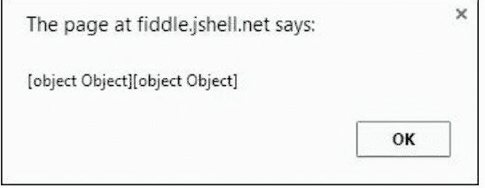

在幕后，JavaScript 引擎会调用与对象关联的 toString 方法，然后将它们拼接成一个单独的值。这有可能在我们的应用程序中导致意外结果。为了实现我们想要的功能，我们必须显式实现方法来处理所需的功能。

```
public add(v: IVector): IVector {
    var newVector = new Vector();
    newVector.x = this.x + v.x;
    newVector.y = this.y + v.y;
    return newVector;
}
```

```javascript
public static add(v1: IVector, v2: IVector): IVector {
    return v1.add(v2);
}
```

在将这些方法添加到我们的类定义中，并对 `toString` 进行方法重写之后，我们只需修改应用程序代码来调用新的 add 方法，即可获得预期的结果：

```javascript
var v3 = Vector.add(v1, v2);
alert("X: " + v3.x + ", Y: " + v3.y);
```

最终结果将是一个新的 Vector 对象，它是两个向量的和：


## 方法重写

方法重写是一种替换从超类继承的功能的方式。方法重写必须与被重写的方法具有相同的调用签名。请看下面的示例：

```typescript
interface IEmployee {
    name: string;
    email: string;
    work(tasks: string[]);
}
class Employee implements IEmployee {
    constructor(public name: string, public email: string) {
    }
    public work(tasks: string[]) {
        for (var i = 0; i < tasks.length; i++) {
            //perform task
        }
    }
}
interface IManager extends IEmployee {
    employees: IEmployee[];
}
class Manager extends Employee implements IManager {
    public employees: IEmployee[] = [];
    constructor(name: string, email: string, employees: IEmployee[]) {
        super(name, email);
        this.employees = employees;
    }
    public work(tasks: string[]) {
        for (var i = 0; i < this.employees.length; i++) {
            for (var j = 0; j < tasks.length; j++) {
                this.employees[i].work([tasks[j]]);
            }
        }
    }
}
```

在这个示例中，你可以看到我们有两个类。首先，一个通用的 Employee 类，它代表了组织中任何员工的基类。该员工拥有一些属性，例如姓名和用于联系他们的电子邮件地址。其次，有一个非常简单的方法，允许向员工传递一个任务列表，该任务列表将按顺序执行，直到所有任务完成。下一个类是 Manager 类，它是 Employee 的子类。Manager 拥有与普通员工相同的所有功能，只是他们还拥有一个自己负责的员工列表。Manager 会收到一个任务列表，而不是显式地执行每个任务，它会把每个任务委托给其下属员工去执行。如果我们从 work 方法中添加或删除参数，那么子类和超类之间的调用签名就会不同，从而违反里氏替换原则。TypeScript 不会阻止你更改方法签名，但这会让你的代码更难维护。

## 参考资料

要了解更多关于面向对象设计和面向对象编程概念的信息，请访问：

- http://www.objectmentor.com/omSolutions/oops_what.html
- http://www.codeproject.com/Articles/22769/Introduction-to-Object-Oriented-Programming-Concepts

## 总结

通过本章的学习，你应该已经对面向对象编程有了基本的了解。我们已经通过几个示例了解了如何将封装、多态、抽象和继承付诸实践，以及它们如何让我们构建可扩展的应用程序。SOLID 原则帮助我们规划了类应该如何设计。接下来，我们将在后续几章中将这些概念付诸实践。我们将在[第5章](Chapter 5)*创建简单的绘图应用程序*中，使用 TypeScript 和少量 HTML 来开发一个交互式绘图应用程序。
