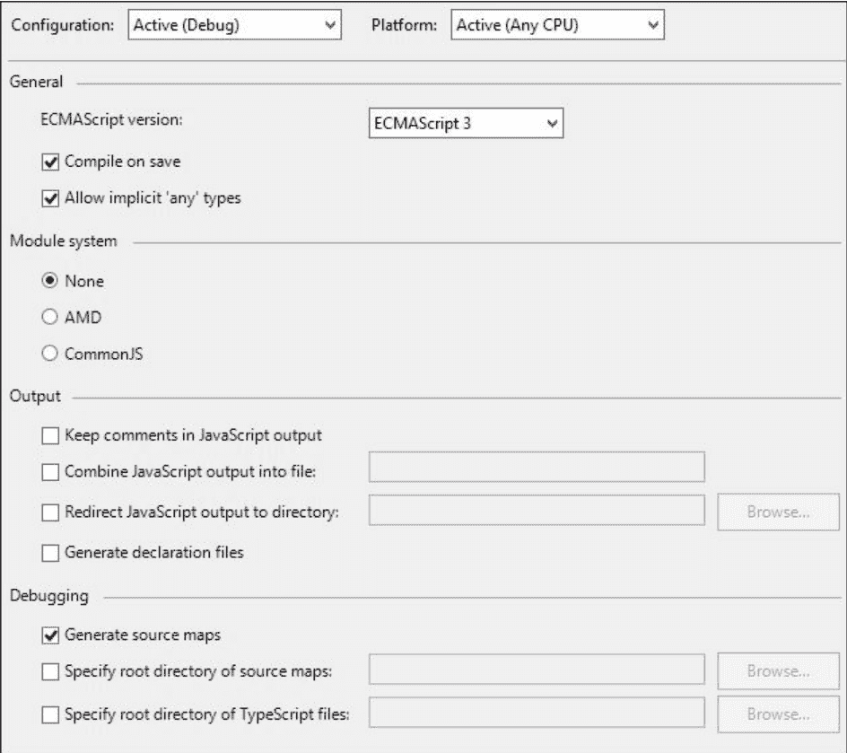
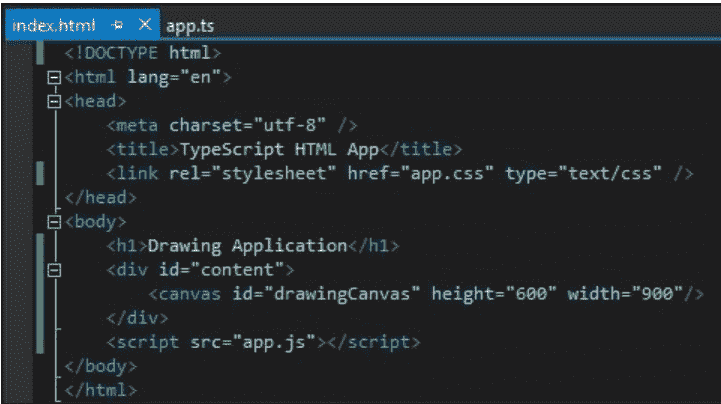
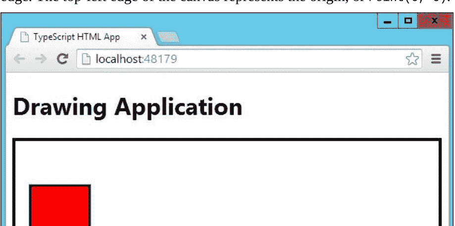
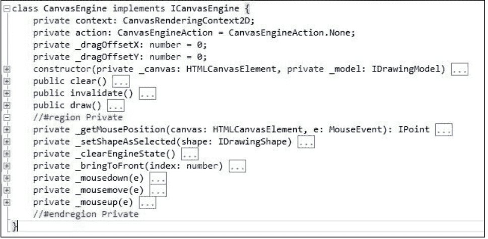
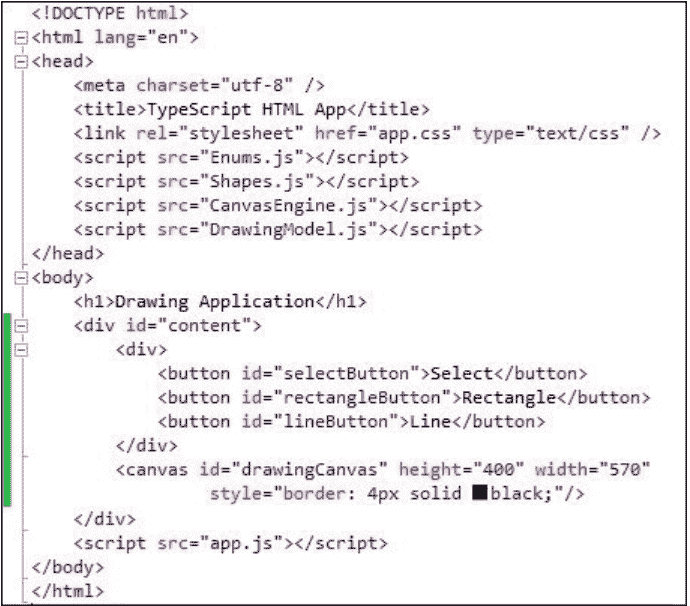
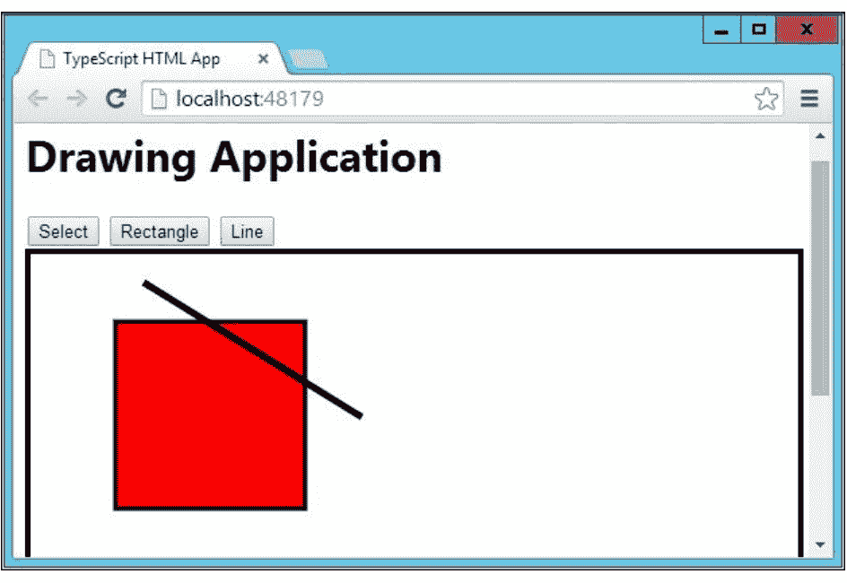
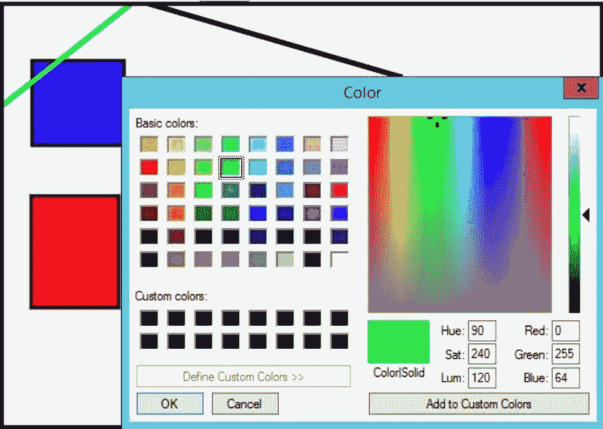
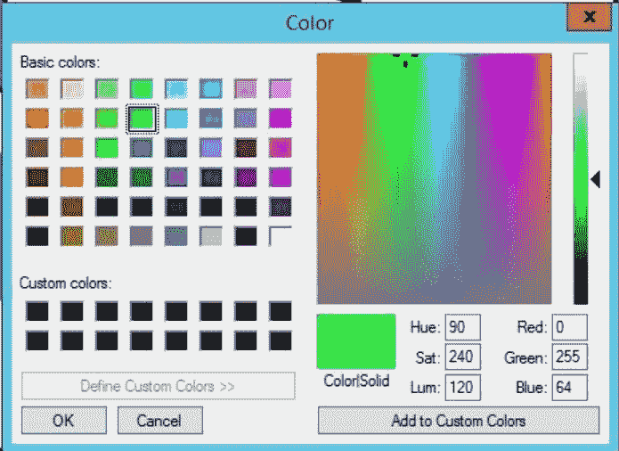

# 第5章 创建简单的绘图应用程序

在很短的时间内，我们已经涉及了大量的信息。让我们把这些信息运用起来；让我们构建一个完整的应用程序，而不是仅仅查看代码示例。我们将构建一个类似于“画图”的基于 Web 的绘图应用程序，但它将托管在浏览器中。本章将涵盖的主题包括：

- 创建项目
- 基本形状
- 在画布上绘制对象
- 管理画布状态与决策
- 跟踪应用程序状态

### 设置项目

首先，我们需要创建一个新项目来托管我们的应用程序，并配置编译器设置。在 Visual Studio 中创建一个新项目，使用[第2章](#)*TypeScript 基础*中描述的 TypeScript 项目模板，并将其命名为 `DrawingApplication`。然后，右键单击项目并选择**属性**，打开项目属性。

在下面的屏幕截图中，你可以看到我们将用于此应用程序的设置：



正如你所见，我们将以 ECMAScript 3 为目标，以确保我们的应用程序能在更广泛的平台上运行。我们不会使用外部模块系统，注释将从最终输出中移除，其余输出可以保留默认值。接下来，我们需要修改 `index.html` 以包含一个 canvas 元素。HTML canvas 元素是 HTML5 标准的一部分，目前大多数现代浏览器都支持它。由于我们还没有使用 jQuery，我们还需要将 `app.js` 文件的加载移到 body 内部；这样，canvas 元素在运行时就可以供我们使用了。下面的屏幕截图显示了进行这些修改后的 `index.html` 文件：



现在我们已经完成了项目的基础设置，让我们开始构建一个面向对象的 TypeScript 应用程序。在本章中，我们将使用几个枚举来帮助定义抽象，并让我们的类型以强类型的方式进行通信。我倾向于保持代码的清晰分离，以便于导航，因此创建的所有枚举都将放在一个名为 Enums.ts 的文件中。这两个枚举如下：

```
enum DrawingToolType {
    Select,
    Rectangle,
    Circle,
    Line,
    Freehand
}
enum CanvasEngineAction {
    None,
    Move,
    Resize
}
```

DrawingToolType 类型将用于帮助确定用户选择了哪个绘图工具。负责与画布交互的类型需要知道这一点才能正常运行。CanvasEngineAction 类型将由负责绘制形状的对象使用，以告知画布操作者如何处理用户的输入。


## 形状

遵循我们在上一章中学到的原则，我们需要在应用程序中执行不同任务时使用多种不同的类型。我们需要对形状是什么的表示，如何绘制它们，与用户界面交互的东西，以及维护要绘制的对象列表的地方。

```typescript
}
class Circle implements ICircle {
    constructor(public radius: number) {
    }
    public resize(radius: number) {
        this.radius = radius;
    }
    public area(): number {
        return Math.PI * this.radius * this.radius;
    }
}
class Line implements ILine {
    constructor(public p1: IPoint, public p2: IPoint) {
    }
    public length(): number {
        var a2 = Math.pow(this.p2.x - this.p1.x, 2);
        var b2 = Math.pow(this.p2.y - this.p1.y, 2);
        return Math.sqrt(a2 + b2);
    }
}
class Freehand implements IFreehand {
    public points: Array<IPoint> = [];
    constructor() {
    }
    public addPoint(point: IPoint) {
        this.points.push(point);
    }
}
```

这些类中的每一个都仅限于单一职责，即跟踪形状的状态并报告与其关联的各种属性。所有这些功能都很有用，但它并不能完全达到我们在画布上绘制对象的目标。

## 绘制形状

现在我们已经有了要绘制的基本表示，我们需要定义将处理此事的对象。这些对象应尽可能少地完成绘制其所代表形状所需的工作。这意味着不直接与 **Document Object Model (DOM)** 交互。以下接口表示我们将用来表示可在画布元素上绘制和操作形状的不同抽象：

```typescript
interface IDraw {
    draw(ctx: CanvasRenderingContext2D);
}
interface IResize {
    inResizeZone: (mouse: IPoint) => boolean;
    resizeToLocation: (to: IPoint) => void;
}
interface IMove {
    move: (to: IPoint) => void;
    contains: (mousePoint: IPoint, ctx: CanvasRenderingContext2D) => boolean;
    getMoveOffset(mousePos: IPoint): IPoint;
}
interface IDrawingShape extends IDraw, IResize, IMove {
    shape: IShape;
    location: IPoint;
    isSelected: boolean;
    selectionZoneWidth: number;
    opacity: number;
    getCursorType: (mousePoint: IPoint) => string;
    getClickLocationAction(mouse: IPoint, ctx: CanvasRenderingContext2D): CanvasEngineAction;
}
```

每个接口都可以很容易地合并成一个单一接口，但根据接口隔离原则，每个操作现在都可以根据需要彼此解耦。IDrawingShape 接口最终合并了这些类型，同时添加了一些自己的功能。所有这些组合在一起表示一种类型，我们将能够在 HTML 画布元素上绘制并以某种方式与其交互。每个 IDrawingShape 实例都保存对其特定形状的引用，然后可由我们的应用程序逻辑访问或操作。将每个形状与绘图特定接口分离，维护了单一职责原则，允许形状跟踪其数据，而绘图对象将只负责与在浏览器中渲染特定形状相关的方法。形状在画布上的位置由绘图形状管理，以及它是否是画布上当前选中的对象。getCursorType 和 getClickLocationAction 函数是应用程序特定的，将允许负责处理用户交互的对象在继续其应用程序逻辑之前从绘图对象请求信息。此接口的具体实现如下：

```typescript
class DrawingShapeBase implements IDrawingShape {
    public shape: IShape = null;
    public location: IPoint = new Point(0, 0);
    public isSelected: boolean = false;
    public selectionZoneWidth: number = 4;
    public opacity: number = 1;
    constructor() {
    }
    public inResizeZone(mouse: IPoint): boolean {
        throw "Method not implemented";
    }
    public move(to: IPoint) {
        this.location = to;
    }
    public resizeToLocation(to: IPoint) {
        throw "Method not implemented";
    }
    public contains(mousePoint: IPoint, ctx: CanvasRenderingContext2D): boolean {
        throw "Method not implemented";
    }
    public draw(ctx: CanvasRenderingContext2D) {
        throw "Method not implemented";
    }
    public getMoveOffset(mousePos: IPoint): IPoint {
        return new Point(0, 0);
    }
    public getCursorType(mousePoint: IPoint): string {
        throw "Method not implemented";
    }
    public getClickLocationAction(mousePoint: Point, ctx: CanvasRenderingContext2D): CanvasEngineAction {
        if (this.inResizeZone(mousePoint)) {
            return CanvasEngineAction.Resize;
        }
        else if (this.contains(mousePoint, ctx)) {
            return CanvasEngineAction.Drag;
        }
        return CanvasEngineAction.None;
    }
}
```

正如你所见，这是一个非常简单的基类，并不意味着直接实例化。它提供了一些默认实现，可以由形状在必要时重用，但也可以被重载。因此，现在我们已经设置了形状抽象，让我们开始为我们打算在应用程序中绘制的每种不同形状实现特定逻辑。以下屏幕截图显示了 DrawingShape 类型的具体实现，专门针对我们之前定义的矩形形状：

```typescript
class DrawingRectangle extends DrawingShapeBase implements IFillStyle {
    public shape: IRectangle = new Rectangle(0, 0);
    public fillStyle: string = "#FF0000"
    constructor() ...
    public inResizeZone(point: IPoint): boolean ...
    public resizeToLocation(to: IPoint) ...
    public draw(ctx: CanvasRenderingContext2D) ...
    public contains(mousePoint: IPoint, context: CanvasRenderingContext2D): boolean ...
    public getMoveOffset(mousePosition: IPoint): IPoint ...
    public getCursorType(mousePoint: IPoint) ...
}
```

我们将在遇到其使用时介绍每种不同方法的具体实现。完整代码可在网上获得。现在，让我们只看看我们试图做的最基本的事情，即在画布上绘制一个矩形：

```typescript
public draw(ctx: CanvasRenderingContext2D) {
    ctx.fillStyle = "#FF0000";
    ctx.globalAlpha = this.opacity;
    ctx.fillRect(this.location.x, this.location.y, this.shape.width, this.shape.height);
    ctx.strokeStyle = "#000000";
    ctx.lineWidth = 3;
    ctx.strokeRect(this.location.x, this.location.y, this.shape.width, this.shape.height);
}
```

正如我们在类型抽象中之前定义的那样，Draw 方法接收一个参数，其类型为 CanvasRenderingContext2D。此类型是对由画布元素返回的对象进行描述，允许我们直接在画布上绘制不同的对象。使用上下文对象的 API 绘制矩形非常容易。

### 注意

HTML5 canvas 对象具有非常强大的 API；有关其功能完整列表，请访问 http://www.w3schools.com/tags/ref_canvas.asp。

我们首先设置想要矩形的颜色；这必须使用 RGB 十六进制三元组完成。然后，我们可以使用 globalAlpha 属性发送对象将使用的透明度级别。接下来，我们使用上下文根据形状对象的属性和绘图对象的定位在画布对象上渲染矩形。我们还将显示矩形周围的边框，因此我们以相同的方式设置描边颜色，然后设置我们想要绘制的边框宽度。然后，再次调用上下文在画布上渲染我们想要的对象。好的，我们现在有一个形状类型和一种可在浏览器中渲染它的类型。让我们创建一个形状并测试应用程序：

```typescript
var canvas = <HTMLCanvasElement>window.document.getElementById("drawingCanvas");
var ctx = canvas.getContext("2d");
var shape1 = new DrawingRectangle();
shape1.move(new Point(20, 60));
```


```typescript
shape1.shape.resize(60, 80);
shape1.draw(ctx);
```

首先我们从 DOM 中获取画布并将其强制转换为 `HTMLCanvasElement` 类型，以便轻松访问其不同的属性。我们需要获取将由我们的绘图对象用来显示其形状的渲染上下文。然后，我们创建一个新的 `DrawingRectangle` 并将其移动到新位置并赋予其大小。最后，我们告诉形状使用画布元素的上下文对象自行绘制。

在下面的屏幕截图中，你可以看到我们有一个带黑色边框的红色矩形。它距离左侧边缘 20 像素，距离顶部边缘向下 60 像素。画布的左上角代表原点，即 `Point(0, 0)`。



现在我们可以在画布上绘制形状，让我们定义它如何被操作。剩余的工作由基于所表示的形状类型以及用户执行的操作的计算完成。`move` 功能由基类型提供，因为它不需要直接与形状交互。任何想要更改 `move` 方法工作原理的子类都可以覆盖它，正如我们在第 4 章《使用 TypeScript 进行面向对象编程》中所学到的。接下来，让我们看看 `DrawingRectangle` 的调整大小方法：

```typescript
public inResizeZone(point: IPoint): boolean {
    return ((point.x >= this.location.x + this.shape.width - this.selectionZoneWidth &&
        point.x <= this.location.x + this.shape.width + this.selectionZoneWidth) &&
        (point.y >= this.location.y + this.shape.height - this.selectionZoneWidth &&
        point.y <= this.location.y + this.shape.height + this.selectionZoneWidth));
}
public resizeToLocation(to: IPoint) {
    var cursor = window.document.body.style.cursor;
    if (cursor == "se-resize") {
        this.shape.width = to.x - this.location.x;
        this.shape.height = to.y - this.location.y;
    }
}
```

第一个方法确定点参数是否位于绘图对象的选择区域边界内。它将被用于帮助我们在下一节中构建的引擎做出决策。对于 `DrawingRectangle`，这是右下角；然而，悬停在完全正确的像素上以管理它相当困难。这就是为什么有一个可配置大小的选择区域。`resizeToLocation` 方法接收一个点并修改底层形状对象的属性以调整其大小。对于矩形，这就像取传入点与矩形当前位置之间的差值一样简单。抽象的其它方法在以下代码中显示。它们用于向画布引擎提供信息，以便它能够适当地与用户交互。

```typescript
public contains(mousePoint: IPoint, context: CanvasRenderingContext2D): boolean {
    if (this.shape.height < 0) {
        this.location.y = this.location.y + this.shape.height;
        this.shape.height = this.shape.height * -1;
    }
    if (this.shape.width < 0) {
        this.location.x = this.location.x + this.shape.width;
        this.shape.width = this.shape.width * -1;
    }
    return (this.location.x <= mousePoint.x) &&
        (this.location.x + this.shape.width >= mousePoint.x) &&
        (this.location.y <= mousePoint.y) &&
        (this.location.y + this.shape.height >= mousePoint.y);
}
public getMoveOffset(mousePosition: IPoint): IPoint {
    return new Point(mousePosition.x - this.location.x, mousePosition.y - this.location.y);
}
public getCursorType(mousePoint: IPoint) {
    if (this.inResizeZone(mousePoint))
        return "se-resize";
    else
        return "move";
}
```

`contains` 方法对形状的状态进行了一点维护，以确保其执行正确的计算。如果矩形的高度或宽度小于零，则确定提供的点是否在形状边界内的逻辑将无法按预期执行。`getMoveOffset` 返回在画布上提供流畅拖动体验所需的 x 和 y 偏移量。最后一块拼图是 `getCursorType` 方法，它告诉引擎通过更改光标来通知用户该区域是可交互的。

## 使应用程序具有交互性

现在我们有能力创建任意数量的形状并向用户展示它们。然而，这在功能上非常有限，不允许应用程序与使用者之间进行任何交互。大多数绘图应用程序允许对画布上的对象进行基本移动和调整大小。这要求应用程序在用户尝试更改其中一个形状时每次都重绘自身。

### 引擎

为了处理画布状态的绘制和更新，我们需要一个专注于维护此项的新类型。我们将其称为 `CanvasEngine`，它应该具有非常简单的抽象，因为它只需要执行几个基本任务：绘制画布、清除画布以及接收重绘当前帧的请求：

```typescript
interface ICanvasEngine {
    invalidate();
    clear();
    draw();
}
```

该对象在内部会做更多工作，但任何使用引擎的对象只需要这些函数与之交互。现在让我们看看该类型的更复杂实现。在下面的屏幕截图中，你可以看到完整的实现。随后将对每个公共和私有方法进行分解。



正如你所见，我们有一系列私有方法和事件处理程序，可帮助我们解释用户操作。构造函数接收我们想要操作的画布和负责维护引擎操作的形状列表的模型。该模型已像我们其余类型一样抽象，以保持应用程序解耦。

```typescript
interface IDrawingModel {
    selection: IDrawingShape;
    shapes: IDrawingShape[];
    addShape(shape: IDrawingShape);
    getNewShape(location: IPoint): IDrawingShape;
    getDrawingTool(): DrawingToolType;
}
```

我们稍后会查看该类型的具体实现，但了解接口是什么将使我们能够继续进行引擎代码。我们将从构造函数开始，然后转向公共方法，最后查看私有用户交互相关方法。正如以下代码示例所示，构造函数做了几件事来设置引擎的状态，并连接事件处理程序：

```typescript
constructor(private _canvas: HTMLCanvasElement, private _model: IDrawingModel) {
    this.ctx = this._canvas.getContext("2d");
    this._canvas.addEventListener('mousedown', (e) => this._mousedown(e), true);
    this._canvas.addEventListener('mousemove', (e) => this._mousemove(e), true);
    this._canvas.addEventListener('mouseup', (e) => this._mouseup(e), true);
}
```

我们首先获取将用于操作画布的渲染上下文。它被存储为私有变量，并在应用程序生命周期内使用。接下来我们做的就是将事件处理程序连接到画布元素。我们需要在用户用鼠标操作画布上的对象时执行特定操作。语法看起来有点奇怪，不过。这不是有效的 JavaScript 代码，但在编译后将运行良好。构造函数内部的 `=>` 语法告诉 TypeScript 编译器在最终的 JavaScript 表示中生成 `this` 对象的特殊表示。最终的 JavaScript 代码看起来会类似于以下内容：

```typescript
function CanvasEngine(_canvas, _model) {
    var _this = this;
    this._canvas.addEventListener('mousedown', function (e) {
        return _this._mousedown(e);
    }, true);
}
```

这确保了当我们附加到画布的事件监听器被调用时，我们拥有对引擎实例的正确引用。否则，我们可能会使用不代表 `CanvasEngine` 实例的 `this` 对象；在这种情况下，它将是触发事件的 DOM 元素，调用 `_mousedown` 方法将失败。现在我们已经实例化了对象并连接了事件，让我们看看公共方法。`clear` 和 `invalidate` 方法都很简单：

```typescript
public clear() {
    this.ctx.clearRect(0, 0, this._canvas.width, this._canvas.height);
}
public invalidate() {
    window.requestAnimationFrame(() => this.draw());
}
```

`clear` 方法用空白矩形覆盖整个画布，以从视图中移除所有现有对象。`invalidate` 方法调用 `draw` 方法以显示由传递给构造函数的绘图模型表示的所有对象。`draw` 方法比这两个方法复杂不了多少。


由于我们之前所做的绘图形状抽象。

```
public Draw() {
    var shapes: Array<IDraw> = this._model.shapes;
    this.clear();
    if (shapes) {
        for (var i = 0; i < shapes.length; i++) {
            this.context.save();
            shapes[i].draw(this.context);
            this.context.restore();
        }
    }
}
```

在这个方法中，我们获取模型希望我们绘制的每个形状的引用，并清除画布上任何已有的图形。然后我们遍历形状列表，让每个形状绘制自身。由于我们抽象了绘图接口，只要每个对象实现了 draw 方法，其实际类型对引擎来说并不重要。如你所见，我们在调用 draw 方法时，用上下文对象的 save 和 restore 两个方法进行了包裹。

这些方法用于在特定绘图形状改变上下文之前保存上下文的绘图状态，并在绘制完成后恢复到此状态。仅凭这些方法，我们就创造了一种在画布上反复绘制帧的方式。结合我们之前看到的 IDrawingModel 接口的以下实现，我们可以有效地模拟对象在屏幕上的移动：

```
class DrawingModel implements IDrawingModel {
    public selection: IDrawingShape = null;
    public shapes: IDrawingShape[] = [];
    constructor() {
    }
    public addShape(shape: IDrawingShape) {
        this.shapes.push(shape);
    }
    public getNewShape(location: IPoint): IDrawingShape {
        throw ("Not implemented");
    }
    public getDrawingTool(): DrawingToolType {
        return DrawingToolType.Select;
    }
}
```

这是该类的极简实现，我们稍后将填充 getNewShape 和 getDrawingTool 方法。不过目前，我们可以存储一个形状列表并将新形状添加到该列表，画布就能为我们重新绘制它们。如果我们修改前面示例中的应用程序代码，创建一个 DrawingModel 并把我们的形状添加进去，那么我们就可以编写代码来操作我们的矩形，并让它在屏幕上移动。

```
var model: IDrawingModel = new DrawingModel();
model.addShape(shape1);
var engine: ICanvasEngine = new CanvasEngine(canvas, model);
function moveObject(counter: number, upperLimit: number) {
```

```
if (counter > upperLimit) {
    return;
}
setTimeout(() => {
    shape1.move(new Point(shape1.location.x + 1, shape1.location.y + 1));
    engine.invalidate();
    counter++;
    moveObject(counter, upperLimit);
}, 20);
}
moveObject(0, 75);
```

前面的代码实例化了一个 DrawingModel，向其中添加一个形状，实例化 CanvasEngine，并运行一个递归函数，使对象在画布上沿对角线移动。递归函数使用 setTimeout 函数让对象的移动产生轻微的延迟，否则对象移动的速度将快得超出我们追踪它的能力。我们再次使用 lambda 语法 `() => { }`，但因为我们不在对象的构造函数中，它只是生成函数的简写形式。然而，这个应用程序理应是以用户为中心的；因此，让我们看看如何挂接鼠标事件，以允许用户操作我们画布上的对象。

## 鼠标事件

在我们的形状与鼠标之间的任何交互中，第一个动作将是一个选择事件。这将由与画布关联的 mousedown 事件来处理。这使我们能够使用点击并按住的功能，以及鼠标释放时的附加功能。mousedown 事件处理程序如下例所示：

```
private _mousedown(e) {
    var mouse: IPoint = this._getMousePosition(this._canvas, e);
    var i, shape;
    if (this._model.shapes) {
        for (i = this._model.shapes.length - 1; i >= 0; i--) {
            this._model.shapes[i].isSelected = false;
        }
    }
    if (this._model.getDrawingTool() != DrawingToolType.Select) {
        shape = this._model.getNewShape(mouse);
        this._model.addShape(shape);
        this.action = CanvasEngineAction.Resize;
        this._setShapeAsSelected(shape);
        return;
    }
    else if (this._model.shapes) {
        for (i = this._model.shapes.length - 1; i >= 0; i--) {
            this.action =
            this._model.Shapes[i].getClickLocationAction(mouse, this.context);
            switch (this.action) {
                case CanvasEngineAction.Resize:
                case CanvasEngineAction.Move:
                    var moveOffsetPoint =
                    this._model.shapes[i].getMoveOffset(mouse);
                    this._dragOffsetX = moveOffsetPoint.X;
                    this._dragOffsetY = moveOffsetPoint.Y;
                    this._setShapeAsSelected(this._model.shapes[i]);
                    this._bringToFront(i);
                    return;
                default:
                    break;
            }
        }
    }
    this._clearEngineState();
}
```

该方法首先获取鼠标相对于画布的点位置。然后，每个形状都被设置为未选中。如果模型告诉我们绘图工具不是选择工具，那么我们就会创建一个新形状，将其添加到模型中，选中它，并将引擎的当前动作设置为调整大小，这样按住鼠标时，新形状会随着鼠标的移动而缩放。不过到目前为止，我们还没有定义任何更改绘图工具的逻辑，所以目前它永远都是选择工具。当选择工具激活时，我们就要遍历模型中的形状列表，并判断是否需要对它们采取任何操作。

## 提示

请注意，这次我们是反序遍历列表；然而在 draw 方法中，我们是正序遍历的。如果存在重叠的对象，我们希望显示在最上方的对象就是我们操作的对象。

一旦我们获得了当前形状应采取的动作，就必须保存 mousemove 或 mouseup 事件可能需要的任何附加属性，以便完成它们的动作。这包括确定鼠标点击位置与绘图形状当前位置之间的距离，将其设置为选中形状，并将其移动到形状列表的末尾；这样，它就会被最后渲染，并位于画布上所有其他形状的上方。如果不需要执行任何操作，引擎会清除所有选择并重新绘制所有形状。此方法块中用到的辅助方法如下例所示：

```
private _getMousePos(canvas: HTMLCanvasElement, e: MouseEvent): IPoint
{
    var rect = canvas.getBoundingClientRect(),
        root = window.document.documentElement;
    var mouseX = e.clientX - rect.left - root.scrollLeft;
    var mouseY = e.clientY - rect.top - root.scrollTop;
    return new Point(mouseX, mouseY);
}
private _setShapeAsSelected(shape: IDrawingShape) {
    shape.isSelected = true;
    this._model.selection = shape;
    this.invalidate();
}
private _clearEngineState() {
    this.action = CanvasEngineAction.None;
    this._model.selection = null;
    this.invalidate();
}
private _bringToFront(index: number) {
    var shape = this._model.shapes[index];
    if (shape) {
        this._model.shapes.splice(index, 1);
        this._model.shapes.push(shape);
        this.invalidate();
    }
}
```

这些方法中的每一个都在非常受控的范围内执行非常具体的功能。这在我们后面进行单元测试时会派上用场。因此，此时最终用户在画布上选中了一个对象并想要操作它。这些交互将在 mousemove 事件中处理。正如你在下面的代码示例中所见，操作我们的对象几乎不需要引擎做什么工作：

```
private _mousemove(e) {
    var mouse: IPoint = this._getMousePosition(this._canvas, e);;
    switch (this.action) {
        case CanvasEngineAction.Move:
```

```
var newLocationX = mouse.x - this._dragOffsetX;
var newLocationY = mouse.y - this._dragOffsetY;
var newLocation = new Point(newLocationX, newLocationY);
this._model.selection.move(newLocation);
this.invalidate();
break;
case CanvasEngineAction.Resize:
    this._model.selection.resizeToLocation(mouse);
    this.invalidate();
    break;
case CanvasEngineAction.None:
default:
    var mousePointer = "auto";
    if (this._model.shapes) {
        for (var i = this._model.shapes.length - 1; i >= 0; i--) {
            if (this._model.shapes[i].inResizeZone(mouse) ||
                this._model.shapes[i].contains(mouse, this.context)) {
                mousePointer = this._model.shapes[i].getCursorType(mouse);
                break;
            }
        }
    }
    window.document.body.style.cursor = mousePointer;
    break;
}
```

这个函数使用引擎的私有状态来确定它应该采取的动作，并从我们的 IDrawingShape 抽象中调用适当的方法。该方法还处理未选中任何形状且用户正在屏幕上移动鼠标的情况。如果没有选中任何对象，引擎会确定光标位置是否可点击以进行操作。我们可以安全地将 DrawingShapeBase 类的任何具体实现放入此方法中，它便可与用户进行交互。此交互的最后一部分是 mouseup 事件，它标志着一组特定用户交互的结束。此时，CanvasEngine 类必须重置其状态，并为下一次交互做好准备。

```
private _mouseup(e) {
    var selection = this._model.selection;
    if (selection) {
        selection.isSelected = false;
    }
    this._clearEngineState();
}
```

现在，我们可以运行应用程序，DrawingModel 中的形状就可以根据用户的意愿在画布上移动和调整大小。接下来我们要做的是允许用户创建新形状，因为如果只能与屏幕上已有的形状互动，那它就算不上什么绘图应用程序了。


## 用户选项

我们现在已经拥有了一套可复用的形状类型、一套包含对形状引用绘图类型、一个控制执行流程的引擎，以及一个用于跟踪和管理绘图对象的对象。我们唯一缺少的就是用于操纵所执行操作的用户选项。在本节中，我们将修改原始的 HTML 并完成 DrawingModel 类型的实现。

我们需要做的第一件事是添加一些新按钮。每个按钮都将与一种不同的工具类型相关联。如以下屏幕截图所示，我们现在有三个新按钮，每个按钮都显示其所代表的工具的名称：



现在我们有了按钮，就需要在点击时执行一些工作。DrawingModel 将为我们处理这项工作，因为我们需要直接修改此对象的属性。我们需要为每个按钮添加一个事件处理程序，该处理程序将模型的私有成员设置为相应的绘图工具。在本类的前面示例中，我们有一个空的构造函数；我们需要更改它，以便在创建模型时，它开始监听点击事件。

```
private _drawingTool: DrawingToolType = DrawingToolType.Select;
constructor() {
    this._addEventListeners();
}
private _addEventListeners() {
    var selectButton = window.document.getElementById("selectButton");
    selectButton.addEventListener("click", (e) => {
        this._drawingTool = DrawingToolType.Select;
    }, true);
```

```
var rectButton = window.document.getElementById("rectangleButton");
rectButton.addEventListener("click", (e) => {
    this._drawingTool = DrawingToolType.Rectangle;
}, true);
var rectButton = window.document.getElementById("lineButton");
rectButton.addEventListener("click", (e) => {
    this._drawingTool = DrawingToolType.Line;
}, true);
}
```

有了这些事件处理程序将私有变量设置为适当的绘图工具后，我们现在也可以填入此实现的其余部分。之前，我们将 getNewShape 方法留空，并且 getDrawingTool 方法始终返回 Select 工具。现在我们有了对应使用工具的私有引用，getDrawingTool 只需返回该值即可。getNewShape 方法需要做更多的工作。在以下示例中，你可以看到我们创建了新形状并设置了一些初始绘图属性：

```
public getNewShape(location: IPoint): IDrawingShape {
    var shape: IDrawingShape = null;
    var cursor: string = "auto";
    switch (this._drawingTool) {
        case DrawingToolType.Rectangle:
            shape = new DrawingRectangle();
            shape.move(location);
            (<DrawingRectangle>shape).shape.height = 3;
            (<DrawingRectangle>shape).shape.width = 3;
            cursor = "se-resize";
            break;
        case DrawingToolType.Line:
            shape = new DrawingLine();
            (<DrawingLine>shape).shape.p1 = location;
            (<DrawingLine>shape).shape.p2 = new Point(location.x + 1, location.y + 1);
            cursor = "e-resize";
            break;
    }
    window.document.body.style.cursor = cursor;
    return shape;
}
public getDrawingTool(): DrawingToolType {
    return this._drawingTool;
}
```

根据模型的私有状态，我们创建 DrawingRectangle 或 DrawingLine。本书中已展示了 DrawingRectangle 类的完整实现；DrawingLine 类的实现可与本书中的所有其他代码示例一起下载。现在我们拥有运行应用程序所需的所有组件，并允许用户按需创建和修改形状。app.ts 的最终代码如下：

```
var canvas: HTMLCanvasElement = <HTMLCanvasElement>window.document.getElementById("drawingCanvas");
var model: IDrawingModel = new DrawingModel();
```

```
var engine: ICanvasEngine = new CanvasEngine(canvas, model);
```

正如你所见，我们应用程序的主要部分几乎没有做任何工作。画布从 DOM 中检索，DrawingModel 被实例化，最后创建引擎。应用程序运行时，所有事件处理程序都会被附加，从那时起一切都由用户驱动。



这是一个良好的开端，但如果我们能更改正在绘制对象的颜色就更好了。除了画布元素外，HTML5 还包含一个颜色选择器，它会启动浏览器的颜色选择器对话框并返回所选颜色的六位十六进制代码。我们需要做的第一件事是创建新的接口来支持我们想要做的事情。由于画布的绘图上下文同时具有 fillStyle 和 strokeStyle 属性，我们不妨采用类似的系统。这些应该是单独的接口，因为正如前一幅图像所示，线条对填充颜色没有任何用处。所以，让我们创建这两个新的接口并将它们应用到我们的绘图对象上：

```
interface IFillStyle {
    fillStyle: string;
}
interface IStrokeStyle {
    strokeStyle: string;
}
```

接下来，我们需要修改绘图对象的具体实现以实现适当的接口。我们必须修改 DrawingRectangle 类以实现 IFillStyle 接口，并修改 DrawingLine 类以实现 IStrokeStyle 接口。在以下屏幕截图中，你可以看到对 DrawingRectangle 类所做的修改：

```
class DrawingRectangle extends DrawingShapeBase implements IFillStyle {
    public shape: IRectangle = new Rectangle(0, 0);
    public fillStyle: string = "#FF0000"
    constructor() ...
    public inResizeZone(point: IPoint): boolean ...
    public resizeToLocation(to: IPoint) ...
    public draw(ctx: CanvasRenderingContext2D) {
        ctx.fillStyle = this.fillStyle;
        ctx.strokeStyle = "#000000";
        ctx.globalAlpha = this.opacity;
        ctx.lineWidth = 3;
        ctx.fillRect(this.location.x, this.location.y, this.shape.width, this.shape.height);
        ctx.strokeRect(this.location.x, this.location.y, this.shape.width, this.shape.height);
    }
    public contains(mousePoint: IPoint, context: CanvasRenderingContext2D): boolean ...
    public getMoveOffset(mousePosition: IPoint): IPoint ...
    public getCursorType(mousePoint: IPoint) ...
}
```

implements 关键字已添加到类声明中，对 DrawingRectangle 强制执行类型限制。已添加并初始化了公共 fillStyle 成员。Draw 方法只有一个小的更改，即将渲染上下文的 fillStyle 设置为新的 fillStyle 成员。现在让我们修改 HTML 以包含颜色选择器并为其提供一个 ID，以便稍后可以向其添加事件处理程序。

```
<button id="selectButton">Select</button>
<button id="rectangleButton">Rectangle</button>
<button id="lineButton">Line</button>
<input type="color" id="colorPicker" />
```

现在，我们可以修改模型以在创建这些对象类型时更改其颜色。首先，我们必须添加另一个事件处理程序来监听颜色选择器的值是否发生变化。当此事件触发时，我们将把该值存储为模型私有状态的一部分，并在创建新形状对象期间检索它。在以下示例中，你可以看到模型是如何被修改的：

```
private _drawingColor: string = "#000000";
private _addEventListeners() {
    var selectButton = window.document.getElementById("selectButton");
    selectButton.addEventListener("click", (e) => {
        this._drawingTool = DrawingToolType.Select;
    }, true);
    var rectButton = window.document.getElementById("rectangleButton");
    rectButton.addEventListener("click", (e) => {
        this._drawingTool = DrawingToolType.Rectangle;
    }, true);
    var rectButton = window.document.getElementById("lineButton");
    rectButton.addEventListener("click", (e) => {
        this._drawingTool = DrawingToolType.Line;
    }, true);
    var colorPicker = window.document.getElementById("colorPicker");
    colorPicker.addEventListener("change", (e) => {

```
this._drawingColor = (<any>e.currentTarget).value;
}, true);
}
public getNewShape(location: IPoint): IDrawingShape {
    var shape: IDrawingShape = null;
    var cursor: string = "auto";
    switch (this._drawingTool) {
        case DrawingToolType.Rectangle:
            shape = new DrawingRectangle();
            shape.Move(location);
            (<DrawingRectangle>shape).shape.height = 3;
            (<DrawingRectangle>shape).shape.width = 3;
            (<DrawingRectangle>shape).fillStyle = this._drawingColor;
            cursor = "se-resize";
            break;
        case DrawingToolType.Line:
            shape = new DrawingLine();
            (<DrawingLine>shape).shape.p1 = location;
            (<DrawingLine>shape).shape.p2 = new Point(location.x + 1, location.y + 1);
            (<DrawingLine>shape).strokeStyle = this._drawingColor;
            cursor = "e-resize";
            break;
    }
    window.document.body.style.cursor = cursor;
    return shape;
}
```

如你所见，我们添加了一个新的私有变量来存储当前颜色值。添加额外的事件处理器是为了监听颜色选择器的值变化并存储该值。getNewShape 代码仅仅是为实例化的类型设置相应的属性，其余部分由形状对象处理。正如下面截图所示，我们现在可以创建任意大小或颜色的对象：

## 绘图应用程序

选择   矩形   线条





## 颜色

基本颜色：

自定义颜色：

定义自定义颜色 >>

确定   取消

颜色|纯色

色相：90
饱和度：240
亮度：120
红色：0
绿色：255
蓝色：64

添加到自定义颜色

## 小结

在整章中，我们专注于用 TypeScript 从头到尾构建一个绘图应用程序。我们从应用程序的基本构建块（抽象）开始，然后创建了一套可复用的形状对象。这些对象随后被用于一组负责在 HTML5 画布上绘制它们的类中。接下来，我们构建了一个引擎，负责处理用户交互并从绘图对象请求信息以做出决策。最后，我们构建了一个模型来跟踪正在运行的应用程序中的所有形状对象。所有这一切都是使用 TypeScript 完成的，而且仅使用 TypeScript。不过，Web 开发中的一个常见做法是集成第三方库，例如 jQuery。在下一章中，我们将介绍一些可用的第三方库，以及如何将它们集成到你的项目中。
