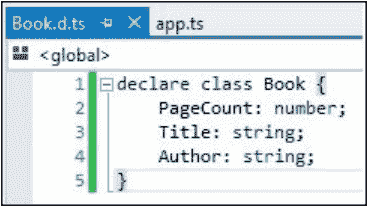
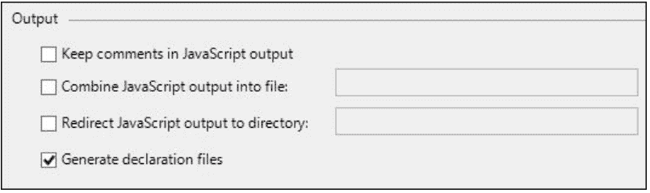
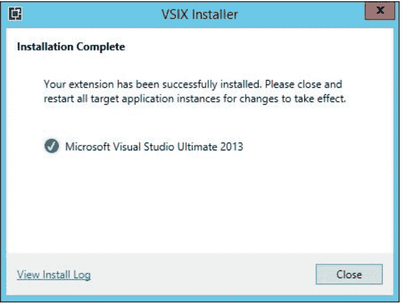
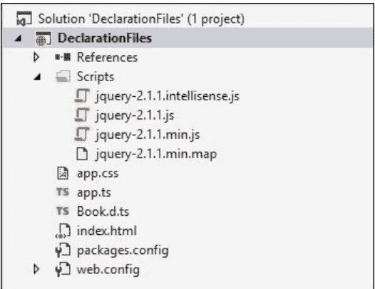
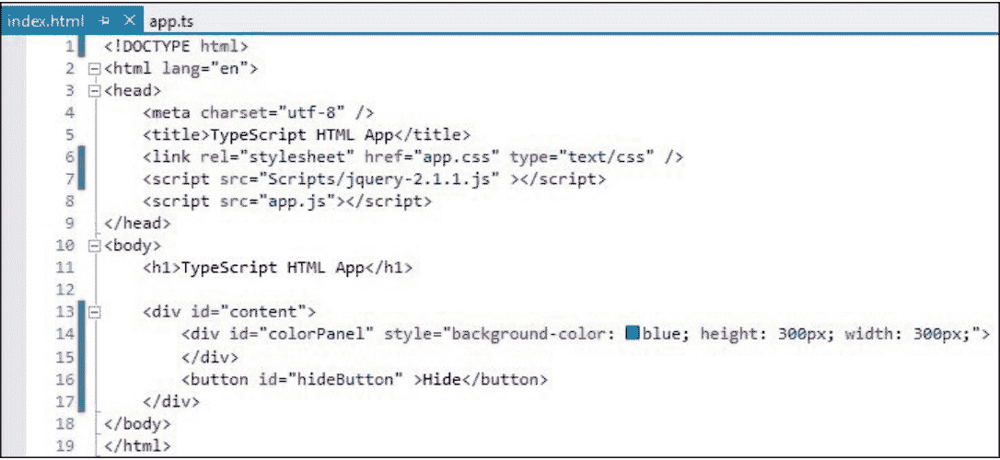
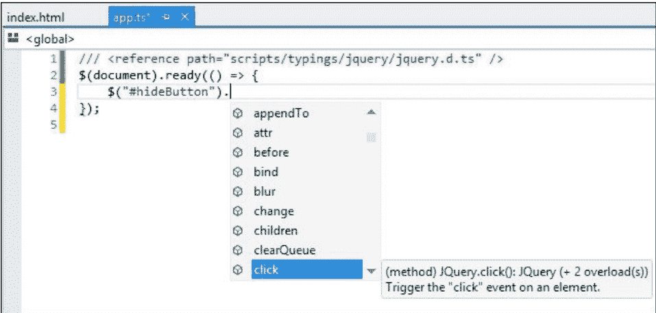
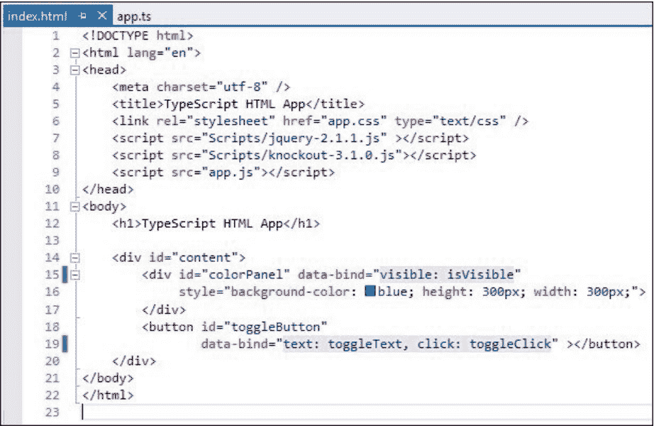
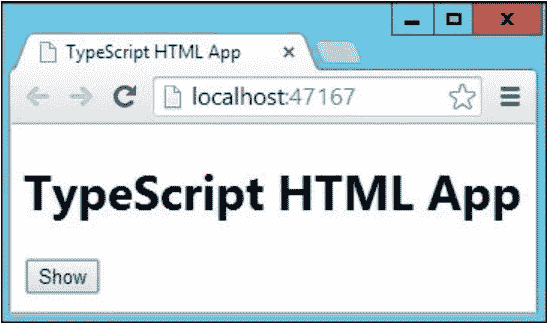
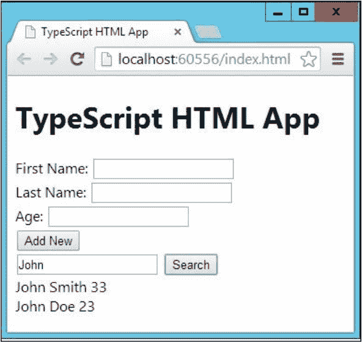

# 第 6 章 声明文件与库集成

到目前为止，我们一直在编写不集成任何外部 JavaScript 库的 TypeScript。我们已经涵盖了该语言在 JavaScript 之上添加的各种概念，以及如何在构建大型应用程序时利用它们。我们一直忽略了 Web 上公开可用的所有第三方库，这些库可以改善 JavaScript 体验。在本章中，我们将介绍声明文件，以及它们如何帮助我们与其他 JavaScript 库集成。本章将涵盖的主题包括：

- 声明文件
- NuGet 包管理器
- jQuery
- Knockout
- 外部模块

## 声明文件

声明文件是 TypeScript 中一种特殊类型的源文件，并且具有不同的文件扩展名。声明文件的文件扩展名为 `.d.ts`，它们可以包含类型信息，但不包含实现细节。这包括接口定义和类型声明。

类型声明使用 `declare` 关键字创建，如下面的截图所示：



如你所见，文件名是 `Book.d.ts`，编译器正是通过这一点知道该文件将只包含声明。此时，不会创建任何输出文件，并且当文件中发现实现代码时，将生成错误。这些文件的目的是为不是 TypeScript 文件的其他 JavaScript 库提供类型信息。这使我们能够以强类型的方式与这些库交互，提供编译时检查和智能代码补全。在上一个示例中，我们声明 `Book` 类将存在于全局命名空间中，从而可以在整个项目中引用它。我们现在可以自由使用 `Book`，但如果没有为其提供实现，那么我们的应用程序在运行时只要引用了 `Book` 类型就会失败。

正如我们在前面查看 TypeScript 编译器及其选项时所见，我们可以为自己的代码自动生成声明文件。这些声明文件可以从你自己的解决方案中的其他项目引用，也可以作为你分发的库的一部分进行部署。每输出一个 JavaScript 文件，就会对应输出一个声明文件。如果你将所有代码合并到单个文件中，那么将创建一个声明文件。从项目属性的 TypeScript 构建部分选择**生成声明文件**选项，将为编译器提供用于创建声明文件的适当参数，如下面的截图所示：



在整本书中，我们使用了各种并非由我们显式声明的类型。我们在绘图应用程序中使用的 `CanvasRenderingContext2D` 对象在 Visual Studio IntelliSense 中具有完整的类型信息列表，但我们从未见过它的声明或实现。这是因为 TypeScript 附带了一个 `lib.d.ts` 文件，它声明了数千个不同对象的类型信息。每次编译器运行时，都会自动引用这个声明文件。这个类型列表非常有用，但它不包含项目中可能引用或不引用的任何外部库中的类型。

## 第三方库集成

大规模 Web 开发中的关键组件之一是使用为我们处理某些任务的开源库。jQuery 是较流行的库之一，用于轻松与**文档对象模型（DOM）**交互。这些库提供了各种各样的功能，但所有这些交互都可以赋予一定程度的类型化。在本节中，我们将研究以下库：

- jQuery
- Knockout
- RequireJS

在开始开发这些库之前，我们需要先在项目中引用它们。这些库中的每一个都可以直接从其网页下载，或通过使用 NuGet 下载。NuGet 是 Visual Studio 的包管理器，可以作为扩展安装。



我们将安装的 NuGet 包将包含我们要使用的库的代码，以及每个库的单独声明文件。不过，并非每个库都有与之关联的 NuGet 包或声明文件，但 Web 开发社区在这方面填补空白做得非常好。GitHub 上的 **DefinitelyTyped** 仓库中有一个大型 TypeScript 库声明文件存储库。

## 与 jQuery 集成

jQuery 是 Web 上最流行的开源库之一。它可用于从 DOM 操作到简化远程服务器调用的各种场景。如果你计划构建大型 Web 应用程序，可能已经在计划使用 jQuery；如果没有，我强烈建议你使用。要开始使用 jQuery，我们需要做的第一件事是安装 jQuery NuGet 包。右键单击项目，然后选择**管理 NuGet 包**。这将弹出一个与更新和扩展窗口类似的窗口。在**联机**部分中的 nuget.org 仓库中找到 jQuery 并安装它。如下面的截图所示，此包安装了多个文件，帮助我们使用 jQuery 进行开发：



现在我们可以向 index.html 文件添加一个 script 标签，jQuery 将在运行时供我们使用。然而，在我们开发并编译 TypeScript 代码时，这用处不大，因为我们没有关于该库的任何类型信息。要导入此类型信息，我们需要一个代表 jQuery 库的声明文件。再次打开**管理 NuGet 包**窗口并搜索 jQuery.TypeScript。安装名为 **jquery.TypeScript.DefinitelyTyped** 的包（在撰写本文时其版本为 1.3.5），以导入 jQuery 库的类型信息。

### 提示

还有许多其他库扩展了 jQuery，并且已经创建了相当多的声明文件来支持这些不同的扩展。

现在，jQuery 的类型信息已包含在项目中，我们将能够以更健壮的方式使用该库。让我们向 HTML 中添加一些元素，我们将使用 jQuery 库来操作这些元素。




如你所见，我们已经将 jQuery 的 script 标签添加到了文档的 head 标签中，并在 body 中添加了几个元素。第一个元素是一个带有蓝色背景的大正方形 div。第二个是一个按钮，用户将点击它来隐藏显示的蓝色 div 标签。现在我们有了要操作的对象，让我们创建一些 TypeScript 来执行预期的操作。

为了在 TypeScript 编译器中以强类型方式使用 jQuery，我们必须将声明文件的引用放在我们希望使用它的 TypeScript 文件顶部。这是通过在 TypeScript 文件顶部使用特定格式完成的；将引用放在页面顶部以外的任何位置都会导致它们无法正常工作。在下面的示例中，你可以看到如何引用声明文件：

```typescript
/// <reference path="scripts/typings/jquery/jquery.d.ts" />
```

引用中包含的路径是相对于你当前正在处理的文件的。一旦添加了这个引用，我们就能够使用 IntelliSense 和代码补全来帮助我们处理 jQuery API。



如你所见，我们获得了与 Visual Studio 代码补全相关的完整功能集。

### 提示

当集成大量库时，通过创建 `_references.d.ts` 文件并仅向该文件添加引用来管理你的引用会更简单。然后，你的每个代码文件只需引用单个 `_references.d.ts` 文件，即可导入项目的所有相关类型信息。

正如你在以下代码示例中所看到的，使用 jQuery 在 DOM 上定位对象并操作它们要容易得多，并且将减少我们为制作动态应用程序而必须生成的代码量：

```typescript
/// <reference path="scripts/typings/jquery/jquery.d.ts" />
$(document).ready(() => {
    $("#hideButton").click((event) => {
        $("#colorPanel").hide(1000);
    });
});
```

文件中的第一个元素是对 jQuery 声明文件的引用。这使我们能够在 TypeScript 中使用 $ 表示法而不会生成编译器错误，但是，jQuery 仍然需要在运行时加载才能正常工作。我们等待 DOM 完成加载，这会触发函数委托被调用。此时，我们选择之前添加到 HTML 中的按钮，并监听其 click 事件触发。当发生这种情况时，会调用另一个函数委托，该委托使用 jQuery 的 UI 修改方法之一 hide，使大正方形 div 标签在 1000 毫秒内消失。现在如果运行该应用程序，隐藏按钮上方会有一个大的蓝色正方形。一旦点击按钮，你可以看到蓝色方块消失，UI 会为其消失进行调整。jQuery 拥有非常庞大的功能和扩展集。要了解更多信息，我建议访问 [http://jquery.com/](http://jquery.com/) 获取 API 参考和示例。



如你所见，我们在 head 中包含了 jQuery 和 Knockout 库。然后，在 HTML 的 body 中，我们拥有在 jQuery 示例中创建的两个元素。但是，这些元素现在都包含了绑定。`colorPanel` div 使用 Knockout 的 visible 绑定绑定到 `IsVisible` 可观察对象。当 `IsVisible` 可观察对象发生变化时，Knockout 将评估新值并操作 DOM 以显示或隐藏 div。该按钮绑定到视图模型上的多个元素：`toggleText` 对象将决定按钮的值是什么，以及 `toggleClick` 方法，该方法将在 click 事件触发的任何时候执行。

### 提示

Knockout 支持许多不同类型的绑定，并且还有一个自定义绑定模型，允许你定义自己的绑定。访问 [www.knockoutjs.com](http://www.knockoutjs.com) 了解更多信息。

好的，我们现在已经拥有了将 DOM 动态绑定到 TypeScript/JavaScript 的大部分构件，但我们实际上需要连接视图和视图模型。以下代码段展示了如何将两者绑定在一起：

```javascript
$(document).ready(() => {
    ko.applyBindings(new ViewModel());
});
```

如你所见，我们在应用绑定之前等待 DOM 就绪。如果在所有元素可用之前尝试绑定，运行时将发生错误。一旦 DOM 就绪，我们就创建 `ViewModel` 类的一个新实例并将其传递给 Knockout，其余工作将由 Knockout 处理。或者，你可以传入一个特定元素来绑定视图模型。现在当我们运行该应用程序时，它会以可见的大蓝色正方形开始，按钮的文本是 **隐藏**。然而，这不再是像之前那样的应用程序生命周期终点，按钮文本已经改变，我们可以执行另一个操作，如下面的截图所示：



## 使用 RequireJS

在第 2 章 *TypeScript 基础*中，我们讨论了模块定义，但当时我们只关注了内部模块。当时提到了外部模块，但我们没有深入探讨。既然我们已经熟悉了集成外部库，我们将引入一个更常见的外部模块库。RequireJS 是一个 JavaScript 模块加载器，用于确保应用程序执行期间使用的所有对象在必要时可用。这将允许我们将代码分离到不同的文件中，而不必担心它们的加载顺序，因为 RequireJS 将为我们管理这些。就像 jQuery 和 Knockout 一样，RequireJS 及其声明文件可以通过 NuGet 包管理器获得，也可以在线访问 www.requirejs.org 找到。本文使用的包是 "RequireJS" 版本 2.1.14 和 RequireJS.TypeScript.DefinitelyTyped 版本 0.2.0。对于下一个示例，我们将需要所有三个库可用。让我们构建一个简单的应用程序，允许我们向目录中添加人员，然后搜索该目录。

RequireJS 是一个 **异步模块加载器（AMD）**，因此我们需要设置适当的项目设置。打开项目设置的 TypeScript Build 部分，并将 Module system 选项设置为 AMD。现在，我们需要创建一个新模块，该模块将包含与表示目录人员的一组类型相关的所有代码。在项目的 Scripts 文件夹中创建一个名为 People.ts 的新 TypeScript 文件。正如你在下面的示例中所看到的，我们定义了 IPerson 抽象，然后实现了它：

```typescript
export interface IPerson {
    firstName: string;
    lastName: string;
    age: number;
}
export class Person implements IPerson {
    constructor(public firstName: string, public lastName: string, public age: number) {
    }
}
```

IPerson 接口和 Person 类都使用了 export 关键字进行修饰，这将告诉编译器这些类型在引用此模块的其他模块中可用。生成的 JavaScript 与为内部模块生成的略有不同：

```javascript
define(["require", "exports"], function(require, exports) {
    (function (People) {
        var Person = (function () {
            function Person(firstName, lastName, age) {
                this.firstName = firstName;
                this.lastName = lastName;
                this.age = age;
            }
            return Person;
        })();
        People.Person = Person;
    })(exports.People || (exports.People = {}));
    var People = exports.People;
});
```

如你所见，普通的模块定义被包裹在另一个名为 `define` 的函数中，该函数接受一个依赖对象数组和一个在加载所有依赖模块时要调用的函数。接下来我们需要创建的是可以将 HTML 绑定到其上的视图模型。我们将需要用于新人员的三个输入值的可观察对象、我们想要搜索的值以及一个用于保存搜索结果的可观察数组。我们还需要一个方法来启动添加过程和一个方法来执行目录搜索。我们可以将所有这些代码放在一个单独的 TypeScript 文件中，并使用 `import` 和 `require` 关键字来包含我们刚刚创建的 People 模块：

```typescript
import People = require("Scripts/People");
export class PersonFinderViewModel {
    public peopleArray: KnockoutObservableArray<People.IPerson> = ko.observableArray([]);
    public newFirstName: KnockoutObservable<string> = ko.observable("");
    public newLastName: KnockoutObservable<string> = ko.observable("");
    public newAge: KnockoutObservable<number> = ko.observable(null);
    public searchValue: KnockoutObservable<string> = ko.observable("");
    public searchResult: KnockoutObservableArray<People.IPerson> = ko.observableArray([]);
    constructor() {
    }
    public findPersonByFirstName(viewModel: PersonFinderViewModel, event: JQueryEventObject) {
        var people = this.peopleArray();
        var searchValue = this.searchValue();
        this.searchResult([]);
        for (var i = 0; i < people.length; i++) {
            if (searchValue === people[i].firstName) {
                this.searchResult.push(people[i]);
            }
        }
    }
    public addNewPerson(viewModel: PersonFinderViewModel, event: JQueryEventObject) {
        var newPerson = new People.Person(this.newFirstName(), this.newLastName(), this.newAge());
        this.peopleArray.push(newPerson);
        this.newFirstName("");
        this.newLastName("");
        this.newAge(null);
    }
}
```

如你所见，我们向 require 函数提供了 People 模块的路径，这告诉 RequireJS 将该模块添加到传递给 define 方法的模块列表中，同时也告诉 TypeScript 编译器相关类型信息。我们定义了一个人员列表，该列表将作为完整的目录列表存储，新人员字段的可观察对象、搜索可观察对象，以及将绑定到 click 事件的两个方法。`findPersonByFirstName` 方法检索 `searchValue` 可观察对象的最新值以及我们将要搜索的人员列表。


我们将 jQuery 和 Knockout 的引用包含在全局命名空间中，然后使用一个 script 标签引入 require。require 标签中包含一个名为 `data-main` 的绑定，用于定义应用程序的入口点。

**注意**

有关 RequireJS 的更多信息，请访问 [http://requirejs.org/](http://requirejs.org/)。

在 HTML 的 body 部分，我们有标签和输入框定义了 UI 并绑定到视图模型中的各个对象。搜索结果部分做了一些新的事情，值得注意。使用 `searchResult` 可观察数组上的 `foreach` 绑定，我们为数组中的每个项创建了一个模板。这些绑定的上下文基于正在迭代的项的类型，在我们的例子中是一个 Person 对象。

虽然 `firstName`、`lastName` 和 `age` 属性不是可以绑定的可观察对象，但绑定只会发生一次。如果这些字段的值发生变化，UI 不会被更新。我们需要做的最后一件事是创建应用程序的入口点。我们需要导入创建的视图模型，等待 DOM 就绪，然后应用我们的绑定：

```javascript
import PersonFinderViewModel = require("Scripts/PersonFinderViewModel");
$(document).ready(() => {
    ko.applyBindings(new PersonFinderViewModel.PersonFinderViewModel());
});
```

现在我们可以运行应用程序并向目录中添加多个用户。当我们按名字搜索某人时，所有匹配的结果都将被显示：


