# 第 7 章. 增强绘图应用程序

当我们在第 5 章 *创建简单的绘图应用程序* 中开始绘图应用程序时，我们按功能将所有代码分组在一起。这使我们能够减少应用程序运行所需的 script 标签数量。利用我们在上一章中学到的知识，我们将修改绘图应用程序以使用 AMD 模块和 RequireJS。我们还将集成 Knockout 和 jQuery 以改善整体用户体验。最后，我们将查看如何使用 RequireJS 将所有应用程序代码构建成单个压缩文件以进行部署优化。我们将对应用程序进行的增强包括：

- 转换为 AMD 模块
- 绑定用户控件
- 生成单个输出文件
- 美化应用程序

### 转换为 AMD 模块

转换为 AMD 模块是一个相当简单的过程。然而，这是一个审视项目结构和可维护性的好时机。在开始之前，我们必须安装 RequireJS NuGet 包版本 2.1.14 以及相应的声明文件 requirejs.TypeScript.DefinitelyTyped 版本 0.2.0。

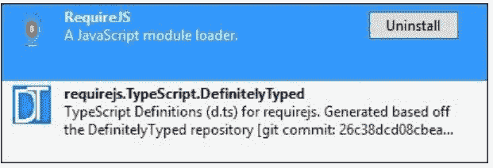

TypeScript 构建设置也必须更改为使用上一章所示的 AMD 模块系统。一旦这些步骤完成，我们就可以开始增强我们的应用程序。为此，我们希望为应用程序添加一个文件夹结构，以帮助我们根据功能轻松分离模块。此时，重要的是决定如何划分应用程序的代码。由于我们使用的是 RequireJS 模块，我们将使用 export 关键字为所有希望从其他模块使用的对象。我们可以使用 export 关键字有三种方式，每种方式对生成的 JavaScript 都有不同的影响。以下示例显示了该关键字的更常见用法：

```
export class Freehand implements IFreehand {
    public points: Array<IPoint> = [];
    constructor() {
    }
    public AddPoint(point: IPoint) {
        this.points.push(point);
    }
}
```

在此示例中，export 关键字注释了类型声明。这告诉 TypeScript 编译器将此类型放置在正在生成的模块的 exports 对象上。

**提示**

export 关键字只有在向编译器提供 `--module` 标志时才可用。尝试在不提供此选项的情况下使用它将导致编译器错误。Visual Studio 在项目属性的 TypeScript Build 部分中选择模块系统时提供此标志。

此类定义的 resulting JavaScript 将与我们之前的模块定义非常相似。然而，由于我们选择使用 AMD 模块，会添加一些特殊语法：

```
define(["require", "exports"], function(require, exports) {
    var Freehand = (function () {
        function Freehand() {
            this.points = [];
        }
        Freehand.prototype.AddPoint = function (point) {
            this.points.push(point);
        };
        return Freehand;
    })();
    exports.Freehand = Freehand;
});
```

AMD 模块和标准 JavaScript 模块之间的差异从定义的最开始就显而易见。AMD 规范提供了一个名为 define 的函数，用于协助模块加载器。虽然这里只显示了该函数的两个参数，但该函数可选地接受一个在生成的 JavaScript 代码中显示的两个参数之前的前置参数。此可选第一个参数是模块的标识符，我们将在本章后面讨论此参数，以便我们想将最终的应用程序代码压缩时。define 函数的第二个参数是模块依赖项列表。我们在项目中用来引用另一个模块的每个 require 语句都将包含在此列表中。第三个也是最后一个参数是我们定义模块的唯一强制参数，它是一个将执行以实例化对象或模块的函数。提供给 define 函数的每个依赖项都将作为参数提供给函数，以便在模块内部使用。

export 关键字也可以分配给一个类型。在以下示例中，你可以看到我们不是用 export 关键字装饰我们的类，而是改用赋值运算符为其赋予新值：

```
class Circle implements ICircle {
    constructor(public radius: number) {
    }
    public resize(radius: number) {
        this.radius = radius;
    }
    public area(): number {
        return Math.PI * this.radius * this.radius;
    }
}
export = Circle;
```

使用此方法将我们限制为从文件中导出单个类型；然而，此类型可以是包含任意数量导出对象的模块。生成的 JavaScript 看起来像以下代码：

```
define(["require", "exports"], function(require, exports) {
    var Circle = (function () {
        function Circle(radius) {
            this.radius = radius;
        }
        Circle.prototype.resize = function (radius) {
```


```typescript
export import DrawingToolType =
require('Scripts/Drawing/Enums/DrawingToolType');
```

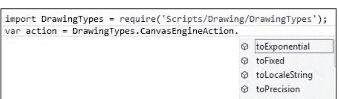

等等一下；这些并不是我们枚举的值。出了什么问题？好吧，这与编译器如何解释导入后又导出的 `CanvasEngineAction` 枚举的返回类型有关。枚举是对数字的巧妙表示，因此类型系统会将返回类型读取为数字，并判定这些必须是我们的可用选项。模块和类没有这个问题，因为它们的类型是唯一的。为了解决这个问题，我们只需要正确地为 action 变量指定类型，我们的枚举就会按预期工作。

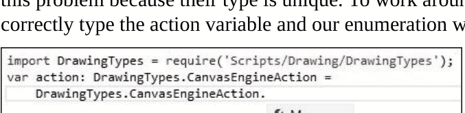

所有这些方法都是完全有效且适用于不同需求的。随着我们重构绘图应用程序，我们将使用这些方法的组合来将代码拆分为逻辑分组。使用 TypeScript 编译器并不是我们分割代码的唯一方式。保持代码在将相似对象分组的目录结构中，会使代码功能之间的区分变得容易。在下面的屏幕截图中，你可以看到我们为通用形状对象创建了一个单独的目录，与任何绘图相关逻辑分开。绘图代码也根据每个分组将包含的功能被细分为更精细的子部分。

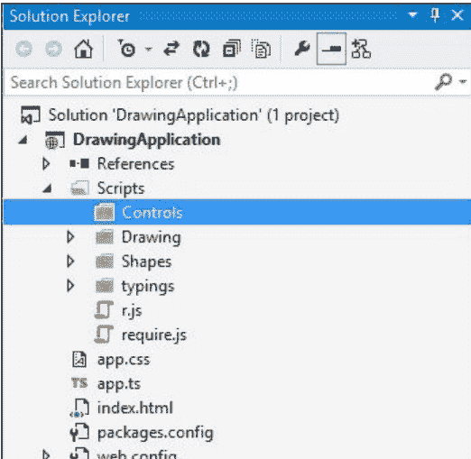

现在我们可以开始将代码拆分为单独的文件，每个文件服务于不同的特定目的。我们可以将特定区域的所有接口类型放在一个名为 `<Area>Types.ts` 的单个 TypeScript 文件中，例如 `ShapeTypes.ts`。这将为我们提供一个引用接口和枚举的地方，同时将类和实际实现代码分开。每个接口都应使用 `export` 关键字进行装饰，以确保我们能够以一致的方式与所有这些类型进行交互。接下来，我们需要决定如何构建实现代码。每个不同的形状对象都可以拆分为单独的代码文件并放置在我们创建的 `Shapes` 目录中。然而，这些类中的代码量很小且相对容易管理，因此我们可以轻松地将它们全部放在一个模块中。如果实现开始像绘图相关对象那样增长，我们将希望为每种类型准备单独的文件以保持代码清晰且易于维护。

`Shapes.ts` 文件的完整内容如下所示：

```typescript
import ShapeTypes = require('Scripts/Shapes/ShapeTypes');
export class Point implements ShapeTypes.IPoint {
    constructor(public X: number, public Y: number) {
    }
}
export class Line implements ShapeTypes.ILine {
    constructor(public p1: ShapeTypes.IPoint, public p2: ShapeTypes.IPoint) {
    }
    public Length(): number {
        var a2 = Math.pow(this.p2.X - this.p1.X, 2);
        var b2 = Math.pow(this.p2.Y - this.p1.Y, 2);
        return Math.sqrt(a2 + b2);
    }
}
export class Rectangle implements ShapeTypes.IRectangle {
    constructor(public Height: number, public Width: number) {
    }
    public Resize(height: number, width: number) {
        this.Height = height;
        this.Width = width;
    }
}
export class Freehand implements ShapeTypes.IFreehand {
    public Points: Array<ShapeTypes.IPoint> = [];
    constructor() {
    }
    public AddPoint(point: ShapeTypes.IPoint) {
        this.Points.push(point);
    }
}
export class Circle implements ShapeTypes.ICircle {
    constructor(public Radius: number) {
    }
    public Resize(radius: number) {
        this.Radius = radius;
    }
    public Area(): number {
        return Math.PI * this.Radius * this.Radius;
    }
}
```

正如你所见，我们导入了 `ShapeTypes` 模块，这使我们能够访问为形状创建的所有抽象。通常，接口在 TypeScript 类型系统中在全局级别可用。然而，由于我们用 `export` 关键字装饰了它们，它们已被放置在没有关联代码的模块类型上。我们通过此模块类型引用每个接口。然而，生成的 JavaScript 中不包含对其的引用。现在，我们应该进入应用程序的 Drawing 区域并相应地划分这些类型。我们将从接口和枚举开始，因为它们是最基本的类型，实现代码在没有它们的情况下无法工作。

每个枚举可以放在自己的文件中，而所有接口将放在单个 `DrawingTypes.ts` 文件中。由于我们的一些接口引用了枚举，我们将需要在 `DrawingTypes` 文件中导入它们。这是一个特别好的时机，可以结合使用 `export` 和 `import` 关键字将枚举附加到 `DrawingTypes` 模块。这将使我们能够以与在应用程序中访问接口相同的方式访问这些枚举。接下来，让我们将绘图形状拆分为单独的文件。这些类中的每一个都需要大量的代码，将它们分离到单独的代码文件中将使我们更容易维护它们。下面的屏幕截图显示了 Drawing 目录中的每个不同文件：

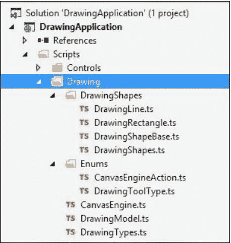

我们将把它们重新组合成一个名为 `DrawingShapes` 的单个模块，我们将直接使用它来访问这些类型。`DrawingShapes` 模块只不过是一系列 export import，如以下代码所示：

```typescript
export import DrawingShapeBase =
require('Scripts/Drawing/DrawingShapes/DrawingShapeBase');
export import DrawingRectangle =
require('Scripts/Drawing/DrawingShapes/DrawingRectangle');
export import DrawingLine =
require('Scripts/Drawing/DrawingShapes/DrawingLine');
```

`DrawingModel` 和 `CanvasEngine` 文件将导入它们需要的模块并将其中包含的类分配给 export 对象。既然我们所有的代码现在都在 AMD 模块中，我们就可以修改我们的 HTML 以仅加载应用程序的主入口点 `app.js`，它位于项目的根目录，其余模块将在程序执行过程中按需加载。

```html
<!DOCTYPE html>
<html lang="en">
<head>
    <meta charset="utf-8" />
    <title>TypeScript HTML App</title>
    <link rel="stylesheet" href="app.css" type="text/css" />
</head>
<body>
    <h1>Drawing Application</h1>
    <div id="content">
        <div>
            <button id="selectButton">Select</button>
            <button id="rectangleButton">Rectangle</button>
            <button id="lineButton">Line</button>
            <input type="color" id="colorPicker" />
        </div>
        <canvas id="drawingCanvas" height="400" width="570"
                style="border: 4px solid black;"></canvas>
    </div>
    <script data-main="app.js" src="scripts/require.js"></script>
</body>
</html>
```

## 绑定用户控件

现在我们已将应用程序转换为使用 AMD 模块，让我们逐步增加应用程序的复杂性。目前，我们在 DOM 中搜索单个元素并为其附加事件处理程序。这不一定是坏事；然而，它确实使我们的代码容易受到许多可能问题的困扰。DOM 可能尚未完成我们尝试附加到的对象的渲染，或者该对象可能已被另一段代码移除。这种方法另一个陷阱是，如果我们想向应用程序添加另一种绘图形状类型，我们必须在 HTML 中添加另一个元素，然后再添加更多代码来添加事件处理程序。这效率低下，并且可能导致在某处犯错。幸运的是，有许多可用的库允许我们实现诸如 **Model View Controller (MVC)** 和 **Model View ViewModel (MVVM)** 之类的绑定模式。Knockout 就是其中一个库，它将 MVVM 引入 JavaScript 和 TypeScript 开发。


## 可复用的控件

在上一章中，我们了解了 Knockout 及其 foreach 绑定，它允许我们在 HTML 中创建一个模板，数组中的每个对象都会绑定到该模板上。我们将把相同的概念应用于绘图应用程序的每一个选项。其中一些对象在类型和功能上非常相似，例如类型选择控件。然而，颜色选择器需要实现的界面则非常不同。这时，Knockout 模板绑定就派上用场了。

Knockout 模板绑定允许我们为特定的对象类型提供 HTML 模板。这使我们能够将 HTML 与正在运行的 JavaScript 分离开来。在本例中，我们将有一个用户控件列表，显示在画布对象上方的空间中。在创建要绑定到的模板之前，我们需要定义它们将绑定到的抽象。该抽象的最顶层是 IUserControl 类型，它包含 id 和 templateName 两个属性，这是将我们的 DOM 元素绑定到它上面的最低要求：

```
export interface IUserControl {
    id: string;
    templateName: string;
}
```

我们还需要一些接口来表示工具选择按钮和颜色选择器。这些接口更加专注于它们各自的直接功能，但只要它们提供了与之匹配的模板名称，我们所有的绑定都将无缝地进行。这些接口将定义在 Controls 目录下名为 ControlsTypes.ts 的文件中，代码如下：

```
export interface IUpdateObservable {
    observable: KnockoutObservable<any>;
}
export interface IToolSelectionControl extends IUserControl,
IUpdateObservable {
    toolType: DrawingTypes.DrawingToolType;
    click(viewModel: any, event: JQueryEventObject);
    observable: KnockoutObservable<DrawingTypes.DrawingToolType>;
    buttonText: KnockoutObservable<string>;
}
export interface IColorSelectionControl extends IUserControl,
IUpdateObservable {
    change(viewModel: any, event: JQueryEventObject);
    observable: KnockoutObservable<string>;
}
```

如你所见，IToolSelectionControl 接口有一个 toolType 属性，用于存储这个控件所负责的值。还有一个 click 函数，它将作为我们稍后要创建的 HTML 绑定中的事件处理器。其余两个对象是 Knockout observable，其中一个将用于通知调用应用程序已选择了新工具，另一个将用于定义按钮所显示的文本。IColorSelectionControl 接口以与 IToolSelectionControl 接口相同的方式扩展了 IUserControl，但这里的附加属性却大不相同。该接口定义了一个 change 方法，当颜色输入的 change 事件触发时，该方法将被调用。该接口的最后一个属性与 IToolSelectionControl 接口上的 observable 属性非常相似。两者之间的主要区别在于它们存储的类型不同；在本例中，我们存储的是代表当前颜色的字符串值。由于这两个接口之间关系紧密，我们抽象出了 IUpdateObservable 接口，然后在更细粒度的接口中提供了更具体的类型定义体验。

现在我们已经定义了接口，就可以构建 HTML 模板来表示我们想要创建的不同控件了。第一个模板将只包含一个应用了自身绑定的按钮元素。第二个模板是颜色选择器，它具有一组专门针对此元素类型的独特绑定。最后，我们必须修改当前容纳控件的 HTML 区域。如你所见，生成的 HTML 中没有直接定义控件，但是当控件被添加到名为 userControls 的可观察列表时，它们就会出现在我们的应用程序中：

```
<!DOCTYPE html>
<html lang="en">
<head>
<meta charset="utf-8" />
<title>TypeScript HTML App</title>
<link rel="stylesheet" href="app.css" type="text/css" />
<link rel="stylesheet" href="DrawingApplication.css" type="text/css" />
<script src="Scripts/jquery-2.1.1.js"></script>
<script src="Scripts/knockout-3.1.0.js"></script>
<script data-main="app" src="Scripts/require.js"></script>
</head>
<body>
<h1>Drawing Application</h1>
<div id="content">
<div data-bind="foreach: userControls">
<span data-bind="attr: { id: id }, template: { name: templateName }"></span>
</div>
<canvas id="drawingCanvas" height="400" width="570" />
</div>
</body>
</html>
<script type="text/html" id="ButtonTemplate">
<button class="tool-select-button" data-bind="text: buttonText, click: click, css: { 'selected': isSelected }" />
</script>
<script type="text/html" id="ColorPickerTemplate">
<input type="color" data-bind="event: { change: change }" />
</script>
```

如你所见，我们使用 foreach 绑定为 UserControls 列表中的每个对象创建一个新控件，我们的 HTML 将绑定到这个列表。在该绑定内部，有一个 span 元素绑定到 IUserControl 接口。我们的画布对象暂时保持不变，但页面底部出现了一些新元素。这些新的 script 标签将包含用户控件要绑定到的 HTML 模板。按钮模板围绕工具选择控件接口创建绑定，将文本绑定到 ButtonText observable，并将 click 事件绑定到 click 函数。颜色选择器只需要将 change 事件绑定到 Change 方法。

最后一步是实现我们的每个接口，并将视图模型绑定到 DOM。这些类型中的每一个都将放在 controls 目录下的单独文件中。所有文件都可以在下面的截图中看到：

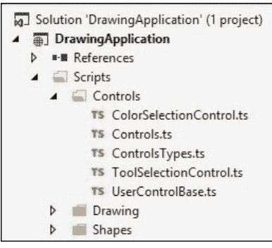

我们将从基础用户控件对象开始，它位于 UserControlBase.ts 文件中，我们其余的类型都将扩展它：

```
import ControlsTypes = require('Scripts/Controls/ControlsTypes');
class UserControlBase implements ControlsTypes.IUserControl {
    public templateName: string = "TemplateNotProvided";
    constructor(public id: string) {
    }
}
export = UserControlBase;
```

id 属性作为必填属性传入，因此它总是有值。templateName 字符串默认被设置为一个无效值，这确保了任何扩展 UserControl 类型的类型都会被强制更新该属性。如果提供了无效的模板名称，Knockout 将在运行时生成错误。但是，如果提供的是空字符串，执行将继续正常进行。现在，让我们来实现工具选择按钮：

```
import ControlsTypes = require('Scripts/Controls/ControlsTypes');
import UserControlBase = require('Scripts/Controls/UserControlBase');
import DrawingTypes = require('Scripts/Drawing/DrawingTypes');
class ToolSelectionControl extends UserControlBase
    implements ControlsTypes.IToolSelectionControl {
    public buttonText: KnockoutObservable<string> = ko.observable("");
    constructor(id: string, public toolType: DrawingTypes.DrawingToolType,
        public observable: KnockoutObservable<DrawingTypes.DrawingToolType>) {
        super(id);
        this.templateName = "ButtonTemplate";
        this.buttonText(DrawingTypes.DrawingToolType[this.toolType]);
    }
}
```

```
```typescript
public click(viewModel: any, event: JQueryEventObject) {
    this.observable(this.toolType);
}
}
export = ToolSelectionControl;
```
```

这里的整体代码并不花哨，但它让我们可以用比以前少得多的精力添加新的工具按钮。该类型的构造函数接收对象的 ID 以传递给基类构造函数、对象实例将要表示的 DrawingToolType 值，以及一个在按钮被点击时将被更新的 Knockout observable。由于这是一个具体实现，我们必须提供一个有效的 HTML 模板名称，最后，我们使用了一点枚举魔法来为按钮文本提供值。click 事件所做的只是将存储的工具类型赋给创建对象时提供的 observable。颜色选择控件的实现甚至更简单：

```
```typescript
import ControlsTypes = require('Scripts/Controls/ControlsTypes');
import UserControlBase = require('Scripts/Controls/UserControlBase');
class ColorSelectionControl extends UserControlBase
    implements ControlsTypes.IColorSelectionControl {
    constructor(id: string, public observable: KnockoutObservable<string>)
    {
        super(id);
        this.templateName = "ColorPickerTemplate";
    }
    public change(viewModel: any, event: JQueryEventObject) {
        this.observable((<any>event.currentTarget).value);
    }
}
export = ColorSelectionControl;
```
```


## 创建视图模型

现在我们已经设置好了可复用控件，需要创建应用程序将绑定的视图模型，并对现有类型进行一些修改，以确保程序顺利运行。为了维护单一职责模式，我们应该创建一个新的模型供 UI 绑定，而不是使用负责维护应用程序中形状状态的 DrawingModel 类。这个新模型将使用 Knockout 绑定到 DOM，并负责创建和维护应用程序的状态。它将位于 Drawing 目录下的 DrawingModel.ts 文件中。在创建此模型之前，我们需要修改现有的绘图模型，以便当用户与控件交互时，应用程序视图模型能够更新绘图模型。如你所见，在提供的新接口定义中，我们将绘图工具和绘图颜色属性设为公共成员：

```
export interface IDrawingModel {
    selection: IDrawingShape;
    shapes: IDrawingShape[];
    addShape(shape: IDrawingShape);
    getNewShape(location: ShapeTypes.IPoint): IDrawingShape;
    drawingTool: DrawingToolType;
    drawingColor: string;
}
```

getDrawingTool 方法不再有必要，因为我们提供了对底层实例成员的公共访问。如果我们处理的是已发布的软件，我们不希望直接修改此接口，而应扩展它并为 DrawingModel 类型提供新的实现。然而，由于这只是一个示例应用程序，我们可以修改它以改进整体设计，尽管这会导致破坏性更改。只需修改此类的内部实现以及 canvas 引擎中的一处引用，即可让应用程序恢复正常工作。

一旦完成了这些修复，我们就可以有效地设计应用程序视图模型，该模型将位于 Scripts 目录下的 DrawingApplicationModel.ts 文件中：

```
import ControlsTypes = require('Scripts/Controls/ControlsTypes');
import DrawingModel = require('Scripts/Drawing/DrawingModel');
import CanvasEngine = require('Scripts/Drawing/CanvasEngine');
import Controls = require('Scripts/Controls/Controls');
import DrawingTypes = require('Scripts/Drawing/DrawingTypes');

class DrawingApplicationModel {
    public userControls: KnockoutObservableArray<ControlsTypes.IUserControl> =
        ko.observableArray([]);
    public selectedToolType: KnockoutObservable<DrawingTypes.DrawingToolType> =
        ko.observable(DrawingTypes.DrawingToolType.Select);
    public selectedColor: KnockoutObservable<string> =
        ko.observable("#000000");
    private _drawingModel: DrawingTypes.IDrawingModel;

    constructor(canvas: HTMLCanvasElement) {
        this._drawingModel = new DrawingModel();
        var engine = new CanvasEngine(canvas, this._drawingModel);
        this._buildControls();
        this._createSubscriptions();
    }
    private _buildControls() {
        var selectionControl = new Controls.ToolSelectionControl("selectButton",
            DrawingTypes.DrawingToolType.Select, this.selectedToolType);
        var rectangleControl = new Controls.ToolSelectionControl("rectangleButton",
            DrawingTypes.DrawingToolType.Rectangle, this.selectedToolType);
        var lineControl = new Controls.ToolSelectionControl("lineButton",
            DrawingTypes.DrawingToolType.Line, this.selectedToolType);
        var colorControl = new Controls.ColorSelectionControl("colorPicker",
            this.selectedColor);
        this.userControls.push(selectionControl, rectangleControl,
            lineControl, colorControl);
    }
    private _createSubscriptions() {
        this.selectedToolType.subscribe((newValue) => {
            if (this._drawingModel) {
                this._drawingModel.drawingTool = newValue;
            }
        });
        this.selectedColor.subscribe((newValue) => {
            if (this._drawingModel) {
                this._drawingModel.drawingColor = newValue;
            }
        });
    }
}
export = DrawingApplicationModel;
```

我们将需要三种 Knockout 可观察类型：一种用于我们希望显示的控件，另一种用于维护当前选中的控件，最后一种用于跟踪当前颜色。该视图模型还会根据需要创建和修改绘图模型和 canvas 引擎对象。构造函数接收 HTMLCanvasElement，引擎会将其作为参数使用，而应用程序的其余部分都被隔离在这个类中。我们有两个私有初始化方法。第一个方法构建 DOM 所绑定的控件数组。如你所见，我们现在使用代码来定义这些对象，而不是直接操作 DOM。每个工具选择控件都会接收应用程序模型用来跟踪 IUpdateObservable 接口中 observable 对象状态的 observable。另一方面，颜色选择器接收 selectedColor 可观察对象。如你所见，现在只需添加几行代码即可创建一个全新的按钮：

```
var freehandControl = new Controls.ToolSelectionControl("freehandButton",
    DrawingTypes.DrawingToolType.Freehand, this.selectedToolType);
this.userControls.push(freehandControl);
```

一旦所有这些对象都被实例化，它们就会被添加到控件数组中，从而使

## 生成单个输出文件

在我们绘图应用的原始版本中，只需下载六个文件到客户端浏览器：一个单独的 CSS 文件、我们的 app.js 文件，以及包含我们对象类型的文件。每个文件都是一个独立的 Web 请求，并且必须加载所有文件后，我们的应用程序才能运行。

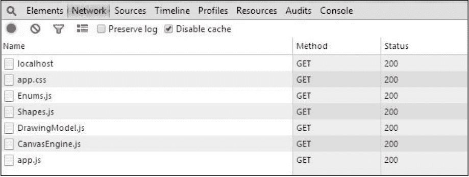

这是一个相对快速的过程，平均耗时不到 100 毫秒，具体取决于网络延迟。然而，在我们追求创建大规模可维护应用程序的过程中，代码文件的数量激增。现在，在应用程序成功完成所有功能之前，需要将超过 20 个文件加载到客户端浏览器中。这导致我们的加载时间比以前增加了一倍以上，如下面的网络流量截图所示：

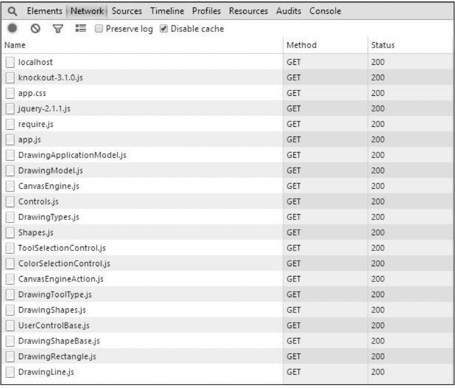

这种加载时间的延迟对于开发目的来说是完全可接受的（事实上，正如我们将在下一章看到的，它实际上是更可取的）。但是，如果我们计划让消费者使用我们的应用程序，就需要减少 JavaScript 输出的体积。在实现 AMD 模块之前，这就像向编译器提供 --out 参数或更改我们在 Visual Studio 中的 TypeScript 构建设置一样简单。然而，当提供了 module 标志时，这是不可能的。

为了将所有生成的 JavaScript 模块编译到单个文件中，我们至少还需要一个工具。Node.js 是一个很棒的平台，提供了大量功能，其主要功能是帮助创建可扩展的网络应用程序。可从 http://nodejs.org/ 下载。Node 提供了大量功能，我鼓励你阅读 API 文档和示例以了解更多信息。在我们的场景中，我们将把它用作 JavaScript 运行时环境。这将使我们能够使用 r.js 来追踪所有 RequireJS 语句，并构建一个优化的模块列表。

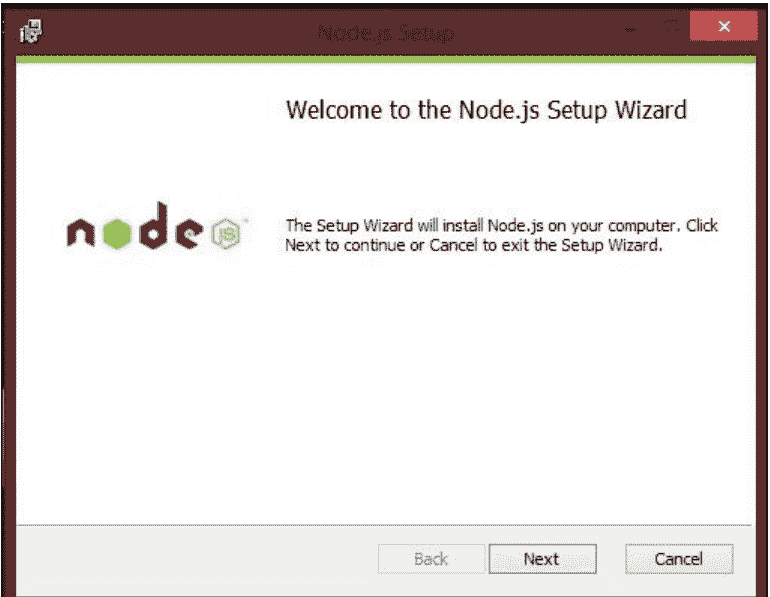

一旦安装了 Node.js，我们就可以从命令行以及通过 PowerShell 使用它。我们将把它与 r.js 结合使用，r.js 是在我们安装 RequireJS NuGet 包时安装到 Visual Studio 项目中的。这个库是 RequireJS 的优化器，可以在 Node 和 Rhino 中运行。

### 注意

> 有关 Rhino 的更多信息，请访问 https://developer.mozilla.org/en-US/docs/Mozilla/Projects/Rhino。

优化器需要一些参数来决定如何生成输出。我们必须提供名称、输出结果文件的路径、一个告诉优化器在应用程序中搜索所有嵌套依赖项的标志，以及 r.js 在执行优化时应查看的路径。我们将把这些选项放在一个独立的 JavaScript 文件中，如果我们想要更改最终代码的生成方式，可以修改该文件：

```
({
    name: "DrawingApplication",
    out: "DrawingApplication.js",
    findNestedDependencies: true,
    optimize: "none",
    paths: {
        'DrawingApplication': 'app'
    }
})
```

如你所见，所有这些选项都放在一个 JSON 对象中，该对象将提供给 RequireJS 优化器。这里的一个额外标志是 optimize 标志，它决定


是否应该对代码进行压缩。

## 注意

有关 r.js 优化器的更多信息，请访问 http://requirejs.org/docs/optimization.html。

为了保持可读性，我们目前将其保留为 none。当我们真正想要部署代码时，只需注释掉此选项，所有代码都将被放置在单个文件的一行中。我们生成优化后的 JavaScript 输出文件必须做的最后一件事是创建一个简单的 PowerShell 脚本，该脚本将运行优化器并提供我们的选项：

```
cls
write-host '-Building Drawing Application'
node Scripts/r.js -o buildSingleFile.js
```

在此脚本中，我们清除当前屏幕，记录一些输出，最后使用 Node.js 运行 RequireJS 优化器。如果一切按预期进行，优化器将提供跟踪输出，让我们知道应用程序所需的所有模块都已包含在优化中。以下屏幕截图显示了运行脚本的输出，如您所见，所有 JavaScript 依赖项都已包含在构建中：

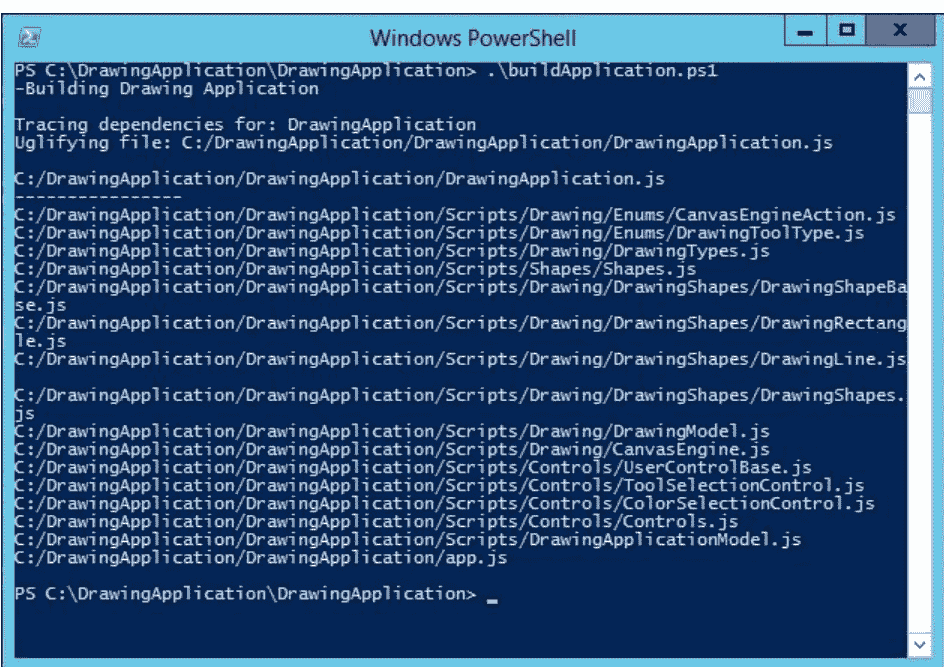

此过程的最后一步是修改我们的 HTML 页面以指向生成的输出文件。在此之前，我们必须了解我们刚刚运行的 PowerShell 脚本的输出。如前所述，AMD 模块有三个参数；

## 样式化应用程序

到目前为止，我们只介绍了开发应用程序源代码的方式。然而，对应用程序进行样式设置与功能一样重要。我们编写的代码可以完全没有错误，但如果应用程序的外观和感觉不佳，用户就不会采用它。传统上，在使用 HTML 页面开发 Web 应用程序时，我们会使用层叠样式表（CSS）来设置对象的样式。然而，与 TypeScript 改进 JavaScript 开发的方式类似，一种名为 LESS 的语言已被开发出来，可编译为纯 CSS。LESS 可从 http://lesscss.org/ 单独下载，或在 Visual Studio 的情况下，可通过 Mads Kristensen 的 Web Essentials 插件安装。此插件可通过扩展和更新窗口获得，就像 NuGet 包管理器一样。

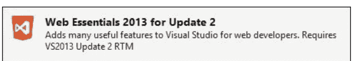

安装后，我们可以向应用程序添加 LESS 样式表。LESS 具有大量非常有用的功能，可帮助我们以更稳健的方式创建友好的用户界面。我们能够声明变量并将样式嵌套在彼此内部。让我们使用 LESS 来改善应用程序的感觉。目前，用户没有任何视觉提示来告知他们当前正在使用什么工具。我们可以使用一些代码在单击按钮时更改光标类型；然而，这可能会被页面上的其他元素覆盖，包括我们的应用程序所依赖的 CanvasEngine 类。相反，我们将使用 Knockout 绑定结合生成的 CSS 样式。首先，我们需要在 IToolSelectionControl 接口和 ToolSelectionControl 类上创建一个新属性，以存储当前控件是否被选中：

```
import ControlsTypes = require('Scripts/Controls/ControlsTypes');
import UserControlBase = require('Scripts/Controls/UserControlBase');
import DrawingTypes = require('Scripts/Drawing/DrawingTypes');
class ToolSelectionControl extends UserControlBase
    implements ControlsTypes.IToolSelectionControl {
    public buttonText: KnockoutObservable<string> = ko.observable("");
    public isSelected: KnockoutComputed<boolean> = null;
    constructor(id: string, public toolType: DrawingTypes.DrawingToolType,
        public observable: KnockoutObservable<DrawingTypes.DrawingToolType>) {
        super(id);
        this.templateName = "ButtonTemplate";
        this.buttonText(DrawingTypes.DrawingToolType[this.toolType]);
        this.isSelected = ko.computed(() => {
            return this.observable() == this.toolType;
        });
    }
    public click(viewModel: any, event: JQueryEventObject) {
        this.observable(this.toolType);
    }
```

```
}
}
export = ToolSelectionControl;
```

如您所见，我们创建了一个新的 KnockoutComputed 对象，它将返回一个布尔值，并且我们的 HTML 将绑定到它。与可观察对象存储实例值不同，计算对象运行一个负责设置或返回值的函数。在这种情况下，我们检查控件 supposed to 更新的可观察对象的值是否与此控件关联的工具相同。如果它们相同，则将返回 true 值；否则，结果为 false。通过在此函数的主体中包含另一个可观察对象，Knockout 将创建对该对象的订阅，并且只要其值发生变化，此函数将被重新评估。这使我们不必编写任何额外的逻辑来在单击这些控件时更新可观察对象。绑定到计算对象与绑定到可观察对象相同，因为它们共享一个共同的超类。

```
<script type="text/html" id="ButtonTemplate">
    <button class="tool-select-button" data-bind="text: buttonText, click: click,
        css: { 'selected': isSelected }" />
</script>
```

在前面的屏幕截图中，您可以看到我们已向按钮添加了一个类，我们将能够为其提供样式，然后是额外的 Knockout 绑定。此绑定将在计算对象返回 true 值时向按钮元素添加 'selected' 类。现在我们需要定义这些样式并将它们包含在我们的应用程序中。LESS 最有价值的功能之一是能够定义可在所有 LESS 文件中重用的变量。在以下示例中，我们定义了想要在整个应用程序中使用的几种颜色：

```
@selectionColor: #1111DD;
@accentColor: white;
@borderColor: black;
```

selectionColor 变量将用于表示当前选定工具的颜色，而 accentColor 和 borderColor 变量将用于各种目的。不是为每个样式显式定义这些颜色并在每次使用时更改它们，我们只需更改这些变量的值，整个应用程序的外观就可以改变。要使用这些变量，我们只需导入包含它们的 .less 文件，它们就会可用：

```
@import 'ApplicationColors.less';
.tool-select-button {
    background-color: @accentColor;
    border-color: @borderColor;
    &.selected {
        background-color: @selectionColor;
        color: @accentColor;
    }
}
input[type=color] {
```

```
border-color: @borderColor;
}
canvas {
    border: 4px solid @borderColor;
}
```

我们使用变量来定义样式的值。现在具有 .tool-select-button 类的按钮将被赋予新的背景和边框颜色。还显示了一个嵌套样式，该样式在编译为 CSS 时将创建表示这两种样式并集的另一个样式。最终样式在颜色选择器周围放置边框。当 LESS 代码被编译时，结果 CSS 将类似于以下代码：

```
.tool-select-button {
    background-color: #ffffff;
    border-color: #000000;
}
.tool-select-button.selected {
    background-color: #1111dd;
    color: #ffffff;
}
input[type=color] {
    border-color: #000000;
}
canvas {
    border: 4px solid #000000;
}
```

请注意，所有变量都已被删除并替换为它们所代表的值。LESS 变量在 CSS 中没有表示，因此它们的行为类似于 TypeScript 中的接口，即没有编译输出。如果导入的 LESS 文件包含样式，则所有这些样式都将作为合并的样式集包含在结果 CSS 文件中。现在我们可以简单地修改我们的 HTML 以链接我们的样式表，我们的应用程序将具有更好的用户体验。


```html
<!DOCTYPE html>
<html lang="en">
<head>
    <meta charset="utf-8" />
    <title>TypeScript App</title>
    <link rel="stylesheet" href="app.css" type="text/css" />
    <link rel="stylesheet" href="DrawingApplication.css" type="text/css" />
    <script src="Scripts/jquery-2.1.1.js"></script>
    <script src="Scripts/knockout-3.1.0.js"></script>
    <script data-main="app" src="Scripts/require.js"></script>
</head>
<body>
    <h1>Drawing Application</h1>
    <div id="content">
        <div data-bind="foreach: userControls">
            <span data-bind="attr: { id: id }, template: { name: templateName }"></span>
        </div>
        <canvas id="drawingCanvas" height="400" width="570" />
    </div>
</body>
</html>
```

运行应用程序时，**Select** 按钮会显示所选样式，因为我们添加的 KnockoutComputed 对象对该控件求值为 true。选择其他任何工具都会导致绑定被重新评估，并且样式会随着用户操作而改变。带边框的任何元素都有统一的颜色，如果我们以后想修改它，只需在一个位置更改即可。如果我们以后需要重新设置应用程序的样式，这将为我们节省大量时间。

## 绘图应用程序

Select Rectangle Line

## 小结

在本章中，我们介绍了几种改进企业级 JavaScript 应用程序开发和部署方式的方法。我们将绘图应用程序转换为 AMD 模块，以消除手动管理脚本加载方式的需求。我们使用 Knockout 在 HTML 和 TypeScript 代码之间创建了绑定，这使我们能够以最少的努力轻松扩展应用程序的行为。然后，我们通过将所有模块减少为单个优化的 JavaScript 文件来提高应用程序可用性的速度。最后，我们添加了 LESS 样式表，使我们能够创建可轻松维护和修改的强大样式集。在下一章中，我们将研究调试 TypeScript 的不同方法，以及如何为我们的应用程序提供单元测试。
