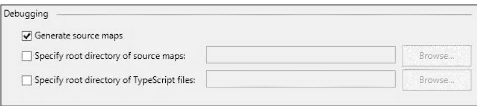
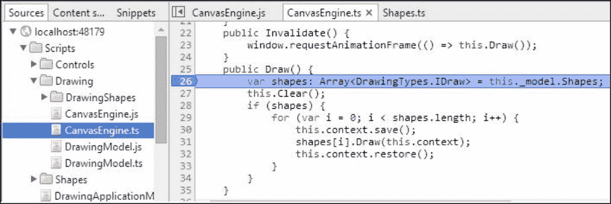
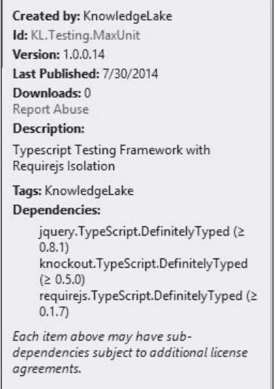

# 第 8 章 调试 TypeScript

我们已经掌握了使用 TypeScript 编写大规模应用程序所需的所有技能。TypeScript 提供的编译器和语言结构使我们能够快速、安全地开发可靠的程序。然而，正如所有经验丰富的开发人员都知道的那样，编译通过的代码并不总是按预期执行。在本章中，我们将讨论部署和运行 TypeScript 后可用的不同调试选项。我们还将介绍单元测试，这将使我们能够使用代码测试功能。在本章中，我们将研究以下主题：

- Debugging
- Test-driven development

### 调试

在开发纯 JavaScript 应用程序时，我们的调试选项通常取决于每个浏览器中可用的工具。大多数现代浏览器都包含某种形式的开发者控制台，允许我们查看网页上运行的脚本。从此控制台，我们可以设置断点并调查应用程序的行为。我们可以在 TypeScript 应用程序中执行相同的任务；然而，这会让我们逐步执行生成的 JavaScript，而不是我们实际编写的 TypeScript 代码。

### 源码映射

正如我们之前讨论的那样，源映射是一种将一个代码文件，通常是压缩过的，映射回原始代码文件的方法。在 TypeScript 中，这一概念同样适用，并允许我们逐步执行未编译的 TypeScript 代码。要启用此功能，我们必须做的第一件事是确保项目设置已设置为生成源映射；此设置默认处于开启状态：



此设置将为编译器提供 --sourcemap 参数，并允许我们将输出的 JavaScript 文件链接到原始 TypeScript 文件。在大多数现代浏览器中，这将导致 TypeScript 文件下载到客户端，我们将能够设置断点并逐行逐步执行我们的代码。

### 调试器

有多种方法可以调试应用程序的代码，我们可能需要它们的组合来确保提供高质量的应用程序。Chrome、Firefox 和 Internet Explorer 等现代浏览器都包含一个开发者控制台，为 Web 应用程序提供调试功能。在下面的屏幕截图中，您可以看到我们可以使用 Chrome 开发者工具直接进入 TypeScript 代码：



在这里，您可以看到我们在绘图应用程序的 `CanvasEngine` 的 `Draw` 方法上设置了一个断点。在源窗口中，JavaScript 文件和 TypeScript 文件都是可见的，就像我们在 TypeScript 文件中包含的类型注释一样。这对于开发人员来说是一个非常强大的功能，因为它防止我们必须将生成的 JavaScript 代码转换回原始 TypeScript 代码的特定行。使用 Visual Studio 和 Internet Explorer，我们实际上可以直接从 IDE 调试。这使我们能够以与调试 C# 代码相同的方式使用 Visual Studio 中可用的所有工具和功能。这包括调用堆栈、添加任何监视表达式以及对象探索，如以下屏幕截图所示：

测试应用程序代码在它预期运行的所有环境中非常重要。每个浏览器都实现了自己的 JavaScript 引擎，并且采用了 HTML5 标准的不同功能集。熟悉每个不同的开发者控制台对于跟踪和解决可能在另一个浏览器中不明显的问题非常重要。

### 测试驱动开发

随着应用程序在规模和复杂性方面不断增长，我们交付尽可能少错误的软件比以往任何时候都更重要。手动测试不一致且缓慢，这意味着我们需要采用更系统的方法来确保软件质量。这种需求催生了测试驱动开发的概念。测试驱动开发是一种开发周期，重复一组小的步骤以确保每一行代码都经过测试。测试驱动开发生命周期的步骤是：

- Adding a test
- Running the tests
- Writing the code
- Running the tests again
- Refactoring the code

我们想要做的第一件事是编写一个测试来验证某些功能。这为我们尚未编写的代码创建了一个需求。当为新功能编写单元测试时，此测试最初会失败；这是预期的，有助于验证测试确实具有失败状态。此时，我们运行所有测试，验证现有测试仍然通过，而我们的新测试失败。如果新测试没有失败，则功能可能已经实现，或者测试无效，需要重写。一旦我们有了有效的测试，我们必须实现我们试图测试的功能。此代码在第一次实现时不必完美；目标只是编写足够多的代码来通过测试。当功能实现后，我们重新运行测试并验证我们的代码是否有效。如果没有，则必须进行更正。否则，代码可以重构；但测试必须始终通过。此过程重复进行，直到每个功能都有测试和实现。现在我们熟悉了测试驱动开发的过程，让我们看看 TypeScript 中的单元测试是如何工作的。

## 注意

有关测试驱动开发的更多信息，请访问 http://msdn.microsoft.com/en-us/library/aa730844(v=vs.80).aspx。

### 单元测试

单元测试是使用一组控制数据和预期结果测试小功能单元的代码块。这些测试可靠且可重用，确保我们的代码不仅针对应用程序的当前版本进行了测试，而且针对所有未来版本进行了测试。这将确保任何添加或修改的功能不会破坏现有功能，并在问题出现很早之前提醒我们。TypeScript 不附带任何内置的单元测试工具；然而，Web 社区再次填补了这一空白。Maxim Fridberg 创建了一个单元测试框架，它为您提供了一种简单的方法来创建和查看您创建的库的所有单元测试。该框架的名称是 MaxUnit，可从 https://github.com/KnowledgeLakegithub/MaxUnit 下载，或作为名为 KL.Testing.MaxUnit 的 NuGet 包提供。



此包将向我们的 Visual Studio 项目添加许多文件，包括框架的示例用法。MaxUnit 的优点是它允许我们为 TypeScript 库编写 TypeScript 测试。有许多其他测试框架可用于测试 JavaScript 库，包括 Jasmine (https://github.com/pivotal/jasmine/) 和 QUnit (http://qunitjs.com/)。通常最好将测试代码与实现代码分开，以确保它以与使用方式相同的方式进行测试。为了感受单元测试的工作方式，让我们以我们在绘图应用程序中创建的 Shapes 库为例，并创建一系列测试以确保其功能正常。Shapes 库输出到单个 JavaScript 文件，并且与之关联的接口可用于测试我们的代码。


## 添加测试

现在我们已经安装了工具链，让我们开始对库进行单元测试的过程。首先需要做的是将 Shapes 库添加到测试项目中。此过程可以手动完成，也可以使用 PowerShell 自动部署我们代码的最新版本。对于现在，我们将手动处理它，以便我们可以专注于测试。一旦我们的库被添加到项目中，我们就可以开始编写测试。我们将为 Shapes 库中的每个对象创建一个单独的测试类来进行测试。让我们从库中最简单的类 Point 类开始，以感受测试。在下面的示例中，你可以看到我们创建了一个名为 test_Point 的新类，其中包含针对该特定类的所有测试：

```
/// <reference path="../../maxunit.ts" />
/// <reference path="../../scripts/typings/shapes/shapestypes.d.ts" />
class test_Point extends maxUnit.TestClassBase {
    private _shapes: Shapes = null;
    constructor() {
        //give test suite a name
        super('test_Point');
        //add test by name
    }
    setUpAsync(dfdSetup: jQueryDeferred<any>) {
        var cb = super.setUpAsync;
        require(['/Scripts/Shapes/Shapes.js'], (Shapes) => {
            this._shapes = Shapes;
            cb(dfdSetup);
        });
    }
    tearDown() {
        super.tearDown();
    }
}

export = test_Point;
```

该类继承自 maxUnit 基类 TestClassBase，它提供了用于将测试注册到测试框架的方法。构造函数调用基构造函数并提供此组测试的名称。最终，此部分还将包含我们每个单元测试的注册。setUpAsync 方法将用于设置任何必要的模拟对象并创建对 Shapes 库的引用。如果我们的库包含 jQuery 或任何其他依赖项，我们将模拟这些对象以确保我们的库按预期执行。tearDown 方法提供了一个位置，用于在测试运行后执行你可能想要的任何清理逻辑。现在，让我们开始编写一些非常简单的测试来验证 Point 对象的创建。每个单元测试应分为三个部分：

- Arrange
- Act
- Assert

Arrange 部分将创建我们执行测试所需的任何对象，act 将执行

## 欢迎使用 MaxUnit

## Tests:(Total Failed : 0)
(Total Passed: 2)

Test:
ShapeTests/test_Point
(failed: 0) (passed: 2)

## Passed

| Test Name | Test Description | Message |
|---|---|---|
| test_PointInitX | Test Point.X value init | OK |
| test_PointInitY | Test Point.Y value init | OK |

这些都是非常简单的测试，涵盖了创建 Point 对象所使用的最基本路径；然而，在编写单元测试时，我们希望覆盖尽可能多的场景以验证正确的功能。例如，与其只测试特定的类，让我们围绕一个接口编写一些测试，这将创建一系列可以在多个具体实现上成功运行的测试。在下面的示例中，你可以看到我们创建了一组新的测试，将用于测试 IRectangle 接口：

```
/// <reference path="../../maxunit.ts" />
/// <reference path="../../scripts/typings/shapes/shapetypes.d.ts" />
class test_IRectangle extends maxUnit.TestClassBase {
    private _shapes: Shapes = null;
    constructor() {
        //give test suite a name
        super('test_Point');
        //add test by name
        this.AddTest('test_RectangleResize', 'Test resizing of Rectangle');
    }
    setUpAsync(dfdSetup: JQueryDeferred<any>) {
        var cb = super.setUpAsync;
```

```
```typescript
require(['/Scripts/Shapes/Shapes.js'], (Shapes) => {
    this._shapes = Shapes;
    cb(dfdSetup);
});
}
tearDown() {
    super.tearDown();
}
test_RectangleResize() {
    //Arrange
    var rect: IRectangle = new this._shapes.Rectangle(4, 6);
    this.test_IRectangleResize(rect);
}
test_IRectangleResize(r: IRectangle) {
    //Act
    r.resize(3, 9);
    //Assert
    this.Assert.AreIdentical(9, r.width, "Should return 9");
}
}

export = test_IRectangle;
```
```

正如你所见，我们的类结构非常相似；然而，单元测试的各个部分已被分离为两个逻辑部分。第一部分是我们尝试测试的对象的创建，第二部分是我们将要测试的接口。此测试的第二部分可以一遍又一遍地重用于我们创建的每个实现 IRectangle 的类。例如，正方形与矩形非常相似；事实上，我们可以以这样的方式实现它们，使它们具有完全相同的属性集。我们可以非常轻松地向我们的 Shapes 库添加一个新类来表示正方形：

```
```typescript
export class Square implements IRectangle {
    constructor(public height: number, public width) {
        this.width = this.height;
    }
    public resize(height: number, width: number) {
        this.height = height;
        this.width = height;
    }
}
```
```

正如你所见，这个类同时维护了 IRectangle 接口和正方形的概念，通过确保 width 和 height 属性被设置为相同的值。我们现在可以在 test_IRectangle 类中编写第三个测试方法，该方法将实例化一个新的 Square 对象并将其通过用于 Rectangle 对象的 resize 测试：

```
```typescript
test_SquareResize() {
    //Arrange
    var square: IRectangle = new this._shapes.Square(4, 6);
    this.test_IRectangleResize(square);
}
```
```

通过使用我们的接口抽象，我们的测试成为可重用的代码单元，可用于多种

对象类型。一起运行这些测试会产生以下输出：

## Tests:(Total Failed : 1)
(Total Passed: 3)

- Test:
ShapeTests/test_Point
(failed: 0) (passed: 2)

- Test:
ShapeTests/test_IRectangle
(failed: 1) (passed: 1)

## Failed

| Test Name | Test Description | Message |
| test_SquareResize | Test resizing of Squares | areIdentical failed when passed expected: {number} "9" and actual:{number} "3" Should return 9 |

## Passed

| Test Name | Test Description | Message |
| test_RectangleResize | Test resizing of Rectangle | OK |

正方形测试失败了。接口已实现，因此我们的代码能够编译；然而，这暴露了我们对正方形的假设存在问题。通过我们的实现，我们将正方形的行为强加给了 IRectangle 类型。此测试暴露了我们破坏了我们在第 4 章《使用 TypeScript 进行面向对象编程》中讨论的里氏替换原则的事实。我们无法安全地用另一个 IRectangle 对象替换一个 IRectangle 对象，这可能导致意外的行为。

## 小结

在本章中，我们讨论了 TypeScript 开发的最后几个部分。我们讨论了源映射以及 TypeScript 如何使用它们将输出 JavaScript 文件映射回原始 TypeScript 文件，使我们能够在编译前逐步执行代码。我们查看了调试代码的不同环境，无论是在浏览器中还是在 IDE 中。最后，我们查看了测试驱动开发以及它如何以可重用和一致的方式让我们捕获错误和意外功能。我们在短时间内讨论了大量主题：

- Working with the compiler
- TypeScript’s language constructs
- Object-oriented development with TypeScript
- Asynchronous module definitions
- Integrating with external libraries
- Test-driven development

我们使用这些不同的主题构建了一个绘图应用程序，并在需求变化和知识增加时对其进行了改进。你现在有能力在 TypeScript 中启动一个新应用程序，并将其从初始需求带到抛光的最终产品。
