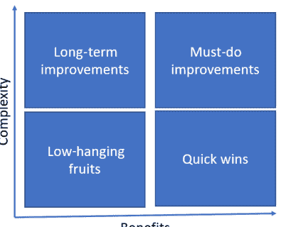

## 1 自动化之旅与识别合适的业务流程

数字化转型是当今的热门关键词之一，因为机器人流程自动化 (RPA) 正在改变我们的工作方式。

UiPath 是 RPA 领域的领先供应商，为流程自动化提供了先进的 (SOTA) 平台。UiPath 自动化平台包含 20 多种不同的产品，以满足不同的自动化需求。与其他 RPA 工具相比，UiPath 提供的 SOTA 功能是该公司成为市场领导者的原因之一。此外，UiPath 还提供一个高标准认证计划和学习平台，帮助用户发挥技术的力量。

UiPath Certified Professional 计划提供两项认证考试，包括高级认证和初级认证。初级认证适用于初级 RPA 开发人员、解决方案架构师、**业务分析师 (BA)**，以及任何希望在 RPA 领域发展职业生涯的业务用户。高级认证评估更深层次的 RPA 专业知识，专为高级开发人员设计。本书主要侧重于提供 UiPath 初级认证指南，涵盖考试所需的所有方面。

在本章中，我们将探讨数字化转型的重要性及其推动因素。本章还将阐述商业中的一些 RPA 用例，随后介绍识别合适自动化流程所需的关键步骤。在开始 RPA 之旅之前，了解并掌握这些信息至关重要。本章涵盖的主题将让您了解世界范围内流程自动化的现状、其重要性以及涉及的关键资源。

在本章中，我们将介绍以下主题：

- 了解自动化为何推动数字化转型
- 在商业中实施 RPA
- RPA 可以自动化哪些内容？
- 为 RPA 识别流程
- 了解 RPA 之旅的各个阶段
- 了解 RPA 项目中的 RPA 资源与职责

### 技术要求

本章将介绍理论内容，因此无技术要求。

## 了解自动化为何推动数字化转型

人们的工作方式多年来一直在变化。在计算机时代之前，人们大量手动完成复杂活动；然而，随着计算机的出现，人们逐渐转向数字化工作方式。今天，世界上每位员工都与某些软件应用程序交互，以完成日常工作。所有这些操作的中心联系人仍然是我们（即人类）。因此，尽管我们开发了许多软件应用程序来处理日常活动，但我们仍在忙于执行同样平凡重复的工作。随着时间的推移，工作再次堆积起来，人们每天都在执行一套标准的重复性任务，如同机器人一样工作。

摆脱这些重复性工作的解决方案是什么？答案就是 RPA。

RPA 是一项经过多年发展的技术。在早期阶段，存在特定且依赖于应用程序的自动化工作流，例如 Microsoft Excel 中的宏。这些自动化脚本仅在应用程序范围内工作，并自动执行一些耗时的手动活动。这项技术逐渐演进，接着我们能够使用复制实际用户活动的工具，从而提升了自动化能力和任务执行效率。软件行业是一个快速增长的行业，您每天都会接触到许多新技术。最新技术——例如人工智能 (AI)、机器学习 (ML)、Microsoft、Google 以及其他认知服务——的发展，扩展了机器人的功能。如今，RPA 结合了多种技术，例如工作流自动化、ML、AI、智能字符识别 (ICR) 等等。

RPA 是一种在数字化界面中自动执行此前由人类完成的任务的技术。该软件使用计算机机器人来运行应用程序，其方式与人类通过与软件用户界面 (UI) 交互所做的方式相同。除了模拟人类交互外，RPA 还包括调用后台服务（例如应用程序编程接口 (API)、数据库等）的功能，以高效且准确地执行操作。RPA 的目标是用数字化劳动力取代人类执行的重复性任务，从而专注于组织中更具附加值的活动。软件机器人充当您的虚拟助手，只需使用现有应用程序而无需更改其现有基础架构即可执行操作，并始终如一地记录每一步，以便用于报告和维护。此类机器人能够与任何软件应用程序交互，模拟人类操作。

此外，机器人可以每天 24 小时、每周 7 天无误工作，且几乎无需人工干预。RPA 主要针对高度手动、重复性、基于规则的流程，这些流程的异常率低，且采用标准的电子可读输入。这些机器人被视为虚拟劳动力，由业务团队和 **信息技术 (IT)** 团队管理其运营。

如今，RPA 不仅是一种自动化类型，也是行业中最流行的技术之一。RPA 因其独特功能而广受欢迎，这些功能使其成为推动数字化转型的技术。RPA 的某些独特功能将在此详细介绍：

- **RPA 是一种非侵入式技术**：在组织中使用 RPA 不需要对现有 IT 基础架构进行重大更改，也不需要与现有软件应用程序进行深度集成。RPA 是一种能够为流程自动化提供可靠、快速且具有成本效益的解决方案的技术。

- **RPA 易于扩展**：RPA 实施通常不局限于特定流程。此外，自动化的业务流程也会随着时间而变化。实施 RPA 的组织通常会寻找方法，根据未来需求快速扩展或缩减。因此，RPA 解决方案的构建方式使其能够轻松扩展，而无需太多麻烦。

- **RPA 具有前瞻性**：当今构建的自动化解决方案使用的是当前可用的技术。然而，这些机器人很容易扩展以使用明天可用的技术。

- **客户期望**：每天对服务的需求都在增加。然而，为了满足不断增长的需求，组织必须在昂贵资源上投入大量资金。使用 RPA 可以帮助组织降低在新资源上的支出，因为 RPA 带来了虚拟劳动力的力量，能够快速满足不断增长的需求。除此之外，利用虚拟劳动力可以提高流程的效率和可靠性，因为机器人可以提供高准确率。

- **合规与法规**：每个组织都必须遵守政府规则和法规。满足合规性和法规要求需要大量手动工作，因为有许多任务需要完成。然而，使用虚拟劳动力有助于遵守规则和法规，因为机器人会生成执行日志以用于合规性报告。

数字化转型当今是一个必不可少的话题，因为 RPA 正在改变我们在个人生活和工作中的工作方式。这些虚拟劳动力可以利用面向未来的技术，快速满足客户期望、合规性和监管要求。需要知道的是，机器人的能力随着时间的推移不断扩展，使它们能够模拟在数字平台上执行的几乎所有操作。如今，此类机器人正在多个行业大规模应用。

## 业务中实施 RPA

业务中的 RPA 能够在机器人和人类员工之间建立伙伴关系，让人类专注于他们最擅长的事情。一旦组织实施 RPA，首先浮现的问题就是：当任务被自动化时，机器人会做什么，人类员工又会做什么？机器人最擅长处理枯燥、重复且高容量的任务，并能以高效率和高精度完成自动化。当机器人负责手动任务时，人类员工可以不必再为痛苦的琐碎活动烦恼，而是专注于与人面对面的讨论，为业务管理制定战略解决方案。此外，人类员工还可以专注于自我提升技能，以更好地胜任组织内部的管理层级机会。

有人可能会问，引入 RPA 是否会导致他们丢失工作。RPA 并不是人类员工的替代品。RPA 只处理人们过去执行的重复性和琐碎的活动。因此，引入 RPA 消除了人们过去执行的某些任务，让人们有更多空闲时间专注于战略活动，而非重复性操作。尽管机器人拥有 AI 来处理特定动作，但在战略决策方面，机器人无法替代人们多年积累的经验和复杂推理能力。

当今，不同行业的组织已实施 RPA 以自动化其流程。以下截图展示了其他行业中已自动化的一些功能：

| 行业 | 自动化流程 |
|---|---|
| 服务业 | - 客户开票 - 理赔处理 - 呼叫中心流程 |
| 金融 | - 欺诈检测与预防 - 数据集成（内部和外部来源） - 账户清算 - 自动开户 - 自动销户 - 贷款处理 - 信用卡申请 - 启用/禁用信用卡 - 客户入职 |
| 医疗保健 | - 数字化和更新患者记录 - 库存管理 - 发票清算 - 自动化报告生成 |
| 教育 | - 课程注册 - 出勤管理 - 课程日程管理 - 成绩和报告单处理 |
| 技术 | - 投诉管理 - 通过更新数据管理客户 - 启用/禁用客户服务 |
| 制造业 | - 库存管理 - 采购管理 - 支付处理 - 客户沟通 - 发票处理 - 采购订单管理 |
| 零售 | - 员工入职 - 员工离职 - 员工工资单处理 - 发票处理 - 退货处理 - 销售分析 |
| 政府 | - 福利索赔 - 欺诈预防 - 付款人数据更新 |

图 1.1 – 业务中的 RPA 示例

除图 1.1 所示表格中包含的内容外，每个行业还有更多流程适合自动化。

前面的列表展示了自动化的一些最常见用例。接下来将详细介绍其中一些流程。

### 工资单处理

工资单处理是任何组织中的典型流程。工资单指的是每月进行的、用于跟踪员工考勤和薪资（或激励付款）的操作。工资单计算非常耗时，因为工资单是基于不同因素计算的——例如，为了计算总月薪，相关人员需要计算工作小时数/天数、发薪日次数、税金、奖金、津贴等。为每位员工进行此检查既复杂又高度依赖人工。

此外，有时会出现员工未正确更新考勤的情况。在这种情况下，**人力资源（HR）**代表需要亲自（通过电子邮件或电话）联系他们，并要求他们在执行此操作前更新考勤。RPA 可以自动访问人力资源应用程序，甚至手动维护的考勤表，以捕获所需信息并完成工资单计算。该流程还可以通过自动化实际银行转账（将资金转入员工薪资账户）来进一步实现自动化。

### 客户信息管理

公司的主要目标之一是保持良好的客户关系。保持良好关系需要与客户相关的每一条记录都能在中央系统中访问，例如 **客户关系管理（CRM）**应用程序。然而，大型公司分布在不同地理区域，因此要维护一个合适的 CRM 系统具有挑战性，并且需要大量的数据录入和频繁更新。现在，通过引入 RPA 来维护和更新 CRM 应用程序中的此类信息。连接到各种数据源的机器人会捕获所需信息，并在无需任何人工干预的情况下轻松更新 CRM。

## 发票处理

几乎所有组织都需要处理文档，其中最常见的类型之一是发票。组织以不同方式接收发票，例如软复印件或硬复印件。此外，其中一些发票是手写的，另一些是计算机生成的，这增加了复杂性。数据录入人员需要从这些发票中提取关键信息，并更新下游应用程序以及时维护财务记录。通常，组织每天会收到许多发票，需要及时进行数据录入、管理验证和系统更新，所有这些都需要耗费大量人工小时。将 RPA 引入此类流程在数据准确性、效率和可靠性方面具有诸多好处。机器人具备从发票中提取所需关键信息的智能，能够基于预定义的一组规则执行验证，并以最少的人工参与更新下游应用程序。

## 财务报表对账

财务报表对账涵盖财务团队运营的很大一部分，包括将订单、付款、损失、毛利等与月末收到的内部账户和财务报表进行匹配。这是一项非常耗时的任务，涉及许多财务员工，因为他们处理的账户每天会进行大量交易。为了确保财务报表在月末前准备就绪，财务团队每天辛勤工作，完成并匹配前一天的财务报表，以减轻月末的工作量。将 RPA 引入此类流程已显示出显著改进。机器人可以比财务团队管理的所有对账快得多、更准确地执行相同的操作。

## 呼叫中心自动化

呼叫中心在为其宝贵客户提供更好、更快的客户支持方面发挥着重要作用。一旦呼叫中心坐席接到客户来电，他们必须先执行初步检查以验证和识别客户，然后才能提供服务。以银行的呼叫中心为例。在这种情况下，客户可能会就诸如请求账户信息、信用卡/借记卡故障投诉、启用和禁用服务或其他事项进行咨询。呼叫中心坐席必须访问多个系统，检索所需信息以执行初步验证，并为客户提供基本服务。执行上述操作需要时间，并且会分散坐席与客户讨论时的注意力。将 RPA 引入此类流程，使机器人能够理解双方之间的对话。基于这种理解，机器人会从系统中执行所需的数据检索。机器人最终会在屏幕上自动显示信息，让坐席能够专注于对话以提供更好的服务。

## 贷款处理

尽管银行和金融机构使用许多软件应用程序来执行其业务，但一些流程（如贷款处理活动）仍然需要大量手动处理。此外，一些金融组织仍然使用基于纸质的贷款申请表格。一旦客户填写申请表并连同其他所需文件提交申请，银行代表将核实提交的数据。数据验证通常包括验证客户的个人信息、与其他银行获得的其他融资进行交叉核对、还款能力等。此类检查通过连接多个外部应用程序来完成，通常需要很长时间。背景调查完成后，银行经理根据特定标准进行审批。为贷款处理引入 RPA 带来了许多好处，因为大多数这些功能——例如阅读申请表、执行背景调查、计算可批准的贷款金额等——很容易实现自动化。

除了上述流程，世界上还有许多更多令人兴奋的流程由机器人处理，使它们能够专注于更多增值活动。

> **重要说明**
> 
> 业务中的 RPA 使员工能够专注于更具战略性的举措，而机器人处理交易活动。本章节介绍了世界各地多个组织中常见的自动化流程。大多数需要自动化的业务流程都很复杂，需要执行许多步骤。了解 RPA 机器人可以执行的所有活动，以满足此类复杂的业务要求至关重要。RPA 机器人执行的简单操作有时需要多种技术的组合。

## RPA 可以自动化什么？

如前所述，RPA 机器人可以模仿数字平台上的人机交互。以下是 RPA 机器人可以处理的极少数操作示例：

- 自动化阅读、发送电子邮件和附件
- 登录 Web 和企业应用程序
- 移动文件和文件夹
- 复制和粘贴数据
- 在 Web/桌面应用程序中填写表单
- 将数据读入和写入数据库
- 跨多个系统报告
- 从网页抓取数据
- **物联网 (IoT)** 数据采集和分析
- 执行从简单到复杂的计算
- 从扫描和计算机生成的结构化或半结构化文档中提取数据
- 收集社交媒体统计数据并对其执行不同的分析
- 自动化客户服务
- 标准信函撰写

考虑到技术进步和 RPA 机器人功能的扩展，机器人可以执行前面列表中未包含的更多功能。如今，新的技术改进将 RPA 提升到了另一个水平，称为**超自动化**。超自动化的概念涵盖了更多功能，例如 AI 技能、ML、长期运行的工作流、流程挖掘、原生集成和高级分析。

将具有 AI 功能的 RPA 与 **自然语言处理 (NLP)**、ICR、**光学字符识别 (OCR)** 和 AI 计算机视觉相结合，使机器人能够执行更先进、更复杂的任务。使用 AI 还允许机器人通过 ML 自我学习。随着时间的推移训练机器人的能力有助于提高其准确性和可靠性。此外，借助长期运行的工作流概念，机器人可以处理更多样化的业务场景，人类可以与机器人在特定决策点无缝交互，而无需担心决策点前后发生的情况。

## 确定适用于 RPA 的流程

作为人类，我们通过简单的鼠标或键盘操作与软件应用程序交互。但是，我们在不同环境中执行这些步骤，例如台式机或笔记本电脑以及远程或**虚拟机 (VMs)**。当今技术已允许 RPA 机器人以更高的精度模仿相同的操作，无论它们在哪个环境下工作。机器人执行的所有活动都需要监控，以确保数字劳动力的最佳利用。此外，监控允许管理员跟踪和监控执行时间和故障以及机器人的空闲时间。当今的数据分析能力提供了对这些数据的精确跟踪和分析，以计算**投资回报率 (ROI)**、利用率、机器人空闲时间等。超自动化是一个概念，它不仅涵盖机器人的开发和监控，还使组织能够精确监控和分析业务流程本身。业务流程挖掘是超自动化提供的一种概念，用于探索流程、识别流程的性质、异常、执行流程的不同方法、已执行的步骤、瓶颈和自动化可能性。

当今的 RPA 不仅仅是一种技术——它是 AI、ML、NLP、ICR 等多种技术的组合。该组合允许 RPA 机器人在无需人工干预的情况下执行各种从简单到复杂的活动。RPA 必须明智地应用于业务流程，在确定用于自动化的业务流程时需要考虑许多因素。

在决定流程自动化潜力时，我们会查看几个主要特征。从高层次来看，我们可以将这些特征分为以下两个主要部分：

- 流程适配性
- 自动化复杂性

在计算流程自动化适配性时涉及几个因素。下表说明了确定流程适配性时考虑的因素：

| 流程适配性 | |
|---|---|
| 流程应基于规则 | 对所处理数据做出的决策必须由一组预定义的规则支持。 |
| 异常率低 | 流程不应存在由于未知条件而无法完成流程的许多场景。 |
| 重复操作 | 考虑到流程的重复性，它们需要进一步分类： • 手动且非重复：需要手动执行，但每次运行执行的步骤不同且非重复的流程。此类性质的功能不适合自动化，因为自动化需要一组标准步骤。 • 手动且重复：需要手动执行，并且每次运行执行的步骤相同且重复的流程。此类性质的功能高度适合自动化。但是，重复操作需要适当的标准以确保高效率。 • 半自动化且重复：流程中执行的步骤是重复的，但其中一些步骤已使用宏或其他自动化方法自动化。通过对流程进行适当分析，可以识别可能的自动化机会。 • 已自动化：如果流程已自动化，则无需引入 RPA。 |
| 标准输入 | 提供给流程的输入应为电子且易于读取，或者可使用 RPA 关联的技术（例如 OCR）读取。 |
| 稳定流程 | 流程不应在执行的步骤上频繁变更。 |

业务流程应满足图 1.2 中列出的所有因素才能符合自动化条件。除了流程适配性因素外，自动化复杂性也是确定合适自动化流程的一个关键方面。下图说明了确定流程自动化复杂性时需要考虑的特征：

| 自动化复杂性 | |
|---|---|
| 应用程序类型 | 我们今天使用的一些应用程序（例如 Office 套件）很容易自动化。但是，我们确实会遇到非常复杂的应用程序，例如大型机应用程序，这些会增加自动化工作量。完整的流程可能需要与多此类应用程序交互。在确定流程自动化适用性时，这一点起着重要作用。 |
| 应用程序中需要交互的屏幕数量 | 类似于人类工人，RPA 机器人与应用程序特定屏幕上显示的元素交互。执行的操作可能需要导航到应用程序的多个屏幕。机器人根据应用程序屏幕上显示的元素被编程为执行不同的操作。需要交互的屏幕数量越多，编程机器人所需的工作量就越大。 |
| 输入类型 | 如前所述，输入越标准化，处理和准备数据所需的工作量就越少。但是，存在信息未标准化并需要转换为标准格式的情况，这需要额外的工作量。复杂性取决于输入的标准化程度。例如，如果 RPA 机器人需要从一段文本中提取数据，这是最复杂的输入之一。另一方面，如果 RPA 机器人需要从结构化 Excel 文件中提取数据，这是最不复杂的输入之一。 |
| 输入数量 | 输入数量越多，复杂性越高。 |
| 业务决策 | 流程中做出的决策数量越多，复杂性越高。 |

图 1.3 – 确定适用于自动化的流程时的流程复杂性因素

决定某个流程是否适合自动化，需要考虑所有讨论过的因素。根据讨论因素的结果，将流程映射到流程评估矩阵中，以比较和识别最佳流程。下图展示了每个流程在评估后映射到的流程评估矩阵。每个流程根据自动化后产生的复杂性和收益进行评估，并映射到矩阵的相应框中。此处显示的矩阵在对已评估流程进行优先级排序和分类方面发挥着重要作用：

图 1.4 – 流程评估矩阵

确定流程落入哪个桶后，组织可以根据之前的矩阵对自动化计划进行优先级排序。在初期，组织可以优先处理快速见效的流程，因为这些流程不太复杂，且在较短时间内能带来最高收益。垂手可得的项目是最佳的起点，能够展示自动化如何改善人们的工作方式。落入长期改进桶的流程通常在自动化中被忽略，因为与所需投入相比，它们不提供显著优势。落入垂手可得项目和必须改进类别的流程会根据组织的战略计划获得RPA优先级。此外，落入必须改进类别的流程通常需要标准化来改进流程。改进后的流程将再次评估，并根据评估后落入的桶进行优先级排序。

在组织或部门中自动化每个流程并非良好做法。在实施RPA之前，重要的是识别所获得的收益、所需的努力和资源，以及流程本身是否适合自动化。在必要时无法进行流程评估和标准化，可能导致在没有适当策略的情况下应用RPA后出现更多低效率和高成本。因此，以下评估策略在任何RPA项目中都至关重要。

## 了解RPA之旅的各个阶段

分析流程并正确分类可以在RPA项目中获得快速见效；然而，并非所有功能都是快速见效的。为了从这些项目中实现长期效果，组织必须拥有正确的心态、适当的资源和合理的目标，以获得最佳结果。因此，每个RPA项目都需要在旅程的不同阶段涉及多种关键资源。

每个RPA项目在其自动化旅程中需要经历六个阶段。这些阶段在下图中描述：

图 1.5 – RPA之旅

以下各部分将更详细地描述每个阶段。

### 发现

发现是任何RPA项目的初始阶段。此阶段的主要目标是在组织内宣传自动化，并找到最适合自动化的流程候选者。执行发现有两种方法，如下：

- 组织已经知道需要自动化的流程。
- 发现所有可能的自动化候选流程。

如果组织确实知道需要自动化的流程，发现阶段的范围将局限于已识别的流程。RPA团队中的关键资源，如业务分析师（BAs）和RPA解决方案架构师，可以与业务团队一起详细了解流程。RPA专家和业务团队进行多次需求收集会议，以捕捉了解流程所需的所有信息。团队的任务包括流程评估和现状流程的详细映射。BAs详细绘制现状流程，解释所有涉及的子流程。流程图有助于发现标准化要求和需要自动化的步骤。RPA团队记录所有信息，并呈现两份标准文档，如下所示：

- **流程定义文档 (PDD)**：包含关于现状流程及其标准化和自动化方式的详细信息。
- 解决方案设计文档 (SDD)：包含自动化解决方案的所有技术细节。

然而，如果组织没有特定需要自动化的流程，则需要对所有可用功能进行彻底分析，以识别可能的候选者。在这种情况下，RPA专家（如BAs和解决方案架构师）将与所有关键业务人员一起，了解现有流程并识别合适的自动化机会。团队遵循之前解释的相同步骤来进行评估。所有分析的流程都会被记录，并放入前一节讨论的评估矩阵中。一旦评估矩阵更新，最重要且最合适的业务流程将根据成本、ROI等不同因素进行选择。其余的功能将保留在自动化管道中，以便跟踪未来几个月内需要自动化的已识别流程。所有这些流程在自动化之前都要经过一定程度的标准化和治理程序，以改进流程。

### 构建

在发现阶段识别的自动化机会的开发在构建阶段进行。执行自动化项目开发有两种不同的方法，如下所示：

- 卓越中心 (CoE)驱动：核心开发团队由RPA专家组成，如RPA解决方案架构师、RPA开发人员和经验丰富的BAs，他们负责发现和开发自动化解决方案。RPA团队在整个自动化旅程中与业务用户合作，以确保成功交付。
- 民主化方法：采用这种方法，业务用户自己进行开发。并非所有业务用户都可能有技术经验，因此他们被赋予使用不需要专业或编程知识的工具来执行操作的能力。

开发完成后，所有自动化解决方案都将经过严格测试，以确保效率、准确性、可靠性，并确保编码符合开发标准和最佳实践。

### 管理

构建的自动化解决方案需要不时进行部署和更新。跟踪项目中每次部署和更新非常重要，原因有很多，例如：

- 跟踪所进行的更改
- 在需要修复bug时比较不同版本
- 在紧急情况下回滚到之前的版本
- 监控所创建自动化解决方案的使用情况
- 访问管理解决方案

### 运行

运行阶段在每个自动化项目中都至关重要。机器人在本阶段执行已部署的解决方案。机器人的执行和分配根据组织要求进行配置。根据组织的需求，机器人在用户的机器或虚拟环境中执行开发的流程，无需人工干预。

### 参与

每个业务流程都包括需要执行用户进行决策的步骤。其中一些决策基于规则，但有些需要专业知识和用户体验（UX）。在这种情况下，机器人和用户必须协作完成某些步骤，而机器人处理最复杂的活动。这个概念称为“人在环回路”（human in the loop），即机器人为用户分配任务，一旦用户完成这些任务，机器人就会接管其余活动的控制权。

### 度量

引入RPA会在组织内产生影响。产生的效果需要进行衡量，以了解如何扩展RPA举措。这些衡量指标提供了关于自动化结果和所产生影响的洞察，以使RPA策略与组织目标保持一致。

与任何软件开发项目一样，RPA项目也有生命周期。每个RPA项目在其生命周期中都必须经过一组强制性步骤，以确保高效且有价值的交付。生命周期的每个阶段都需要不同的资源。下一节将解释RPA项目所需的资源及其各自的职责。

## 了解 RPA 项目中的 RPA 资源和职责

当我们探讨 RPA 之旅的不同阶段时，也会接触到各个项目中的许多专家。这些专家依据自身专长执行多项任务，以确保 RPA 项目高质量、按时交付。接下来，我们将详细了解这些角色。

### RPA 解决方案架构师

解决方案架构师负责为拟议的业务流程设计 RPA 解决方案的架构。解决方案架构师与 BA 协作，捕获需求并将确定的业务场景转化为技术方案。解决方案架构师将技术架构知识转移给 BA、业务用户和 RPA 开发人员，以便在开发前最终确定方案。解决方案架构师还充当开发团队负责人（但不执行代码开发），以确保代码质量和标准。架构师从流程的第一阶段参与，直至方案被接受并部署。

### RPA 开发人员

RPA 开发人员负责开发解决方案架构师提供的解决方案架构。RPA 开发人员与开发工具交互，并对不同的开发技术有着出色的了解，以在预期标准内交付最终输出。RPA 开发人员主要参与项目生命周期的构建阶段，执行开发、测试和 bug 修复。

### BA（业务分析师）

BA 主要负责收集所有所需信息以了解流程并绘制其现状版本。BA 还与 RPA 解决方案架构师密切合作，开发涉及流程标准化和自动化的未来业务流程。BA 还应了解 RPA 能力及其工作原理，以提供更好的解决方案。此外，BA 还负责将捕获的需求和解决方案转化为 PDD，移交给业务团队和开发团队。BA 主要在项目的发现阶段参与。不过，BA 也会不时参与项目的开发阶段，以确保需求的正确交付。

### 实施经理

实施经理管理整个项目及参与团队。实施经理通过整体管理项目，确保项目里程碑按时达成。通常，实施经理是业务利益相关者的唯一联系点。

### 基础设施工程师/经理

基础设施是任何 RPA 项目中至关重要的方面。基础设施工程师/经理负责通过提供所需的硬件和软件配置，保障机器人的安全性以及所开发流程的高效执行。

### RPA 支持

该角色在业务用户日常使用机器人时遇到问题或顾虑时提供支持。

之前提到的角色作为 CoE 团队的一部分参与项目。更多来自业务用户的利益相关者也将加入团队，以确保项目知识转移和交付的成功。

### 小结

本章介绍了 RPA，并探讨了为什么它是数字化转型的驱动力。我们进一步讨论了 RPA 为组织带来的好处，以及使用 RPA 在不同行业中自动化的流程及其结果。其中一些流程进行了更详细的讨论，解释了如何应用 RPA。此外，我们还探讨了需要考虑的因素，以确定哪些业务流程适合 RPA。

此外，我们还介绍了这些因素如何帮助在流程评估矩阵中比较流程，以及矩阵中哪些细分部分值得考虑自动化。RPA 之旅适用于每个经过自动化的流程。本章还阐述了 RPA 之旅的关键阶段以及涉及的重要资源有哪些。最后，本章介绍了 CoE 团队中每个基本资源的角色和职责。

既然我们了解了什么是 RPA，现在正是向您介绍 UiPath 生态系统以及 UiPath 用于构建自动化解决方案的工具的时机。第 2 章“UiPath 生态系统”将向您介绍 UiPath 生态系统、开发工具以及设置开发环境。
