## 2 UiPath 生态系统

UiPath 平台是一个端到端的自动化平台，通过帮助组织提高韧性、适应不断变化的市场趋势并持续改进自身流程，使其能够取得显著成果。这是一种增强版的自动化，包含机器学习、流程挖掘、任务挖掘、计算机视觉等多种先进技术。UiPath 平台提供所有所需的工具和服务，支持企业向完全自动化企业的数字化转型。

让我们先概览一下 UiPath 平台，并了解如何开始使用 UiPath Studio 构建从简单到复杂的自动化。

本章包含以下部分：

- UiPath 平台概览
- 设置 UiPath Studio
- UiPath Studio 界面

### 技术要求

安装 UiPath Studio 应具备以下硬件和软件：

| 项目 | 最低 | 推荐 |
|---|---|---|
| CPU 核心 | 2 x 1.8 GHz 32 位 (x86) | 4 x 2.4 GHz 64 位 (x64) |
| 内存 | 4 GB | 8 GB |
| 操作系统 | Windows 8.1 | Windows 10 |
| .NET Framework | 版本 4.6.1 | 版本 4.6.1 或更高 |

图 2.1 – 技术要求

如需下载并安装 UiPath Studio，请访问 `https://www.uipath.com/start-trial` 进入 UiPath Automation Cloud 门户，并按照屏幕说明在 UiPath 门户上注册。

> **重要说明**
>
> 本章使用 UiPath Studio 2020.10 创建。某些元素在最新的社区版中可能有所不同。

### UiPath 企业级 RPA 平台概览

UiPath 企业级 RPA 平台提供多种工具和技术，可将多个应用程序和部门无缝集成到完全自动化的企业中。该平台有助于让组织中的每个人都参与到自动化之旅中，以自动化更多劳动密集型任务。

要实现成功的端到端自动化，组织需要快速识别并自动化所有可能的业务流程，让组织中的每个人都能为自动化之旅做出贡献，使人与机器人能够共同实现自动化，并管理完整的自动化周期。RPA 生命周期包含以下阶段，将在后续章节中讨论：

- **发现**
  流程专家使用发现工具识别、分析并记录需要自动化的流程。

- **构建**
  开发人员使用 UiPath Studio 以较少的工作量自动化更多流程。

- **管理**
  将开发的解决方案部署到 UiPath Orchestrator 以执行自动化。

- **运行**
  您可以使用 UiPath Robots 安全且灵活地执行自动化解决方案，这些机器人可以访问您的应用程序和数据以执行自动化。

- **参与**
  人类与机器人协同行动，共同完成自动化目标。

- **衡量与治理**
  确保自动化流程与业务预期保持一致。

通过实施 UiPath 企业级 RPA 平台，可以实现所有这些功能，如图 2.2 所示，您可以看到关键组件的运行情况。

UiPath 平台的核心组件是 **UiPath Studio**、**Orchestrator** 和 **Robots**，根据企业的自动化需求，它们还可以利用 Automation Hub、Task Mining、AI Fabric 和 Insights 等高级工具。在 RPA 生命周期中，使用组合工具和技术实现端到端自动化的过程也可称为 **超自动化**。

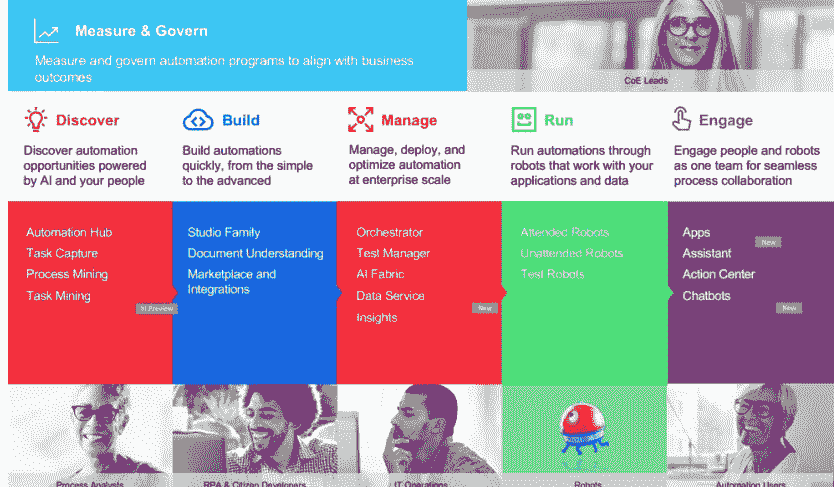

图 2.2 – UiPath 企业级 RPA 平台

你应该已经从上一章中对超自动化和 RPA 旅程的各个阶段有相当的了解。现在，让我们进一步探索，了解每个阶段用于实现超自动化的工具和技术。

## Discover

Discover 阶段涵盖了解、识别和定义自动化流程需求的过程，通过吸引组织内多个利益相关方参与，例如业务用户、**卓越中心 (CoE)** 领导者和 RPA 开发人员。此阶段使用的不同工具包括 **Automation Hub**、**Task Capture**、**Process Mining** 和 **Task Mining**；让我们详细讨论每个工具：

- **Automation Hub**：该工具的主要思想是鼓励组织内的任何员工通过简单的提交流程贡献自动化构想，以便通过吸引相关利益相关方，将构想转化为可工作的解决方案。该工具具有多种功能，例如将流程导出为 XAML 或 PDD 文件、对流程进行截图以及检查 ROI 预测。

- **Task Capture**：UiPath Task Capture 用于通过从员工处收集详细信息来直接深入了解日常自动化流程。一旦确定了潜在的自动化候选对象，你的 **主题专家 (SMEs)** 可以就特定任务提供其专业知识，并帮助实现 RPA 目标。

- **Process Mining**：Process Mining 是一种流程分析工具，为组织所经历的运营和流程挑战提供解决方案。它通过实施基于事实的技术，明确区分有用流程和耗时流程，从而改善业务和客户参与度，并以图形表示形式展示流程的内部功能。

- **Task Mining**：UiPath Task Mining 是一种自动化机会发现工具，用于收集信息（例如桌面数据，包括截图和日志数据，如鼠标单击和按键），然后运行 **机器学习 (ML)** 模型来分析数据，并建议一系列具有高自动化潜力的流程，这些流程可以以多种方式惠及不同的利益相关方。

## Build

使用 UiPath 平台，无论之前的编码技能如何，每个人都应该能够构建自动化。UiPath 自动化构建工具有三种类型：

- **StudioX** (面向公民开发者)：UiPath StudioX 是一种用于自动化业务应用程序的完整解决方案。它旨在通过与 Microsoft Office 应用程序无缝集成并提供直观的用户界面来帮助每个业务用户自动化重复性任务，从而轻松创建自动化。作为业务用户，你可以通过将相应活动拖动到设计器面板，为项目创建分步图形表示。这可以与 RPA 利益相关方进一步审核，以进行分析和开发。

- **Studio** (面向 RPA 开发者)：UiPath Studio 是一种专业开发工具，用于创建复杂业务流程。它在强制执行标准、减少错误和缩短开发时间的同时支持团队协作。UiPath Studio 非常适合具有编程背景且希望创建复杂自动化项目的开发者。

- **Studio Pro** (面向专业开发者)：除了 Studio 的所有功能之外，UiPath Studio Pro 还提供对高级功能的访问，例如测试自动化、应用程序测试、RPA 测试、API 测试和移动自动化。简而言之，它是 UiPath Studio 的超集，可直接与 UiPath Test Manager 集成，并具有针对软件测试自动化的特定功能。

所有三种产品都有一个统一安装程序。下载并运行安装步骤后，你可以选择最适合自己的配置文件。可以随时从 **设置** 面板在配置文件之间切换。

## Manage

构建机器人后，需要对其进行有效管理，以免在部署或生产环境中出现问题。Manage 阶段是控制所有其他自动化资源的集中位置。Manage 阶段使用不同的工具，让你能够从零开始并在最少天数内进行生产部署。这也可以部署在涉及短期且重复的流程以及较少机器人的场景中。让我们逐一了解这些工具：

- **Orchestrator**：UiPath Orchestrator 有助于远程控制机器人以执行单次或多次业务流程执行。它支持管理各种资源，例如资产、队列和触发器，并有助于管理机器人及其环境。这还可以与第三方应用程序和解决方案无缝集成，以便在多个环境中执行持续任务。

- **AI Fabric**：UiPath AI Fabric 用于将 ML 与 RPA 集成。为业务流程开发的 ML 模型可以使用 AI Fabric 导入到 UiPath，供机器人执行业务流程。ML 模型是在 UiPath 外部使用第三方应用程序（例如 Python 和 AutoML）构建的，然后使用 AI Fabric 与 RPA 集成。

- **Test Suite**：UiPath Test Suite 是一组紧密集成的工具包，通过与测试管理和 **应用生命周期管理 (ALM)** 工具集成来整合测试流程。UiPath Test Suite 包括 Studio Pro、Orchestrator、Test Manager Hub 和 Test Manager 等工具的组合。

- **Data Service**：UiPath Data Service 是一种持久数据存储服务，可为你的 RPA 项目提供更高级的数据建模和强大的数据存储功能。这个集中位置旨在安全地存储和管理 UiPath 内的业务数据，并与 UiPath Studio 和 UiPath Robots 集成，让你构建能够利用丰富的关系数据类型、集成安全性以及即时配置和部署等功能的自动化，同时考虑可扩展性。

- **Insights**：Insights 使用执行业务流程时的现有指标和运营数据，在 UiPath Orchestrator 中提供报告平台。通过使用自定义设计的仪表板可视化跨所需指标的公司数据，它使你能够发现新的分析见解并跟踪绩效指标，并可以向你发出错误和异常警报。

## Run

有两种机器人开发类型——分离有人值守和无人值守机器人的功能，并添加集成，使机器人在不太费力的情况下成为你工作的一部分。让我们简要地看看这两种类型：

- 有人值守机器人：这些机器人与人类用户协同工作以执行业务流程。这些是典型的 RPA 候选项，负责执行大部分重复性和枯燥的工作，机器人会负责处理执行。在这类执行中，人工干预仍然必不可少，主要是在业务流程执行过程中输入凭据或授权事务。

- 无人值守机器人：这些机器人执行成批进行的复杂重复性任务。它们还用于无需人工干预且执行过程中涉及少数敏感流程（例如签名验证和发票审批）的场景。

## Engage

在 Engage 阶段，人与机器人协同工作以实现共同的自动化目标。机器人不允许执行某些操作，例如审批发票或验证签名，这些操作完全依赖人类完成。同样，人类依赖机器人执行所有重复性、手动和枯燥的任务。在 Engage 阶段，我们有不同的工具来实现自动化目标，具体如下：

- Apps：UiPath Apps 是一个基于云的低代码应用程序开发平台，可让你构建和共享提供引人入胜的用户体验的企业级自定义应用程序。使用 UiPath Apps，你可以快速构建自定义业务应用程序，利用自动化的力量连接到任何基础云或本地系统中的数据。

- Action Center：UiPath Action Center 为业务用户提供了一种处理可操作项目并向机器人提供业务输入的方式。它支持长时间运行且需要人工干预的无人值守工作流，因为工作流执行被拆分为多个可管理的工作流，并可以根据人类用户的输入在稍后执行。例如，如果执行审批流程需要签名验证，机器人会通知人工审批者，并根据人类的输入执行审批流程。

- Assistant：UiPath Assistant 是所有人值守自动化需求的中心。它是一个应用程序，允许你查看、管理和设置流程提醒。作为服务的客户端，它可以根据用户输入请求启动或停止作业并更改设置。

在本节中，我们讨论了RPA的超自动化平台/生命周期。我们还讨论了RPA企业平台各阶段中使用的不同工具。虽然我们接触过多种工具，但UiPath Studio在构建阶段是Associate Certification的重点，你将在即将到来的章节中学习如何安装和使用UiPath Studio。

## 设置UiPath Studio

探索UiPath Studio组件的最佳方法是开始使用它们来满足您的日常自动化需求。在本书中，您将有大量机会学习和实践，所以让我们从安装UiPath Studio开始。

## 探索不同的版本

首先，让我们简要了解一下UiPath的不同版本：

- Community Edition：Community Edition始终免费，附带两个Studios、三个Robots和一个云托管的Orchestrator，用于设计自动化。用户可以使用UiPath Forum支持和UiPath Academy课程。

- Enterprise Server Edition：此UiPath Studio版本主要面向大型企业的本地企业部署。它可以拥有无限数量的Studios、一个本地Orchestrator和无限数量的Robots，用于设计自动化。它提供UiPath技术支持团队的高级支持，以防出现任何问题，并提供来自UiPath官方培训合作伙伴的专业培训。

- Enterprise Cloud Edition：UiPath Enterprise Cloud Edition通过将基础架构维护在云端，满足Community级和Enterprise级用户的自动化需求。它提供通过云端即时访问构建自动化流程所需的所有工具和服务，并支持自动化资源的无限扩展，以实现完全的企业级容量。此版本安全性高且合规，并提供集中式用户访问管理。此外，此版本还提供UiPath技术支持团队的高级支持，以防出现任何问题，并提供来自UiPath官方培训合作伙伴的专业培训。

虽然有三种不同的UiPath Studio版本可供选择，但最适合本书的是UiPath Community Edition。

## 安装UiPath Studio

在本节中，我们将了解如何从零开始安装UiPath Studio。您可能会遇到两种安装程序：UiPath.Studio.msi 和 UiPathStudioSetup.exe。UiPath.Studio.msi 安装UiPath平台的Enterprise版本或Enterprise Trial版本。这支持机器上所有登录的用户，提供命令行支持和可自定义安装，并且需要管理员权限才能安装Studio。UiPathStudioSetup.exe 安装UiPath Studio的Community Edition，仅适用于执行安装的用户，不提供命令行支持或可自定义安装，并且不需要管理员权限来安装Studio。按照以下逐步说明下载并安装UiPath Studio Community Edition：

- 1. 通过以下链接导航到UiPath Start Trial网页：[UiPath Start Trial网页](https://www.uipath.com/start-trial)。

- 2. 通过输入信息注册UiPath Automation Cloud，如下图所示：

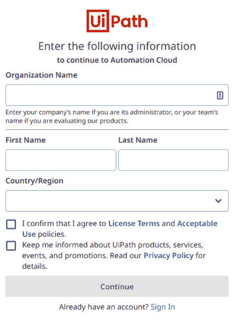

图 2.3 – 注册UiPath云平台

- 3. 注册并验证电子邮件地址后，单击**Automation Cloud**屏幕右侧的**资源中心**，如图2.4所示：

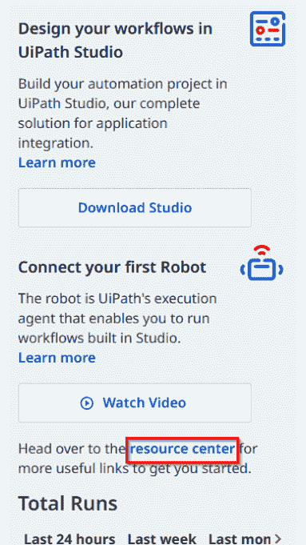

图 2.4 – 资源中心

- 4. 单击**Automation Cloud**屏幕上Community Edition部分的**下载（预览）**，如*图 2.5*所示：

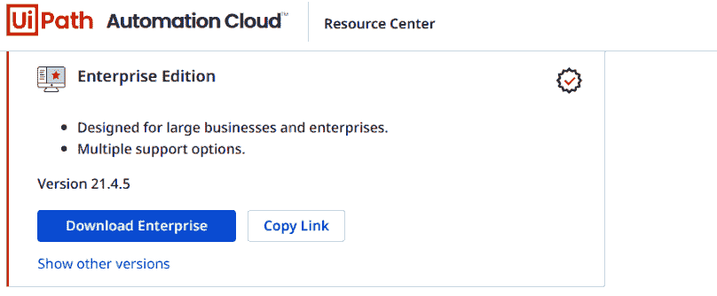

图 2.5 – 下载UiPath Community Edition

- 5. 将UiPath Studio.msi可执行文件下载到系统后，双击该文件并按照屏幕说明进行安装。在安装过程中选择默认或推荐选项。设置完成后，您将看到以下屏幕（图 2.6）。单击**完成**以退出设置屏幕。

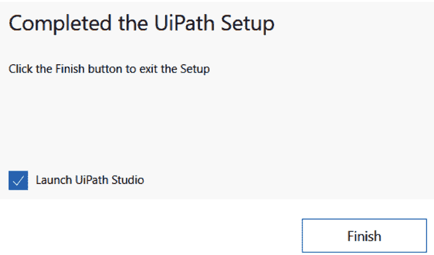

图 2.6 – UiPath Studio 设置向导

- 6. 为了确保UiPath安装成功，请在Windows搜索栏中输入UiPath以启动UiPath。从显示的菜单中单击**UiPath Studio**。

- 7. UiPath Studio启动成功后，您将看到软件的主屏幕，如图2.7所示：

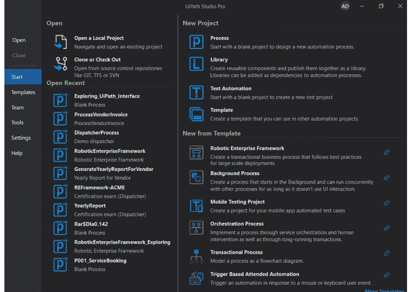

图 2.7 – UiPath Studio主屏幕

- 8. 导航到Settings | License and Profile以在UiPath Studio中配置配置文件，如下所示（图 2.8）。从显示的选项中选择UiPath Studio。

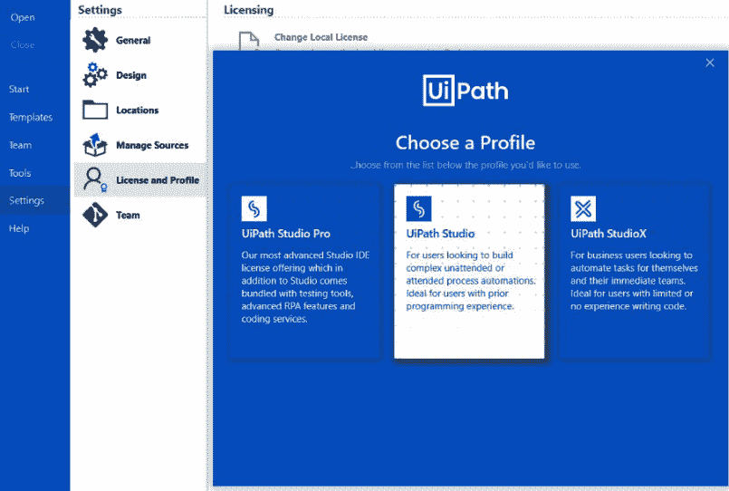

图 2.8 – 配置文件选项

在本节中，我们讨论了注册UiPath云平台的不同选项以及如何安装UiPath Studio。现在，让我们探索更多功能，看看如何使用UiPath Studio中可用的不同部分和功能来实现自动化。

## 探索UiPath Studio界面

UiPath Studio有多种用于多种目的的菜单选项。屏幕上的每个项目都有悬停文本来解释功能。

让我们通过创建一个基本流程来探索UiPath Studio的各个部分，并更熟悉Studio界面。要创建流程，请在新建项目部分单击**流程**，如图2.9所示：

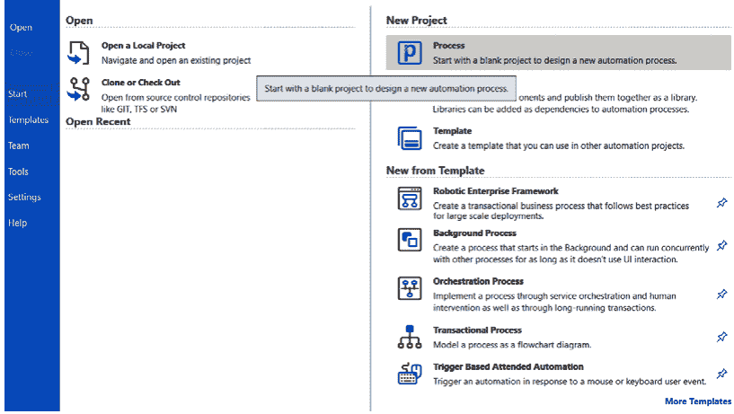

图 2.9 – 主屏幕上的新建项目部分

当您单击**流程**时，将出现一个名为**新建空白流程**的弹出窗口，其中包含三个字段：

- 名称：用于捕获项目的名称
- 位置：用于捕获要保存的项目的文件夹路径
- 描述：用于捕获有关项目的更多详细信息

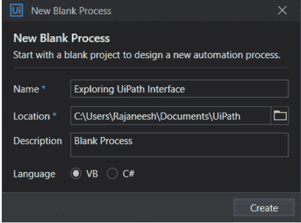

图 2.10 – 新建空白流程

在本示例中，我将流程名称设置为"探索UiPath界面"，流程描述设置为"空白流程"。单击创建后，我们将进入一个新项目屏幕，在该屏幕中我们将了解如何最好地使用不同的面板和功能来设计我们的自动化工作流。

## 设计器面板

设计器面板用于通过拖放活动来设计自动化项目。

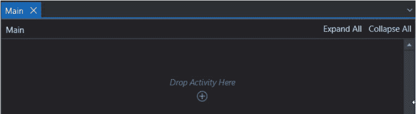

图 2.11 – 设计器面板

设计器面板是设计或创建自动化项目的主要空间，可快速访问活动、属性、变量和参数面板。活动可以折叠或展开以便更好地查看，该面板非常直观，因为它支持所有Microsoft Windows操作，例如剪切、复制和粘贴。

## 项目面板

项目面板以树形结构显示，其中根节点是项目名称，分支包含依赖项、输入、设置和项目文件。您可以在图2.12中看到您刚刚创建的流程：

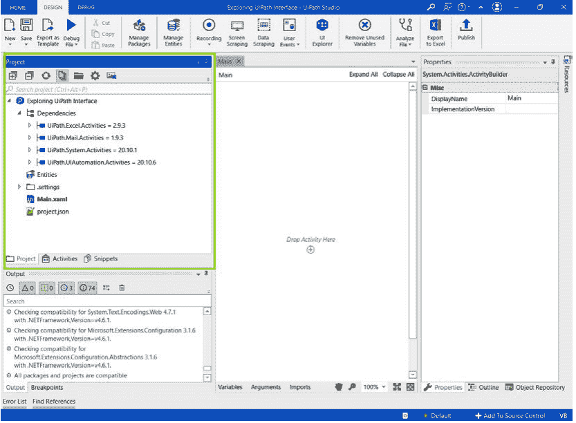

图 2.12 – 项目面板

在**项目**面板中，您可以执行几乎在Windows文件夹上执行的所有操作。您可以复制和粘贴文件、从另一个文件夹拖动文件、重命名文件并更改项目设置。此部分用于管理项目文件、依赖项和项目设置。

## 活动面板

**活动**面板可帮助您选择要添加到自动化中的正确活动。您可以在提供的**搜索**字段中按名称或描述搜索活动。

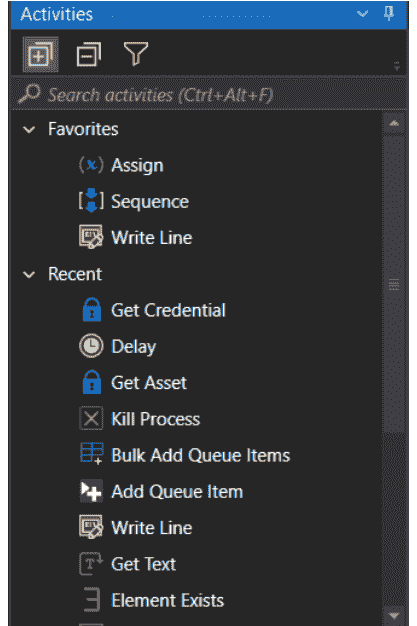

图 2.13 – 活动面板

在面板中找到活动后，您可以单击并拖动它，或按键盘上的*回车*按钮将其添加到**设计器**面板。您还可以右键单击活动并将活动添加到**收藏夹**面板。

## 属性面板

此部分用于管理各种活动的属性并管理变量。**属性**面板看起来类似于*图 2.14*，但会根据所选活动而变化：

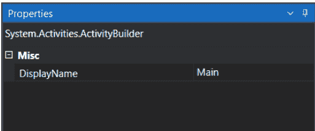

图 2.14 – 属性面板

单击**设计器**面板中的某个活动后，**属性**面板将默认显示在右侧。这样，您可以分析或更改所选活动特定的属性。将鼠标悬停在**属性**字段上可获取有关该字段的更多信息。某些属性（例如**键入文本**活动的**文本**字段，或**打开浏览器**活动的**输出**字段）允许从**属性**面板创建变量。

### 变量面板

**变量**面板可让您创建变量并对其进行修改。

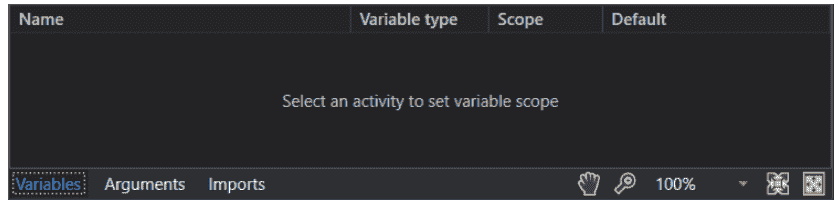

图 2.15 – 变量面板

创建变量时需要注意以下几个细节：

- **名称**：应为变量指定准确且有意义的名称，并且需使用驼峰命名法创建（例如，userName），这有助于用户轻松读取名称。在此面板中重命名变量会自动更新当前文件中的所有出现位置。
- **变量类型**：需要从 UiPath 提供的选项列表中选择正确的变量类型。单击**变量类型**列中的**浏览类型...**以浏览所有可用的变量类型选项。变量类型示例包括**字符串**、**Int32**、**布尔值**、**数据表**和**日期时间**。
- **作用域**：需要决定变量可访问的级别，可以是特定序列的局部作用域，也可以是整个项目的全局作用域。

> **重要说明**
> 您可以参阅*第 5 章，了解变量和参数*中的*练习创建变量*部分，以获取有关使用变量的最佳实践的更多信息。

### 参数面板

**参数**面板主要用于访问工作流时，通过参数传递输入或从参数获取输出。

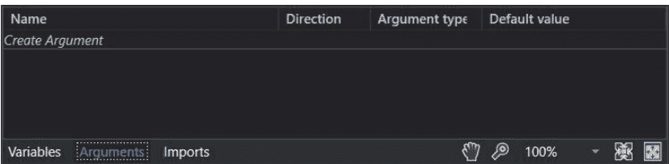

图 2.16 – 参数面板

需要填写三个必填字段：

- **名称**：可以使用小写或大写驼峰命名法，后跟变量的数据流向。例如，输入用户名可表示为 `in_username` 或 `in_UserName`，输出可表示为 `out_username` 或 `out_UserName`。
- **方向**：可以是 **入**、**出** 或 **入/出**，具体取决于数据流向。
- **参数类型**：需要根据变量或参数的性质进行选择。

### 输出面板

输出面板的主要用途是使用日志消息或写入行活动来验证工作流的结果：

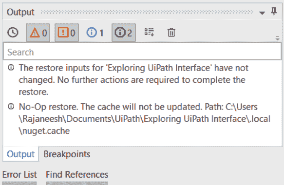

图 2.17 – 输出面板

输出面板中提供不同选项，可根据日志消息类型（例如错误或警告）来显示或隐藏消息。还提供一个搜索字段，用于搜索特定日志；在此搜索过程中，匹配结果会被高亮显示。单击“错误列表”面板会显示工作流执行期间的任何错误，单击“警告”面板会显示自动化工作流执行期间生成的任何警告。

### 大纲面板

**大纲**面板用于查看所选工作流的层次结构以及工作流中所有可用节点，如*图 2.18*所示：

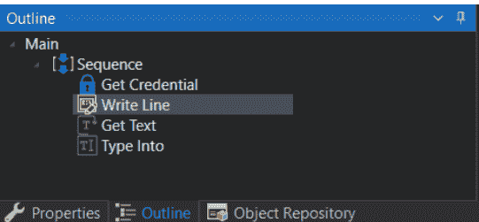

图 2.18 – 大纲面板

本节介绍了在自动化过程中经常会遇到的 UiPath Studio 的所有关键用户界面组件。这将帮助您更好地理解 UiPath Studio，并在即将到来的章节中创建自动化项目。

### 摘要

本章介绍了 UiPath Enterprise 平台及其组件。作为介绍的一部分，本章详细描述了 UiPath Enterprise 平台的每个组件。此外，我们还讨论了如何安装 UiPath 并设置 UiPath Studio 配置文件。UiPath Studio 是 UiPath 平台的核心，因为自动化是在 Studio 中创建的，然后发布到 Orchestrator 并由机器人执行。

下一章将介绍 UiPath Orchestrator 以及如何在 Orchestrator 中创建、发布和执行自动化。
