## 3 介绍 UiPath Orchestrator

**UiPath Orchestrator** 是一个 Web 应用程序，也是必不可少的 UiPath 组件，通过它，在 **UiPath Studio** 中开发的自动化工作流会被发布、分配给机器人并执行。它可以管理机器人、活动包、待处理数据、执行计划以及许多其他资产。Orchestrator 可以管理各种类型的流程，从简单到复杂。

本章重点介绍 **UiPath Cloud** 平台和 Orchestrator。与 UiPath Studio 类似，UiPath Orchestrator 在自动化中发挥着重要作用。Orchestrator 是所有已部署机器人和流程的中央控制单元；因此，了解 Orchestrator 的用途以及在 Orchestrator 中用于管理虚拟劳动力的关键概念至关重要。

本章包含以下部分：

- 介绍 UiPath Automation Cloud 平台
- 介绍 UiPath Orchestrator
- 了解 UiPath Orchestrator 的基本概念
- 在 Automation Cloud 中创建您的第一个 Orchestrator 实例
- 将本地机器人连接到 Orchestrator

### 技术要求

在开始本章之前，请确保已安装 UiPath Studio 和 **UiPath Robot**。本章需要您大致了解如何使用 Studio 和 **UiPath Assistant**。

此外，请使用以下链接注册或登录 Cloud 平台：https://cloud.uipath.com/portal_/cloudrpa。

本章将详细讨论 Cloud 平台的功能。

### 创建您的第一个云 Orchestrator 实例

UiPath 提供三个版本的云平台：社区版、企业试用版和企业版。无论哪个版本，注册云平台都会自动创建 UiPath Orchestrator 服务。已完成的服务可见于 **主页** 页面。但是，如果 Orchestrator 服务在主页上不可用，您可以通过导航到 **管理** 页面，然后进入 **服务** 页面来轻松创建它。

如果不可用，请按照以下步骤创建您的第一个 Orchestrator 服务：

1. 通过以下链接登录 Cloud 平台：https://cloud.uipath.com/portal_/cloudrpa。
2. 如果 **主页** 界面上不可用 Orchestrator 服务，请导航到 **管理** 页面。
3. 导航到 **租户** 页面并单击 **添加租户** 按钮。
4. 填写 **租户名称** 字段，并确保在服务选项中选中了 Orchestrator 服务。
5. 单击 **保存** 按钮。
6. 如果 Orchestrator 服务可用，请单击 **Orchestrator 服务** 以导航到 Orchestrator。

按照这些步骤可以轻松创建第一个 Orchestrator 服务。设置服务是第一步。UiPath Robot 服务需要进行一些配置才能连接到创建的 Orchestrator 服务。

### 介绍 UiPath Cloud 平台

基于云的 Enterprise 平台以平台即服务形式提供给所有用户。Cloud 平台使用户能够创建和管理所有自动化资源。它允许用户无需更改现有基础架构即可即时自动化，并快速扩展。此外，Cloud 平台还能通过请求试用或购买 UiPath 提供的其他服务的额外许可证，轻松管理许可证计划。

以下是 Cloud 平台的一些主要功能：

- 管理谁可以访问 Cloud 平台及其基于所需执行任务的角色
- 通过将许可证分配给 Orchestrator 实例来管理许可证
- 管理多个 UiPath Orchestrator 租户及其关联的服务
- 管理基于触发器调度程序需要执行的机器人和流程
- 管理 UiPath 提供的其他基于云的解决方案
- 管理出于审计目的的日志

UiPath 在 Cloud 平台中管理所有系统更新，从而让用户免受系统更新负担。此外，Cloud 平台提供业界领先的防御机制，许多政府组织已验证其可确保数据安全。Cloud 平台面向企业用户和社区用户提供。

登录 Cloud 平台后，您将能够访问接下来列出的各个部分。

## 主页和资源中心

主页展示了一个仪表板，可让您高级地查看机器人和 Studio 许可证、许可证使用情况、操作中心中最近分配的任务、最近执行的流程，以及访问 Orchestrator 服务。Cloud 平台的最新版本可能与图 3.1 略有不同。此外，Community Cloud 与 Enterprise 版本相比也可能有所不同，因为某些功能基于许可证类型在环境方面受到限制。

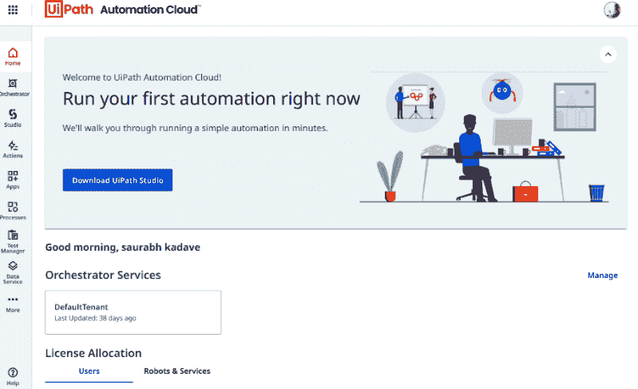

图 3.1 – Automation Cloud 主页

如图 3.1 所示，主页还可让您访问其他资源，例如用于下载 UiPath Studio 的下载链接

## 操作

操作让您能够管理并处理机器人为人类验证而创建的所有任务。图 3.2 显示了 UiPath Cloud 平台中操作中心任务的样子：

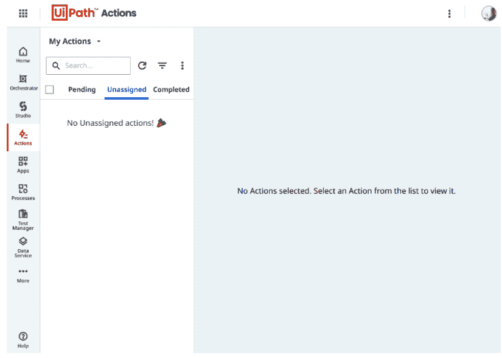

图 3.2 – Automation Cloud 操作屏幕

**操作**页面显示用户完成的所有任务，包括待处理、未分配和已完成的任务。用户还可以将任务分配给自己或将其转移给其他用户以进行进一步操作。

## 应用

**应用**屏幕为用户提供构建其应用程序的功能。**UiPath 应用** 是一个低代码平台，允许任何用户通过拖放所需元素来快速创建 Web 界面。通过应用设计的应用程序与机器人交互，以执行使用用户通过应用程序提供的数据的自动化流程。

应用程序有助于为用户提供一个简单的单一界面，以便与需要在幕后与多个应用程序交互的复杂自动化解决方案进行交互。图 3.3 说明了应用屏幕。应用程序不是 Associate 认证的一部分；但是，我们想提供其他可用的有趣功能的概览。

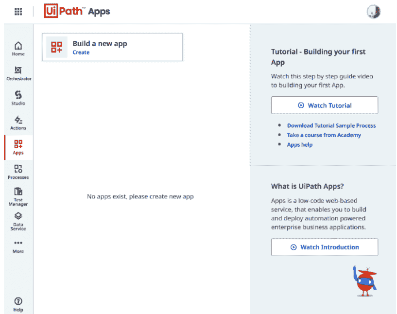

图 3.3 – Automation Cloud 应用屏幕

如图 3.3 所示，UiPath 应用程序可以无缝地为不同需求创建多个应用程序。用户可以与需要访问权限并在日常活动中利用自动化能力的其他用户发布和共享应用程序。

## 流程

**流程**页面可轻松访问机器人在 Orchestrator 中执行的所有自动化流程，而无需 *实际* 登录到 Orchestrator。但是，配置这些自动化流程需要通过 UiPath Orchestrator 完成。_图 3.4_ 说明了 UiPath Cloud 平台中可用的示例 **流程** 页面。虽然流程是认证计划的一部分，但 **流程** 部分中显示的内容不是 Associate 认证的一部分。

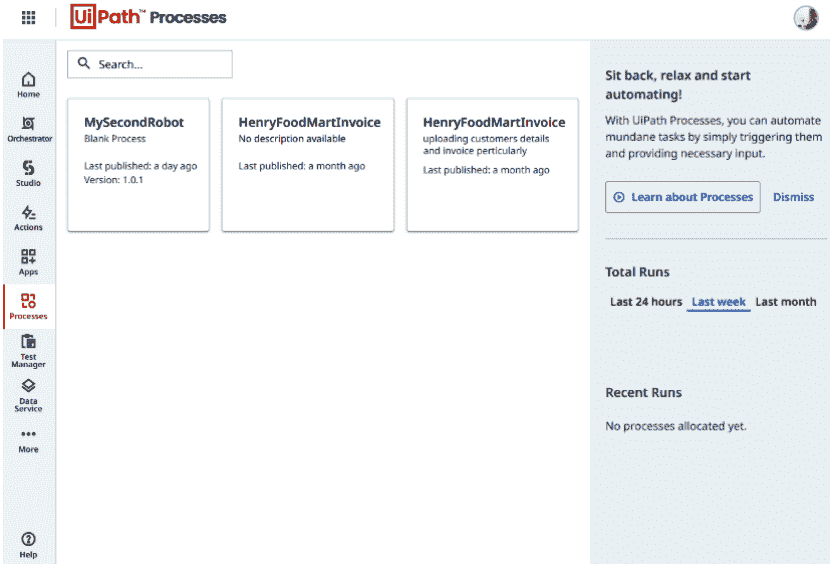

图 3.4 – Automation Cloud 流程屏幕

如 _图 3.4_ 所示，**流程**页面显示所有可用流程以及一些其他详细信息，例如版本、上次运行日期和包源，用户可以单击并执行。

## 数据服务

数据服务为用户提供了一个存储通过自动化流程传递的数据的平台。该服务提供基于云的安全存储，以在关系模型中存储数据，机器人可以轻松访问信息进行处理。数据服务的目标是为机器人处理的数据提供单一存储点。数据服务是一个值得探索的有趣功能；但是，它不是 Associate 认证的一部分。

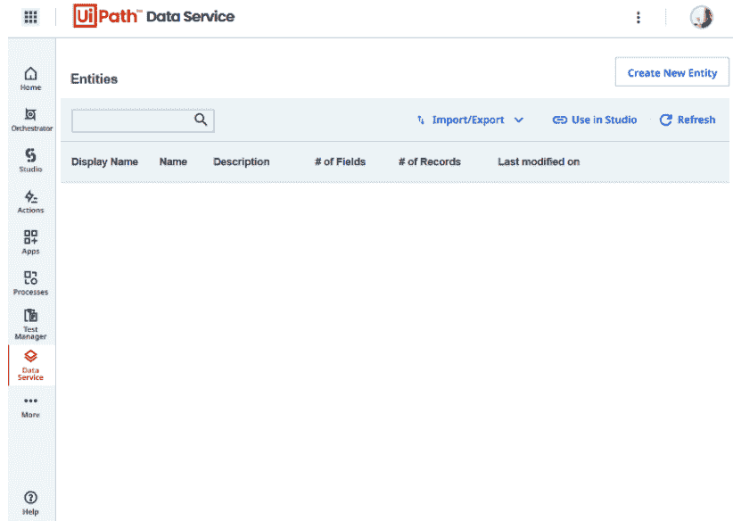

图 3.5 – Automation Cloud 数据服务屏幕

图 3.5 展示了在平台中创建的一些示例存储实体，用于存储数据。实体页面通过显示描述、列数、每个实体中的记录数以及上次修改日期来总结每个实体。

## AI Fabric

AI Fabric 允许用户部署和训练开箱即用的 AI 模型，或让自定义构建的 AI 模型在自动化解决方案中运行。在 AI Fabric 中创建的 AI 模型可与通过 UiPath Studio 构建的 UiPath 自动化解决方案无缝集成，以赋予机器人执行的任务以智能。图 3.6 让您大致了解 AI Fabric 主屏幕的样子。构建和连接 AI 模型很有趣；但是，还有更多高级功能。因此，AI Fabric 未包含在 Associate 认证中。

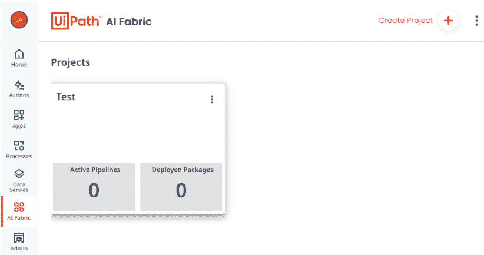

图 3.6 – Automation Cloud AI Fabric 屏幕

所有创建的 AI Fabric 项目都将列在 AI Fabric 平台的主登录页面上。

## 管理

管理页面包含多个部分，允许您配置服务、许可证、用户访问和组织设置。您在管理页面上看到的功能因版本（Community 或 Enterprise）和当前发行版而异。

## 租户

**租户**页面包含您在云平台中使用的不同应用程序的实例。这些应用程序之一是 UiPath Orchestrator。目前，**租户**页面仅支持 Orchestrator 应用程序的实例。

图 3.7 让您一窥 **租户** 页面在 Automation Cloud 中的显示方式。**租户**页面可能包含多个 Orchestrator 租户，从而实现多租户。通过拥有多个租户，用户可以将自动化解决方案分离到不同的环境中。多租户的最佳示例之一是为开发、QA 和生产使用单独的租户。

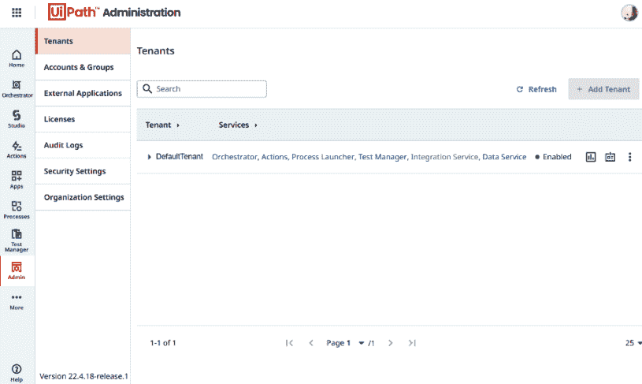

图 3.7 – Automation Cloud 租户屏幕

如 **图 3.7** 所示，**租户**页面列出了您在组织实例下拥有的所有 Orchestrator 实例。该页面还允许用户编辑分配给租户的许可证，并管理与 Orchestrator 实例一起使用的其他服务，例如操作中心、数据服务和 AI Fabric。

## 用户和组

用户和组管理是 Automation Cloud 提供的关键功能之一。帐户和组页面允许您通过创建用户、在组织和服务级别自定义权限、邀请新用户以及删除现有用户来管理用户和组。图 3.8 说明了 Automation Cloud 中用户选项卡的样子：

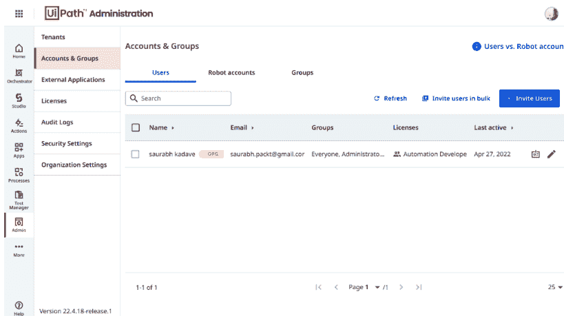

图 3.8 – Automation Cloud 用户管理屏幕

除了上述功能外，帐户和组页面还允许通过“邀请用户”选项批量邀请用户。

## 许可证

许可证管理分为三个不同的类别：Community 计划、Enterprise 试用版和 Enterprise 许可证计划。许可证页面显示分配给您的许可证计划，以及您在 Cloud 平台中可以访问的机器人和其他服务的数量。

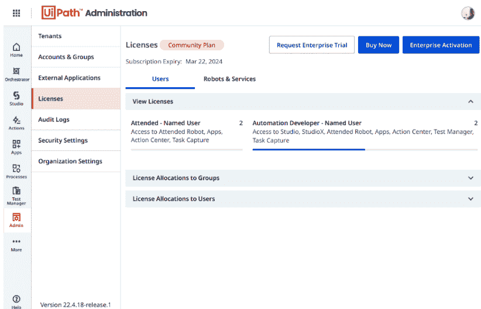

图 3.9 – Automation Cloud 许可证屏幕

如图 3.9 所示，许可证信息显示在三个不同的选项卡下：

- 机器人选项卡说明 Cloud 平台可用的有多少个有监督、无监督、测试和非生产机器人许可证。
- Studio 选项卡显示用户可用的命名用户 Studio、Studio X 和 Studio Pro 许可证。
- 其他服务选项卡展示了 AI Fabric、计算机视觉、GPU 和文档理解等服务的许可证可用性。

## 审计日志

审计日志页面显示与用户操作相关的所有日志，例如新用户创建和成员计划。图 3.10 说明了审计日志页面：

| 类别 | 用户 | 操作 | 操作详情 | 时间 |
| :--- | :--- | :--- | :--- | :--- |
| 用户 | saurabh kadave | 登录 | User 'saurabh kadave saurabh.packt@gmail.c... | 6 分钟前 |
| 用户 | saurabh kadave | 登录 | User 'saurabh kadave saurabh.packt@gmail.c... | 1 天前 |
| 用户 | saurabh kadave | 登录 | User 'saurabh kadave saurabh.packt@gmail.c... | 1 天前 |
| 机器人帐户 | saurabh kadave | 创建 | {"adminName": "saurabh kadave", "users": "R... | 1 天前 |
| 用户 | saurabh kadave | 登录 | User 'saurabh kadave saurabh.packt@gmail.c... | 1 天前 |
| 用户 | saurabh kadave | 登录 | User 'saurabh kadave saurabh.packt@gmail.c... | 8 天前 |

图 3.10 – Automation Cloud 审计日志屏幕

**审计日志**页面还允许用户下载所有审计日志以供审计用途。此外，该页面将通过跟踪用户操作，帮助您遵守组织的规则和规定。

## 组织设置

**组织设置**页面提供更改 Orchestrator URL、Automation Cloud 平台名称和语言设置的功能。

- Automation Cloud 包含 UiPath Orchestrator 和许多其他服务的实例。了解 Automation Cloud 平台有助于用户在几分钟内轻松配置和部署 Orchestrator 实例。
- Orchestrator 使用 Automation Cloud 平台中可用的许可证与机器人连接并运行自动化流程。在 Automation Cloud 中创建的每个 Orchestrator 都分配了多个许可证以执行所需操作。

本章的下一部分说明如何在 Automation Cloud 平台上创建 Orchestrator 实例。

## 介绍 UiPath Orchestrator

UiPath Orchestrator 是整个自动化套件的核心，用于管理在 Studio 中开发的所有已发布自动化解决方案、机器人执行任务以及执行计划。Orchestrator 提供云平台和本地解决方案两种形式。它为用户提供了许多功能。其中一些功能如下：

- **Provisioning**：创建新机器人并维护现有机器人和用户。
- **Deployment**：将在 UiPath Studio 中创建的工作流部署，以便按需执行或使用计划确保高效的规划和执行。
- **Configuration**：创建和维护用户组、机器人以及流程和其他资源的用户访问权限。
- **Monitoring**：跟踪已执行流程的状态、机器人状态和用户权限。
- **Logging**：将与执行、机器人、审计日志和其他操作相关的数据存储在 SQL 数据库或 Elasticsearch 中。
- **Queues**：作为队列中事务数据的中间数据存储和处理系统，通过对已处理的事务进行优先级排序来实现。每个事务在执行期间都会被单独处理和监控，确保整个流程不受任何事务错误的影响。
- **Integrated Connectivity**：通过 API 或其他集成方法，为第三方服务之间的通信提供安全连接。
- **Version Control**：Orchestrator 维护已发布的包和库的版本。Orchestrator 还允许在多个机器人中使用不同的包版本进行执行。

UiPath Automation Cloud 使用户能够管理虚拟劳动力。要充分利用 Orchestrator 提供的功能，了解关键基础知识至关重要。

## 了解 UiPath Orchestrator 的基本概念

在使用 UiPath Orchestrator 之前，每个人都需要知道一些基本概念。列出了一些基本概念如下。

### 机器人

**机器人**（又称**执行代理**）执行在 UiPath Studio 中创建的工作流。Orchestrator 通过**机器人**页面管理这些执行代理。代理是单独安装的，或随 Studio 一起安装，具体取决于许可模型。Orchestrator 中提供不同类型的机器人。在机器人类型层次结构的顶部，Orchestrator 将机器人分为两类，如图 3.11 所示：

| 机器人类型 | 描述 |
|---|---|
| 标准 | 当机器人工作的机器不发生变化时配置 |
| 浮动 | 当机器人工作的机器经常更改，或同一用户在多台设备上工作时配置 |

图 3.11 – UiPath Orchestrator 中的机器人类型

Orchestrator 允许根据机器人分配方式创建任一类型。上述每种类型均按机器人的触发方式和安装环境进一步分为四种其他机器人类型，如图 3.12 所示：

| 机器人类型 | 描述 |
|---|---|
| 有人值守机器人 | 由用户手动触发或通过用户事件触发。机器人代理运行在人类用户工作的同一台机器上，协助用户的日常活动。 |
| 无人值守机器人 | 在虚拟机中运行，无需任何人工干预即可执行流程。Orchestrator 通过控制执行、监控以及通过队列管理数据来管理无人值守机器人。 |
| 开发机器人 | 功能与无人值守机器人相同，但仅用于将 UiPath Studio 连接到 Orchestrator 以及用于开发目的。 |
| 非生产机器人 | 仅用于开发和测试目的。 |

图 3.12 – UiPath Automation Cloud 中的机器人类型

除这些之外，可能还有更多类型；但是，为了 Associate 认证的目的，我们将仅关注前表中引用的机器人类型。

### 文件夹

使用**文件夹**可让用户更好地组织流程、机器人、资产和队列，以便更好地管理和访问控制。UiPath Orchestrator 支持**现代**和**经典**文件夹类型，各具一系列功能。

现代文件夹提供以下功能：

- 它们允许动态分配机器人和用户角色。
- 它们支持层次结构，每个一级文件夹下最多可有六个子文件夹。
- 它们通过轻松集成 Windows Active Directory 来实现大规模自动化计划。
- 每个文件夹都有自己的包源，用于存储与文件夹上下文相关的包。

经典文件夹不具备现代文件夹提供的相同功能。以下是经典文件夹与现代文件夹相比的局限性：

- 它们以传统方式包含机器人和环境。
- 它们无法创建或维护子文件夹。
- 在经典文件夹中创建的机器人只能在文件夹范围内工作。

此处需要指出的一个重要点是，经典文件夹是 Associate v1.0 认证的一部分。但是，用户可能无法在 Community 版本中使用它们，因为该功能已停用。Orchestrator 的最新版本仅使用现代文件夹。

文件夹在 Orchestrator 的租户级别创建和管理。图 3.13 说明了 Orchestrator 的**文件夹管理**页面：

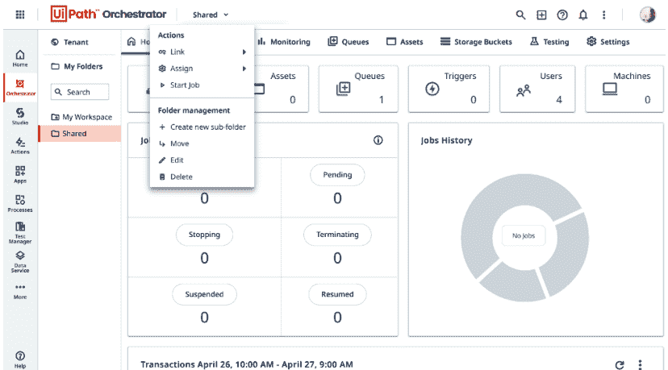

图 3.13 – UiPath Orchestrator 中的文件夹创建

文件夹能更好地控制用户看到的内容和可控制的内容。文件夹管理屏幕授予不同权限级别的不同用户访问文件夹资源的权限。Orchestrator 将经典文件夹显示为红色，将现代文件夹显示为蓝色。此外，现代文件夹允许创建子文件夹以进一步划分资源，而经典文件夹不允许子文件夹。

另一方面，还有一种名为 "MyWorkspace" 的文件夹。开发人员主要使用此选项将其开发工作与其他用户隔离。MyWorkspace 是唯一的，其他用户无法访问另一用户的工作区。MyWorkspace 提供与其他文件夹相同的功能，但仅限于分配的用户。

### 环境

UiPath Orchestrator 中的环境功能允许对机器人进行分组。在引入文件夹之前，分组是对机器人进行分类的传统方法。分组通常基于执行其自动化解决方案的业务群组进行。例如，人力资源部门可能有多个用户组运行与该部门其余部分断开连接的自动化解决方案。每个环境可能包含多个机器人，一个机器人可以是多个环境的一部分。环境的管理通过 Orchestrator 中的环境页面进行处理。环境仅在经典文件夹中可用。

### 组织单位

UiPath Orchestrator 允许在同一个 Orchestrator 实例中创建多个业务单元。每个实例将包含其专用的环境、队列、资产和机器人。业务单元的分离确保了流程、机器人的正确组织，以及 Orchestrator 中可用数据和流程的安全性。

### 包

已发布的工作流解决方案称为包。包可以在本地和 UiPath Orchestrator 中发布。可以通过 UiPath Studio 直接上传包到 Orchestrator，也可以通过 Orchestrator UI 手动上传。Orchestrator 管理在 Orchestrator 中部署和使用的包的版本。Orchestrator 的包屏幕允许管理所有包及其版本。

包屏幕根据用户的使用方式显示发行说明或升级包。同样，相同的包管理显示允许用户通过删除或跟踪发布信息来维护发布版本的历史记录，以便更好地查看更改。包的使用情况决定了包的状态为 Active 或 Inactive。如果包在一个或多个流程中使用，则所使用的包版本的状态设置为 Active。图 3.14 显示了包含所有可用包的包页面：

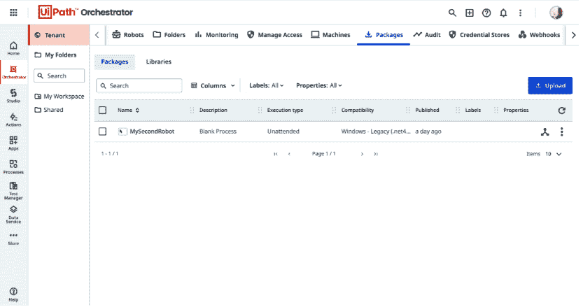

图 3.14 – UiPath Orchestrator 包屏幕

单击每个包的选项按钮（三个点）将打开一个菜单，您可以在其中选择查看包版本。查看版本显示包的可用版本以及进程使用的版本。图 3.15 显示所选包的版本：

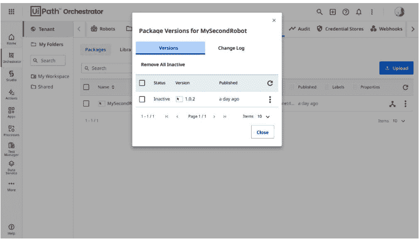

图 3.15 – 查看包版本和用法

## 流程

流程是使用在 Orchestrator 中发布的包创建的。多个流程可以在不同环境中使用同一个包。例如，假设您开发并部署了一个包，用于登录核心系统以更新客户的账户详细信息。银行不同部门的不同人员可以更新账户详细信息。因此，同一个包可以通过连接其他流程，由不同团队用于不同的账户更新。机器人会在其环境中查找要执行的流程。在 UiPath Studio 中开发的每个自动化解决方案的 Main.xaml 文件是执行开始的主文件。主工作流文件中可用的参数允许用户在流程执行和创建期间传递预定义值。

图 3.16 显示 Orchestrator 的流程页面。流程页面位于每个文件夹可用的自动化选项卡下。该包包含有关流程的所有信息，包括用于流程的包、包版本和执行优先级。

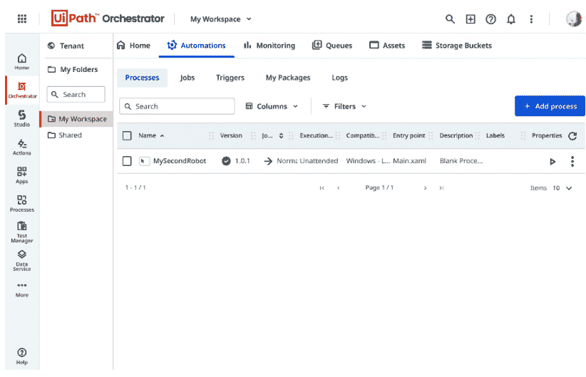

图 3.16 – UiPath Orchestrator 中的流程页面

流程创建在将包上传到 Orchestrator 后进行。单击**流程**页面上的蓝色**添加流程**按钮将进入流程创建页面。流程创建分为三个阶段配置，如下屏幕截图所示。流程创建需要用户提供以下输入（输入分三个阶段提供）：

- **显示名称**：流程的更易于用户使用的名称。Orchestrator 和 UiPath Assistant 使用此名称来引用流程。
- **包名称**：从 Orchestrator 中可用的包列表中选择。主要用于在发布后选择要创建的流程。
- **包版本**：显示用于流程的包版本。
- **作业优先级**：您选择的优先级在流程执行期间应用。当高优先级作业在给定时间执行/计划运行时，将优先于中优先级或低优先级作业。
- **描述**：流程的简短描述。

提供此处引用的信息并单击**创建**按钮可在 Orchestrator 中创建流程。UiPath Assistant 和作业将有权访问并显示新添加的流程。*图 3.17 显示 Orchestrator 的流程创建屏幕：*

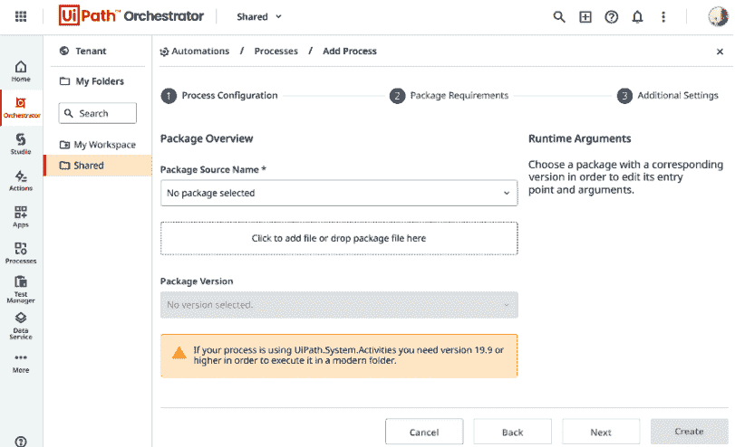

图 3.17 – UiPath Orchestrator 中的流程创建页面

我们需要浏览屏幕截图中显示的三个阶段，并配置先前描述的字段以创建流程。这些阶段旨在简化配置屏幕，并以有条理的方式提供选项。

### 作业

作业是由机器人执行的任务。每个作业都通过 Orchestrator 中的作业页面单独管理。Orchestrator 允许按需或基于计划创建作业。按需作业可以通过从作业页面创建作业或从 UiPath Assistant 屏幕触发作业来启动。计划作业根据在 Orchestrator 中创建的预定义计划触发。

此外，作业可以通过队列自动触发。如果队列配置为在插入新项目时触发特定流程，则队列将在没有计划的情况下自动创建作业。图 3.18 显示作业页面上的已执行作业。作业页面提供所有已执行流程、执行时间、用户、计算机（机器人连接的计算机名称）、机器人类型以及执行状态的详细信息。

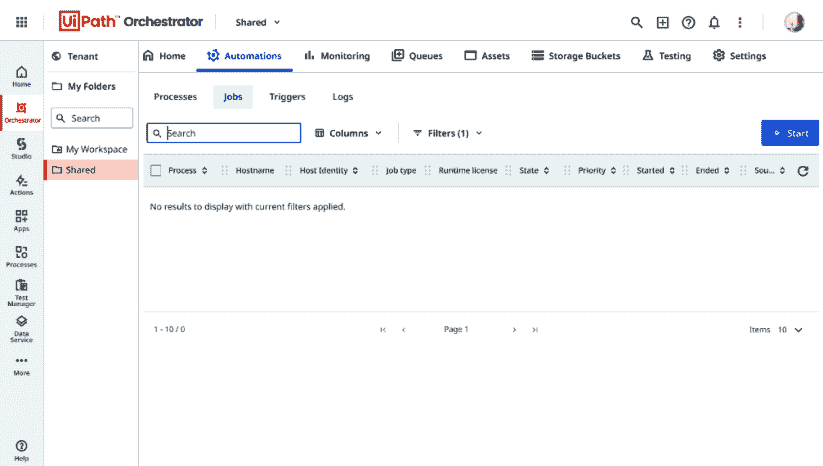

图 3.18 – UiPath Orchestrator 中的作业页面

与流程页面类似，Orchestrator 允许从作业页面创建作业。这使您可以选择要执行的流程、环境以及分配给执行任务的机器人。如图 3.19 所示，如果用户未指定，执行目标和机器人分配将自动处理：

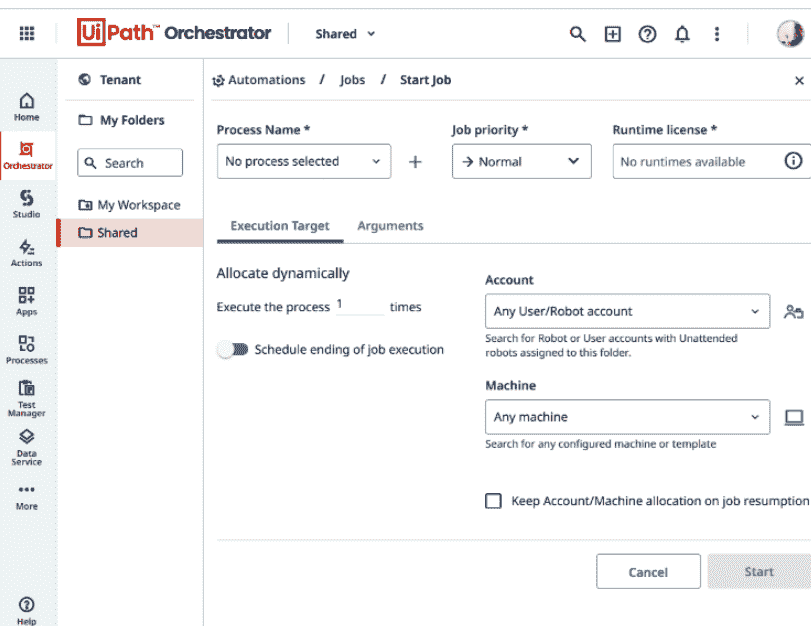

图 3.19 – UiPath Orchestrator 中的作业创建页面

作业创建要求用户在单击开始按钮之前配置作业创建显示字段：

- **流程名称**：从下拉列表中选择要运行的流程。下拉菜单显示在创建流程时为每个流程提供的显示名称。
- **作业优先级**：作业优先级有三个值：低、正常和高。默认优先级为正常。
- **运行时许可证**：Orchestrator 支持两种主要的运行时许可证选项：无人值守和非生产。无人值守用于为租户分配了生产无人值守运行时许可证的情况。非生产用于非生产许可证，但也类似于无人值守。
- **执行流程 X 次**：使流程能够运行 X 次。
- **帐户**：如果未提及，用户/机器人将从为流程分配的用户组中动态分配。
- **计算机**：如果未提及，运行时计算机将为流程动态分配。
- **开始按钮**：单击**开始**按钮将立即启动作业，并且它将在**作业**页面上可见。

## 触发器

**触发器**使机器人能够在给定时段运行特定流程。计划允许用户在无需人工干预的情况下迭代触发流程。Orchestrator 中的**触发器**页面为您提供基于常规工作日或包含非工作日的自定义日历创建计划的权限。

**触发器**页面的以下屏幕截图显示了两种不同的触发器类型：

- **队列触发器**：此触发器与队列相关联。每当将指定数量的新项目插入队列时，它将自动触发。队列触发器在您无法定义特定时间帧来触发流程，但需要在数据可用时立即运行流程的情况下很有帮助。

- **基于时间的触发器**：此触发器经过编程，可在每小时、每天、每周或每月的特定时间触发特定流程。用户可以使用高级选项下的 cron 表达式根据需要配置自定义时间频率。**触发器详细信息**列指定基于时间的触发器的时间和运行频率。

此外，**触发器**页面包括触发器名称、与触发器关联的流程、执行环境以及任务的优先级。

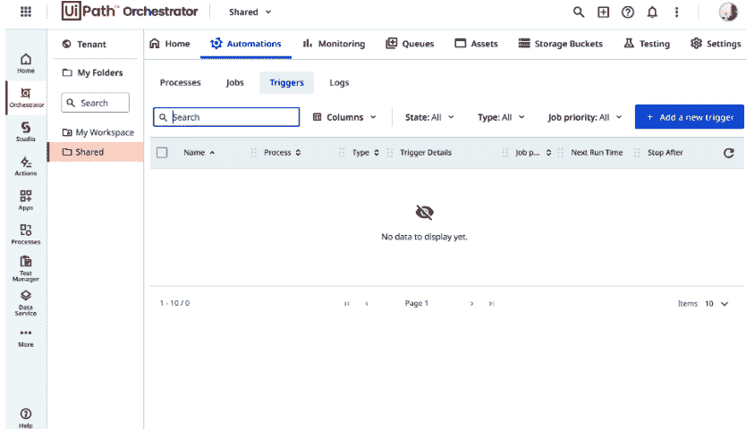

图 3.20 – UiPath Orchestrator 中的触发器页面

单击**触发器**页面上的**添加新触发器 (+)**按钮将打开一个新页面以创建新触发器。屏幕上显示的选项取决于您选择的触发器类型。*图 3.21* 显示创建基于时间的触发器所需的输入：

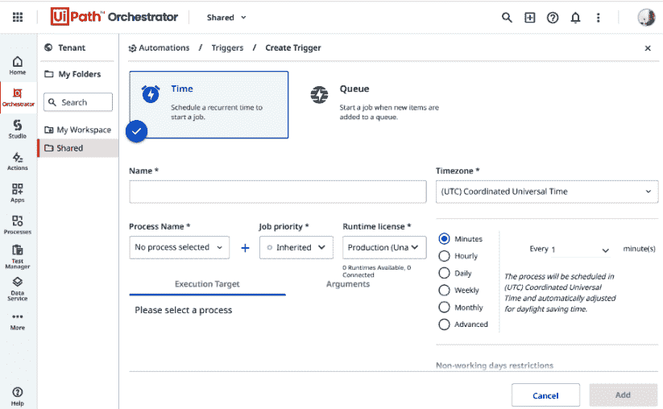

图 3.21 – UiPath Orchestrator 中的基于时间的触发器创建

基于时间的触发器创建需要 *图 3.21* 中显示的选项。以下是屏幕上每个选项的描述：

- **名称**：触发器的名称。
- **时区**：要考虑的基于时间的触发器的时区。
- **流程名称**：包含一个下拉列表，包含 Orchestrator 中可用的所有流程。用户必须根据触发器选择要执行的流程。
- **作业优先级**：与作业创建屏幕类似，此属性描述在通过触发器创建作业时要考虑哪个优先级。
- **频率**：选择触发流程的频率。例如，如果流程需要每 3 小时执行一次，则频率必须设置为**按小时**，并且必须选择**每 3 小时**的时间间隔。

- **非工作日限制**：如果构建的自定义日历包含非工作日，用户可以选择该日历。触发器不会在定义的非工作日执行。

- 另一方面，队列触发器创建具有不同的属性集。图 3.22 说明了创建队列触发器所需的输入：

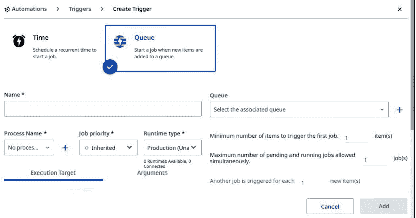

### 图 3.22 – UiPath Orchestrator 中的队列触发器创建

以下是创建队列触发器所需的每个输入字段的说明：

- **名称**：触发器的名称。
- **进程名称**：触发器应执行的进程的名称。下拉列表显示 Orchestrator 中所有可用的进程。
- **队列**：触发器监视新项目的队列。
- **作业优先级**：类似于作业创建屏幕，此属性描述通过触发器创建作业时应考虑的优先级。
- **参数**：如果所选进程为定义的参数需要预定义的输入值，则通过此选项分配必要值。但是，Parameters 选项是可选的，因为用户可能不需要提供输入，但会自动从另一个进程获取。

- **触发第一个作业所需的最小项目数**：定义队列中触发进程所需的最小项目数。
- **允许同时运行的最大挂起和运行作业数**：多个作业可以同时使用队列中的项目。此属性控制触发器创建的用于同时运行的最大运行或挂起作业数。
- **时区**：队列关联的时区。
- **非工作日限制**：如果构建的自定义日历包含非工作日，用户可以选择该日历。触发器不会在定义的非工作日执行。

## 资产

资产允许您存储单个数据元素以供自动化流程中稍后使用。Orchestrator 中可用的典型资产类型允许存储文本值、布尔值、整数值和应用程序凭据。

资产还提供存储和传递不同机器人不同值的功能。如果资产配置为存储单个值，所有机器人都使用相同的值。但是，如果资产配置了 **Value Per Robot** 选项，不同机器人将获得分配给每个机器人的值。资产可以通过 Orchestrator 中的 **资产** 页面创建和配置。

当机器人需要凭据来访问应用程序，或者在工作流中存储值没有意义的场景时，资产非常有用。Orchestrator 允许为每个文件夹创建资产。在一个文件夹中创建的资产仅在该文件夹的范围内可见。

*图 3.23 说明了所选文件夹的 Orchestrator 主页上的 **ASSETS** 选项：*

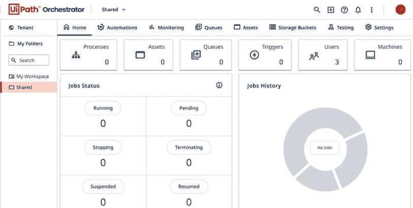

### 图 3.23 – Orchestrator 主页文件夹资产选项

单击资产会将用户导航到资产页面，该页面列出该文件夹下的所有可用资产。图 3.24 展示了所选文件夹的资产页面。显示还提供创建、编辑和删除新资产的功能。

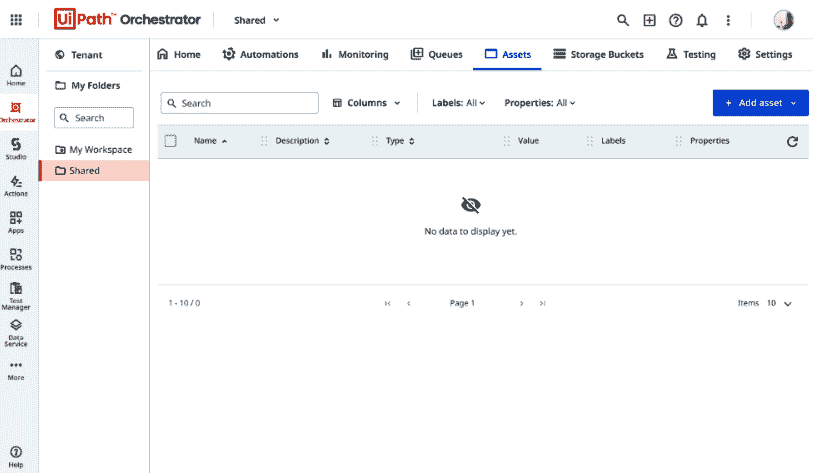

### 图 3.24 – 所选文件夹的 UiPath Orchestrator 资产页面

要创建资产，用户可以单击 + 按钮导航到资产创建页面。图 3.25 显示资产创建页面和创建资产所需的字段：

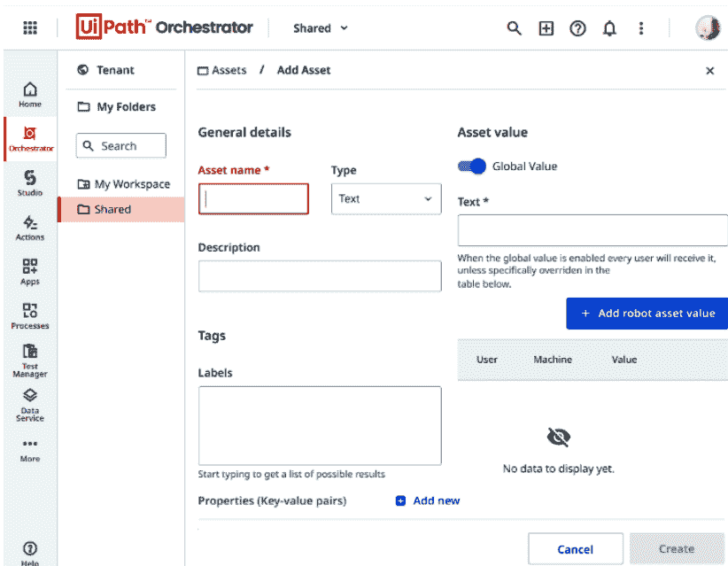

### 图 3.25 – UiPath Orchestrator 资产创建页面

以下是必填字段的说明：

- **资产名称**：资产应具有唯一名称，因为 Studio 中创建的工作流使用此名称引用资产。
- **类型**：资产的数据类型。根据资产中存储的数据选择数据类型。目前，资产仅支持文本、整数、布尔值和凭据等原始数据类型。凭据是一种特殊类型，允许用户安全地在不同系统中存储凭据。其他数据类型（如文本、整数和布尔值）根据资产的值和用途选择。
- **描述**：简要说明资产的用途及其包含的值。

- **全局值**：如果启用，每个用户都将收到该值，除非用户在特定值部分中显式替换它。

- **添加机器人资产值**：如果配置，资产可以为每个用户/机器人提供不同的值。默认值为单个值。

UiPath Studio 提供一组活动，可用于与 Orchestrator 中的资产交互。以下描述了每个活动及其与资产的交互方式：

- **获取资产**：检索指定资产的值

- **设置资产**：使用新值更新指定资产

- **获取凭据**：从指定的凭据类型资产中检索凭据

- **设置凭据**：使用新凭据更新指定的凭据类型资产

## 队列

**队列** 提供按顺序存储和处理队列中项目的功能。添加到队列中的记录称为 **事务项目**。事务的执行顺序基于每个事务项目的优先级和 SLA 级别决定。一个或多个机器人访问队列以分别处理每个事务。队列还可以通过 **队列触发器** 选项在插入新队列项目时触发作业。在复杂自动化解决方案中使用队列有许多优势。以下是其中一些优势：

- 所有事务项目的中央存储库。
- 每个事务项目以及队列本身的报告功能。
- 基于事务优先级和 **服务级别协议 (SLA)** 级别的内置事务项目优先级。SLA 是组织中每个人都需要遵循的约定服务交付时间表，以确保客户满意度和高质量交付。
- 使用一个或多个机器人高效处理项目。
- 失败事务项目的高级自动重试功能。

在处理需要独立处理和监控的大量数据时，这些功能非常有用。例如，处理客户投诉、客户贷款申请处理和客户注册是队列流程的绝佳用例。这些示例是处理队列的理想候选对象，因为每个投诉或每个贷款申请相互独立。每个项目都有其独特的特征，需要单独处理。

与资产类似，Orchestrator 中的文件夹包含队列。一个文件夹中可用的队列对另一个文件夹不可见。图 3.26 显示 Orchestrator 主页上可用于访问队列页面的选项：

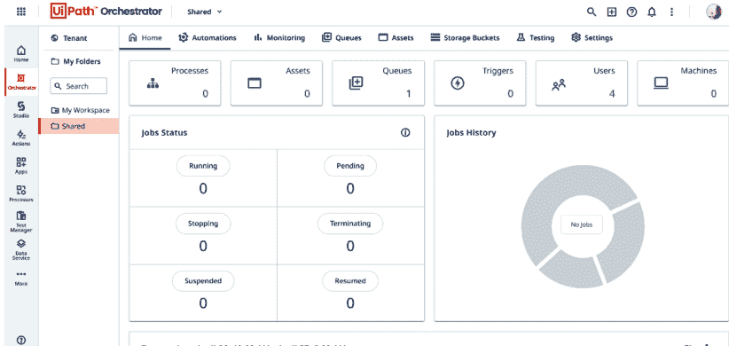

### 图 3.26 – Orchestrator 主屏幕上的队列选项

队列页面显示所选文件夹中所有可用队列及其相关附加信息。图 3.27 显示队列页面中每个队列的相关信息：

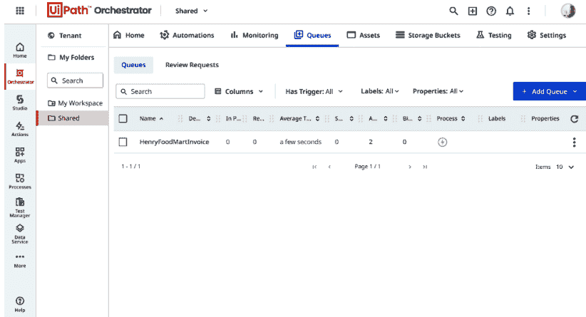

### 图 3.27 – Orchestrator 队列页面上显示的信息

以下是信息的详细说明：

- **名称**：队列的名称
- **描述**：队列的简要描述
- **进行中**：状态为进行中的事务项目数量
- **剩余**：待处理的事务项目数量
- **平均时间**：完成事务所需的平均时间
- **成功**：成功完成的事务项目数量
- **应用程序异常**：由于应用程序异常导致的失败事务数量
- **业务异常**：由于业务异常导致的失败事务数量
- **进程**：显示关联的队列触发器

单击右上角的 + 添加队列按钮会导航到队列创建屏幕。图 3.28 显示创建队列所需的配置：

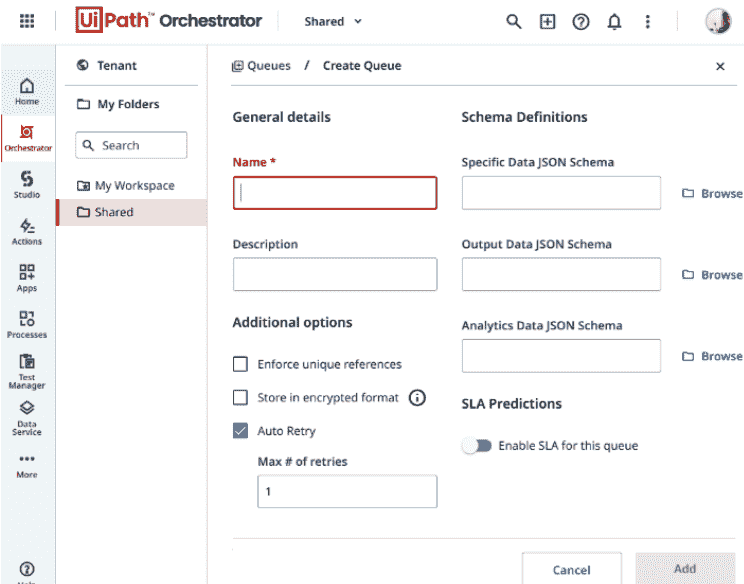

### 图 3.28 – UiPath Orchestrator 中的队列创建页面

以下是对每个必填字段的描述，以便于理解：

- **名称**: 在 UiPath Studio 中创建的工作流使用提供的名称来引用队列。
- **描述**: 对队列及其用途的简短说明。
- **强制唯一引用**: 队列中创建的每个事务都有一个引用。如果希望事务引用唯一，则将此属性选择为 **是**。用户在创建队列后无法更改此属性。
- **自动重试**: 如果需要自动重试失败的事务，则将此属性选择为 **是**。
- **最大重试次数**: 指定失败事务需要重试的最大次数。作为最佳实践，在终止之前建议最多重试三次。

UiPath Studio 提供了一组独特的活动，可以轻松与创建的队列进行交互。这些活动允许机器人插入项目、批量插入项目、检索队列项目并处理它们。以下是 UiPath 工作流中用于与队列交互的活动：

- **添加队列项目**: 用于将事务项目添加到队列中。每个事务项目可能包含多个数据元素。队列项目使用键值对来引用事务中的每个数据元素。使用此活动添加的每个事务项目都会以 **新建** 状态添加到队列中。
- **添加事务项目**: 与 **添加队列项目** 类似，此活动也将事务项目添加到队列中，但状态为 **进行中**。此活动允许在将项目添加到队列后立即处理该项目。
- **获取事务项目**: 检索队列中状态为 **新建** 的下一个可用事务项目。每个检索到的项目的状态都会自动更改为 **进行中**。
- **推迟事务项目**: 用于添加日期参数，以定义项目应处理的日期和时间。
- **设置事务进度**: 某些事务处理时间较长，并且可能需要根据业务要求通过多个阶段。此活动有助于为这类事务引入和跟踪自定义状态。
- **设置事务状态**: 用于在失败或成功时更改事务项目的状态。如果失败是由于业务或应用程序规则异常引起的，状态将更改为 **失败**。同样，当事务成功处理时，状态将更改为 **成功**。

- **获取队列项目**: 检索活动中定义状态的所有队列项目。
- **等待队列项目**: 等待队列中可用于处理的事务，并将其状态设置为进行中。
- **批量添加队列项目**: 允许用户一次将一组项目添加到队列中。所有添加的项目都将具有新建状态。
- **删除队列项目**: 用于删除指定的具有新建状态的项目。

UiPath Orchestrator 在您构建的整个自动化解决方案中起着重要作用，因此，了解基础知识是学习 UiPath 平台时的主要关键点之一。从本章讨论的主题中获得的知识和熟悉度将有助于理解和实践后续章节中讨论的功能。下一节将重点介绍创建第一个 Orchestrator 实例并连接本地机器人，作为旅程的第一步。

## 摘要

本章介绍了 UiPath Cloud 平台和 UiPath Orchestrator。UiPath Orchestrator 是 UiPath 平台的核心，因为它是所有机器人的控制中心。作为介绍的一部分，本章详细描述了 Cloud 平台和 Orchestrator 的每个可用组件。我们还描述了可用于与 Orchestrator 资产和队列交互的一些活动。最后，我们探讨了如何配置 Cloud 平台以创建第一个 UiPath Orchestrator 实例。

已讨论的 UiPath Orchestrator 基本概念将在后续章节中很有用。下一章将描述 UiPath Robot、不同类型的机器人，以及如何配置和连接它们到 Orchestrator。为了更好地理解机器人的配置，必须很好地理解那里描述的概念。
