## 在 UiPath 生态系统中创建、部署和执行 RPA 进程

一旦您的机器人已创建并分配给进程，您将面临如何管理其所有操作的任务。这时 Orchestrator 就派上用场了——它可以帮助您在一个位置管理多个机器人。

作为本章的一部分，您将创建一个机器人并建立本地机器人与 UiPath Orchestrator 之间的连接。然后，您将在 UiPath Studio 中创建第一个机器人流程自动化 (RPA) 进程，将其发布到 Orchestrator 并部署该进程。最后，您将学习如何使用 UiPath Assistant 和有监督自动化来执行进程。

本章包含以下部分：

- 将机器人连接到 Orchestrator
- 创建您的第一个 RPA 进程
- 在 Orchestrator 中管理包
- 从 UiPath Assistant 运行已部署的进程

## 技术要求

本章要求您安装了 UiPath Studio 和 UiPath Robot，并对 Studio 用户界面有基本了解。您可以参考第 2 章 UiPath 生态系统来了解 Studio 的基础知识。您还需要以下先决条件：

- 访问 UiPath Automation Cloud 门户
- 您的计算机上已安装 UiPath Studio
- 访问命令提示符

## 将机器人连接到 Orchestrator

在上一章中，您了解了 Orchestrator 和机器人，但在本节中，您将学习如何创建机器人并将其连接到 Orchestrator。

安装 UiPath Studio 后，您可能会注意到在 Orchestrator 云中已创建默认租户、计算机和机器人，并且 UiPath Studio 与 Orchestrator 之间的连接已经建立。但是，通过以下各节，您将了解如何手动创建机器人并建立到 Orchestrator 的连接。

## 在 Orchestrator 中创建计算机模板

您将用于自动化的计算机需要注册到 Orchestrator，并且安装在您计算机上的机器人需要与 Orchestrator 相关联，以便 RPA 进程能够无缝运行。执行以下步骤在 Orchestrator 中创建计算机模板：

1. 登录 UiPath Automation Cloud。

2. 使用 URL https://cloud.uipath.com/ 启动相应的 **Orchestrator Services** 选项，如以下屏幕截图所示：

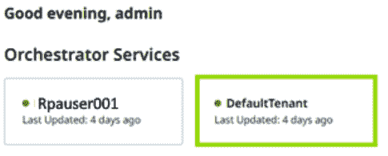

图 4.1 – Orchestrator 服务

3. 单击 Orchestrator 窗口左侧的 **租户** 菜单：

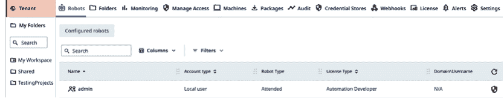

图 4.2 – 租户菜单

4. 单击 **计算机** 选项卡：

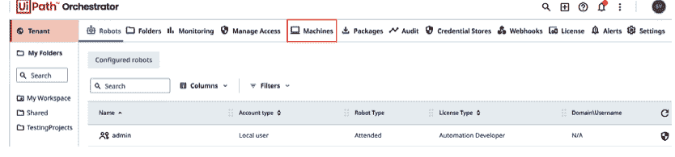

图 4.3 – 计算机菜单

5. 单击 **+ 添加计算机** 图标，将显示 **标准计算机** 和 **计算机模板** 等选项。

我们正在创建计算机模板，因为它允许多个用户将其机器人连接到 Orchestrator。

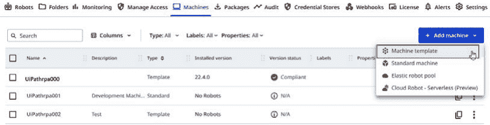

图 4.4 – 添加计算机选项

6. 单击计算机模板，将进入添加计算机模板窗口。

7. 在添加计算机模板屏幕上，输入计算机的详细信息。您需要提供计算机名称、简短说明，以及要注册计算机的预期运行时许可证（执行插槽）| 生产 (无人值守) 数量。然后，单击预配：

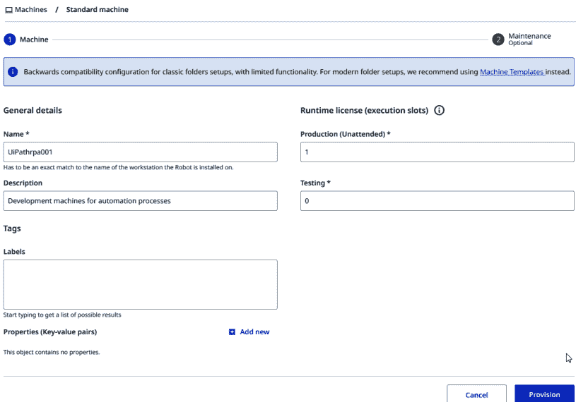

图 4.5 – 添加标准计算机

- 8. 单击 **预配** 后，机器将在 Orchestrator 中创建，如下所示：

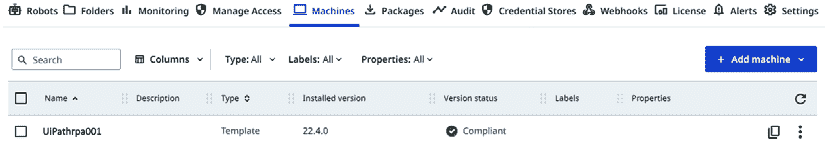

图 4.6 – 可用的机器

- 9. 您可以单击 **复制机器密钥到剪贴板** 图标复制机器密钥，以便将来用于将 UiPath Robot 连接到 Orchestrator：

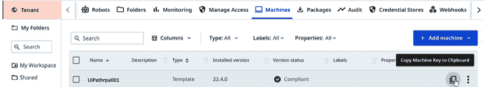

图 4.7 – 复制机器密钥

- 10. 您还可以复制 Orchestrator URL 以备将来使用，以便将 UiPath Robot 连接到 Orchestrator。为此，请复制 URL 直至 **orchestrator** 关键字，如本屏幕截图中高亮所示：

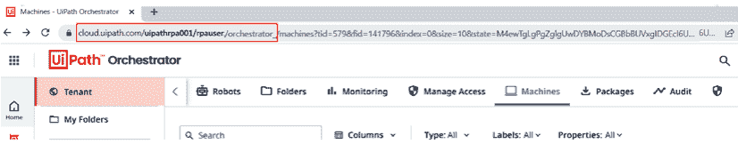

图 4.8 – 复制 Orchestrator URL

现在，您已在 Orchestrator 中成功创建标准机器，并需要将机器人连接到创建的机器以执行 RPA 进程。以下部分将介绍如何创建标准机器人并将其连接到 Orchestrator。

## 创建机器人帐户

在本节中，您将通过执行以下步骤创建机器人帐户：

- 1. 单击 Admin | 帐户和组 菜单导航到机器人帐户部分，如以下屏幕截图所示：

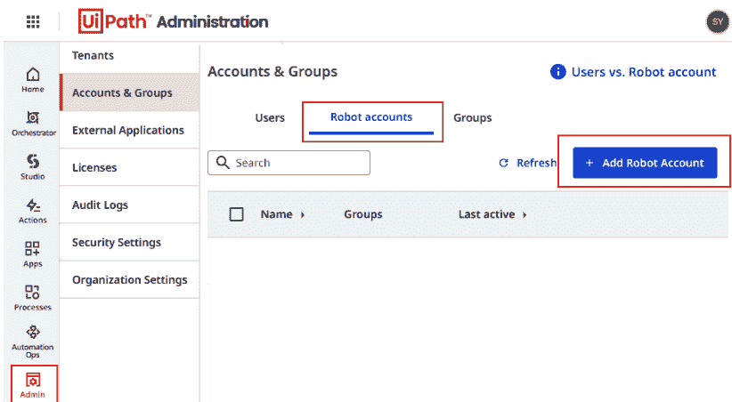

图 4.9 – 帐户和组部分

- 2. 单击 + 添加机器人帐户 按钮：

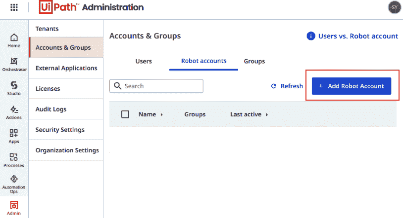

图 4.10 – Robot 菜单

- 3. 输入机器人名称并选择适当的组名称以创建机器人服务帐户。单击 **添加** 按钮创建机器人。

- 4. 如果 UiPath Assistant 未显示在任务栏上，请从 Windows 开始菜单打开 UiPath Assistant，如以下屏幕截图所示：

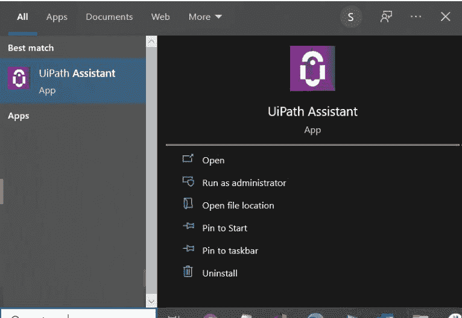

图 4.11 – 启动助手

- 5. 现在，您将能在任务栏上看到 UiPath Assistant。

- 6. 在任务栏上右键单击 UiPath Assistant，将出现上下文菜单。从列表中选择 Orchestrator 设置，这将显示 Orchestrator 设置 窗口：

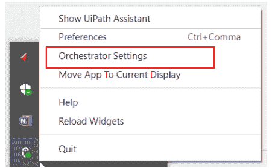

图 4.12 – 上下文菜单

- 7. 在 **Orchestrator 设置** 窗口中验证连接状态。如果状态为 **已连接，已授权**，请单击 **登出** 按钮，如以下屏幕截图中高亮所示：

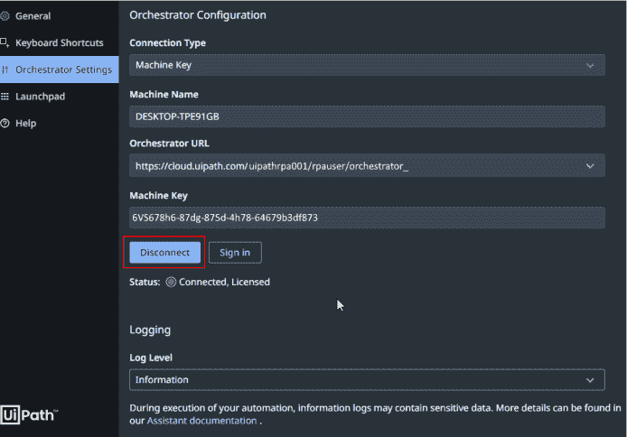

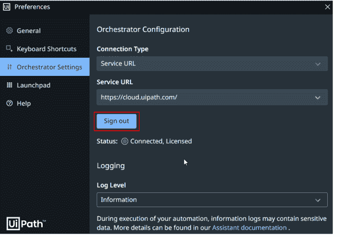

图 4.13 – Orchestrator 设置 – 登出

- 8. 确保 **Orchestrator 设置** 窗口中的连接状态为 **脱机**，如以下屏幕截图所示：

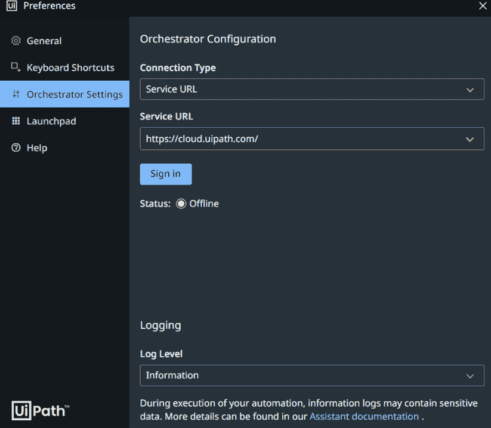

图 4.14 – Orchestrator 设置 – 脱机连接

- 9. 在 **连接类型** 下，在 **Orchestrator 配置** 屏幕上选择 **机器密钥**。 **机器名称** 已自动填充。但是，您需要 **Orchestrator URL** 和 **机器密钥** 的值才能连接到 Orchestrator，这些值可从上一部分 _创建 Orchestrator 中的机器模板_ 的 _步骤 9 和 10_ 中获取。

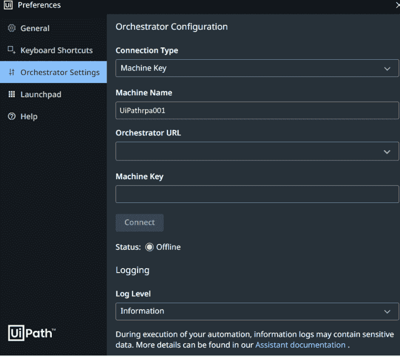

图 4.15 – 连接类型 – 机器密钥

- 10. 输入 **Orchestrator URL** 和 **机器密钥** 详细信息并单击 **连接** 以使机器人连接到 Orchestrator。连接后，状态将更改为 **已连接，已授权**，如以下屏幕截图所示：

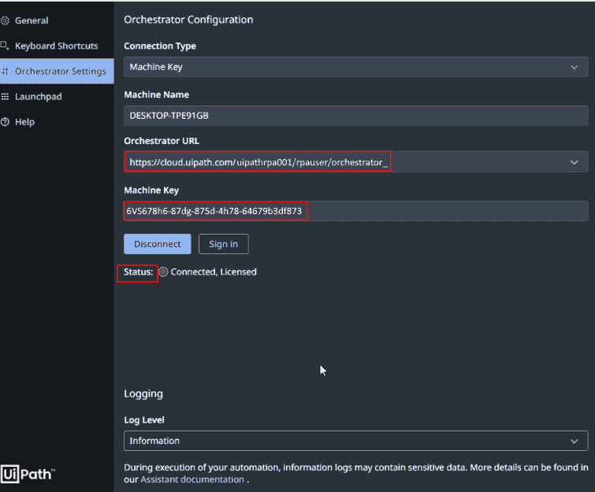

图 4.16 – 连接成功 – 机器密钥

本节中您遵循的逐步说明让您对在 Orchestrator 中创建机器人、机器和环境的端到端流程以及建立与其连接有了良好的理解。让我们通过使用实际用例示例创建您的第一个 RPA 进程来深入了解。

## 创建您的第一个 RPA 进程

为帮助您更好地理解 UiPath Studio 和 RPA 进程，让我们将所学知识应用到一个简单的项目中，在消息框中显示 `Hello World`。

按照以下步骤创建您的第一个自动化进程：

- 1. 启动 UiPath Studio，并通过单击 **主页** 选项卡导航到主页视图：

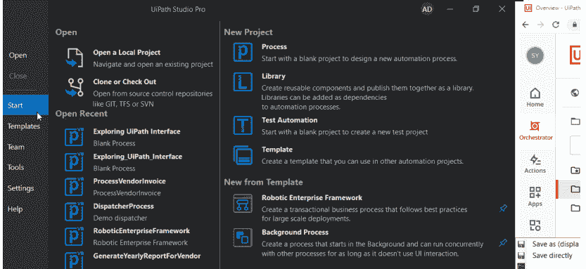

图 4.17 – 主页视图

- 2. 在新建项目部分单击 进程 以创建新项目。随后将显示新建空白进程窗口：

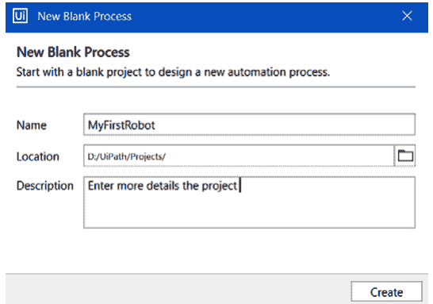

图 4.18 – 新建进程

- 3. 为项目输入合适的名称并选择保存位置的驱动器。请注意，项目名称不能超过 128 个字符，描述不能超过 500 个字符。

- 4. 输入所有详细信息后，单击 创建 。新项目将在 Studio 中打开。

- 5. 在新创建的项目的 **设计** 视图上单击 打开主工作流 ：

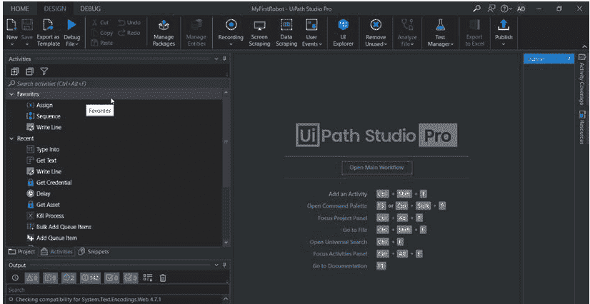

图 4.19 – 设计视图

- 6. 在活动面板的搜索框中输入 序列 以从活动拖放序列。双击 序列 标题并将其重命名为 MyFirstRobot：

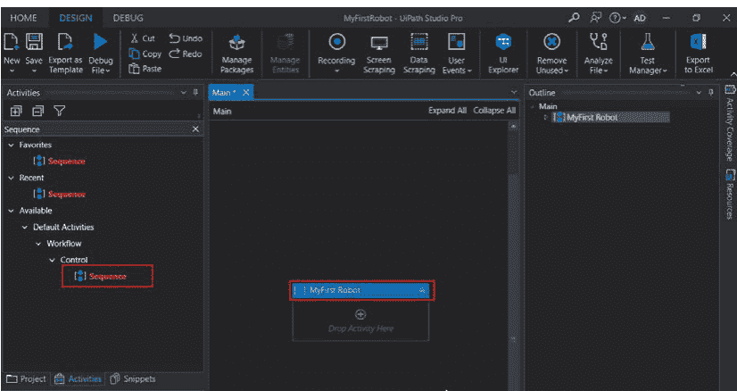

图 4.20 – 创建序列

- 7. 右键单击序列以添加注释，或按 Shift + F2 以添加有关项目的更多描述性信息：

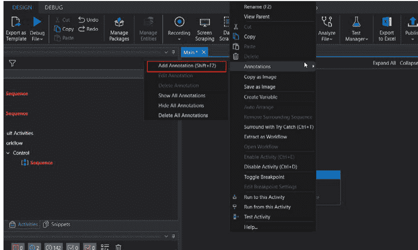

图 4.21 – 添加注释

- 8. 现在，在活动面板的搜索框中输入 消息框 以将 消息框 活动拖放到 MyFirstRobot 序列活动中：

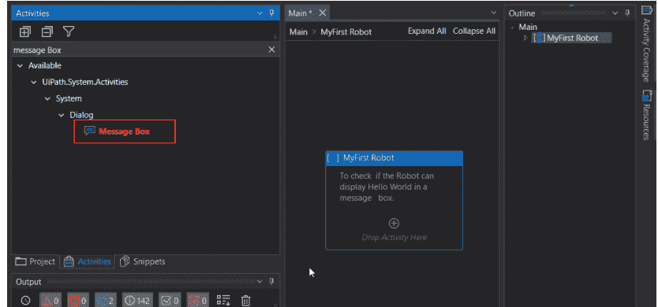

图 4.22 – 添加消息框

- 9. 默认情况下，消息框没有任何默认值。但是，消息框会显示一个警报，并期望为消息框提供文本值：

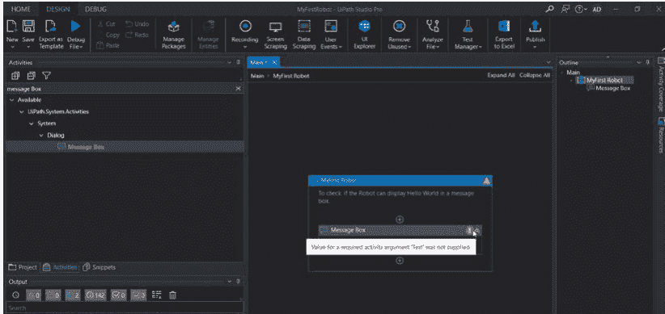

图 4.23 – 了解警报消息

- 10. 在双引号内向 **消息框** 活动中输入文本 "Hello World! "：

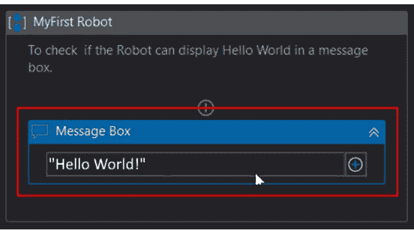

图 4.24 – 在消息框中输入消息

- 11. 现在，通过单击 **运行** 按钮或按 *Ctrl + F5* 运行工作流：

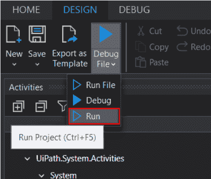

图 4.25 – 运行工作流

- 12. 验证机器人生成的 **消息框** 输出。单击 **确定** 以结束机器人执行：

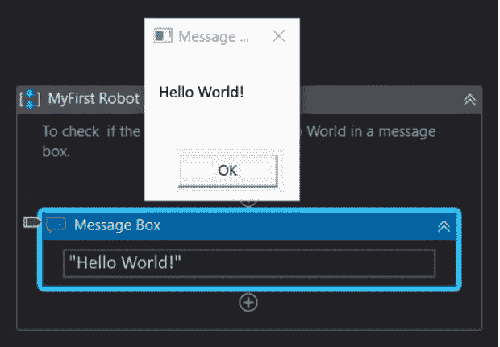

图 4.26 – 运行工作流

重要说明

由于本章中显示的屏幕截图是使用 UiPath Studio 2020.10 拍摄的，因此最新 Community Edition 版本中的某些元素可能有所不同。

您已成功创建第一个机器人，该机器人显示 "Hello World!" 消息。在下一节中，您将创建第二个机器人，该机器人将与多个应用程序一起执行稍多的工作。

## 创建您的第二个 RPA 进程

现在，让我们直接创建一个简单的项目，以从网页提取信息并将其写入记事本（写入应用程序）。

### 前提条件

尝试执行以下步骤以识别与 Chrome 扩展程序相关的启动 Chrome 问题，因为我们将在本练习中使用 Chrome 浏览器：

- 1. 从 工具 页面，单击 UiPath 扩展程序 中的 Chrome ：

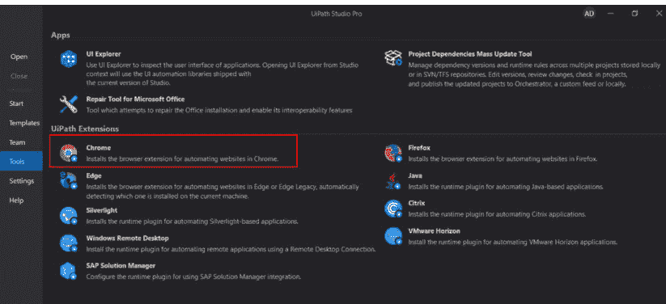

图 4.27 – Chrome 扩展程序

- 2. 在 Chrome 中导航至 chrome://extensions/ 并确认扩展程序可用：

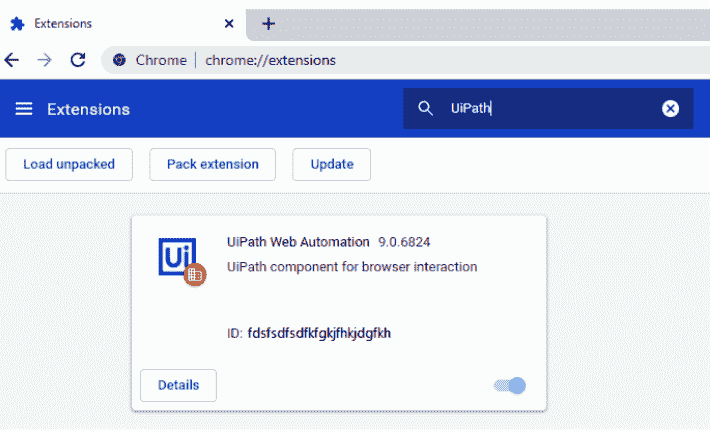

图 4.28 – 启用 Chrome 扩展程序

- 3. 确保 **UiPath** 扩展程序默认处于启用状态。如果不是，请单击高亮显示的切换图标手动启用它：

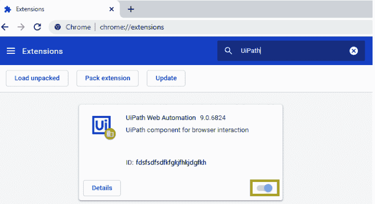

图 4.29 – 手动启用 Chrome 扩展程序

扩展程序正确设置后，请执行以下流程设计步骤。

按照以下步骤创建您的第二个自动化流程：

- 1. 启动 UiPath Studio，并通过单击 **主页** 选项卡导航到主页视图。

- 2. 在 **新建项目** 部分中单击 **流程** 以创建新项目。将显示 **新建空白流程** 窗口：

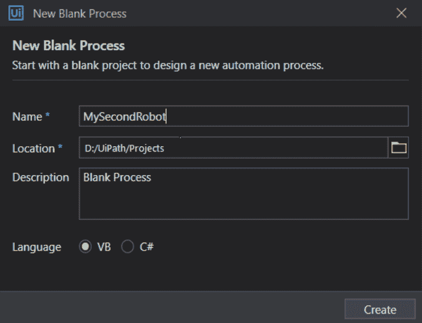

图 4.30 – 创建新流程

- 3. 为项目输入合适的名称，并选择保存项目的驱动器位置。请注意，项目名称不能超过 128 个字符，描述不能超过 500 个字符。

- 4. 输入所有详细信息后，单击 **创建**。新项目将在 Studio 中打开。

- 5. 单击 **将活动拖放到这里**，并键入 Open Browser：

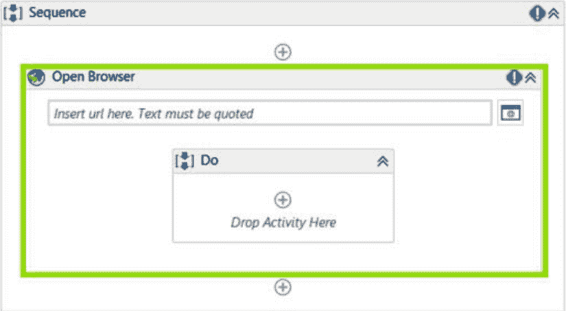

图 4.31 – 打开浏览器

- 6. 将序列命名为 Extract Text from Packt，并插入 https://www.packtpub.com/au/about URL：

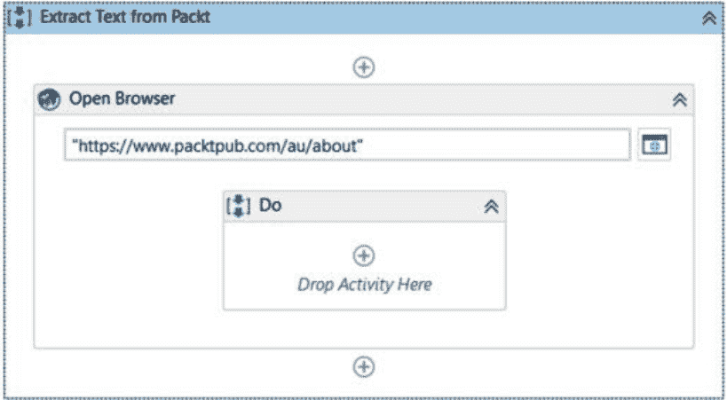

图 4.32 – 打开浏览器 URL

- 7. 单击 **打开浏览器**。从 **属性** 选项中，通过单击 **浏览器类型** 展开下拉列表：

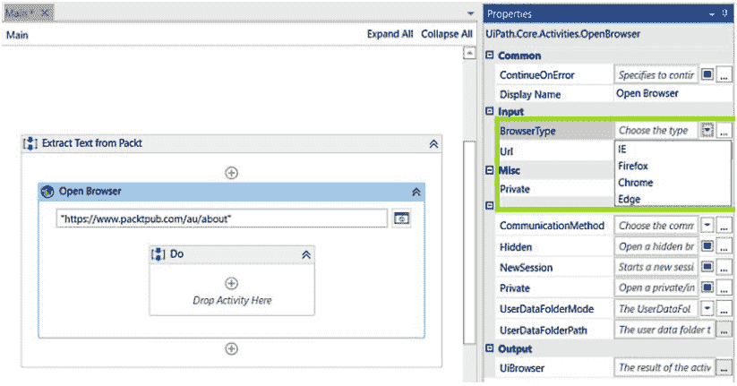

图 4.33 – 打开浏览器类型

- 8. 将 Chrome 选为首选浏览器：

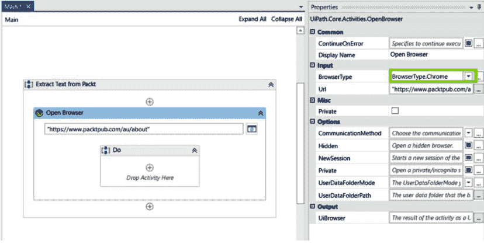

图 4.34 – 打开浏览器类型

- 9. 将 **Do** 序列重命名为 **提取文本**，并单击 **将活动拖放到这里** 以选择 **获取可见文本** 活动：

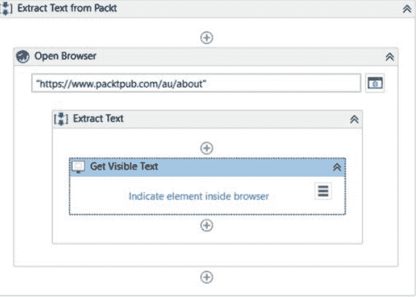

图 4.35 – 获取可见文本

- 10. 单击 **运行** 按钮，检查浏览器是否已成功启动：

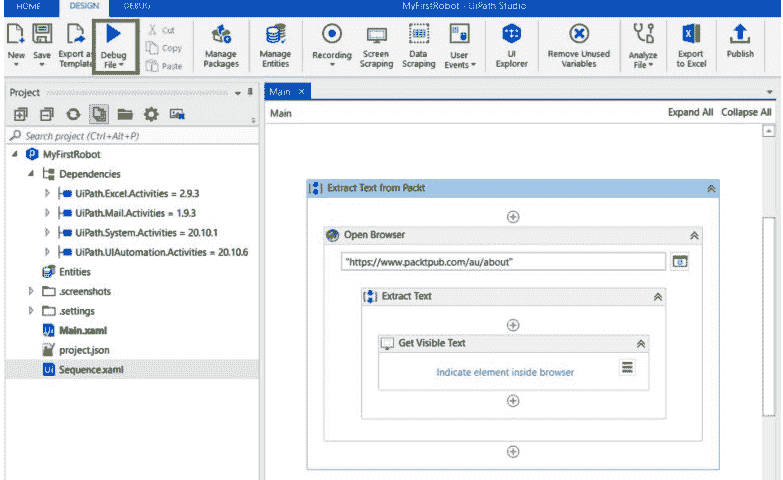

图 4.36 – 运行流程

- 11. 验证机器人是否可以成功启动带有预期网页的浏览器：

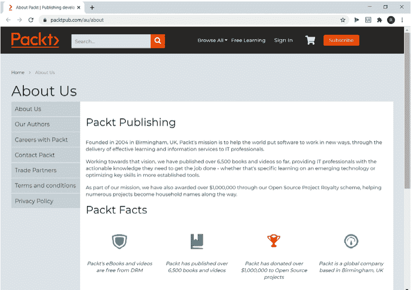

图 4.37 – 输出结果

- 12. 在 **获取可见文本** 活动中单击 **指示元素**，以从浏览器中提取所需内容：

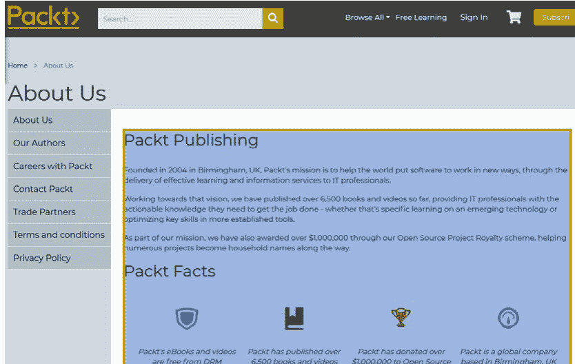

图 4.38 – 指示元素

- 13. 在 **属性** 面板的 **文本** 字段中按 Ctrl + K 创建一个变量以保存提取的文本。这样您可以输入变量名称，如突出显示所示：

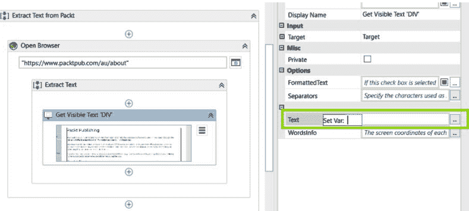

图 4.39 – 创建变量

- 14. 将变量名设置为 `txtAboutPackt` 并按 `Enter`。这将把提取的文本保存到 `txtAboutPackt` 变量中：

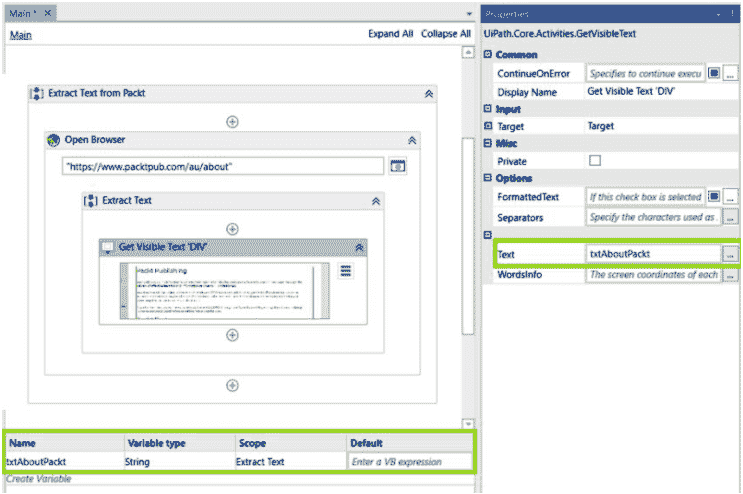

图 4.40 – 设置输出属性

- 15. 单击 + 符号并添加 **打开应用程序** 活动。

- 16. 从 **打开应用程序** 活动中，通过单击 **指示浏览器内的窗口** 附加记事本应用，以输出前面步骤中提取的文本：

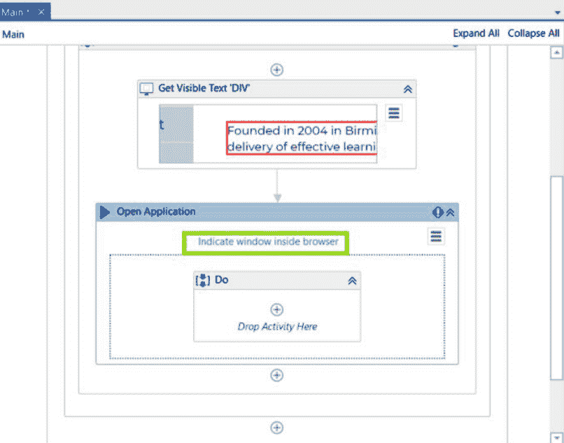

图 4.41 – 打开应用程序

- 17. 确保记事本应用已链接到 **打开应用程序** 活动：

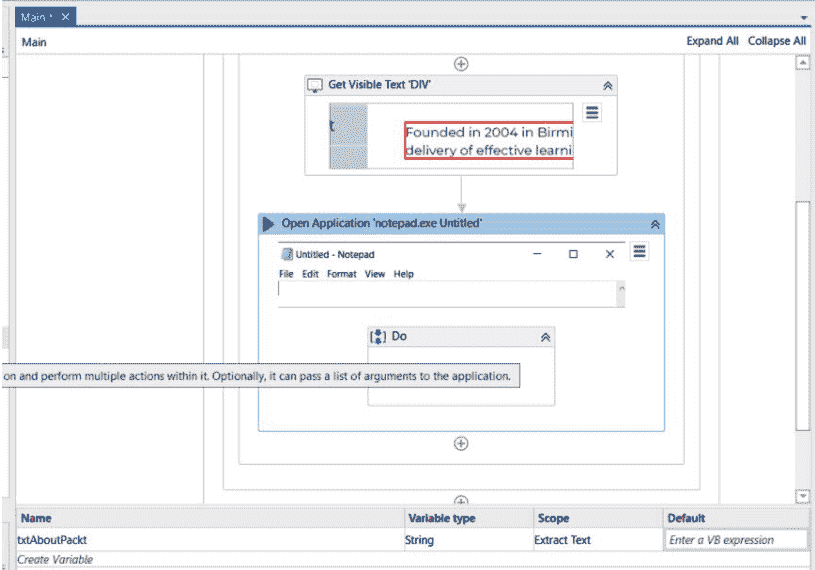

图 4.42 – 指示记事本作为输出

- 18. 将 **打开应用程序** 内部的序列更改为 **输入文本**，并单击 + 符号以包含设置的文本：

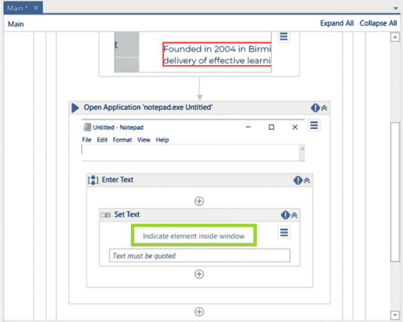

图 4.43 – 设置输出文本

- 19. 单击 **指示** 元素以指向空白记事本：

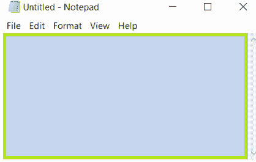

图 4.44 – 指示记事本以写入输出文本

- 20. 将 **设置文本** 活动更改为 **输入提取的文本**，并修改文本字段以接受可用的 `txtAboutPackt` 字符串变量：

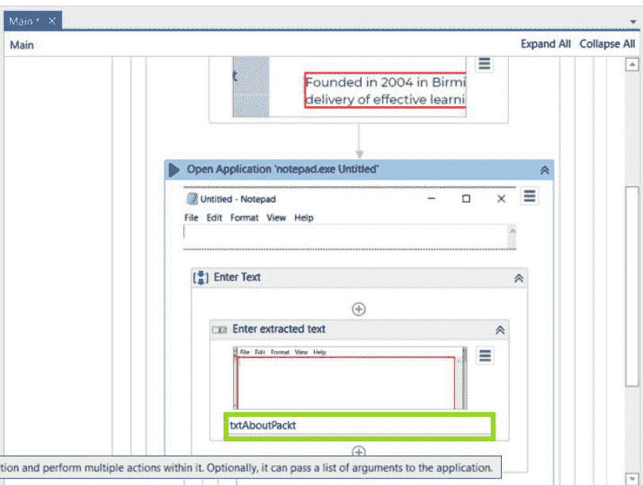

图 4.45 – 文本变量输出的映射

- 21. 最后，包含关闭标签页活动，以便机器人在自动化执行期间关闭已打开的浏览器：

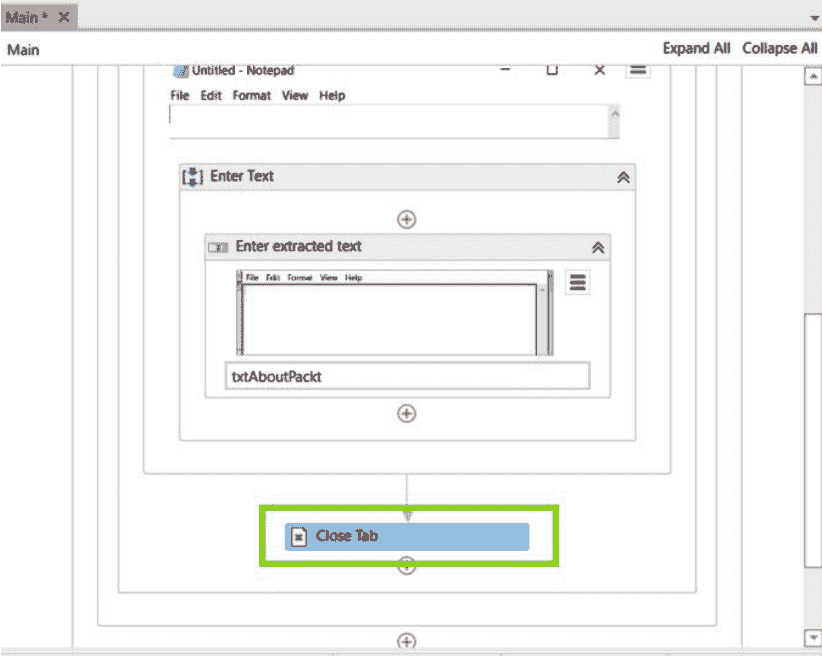

图 4.46 – 关闭标签页

- 22. 单击保存按钮（或按键盘上的 Ctrl + S）保存工作流。

- 23. 要执行工作流，请关闭任何打开的浏览器或记事本应用程序，并从 **设计** 面板单击运行按钮：

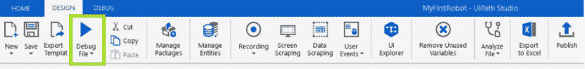

图 4.47 – 调试选项卡

- 24. 观察机器人生成的输出：

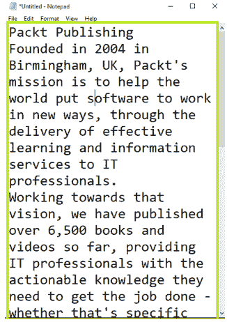

图 4.48 – 结果验证输出

- 25. 通过单击 Studio 上的发布按钮发布项目：

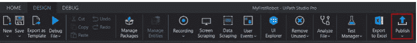

图 4.49 – 发布过程

- 26. 在 **包属性** 部分中单击 **下一步**：

图 4.50 – 包属性

- 27. 在 **发布选项** 中，确保已选择 **Orchestrator 租户进程馈送** 以将项目发布到 Orchestrator 中的 **租户** 级别（默认已选中）。如果您选择 **Orchestrator 个人工作区馈送** 选项，也可以直接发布到个人工作区文件夹，如 **图 4.51** 所示：

图 4.51 – 发布流程

- 28. 单击 **下一步**，然后在 **发布流程** 弹出窗口中单击 **发布** 按钮。由于我们使用默认工作区文件夹，已发布的项目将在 Orchestrator 的默认文件夹中可用。您将在 Studio 中发布项目后看到以下确认消息：

图 4.52 – 已发布的项目

在本节中，您已成功创建第二个 RPA 流程并将其发布到 Orchestrator。在即将到来的节中，让我们看看如何从 Orchestrator 部署已发布的流程，以便由 UiPath Assistant 执行。

> **重要提示**
> 尝试使用 **获取完整文本** 活动而不是 **获取可见文本** 活动来运行给定项目，并观察差异。您也可以尝试不同可用的 Web 搜集活动，使您的学习更加有趣！

## 在 Orchestrator 中管理包

从 UiPath Studio 发布的包必须在 UiPath Orchestrator 中可用。该包将进一步部署并分配给正确的机器人以执行。让我们看看执行这些操作的逐步说明。

## 使用已发布包的最新版本

每次向 Orchestrator 发布包时，版本号都会更新。因此，使用最新包以获取所有最新更新和/或代码至关重要。按照以下逐步说明使用最新版本：

- 1. 导航到 Orchestrator 中的 **包** 选项卡：

图 4.53 – 包

- 2. 单击 **浏览包** 以查看包的详细信息：

图 4.54 – 浏览包

- 3. 单击 **更多操作** 图标：

图 4.55 – 更多操作

- 4. 如果要查看可用版本，请单击 **查看版本**：

图 4.56 – 查看版本

- 5. 选择所需的包并单击升级包按钮：

图 4.57 – 使用最新版本

您现已将包升级到最新版本。在即将到来的节中，您将看到如何创建自动化流程并从 UiPath Assistant 执行它。

## 创建自动化流程

已发布的包必须部署或转换为自动化流程，以便由机器人执行。让我们看看如何在 Orchestrator 中执行自动化创建过程：

- 1. 单击我们正在使用的显示屏左侧的 **默认文件夹**，单击 **自动化** 选项卡，然后单击 **添加流程** 按钮：

图 4.58 – 添加流程

- 2. 输入正确的 **包源名称**、**包版本** 和 **环境** 详细信息，然后单击 **继续** 按钮：

图 4.59 – 输入流程详细信息

- 3. 输入 **显示名称** 和 **描述** 详细信息，然后单击 **创建**：

图 4.60 – 创建流程

- 4. 通过查看 **自动化** 选项卡，确保流程已创建并显示：

图 4.61 – 可用流程

在本节中，我们了解了从 Orchestrator 部署已发布包的方式。在即将到来的章节中，我们将了解如何从 UiPath Assistant 执行已部署的流程。

### 从 UiPath Assistant 运行流程

为了实现有监督的自动化（如第 3 章“UiPath Orchestrator 简介”中所述），即在没有任何人工用户帮助的情况下执行自动化流程，我们需要执行以下步骤：

- 1. 从任务栏启动 UiPath Assistant：

图 4.62 – UiPath Assistant 任务栏图标

- 2. 验证从 Orchestrator 发布的包在 UiPath Assistant 中处于 **等待安装** 状态，如图 4.77 所示：

图 4.63 – UiPath Assistant – 等待安装

- 3. 单击开始按钮以安装包并从 UiPath Assistant 启动流程执行：

图 4.64 – UiPath Assistant 安装和执行过程

- 4. 验证 UiPath Assistant 中自动化的状态，并确保流程的自动化执行已完成：

图 4.65 – UiPath Assistant 已执行的流程

- 5. 通过检查记事本应用，验证从 **Packt 出版社** 网站提取的输出文本，如下所示：

图 4.66 – 结果验证输出

在本节中，我们了解了从 UiPath Assistant 执行已部署流程的逐步说明，并已验证结果。

### 摘要

本章提供了使用 UiPath Enterprise 平台所有核心组件的更多经验机会。您已在 Orchestrator 中成功创建了计算机、机器人和环境，并建立了 UiPath Studio 与 Orchestrator 之间的连接。

此外，您已创建第一个 RPA 流程并将其发布到 Orchestrator。随后部署了已发布包的最新版本，并使用 UiPath Assistant 从计算机任务栏执行了自动化流程。总体而言，您通过实施一个简单的项目体验了端到端自动化。

下一章将介绍 UiPath Orchestrator 是什么，以及如何在其中发布和执行自动化。它还将提供有关变量和参数的更多信息，帮助您在构建更强大的自动化流程方面积累更多经验。
