## 5 了解变量和参数

**变量和参数** 是任何编程语言中的两个关键组件。与其他任何编程语言一样，UiPath Studio 也使用变量和参数来存储、读取和处理数据。变量和参数使用户能够根据每个步骤的输入和输出连接不同的操作，从而构建自动化流。

到本章结束时，您将了解 UiPath 中使用的最常见数据类型，以及如何根据要求配置参数和变量。

本章包含以下部分：

- 探索变量
- 练习创建变量
- 探索参数
- 练习创建参数
- 了解数据类型

### 技术要求

在开始本章之前，请确保已安装 UiPath Studio 和 UiPath Robot。本章需要对如何使用 Studio 和 UiPath Assistant 工具有大致了解。您可以参考 _第 2 章，UiPath 生态系统_ 以更好地了解 UiPath Studio 的基础知识。

### 探索变量

变量可定义为存储相同数据类型值的容器。更改变量值的方法有多种，例如：

- **外部输入**：用户或另一系统提供要存储在变量中的值。
- **数据操作**：在数据操作过程中使用的变量可能保存派生值。数据操作过程是一系列执行步骤，用于提取、过滤、修改和清理数据。数据操作在 _第 7 章，使用 UiPath 操作数据_ 中有详细描述。
- **在活动之间传递**：执行多个工作流活动时，可能将同一变量用作活动的输入或输出。

现在让我们详细了解变量的主要属性。

### 变量属性

UiPath 中用于配置变量的主要属性有四个。您可以通过 UiPath Studio 的 **变量** 面板找到这四个属性，如下屏幕截图所示：

| 名称 | 变量类型 | 范围 | 默认值 |
| :--- | :--- | :--- | :--- |
| SumValue | Int32 | 序列 | 输入 VB 表达式 |
| 创建变量 | | | |
| 变量：参数 导入 ... | | | |

图 5.1 – UiPath Studio 中的变量面板

为更好地理解，让我们详细探讨每个属性，如下：

- **名称**：此属性包含变量的名称。此处指定的名称用于在整个自动化工作流中引用变量。根据变量的用途，为其提供简短但具有描述性的名称始终是最佳实践。
- **变量类型**：这定义了变量中存储的数据类型。变量类型在创建变量时定义，如有需要可以更改。某些特定类型更通用，可以容纳不同类型的数据。这些数据类型是 UiPath 特有的。通常，常用数据类型包括 **文本**、**数字**、**数组**、**日期/时间**、**布尔值** 和 **数据表**。
- **范围**：描述变量可用的工作流区域。**序列**、**流程图** 和 **范围活动**（在 *第 6 章，了解不同控制流* 中有详细描述）等容器定义了变量可工作的区域。将变量分配到所需范围始终是个好主意，以确保高效执行并避免混淆，因为实际自动化工作流中使用了许多变量。
- **默认值**：每个变量默认都分配有一个默认值。默认值属性使用户能够为变量设置自定义默认值。

既然现在了解了变量的属性，让我们看看可以采用哪些不同的方法来创建变量。变量创建涉及配置前面描述的属性。

### 在 UiPath 中创建变量

在构建自动化工作流时，变量的创建和修改非常频繁。因此，UiPath 在工作流中引入了三种创建变量的方法，如下所述：

- **通过变量面板**：单击 **变量** 面板中的 **创建变量** 选项，可通过配置前面讨论过的属性来轻松创建变量。以下屏幕截图展示了此操作：

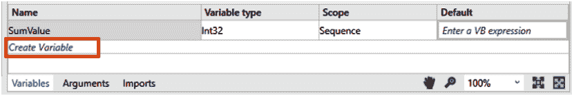

图 5.2 – UiPath Studio 中的变量面板

单击 **创建变量** 选项会在面板中创建一行新行，以便为新变量提供名称、变量类型、范围和默认值。


- 通过设计器面板：使用您要将变量关联到的活动，并按 Ctrl + K 快捷键在设计器面板中启用变量创建模式。您可以根据需要通过变量面板提供变量名称和其他附加配置。通过设计器面板创建的变量会根据活动的配置和活动的作用域自动选择变量的作用域和数据类型。活动所在的容器决定了变量的作用域。

- 通过属性面板：活动的属性面板包含活动的所有配置选项。与设计器面板类似，在变量需要交互的属性中按 Ctrl + K 快捷键将启用变量创建模式。变量的其余属性将根据活动的配置和活动的作用域自动配置。

变量是我们在所有编程语言中用于存储不同类型数据的常见容器。UiPath 使用 Microsoft .NET Framework 提供的所有数据类型，以及一些 UiPath 特有的其他数据类型。既然我们现在了解了变量的基本属性，本书的下一部分将为您提供关于变量创建和作用域管理的实践指南。现在练习变量创建在未来章节中将会非常有用，因为我们将讨论更复杂的场景。

## 练习变量创建

既然我们已经介绍了变量的基础知识，现在让我们稍加练习。以下步骤将指导您如何在 UiPath 工作流中创建一个简单变量：

1. 从 Windows 开始菜单运行 UiPath Studio。

2. 在 Studio 开始画面的新建项目部分，单击“进程”选项以创建一个新的空白项目，如下图所示：

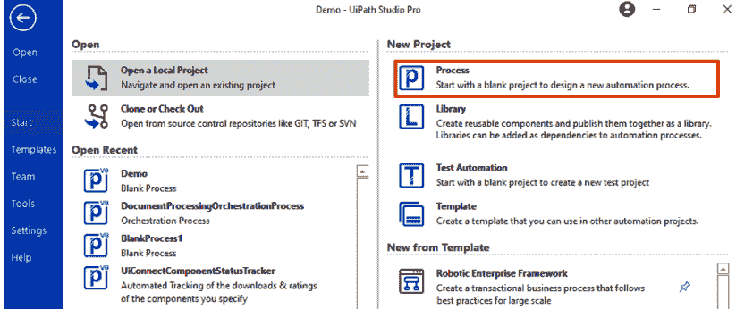

图 5.3 – 工作室开始页

3. 在弹出的菜单中，提供解决方案名称和要保存解决方案的文件路径，然后单击 **创建** 按钮以创建您的空白解决方案，如下图所示：

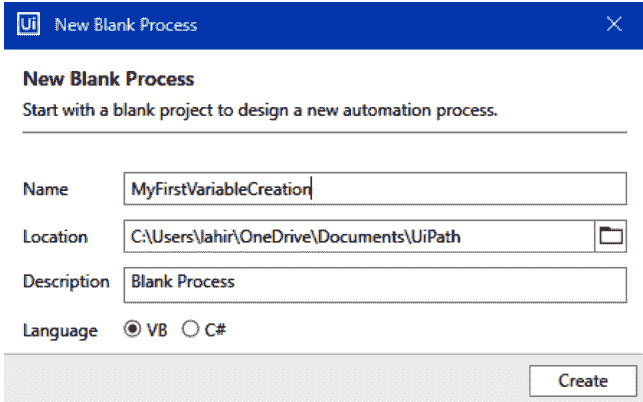

图 5.4 – UiPath Studio 项目创建页面

4. 创建项目后，您的屏幕将类似于下图所示。现在，单击 Main.xaml 文件在设计器面板中打开它。

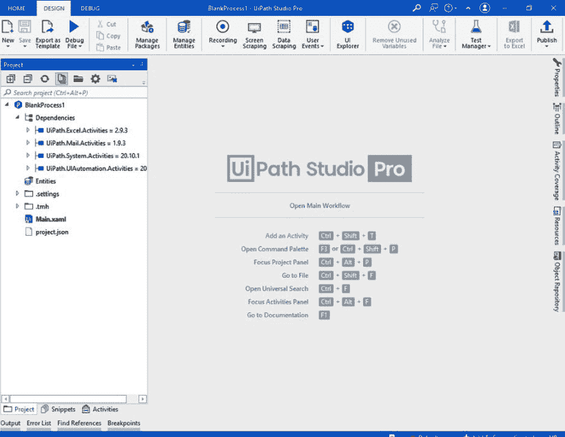

图 5.5 – UiPath Studio 项目主页

5. 单击活动面板，搜索序列活动，并将其拖放到工作流主体中。

6. 打开变量面板，创建一个名为 UserName 的字符串类型变量，如下图所示：

| 名称 | 变量类型 | 作用域 | 默认值 |
|---|---|---|---|
| UserName | 字符串 | 序列 | 输入 VB 表达式 |
| 创建变量 | | | |

图 5.6 – 变量创建

7. 从 **活动** 面板搜索 **输入对话框** 活动，并将其拖放到设计器中。**输入对话框** 活动会提示用户在运行时输入一个值。

8. 配置 **输入对话框** 活动，如下图所示：

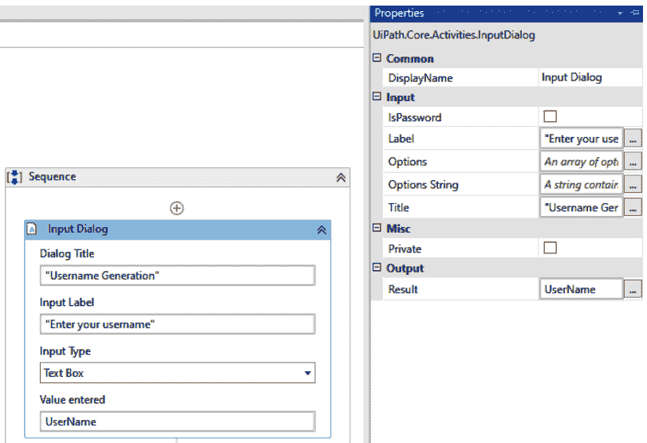

图 5.7 – 配置输入对话框活动

9. 从 **活动** 面板搜索 **消息框** 活动，并将其放置在 **输入对话框** 活动下方。

10. 通过键入以下命令配置 **消息框** 活动：

```
"Hello " + UserName + ", Nice to see you!"
```

11. 现在，单击 **设计** 功能区上的 **调试文件** 按钮（或按 F6）以运行进程。

12. 一旦 **输入对话框** 活动在您的屏幕上显示，提供一个名称并单击确定。

13. 您将看到一个 **消息框** 活动，其中包含文本 "Hello John, Nice to see you!"（如果您提供 John 作为名称）。根据您提供的名称，**消息框** 活动可能会更改。

完成此实践任务后，您现在知道如何使用变量来分配用户输入的值并在消息框中显示它。

现在，让我们看一个变量作用域更改会影响工作流的场景，如下所示：

1. 使用您刚刚构建的相同工作流，现在选择另一个 **序列** 容器，并将其定位在 **输入对话框** 和 **消息框** 活动之间，如下图所示：

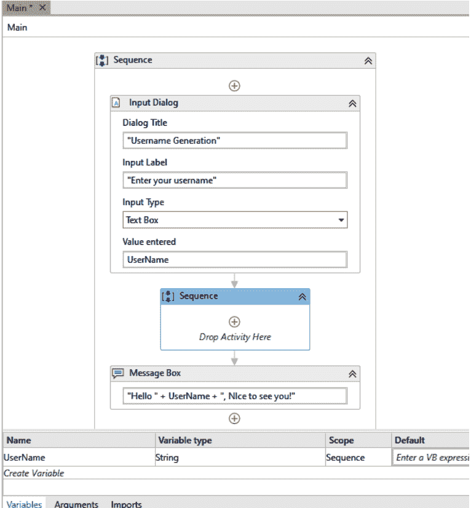

图 5.8 – 向工作流添加内部序列

2. 双击新添加的 **序列** 容器的标题，并将其重命名为 **内部序列**，如下图所示：

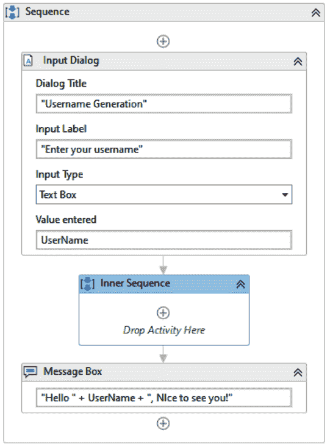

图 5.9 - 重命名内部序列

3. 从 **活动** 面板搜索 **赋值** 活动，并将其放置在 **内部序列** 容器内。

4. 为 **赋值** 活动的 **值** 段提供以下值：

```
"Welcome to my first RPA program"
```

5. 单击 **赋值** 活动的 **对象** 段，并按 Ctrl + K 以启用变量创建模式。

6. 将变量名提供为 `WelcomeMessage` 并按 `Enter` 创建此变量。

7. 现在，您的工作流和 **变量** 面板应类似于此：

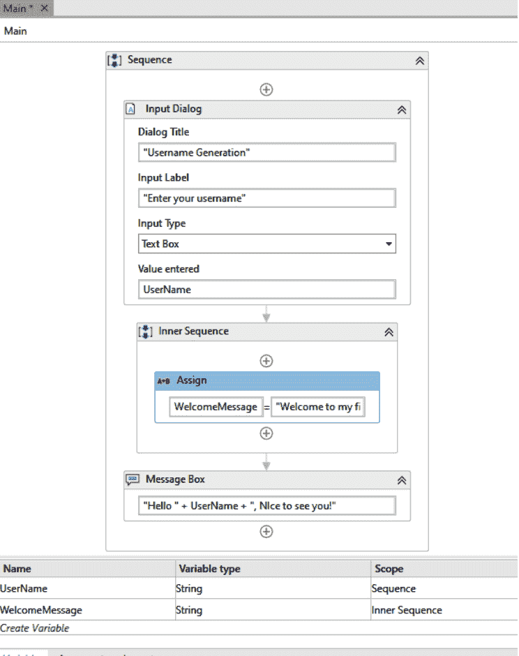

| 名称 | 变量类型 | 作用域 |
| --- | --- | --- |
| UserName | 字符串 | 序列 |
| WelcomeMessage | 字符串 | 内部序列 |
| 创建变量 | | |

图 5.10 – 配置赋值活动后的工作流

仔细查看 **变量** 面板，我们注意到新 `WelcomeMessage` 变量的 **作用域** 值自动设置为 **内部序列**。这意味着 `WelcomeMessage` 变量仅在 **内部序列** 作用域内可访问。但是，在选择 **赋值** 活动时，您仍然可以在 **变量** 面板中看到 `UserName` 变量。这意味着您可以在 **内部序列** 作用域内访问 `UserName` 变量，因为 `UserName` 变量的作用域是容纳内部序列的外部序列。

8. 现在，单击 **消息框** 活动，同时密切监视 **变量** 面板。一旦单击 **消息框** 活动，`WelcomeMessage` 变量将从 **变量** 面板中消失，如下图所示：

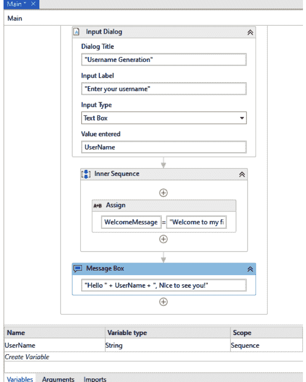

图 5.11 – 解释变量作用域

变量消失是因为 **内部序列** 变量无法在其定义作用域之外使用。

9. 如果您尝试通过包含 WelcomeMessage 变量来配置 **消息框** 活动，该活动将向您显示一条错误消息，如下所示：

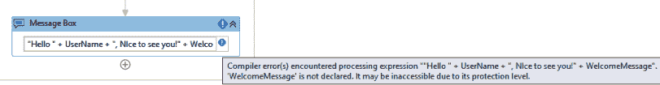

图 5.12 – 解释由于作用域不正确导致的错误

错误消息指出 WelcomeMessage 变量未声明，因为它找不到该变量。

10. 现在，再次选择 **内部序列** 容器，并将 WelcomeMessage 变量的 **作用域** 值更改为外部序列。配置完成后，您的 **变量** 面板应类似于此：

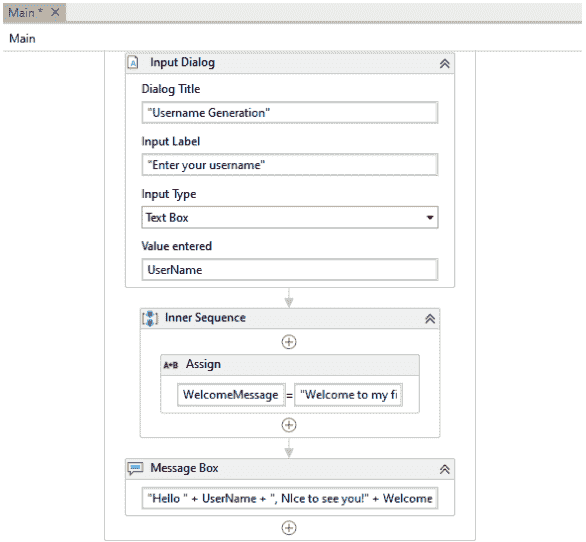

| 名称 | 变量类型 | 作用域 | 默认值 |
|---|---|---|---|
| WelcomeMessage | 字符串 | 序列 | 输入... |
| UserName | 字符串 | 序列 | 输入... |
| 创建变量 | | | |

图 5.13 – 修复变量作用域问题

您现在可以看到 **消息框** 活动的错误已消失，因为该变量现在可访问了。

11. 单击调试文件按钮（或按 F6）运行进程以体验输出。

您在本节中遵循的实践步骤让您很好地了解了创建变量的不同方式以及变量的作用域如何影响工作流。关于变量的知识在我们探索参数时将会非常有用。参数与变量非常相似，但具有不同的属性。然而，它们使用与变量相同的概念，只是略有不同。

## 探索参数

在 UiPath 中，变量的目标是在指定作用域内存储数据，并根据需要将其传递给其他变量或活动。现实世界的自动化项目包含多个工作流，因此使用变量不足以连接工作流。UiPath 中的参数派上用场以填补这一差距，充当允许在多个工作流之间传输数据的容器。参数与工作流非常相似，因为它们根据其定义的数据类型动态存储数据。然而，区别在于参数具有方向属性，用于描述数据如何在工作流之间传输。此外，使用参数使用户能够在多个项目中重用自动化工作流。

让我们看看参数的属性。

### 参数的属性

让我们看看参数的属性，如下所示：

- 名称：类似于变量，此属性指示参数的名称。为了区分变量和参数，我们将参数的方向作为名称的前缀作为最佳实践（例如，In_UserName；Out_CustomerData；IO_AccountData）。

- 数据类型：指定参数持有的数据类型。


- Direction：指定数据传入/传出的方向。UiPath 中有三个方向，如下图所示：

| Direction | Description |
| :--- | :--- |
| In | 参数只能在给定工作流内使用，因为数据是传入工作流的 |
| Out | 参数可用于将数据传出给定工作流 |
| In/Out | 参数可用于同时接收和发送数据 |

图 5.14 – 参数方向

- 默认值：参数保持的默认值。但是，对于 Direction 类型定义为 Out 或 In/Out 的参数，此属性被禁用。

现在我们了解了参数的属性，让我们来看看创建参数的不同方法。

## 在 UiPath 中创建参数

当您希望在多个工作流之间传递数据时，会创建参数。参数创建与变量创建类似，如“练习创建变量”部分所述。使用以下方法创建参数：

- 通过“参数”面板：单击“参数”面板上的“创建参数”选项，可以通过配置之前讨论的属性来轻松创建参数。下图演示了此选项：

| 名称 | 方向 | 参数类型 | 默认值 |
|---|---|---|---|
| In CustomerName | In | 字符串 | 输入 VB 表达式 |

创建参数

图 5.15 – UiPath Studio 中的“参数”面板

单击 **“创建参数”** 选项会在面板中创建一个新行，用于为新变量提供名称、数据类型、作用域和默认值。

- **通过“设计器”面板**：使用要与之关联参数的活动，并按 *Ctrl + M* 快捷键在 **“设计器”** 面板中启用参数创建模式。您可以根据需要提供参数名称并通过 **“参数”** 面板进行其他配置。通过 **“设计器”** 面板创建的参数会根据活动的配置自动选择参数的数据类型。

- **通过“属性”面板**：活动的 **“属性”** 面板包含活动的所有配置选项。与 **“设计器”** 面板类似，在参数需要交互的属性中按 *Ctrl + M* 快捷键将启用参数创建模式。参数的 **Direction** 值默认自动设置为 **In**。但是，如果要更改 **Direction** 值，则必须通过 **“参数”** 面板完成。

与变量类似，参数是支持工作流之间传输数据的容器，从而实现组件的可重用性。既然您现在了解了参数的属性和创建方法，下一部分将为您提供练习创建参数的指南。此练习还可帮助您了解如何在 UiPath 解决方案中使用多个工作流。

## 练习创建参数

现在，既然我们已熟悉变量和参数的属性，让我们尝试构建一个简单的工作流来测试我们的知识，步骤如下：

1. 打开 UiPath Studio 并创建一个新项目。
2. 从 **“项目”** 面板打开 *Main.xaml* 文件。
3. 单击 **“活动”** 面板，并拖放 **“输入对话框”** 活动。
4. 配置 **“输入对话框”** 活动以获取用户的姓名。活动配置应类似于此：

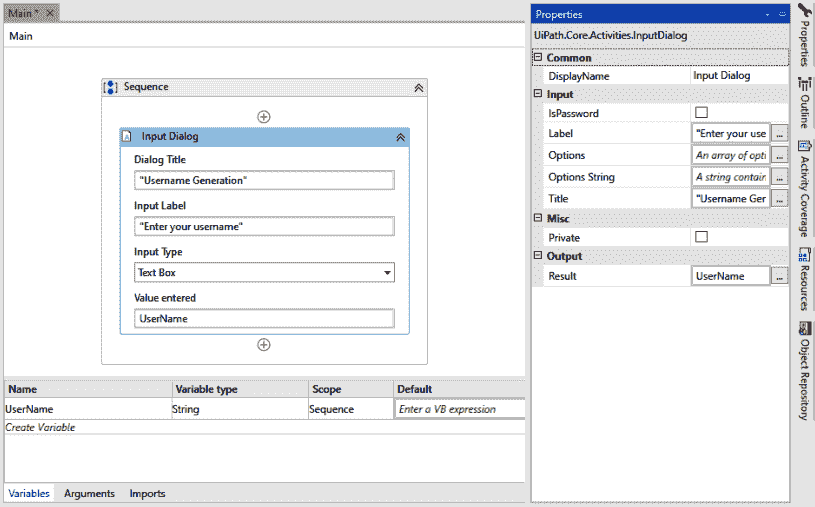

图 5.16 – 配置“输入对话框”活动

5. 在 **“设计”** 功能区上，单击 **“新建”** 并选择 **“序列”** 以创建新的序列工作流文件，如下图所示：

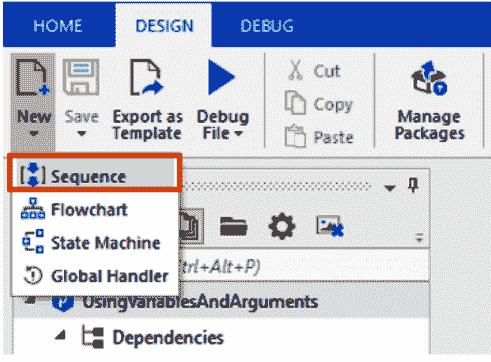

图 5.17 – 创建新的工作流文件

6. 在弹出的窗口中提供工作流文件名，并单击 **“创建”** 按钮以创建此工作流，如下图所示：

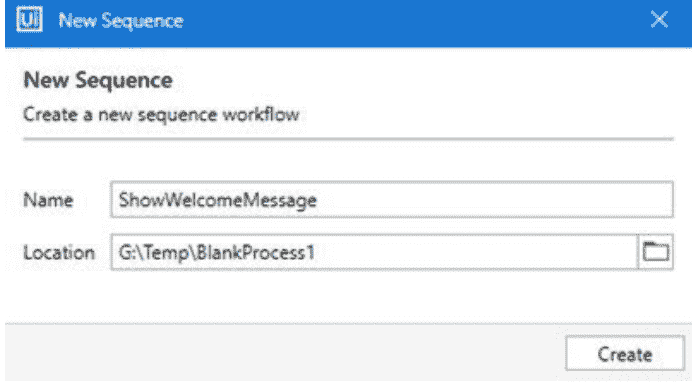

图 5.18 – 创建新的序列工作流

7. 新工作流文件将在 **“设计器”** 面板中打开，显示一个空序列。
8. 单击新工作流文件的 **“参数”** 面板。
9. 单击 **“创建参数”** 并将参数名提供为 `In_UserName`，将 **Direction** 值提供为 `In`，将数据类型提供为 `string`。下图演示了配置：

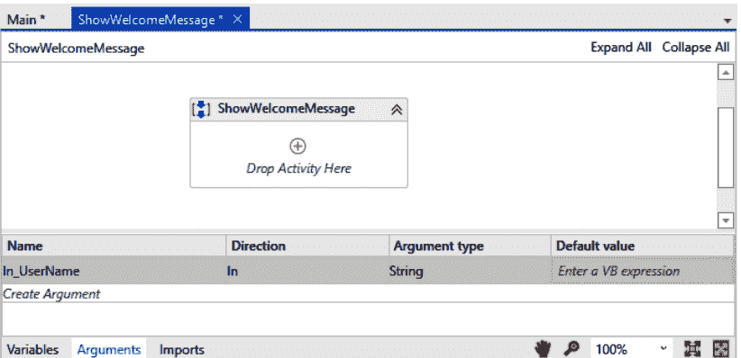

图 5.19 – 新工作流中的参数创建

10. 将 **“消息框”** 活动放置在 **“序列”** 容器中，并使用以下代码进行配置：

```
"Hello " + In_UserName + ", It's nice to see you. This is my first attempt to join two workflows."
```

11. 保存新工作流。配置应类似于此：

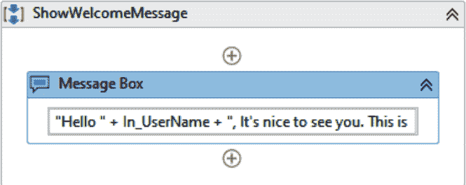

图 5.20 – 新工作流：消息框配置

12. 单击 Main.xaml 文件。
13. 从 **“活动”** 面板搜索 **“调用工作流文件”** 活动，并将其放置在 **“输入对话框”** 活动下方。
14. 单击 **“调用工作流文件”** 活动上的 **“文件夹”** 图标，并选择我们创建的新工作流文件。此命令指示机器人在执行期间执行/调用指定的工作流文件。现在，您可以在屏幕上看到 **“调用工作流文件”** 活动的 **“导入参数”** 按钮已橙色突出显示，如下图所示：

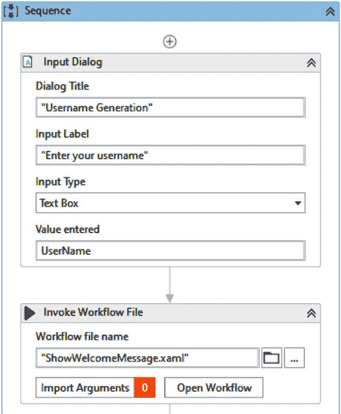

图 5.21 – “调用工作流文件”活动

15. 单击 **“导入参数”** 按钮以配置参数。出现的弹出窗口显示指定工作流的所有预期参数。现在，您可以看到在配置工作流时创建的输入参数。

16. 在弹出窗口的 **“值”** 字段中提供 UserName 变量。在执行期间，用户输入的值将通过 **“输入对话框”** 活动由 UserName 变量捕获。我们在此执行的配置确保将 UserName 变量的值传递给被调用工作流的 In_UserName 参数。下图演示了 **“调用工作流文件”** 活动的完整配置：

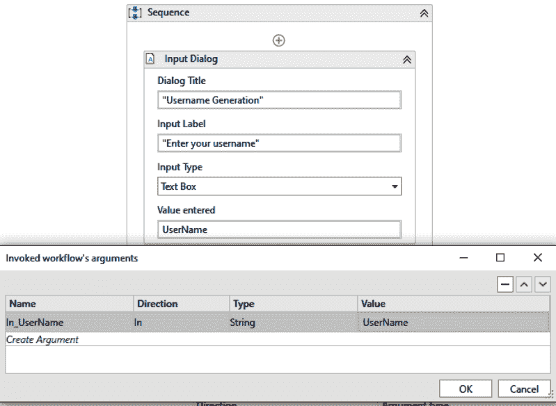

图 5.22 – “调用工作流文件”活动的完整配置

17. 单击“确定”关闭弹出窗口，然后单击“保存”以保存工作流。
18. 单击 UiPath Studio **“设计”** 功能区上的“调试文件”按钮（或按 F6）以测试工作流。
19. 一旦执行开始，将出现一个弹出窗口，要求您输入姓名（如我们配置的工作流所示）。提供姓名并体验输出。您应收到一个包含所提供姓名的 **“消息框”** 活动，如下图所示：

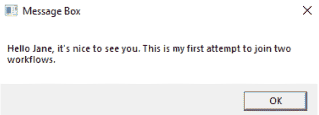

图 5.23 – 执行后的工作流最终输出

完成上述步骤后，您现在了解如何使用参数在工作流文件之间传递数据。参数和变量的使用对接下来的章节非常重要。必须使用不同的变量和参数进行练习，这一点至关重要且不可或缺。变量和参数可能有多种数据类型，了解不同的数据类型以使用与这些数据类型相关的特定函数非常重要。本章的下一部分将解释 UiPath 中使用的不同数据类型。

## 了解数据类型

UiPath 使用多种数据类型来执行和存储不同的数据元素。本节不涵盖所有可用的数据类型。但是，它解释了不同自动化解决方案中常用的数据类型。

让我们来看看一些常用的变量，如下所示：

- **字符串变量**：存储任何文本序列。有许多专门用于字符串处理的方法，将在 *第 7 章，使用 UiPath 操作数据* 中详细介绍。

- **布尔变量**：仅用于存储两个值 `True` 和 `False`，用于控制语句以帮助确定程序流程


- Number variables: 用于存储数值以执行方程或执行比较等。有许多数值变量子类型，以下屏幕描述了其中一些类型：

| Numeric Type | Description |
| :--- | :--- |
| Int16/32/64 | 有符号整数（例如，10、20、100、-250）。 |
| Long | 包含范围从 -9,223,372,036,854,775,808 到 9,223,372,036,854,775,808 的有符号整数 |
| Double | 允许存储最大和最小可能的浮点数。 |
| Decimal | Decimal 支持存储最多 29 位有效数字的值，并可表示高于 7.9228 x 10 ^ 28 的值。Decimal 类型更适合财务计算，因为它支持大数字，并且在舍入值时不会提供错误。 |

图 5.24 – 数值数据类型

- Date and time variables: 日期和时间变量：这些变量类型包含两类数据，如以下屏幕截图所示：

| Data Type | Description |
| :--- | :--- |
| DateTime | 用于存储特定日期的日期和时间信息。这允许执行日期相关的计算，例如计算日期持续时间以及添加和减去日期。 |
| TimeSpan | 用于测量两个给定时间值之间的持续时间。 |

图 5.25 – 日期相关数据类型

- DataTable variables: DataTable 变量：用于以行和列存储表格数据，容纳大块数据，并充当数据库。DataTable 变量对于执行过滤大量数据、搜索和复制等操作很有用。

- GenericValue variables: GenericValue 变量：当您不确定进程返回哪种类型的数据时，GenericValue 变量非常有用。它们能够根据分配给变量的第一个值自动转换其类型。UiPath 建议将 GenericValue 变量用作工作流中的临时解决方案，直到您推导出实际数据类型为止。GenericValue 变量可以容纳任何数据类型，包括 String、Number 和数组。例如，您正在按列比较两个 Excel 表格，每个列都有不同的数据类型。在这种情况下，我们可以使用 GenericValue 变量来执行比较。

- Collection type variables: 集合类型变量：包括所有集合对象，例如数组、列表和字典。以下屏幕截图描述了常用集合对象：

| Collection Type | Description |
|---|---|
| Arrays | 用于存储相同数据类型的多个值。对象大小在创建时定义。 |
| Lists | 用于存储相同数据类型的多个值（类似于数组）。但是，列表的大小在执行期间可能会更改。 |
| Dictionary | 用于以键值对形式存储数据值，其中唯一键引用每个值。简单来说，字典变量中的每个值都使用描述集合中值的唯一键来引用。 |

图 5.26 – 集合数据类型

到现在，您应该已初步了解常用数据类型。我们将在第 7 章《使用 UiPath 操作数据》中讨论如何使用这些数据类型及其独特功能。

## Summary

本章向您介绍了变量和参数。变量和参数是特定定义类型的容器，使用户能够在执行期间保留数据。在 UiPath 中，变量/参数的属性定义了它们在自动化工作流中的用途。本章介绍了属性，并提供了配置和使用变量及参数的分步实践指南。此外，本章还对常用数据类型进行了初步介绍，将在数据操作章节中详细介绍。

讨论的变量和参数概念及其用法在后续章节中将非常有用。下一章介绍了设计自动化工作流时使用的控制流。控制流章节使您能够了解如何构建工作流，包括条件语句和循环。构建用于支持业务流程的自动化解决方案包含许多决策点，并可能要求您迭代执行相同步骤，因此掌握构建执行流程的概念至关重要。
