## Understanding Different Control Flows

要使用 UiPath Studio 创建强大的自动化工作流，您必须了解如何使用控制流高效地控制项目。UiPath 提供了许多控制流活动，因此您可以有效地驱动项目的自动化工作流。控制流为机器人提供了更多能力，使其在执行过程中评估任何业务条件时能够做出决策。在本章中，我们将通过使用实时示例介绍重要的控制流活动来学习这些基本技能。

在本章中，我们将涵盖以下主题：

- 控制流概述
- 什么是序列？
- 什么是流程图？
- 探索决策和决策类型
- 探索循环和循环类型

本章结束时，您将能够理解控制流背后的所有关键概念，并能够在机器人中实现这些想法。

### Technical requirements

若要使用控制流，您需要安装 UiPath Studio 和 UiPath Robot。

本章您需要大致了解如何使用 Studio 和 Robot。请参阅第 2 章 UiPath 生态系统和第 5 章 学习变量和参数，了解 UiPath Studio 的基础知识。

### Overview of control flows

控制流是用于在 UiPath 中将决策要求转换为业务工作流的活动。在 RPA 项目中，控制流在 RPA 代码中按顺序执行。此代码可能包含 UiPath 活动、控制语句和工作流。RPA 项目中有两个关键工作流，如下所示：

- **序列**：序列工作流易于阅读，并且按从上到下或按活动序列执行。它们主要用于简单或线性业务流程，这些流程涉及对给定输入数据执行一次自动化执行序列 *一次*。

- **流程图**：流程图业务流程用于解决涉及许多决策点和复杂逻辑的复杂业务要求。

RPA 工作流使用控制流活动来驱动语句的执行。最常用的控制活动如下：

- **If**：此活动用于验证条件，结果为 `True` 或 `False`。它对于根据变量的输入值做出决策非常有用。此规则使用 *如果-那么-否则* 规则来评估任何给定输入。例如，如果您想通过读取 `Age` 字段的值来检查选民的资格，则需要评估给定年龄是否大于或等于 18 的业务条件，以查找其资格状态，如以下屏幕截图所示：

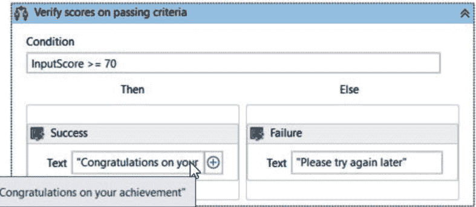

图 6.1 – 如果-那么-否则 示例

- **循环**：这些用于根据条件要求验证一组语句，或在满足某个条件之前多次执行语句。关键循环是 **DoWhile**、**While** 和 **For Each**。

- **Switch**：当存在两个以上的决策点，并且必须对每个决策结果执行相应操作时，使用此活动。

在本节中，我们提供了控制流的高级概述。我们将在即将到来的章节中更详细地探讨控制流。

### What are sequences?

序列易于理解，并且是最简单的项目类型。它们通常用于线性流程，并具有逐步说明，需在单个活动块中依次执行。序列的主要用途是 **可重用性**，即它们可以在单个工作流中使用，也可以通过传递参数从任何其他自动化工作流中调用，我们将在 _第 5 章_、_学习变量和参数_ 中讨论这些参数。

例如，您可以创建一个从电子表格获取信息并将其输入注册网页的序列。让我们探索一个示例。

## 序列示例

在本示例中，我们将创建一个序列，用于询问名、姓和年龄，然后在句子中显示答案：

- 1. 在 UiPath Studio 的“新建项目”部分中创建一个新空白流程，并将其命名为 Sequence_Example，如下图所示：

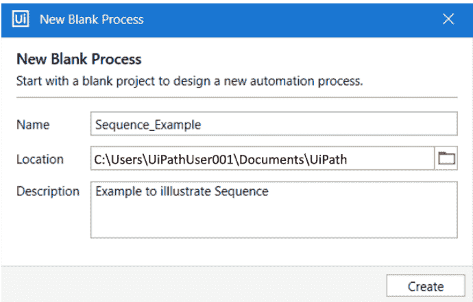

图 6.2 – 创建新空白流程

- 2. 输入首选的项目位置以保存项目。

- 3. 在描述字段中输入项目详细信息，并单击创建以创建设计器面板。

- 4. 将“序列”活动从活动面板拖放到设计器面板中。

- 5. 创建三个名为 FirstName、LastName 和 Age 的字符串变量，用于存储从用户接收的信息，如下所示：

| 名称 | 变量类型 | 范围 | 默认值 |
| :--- | :--- | :--- | :--- |
| FirstName | String | Sequence_Example | 输入 VB 表达式 |
| LastName | String | Sequence_Example | 输入 VB 表达式 |
| Age | String | Sequence_Example | 输入 VB 表达式 |

图 6.3 – 创建变量

- 6. 将三个 **输入对话框** 活动依次拖到项目的序列中。

- 7. 按以下步骤编辑输入对话框的属性，以便其接受并存储 FirstName（以下选项如下图所示）：

  - 将第一个 **输入对话框** 的 **显示名称** 属性设置为 First Name。
  - 将 **对话框标题** 设置为 "Enter First Name"。
  - 将 **输入标签** 设置为 "What's your First Name?"。
  - 将 **输入类型** 设置为 Text Box。
  - 将输入值存储在 FirstName 中：

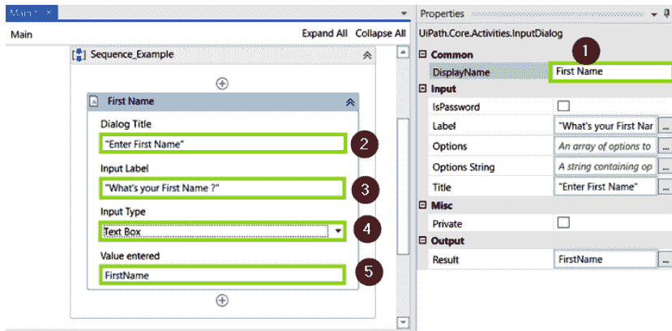

图 6.4 – 更新输入对话框属性 – 第 1 部分

- 8. 按以下步骤接受并存储 **LastName**（以下选项如下图所示）：

  - 将第二个 **输入对话框** 的 **显示名称** 属性设置为 Last Name。
  - 将 **对话框标题** 设置为 "Enter Last Name"。
  - 将 **输入标签** 设置为 "What's your Last Name?"。
  - 将 **输入类型** 设置为 Text Box。

  - 将输入值存储在 LastName 中：

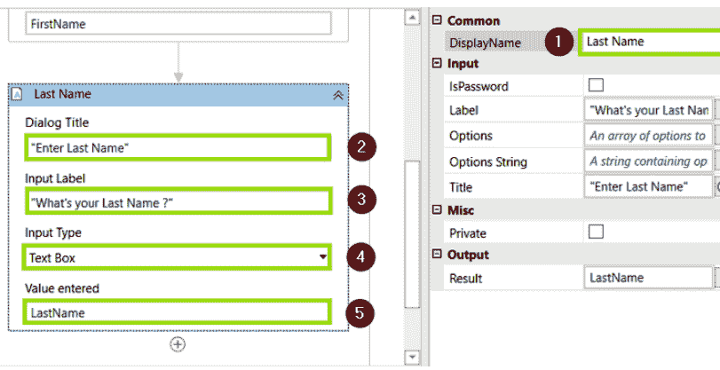

图 6.5 – 更新输入对话框属性 – 第 2 部分

- 9. 按以下步骤接受并存储 Age（以下选项如下图所示）：

  - 将第三个 **输入对话框** 的 **显示名称** 属性设置为 Age。

  - 将 **对话框标题** 设置为 "Enter Age"。

  - 将 **输入标签** 设置为 "What's your Age?"。

  - 将 **输入类型** 设置为 Text Box。

  - 将输入值存储在 Age 中：

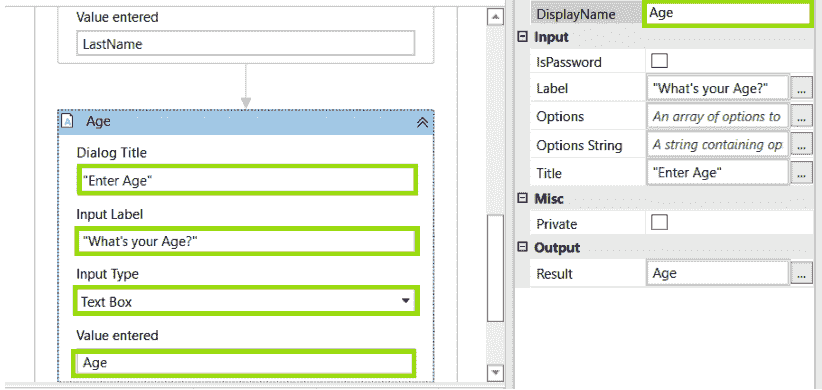

图 6.6 – 更新输入对话框属性 – 第 3 部分

- 10. 将 **消息框** 活动拖到序列中，并从 **属性** 部分更改 **文本**，使其包含 "The Age of " + FirstName + " " + LastName + " is " + Age + "。"，如下图所示：

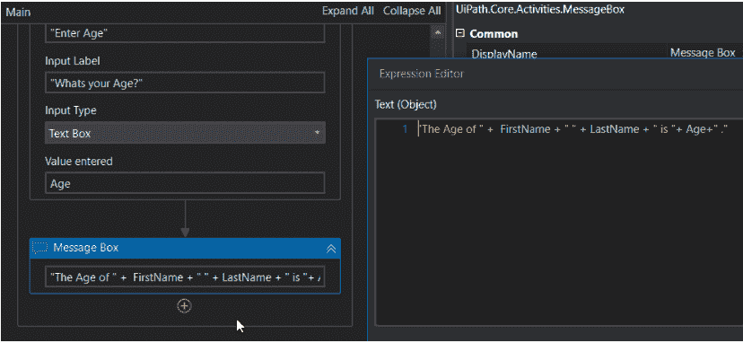

图 6.7 – 消息框活动

项目的序列大纲应如下所示：

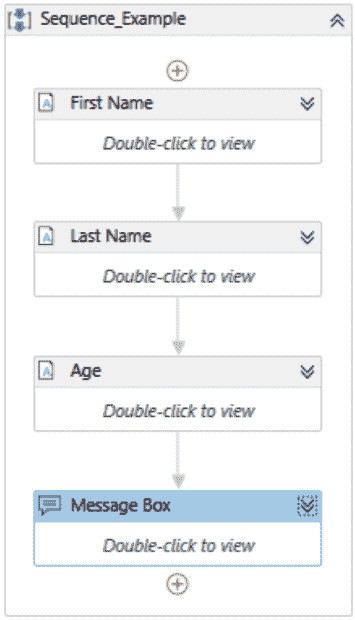

图 6.8 – 序列大纲

- 11. 单击 **设计** 选项卡中的 **运行** 按钮，并按照提示输入您的输入，以确保最终输出如下所示：

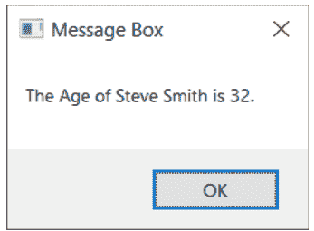

图 6.9 – 输出消息框

在本节中，我们了解了如何在自动化中使用序列。在下一节中，我们将探索其他控制流选项。

## 什么是流程图？

**流程图** 用于业务流程复杂且具有多个决策点的项目设置中。流程图支持使用各种类型的活动（例如 **If/Else**、**循环** 和 **开关**）进行多个逻辑分支。

例如，您可以创建一个流程图，通过 **输入文本框** 从用户处获取 `Year` 等输入信息，并验证其是否为闰年。在此示例中，可能有两种可能的结果。一种是 *闰年*，而另一种基于所提供的输入则是 *非闰年*。让我们来看一个示例。

## 流程图示例

在本节中，我们将创建一个流程图示例，用于识别给定年份是否为闰年。执行以下步骤以使用流程图构建自动化：

- 1. 在 UiPath Studio 的 **新建项目** 部分中创建 **新建空白流程**，并将其命名为 `Flowchart_Example`，如下图所示：

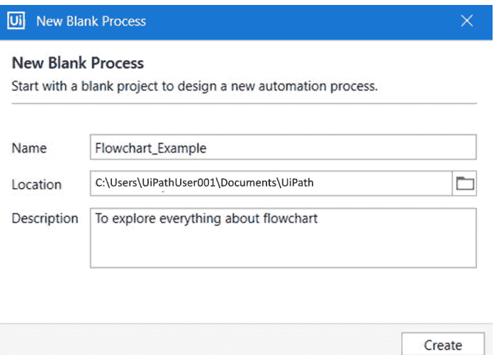

图 6.10 – 创建新空白流程

- 2. 输入首选的项目 **位置** 以保存项目。

- 3. 在 **描述** 字段中输入详细信息，并单击 **创建** 以创建 **设计器** 面板。

- 4. 从 **设计** 选项卡中单击 **新建** > **流程图**，并将 **名称** 设置为 `LeapYear`，如下图所示：

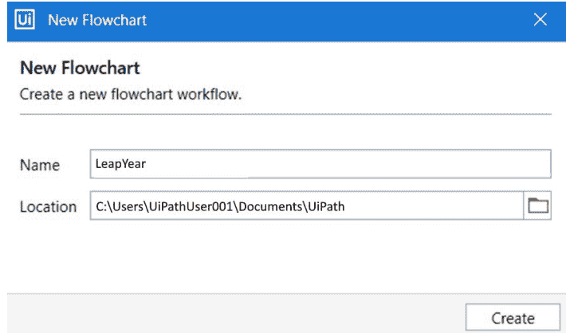

图 6.11 – 新建流程图

- 5. 单击 **创建** 以更新 **设计器** 视图，如下图所示：

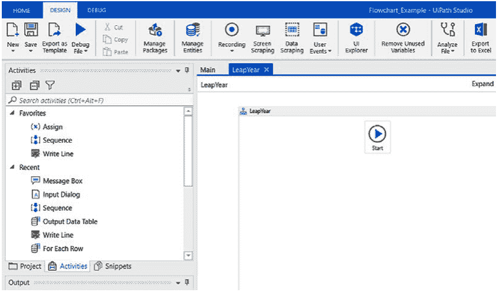

图 6.12 – 流程图设计器视图

- 6. 创建名为 `inputYear` 的 **名称变量** 和名为 `Int32` 的 **变量类型**，用于存储从用户接收的信息，如下所示：

| 名称 | 变量类型 | 范围 | 默认值 |
|---|---|---|---|
| inputYear | Int32 | LeapYear | 输入 VB 表达式 |
| 创建变量 | | | |

图 6.13 – 创建变量

- 7. 将输入对话框活动拖到项目流程图中，如下所示：

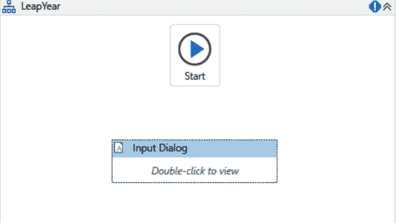

图 6.14 – 输入对话框

- 8. 按以下步骤接受并存储输入年份，如下图所示：

  - 将 **对话框标题** 设置为 "Input Year"。
  - 将 **输入标签** 设置为 "What's the Input Year?"。
  - 将 **输入类型** 设置为 Text Box。
  - 将输入值存储在 inputYear 中：

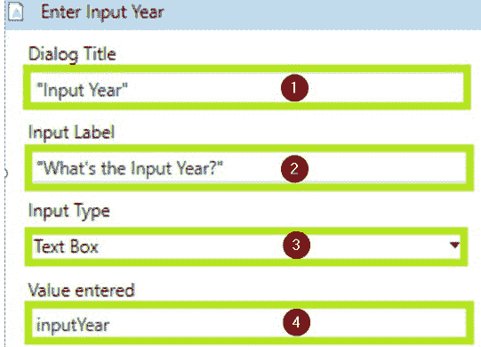

图 6.15 – 更新输入对话框属性

- 9. 通过拖动指针将 **开始** 节点连接到 **输入对话框**，如下图所示：

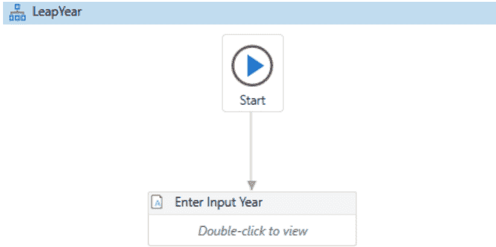

图 6.16 – 连接输入对话框

- 10. 拖动 **流程决策** 活动并将其放置在 **输入对话框** 旁边。

- 11. 单击 **流程决策**，并在 **条件** 字段中输入 "`inputYear mod 4 = 0`" 作为 VB 表达式，以验证给定输入是否为闰年。否则，它不是闰年，如下图所示：

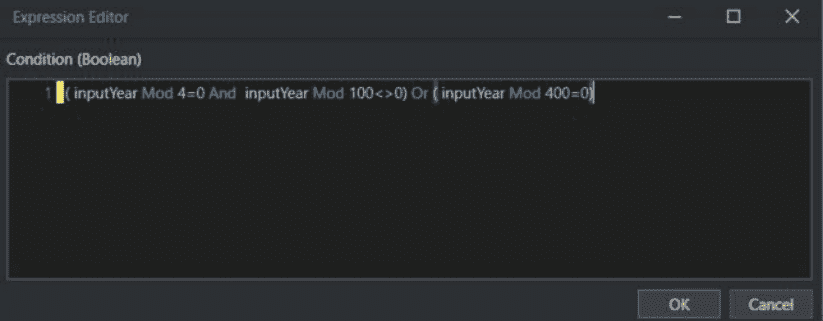

图 6.17 – 更新条件（布尔）面板中的条件

- 12. 将 **消息框** 活动拖到流程决策的 **真** 侧，并向 **属性** 的 **文本** 字段添加消息 "`The given year " + inputYear.ToString + " is a Leap Year`"，如下所示：

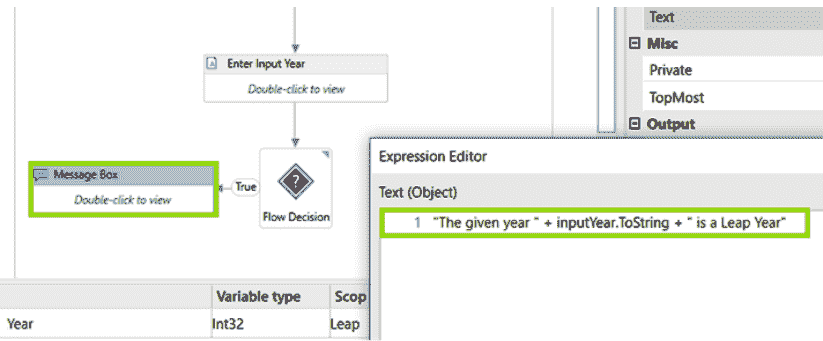

图 6.18 – 真分支消息框

- 13. 将 **消息框** 活动拖到流程决策的 **假** 侧，并向 **属性** 的 **文本** 字段添加消息 "The given year " + inputYear.ToString + " is not a Leap Year"，如下所示：

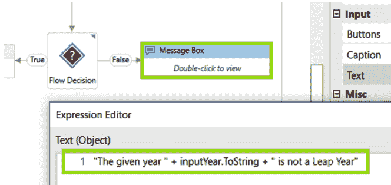

图 6.19 – 假分支消息框

项目的流程图大纲应如下所示：

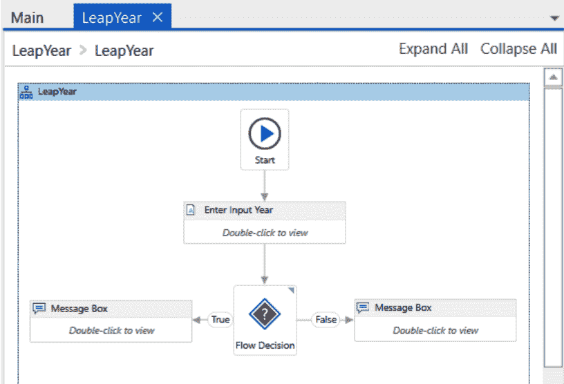

图 6.20 – 流程图大纲

- 14. 单击 **设计** 选项卡中的 **运行** 按钮，并按照提示输入您的输入。闰年的最终输出应如下所示：

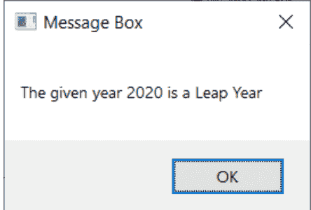

图 6.21 – 最终真分支输出消息

- 15. 单击 **设计** 选项卡中的 **运行** 按钮，并按照提示输入您的输入，以便在非闰年时最终输出如下所示：

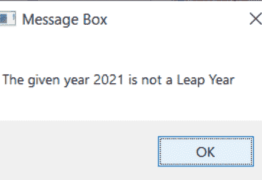

图 6.22 – 最终假分支输出消息

到目前为止，我们已了解如何使用实时示例在 **设计器** 面板中使用序列和流程图进行自动化。在即将到来的章节中，我们将学习如何使用控制流活动来增强自动化。

## 探索决策和决策类型

决策活动允许您在需要对业务场景进行决策评估时控制数据流的执行。基于此，必须执行两个操作之一。这两个操作构成决策活动的分支，并根据决策结果执行，结果可以是 True 或 False。在预期有多个结果的情况下，建议使用 Switch 活动。

If 语句活动用于序列，而流程决策活动用于流程图。例如，您可以检查某些输入文本中的特定值，并根据文本的结果采取行动。让我们详细了解一下。

### If 活动示例

在此示例中，我们将创建一个序列，要求输入一个数字，然后显示给定数字是偶数还是奇数。让我们开始：

- 1. 在 UiPath Studio 的新建项目部分创建一个新空白流程，并将其命名为 Decision_Example，如下图所示：

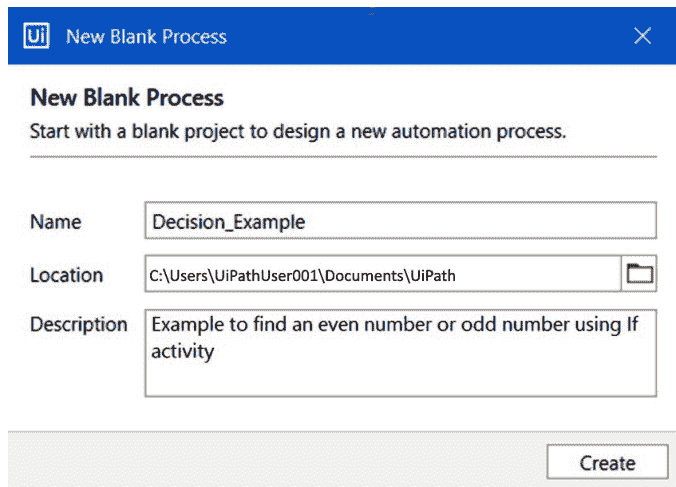

图 6.23 – 创建新空白流程

- 2. 输入首选的项目位置以保存项目。
- 3. 在 **描述** 字段中输入一些详细信息，并单击 **创建** 以创建 **设计器** 面板。
- 4. 创建一个名为 `InputNumber` 的整数，用于存储从用户接收到的信息，如下图所示：

| 名称 | 变量类型 | 作用域 | 默认值 |
| --- | --- | --- | --- |
| InputNumber | Int32 | 序列 | 输入 VB 表达式 |

图 6.24 – 创建变量

- 5. 将 **输入对话框** 活动拖放到项目序列中。
- 6. 按以下步骤接受并存储 `InputNumber`，如下图所示：

  - 将 **对话框标题** 设置为 "Input Number"。
  - 将 **输入标签** 设置为 "Enter Input Number"。
  - 将 **输入类型** 设置为文本框。
  - 将 **输入的值** 存储在 `InputNumber` 中：

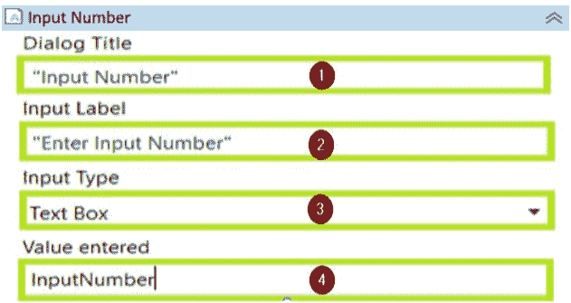

图 6.25 – 更新输入对话框属性

- 7. 将 **如果** 活动从 **活动** 面板拖放到 **设计器** 面板中，如下图所示：

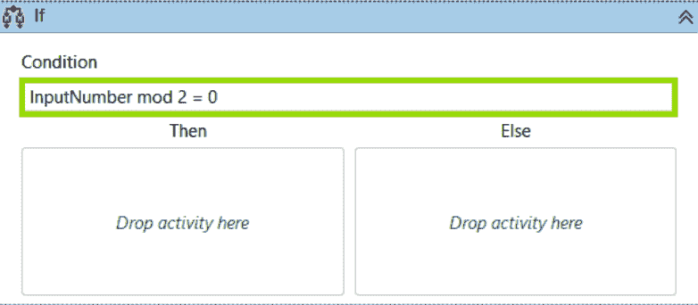

图 6.26 – 创建如果活动

- 8. 在 **条件** 字段中写入 `InputNumber mod 2 = 0`，如下图所示：

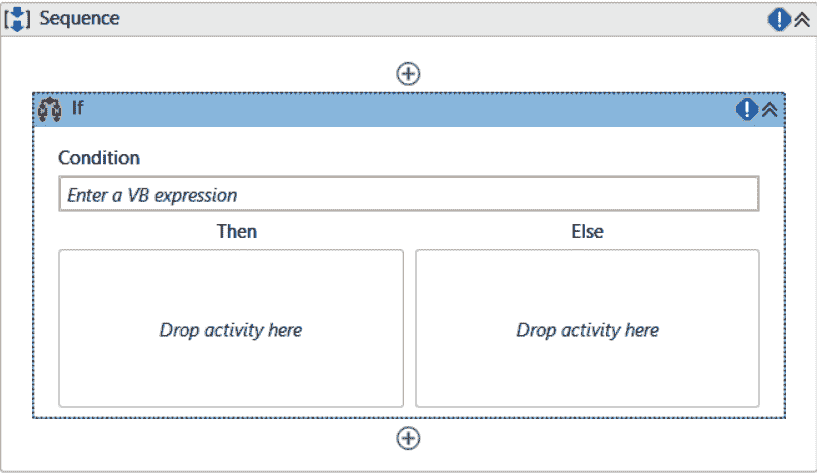

图 6.27 – 设置如果条件

- 9. 在 **然后** 分支中，拖入一个 **消息框** 活动并写入 "The given number is an even number"。

- 10. 在 **否则** 分支中，拖入一个 **消息框** 活动并写入 "The given number is an Odd number"。

项目的大纲序列应如下所示：

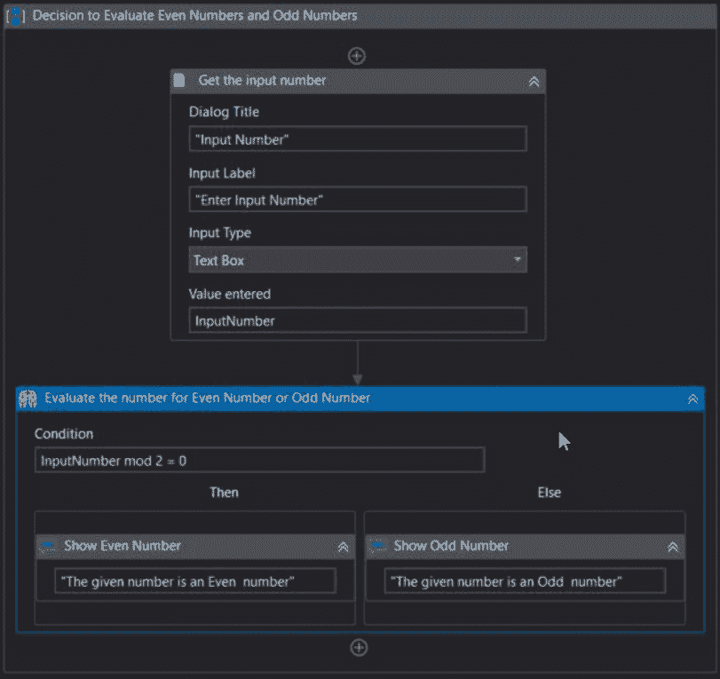

图 6.28 – 序列大纲

- 11. 单击 **设计** 选项卡上的 **运行** 按钮，并按照提示输入您的输入，以便偶数的最终输出如下所示：

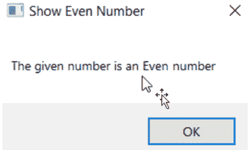

图 6.29 – 偶数的输出消息

- 12. 单击 **设计** 选项卡上的 **运行** 按钮，并按照提示输入您的输入，以便奇数的最终输出如下所示：

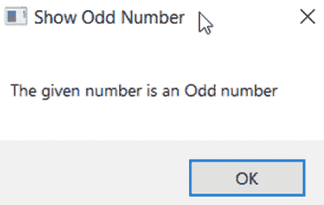

图 6.30 – 奇数的输出消息

在本节中，我们了解了如何使用 If、Else 和 Then 来评估条件，并根据评估结果执行操作。在下一节中，我们将学习如何使用循环来自动执行重复任务。

## 探索循环和循环类型

**循环** 用于根据自动化过程中特定条件对给定语句进行重复执行。它们主要用于自动化重复性自动化任务。UiPath 中的关键循环是 **执行直到循环**、**While** 和 **针对每个**。让我们逐一探讨。

### 执行直到循环

执行直到循环内部的语句会先执行一次，然后重复执行，直到满足指定条件为止。

### 执行直到循环示例

在此示例中，我们将创建一个序列，要求输入一个数字，然后执行操作以输出指定次数的值。让我们开始：

- 1. 在 UiPath Studio 的新建项目部分创建一个新空白流程，并将其命名为 DoWhile_Example，如下图所示：

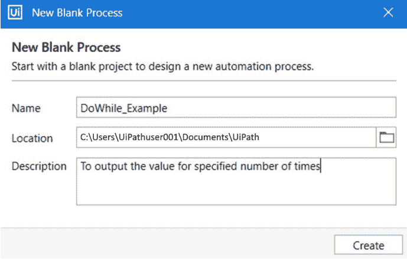

图 6.31 – 创建新空白流程

- 2. 输入首选的项目位置以保存项目。
- 3. 在 Description 字段中输入一些详细信息，并单击 Create 以创建 Designer 面板。
- 4. 创建一个名为 Counter 的整数，用于从用户获取信息，如下图所示：

| 名称 | 变量类型 | 作用域 | 默认值 |
| --- | --- | --- | --- |
| Counter | Int32 | 序列 | 输入 VB 表达式 |

图 6.32 – 创建变量

- 5. 将 Input Dialog 活动拖放到项目序列中。
- 6. 按以下步骤接受并存储 `InputNumber`，如下图所示：

  - 将 Dialog Title 设置为 "Input Number"。
  - 将 Input Label 设置为 "Enter Input Number"。
  - 将 Input Type 设置为文本框。
  - 将输入的值存储在 InputNumber 中：

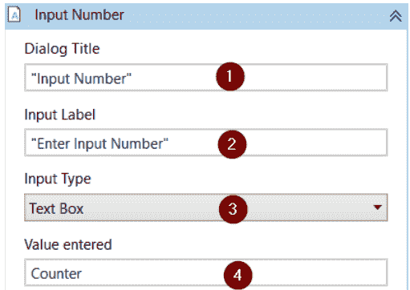

图 6.33 – 更新输入对话框属性

- 7. 将 **执行直到循环** 活动从 **活动** 面板拖放到 **设计器** 面板中，如下图所示：

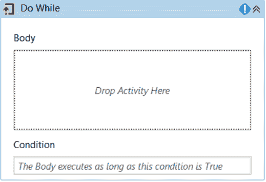

图 6.34 – 创建执行直到循环活动

- 8. 在 **条件** 字段中写入 `Counter < 10`。
- 9. 在 **主体** 分支中，拖入一个 **写入行** 活动并写入 `Counter.ToString`。
- 10. 将 `Do While` 序列的名称更改为 `Do While_Count Numbers`，并将 `Body` 序列的名称更改为 `Increment Counter by 1`。
- 11. 将 **分配** 活动拖入 `Increment Counter by 1` 序列中，并写入 `Counter = Counter + 1`。
- 12. 项目的大纲序列应如下所示：

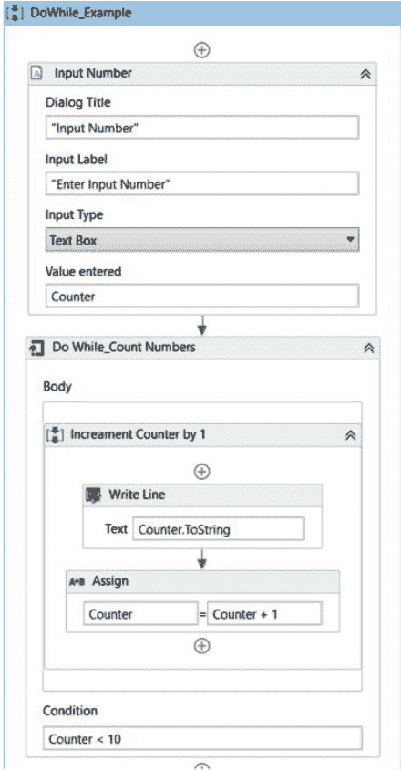

图 6.35 – 序列大纲

- 13. 单击 **设计** 选项卡上的 **运行** 按钮，并按照提示输入 1 作为输入，以便小于 10 的数字的最终输出如下所示：

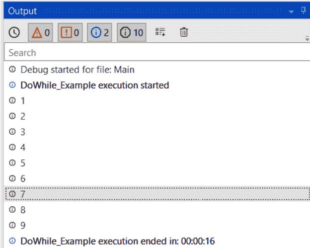

图 6.36 – 小于 10 的输入的输出窗口

- 14. 单击 **设计** 选项卡上的 **运行** 按钮，并按照提示输入 99 作为您的输入，以便大于 10 的数字的最终输出如下所示。数字 **99** 将显示在输出中，因为已使用 **写入行** 活动显示通过 **输入对话框** 活动读取并保存在 **计数器** 变量中的输入数字。

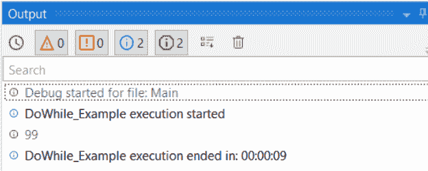

图 6.37 – 大于 10 的输入的输出窗口

### While

While 循环内部的语句仅在满足指定条件时执行任意次数。

### While 循环示例

在以下示例中，我们将创建一个序列，要求输入一个数字，然后执行操作以输出值，只要条件已满足。让我们开始：

- 1. 在 UiPath Studio 的 **新建项目** 部分中创建 **新建空白流程**，并将其命名为 While_Example，如下图所示：

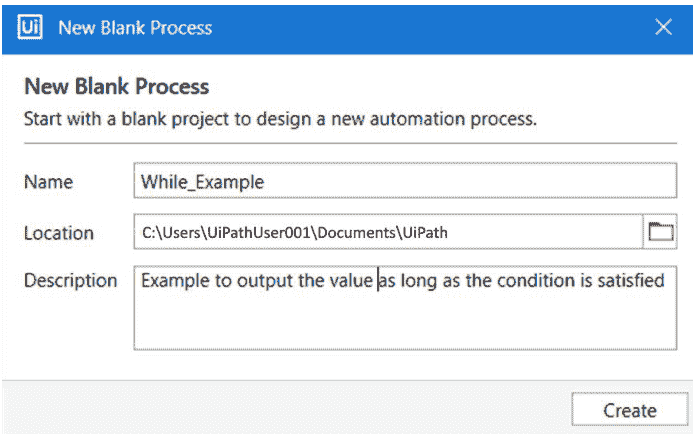

图 6.38 – 创建新空白流程

- 2. 输入首选的项目 **位置** 以保存项目。
- 3. 在 **描述** 字段中输入一些详细信息，并单击 **创建** 以创建 **设计器** 面板。
- 4. 创建一个 **计数器** 整数，以便从用户获取信息，如下图所示：

| 名称 | 变量类型 | 作用域 | 默认值 |
| --- | --- | --- | --- |
| Counter | Int32 | 序列 | 输入 VB 表达式 |

图 6.39 – 创建变量

- 5. 将 Input Dialog 活动拖放到项目的序列中。

- 6. 按以下步骤接受并存储 InputNumber，如以下截图所示：
  - 将 Dialog Title 设置为 "Input Number"。
  - 将 Input Label 设置为 "Enter Input Number"。
  - 将 Input Type 设置为 Text Box。
  - 将要输入并存储在 Counter 中的值设置为：

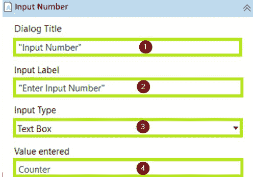

图 6.40 – 更新 Input Dialog 属性

- 7. 将 While 活动从 Activities 面板拖放到 Designer 面板中，如以下截图所示：

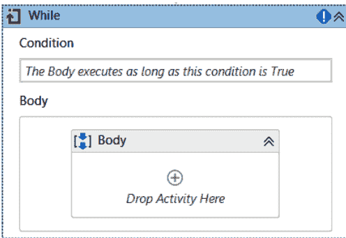

图 6.41 – While 活动的 Designer 视图

- 8. 在 **条件** 字段中，写入 `Counter < 10`。

- 9. 在 **主体** 分支中，拖放一个 **写入行** 活动并写入 `Counter.ToString`。

- 10. 拖放一个 **分配** 活动并写入 `Counter = Counter + 1`。

项目的序列大纲应如下所示：

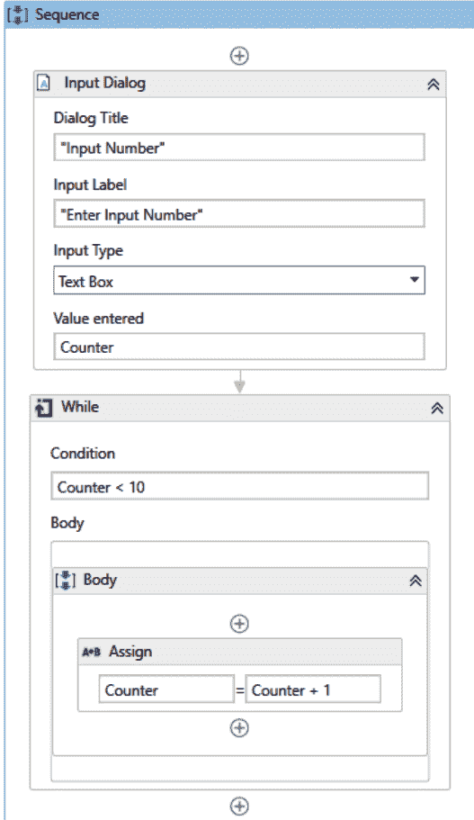

图 6.42 – 序列大纲

- 11. 单击 **设计** 选项卡中的 **运行** 按钮，并按照提示输入 1 作为您的输入，以便对于小于 10 的数字，最终输出如下所示：

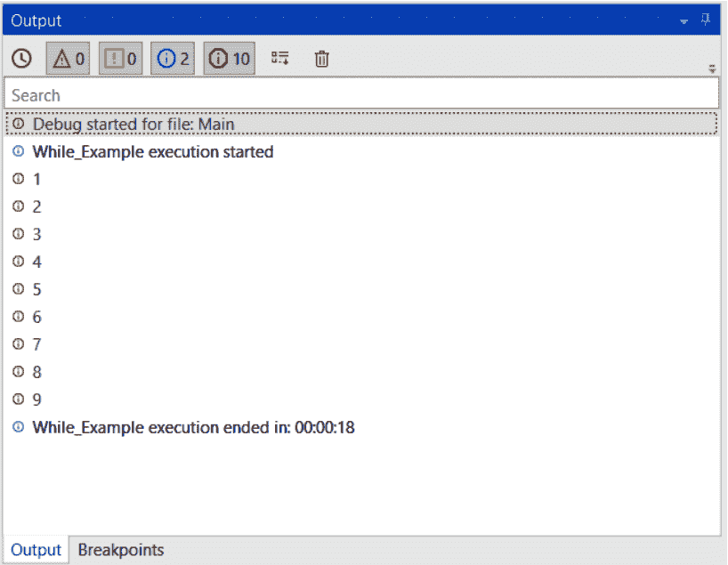

图 6.43 – 小于 10 的输入的输出窗口

- 12. 单击 Design 选项卡中的 Run 按钮，并按照提示输入 99 作为您的输入，以便对于大于 10 的数字（即 99），最终输出如下所示：

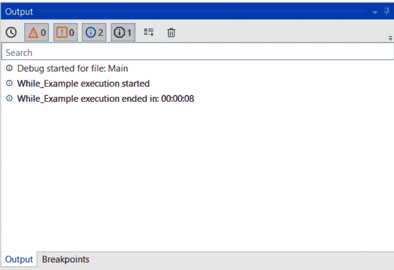

图 6.44 – 大于 10 的输入的输出窗口

在本节中，我们探索了 Do While 活动，它在许多编程场景中用于循环处理输入或值，直到满足特定条件为止。在下一节中，我们将了解 `For Each` 活动，以了解如何处理每一条可用的输入数据。

## For Each

For Each 活动可帮助您遍历列表、数组或字典中定义的数据集合中的每个项目，如您在 *第 7 章，使用 UiPath 操作数据* 中所学。For Each 活动内部的语句针对每个项目执行一次，以便其操作基于该项目的信息进行。

### For Each 活动示例

在本示例中，我们将创建一个对数字列表执行操作的序列。让我们开始吧：

- 1. 在 UiPath Studio 的新建项目部分创建一个新的空白流程，并将其命名为 For_Each_Example，如以下截图所示：

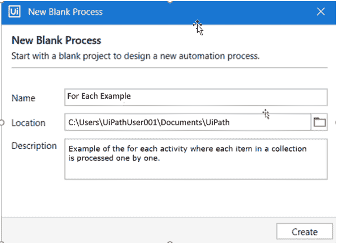

图 6.45 – 创建新的空白流程

- 2. 输入首选的项目位置以保存项目。

- 3. 在 Description 字段中输入一些详细信息，并单击 Create 以创建 Designer 面板。

- 4. 创建一个变量并将其命名为 Counters。然后，将 Variable type 设置为 Array of [T]，并从下拉列表中选择 Int32，如以下截图所示：

| 名称 | 变量类型 | 作用域 | 默认值 |
|---|---|---|---|
| Counters | Int32[] | Sequence | 输入 VB 表达式 |

图 6.46 – 创建变量

- 5. 在 **变量** 的 **默认值** 列中，将默认列表定义为 {1, 2, 3, 4, 5, 6, 7, 8, 9, 10}，如以下截图所示：

| 名称 | 变量类型 | 作用域 | 默认值 |
|---|---|---|---|
| Counters | Int32[] | Sequence | {1,2,3,4,5,6,7,8,9,10} |

图 6.47 – 设置默认值

- 6. 将 **遍历每个** 活动从 **活动** 面板拖放到 **设计器** 面板中，如以下截图所示：

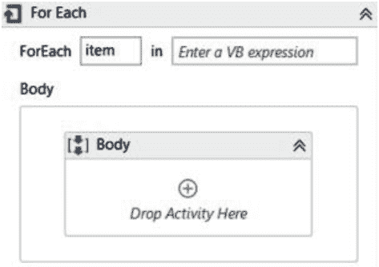

图 6.48 – 创建 For Each 活动

- 7. 将 **遍历每个** 字段中的默认值更新为 Counter，并将 **in** 字段更新为 **计数器**，如 *图 6.49* 所示。在 **主体** 分支中，拖放一个 **写入行** 活动并写入 "The Current item in process is " + Counter.ToString。由于 **计数器** 中每个项目的数据类型为 Int32，我们需要将其转换为 String 格式，以便在 **写入行** 活动中显示该项目。

项目的序列大纲应如下所示：

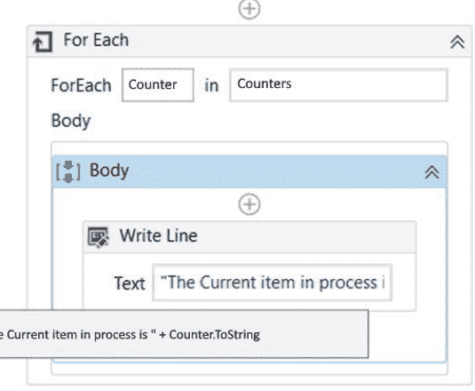

图 6.49 – 序列大纲

- 8. 单击 **设计** 选项卡中的 **运行** 按钮，并按照提示输入您的输入，以便最终输出如下所示：

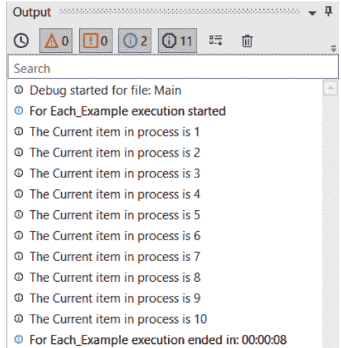

图 6.50 – 输出窗口

在本节中，我们探讨了可用于自动化重复任务并有效增强自动化的不同类型的循环。这些概念可根据自动化要求应用于不同情况。

## 摘要

在本章中，我们了解了不同类型的控制流概念、控制流语句（如循环、开关和 If 语句）及其实现。我们还学习了如何应用这些控制流概念。本章提供的示例将帮助您在创建机器人时遇到类似的数据处理情况时决定使用哪个活动。

在下一章中，您将学习如何使用控制流活动操作不同类型的数据。
