## 7 使用 UiPath 操作数据

如今，每个软件应用程序、业务流程或人类都在处理数据。数据是每个组织中最关键的资源，并且以多种不同的形式提供给我们。我们需要修改、结构化、格式化或排序数据，以将其转换为业务流程中的有意义信息。

本章重点介绍基于各种数据类型的不同数据操作方法。业务流程中使用的数据在准备好用于流程各个阶段之前，要经过许多转换步骤，因此了解如何执行此类操作至关重要。

本章包含以下各节：

- 解释数据操作的概念
- 了解字符串操作
- 了解日期和时间操作
- 了解列表操作
- 了解数值计算
- 了解字典操作
- 了解使用正则表达式 (regexes) 进行模式匹配的数据提取

### 技术要求

作为先决条件，请安装并连接 UiPath Studio 和 UiPath Robot 与 Orchestrator。此外，在开始本章之前，理解不同的数据类型、控制流和 UiPath Studio 功能是至关重要的。

### 解释数据操作的概念

数据操作是通过各种操作更改数据以将其转换为可用格式的过程。它是业务运营和管理中的重要功能，因为它提供了许多好处，例如：

- 将数据转换为更一致的格式，以提高可靠性、可读性和组织性
- 根据业务要求实现定制并生成更有意义的数据
- 删除不需要的数据，以确保仅处理所需信息

数据操作操作包括四项主要功能，如下所示：

- 指定提取条件（如筛选、汇总等）来提取数据
- 添加新数据
- 删除不需要的数据
- 通过更新新值或将非结构化数据转换为更有意义且更易于处理的格式来更改现有数据

根据数据类型，有多种不同的数据操作方法。现在，让我们来看看各种数据操作技术。

### 了解字符串操作

字符串是任何自动化解决方案中最常用的数据类型之一。字符串数据类型是指一系列文本值，我们经常使用这些值在多个应用程序之间提取、显示、处理和发送数据以进行进一步处理。字符串操作有助于执行诸如为用户发送电子邮件、从较大文本中提取文本部分等业务场景。


UiPath 使用 **Visual Basic .NET (VB.NET)** 或 C# 中的字符串操作方法，具体取决于您在 UiPath Studio 中选择使用的语言。在本章中，我们将使用 VB.NET 中的方法。以下部分介绍了 UiPath 中一些常用的字符串操作方法。

## Concat 函数

Concat 函数使用户能够将两个或多个字符串表示形式合并为一个字符串表示形式。Concat 函数一次最多可合并四个字符串对象。以下代码片段显示了我们用于合并字符串的表达式：

```
String.Concat(StrVariable1, StrVariable2)
```

让我们看看如何使用此函数的简单示例。请按以下步骤操作：

- 1. 打开 UiPath Studio 并创建新项目。
- 2. 项目就绪后，双击 **项目** 面板中的 Main.xaml 文件，在 **设计器** 面板中打开它。
- 3. 单击 **活动** 面板，搜索 **序列** 活动，并将其拖到 **设计器** 面板中。
- 4. 选择您添加的 **序列** 活动，然后单击 **变量** 面板。
- 5. 创建名为 DisplayText 的 String 类型新变量。
- 6. 拖放一个 **赋值** 活动，并将以下值分配给 DisplayText 变量："您好... 我的名字是"。
- 7. 创建另一个名为 FirstName 的 String 变量。
- 8. 在之前的活动下方再使用一个 **赋值** 活动，并为 FirstName 变量分配值 "约翰"。
- 9. 创建第三个名为 LastName 的 String 变量。
- 10. 在前一个活动下方再使用第三个 **赋值** 活动，并为 LastName 变量分配值 "多伊"。
- 11. 现在，在 **活动** 面板中搜索 **消息框** 活动，并将其拖放到最后一个 **赋值** 活动之后。
- 12. 使用以下代码配置您的 **消息框** 活动：

```
String.Concat(DisplayText, FirstName, LastName)
```

到这一步时，您的工作流应类似于此：

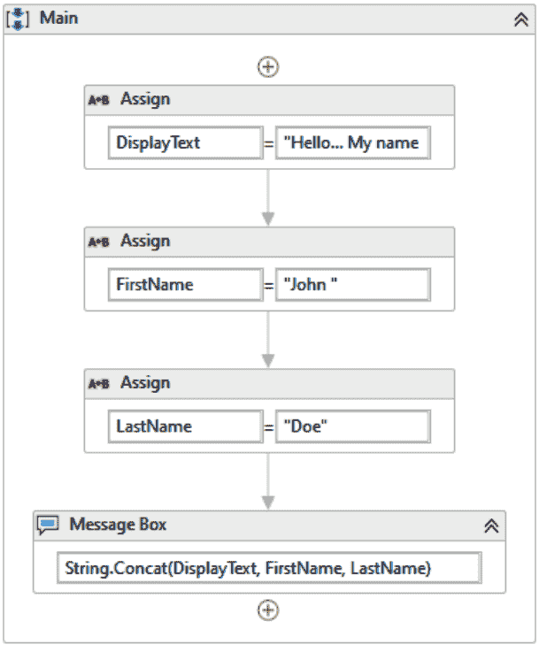

图 7.1 – String.Concat 函数示例

现在我们知道如何合并两个字符串，让我们看看如何检查特定字符串是否存在于另一个字符串中。

## Contains 函数

Contains 函数用于检查指定的子字符串是否存在于另一个字符串中。该函数根据结果返回布尔值。当子字符串存在于主字符串中时，函数返回 True；否则返回 False。需要注意的是，此函数区分大小写；因此，即使两个字符串匹配，但字母大小写不同，它仍可能返回 False。如第 5 章“关于变量和参数”中所讨论，布尔结果使用户能够控制工作流执行。由于 Contains 函数返回布尔结果，该函数主要与控制流活动相关联。根据您使用的是序列还是流程图容器，可以使用 If 活动或流程决策活动。

让我们查看我们设计的同一工作流，并通过添加此函数来更改它以测试其功能，具体步骤如下：

- 1. 在同一工作流中，从 **活动** 面板拖放一个 **If** 活动，并将其放置在最后一个 **赋值** 活动和 **消息框** 活动之间。

- 2. 使用以下代码为 **表达式** 部分配置 **If** 活动：

```
String.Concat(DisplayText, FirstName, LastName).Contains("John")
```

该表达式连接所有字符串变量，并检查其中是否包含子字符串 "约翰"。

- 3. 选择位于 **If** 活动下方的 **消息框** 活动，并将其移动到 **If** 活动的 **Then** 部分中。

- 4. 从 **活动** 面板拖放一个 **写入行** 活动到 **If** 活动的 **Else** 部分中。

- 5. 使用以下字符串配置 **写入行** 活动：

```
"The name you are looking for is not available"
```

配置 **写入行** 活动后，您的工作流应类似于此：

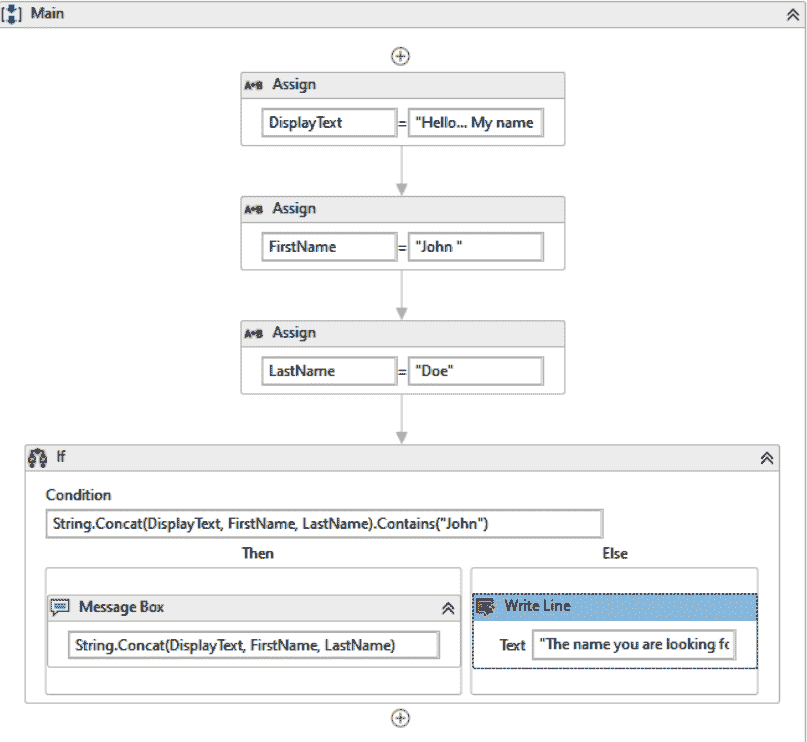

图 7.2 - String.Contains 函数示例

`String.Contains` 函数如果可用所搜索的字符串，会将 `True` 作为结果返回。如果您希望在字符串存在时该函数返回 `False`（只需反转结果即可），可以将 `Not` 关键字引入表达式。在先前描述的示例中，引入 `Not` 关键字后，表达式将如下所示：

```
Not String.Concat(DisplayText, FirstName, LastName).Contains("John")
```

我们还可以查看与 String.Concat 类似的另一个函数。但是，String.Format 函数提供了在定义字符串的指定位置更改值的功能。下一节将详细解释此概念。

## Format 函数

Format 函数与 Concat 函数类似。但是，Format 函数可以将对象转换为字符串，并将其插入到另一个字符串的指定位置。Format 函数还允许将任意数量的字符串合并为一个字符串变量。Format 函数使用特定标识符 (ID) 来定位主字符串中插入新文本的位置。这些 ID 被称为 {0}、{1} 和 {2}，其中数值描述了合并文本的顺序。

让我们看看如何通过简单示例应用 Format 函数，具体步骤如下：

- 1. 让我们继续使用先前构建的同一工作流。在 If 活动下方拖放一个赋值活动。
- 2. 创建一个名为 ConcatenatedText 的新字符串变量，并在赋值活动的目标部分中指定它。

- 3. 在赋值活动的值部分中使用以下代码为其赋值。该函数将连接后的值分配给另一个字符串变量，以便我们进一步处理输出：

```
String.Concat(DisplayText, FirstName, LastName)
```

- 4. 在前一个活动下方拖放另一个赋值活动。

- 5. 通过创建名为 FormatString 的新字符串变量来配置赋值活动的目标部分，并为其分配以下字符串：

```
"Good day... Let me introduce myself. {0} and I am {1} years old. I'm currently based in {2}"
```

- 6. 使用另一个赋值活动并将其放置在前一个活动下方。
- 7. 创建一个名为 DisplayResult 的新字符串变量，并使用变量名配置赋值活动的目标部分。

- 8. 使用以下代码配置同一赋值活动的值部分。以下代码使用 String.Format 函数填充 {0}、{1} 和 {2} 指示器的文本部分：

```
String.Format(FormatString, ConcatenatedText, "29", "Sri Lanka")
```

- 9. 添加一个消息框活动，并通过指定 DisplayResult 变量将其配置为显示消息中的输出。

完成配置后，您的工作流应类似于此：

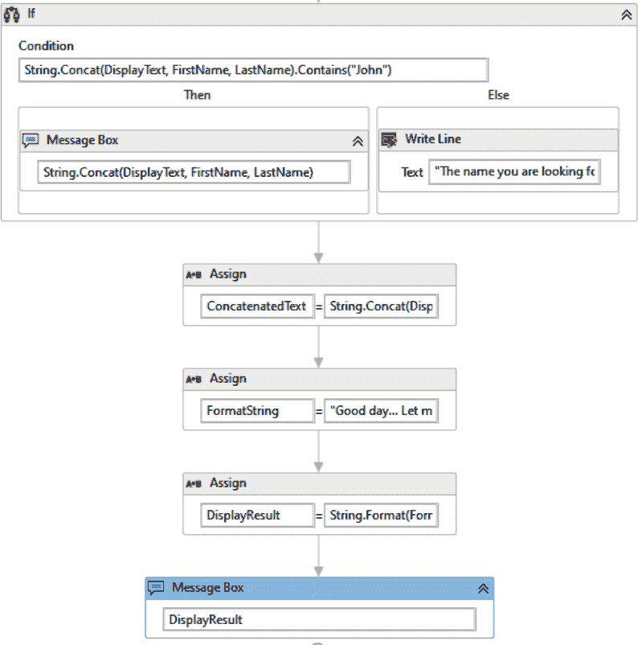

图 7.3 – String.Format 函数示例

- 10. 执行程序，您将看到最后一个 **消息框** 活动的以下输出：

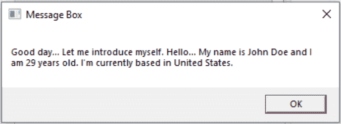

图 7.4 – String.Format 函数输出

`String.Format` 选项在需要使用执行期间检索到的值替换字符串动态部分的场景中非常有用。一个很好的示例是使用收件人姓名更新标准电子邮件正文。因此，让我们来看看 `Replace` 函数。

## Replace 函数

`Replace` 函数使用户能够替换主字符串中指定子字符串的所有出现。与 `Contains` 函数类似，此函数也区分大小写。它使用以下表达式来替换文本：

```
VarName.Replace(<String to Replace>, <New Value>)
```

`Replace` 表达式需要两个参数：要替换的字符串和新文本。

让我们将此函数应用到同一工作流并尝试替换一些值，具体步骤如下：

- 1. 在 UiPath Studio 中打开先前构建的工作流。

- 2. 将 **赋值** 活动拖放到工作流中最后一个 **消息框** 活动之后。

- 3. 通过创建名为 `CleansedValue` 的新字符串变量来配置 **赋值** 活动的 **目标** 部分。

- 4. 通过提供以下代码配置 **赋值** 活动的 **值** 部分：

```
DisplayResult.Replace("Hello...", "")
```


这段代码将在 `DisplayResult` 变量的字符串值中查找单词 "Hello..."，并将其替换为空字符串。

- 5. 在最后一个 **赋值** 活动下方放置一个新的 **消息框** 活动，并将其配置为显示 `CleansedValue` 变量中的值。最终工作流应类似于此：

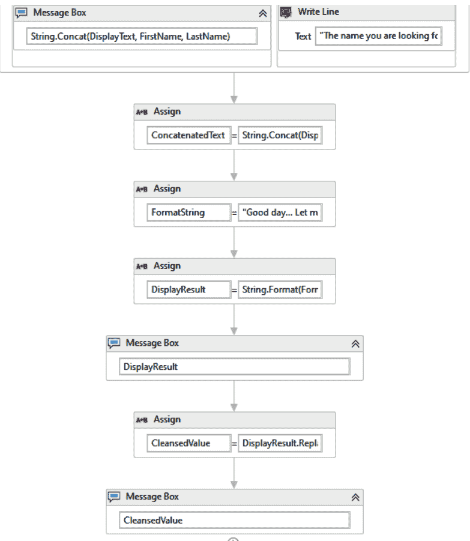

图 7.5 – String.Replace 工作流示例

- 6. 执行工作流并查看弹出的最后一条消息的结果。它应类似于以下输出：

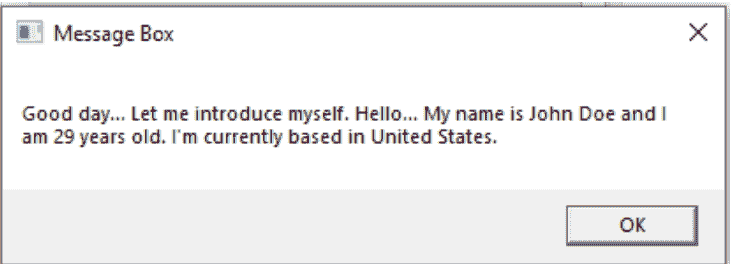

图 7.6 – String.Replace 函数输出

因此，当您想要从字符串中删除特殊字符或任何不需要的文本时，Replace 函数非常有用。

到此，您已熟悉字符串操作下的多种方法。除了这些方法，我们有时还需要搜索字符串的位置并获取其位置以执行某些操作。以下部分介绍了如何使用 IndexOf 方法执行搜索操作。

## IndexOf 函数

IndexOf 函数返回字符串中指定字符首次出现的索引。在编程中，索引始终从 0 开始。因此，在实际字符串中，第一个字母是第零个字母，第二个字母是第一个字母，以此类推。它不仅仅是另一个方法；它是 VB.NET 中许多重载方法之一，这些方法基于我们提供的不同输入参数执行多种搜索机制。通常，它使用以下表达式来获取指定字符的索引：

```
StrVariable.IndexOf("<search string>")
```

让我们获取先前输出字符串中字母首次出现的索引，方法如下：

- 1. 打开我们先前使用过的同一个工作流文件。
- 2. 在工作流末尾放置一个 **消息框** 活动。
- 3. 使用以下代码配置新的 **消息框** 活动：

```
CleansedValue.IndexOf("d").ToString
```

此配置将提供 CleansedValue 字符串中字母 "d" 首次出现的索引。随后，索引将使用 .ToString 方法转换为字符串，以便在消息框活动中以文本形式打印。

- 4. 运行程序并查看输出。最终的消息框活动应返回 "3" 作为输出。如果仔细查看 CleansedValue 变量字符串，字母 "d" 首次出现在单词 "Good" 中。它是字符串中的第四个字母；因此，在基于零的字符串中，该字母的索引为 "3"，这与我们得到的输出相似。

除了我们讨论的内容，还有几个返回字符串索引的重载方法。我们不会详细介绍每个方法；但是，我们需要知道基础知识。以下是列出的部分重载方法：

- `IndexOf(String, Int32, Int32, StringComparison)`：提供当前字符串中指定字符串首次出现的索引。参数指定当前字符串中的起始搜索位置、要在当前字符串中搜索的字符数以及用于指定字符串的搜索类型。
- `IndexOf(String, Int32, StringComparison)`：提供当前字符串中指定字符串首次出现的索引。参数指定当前字符串中的起始搜索位置，以及用于字符串的搜索类型。
- `IndexOf(Char, Int32, Int32)`：提供指定字符首次出现的索引。参数指定起始搜索位置以及在当前字符串中要搜索的字符数。
- `IndexOf(String, StringComparison)`：提供当前字符串中指定字符串首次出现的索引。参数指定用于指定字符串的搜索类型。
- `IndexOf(String, Int32, Int32)`：提供指定字符串首次出现的索引。参数定义当前字符串中的搜索位置以及要搜索的字符数。
- `IndexOf(Char)`：提供当前字符串中指定 Unicode 字符首次出现的索引。

由于我们尝试了不同重载方法中的一种类型，您也可以尝试提到的其他一些类型，以获取关于如何获得给定字符串索引的更多实践。

现在让我们应用关于索引所获得的知识，尝试另一种字符串操作方法。

## SubString 函数

在某些场景中，您需要从较长的字符串中仅提取特定部分以进行进一步处理。例如，从 **便携式文档格式 (PDF)** 文件的所有文本中，您可能只想提取发票号码以在另一个应用程序中使用。`SubString` 函数在这些场景中非常有用，因为它允许通过提供起始索引和子字符串长度来提取文本。它使用以下表达式从较长的字符串中提取一部分文本：

```
StrVariable.Substring(<starting index>, <length of substring>)
```

运用我们对索引的知识，让我们使用相同的工作解决方案，尝试从字符串变量中提取人名，方法如下：

- 1. 让我们打开我们先前使用过的同一个工作解决方案。
- 2. `CleansedValue` 字符串变量包含姓名 "John Doe"。让我们计算字符串中单词 "John" 的起始索引。单词 "John" 从第 47 个位置开始。
- 3. 现在，我们需要检查要提取多少个字符。姓名 "John Doe" 包含八个字符（包括中间的空格）。因此，我们提取所需的字符串长度为 8。
- 4. 使用我们计算出的起始索引和长度，让我们配置最后一个 **消息框** 活动以显示姓名。以下代码示例说明了要在 **消息框** 活动中应用的配置：

```
CleansedValue.Substring(47, 8)
```

我们可以尝试使用 `IndexOf` 函数而无需硬编码位置来获得相同的输出。由于我们探索了几个 `IndexOf` 函数，让我们稍微探讨一下如何将这两个函数结合起来以获得相同的输出。

- 5. 启动程序并查看最后一个 **消息框** 活动的输出。它应显示姓名 "John Doe"。

快速回顾一下，本节重点介绍了如何通过提供起始和结束索引点，从较大的字符串中提取所需的部分。在许多需要根据特定字符串模式提取字符串特定部分的场景中，此函数非常有用。除了此函数，我们还可以将字符串拆分为多个元素并分别访问每个部分。现在让我们看看如何拆分文本并在拆分后检索各个元素。

## Split 函数

Split 函数使用户能够根据特定字符拆分长字符串。当您需要使用 **逗号分隔值** (CSV) 文件或分隔符字符串变量来拆分以访问每个组件时，可以使用此功能。基于分隔符拆分单个字符串会将整个字符串转换为字符串数组，每个元素由基于零的索引表示。它使用以下函数来拆分字符串值。数组的大小是固定的；因此，创建后无法向数组中添加或删除项：

```
StrVariable.Split("<split character>"c)
```

分隔符后面的字母 c 将双引号内指定的字符转换为字符类型。

让我们使用先前的示例拆分 CleansedValue 变量中的值，方法如下：

- 1. 打开相同的工作解决方案。
- 2. 在最后一个 **消息框** 活动之后，放置一个新的 **赋值** 活动。
- 3. 通过创建新的字符串数组类型变量来配置 **赋值** 活动的 **目标** 段。按 `Ctrl + K` 并将变量名提供为 `SplitArray`。现在，如果您查看 **变量** 面板，该变量的数据类型为字符串。
- 4. 在变量的 **变量** 面板中单击 **变量类型**，然后单击 **[T] 数组** 选项以查找更多数据类型。
- 5. 从 **选择类型** 弹出屏幕中，将数组的数据类型选择为 **字符串** 并单击 **确定**。
- 6. 现在，您可以在 **变量** 面板中看到 `SplitArray` 变量的数据类型为 `String[]`。
- 7. 使用以下代码配置 **赋值** 活动的 **值** 段，以按 `<space>` 分隔符拆分 `CleansedValue` 变量中的值：

```
CleansedValue.Split(" "c)
```

上述配置将按空格分隔符拆分 CleansedValue 变量中的整个句子。每个单词将根据其在字符串中的位置表示数组中的特定元素。例如，使用空格拆分 "Hello World" 字符串会将两个单词放在数组的第零个和第一个索引中。


8. 在新的 **赋值** 活动下方使用另一个 **消息框** 活动，并配置它以按指定索引检索文本，如下所示：

```
SplitArray(0).ToString
```

当你达到这一点时，你构建的工作流应该类似于这样：

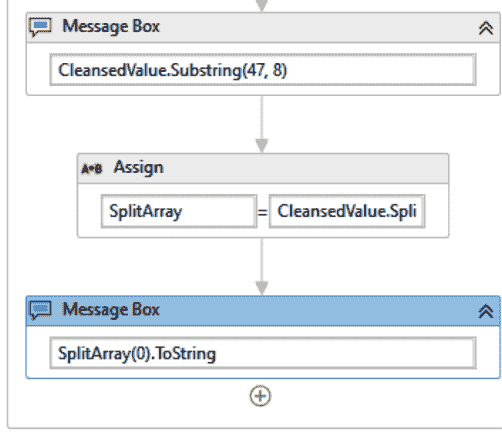

| 名称 | 变量类型 | 范围 |
|---|---|---|
| DisplayText | 字符串 | 主 |
| FirstName | 字符串 | 主 |
| LastName | 字符串 | 主 |
| ConcatenatedText | 字符串 | 主 |
| FormatString | 字符串 | 主 |
| DisplayResult | 字符串 | 主 |
| CleansedValue | 字符串 | 主 |
| SplitArray | 字符串[] | 主 |
| 创建变量 | | |

图 7.7 – String.Substring 和 String.Split 函数的输出

9. 运行程序并观察最后一个 **消息框** 活动的输出。由于我们按空格拆分，`CleansedValue` 字符串的第一个单词位于零号位置。你得到的输出是第一个单词，即 `Good`。尝试更改索引并运行几次以观察输出。以下屏幕截图说明了我们构建的工作流的输出：

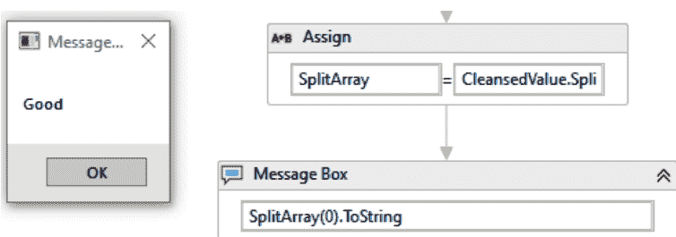

图 7.8 – String.Split 函数的输出

本节重点介绍如何通过提供分隔字符来拆分字符串。当你想要从给定字符串中提取特定文本元素时，此函数非常有用。此外，我们还了解到，拆分数组中的元素可以通过基于零的索引来访问。话虽如此，现在让我们来看看如何将集合变量（例如数组）中的数据合并为一个字符串。

## 连接函数

`Join` 函数通过在每个元素之间引入一个字符作为分隔符，将字符串数组中的所有元素合并为一个字符串。例如，如果数组由 "Hello" 和 "World" 等两个元素组成，则在 `Join` 函数中引入的分隔符将包含在输出字符串中，以指示最初拆分的位置。因此，在我们的示例中，如果引入 " | " 作为分隔符，`Join` 函数将返回 "Hello|World" 作为输出。此处显示了 `Join` 函数使用的表达式：

```
String.Join("<separator>", <Collection Variable>)
```

让我们将此函数应用到之前的工作解决方案中，以连接 SplitArray 变量中的元素，具体步骤如下：

- 1. 打开之前的工作解决方案。
- 2. 在工作流末尾添加一个新的 **消息框** 活动。

- 3. 使用以下代码配置新的 **消息框** 活动，以连接 SplitArray 变量中的元素：

```
String.Join(" ", SplitArray)
```

我们将空格指定为分隔符，以便将字符串还原为其原始形式。

- 4. 运行程序并观察最后一个 **消息框** 活动的结果。它将字符串还原为其原始形式。

字符串操作方法帮助我们了解可以使用文本值执行哪些标准函数。本节中学习的索引概念适用于所有集合类型变量，例如数组、列表、数据表等。VB.NET 中的所有集合变量在引用单个元素时都使用相同的基于零的索引概念。每种数据类型都有其特定的函数。

类似于字符串函数，与日期相关的函数仅适用于 DateTime 数据类型。日期相关计算在任何自动化中都非常常见，因此了解与日期值相关的函数至关重要。

## 了解日期和时间操作

日期和时间是我们几乎随处可见的两种值。同样，组织处理的数据涉及不同的日期、月份和年份。.NET Framework 提供了许多与日期值相关的功能，使用户能够轻松计算和操作日期。但是，对于 Associate 考试来说，不需要了解所有功能。因此，让我们仅查看一些功能，包括以下内容：

- 日期的加减运算
- 格式转换
- 提取日期的各个元素

让我们通过以下场景来探索一些功能。我们需要获取当前日期前 7 天到当前日期后 7 天之间的日期列表。此外，我们还想打印日期、月份和日期名称。以下步骤提供了生成所需输出的指南：

- 1. 打开 UiPath Studio 并创建一个新的空白流程。
- 2. 在“项目”面板中双击 Main.xaml 文件，在“设计器”面板中打开该文件。
- 3. 创建名为 CurrentDate、ProcessDate 和 MaximumDate 的三个变量，并通过将其数据类型更改为 System.DateTime 来配置这三个变量。
- 4. 如果在“变量类型”下拉列表中未列出 DateTime，请单击“浏览更多”，并在“浏览 .Net 类型”弹出窗口中搜索 System.DateTime 数据类型。
- 5. 从“活动”面板将“赋值”活动拖放到工作流中。
- 6. 通过提供名为 CurrentDate 的第一个变量来配置赋值活动的 To 部分。
- 7. 通过提供 System.DateTime.Now 来配置赋值活动的 Value 部分，以将当前日期和时间分配给变量。
- 8. 拖放另一个赋值活动，并使用 CurrentDate.AddDays(-7) 代码生成当前日期前 7 天的日期，并将其分配给 ProcessDate 变量。

指定的代码从 CurrentDate 变量中保存的日期扣除 7 天，以生成一个新日期。

- 9. 同样，在另一个赋值活动中使用以下代码，将范围内的最大日期分配给 MaximumDate 变量：

```
CurrentDate.AddDays(7)
```

指定的代码向 CurrentDate 变量中指定的日期添加 7 天，以生成我们需要提取的最大日期。

- 10. 从 **活动** 面板中搜索 **While** 活动，并将其放置在三个 **赋值** 活动下方。我们使用 While 循环遍历 ProcessDate 和 MaximumDate 变量中指定的日期之间的天数。While 活动的条件使用以下代码：

```
ProcessDate<= MaximumDate
```

- 11. 将 **写入行** 活动放置在 While 循环内部，并使用以下代码对其进行配置：

```
"Date: " + ProcessDate.ToString("dd-MMMM-yyyy") +
" | Month: " + Microsoft.VisualBasic.DateAndTime.
MonthName(ProcessDate.Month) + " | Day: " + ProcessDate.
ToString("dddd")
```

ProcessDate.ToString("dd-MMMM-yyyy") 代码段将日期转换为指定格式，以字符串格式输出日期。例如，日期将打印为 01-January-2021。

Microsoft.VisualBasic.DateAndTime.MonthName(ProcessDate.Month) 代码段生成变量中存储的日期值的月份名称。例如，如果提供的日期是 01/12/2020，则该代码的输出将是 "December"。

ProcessDate.ToString("dddd") 代码段将当前日期转换为星期名称，例如星期日、星期一等等。

- 12. 在 **写入行** 活动下方放置一个新的 **赋值** 活动，并将 ProcessDate 变量的日期增加 1 天。以下代码为该活动提供示例代码：

```
ProcessDate.AddDays(1)
```

达到这一点后，您已完成创建日期操作工作流。开发的工作流应类似于这样：

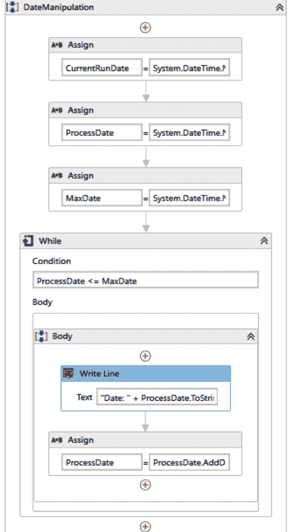

图 7.9 – 日期操作工作流示例

- 13. 运行自动化并在 **输出** 面板中观察输出。此外，尝试围绕相同的工作流进行简单配置，并了解可用于执行日期值相关操作的其他函数。

与日期相关的函数有很多。但是，本章节仅介绍其中一些最常用的函数。根据前面步骤中获得的总体概念，您可以轻松使用其他函数来操作数据以检索所需输出。另一方面，`Lists` 数据类型提供了保存特定数据类型值列表的功能，包括字符串、日期时间、整数等等。本章的下一部分将重点介绍使用列表变量时的一些常用函数。

## 了解列表操作

列表是特定类型的数据类型，可以包含多个数据值。列表中的所有数据值都有一个固定的内存位置，称为 **索引**。数组的大小是固定的，并在变量创建时定义。但是，列表允许我们在运行时添加、修改和删除项目。与数组类似，列表提供用于操作其数据的特定方法，例如以下内容：

- 添加项目
- 删除项目
- 遍历列表中的元素并对每个元素执行特定操作
- 对列表中的项目进行排序
- 搜索项目
- 清除列表中的项目

UiPath 提供了一组活动来高效执行上述操作。UiPath 提供的活动如下：

- **添加到集合**：将新项目添加到指定的集合变量。它相当于 `List.Add()` 函数。
- **清除集合**：删除指定集合变量中的所有数据。处理临时保存数据的列表变量时，此功能非常有用。此活动在加载下一批数据之前删除列表中的所有内容，从而帮助处理此类场景。
- **从集合中删除**：从集合变量中删除指定的项目。除删除操作外，该活动还返回一个布尔结果，指示删除操作是否成功。
- **集合中是否存在**：该活动返回一个布尔结果，指示指定的项目是否存在于集合中。此活动提供了一种高效的机制来检查项目的存在性，而无需遍历列表。


让我们现在来练习一些简单的列表操作方法。接下来概述的步骤提供了执行所需操作的指南。

## 声明列表变量

在本章的这一部分中，我们将了解如何通过变量面板声明列表变量。

打开 UiPath Studio 并创建一个新的流程活动，如下所示：

- 1. 打开 Main.xaml 文件。
- 2. 从活动面板将序列活动拖放到设计器面板中。
- 3. 选择序列活动并单击变量面板。
- 4. 创建名为 StudentsList 的新列表变量，类型为 List<String>。列表数据类型最初不会在下拉菜单中显示。因此，单击下拉菜单中的浏览类型选项，并在浏览并选择 .NET 类型弹出窗口中查找 System.Collections.Generic.List。
- 5. 在 System.Collections.Generic 下选择 List<T>，从下拉菜单中选择数据类型为 String，并单击确定按钮以创建变量。以下截图显示了在浏览并选择 .NET 类型弹出窗口中的配置：

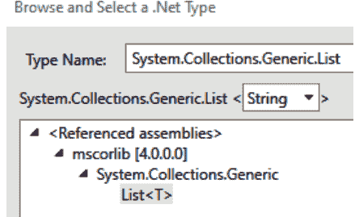

图 7.10 – 列表变量创建

- 6. 在 **变量** 面板中使用以下代码配置 **默认** 部分，以用一些值初始化变量：

```
New List (Of String) from {"John", "Daniel", "Keith"}
```

- 7. 按照相同的步骤创建另一个字符串类型的列表变量并将其命名为 EmployeeList，并使用以下代码配置 **变量** 面板的 **默认** 部分：

```
New List (Of String) from {"Diana", "Lizi", "Peter",
"Daniel"}
```

您现在已熟悉列表变量的创建。现在让我们专注于在工作流中使用变量。

### 向列表添加项目

在本节中，我们将了解如何使用 **添加到集合** 活动向我们之前创建的列表之一添加项目。请按以下步骤操作：

- 1. 在 **变量** 面板中搜索 **添加到集合** 活动，并将其拖放到我们之前创建的 **序列** 容器中。让我们向 StudentList 变量添加一个新项目。

- 2. 选择 **添加到集合** 活动，并在 **属性** 面板中将 DisplayName 属性修改为 Add item to StudentList 以重命名它。

- 3. 通过提供 StudentList 变量来配置活动的集合属性。此属性指示您希望向哪个集合变量添加数据。

- 4. 通过在双引号内提供新名称来配置活动的项目属性，如下所示：

```
"Andrew"
```

- 5. 您现在可以在以下截图中看到 UiPath Studio 在 `Collection` 属性上显示错误消息：

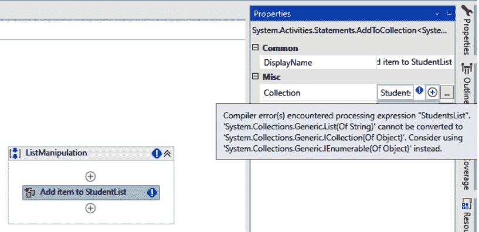

图 7.11 – 配置添加到集合活动的数据类型

此错误是因为集合期望字符串数据类型，但活动已自动配置为添加对象数据类型。您可以在活动的 `TypeArgument` 属性中看到此配置。

- 6. 通过从下拉菜单中选择 **字符串** 作为数据类型来配置活动的 `TypeArgument` 属性。

- 7. 拖放另一个 **添加到集合** 活动，并使用相同的步骤进行配置，以将新名称 "Jane" 添加到 `EmployeeList` 集合变量中。

由于我们已构建工作流以向列表变量添加项目，本章的下一部分将侧重于合并两个列表。

## 合并列表变量

无法直接合并列表——它需要将 `List` 类型转换为 `Enumerable` 类型。为此，请按以下步骤操作：

- 1. 在两个 **添加到集合** 活动下方放置一个 **分配** 活动。

- 2. 通过创建名为 `CombinedPeopleList` 的新列表变量来配置 **分配** 活动的 **到** 段。

- 3. 使用以下代码配置 **分配** 活动的 **值** 段。`Enumerable.Concat` 方法连接转换为可枚举的列表变量。所有需要合并的列表都需要从 `List` 类型转换为 `Enumerable` 类型。`ToList()` 函数将合并的可枚举列表转换为 `List` 数据类型以便进一步处理：

```
Enumerable.Concat(StudentsList.AsEnumerable,
EmployeeList.AsEnumerable).ToList
```

到目前为止，我们有一个 `List` 变量可用于进一步处理。此外，如果我们仔细查看两个列表中的数据值，可以看到名称 "Daniel" 在两个列表中都可用。一旦将两个列表合并为 `CombinedPeopleList`，新列表现在包含重复的 "Daniel" 条目。本章的下一部分将侧重于如何删除重复条目。

## 从列表中删除数据

从列表中删除数据通过 **从集合中删除** 活动变得简单。我们可以使用此活动删除我们有的 "Daniel" 的重复条目，方法是遵循以下准则：

- 1. 从 **活动** 面板搜索 **从集合中删除** 活动，并将其放置在 **分配** 活动下方。

- 2. 通过将 `Item` 属性配置为 "Daniel" 并通过提供 `CombinedPeopleList` 变量来配置 `Collection` 属性来配置 **从集合中删除** 活动。此活动从列表中删除名称 "Daniel" 的第一次出现。

数据现在已准备好进行修改。本章的下一部分将侧重于如何将列表中的数据转换为大写。

## 修改列表中的数据

列表包含多个数据值，我们可以使用索引访问这些值。同样，此功能还使用户能够在对每个数据元素执行不同操作时循环遍历数据元素。

让我们看看如何循环遍历项目并更新列表中的每个项目。在我们的场景中，我们将通过将项目转换为大写字母来更新列表中的项目。请按以下步骤操作：

- 1. 从 **活动** 面板搜索 **对每个** 活动，并将其放置在 **添加到集合** 活动下方。

- 2. 将 **对每个** 活动的 **属性** 面板中的 `TypeArgument` 属性更改为 `String`。此属性指示列表中每个元素的数据类型。因此，我们的列表是 **字符串** 列表，所以我们必须将属性更改为 **字符串**。

- 3. 通过指示 `CombinedPeopleList` 列表变量来配置 **对每个** 活动的 `Values` 属性。它还使用相同的配置更新 **对每个** 活动的 **在** 段。循环 **对每个** 段中指定的 `item` 变量是一个特定变量，仅适用于 **对每个** 循环。`item` 变量在执行期间保存当前迭代的数据元素。

- 4. 从 **活动** 面板搜索 **分配** 活动，并将其放置在 **对每个** 活动的 **主体** 容器内。

- 5. 由于我们需要更新列表中的项目，让我们将 `item` 变量放置在 **分配** 活动的 **到** 段中。

- 6. 使用以下代码配置 **分配** 活动的 **值** 段，该代码将 `item` 变量中的值转换为大写：

```
StrConv(item, VbStrConv.Uppercase)
```

- 7. 通过 **变量** 面板创建另一个 `String` 类型的列表变量并将其命名为 `ModifiedList`。

- 8. 将 `ModifiedList` 变量的 **范围** 字段更改为最外层序列。

- 9. 将 `ModifiedList` 变量的默认值更改为 `New List (Of String)` 以将 `List` 变量初始化为字符串列表。

- 10. 将另一个 **添加到集合** 活动放置在 **对每个** 循环中的 **分配** 活动下方。

- 11. 通过指定新创建的 `ModifiedList` 变量来配置活动的 `Collection` 属性。

- 12. 通过提供 `item` 变量来配置活动的 `Item` 属性。**分配** 活动上方的 **添加到集合** 活动将 `item` 变量中的值转换为大写并覆盖其值。因此，我们正在使用同一个变量将更新后的值添加到新的集合变量中。


- 13. 现在让我们打印结果。搜索一个 **Write Line** 活动，并将其放置在 **For Each** 循环下方。

- 14. 使用以下代码配置 **Write Line** 活动，该代码将最终列表转换为一个可在 **Output** 面板中打印的字符串变量：

```
String.Join(" | ", ModifiedList)
```

到达此点时，您构建的工作流应类似于此：

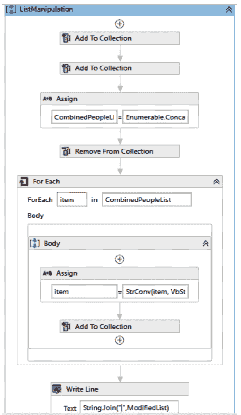

图 7.12 – 列表数据操作工作流

同样，您在 **Variables** 面板中创建的变量的最终配置应类似于此：

| 名称 | 变量类型 | 范围 | 默认值 |
|---|---|---|---|
| StudentsList | List<String> | ListManipulation | New List(Of String) from ["John", "Daniel", "Keith"] |
| EmployeeList | List<String> | ListManipulation | New List(Of String) from ["Diana", "Lizi", "Peter", "Daniel"] |
| CombinedPeopleList | List<String> | ListManipulation | 输入 VB 表达式 |
| ModifiedList | List<String> | ListManipulation | New List(Of String) |
| 创建变量 | | | |

图 7.13 – Variables 面板中的列表数据操作变量

- 15. 执行程序并观察 **Output** 面板中的输出。您应收到以下输出：

```
`JOHN | KEITH | ANDREW | DIANA | LIZI | PETER | DANIEL | JANE`
```

本节所执行的步骤使您很好地了解如何使用 `List` 变量操作数据。与数组相比，`List` 变量提供的其他功能（例如在运行时添加或删除元素）使处理数据元素变得轻松。列表可以存储任何类型的值，包括数值。数值数据具有其独特的功能，例如求和、除法、乘法等等。本章的下一部分将重点介绍几种常用的数值计算。

## 了解数值计算

在执行从简单到复杂的各种计算时，数值数据类型非常有用。我们可以使用数值执行许多计算，例如求和、计算平均值、查找最小值和最大值等等。在 UiPath 中执行数值计算非常简单。让我们尝试一个简单直接的示例。

创建一个 `List` 变量，用于存储学生上学期五门科目的成绩。我们的任务是计算成绩的总分和平均分。按以下步骤操作：

- 1. 打开 UiPath Studio 并创建一个新的 **Blank Process** 活动。
- 2. 双击 `Main.xaml` 文件在 **Designer** 面板中打开该文件。
- 3. 搜索 **Sequence** 活动并将其添加到 **Designer** 面板。
- 4. 使用以下代码创建一个类型为 String 的新 List 变量。该变量包含学生在五门科目中获得的结果：

```
New List(Of String) From {"75", "34.4", "54", "34", "55"}
```

列表中的分数为 String 类型。我们无法使用 String 数据类型执行计算。因此，在执行计算时需要将它们转换为数值数据类型。

- 5. 创建一个名为 TotalScore 的 Int32 类型新变量。
- 6. 创建另一个名为 AverageScore 的 Double 类型变量。
- 7. 拖放一个 For Each 活动，以便我们可以遍历列表中的项目。
- 8. 使用 String 类型配置循环的 TypeArgument 属性。
- 9. 将 Assign 活动拖放到 For Each 循环的主体中。我们将使用 Assign 活动通过在循环中累加每个项目的值来计算分数总和。
- 10. 通过提供变量名 TotalScore 来配置 Assign 活动的 To 部分。
- 11. 使用以下代码配置 Assign 活动的 Value 部分。列表中包含带小数的值。小数值无法直接转换为 Int32。因此，对于我们的场景，我们将首先将字符串转换为 Double，并将其四舍五入到最接近的整数，然后再将其转换为 Int32：

```
TotalScore + Convert.ToInt32(Math.Round(Double.Parse(item)))
```

- 12. 在 For Each 活动下方拖放一个 Write Line 活动，并将其配置为在 Output 面板中将 TotalScore 变量的值作为字符串写入。
- 13. 在最后一个活动下方放置另一个 Assign 活动，并使用以下代码配置 Value 部分，该代码使用 TotalScore 变量中的值生成平均分。我们需要列表中的项目数来计算平均分——StudentMarks.Count 代码会给出学生完成的科目数量：

```
TotalScore / StudentMarks.Count
```

- 14. 通过指定 AverageScore 变量来配置 Assign 活动的 To 部分。AverageScore 变量将保存前一步计算得出的平均分。
- 15. 放置一个 **Write Line** 活动在 For Each 活动下方，并通过将 `AverageScore` 中的值转换为 `string` 来对其进行配置，以便在 **Output** 面板中打印该值。到达此点时，您构建的工作流应类似于此：

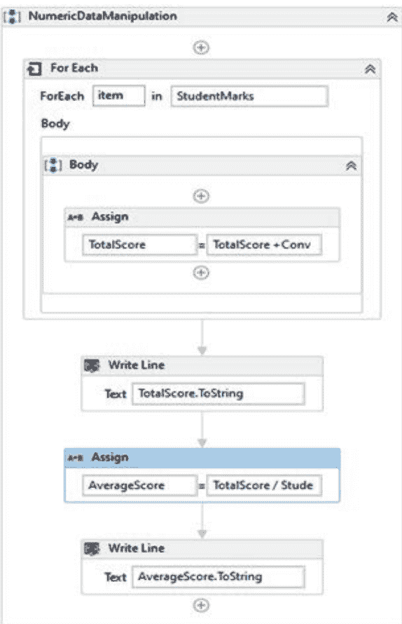

图 7.14 – 数值数据操作工作流示例

- 16. 运行工作流并观察 **Output** 面板中的结果。您应该看到总数显示为整数，而平均值由小数值组成。

.NET Framework 中提供了许多可用于执行数值计算的函数。此处提供的示例是基础示例。其旨在让您了解执行某些数值操作（例如四舍五入、计算总数和求得平均值）的高级思路。您在本章中已获得的知识将为您探索 Math 库中的其他函数以及可用于数值计算的其他各种函数打下基础。请探索其他方法并熟悉这些函数，因为在为您的组织构建自动化解决方案时，它们将非常有用。

虽然数值数据类型具有其独特的功能，但 `Dictionary` 类型变量提供了一种使用键值对概念管理数据的独特方式。本章的下一部分将解释如何使用 `Dictionary` 变量操作数据。

## 了解字典操作

`Dictionary` 类型与 `List` 和 `Array` 类型有一个关键区别。列表和数组存储相同数据类型的多个数据元素，而字典可以存储每个数据元素及其唯一键。这种组合称为 **key-value** 对。用户在创建变量时选择键和值的数据类型。

`Dictionary` 类型主要用于存储配置详细信息或其他类似信息。您可能想知道为什么不应该使用 `List` 类型来存储和访问配置数据。在实际场景中，每个配置数据元素都有一个描述性名称，用于描述配置代表的内容。例如，如果配置文件包含有关 **Uniform Resource Locators (URLs)**、超时和文件路径的数据，则文件可能如下所示：

| 键 | 值 |
| :--- | :--- |
| BusinessURL | https://www.google.com |
| InputExcelFolderPath | C:\Invoice Files\ |
| ProcessTimeout | 10000 |

图 7.15 – 配置文件的示例结构

在类似场景中，字典变量使用描述性键，使用户更容易了解工作流中使用了哪些值。在列表或数组变量中无法实现相同概念，因为列表和数组中的值仅通过索引访问。

UiPath Studio 提供了一个易于使用的环境来处理字典，以执行初始化、添加、删除、提取和重新赋值等操作。让我们通过一个简单的示例来了解如何使用字典。

### 字典初始化

字典也是一种集合变量，类似于列表和数组。因此，初始化过程与这些数据类型相似。初始化发生在通过 Variables 面板创建变量或在工作流中使用 Assign 活动时。

让我们创建一个简单的 Dictionary 变量，用于保存个人信息，例如姓名、年龄、国家和出生日期。按以下步骤操作：

- 1. 打开 UiPath Studio 并创建一个新的空进程。
- 2. 在 Designer 面板中打开 `Main.xaml` 文件。
- 3. 拖放一个新的 Sequence 活动以开始构建工作流。
- 4. 将 Assign 活动从 Activities 面板拖放到 Sequence 容器中。
- 5. 打开 Variables 面板，单击“创建变量”选项，提供名称 "PersonalData" 来创建一个新的 Dictionary 变量。该变量的默认数据类型为 String。
- 6. 单击变量的“变量类型”字段以访问下拉菜单并选择“浏览类型”。此操作将打开“浏览并选择 .NET 类型”窗口。
- 7. 在窗口中搜索 Dictionary 类型，并选择位于 mscorlib.System.Collections.Generic 下的 Dictionary<TKey, TValue> 项目，如下图所示：


## 浏览并选择 .Net 类型

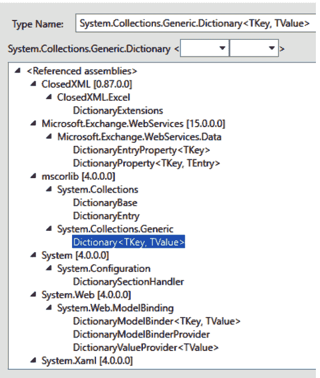

图 7.16 – 创建 Dictionary 类型的变量

8. 从顶部出现的两个下拉选项中，为 **键** 选择 `String` 数据类型，为 **值** 选择 `String`，然后单击 **确定** 按钮。创建变量后，**变量** 面板应显示该变量的数据类型为 `Dictionary<String, String>`。

9. 通过在 **值** 段中提供以下代码来初始化 **赋值** 活动的 **至** 段中的新变量名：

```
New Dictionary(Of String, String)
```

提供的代码使用指定类型的新 Dictionary 对象初始化字典，以便随后使用。现在，让我们向新的 Dictionary 变量赋一些值。

## 向字典添加新项目

既然我们现在有一个可用的变量，让我们向字典添加新值。本节将向字典添加人员姓名、年龄、国家和出生日期等新项目。操作步骤如下：

- 1. 从 **Activities** 面板中搜索 **调用方法** 活动，并将其放置在 **赋值** 活动下方。
- 2. 通过提供 `PersonalData` 字典变量的名称来配置 **调用方法** 活动的 **目标对象** 属性。
- 3. 通过提供方法名 `Add` 来配置 **调用方法** 活动的 **方法名** 属性。`Add` 方法是 .NET Framework 中用于向字典变量添加新项目的方法。
- 4. 展开 **属性** 面板以查看 **调用方法** 活动的属性。
- 5. 单击 **属性** 面板中 **集合** 属性旁边的按钮，打开 **参数** 弹出窗口以提供键值对的新值。字典要求为添加到 `Dictionary` 变量的每个项目提供两个输入参数。
- 6. 在 **参数** 弹出窗口中单击 **创建参数** 选项以创建第一个输入参数。第一个参数指新值的键。我们计划添加一条记录，用于描述人员的姓名、年龄、国家和出生日期等信息。这些 ID 是我们应放入字典中的键。
- 7. 将 **方向** 值配置为 `In`，将 **类型** 值配置为 `String`，因为字典要求键为字符串。
- 8. 将第一个键值提供为 `Name`。
- 9. 按照相同方法创建一个新参数，为你添加的新键提供值。在第二个参数中指定人员姓名为 `John Doe`。**名称** 键将引用存储人员值的第二个参数。

完成上述步骤后，**参数** 屏幕应类似于以下图示：

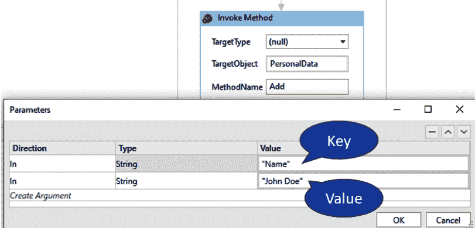

图 7.17 – 向 Dictionary 变量添加第一个项目

- 10. 单击 **确定** 按钮关闭 **参数** 屏幕。
- 11. 再添加三个 **调用方法** 活动，并相应配置，以将年龄、国家和出生日期值添加到字典中。

现在变量中已有数据。让我们尝试提取我们插入的数据，以便在工作流中使用。

## 从 Dictionary 变量提取数据

你已熟悉从列表和数组中提取数据。我们使用索引来访问 Array 和 List 变量中的数据元素。同样，在 Dictionary 变量中，我们使用键来访问数据元素，而不是内存索引。操作步骤如下：

- 1. 打开我们之前用于创建并向 Dictionary 变量赋值的解决方案。
- 2. 在最后一个 **调用方法** 活动下方放置一个 **写入行** 活动。
- 3. 使用以下代码配置 **写入行** 活动，以打印人员姓名：
  `PersonalData("Name").ToString`
- 4. 运行程序并观察输出面板中打印的值。
- 5. 配置 **写入行** 活动以显示其余值，并对其进行测试，以更好地理解如何从 Dictionary 变量中提取值。

走到这一步，你应该已熟悉在 `Dictionary` 变量中操作数据。本节提供的步骤使你能够轻松初始化、赋值并从 `Dictionary` 变量中检索值，以便在实际用例中使用。`Dictionary` 变量的使用与 `List` 和 `Array` 变量类似。唯一的区别在于，`Dictionary` 变量的值是通过唯一键而不是内存位置来访问的。

## 理解基于模式的正则表达式数据提取

在本章中，我们讨论了对不同数据类型进行提取、转换及其他多种操作。到目前为止，我们讨论的都是相当直接的情况，即你拥有需要操作的确切值。但是，存在需要从较大的数据集（例如文本段落）中基于模式提取特定值的场景。我们需要使用正则表达式等独特功能，在这样的场景中仅提取所需的值。

正则表达式的重要性在于，它使用户能够基于特定模式匹配、定位和提取值。例如，如果你有一个包含账号和电子邮件地址的文本段落，可以使用正则表达式从输入字符串中仅提取电子邮件地址。

但是，构建正则表达式可能具有挑战性。UiPath 提供了一个正则表达式生成器来简化这些表达式周围的复杂性。正则表达式通常用于解析文本、输入验证、数据抓取和字符串操作。因此，正则表达式是字符串操作的一部分。然而，我们决定单独讨论正则表达式，因为它们与我们所涵盖的其他操作方法有很大不同。

UiPath 提供了三种使用正则表达式（配合 **正则表达式生成器**）的方法。每种方法都是 UiPath 中与 **正则表达式生成器** 关联的独立活动。这三种方法列于以下：

- **匹配**：用于在输入字符串中搜索特定模式，并将所有匹配值作为 `IEnumerable<Match>` 返回。你可以通过将 **类型参数** 字段设置为 `System.Text.RegularExpressions.Match`，使用 **For Each** 活动访问此类型中的值。
- **IsMatch**：用于检查输入字符串中是否存在特定模式。该函数根据结果返回一个布尔值。
- **Replace**：我们已经讨论过 `string.Replace` 函数。但是，`String.Replace` 函数要求我们提供要替换的确切字符串。**正则表达式生成器** 提供的 Replace 函数允许用户将正则表达式提到的特定模式下的值替换为新值。

每个活动都包含一个按钮，允许你导航到 **正则表达式生成器** 屏幕，从而构建活动的正则表达式。**正则表达式生成器** 屏幕如下所示：

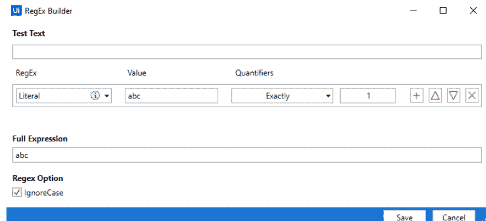

图 7.18 – 正则表达式生成器屏幕

**正则表达式生成器** 屏幕的各个部分说明如下：

- **测试文本**：一个文本编辑器，用户可以在其中将特定文本与表达式进行测试。测试文本中匹配文本模式的部分将被突出显示，以验证表达式。
- **正则表达式**：允许搜索给定文本、数字、字符或多种组合。
- **值**：包含需要检索的确切文本、数字或字符。
- **限定符**：一个下拉列表，包含根据用户要求要检索的结果类型。下拉列表允许用户提取精确匹配，或决定表达式是否可以期望零个或多个匹配的文本值。
- **完整表达式**：表示通过添加一个或多个表达式类型构建的最终表达式。

让我们通过一个简单示例来尝试其中的一些选项。给定的字符串如下：

> "你有一个绝佳的机会与一位名人联系并提问。请立即联系 John.Doe@mail.com 或 Jane.Doe@mail.com 预订座位。如需更多信息，请联系 5992754159。"

我们需要使用并提取字符串中可用的所有电子邮件地址。操作步骤如下：

- 1. 打开 UiPath Studio 并创建一个新的 **空白流程** 活动。
- 2. 在 **设计器** 面板中打开 Main.xaml 文件以开始构建工作流。
- 3. 在 **设计器** 面板中放置一个 **序列** 活动。
- 4. 创建一个名为 InputString 的新字符串变量，用于保存提供给我们的输入字符串。
- 5. 在 **序列** 容器中放置一个 **赋值** 活动，并为 InputString 变量赋值为上面块部分中给定的字符串。
- 6. 从 **Activities** 面板中搜索 **匹配** 活动，并将其拖放到 **赋值** 活动下方。
- 7. 通过提供 InputString 变量名称来配置 **匹配** 活动的 Input 属性。Input 属性提供应用了正则表达式的字符串。
- 8. 单击 **匹配** 活动上的“配置正则表达式”按钮，打开 **正则表达式生成器** 窗口。
- 9. 复制我们想要使用的输入字符串，并将其粘贴到 **正则表达式生成器** 的 **测试文本** 部分中。
- 10. 从 **表达式类型** 下拉列表中将正则表达式类型选择为 **电子邮件**。选择类型后，你可以看到 **完整表达式** 部分中出现的电子邮件预构建正则表达式。此外，它还将突出显示 **测试文本** 部分中的两个电子邮件地址。
- 11. 使用 **Ctrl + K** 变量创建快捷方式创建一个名为 **EmailList** 的新变量，以配置活动的 **结果** 属性。
- 12. 搜索 **For Each** 活动并将其放置在 **匹配** 活动下方。
- 13. 通过搜索 System.Text.RegularExpressions.Match 作为每个项目的类型，来配置 **For Each** 活动的 **类型参数** 字段。
- 14. 在循环内部放置一个 **写入行** 活动，并使用 **item**.ToString 代码对其进行配置，以打印当前迭代的匹配电子邮件地址。


- 15. 执行工作流并监控 **输出** 面板以查看提取的电子邮件地址。
- 16. 同样，尝试执行相同步骤从文本中提取电话号码。

在任何流程中接收到的数据并不总是完美的。因此，提取预期数据并将其转换为我们需要的格式始终是必不可少的。我们始终在处理数据；因此，在构建自动化解决方案时，了解如何使用不同方法来操作数据非常有用。有简单的转换方法，例如我们用于字符串、整数和日期时间格式的方法。但是，在处理非结构化数据且提取并不简单时，正则表达式非常有用。

## 总结

在构建自动化工作流时操作数据非常重要。数据操作使您能够读取、筛选、排序、提取并执行计算，从原始输入数据中得出有意义的数据。不同的变量类型有其独特的数据操作方式。因此，了解 UiPath 提供哪些功能以根据每种数据类型执行各种操作是至关重要的。本章为您提供了良好的理解，了解如何在最常用的变量类型（如字符串、数组、列表和字典）中操作数据。

本章学到的概念对于构建包含许多操作的复杂工作流解决方案非常有帮助。后续章节将使用本章获得的基础知识来执行复杂操作，例如与 Excel 文件、电子邮件、 **用户界面 (UI)** 等进行交互。因此，理解本章中描述的概念和方法是至关重要的。下一章将介绍 UI 自动化中最关键的主题之一：选择器。您在本章中学到的概念在执行 UI 自动化时将证明非常有用。
