## 探索 UiPath 选择器

选择器是自动化中最主要和最重要的主题之一。选择器使用标准 XML 代码自动创建，该代码用于标识用户界面元素。XML 代码由多个节点组成，这些节点是以结构化和分层顺序排列的标签和属性的组合。

在本章中，您将了解什么是选择器、它们如何工作，以及在自动化时如何使用正确的选择器类型和设置。您将了解用户界面、如何执行元素探索，以及如何微调选择器以提高元素识别的准确性。

在本章中，我们将介绍以下主题：

- 选择器的标签和属性
- 选择器编辑器
- UI Explorer
- 完整选择器与部分选择器
- 动态选择器
- 使用 Packtpub.com 的动态选择器示例实现

## 技术要求

本章要求您已安装 UiPath Studio 和 UiPath Robot，并对 Studio 的用户界面有基本了解。请参阅第 2 章“UiPath 生态系统”以了解 Studio 的基础知识。

## 选择器的标签和属性

在本节中，我们将了解更多有关如何使用选择器的标签和属性的信息。如前所述，选择器由特定元素的一组节点组成，这些节点按照详细的层次顺序排列。这与我们用于识别的地址顺序非常相似；即，国家 > 城市 > 邮政编码 > 街道名称 > 门牌号 > 公寓号。选择器的结构可以表示如下：

```
<Node_1 >
<Node_2>
......
<Node_N>
```

图 8.1 – 选择器结构

<Node 1> 通常将是父节点或根节点；最后一个节点 <Node n> 是您可能感兴趣的节点，因为它通常代表 UI 元素，而前面的节点是该元素的父节点。每个节点都有属性，可帮助您在用户界面中识别元素，例如窗口、表格、链接、文本框、按钮等，了解每个节点的属性以应用常量值来准确识别正确元素是至关重要的。让我们看看此类选择器的示例：

```
<wnd app='notepad.exe' cls='Notepad' title='Untitled - Notepad' />
<wnd cls='Edit' />
<ctrl name='Text Editor' role='editable text' />
```

图 8.2 – 选择器示例

在 <Node 1> 代码部分中，wnd (窗口) 是一个标签，而 app='notepad.exe' cls='Notepad' title='Untitled – Notepad' 是一个属性。同样，在 <Node 2> 中，Ctrl (控制) 是一个标签，而 name='Text Editor' role='editable text' 是一个属性。

现在您已了解选择器及其用法，您需要知道如何编辑它们，以便根据您的要求识别目标元素。我们将在下一节中学习如何编辑选择器。

### 选择器编辑器

选择器通常存储在工作流中使用的活动的 **属性** 面板内，并可在 **属性** 窗口中通过 **输入 > 目标 > 选择器** 访问，如下一张屏幕截图所示：

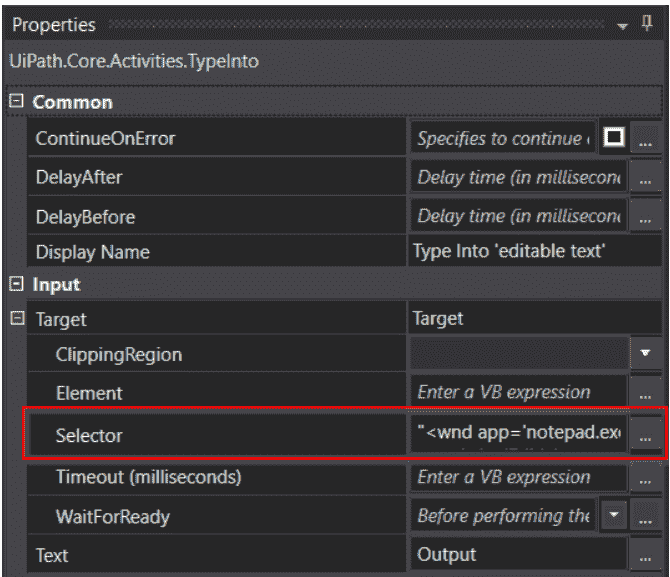

图 8.3 – 属性中的选择器

选择器编辑器工具可帮助您查看已使用的选择器并编辑其属性，以微调选择器以获得更好的可靠性。要访问该工具，您可以单击上一张屏幕截图中高亮显示的属性面板上的三个点，也可以通过任何特定活动的选项菜单单击“编辑选择器”选项。在此示例中，所用的活动是“键入文本”，如下一张屏幕截图所示：

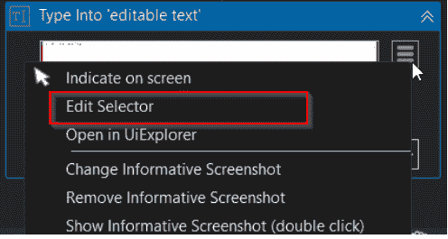

图 8.4 – 编辑选择器

将出现一个新窗口，其中有多个选项。每个选项在克服选择器挑战方面都有其重要性。让我们逐一探讨这些选项；它们显示在下一张屏幕截图中：

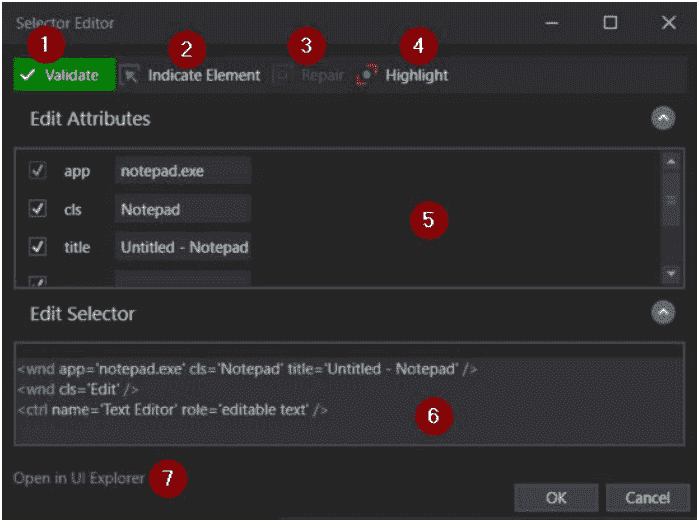

图 8.5 – 选择器编辑器

各选项如下：

- 1. **验证**

  **验证** 按钮根据屏幕上显示的目标 UI 元素的可用性显示 *选择器的状态*。它有三种不同的状态：

  - I. **带有对勾的绿色验证按钮** (如下一张屏幕截图所示) 表示目标元素是 *有效* 的且可以执行：

    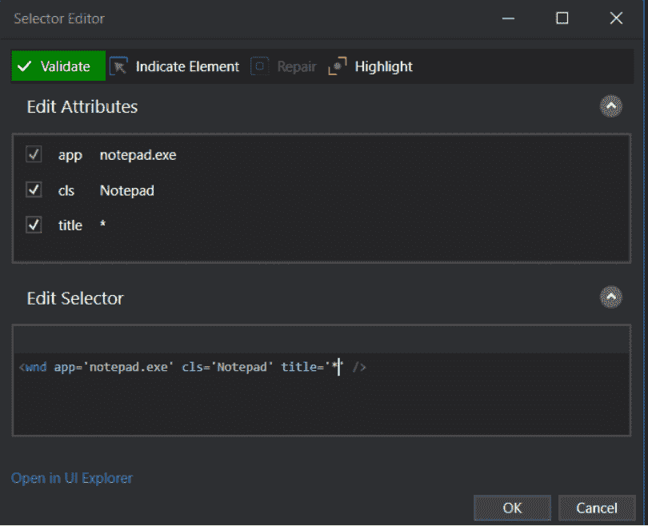

    图 8.6 – 有效选择器

  - II. 带有叉号的红色验证按钮表示目标元素无效且无法执行：

    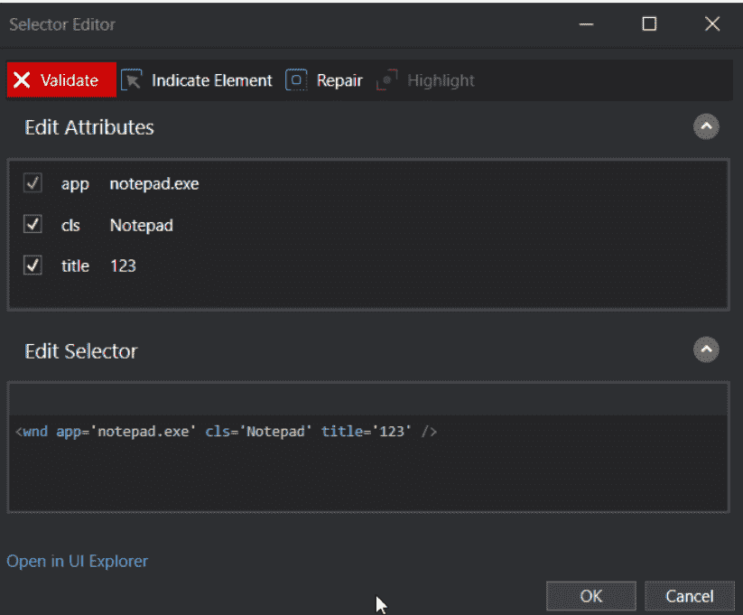

    图 8.7 – 无效选择器

  - III. 带有问号的黄色验证按钮表示与目标元素对应的选择器已被修改，需要重新验证以纠正其状态：

    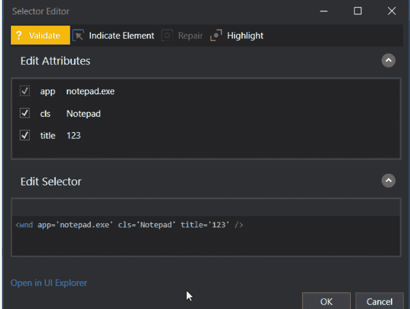

    图 8.8 – 重新验证选择器

- 2. **指示元素**

  此功能用于选择新的 UI 目标或 *覆盖* 屏幕上先前选定的目标。

- 3. **修复**

  当选择器 *无效* 时启用此按钮，用于通过在屏幕上指示相同的目标 UI 元素来 *修复现有选择器*。

- 4. **高亮显示**

  使用此按钮可以 *确保* 修改后的选择器对目标元素仍然 *有效*。单击后，目标元素将在屏幕上高亮显示。

- 5. 编辑属性

  此选项列出目标元素的所有标签名称和属性值。

- 6. 编辑选择器

  此框包含提供目标元素标签名称和属性值的 XML 片段。可以对其进行编辑以帮助微调选择器。

- 7. 在 UI Explorer 中打开

  这是一个单独的工具，可用于细化选择器选项，并且仅针对有效选择器显示。

在本节中，我们了解了选择器编辑器中的各种选项以及如何使用提供的基本选项来操作选择器和属性。有关更高级的编辑选项，我们可以查看 UI Explorer。

### UI Explorer

UI Explorer 用于分析和编辑选择器，特别是在现有选择器不足以用于自动化时。“不足以用于自动化”意味着目标应用程序的选择器属性在每次执行时都会发生变化。UI Explorer 拥有多个选项，可以通过微调选择器属性来克服这些挑战，使其更加可靠。让我们逐一探讨这些选项。单击“在 UI Explorer 中打开”，如图 8.5 所示，打开 UI Explorer，如下所示：

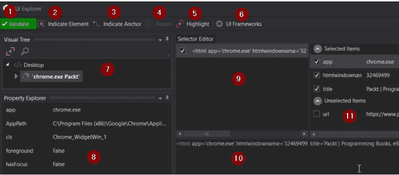

图 8.9 – UI Explorer


让我们更详细地查看可用选项：

- 1. **验证**

  如果要*验证*Selector的有效性，请单击此按钮。单击此按钮前，目标元素必须出现在屏幕上。

- 2. **指示元素**

  单击此选项以*选择*目标元素，并生成包含所有必要属性的选择器。

- 3. **指示锚点**

  此选项用于通过使用目标元素周围的相对元素来*识别*目标元素。

- 4. **修复**

  当选择器无效时，此按钮可用，用于通过在屏幕上指示同一目标UI元素来*修复*现有选择器。

- 5. **高亮显示**

  此选项用于*高亮显示*屏幕上当前选择器的目标，以确保其正常工作。

- 6. **UI 框架**

  **框架设置**选项会根据所使用的应用程序而*更改*。框架有三种类型：

  - **默认**

    这指定了**默认设置**，通常适用于所有类型的用户界面。

  - **主动辅助功能**

    此选项用于**旧版应用程序**（如大型机），或者在默认选项未按预期工作时使用。

  - **UI 自动化**

    这适用于**任何新应用程序**，或者在其他两种类型未按预期工作时使用。

## 7. 可视化树

本节为您提供以**文件夹和子文件夹**树状结构*探索*目标用户界面元素的选项。为了使分析更有效，提供了**高亮显示**选项，以便您可以从树中查看UI元素。

## 8. 属性资源管理器

本节提供*探索*目标应用程序可用属性的选项。

## 9. 编辑选择器

本节包含带有目标元素的**标签名称**和**属性值**的**XML片段**。可以对这些内容进行*编辑*，以微调选择器。

## 10. 编辑属性

本节用于*编辑***节点**中所选项目的属性。

## 11. 选择/取消选择属性

本节*显示*选择器的已选和未选属性列表。这为我们提供了通过选择和取消选择属性来分析选择器的选项。

在本节中，我们探讨了**UI资源管理器**中可用的不同选项，以增强选择器，使其能够处理动态目标元素。在下一节中，我们将比较不同的选择器类型以及如何在不同场景中应用它们。

## 选择器类型

选择器类型取决于UiPath工作流中使用的记录器或活动类型。共有两种类型：

- 部分选择器
- 完整选择器

让我们更详细地了解它们。

## 部分选择器

使用桌面记录器时生成部分选择器。它不包含有关顶级窗口的信息。部分选择器包含在容器中。当我们在同一应用程序屏幕上并与多个元素交互时，使用部分选择器是一个不错的选择。使用部分选择器时，顶部元素（显示为灰色）从父级继承。让我们看一个在记事本应用程序中使用“附加窗口”活动的示例，其中“单击”活动的选择器如下所示，第一行不可编辑：

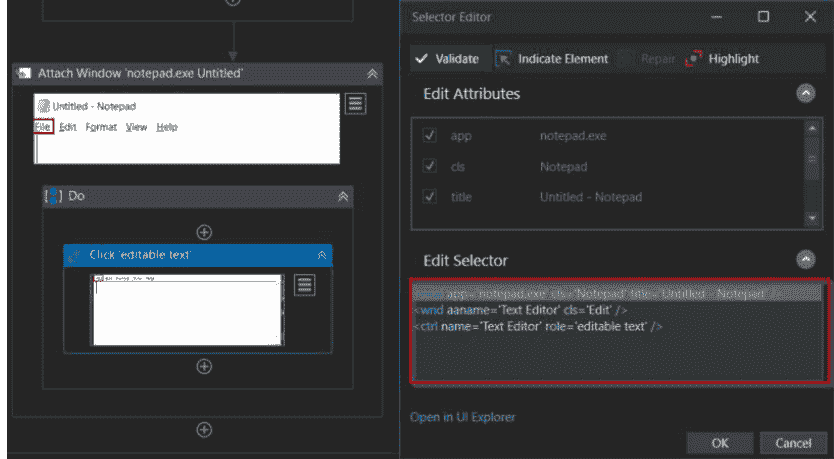

### 图 8.10 – 部分选择器

如果要编辑顶级窗口的属性，可能需要采用称为完整选择器的不同录制方法，我们将在下一节中介绍。

## 完整选择器

使用基本记录器时生成完整选择器。完整选择器包含所有必要节点，包括顶级窗口。它包含应用程序节点和最终节点，用于识别UI元素。

当在多个窗口或活动之间切换时，应使用完整选择器。例如，当在多个应用程序（如记事本、Word或Excel）之间切换数据时，应使用完整选择器：

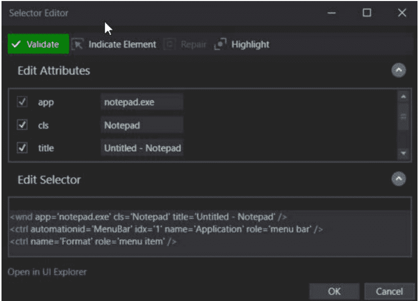

### 图 8.11 – 完整选择器

下表显示了部分选择器和完整选择器之间的区别：

| 部分选择器 | 完整选择器 |
| :--- | :--- |
| 由桌面记录器生成。 | 由基本记录器生成。 |
| 不包含顶级元素。 | 包含顶级元素。 |
| 用于在多个窗口之间切换。 | 用于在同一窗口内停留。 |
| 包含在容器中。 | 不需要容器。 |
| 所有属性都可编辑。 | 仅与部分选择器相关的元素可编辑。 |

### 图 8.12 – 部分选择器和完整选择器的比较

在本节中，我们了解了部分选择器和完整选择器之间的区别。在下一节中，我们将了解动态选择器，并通过真实示例了解如何实现它们。

## 动态选择器

在开始讨论动态选择器之前，让我们先看看静态选择器。**静态选择器**用于指示用户界面中属性不会更改或元素足够稳定的元素。因此，我们不需要更改**选择器编辑器**窗口中的属性，例如选择器的标签和属性。**动态选择器**用于轻松识别目标元素，该元素在运行时更频繁地更改其选择器属性。动态选择器使用**变量**或**参数**创建，而不是选择器标签中的静态属性。而不是硬编码目标元素的值，属性值可以使用变量或参数表示，以动态处理目标。动态选择器的语法如下：

```
<tag attribute = '{{Value}}' />
```

### 图 8.13 – 动态选择器语法

动态选择器可以在**编辑选择器**窗口中进行**分析**和**修改**。此窗口显示所有基本选项，例如**编辑属性**和**编辑选择器**，以便您可以动态修改选择器。但是，对于更高级的选项，例如**可视化树**、**属性资源管理器**和**所选项目**，您可以使用**UI资源管理器**轻松识别动态属性。

下表显示了静态选择器和动态选择器之间的区别：

| 静态选择器 | 动态选择器 |
|---|---|
| 用于通过具有标准属性的高度稳定元素来识别元素。<br>您可以在编辑选择器窗口中硬编码属性值。<br>使用标签和属性来识别目标元素。<br>指示目标元素以进行任何所需更改。 | 用于通过频繁更改属性的不稳定元素来识别元素。<br>您可以在编辑选择器窗口中使用变量或参数将属性值参数化。<br>使用标签、属性、变量和参数来识别目标元素。<br>指示目标元素并对变量或参数的值进行必要更改。 |

### 图 8.14 – 静态选择器和动态选择器的比较

现在，让我们来看看PacktPub网站上关于使用单个选择器动态读取三本书名称的真实示例。为了更好地理解此示例，我们将使用UI资源管理器分析网页、选择器及其属性。

## 动态场景

下面是使用动态值的典型示例。图书名称在一段时间内不断变化，UiPath机器人应动态读取图书名称。在此示例中，我们将让机器人读取前三本书的名称。让我们开始：

- 1. 通过访问 https://www.packtpub.com/ 启动PacktPub网站，如以下截图所示：


### 图 8.15 – PacktPub网站

- 2. 单击“浏览全部”(1)，然后单击“所有图书”(2)，如以下截图所示：


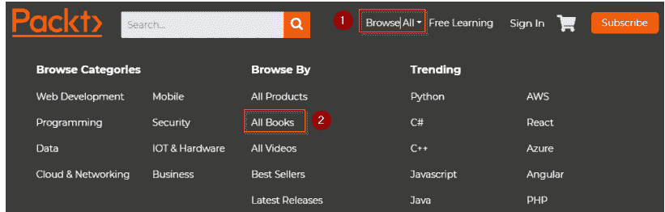

图 8.16 – 所有图书

- 3. 验证 **Books** 页面已显示，如以下屏幕截图所示：

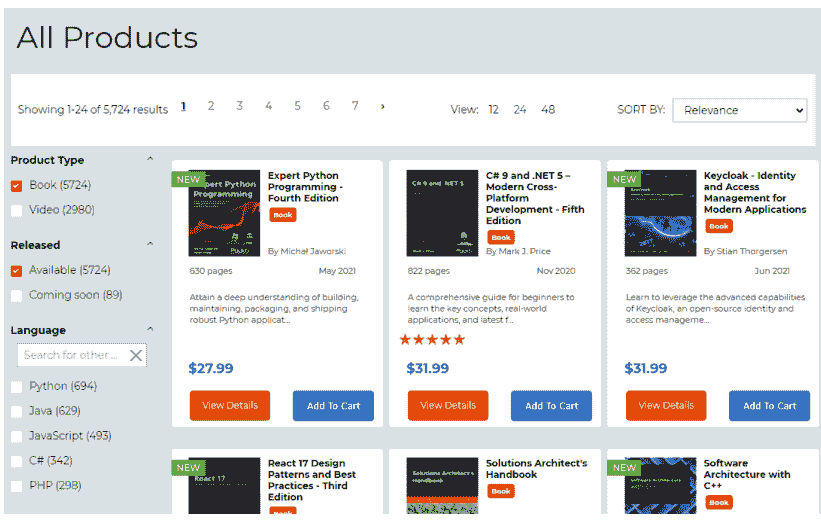

图 8.17 – Books 页面

- 4. 启动 UiPath Studio 并创建一个进程。将其命名为 DynamicSelectors_Packt 并单击 Create，如以下屏幕截图所示：

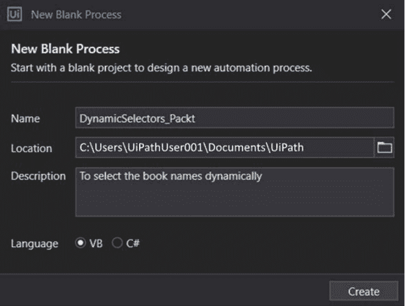

图 8.18 – 新建空白进程

- 5. 使用 Click 活动，检查第一本、第二本和第三本书的选择器。观察其相似之处和差异，如以下屏幕截图所示：

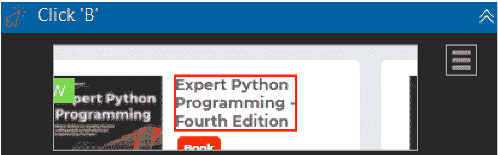

图 8.19 – Click 活动

- 6. 通过单击相应按钮打开 **Edit Selector**：

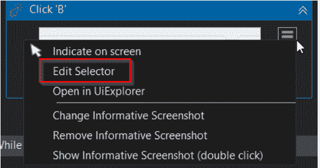

图 8.20 – 编辑选择器

- 7. 观察 **Edit Attributes** 和 **Edit Selector** 选项。在此，您可以修改选择器，以便它们动态识别目标：

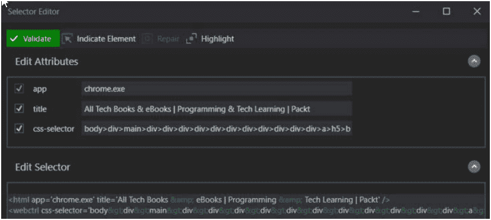

图 8.21 – 选择器编辑器

- 8. 打开 **UI Explorer**，观察第一本、第二本和第三本书之间的相似之处和差异。根据分析，您会发现，当选择 **css-selector**（2）并取消选择 **aaname**（1）（即书名）时，**idx** 值会不断变化：

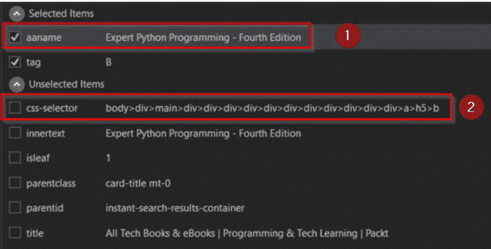

图 8.22 – 编辑选择器

- 9. 现在，通过单击 UI Explorer 中的 **Save** 按钮来完成动态选择器。将显示以下选择器值：

```
<webctrl tag='B' css-selector='body&gt;div&gt;main&gt;div&gt;div&gt;div&gt;div&gt;div&gt;div&gt;div&gt;div&gt;a&gt;h5&gt;b' idx='1' />
```

图 8.23 – 选择器值

如果需要更改高亮显示的 idx='1' 值以便选择下一本书，则需要对该值进行 **参数化**。

- 10. 使用以下选择器选项参数化 .idx 值。选择 .idx 值，右键单击并选择 **Create variable**，如以下屏幕截图所示：

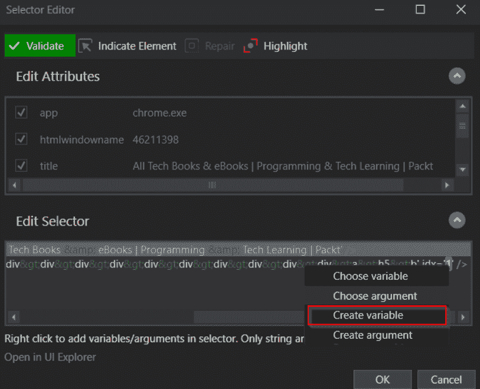

图 8.24 – 选择器值

- 11. 将 Set Name 值设置为 idx（1），将 Set Value 值设置为 1（2）。然后，单击 OK（3）：

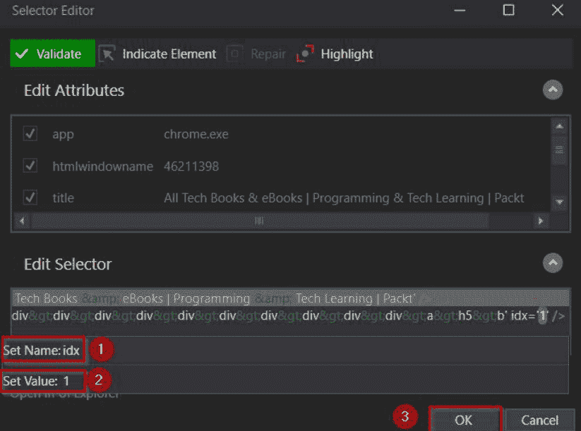

图 8.25 – 参数化值

- 12. 选择器将类似于以下内容，并准备好动态选择值。但是，我们必须相应地更改值：

```
<html app='chrome.exe' title='All Tech Books & eBooks | Programming & Tech Learning | Packt' />
<webctrl css-selector='body&gt;div&gt;main&gt;div&gt;div&gt;div&gt;
div&gt;div&gt;div&gt;div&gt;div&gt;div&gt;div&gt;div&gt;div&gt;
a&gt;h5&gt;b idx='{{idx}}' />
```

图 8.26 – 参数化选择器

- 13. 在 UiPath Studio 序列中，使用 Attach Browser 活动指定 PacktPub 网站，如以下屏幕截图所示：

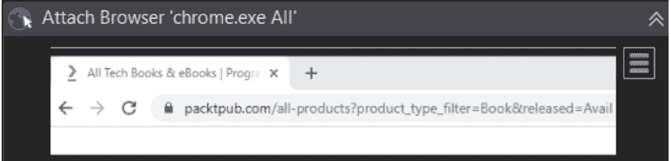

图 8.27 – Attach Browser 活动

- 14. 创建一个 While Loop 活动，使用 idx<=3 条件（1）遍历所有三本书，将步骤 8 中创建的选择器复制到 Get Text 活动（2）。然后，使用 WriteLine 活动写入获得的结果，并递增（3）该值以读取下一本书的名称，如以下屏幕截图所示：

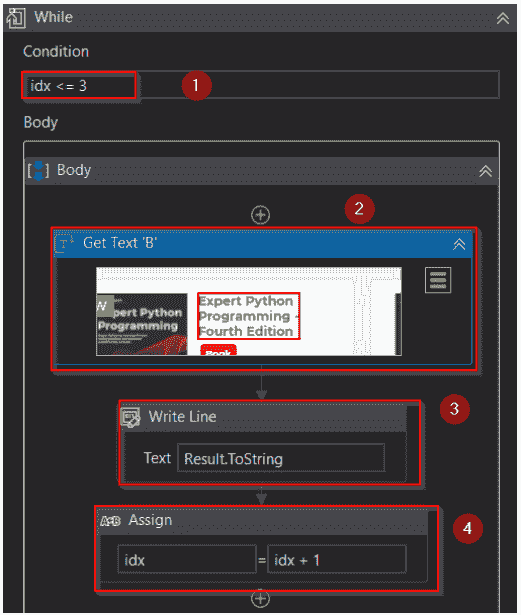

图 8.28 – 提取书名

- 15. 使用 **Debug File** 下的 **Run** 选项运行机器人，或按 *Ctrl + F5*，如以下屏幕截图所示：

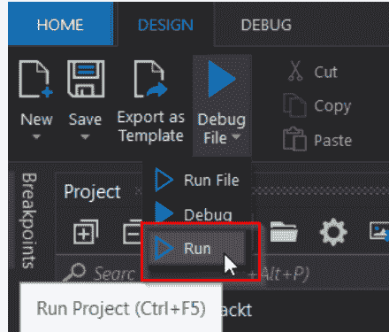

图 8.29 – 运行项目

- 16. 观察 **Output** 部分中生成的输出，如以下屏幕截图所示：

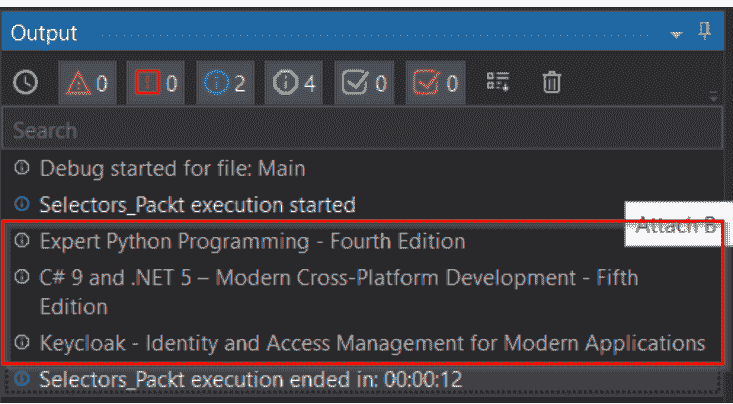

图 8.30 – 验证结果

至此，我们已使用 PacktPub 网站的实际示例成功实现了动态选择器，以动态检索书名。您可以将相同概念应用于不同场景，从而处理动态目标元素。

## 摘要

在本章中，我们介绍了选择器，包括如何使用标记、属性和选择器属性。接着，我们探讨了静态、动态、部分和完整选择器之间的差异。随后，我们学习了 UI Explorer 以及如何在挑战性情况下使用选择器属性。最后，我们介绍了使用动态选择器的实际示例，以实践本章所学概念。

在下一章中，您将使用 Excel 和数据表来操作数据。在此，您将使用选择器从与 Excel 和数据表通信的应用程序中检索数据。
