## 了解数据表用途并探索 Excel 自动化

在上一章中，我们讨论了不同类型的变量和参数。然而，还有一种非常特殊的变量类型，我们称之为 **数据表**。我们使用数据表变量来处理以表格形式组织的更多结构化数据。我们几乎每天都会使用 Microsoft Excel 来执行组织中的不同功能。例如，财务部门可能会定期使用 Excel 生成报告、执行计算和对账财务数据。因此，许多公司和/或部门已经开始自动化在 Excel 中手动执行的操作。

本章重点介绍如何使用 UiPath 自动化 Excel，以及数据表变量如何用于支持 Excel 自动化。

本章包含以下各节：

- 探索数据表
- 创建和自定义数据表变量
- 与 Excel 文件交互
- 实践 Excel 自动化

本章结束时，您将了解使用不同的 Excel 交互方法在 Excel 中执行数据操作的最常用方法。

## 技术要求

在开始本章之前，请确保已安装 UiPath Studio 和助手。本章要求您熟悉使用 Studio 创建变量和简单工作流。此外，您的计算机上必须安装 Microsoft Office 套件。

## 探索数据表

我们都曾在某个时候使用过 Microsoft Excel。在每个 Excel 文件中，我们都会看到以下概念：

- *工作簿*：指 Excel 文件本身。从现在起，在我们的课程中，我们将使用此词来指代 Excel 文件。
- *工作表*：每个工作簿可以包含多个包含数据的工作表。
- *行*：每个工作表由数据行组成。
- *列*：每个数据行包含多个列，这些列包含不同的数据值，指的是每个列所持有的数据类型。
- *单元格*：Excel 表中的单元格包含单个值或公式。每行包含多个单元格。

同样，数据表是一种变量类型，可以以与 Excel 表相同的结构格式存储数据。

您可能会想知道数据表和工作表之间的区别。数据表是单个数据库表的内存表示，可以包含多行，每行由多个不同数据类型的列组成。或者，工作表具有相同的结构，但可以使用表格和图形直观地表示其数据。

## 创建和自定义数据表

本章这一节将介绍如何创建和自定义数据表。

### 创建数据表

如果您已学习第 5 章“了解变量和参数”，那么您现在已熟悉在 UiPath Studio 中创建变量和参数。相同的概念适用于数据表变量。唯一的区别是，对于变量/参数的 Data Type 属性，我们必须从下拉菜单中选择 System.Data.DataTable。

除了变量/参数创建之外，您还将遇到帮助创建数据表的特定活动：

- Build Data Table：此活动提供一个向导，您可以使用它通过添加列、更改列属性（自动增量、空值处理、值的最大长度和默认值）以及添加具有静态值的行来以图形方式构建数据表。当您明确期望来自某个操作的数据表输出具有特定结构时，此活动非常有用。
- Read Range：这是一项允许用户从 Excel 工作表读取数据的活动。此活动的输出是一个数据表，其中包含工作表中指定范围的所有列和行。该活动需要通过使用变量/参数创建快捷键创建数据表变量或通过 Variables/Arguments 面板创建它来配置输出属性。
- Read CSV：与 Read Range 类似，但用于从 CSV 文件读取数据。输出属性的配置与 Read Range 的配置相同。
- Data Scraping：这是 UiPath 提供的一种高级功能，用于从网页或文档中提取结构化数据并将其保存在数据表变量中。该主题在第 10 章“探索用户界面和用户/机器人交互”中有更详细的介绍。
- Generate Data Table：用于从非结构化数据生成数据表。用户可以配置该活动以指定如何根据分隔符拆分行和列。


我们可以在创建的数据表中对数据执行多种操作，例如排序、筛选、清洗以及与其他数据表进行连接。UiPath 专门为数据表提供了大量活动，使这些操作功能变得简单易用。其中一些活动如下：

- **清除数据表**：擦除数据表变量中的所有数据。清除操作不会移除数据表的结构。在处理循环或工作流迭代部分中生成的临时数据以准备最终数据集时，此活动非常实用。清除临时数据表中的数据可确保中间变量被清空，并准备好进行下一轮数据处理。

- **添加数据列**：向现有数据表变量添加新列。我们可以为此活动提供不同的输入。输入可以是现有的 **数据列** 变量，也可以提供列名和数据类型以创建空列。此活动的 **属性** 面板包含多个其他可配置属性，例如默认值、自动递增、唯一值检查以及允许空值的选项。

- **移除数据列**：从现有数据表变量中移除一个数据列。我们可以为此活动提供不同的输入。输入可以是现有的数据列变量，也可以提供要移除的列名或列索引。

- **添加数据行**：向现有数据表变量添加新数据行。我们可以为此活动提供不同的输入。输入可以是现有的 **数据行** 变量，也可以将行的列值作为包含每列值的 **数组行** 提供。数组行中的对象数量应与数据表中的列数匹配。

- **移除数据行**：从现有数据表变量中移除现有行。我们可以提供不同的输入，例如 **数据行** 变量或要移除的行的索引。

- **移除重复行**：此活动提供了一种简便机制，用于查找所有重复行并将其从提供的数据表中移除。

- **筛选数据表**：使用户能够根据其要求筛选现有数据表中的数据。筛选可以采用几种不同的方式。它允许用户通过指定需要移除或保留的列来筛选掉不需要的列。或者，您可以编写条件来筛选数据行。

- **排序数据表**：使用指定列按升序或降序对数据表进行排序。

- **数据表的逐行处理**：类似于 **逐项** 活动，此活动专门用于遍历数据表。默认情况下，该活动允许遍历行。如果在遍历时想要访问行中的特定列，可以使用 `CurrentRow ("<Column Name>") .ToString` 或 `CurrentRow(<Column Index>) .ToString` 命令。

- **连接数据表**：在某些场景中，我们需要使用多个数据表变量来生成所需输出。**连接数据表** 活动使用户能够使用两个数据表中共同可用的一个或多个列来连接两个数据表。表连接以多种方式执行，如下表所示。

让我们通过一个简单的示例来探索连接，以便更好地理解。假设您有两个数据表：

- **数据表 1**：包含所有员工的信息。
- **数据表 2**：包含组织中所有可用部门的信息。
- **连接规则**：两个表具有共同列 `Department ID`，用于指定哪个员工被分配到哪个部门。

以下图表描述了连接数据表活动中可用的不同连接规则及其用途：

| 连接类型 | 说明 |
| :--- | :--- |
| **内连接** | 当我们确定只需要匹配指定连接条件的记录时使用。不匹配的记录将从结果数据表中移除。<br><br>简单来说，它基于定义的共同可用列检查匹配记录，仅返回两个数据表中都有匹配的行。<br><br>示例：<br><br>仅返回已分配到部门的员工 |
| **左连接** | 众所周知，连接包含两个数据表。我们为“数据表 1”属性指定的第一个数据表被视为左数据表。您为“数据表 2”属性指定的数据表被视为右数据表。一旦将连接条件选择为左连接，即表示给予左数据表优先级。与内连接不同，左连接会返回左数据表中的所有行。但是，它也会从第二个数据表中返回找到的所有匹配行，以及没有匹配的空行。<br><br>示例：<br><br>返回所有员工及其分配部门的信息。此外，结果还包含未分配部门的员工。 |
| **全连接** | 无论连接条件如何，保留两个数据表中的所有记录。它更像是左连接和右连接的组合。全连接会为不匹配的记录的两侧添加空值。 |

图 9.1 – 连接数据表活动中的连接类型

我们还可以使用以下图表以图形方式了解这些连接的概念。根据说明，内连接查找相似的数据点。如果将两个数据表包含在维恩图中，应得出以下结果：

数据表 1: 员工 数据表 2: 部门


DT1 部门 ID = DT2 部门 ID

图 9.2 – 数据表内连接的维恩图

左连接略有不同。根据说明，左连接提供第一个数据表中的所有内容以及共同部分，如下：

数据表 1: 员工 数据表 2: 部门


DT1 部门 ID = DT2 部门 ID

图 9.3 – 数据表左连接的维恩图

下一个连接类型是全连接，它提供来自两个数据表的结果。在这种情况下，图表如下：

数据表 1: 员工 数据表 2: 部门


DT1 部门 ID = DT2 部门 ID

图 9.4 – 数据表全连接的维恩图

在处理多个数据集以查找相似值时，这是一个非常常见的概念。理解这些连接类型之间的区别非常重要，因为它们在实际项目中被频繁使用。

连接规则使用户能够连接两个数据表以生成所需数据，如上所述。但是，数据表变量支持更多功能，如下所述：

- **查找数据表**：此功能允许用户在指定数据表中查找值，并返回找到该值的行索引。该活动还允许用户将其配置为返回具有给定坐标的单元格中的值。坐标通常是查找结果的行索引以及要从中提取值的单元格的列名。

- **合并数据表**：用于将另一个数据表追加到当前数据表。合并需要处理两个数据表架构（结构）中的更改。该活动提供一个属性，以四种不同的方式处理缺失的架构。

以下图表说明了合并数据表活动中用于处理缺失架构的选项：

| 缺失架构处理选项 | 说明 |
|---|---|
| 添加 | 将缺失的架构添加到目标数据表 |
| 忽略 | 忽略架构更改，并合并两个数据表中已有的列 |
| 错误 | 如果检测到任何架构更改，则抛出错误 |
| 添加带键 | 添加带内置键的新列 |

图 9.5 – 合并过程中的架构更改处理

- **输出数据表**：此功能使用 CSV 格式将数据表变量中的数据转换为单个字符串。


数据表变量常被用于处理结构化数据的操作。
到目前为止，您已经熟悉数据表支持的函数以及 UiPath 中可用于执行这些函数的活动。掌握这些函数和活动的知识在处理几乎所有 RPA 项目时都非常有用。以下部分将提供使用先前讨论过的某些活动的实际经验。

## 创建和自定义数据表变量

既然我们已了解数据表的基础知识，现在来进行练习。以下步骤将指导您如何使用之前讨论过的某些活动。请考虑一个场景：您有一个包含员工信息的数据表和另一个包含部门信息的数据表。

让我们通过完成以下步骤来构建工作流：

- 1. 打开 UiPath Studio 并创建一个新的 **空白流程** 项目。

- 2. 在 **设计器** 面板中打开 **Main.xaml** 文件。

- 3. 从 **活动** 面板中搜索 **构建数据表** 活动，并将其拖动到画布上。

- 4. 单击活动上的 **DataTable...** 按钮以打开 **构建数据表** 屏幕。此屏幕可用于添加列、行以及更改列属性。

- 5. 单击其旁边的 X 标记以删除所有列和行。

- 6. 单击 + 号以添加一个名为 **员工ID** 的新列，其数据类型为 **Int32**，并将 **自动递增** 属性设置为 **True**。将 **允许为空** 属性配置为 **False**，将 **唯一** 属性配置为 **True**，然后单击 **OK** 以创建新列。此配置将使数据表能够为每个新添加的行自动创建一个新的唯一 ID。

以下图示说明了 **构建数据表** 活动中 `EmployeeID` 字段的配置：

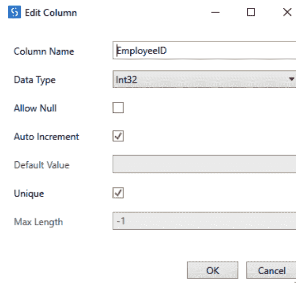

图 9.6 – 在构建数据表活动中创建列

- 7. 创建另一个名为 `FirstName` 的列，其数据类型为 **String**。其余属性无需更改。

- 8. 与 `FirstName` 列类似，创建另外两个名为 `LastName` 和 `City` 的 **String** 数据类型列，以及另一个名为 `DeptID` 的 **Int32** 数据类型列。

- 9. 填充表格行，如图 9.7 所示：

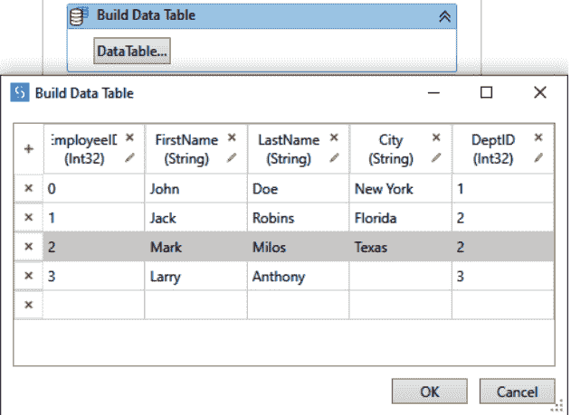

图 9.7 – 构建员工数据表

- 10. 单击 OK 并关闭配置窗口。

- 11. 单击 **属性** 面板，并通过创建新数据表变量并将其分配给活动来配置活动的 **输出数据表** 参数。您可以通过 **属性** 面板使用 **Ctrl + K** 快捷键创建变量。将新数据表命名为 `EmployeeDT`。配置属性后，您的配置应类似于以下图中所示的内容：

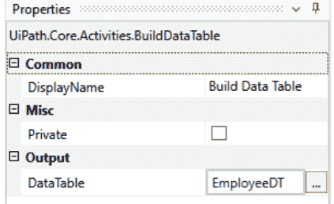

图 9.8 – 配置构建数据表活动的输出属性

- 12. 将另一个 **构建数据表** 活动拖放到上一个活动下方。

- 13. 与之前一样配置该活动以构建以下结构。请注意，此数据表中的 `DepartmentID` 列是 **自动递增** 的。如以下图所示填充和配置数据表：

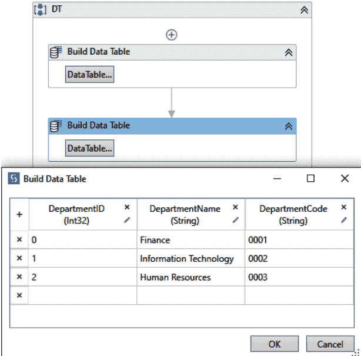

图 9.9 – 构建部门数据表

- 14. 配置活动的 **输出数据表** 属性，并将其分配给名为 `DepartmentDT` 的新数据表变量。到目前为止，我们有两个包含数据的数据表。让我们对数据进行一些操作。

- 15. 让我们从 **DepartmentDT** 数据表中删除一些不需要的列。我们有两个 ID 列。我们将从数据表中删除 **部门代码**。

- 16. 让我们在两个活动下方使用 **删除数据列** 活动：

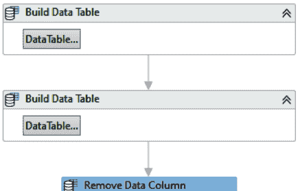

图 9.10 – 添加删除数据列活动

- 17. 通过指定 DepartmentDT 变量来配置删除数据列活动的 **数据表** 属性。该属性指定活动影响哪个数据表。

- 18. 通过指定需要删除的 "DepartmentCode" 列来配置活动的 **列名** 属性：

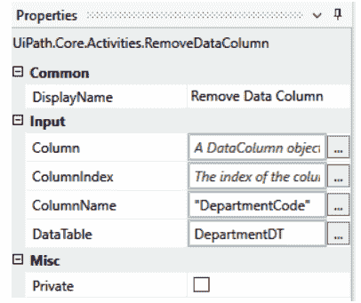

图 9.11 – 配置删除数据列活动

- 19. 现在，让我们向员工表添加一个新行。使用 **添加数据行** 活动，并将其放置在上一个活动下方。

- 20. 通过指定 EmployeeDT 来配置 **添加数据行** 活动的 **数据表** 属性，因为这是我们需要向其添加新行的数据表。

- 21. 使用以下代码配置活动的 **数组行** 属性：

```
{ Nothing, "Amy", "Woods", "New York", Nothing }
```

此处定义的数组需要向所有列传递值。但是，我们无需为 **员工ID** 字段分配值，因为它是一个自动递增字段。在这种情况下，我们将传递由关键字 Nothing 定义的空字段。在同一命令中，我们还将为 **部门ID** 提供空值。

- 22. 在 **添加数据行** 活动下方添加一个 **筛选数据表** 活动。让我们通过删除没有有效 **城市** 的员工来筛选 **EmployeeDT** 数据表：

- 23. 使用相同的 **EmployeeDT** 变量配置 **数据表** 和 **筛选后的数据表** 属性。此配置将使用筛选结果覆盖 **EmployeeDT** 中的数据。

- 24. 单击 **筛选数据表** 活动上的配置筛选器按钮以打开 **筛选向导**。

- 25. 如下图所示配置 **筛选向导**：

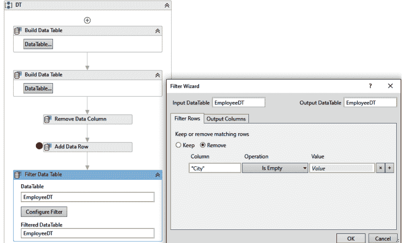

图 9.12 – 筛选数据表

- 26. 在合并两个数据表之前，打印数据表中的值以查看其外观。使用一个 **输出数据表** 活动，并使用 **EmployeeDT** 配置 **数据表** 属性，将输出 **文本** 属性配置为新创建的字符串变量。使用一个 **写入行** 活动，并使用您创建的新字符串变量对其进行配置。

- 27. 运行工作流并检查 EmployeeDT 的输出。您将看到我们对数据表执行的操作的最终结果。请随意在工作流中的任何位置使用输出数据表和写入行的组合，以探索每个操作后的输出。

- 28. 使用合并数据表活动通过通用部门 ID 合并两个数据表。如下图所示配置合并数据表活动。请注意，合并类型选项设置为内部连接：

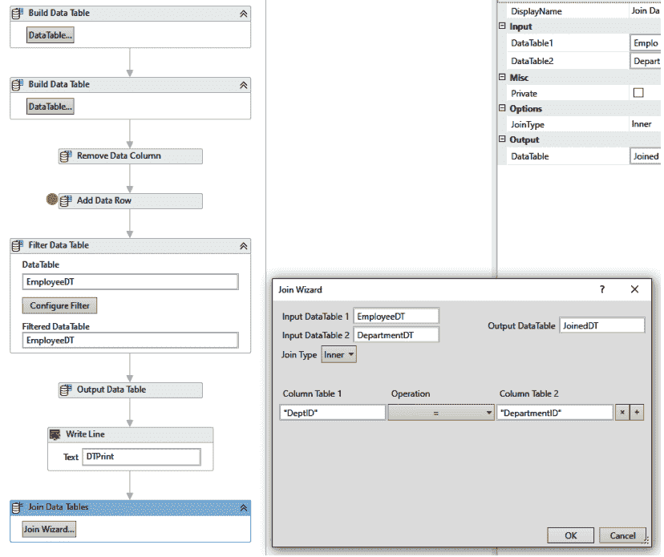

图 9.13 – 配置合并数据表活动

- 29. 使用另一个输出数据表和写入行活动的组合，指向 JoinDT（包含合并结果的数据表），并检查输出。

- 30. 以下是前面工作流（合并类型为内部连接）的输出结果：

| 员工ID | 名 | 姓 | 城市 | 部门ID | 部门ID | 部门名称 |
|--------|----|----|------|--------|--------|----------|
| 0 | John | Doe | 纽约 | 1 | 1 | 信息技术 |
| 1 | Jack | Robins | 佛罗里达 | 2 | 2 | 人力资源 |
| 2 | Mark | Milos | 德克萨斯 | 2 | 2 | 人力资源 |

图 9.14 – 内部连接的数据表输出

- 31. 将合并类型配置为左连接和全连接，并探索输出与之前的输出有何不同。

除涵盖的要点之外，请探索 合并向导 中可用的不同操作类型。我们使用 = 操作进行匹配，因为我们需要精确匹配。但是，有许多可用的操作，可根据场景适用于不同类型的合并。或者，有时，您可能会收到没有适当列名的数据表。在不知道确切列名的场景中，您始终可以使用列索引来引用列。与 集合类型变量 类似，DataTable 也对行和列使用基于零的索引。换句话说，如果您想使用索引访问数据表中的第一行，则始终为零。同一概念也适用于访问列。

假设我们想使用索引而不是列名来配置我们的 合并向导。在这种情况下，我们需要使用以下方法。

第一个数据表（员工）有五个字段，部门 ID 是最后一个字段。考虑到基于零的索引，部门 ID 的索引将为 4。关于部门数据表，您需要使用索引 0，因为部门 ID 字段是第一列。如果要使用识别的索引配置 合并向导，则对 **表 1 列** 字段使用索引 4，对 **表 2 列** 字段使用 **索引 0**。

到目前为止，您应该了解数据表的基本概念以及如何在 UiPath 中将其与我们的活动一起使用。如前所述，UiPath 中有大量活动可用于对数据表执行不同操作。尝试在相同示例中探索其他活动，看看还可以做什么。使用 Excel 文件时，您可以期望获得相同的功能；因此，Excel 文件中的数据易于导出到数据表。下一节将解释如何与 Excel 文件进行交互。围绕 Excel 数据操作构建了许多自动化解决方案。了解可用于与 Excel 文件交互的不同方法至关重要。


## 与 Excel 文件交互

许多业务用户使用 Excel 执行日常活动，例如执行财务计算和维护费用记录。Excel 是任何组织所有部门中最广泛使用的应用程序之一。UiPath 提供了一组出色的活动，可在计算机上安装或未安装 Excel 的情况下，实现与 Excel 文件的无缝集成和交互。Excel 依赖项默认添加到在 Studio 中创建的新解决方案中。但是，如果您特别需要将其添加到解决方案中，可以从依赖项管理器中查找 UiPath.Excel.Activities。

UiPath 提供了两种与 Excel 文件交互的不同方式：

- 文件访问级别：我们称这些为 **工作簿活动**，它们是 Excel 活动的一部分。工作簿活动不需要在计算机上安装 Microsoft Office 软件包。这些活动在后台工作，与实际的 Excel 集成相比速度更快。这些活动仅适用于 .XLSX 文件。

- Excel 应用程序集成：我们称这些为 **Excel 活动**，它们允许我们直接与 Excel 集成。与工作簿活动不同，Excel 活动需要在计算机上安装 Microsoft Office 软件包。使用这些活动将打开 Excel 应用程序，就像人类用户在与其交互之前所做的那样。Excel 活动使用户能够与 CSV、XLS、XLSB 和 XLSM 文件交互。此外，所有 Excel 活动都可以配置为在执行时可见或隐藏。

无论使用哪种方法与 Excel 文件交互（访问级别），两种方法都共享常见操作。但是，尽管操作是常见的，但每种类型都有不同的活动需要执行。例如，您可以在 Excel 活动和工作簿活动下找到可以读取 Excel 文件的活动。这些活动位于 **活动** 面板的两个不同部分中，如 *图 9.12* 所示。

以下屏幕截图显示了 **读取范围** 活动，该活动用于从 Excel 文件中读取数据。如图 9.15 所示，所有 CSV 和 Excel 活动都位于 **应用集成** 类别中，而工作簿活动位于 **系统** -> **文件** -> **工作簿** 类别中。两种类型的主要区别在于，**应用集成** 类别下的活动需要 **Excel 应用程序作用域** 活动来容纳所有其他活动，而其他活动则不需要。以下图显示了分别位于 **工作簿** 和 **Excel** 类别下的两个活动：

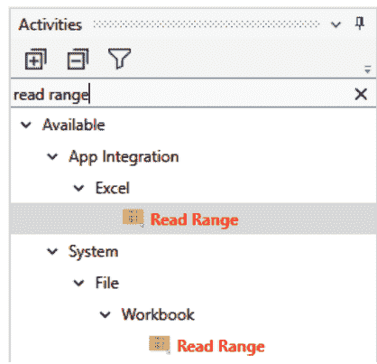

图 9.15 – Excel 和工作簿活动位置

让我们探讨两种方法都可用的常见活动：

- **读取范围**：从 Excel 文件的指定范围读取数据到数据表变量。使用带有 **Excel 应用程序作用域** 的 **读取范围** 活动，使用户能够根据在 Excel 文件中应用的筛选器读取数据。或者，工作簿活动会读取工作表中可用的所有数据，而不考虑筛选器。

- **写入范围**：提供将数据表变量中的数据写入电子表格的功能。写入从用户指示的单元格开始。

- **读取单元格**：将指定单元格的内容读取到字符串变量中。

- **写入单元格**：将变量的内容写入指定工作表中的指定单元格。

- **读取单元格公式**：使用户能够读取指定单元格中的可用公式，并将其存储在字符串变量中。

- **读取列**：使用户能够读取 Excel 文件中指定列的内容。提取的内容存储在 `IEnumerable<object>` 类型变量中。

- 读取行: 类似于 **读取列**，但此活动读取行的内容，从用户提供的单元格标识符开始。该行的提取数据存储在 `IEnumerable<object>` 类型变量中。

- 追加范围: 使将数据表变量中的内容轻松添加到指定电子表格的末尾而不覆盖数据。此外，如果指定的工作表在 Excel 文件中不可用，则该工作表会自动创建。

- 获取表格范围: 特别适用于我们在 Excel 文件中创建的表格。此活动使用户能够在选定的电子表格中定位指定表格并提取表格的范围。此活动的输出可以馈入其他活动，例如 **读取范围** 以从 **获取表格范围** 活动返回的范围中提取数据。

除上述常见活动之外，UiPath 还提供了许多其他活动，用于通过 **Excel 应用程序作用域** 与 Excel 文件交互。

## Excel 应用程序作用域

**Excel 应用程序作用域** 是一个容器，用于容纳所有 Excel 应用程序集成类别活动。**Excel 应用程序作用域** 活动会触发 Excel 文件打开以执行活动范围内指定的操作。您现在对两个类别中常见的可用活动有了大致了解。但是，Excel 应用程序集成除了我们之前讨论的内容之外，还提供了更多功能。我们可以使用应用程序集成方法执行许多其他功能。这些操作可以根据 Excel 函数的不同方面进行分类。

## CSV 活动

Excel 应用程序集成提供了使用数据表变量轻松与 CSV 文件交互的功能。虽然 CSV 活动位于 Excel 应用程序集成类别下，但 CSV 与 Excel 应用程序集成活动的主要区别在于，它们可以在没有 **Excel 应用程序作用域** 的情况下仍然工作。UiPath 提供了三个独特的活动来与 CSV 文件交互：

- 读取 CSV: 读取 CSV 文件中的所有记录，并将其存储在数据表变量中。

- 写入 CSV: 将数据表变量的内容写入 CSV 文件。如果文件不可用，该活动还能够创建 CSV 文件。

- 追加到 CSV: 类似于 **追加范围**，**追加到 CSV** 活动会将数据表变量的内容添加到现有 CSV 文件的末尾而不覆盖数据。但是，如果文件不存在，该活动也可以创建文件。

## 范围活动

属于此子类别的活动可以轻松与 Excel 中的指定范围交互。这些活动类似于我们在学习数据表活动时遇到的活动。但是，这些活动直接在 Excel 文件本身中执行相同的功能：

- 选择范围: 使用户能够在 Excel 文件中选择特定范围。此操作类似于用户在 Excel 电子表格中突出显示特定范围所执行的功能。

- 删除范围: 使用户能够删除 Excel 电子表格中的特定范围。

- 获取所选范围: 将给定范围作为字符串返回，可用于处理范围的其他活动。

- 插入列: 类似于添加数据列，此活动直接在 Excel 文件本身中的特定位置添加新表格列。

- 删除列: 从电子表格中删除指定的 Excel 表格列。删除基于列名进行。

- 插入/删除列: 此活动可以向电子表格添加空白列或删除现有列。

- 插入/删除行: 此活动可以根据用户选择的操作类型添加空白行或删除现有行。

- 自动填充范围: 类似于 Excel 中的自动填充，此活动将给定公式应用于电子表格中的指定范围。

- 复制粘贴范围: 使用户能够将整个范围从一个电子表格复制并粘贴到另一个电子表格。复制的内容可以包括值、格式和公式。

- 查找范围: 类似于数据表和 Excel 中的查找函数，查找范围活动可以在给定范围的所有单元格中搜索值。

- 删除重复范围: 删除指定范围中的所有重复行。

## Excel 表格活动

表格活动与您在 Excel 电子表格中创建的表格进行交互。这些活动允许您执行与排序、筛选和创建表格相关的基本功能。以下活动可用于在表格上完成先前提到的功能：

- **创建表格**：在指定范围中创建指定表格。


- **筛选表格**：根据提供的条件筛选 Excel 电子表格中的表格。**筛选表格** 活动可与 **读取范围** 活动配合使用，当您想要读取筛选后的结果时。筛选操作与 Excel 中的筛选功能相同。应用筛选后，不符合条件的行将在电子表格中隐藏。

- **排序表格**：根据给定列的值以升序或降序排序指定表格。

## Excel 文件活动

文件活动主要与文件本身相关：

- **保存工作簿**：保存指定的工作簿。**Excel 应用程序范围** 活动在退出前会自动保存文件，前提是 **属性** 面板中启用了 **保存更改** 选项。不过，此活动也可用于保存文件。

- **关闭工作簿**：使用户能够关闭特定的 Excel 电子表格。

## 单元格颜色活动

准备 Excel 文件时通常需要添加一些颜色来突出显示特定值。单元格颜色子类别下的活动使用户能够执行以下着色操作：

- **获取单元格颜色**：返回 Excel 文件中特定单元格的背景颜色，并将其存储在 `Color` 变量中。

- **设置范围颜色**：使用户能够将指定单元格范围的背景更改为用户指定的颜色。输入为 `Color` 变量类型。

## 工作表活动

工作表活动提供执行与 Excel 工作表相关的不同操作的功能，例如复制和检索工作表信息。以下活动使您能够处理 Excel 工作表：

- **复制工作表**：使用户能够在同一 Excel 文件或不同文件中创建工作表的副本。

- **获取工作簿工作表**：按索引检索工作表名称。

- **获取工作簿工作表**：检索工作簿文件中所有可用工作表，并将其作为 `String` 数组返回。

## 数据透视表活动

处理财务信息时通常需要对数据进行透视并将其转换为更具图形化和摘要的格式，以便获得更好的洞察。通常，创建透视表后，需要刷新它。UiPath 提供了两个活动来创建和刷新数据透视表：

- **创建数据透视表**：使用指定参数创建数据透视表。Excel 中的数据必须首先转换为表格，才能使用此活动的 `Pivot` 功能。

- **刷新数据透视表**：使用户能够刷新数据透视表，以根据源更新其内容。

## 宏活动

Microsoft Excel 能够使用宏和 VB 脚本来自动执行简单的应用程序特定操作。UiPath 可以与现有宏进行交互，甚至可以使用 VBA 脚本创建宏：

- **执行宏**：执行 `.xlsm` 文件中可用的宏

- **调用 VBA**：使用 VBA 脚本调用另一文件中可用的宏

根据我们所讲的内容，您现在已经熟悉 UiPath 可以在 Excel 文件上执行的活动。其中少数活动的功能与数据表活动类似。不过，其余活动主要侧重于 Microsoft Excel 提供的功能。下一部分将重点介绍一些 Excel 活动的实际操作练习。实践环节不会涵盖我们描述的所有活动。不过，实践环节将帮助您更好地了解在需要时如何使用所讨论的活动。

## 实践 Excel 自动化

在本节中，您将通过与 Excel 文件中的一些数据进行交互来实践所学概念。该 Excel 文件包含员工信息，如 `employee ID`、`first name`、`last name`、`hourly rate` 和 `work hours`。我们的任务是遍历数据并在 Excel 文件中添加两个新列。

一列应包含全名（合并名和姓），另一列应包含员工的总支付金额（时薪 × 工时）。报告生成后，机器人还应筛选数据，找出收入超过 2,000 美元的员工，并为这些数据创建一个单独的 Excel 文件。

执行以下步骤以完成此任务：

- 1. 打开 UiPath Studio 并创建新项目。

- 2. 打开 Microsoft Excel 并创建如图 9.16 所示的数据：

| ID | 名 | 姓 | 年龄 | 时薪 ($) | 工时 |
|---|---|---|---|---|---|
| E0001 | Dany | Joe | 25 | 5 | 20 |
| E0002 | John | Smith | 36 | 25 | 100 |
| E0003 | John | Doe | 27 | 15 | 120 |
| E0004 | Mary | Ann | 30 | 15 | 50 |
| E0005 | Emmy | Elissa | 21 | 10 | 200 |

图 9.16 – Excel 集成示例数据

- 3. 将 Excel 文件保存在可用作我们进程输入的文件夹中。

- 4. 在 UiPath Studio 中打开 Main.xaml 文件。

- 5. 拖放 Excel 应用程序范围活动，并通过提供您创建的 Excel 文件的文件路径来配置“工作簿路径”属性。

Excel 应用程序范围活动中包含一个 DO 序列。这就是您放置所有需要在 Excel 文件上执行的活动的位置。从“活动”面板的 Excel 应用集成部分拖动“读取范围”活动，将其放置在 DO 序列中。以下图示说明了如何通过将“读取范围”活动放在其中来使用 Excel 活动范围读取数据：

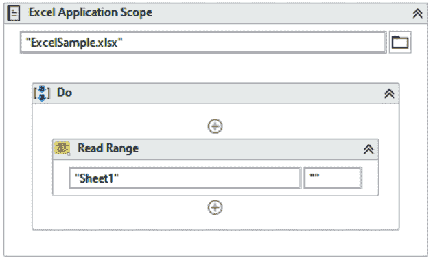

图 9.17 – 从 Excel 读取数据

- 6. 配置 **读取范围** 活动的 **SheetName** 属性，提供您在 Excel 文件中看到的工作表名称。默认情况下，两者均具有 "Sheet1" 值，匹配成功。

- 7. 配置该活动的 **Range** 属性，指定开始读取数据的位置。我们的数据从 **A1** 单元格开始，您需要将其设置为 "A1"。

- 8. 配置该活动的 **Output DataTable** 属性，创建并指定一个新数据表变量，用于保存其从文件中读取的数据：

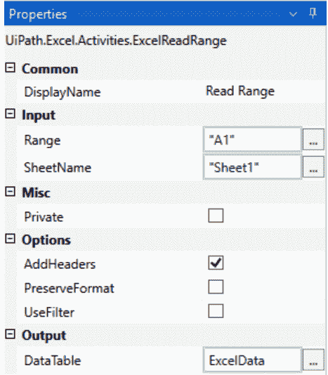

图 9.18 – Excel 读取范围活动的配置

- 9. 在 Excel 中指定我们的两个新列。从 **Excel 应用集成** 部分拖动 **写入单元格** 活动，并将其放置在 **读取范围** 活动下方。

- 10. 配置 **写入单元格** 活动，将 **Range** 属性指定为 "G1"，并将 **Value** 属性指定为单元格值（列名）"Full Name"。

- 11. 添加另一个 **写入单元格** 活动，并将 Range 属性配置为 "H1"，将 Value 属性指定为新列名 "Total Payment"，如以下屏幕截图所示：

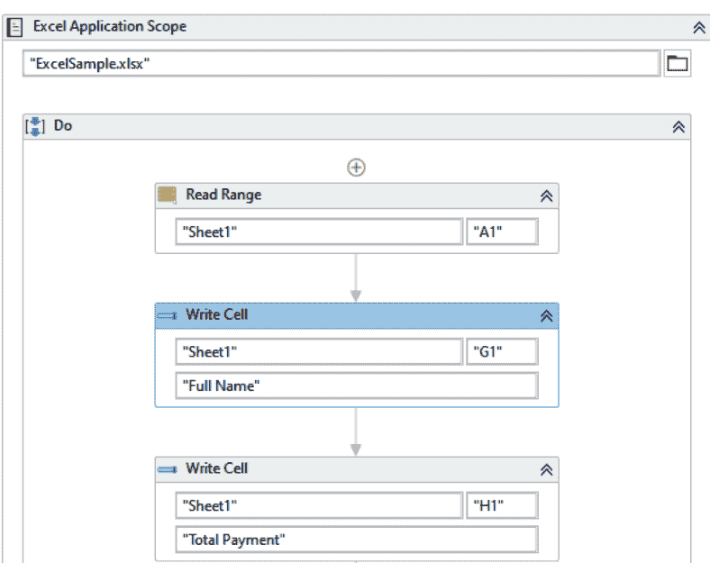

图 9.19 – 添加写入单元格活动

- 12. 现在，遍历数据表中的数据并执行操作。在最后一个 **写入单元格** 活动下方添加 **For Each Row** 活动。

- 13. 配置 **For Each Row** 活动，指定先前为 **读取范围** 创建的数据表变量名。

- 14. 配置该活动的 **输出索引** 属性，创建并指定名为 `CurrentRowIndex` 的新 **Int32** 变量。该属性为正在处理的每一行生成基于零的索引。此活动生成的值在以后更新 Excel 文件中的行时将有所帮助。以下图示显示了 **For Each Row** 活动属性的配置，以获取行索引：

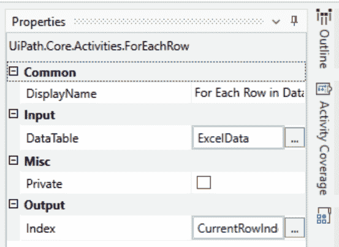

图 9.20 - 在 For Each 循环中生成当前迭代值

- 15. 搜索 **获取行项** 活动，并将其放置在 **For Each Row** 活动的主体中。此活动使用户能够从当前行的指定列获取数据。

- 16. 配置该活动的 **Row** 属性，指定 **For Each Row** 活动的 `CurrentRow` 变量。

- 17. 配置该活动的 **列名** 属性，指定 Excel 文件中的 "`First Name`" 列。列名必须与您在 Excel 文件中看到的完全一致。

- 18. 配置该活动的输出 **Value** 属性，创建并指定名为 `FirstName` 的新字符串变量，如以下图示所示：


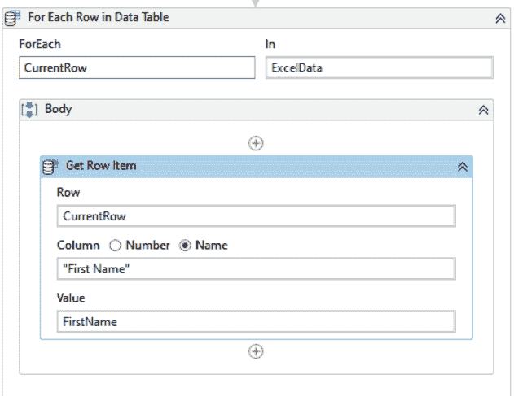

### 图 9.21 – 从当前行提取数据

- 19. 放置三个额外的 **获取行项目** 活动，并为每个需要提取的列配置它们。列为 **姓氏**、**每小时费率** 和 **工作小时数**。像处理第一个一样为每个列创建单独的变量来保存数据。确保为 **每小时费率** 和 **工作小时数** 创建的变量为 `System.Double` 类型：

| 名称 | 变量类型 | 作用域 |
|---|---|---|
| FirstName | String | 主体 |
| LastName | String | 主体 |
| HourlyRate | Double | 主体 |
| WorkHours | Double | 主体 |
| ExcelData | DataTable | 执行 |
| CurrentRowIndex | Int32 | 执行 |
| ProcessedData | DataTable | Excel自动化 |
| 创建变量 | | |

### 图 9.22 – 定义流程的变量

完成该步骤后，工作流应类似于以下截图：

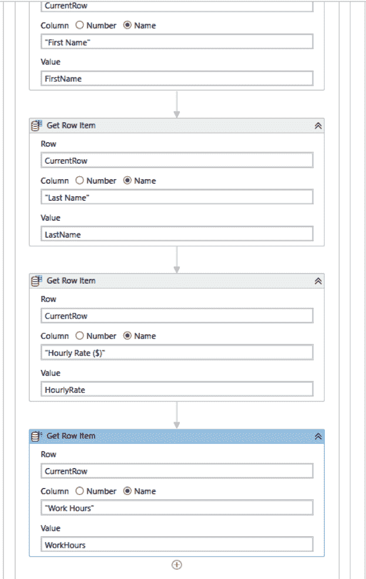

### 图 9.23 – 提取数据以执行操作

现在，开始使用提取的数据更新 Excel 文件。

- 20. 在最后一个 **获取行项目** 活动下方放置一个 **写入单元格** 活动，使用当前行的数据更新 **全名** 列。

- 21. 由于您正在更新 **全名** 列的每个行，因此 **范围** 属性不能使用硬编码值，因为行号是动态的。因此，您需要使用 **对每个行** 活动的 **当前行索引** 变量来查找 Excel 文件中的行号。

- 22. 请记住，该变量生成从零开始的索引，而在 Excel 中，行号从 1 开始。现在，再次查看 Excel 文件。Excel 中的第一行包含标题。实际数据从第 2 行开始。因此，您需要将从零开始的索引与 Excel 中从 2 开始的行号匹配。在 **写入单元格** 活动的 **范围** 属性中使用以下表达式。

请注意，您需要将动态生成的行号转换为 String 类型，因为该字段仅接受字符串值：

```
"G" + (CurrentRowIndex + 2).ToString
```

- 23. 使用以下表达式配置活动的 **值** 属性，以合并名和姓：

```
FirstName + " " + LastName
```

- 24. 在前一个活动下方放置另一个 **写入单元格** 活动，以更新下一列 "**总付款**" 的行。

- 25. 使用以下公式配置活动的 **范围** 属性。它与之前的公式几乎相同。唯一的区别是 Excel 中的列：

```
"H" + (CurrentRowIndex + 2).ToString
```

- 26. 通过指定以下表达式配置活动的 **值** 属性：

```
(HourlyRate * WorkHours).ToString
```

- 27. 在 **对每个行** 活动下方放置一个 **保存工作簿** 活动，以在关闭文件前保存更改。

- 28. 运行流程并查看 Excel 文件中的输出。流程完成后，您应在 Excel 文件中看到以下输出：

| ID | 名 | 姓 | 年龄 | 每小时费率 ($) | 工作小时数 | 全名 | 总付款 |
|---|---|---|---|---|---|---|---|
| E0001 | Dany | Joe | 25 | 5 | 20 | Dany Joe | 100 |
| E0002 | John | Smith | 36 | 25 | 100 | John Smith | 2500 |
| E0003 | John | Doe | 27 | 15 | 120 | John Doe | 1800 |
| E0004 | Mary | Ann | 30 | 15 | 50 | Mary Ann | 750 |
| E0005 | Emmy | Elissa | 21 | 10 | 200 | Emmy Elissa | 2000 |

### 图 9.24 – 探索工作流的输出

在第二部分，您需要从 Excel 读取数据并筛选结果，仅显示总付款大于或等于 2,000 的员工。

- 29. 在 Excel 应用程序作用域下方放置另一个 **读取范围** 活动。这次，使用 File/Workbook 类别下的 **读取范围** 活动。该活动不要求 Excel 文件打开。

- 30. 通过提供工作簿路径，将 **范围** 属性设置为 ""，并将 DataTable 输出到名为 ProcessedData 的新数据表变量，来配置该活动。

- 31. 使用 **筛选数据表** 活动，并按图 9.25 所示进行配置：

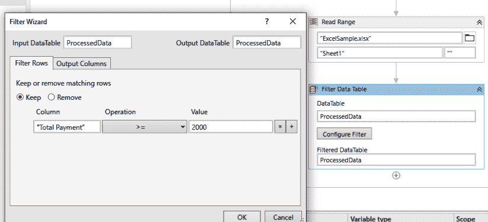

### 图 9.25 – 使用 "总付款" 筛选记录

- 32. 从 **File/Workbook** 类别添加一个 **写入范围** 活动，并将其放置在 **筛选数据表** 活动下方。

- 33. 按图 9.26 所示配置该活动：

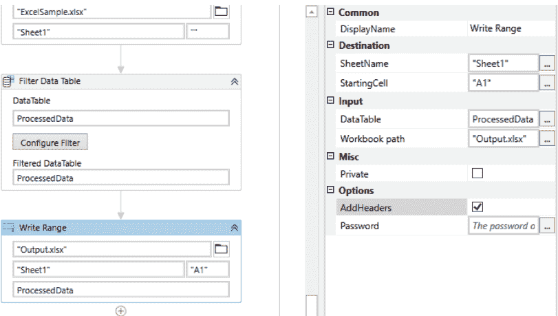

### 图 9.26 – 将处理后的数据写入新 Excel 文件

- 34. 运行工作流并查看新创建的 Excel 文件中的输出。您应只看到两条记录。

您现在已了解可以对数据表和 Excel 文件执行的基本操作。还有许多其他函数可供您探索和尝试。建议使用您构建的相同解决方案来练习不同的函数。探索并了解这些活动的工作原理，在处理包含多个文件且含有复杂数据结构（例如透视表）的大型项目时将会有所帮助。

## 摘要

本章向您介绍了数据表和 Excel 文件。数据表变量类型是一种广泛使用的数据类型，用于保存结构化和表格数据。由于数据表与 Excel 文件共享相同的数据结构，因此它们可以轻松与 Excel 文件交互。在进行实操练习时，您已经体验到，数据表及其相关概念在与 Excel 文件交互时是密不可分的。本章学习的概念和活动在处理大型 Excel 相关自动化项目时将非常有用。

此外，关于使用 Excel 文件和数据表所讨论的概念在后续章节中将非常有用，尤其是在用例章节中。下一章描述了 UiPath 机器人如何与用户界面交互以执行单击、输入和数据抓取等不同操作。学习如何执行用户界面交互对于任何 RPA 项目都非常重要。UI 自动化是一个复杂但重要的主题，它使用户能够编程机器人像人类一样与软件应用程序交互。
