## 10 探索用户界面和用户/机器人交互

**用户界面**（**UI**）自动化是当今自动化世界中最重要的自动化主题之一，也是使用最频繁的主题。UI 元素是 UI 的构建块（例如，窗口、文本字段、按钮、下拉菜单、复选框和文本框）。您的机器人应能够轻松与 UI 元素通信，以执行单击、输入和读取输出值等操作，从而实现完美的自动化解决方案。

作为本章的一部分，您将了解各种更快速、更轻松地与 UI 元素交互的技术。您将学习录制器，并了解如何高效使用它们来实现更快的自动化。您还将学习一些高级 UI 自动化，例如图像和文本自动化。最后，您将了解更多关于输入和输出操作的内容，并探索各种有效的自动化方法。

本章包含以下部分：

- UI 交互简介
- 录制图形用户界面
- 高级 UI 自动化
- 输入操作和方法
- 输出操作和方法

### 技术要求

本章要求您已安装 UiPath Studio 和 Robot，并对 Studio UI、变量、数据类型、控制流和数据操作有基本了解。您可以参考第 5 至 9 章以获取所需的所有知识。

### UI 交互简介

**图形用户界面（GUI）**由各种图形对象组成，例如窗口、文本字段、按钮、下拉列表、复选框、文本框、表格和 URL。

UiPath 能够与大多数类型的桌面和 Web 应用程序无缝交互，因为它
与 HTML、Java、.NET 和 SAP 等主要 GUI 框架有深度集成。

GUI 自动化通过单击、输入、选择、检查值、复制数据和粘贴数据等各种 UiPath 活动与这些 GUI 对象进行交互。UiPath 机器人的交互完全按照 RPA 开发人员设计或开发的流程工作流或自动化项目的指示，以逻辑清晰、更快速、无错误的方式精确复制人类交互。

### 前台与后台自动化

**前台进程**由有人值守的机器人运行，通常在人工监督下执行。机器人使用前台活动与 GUI
元素进行交互。**后台进程**由无人值守的机器人在专用机器上执行，使用后台活动。您需要使用适当的活动来
实现高效的 UI 自动化，为此，让我们按如下方式探索 UiPath Studio 中的关键 UiPath UI 自动化
元素：

- **活动**：这会指示机器人根据所选活动类型、配置的输入、活动属性以及 GUI 生成的输出，在 GUI 上执行操作。作为先决条件，您需要确保 `UiPath.UIAutomation.Activities` 依赖项包默认可用于 **依赖项** 节点。如果该包不可用或被意外移除，则需要从 **管理包** 安装相同的包。我们将在即将到来的章节中进一步探讨关键活动，如 *图 10.1* 所示：


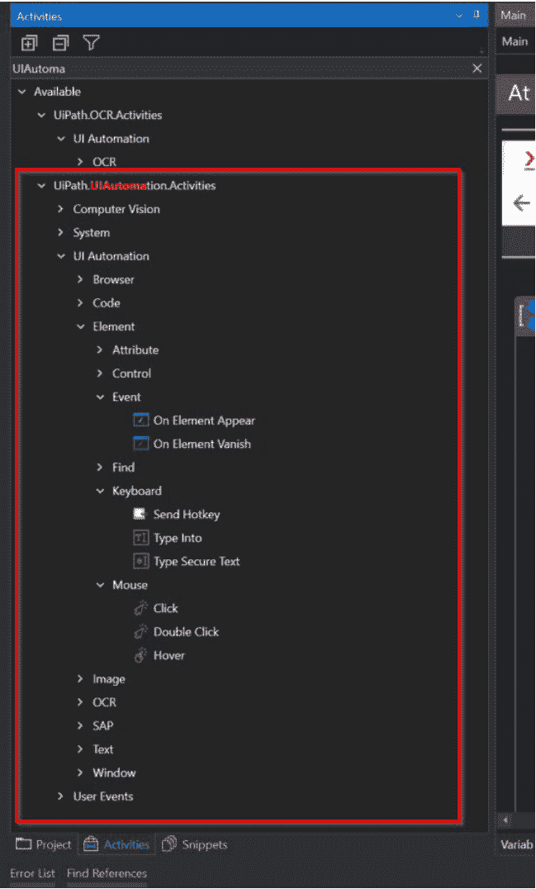

图 10.1 – UI 自动化关键活动

- **录制**: 这使 RPA 开发人员能够捕获逐步过程以及与 GUI 元素的所有关键交互，并将其转换为 UiPath Studio 中的排序工作流，以便更快速地开发 UI 自动化，如下图所示：

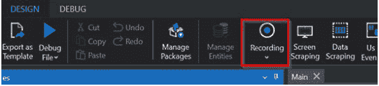

图 10.2 – 录制

- **目标**: 这指示机器人根据配置的**目标**属性，确定需要对哪些 UI 元素执行操作，如图 10.3 所示。最重要的元素是**选择器**，我们已在第 8 章，探索 UiPath 选择器 中讨论过。

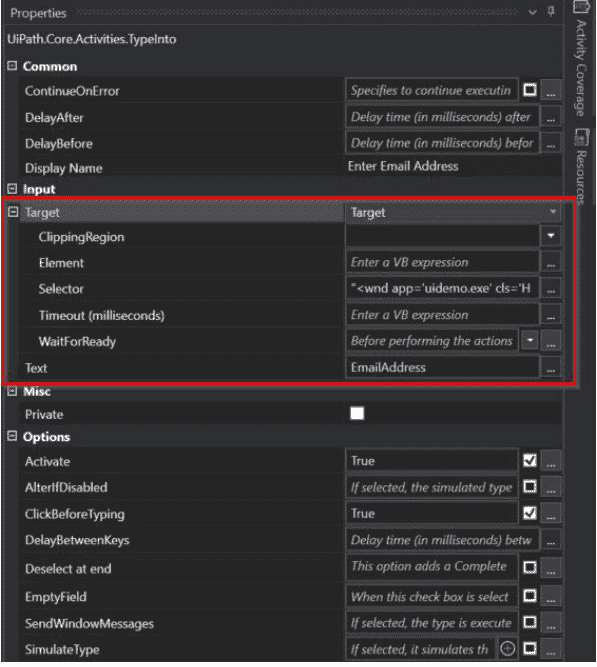

图 10.3 – 定位方法

- 输入和输出: 这些是 UiPath 中的重要功能，用于决定您正在开发的 UI 自动化类型，例如前台或后台自动化。您将启用 SendWindowsMessages 或 SimulateType，如图 10.4 所示。如果您的自动化需要在后台运行且无需任何人工干预，则会选中这些选项：

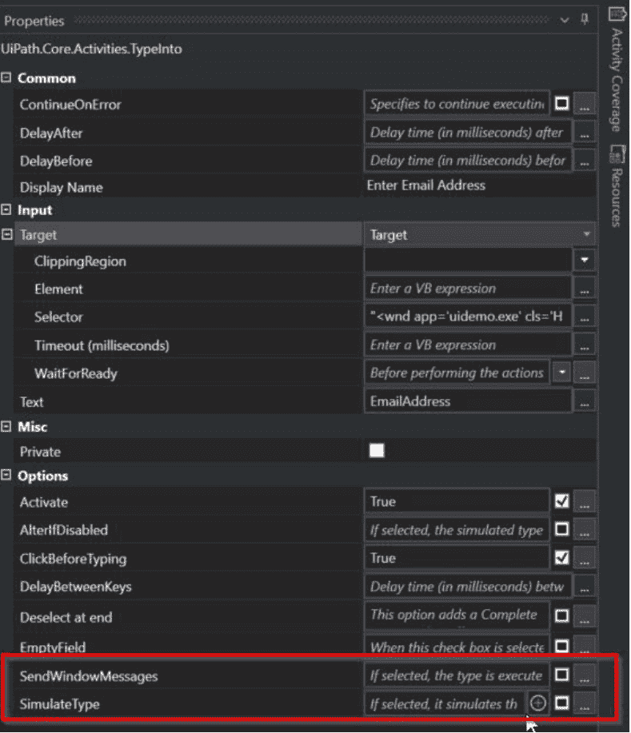

图 10.4 – 输入和输出方法

## 活动

UI 自动化活动用于为机器人开发**任务**或**工作流**，以便与多个应用程序的 GUI 进行通信。活动本质上分为四种不同的类型，如 *图 10.5* 所示：

| 活动 | 描述 |
| :--- | :--- |
| **容器** | 这些用于定位任何 GUI 应用程序（桌面、Web 或大型机）或识别活动窗口或弹出窗口，以与所选窗口范围内的元素进行通信。打开浏览器、打开应用程序、附加浏览器和附加窗口是容器的示例。 |
| **输入** | 这些活动用于向 UI 元素提供输入或执行操作。示例包括单击、键入和发送热键。 |
| **输出** | 这些活动指示机器人从 GUI 提取数据。示例包括获取文本、获取 URL 和获取 OCR 文本。 |
| **同步** | 这些活动指示机器人根据 GUI 行为执行定义的操作，以克服任何意外的 UI 行为。示例包括元素是否存在、图像是否存在和等待元素消失。 |

图 10.5 – UI 自动化活动类型

## 属性

活动的属性决定了机器人将根据所使用的活动如何与 GUI 进行交互。不同的属性选项可在**属性**面板部分中找到，该部分通常默认显示在 UiPath Studio 的右侧。让我们按照以下方式探索 GUI 自动化中使用的一些关键属性：

- **活动后延迟**和**活动前延迟**: 指示机器人在执行活动之前或之后等待指定的毫秒数。**活动后延迟**的默认延迟时间为 300 毫秒，**活动前延迟**的等待时间为 200 毫秒。您可以根据 UI 元素的响应增加或减少延迟时间。

- **继续出错**: 指示机器人在执行活动之前或之后等待指定的毫秒数。默认情况下，**继续出错**为 **假**，这意味着在发生任何错误或异常时，其余活动将不会执行。如果您希望在发生应用程序异常的情况下继续执行，可以将其选择为 **真**。

- **裁剪区域**: 使用 **左**、**右**、**上** 和 **下** 等坐标来定位特定区域。裁剪区域中的值默认为空。如果可用，您可以输入坐标值。

- **发送窗口消息**: 向目标应用程序发送特定消息，可以在后台运行，但不是最快的选项，并且与所有桌面应用程序不兼容。默认情况下，**发送窗口消息**复选框未被选中。

- **模拟输入**和**模拟点击**: 向目标应用程序发送特定消息，可以在后台运行；这是最快的选项，并且与所有桌面应用程序兼容。默认情况下，**模拟输入**或**模拟点击**复选框未被选中。

- **目标**: 通过以选择器、模糊选择器、图像或锚点形式提供输入，以不同的方式帮助机器人识别目标元素。**选择器**是常用的标识元素的方法；它是机器人用来识别目标元素的关键属性，使用带有多个属性的 XML 片段来定位唯一的目标元素。

- **输出**: 使用变量或参数存储活动的输出，以便在项目中使用。默认情况下，**输出**字段将为空。您可以在该字段中创建变量，以存储所选活动生成的输出。

让我们通过 https://www.packtpub.com/ 举个示例，应用迄今所学的几个 UI 自动化活动和属性，以确保我们可以与 Web 应用程序通信。编写本课时时，我可以在此 URL 上看到“免费 7 天试用”页面。如果您找不到相同的页面，可以使用任何其他类似页面。在此示例中，您将访问 Web 应用程序并与 Web 元素进行交互以提供输入，并从网页中访问数据：

- 1. 启动 https://www.packtpub.com/。

- 2. 单击“启动 7 天免费试用”按钮，如图 10.6 所示：


图 10.6 – Packtpub 免费试用访问

- 3. 下一页显示我们将要自动化的“帐户详细信息”部分，如图 10.7 所示：

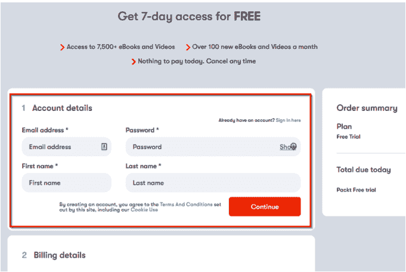

图 10.7 – Packtpub 免费试用注册

- 4. 按以下步骤启动 UiPath，并创建用于处理“帐户详细信息”部分数据的序列工作流，如图 10.8 所示：

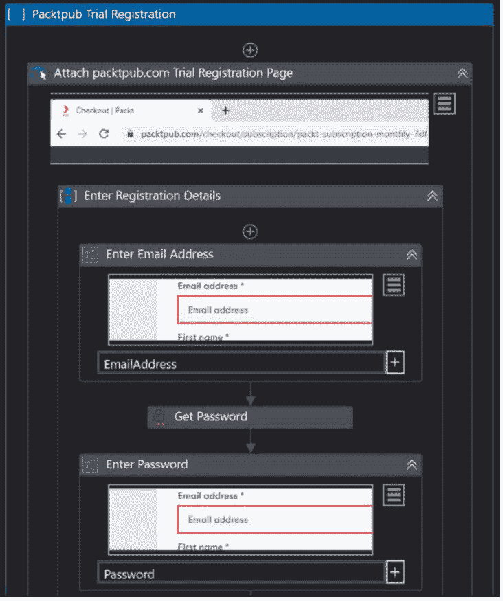

图 10.8 – 输入电子邮件地址和密码

- I. 启动 UiPath Studio。

- II. 创建一个新序列并将其命名为 Packtpub 试用注册。

- III. 创建 String 类型的 EmailAddress、Password、FirstName、LastName 和 TermsAndConditions 变量，并为 EmailAddress、FirstName 和 LastName 添加默认值，如图 10.9 所示：

| 名称 | 变量类型 | 作用域 | 默认值 |
|---|---|---|---|
| EmailAddress | String | Packtpub 试用注册 | "uipathadmin@gmail.com" |
| FirstName | String | Packtpub 试用注册 | "UiPath" |
| LastName | String | Packtpub 试用注册 | "Admin" |
| Password | String | Packtpub 试用注册 | 输入 VB 表达式 |
| TermsAndConditions | String | Packtpub 试用注册 | 输入 VB 表达式 |

图 10.9 – 变量定义

- IV. 拖放“附加浏览器”活动，并使用“指示”选项连接到 Packtpub 试用注册页面。

- V. 将“序列”活动拖入“附加浏览器”活动，并将其命名为“输入注册详细信息”。

- VI. 将“键入”活动拖入“输入注册详细信息”，并将其命名为“输入电子邮件地址”。在属性的文本字段中，使用 EmailAddress 变量。

- VII. 将“获取密码”活动拖入“输入注册详细信息”，并在属性的密码字段中键入您的密码。在属性的结果字段中使用 Password 变量以保存安全密码，如图 10.10 所示：

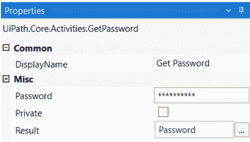

图 10.10 – 密码属性

- VIII. 将 **键入** 活动拖入 **输入注册详细信息**，并将其命名为 `Enter Password`。在属性的文本字段中，使用 `Password` 变量。

- IX. 使用 **键入** 活动输入 **名字** 和 **姓氏**，并使用 **获取文本** 活动提取 `TermsAndConditions` 文本，如 *图 10.11* 所示：

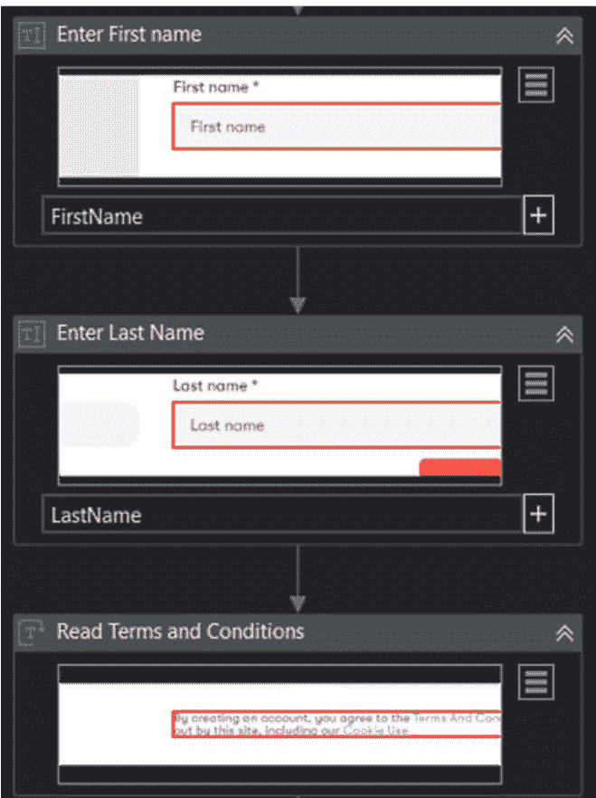

图 10.11 – 输入名字、输入姓氏以及读取条款和条件文本


- X. 将 Element Exists 活动拖放到 Enter Registration Details 中，并将其命名为 Check the Continue Button Exists。在属性的 Output 字段中，创建一个 ContinueAvailable 变量。接下来，拖放 Write Line 活动以输出 ContinueAvailable 变量的值，如图 10.12 所示。

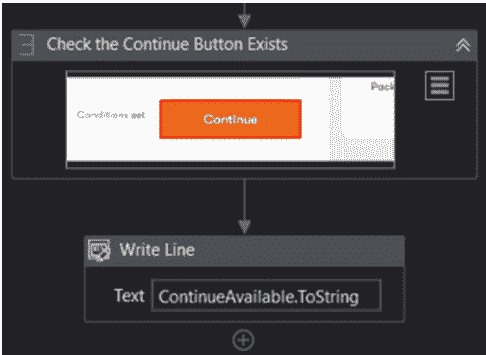

Figure 10.12 – 检查 Continue 按钮的可用性

- XI. 使用 Element Exists 和 Write Line 活动检查 Continue 按钮的可用性并写入输出，如图 10.12 所示：

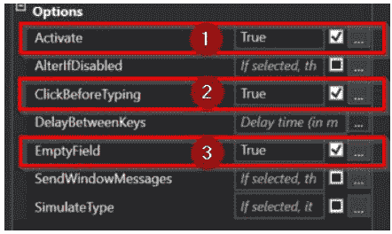

Figure 10.13 – 启用 Type Into 选项

- XII. 确保所有 Type Into 字段中都选中了高亮显示的属性，如图 10.13 所示：

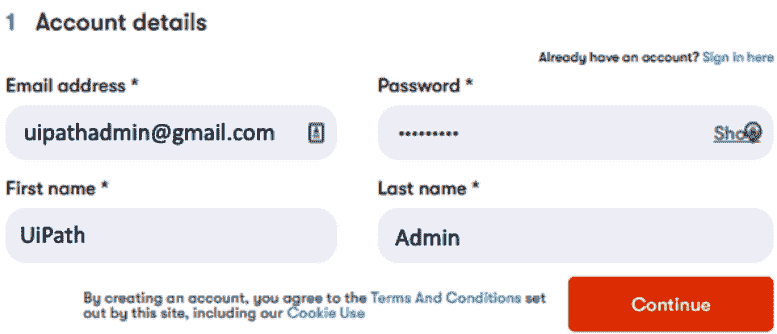

Figure 10.14 – 检查 Packtpub 页面上的输出

- 5. 运行流程以查找机器人，导航到 **账户详细信息** 页面，并根据输入数据输入账户详细信息，如图 10.14 所示：

- 6. 在 **输出** 面板中验证输出，以确保 **TermsAndConditions** 文本已从网页中提取，并且 **继续** 按钮可用，如图 10.15 所示：

```
Debug started for file: Main
Exploring_UiInteraction execution started
By creating an account, you agree to the Terms And Conditions set out by this site, including our Cookie Use
True
Exploring_UiInteraction execution ended in:
00:00:17
```

Figure 10.15 – 检查 UiPath Studio 中的输出

在本节中，我们了解了机器人如何与网页交互以读取和写入数据。我们还了解了机器人如何使用自动化活动和属性与 GUI 交互以自动化 Web 应用程序。您已了解在执行 GUI 自动化时需要注意的不同类型的活动和属性。我们还在示例中使用了这些活动和属性，以更好地理解其功能。您将在即将到来的章节中了解更多有关可用录制选项以及输入和输出方法的信息，这将帮助您更快地进行开发并执行后台自动化。

## 记录 GUI 的方法

录制是 UiPath Studio 中的重要功能，允许用户捕获屏幕上执行的操作并将其转换为序列；这在自动化业务流程时节省了大量时间和精力。要开始录制，您需要访问 **设计 (1)** 面板并单击 **录制 (2)**，这将显示所有可用的录制选项 (3)，如图 10.16 所示：

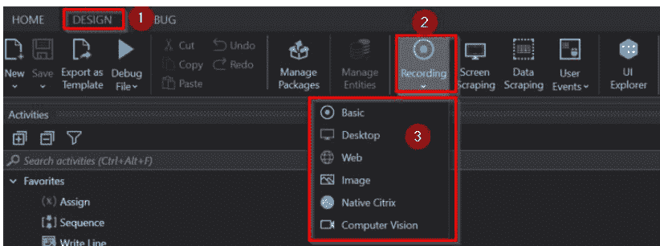

Figure 10.16 – 不同的录制选项

共有六种录制类型：**基本**、**桌面**、**Web**、**图像**、**原生 Citrix** 和 **计算机视觉**。但是，我们将仅探索前三种类型（基本、桌面和 Web），因为这些是最常用的选项，并且与 RPA Associate 认证更相关。

### 基本

**基本** 为每个活动生成 **完整选择器**，但不为活动创建容器。这更适合在容器中创建 *线性序列*，可用于录制 Web 应用程序和桌面应用程序，但它是所有录制器中 *最慢* 的。

让我们使用上一节中用于在 Packtpub 网页上读取和写入数据的相同示例，但这次使用 **基本** 录制：

- 1. 创建一个新序列并将其命名为 `Recordings`。
- 2. 单击 **录制 (1)**，然后单击 **基本 (2)**，如图 10.17 所示：

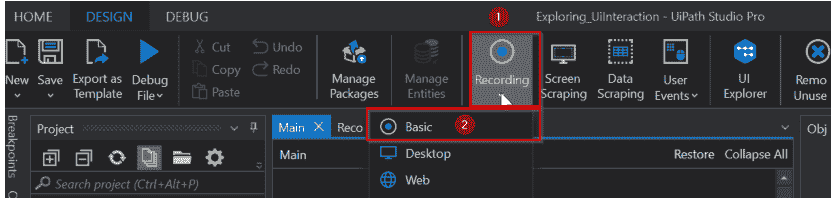

Figure 10.17 – 启动基本录制

- 3. 将显示 **基本录制** 面板，其中包含不同选项，您可以执行以下操作，如图 10.18 所示。

- 4. 使用 **记录** 选项 (1) 记录一系列操作或事件（例如启动应用程序、单击菜单、在字段中输入文本）。为此，您需要单击 **记录** 按钮并执行所有所需操作，在操作完成后按 *Esc* 键停止录制。使用不同的录制工具 (2) 执行逐步录制（例如使用 **启动应用** 启动应用程序、使用 **单击** 单击菜单、使用 **输入** 在文本字段中输入文本），或者您可以同时使用选项 1 和 2 的组合。在完成所有操作后，按 *Esc* 键停止录制。

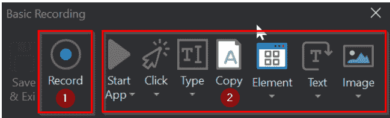

Figure 10.18 – 启动基本录制

- 5. 单击上一屏幕上的 **记录** 按钮，以记录 `https://www.packtpub.com/` 的 **订阅** 页面中 **账户详细信息** 部分的元素，元素顺序编号如 **图 10.19** 所示：

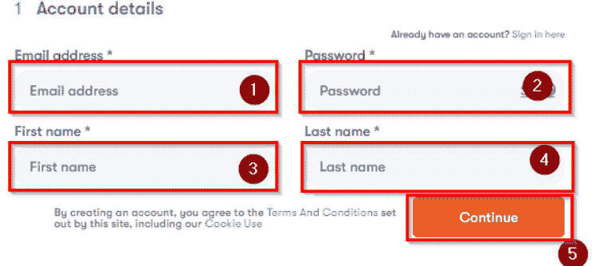

Figure 10.19 – Packtpub 账户详细信息部分

- 6. 按键盘上的 *Esc* 键或右键单击鼠标以停止录制，录制完成后，您将看到以下内容，其中可以看到保存录制或使用各种录制选项开始新录制的选项：

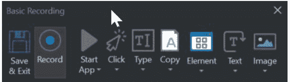

Figure 10.20 – 基本录制工具

- 7. 单击 **保存并退出** 按钮，将录制的活动保存到工作流并退出 **基本录制**：

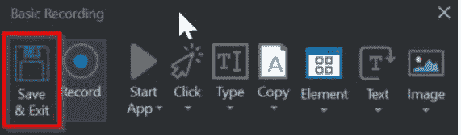

Figure 10.21 – 基本录制保存并退出

- 8. 验证录制是否生成了用户名和密码，如图 10.22 所示：

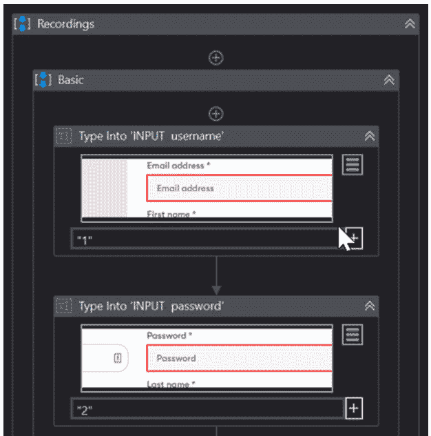

Figure 10.22 – 用户名和密码的工作流验证

- 9. 验证是否记录了 **名**、**姓** 和 **继续** 按钮，如图 10.23 所示：

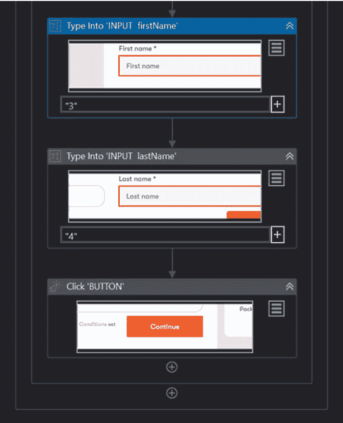

Figure 10.23 – 工作流验证，其他记录的字段

- 10. 单击 **选项** 菜单 (1)，然后从某个活动中单击 **编辑选择器** (2)，如图 10.24 所示：

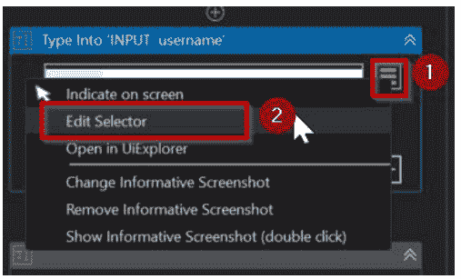

Figure 10.24 – 编辑选择器菜单选项

- 11. 验证编辑选择器部分，以确保选择器的完整 HTML 片段显示且可编辑。另外，验证显示的浏览器详细信息；这就是我们称基本录制为完整选择器的原因，如图 10.25 所示。请注意，在部分选择器中，HTML 片段部分不可编辑。

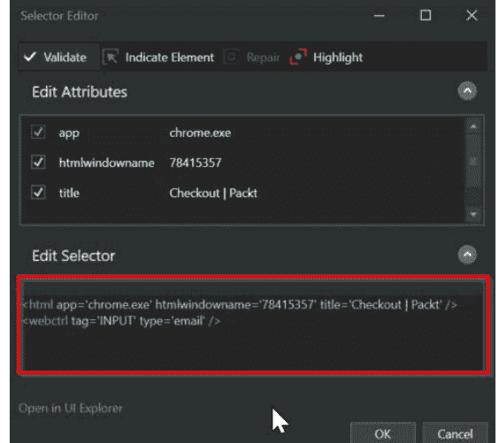

Figure 10.25 – 编辑选择器 – 完整选择器

- 12. 请注意，尽管它是从 Web 应用程序录制的，但基本序列中未录制任何容器（如 Open Browser 或 Attach Browser），如图 10.22 所示。

现在，让我们探索另一个基本录制示例，其中机器人将文本 UiPath 输入到记事本中。为此，请执行以下步骤生成 **基本** 序列，如图 10.26 所示：

- 1. 启动记事本。
- 2. 单击 UiPath Studio 中的 **基本录制** 选项。
- 3. 在录制期间，单击基本录制工具 (2) 中的 **输入** 选项，如图 10.18 所示，并将光标导航到记事本。
- 4. 在记事本中键入 UiPath。
- 5. 按 *Esc* 键停止录制。
- 6. 单击 **保存并退出** 按钮。

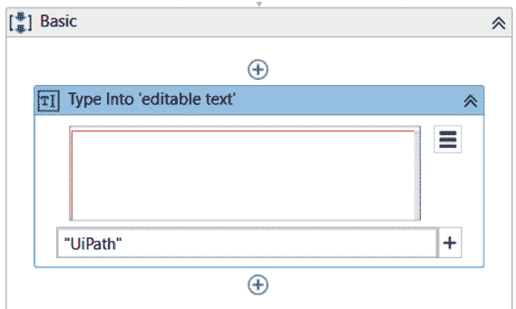

Figure 10.26 – 将文本输入记事本应用程序（基本录制）

- 7. 单击 **选项** 菜单 (1)，然后从某个活动中单击 **编辑选择器** (2)，如图 10.27 所示：

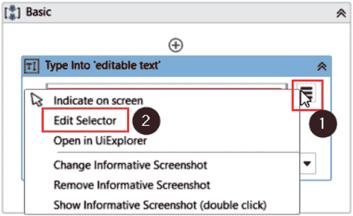

Figure 10.27 – 编辑选择器

- 8. 验证 **输入** 活动的 **编辑选择器** 框，以确保生成的 HTML 代码遵循 **完整选择器** 的结构，这意味着 HTML 标记中的每个属性均可编辑，如 *图 10.28* 所示：

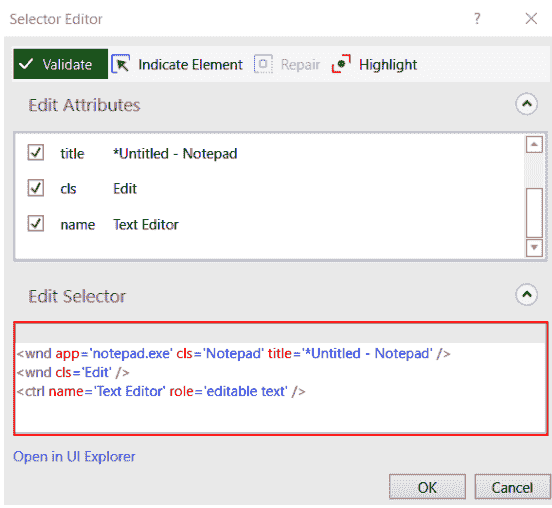

Figure 10.28 – 完整选择器的选择器编辑器视图（输入到记事本）


无论是桌面应用程序还是 Web 应用程序，基础录制都会生成完整选择器，这意味着不会生成单独的容器，例如 **Attach Browser** 或 **Attach Window**。因此，这种录制是 _最慢_ 的，最适合容器内的单个活动或线性工作流。

## 桌面

**桌面** 为每个活动生成一个 **部分选择器**，并为活动创建容器。这更适合于自动化桌面应用程序。这比基础录制 _更快_。让我们看一个自动将文本输入到记事本应用程序的示例：

- 1. 创建一个新序列并将其命名为 `Desktop Recording`。

- 2. 单击 **录制** 按钮 (1)，然后单击 **桌面** (2)，如 *图 10.29* 所示：

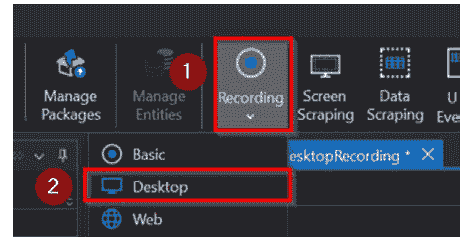

图 10.29 – 启动桌面录制

- 3. **桌面录制** 面板显示多个录制选项，如 *图 10.30* 所示。请参阅 *基础录制的步骤 3* 以了解更多关于录制功能的信息：

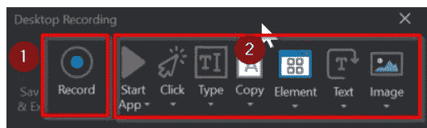

图 10.30 – 桌面录制工具

- 4. 启动新的记事本应用程序并单击 **记录** 按钮。然后，键入 `UiPath` (1)，单击 **格式** 选项卡 (2)，将字体大小更改为 55 (3)，最后，单击 **确定** (4)，如 *图 10.31* 所示：

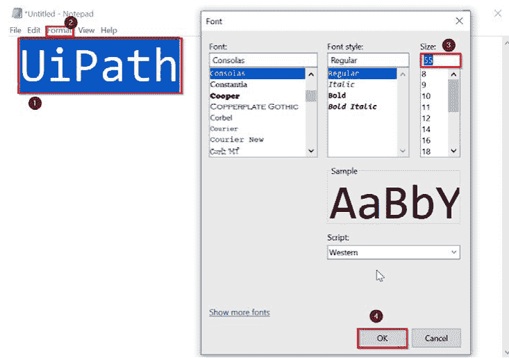

图 10.31 – 录制期间的记事本

- 5. 录制完成后，按键盘上的 Esc 按钮以查找保存录制或开始新录制的选项，如图 10.32 所示：

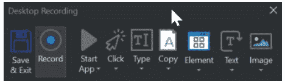

图 10.32 – 桌面录制工具

- 6. 单击 **保存并退出** 按钮以将录制的活动保存到工作流，如图 10.33 所示：

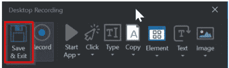

图 10.33 – 保存活动

- 7. 验证是否记录了记事本条目，如图 10.34 所示：

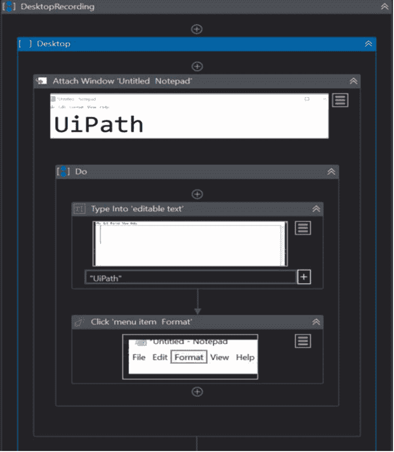

图 10.34 – 记录的活动验证

- 8. 验证是否记录了字体更改，如图 10.35 所示：

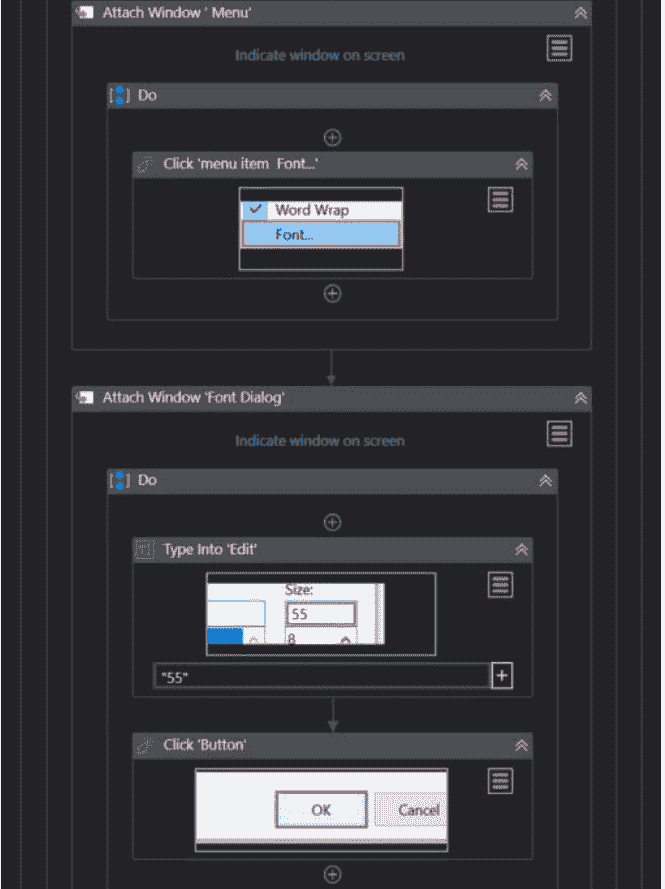

图 10.35 – 记录的活动验证（续）

- 9. 单击 **选项** 菜单 (1)，然后从活动中单击 **编辑选择器** (2)，如 **图 10.36** 所示：

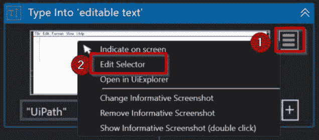

图 10.36 – 编辑选择器

- 10. 验证 **编辑选择器** 部分，以确保显示了选择器的 HTML 片段，且部分 HTML 不可编辑，在 **编辑选择器** 部分的第一行显示为灰色。这就是我们称桌面录制为部分选择器的原因，如 **图 10.37** 所示：

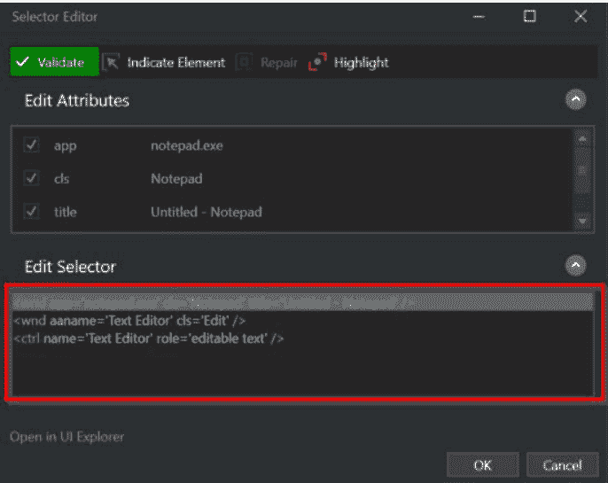

图 10.37 – 编辑选择器

- 11. 验证录制的活动具有容器，例如 Attach Window 或 Use Application，以确保桌面录制支持容器，如图 10.38 所示：

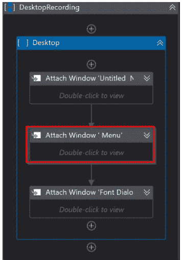

图 10.38 – 容器验证

我们已经了解如何使用桌面录制来记录桌面应用程序，并体验了记录每个事件是多么快速和简单。

## Web

Web 为每个活动生成一个部分选择器，并为活动创建容器。这更适合于自动化 Web 应用程序，并且比基础录制更快。

让我们看看如何使用 Web 自动将文本输入到记事本应用程序的示例：

- 1. 创建一个新序列并将其命名为 web_Recording。

- 2. 单击 **录制** 按钮 (1)，然后单击 **Web** (2)，如图 10.39 所示：

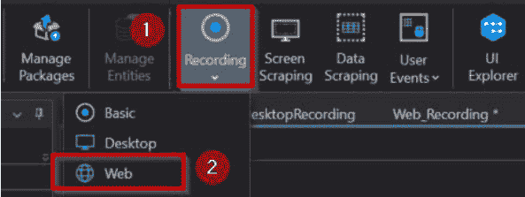

图 10.39 – 启动 Web 录制

- 3. **Web 录制** 面板显示多个选项，如图 10.40 所示。这与前一部分的基础录制类似，不同之处在于 Web 录制具有 **打开浏览器** 选项，而不是基础录制中的 **打开应用程序**。

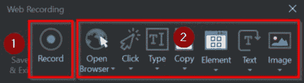

图 10.40 – Web 录制工具

- 4. 单击前一张截图中显示的 **记录**，以记录 https://www.packtpub.com/ 的订阅页面中的 **账户详细信息** 部分，并按图 10.41 中编号的顺序捕获元素：

1. 账户详细信息

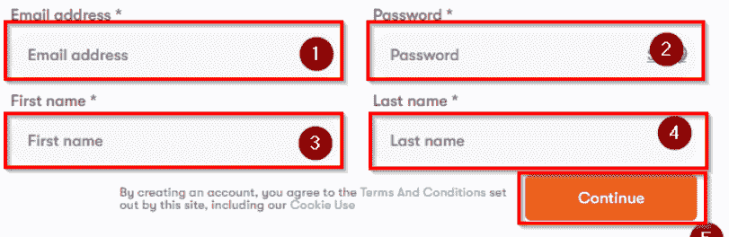

图 10.41 – 录制期间的 Packtpub 账户详细信息

- 5. 在录制过程中键入密码时，会显示一个弹出框，如图 10.42 所示，您需要执行以下操作：

  - 在 **键入所需值** (1) 中键入您的安全密码。
  - 选中 **键入密码** (2) 选项以启用安全文本。
  - 按 Enter 键。

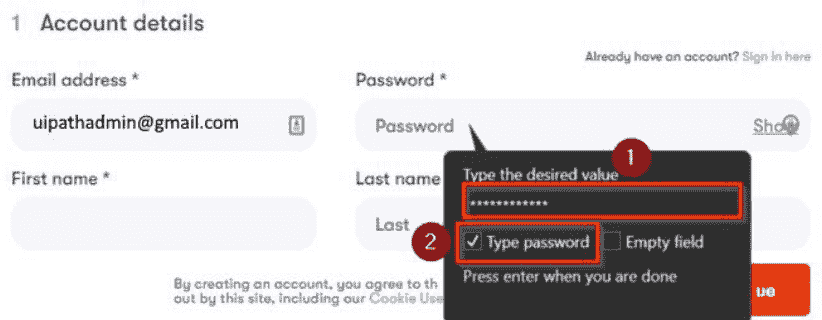

图 10.42 – 录制期间的 Packtpub 密码

- 6. 录制完成后，按键盘上的 Esc 按钮以查找保存录制或开始新录制的选项，如图 10.43 所示：

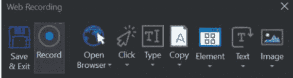

图 10.43 – Web 录制选项

- 7. 单击 **保存并退出** 按钮，将录制的活动保存到工作流并退出 **Web 录制**，如图 10.44 所示：

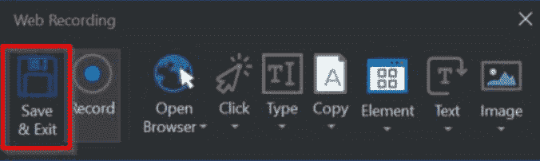

图 10.44 – Web 录制保存并退出

- 8. 验证生成的工作流中是否生成了用户名和密码，如图 10.45 所示：

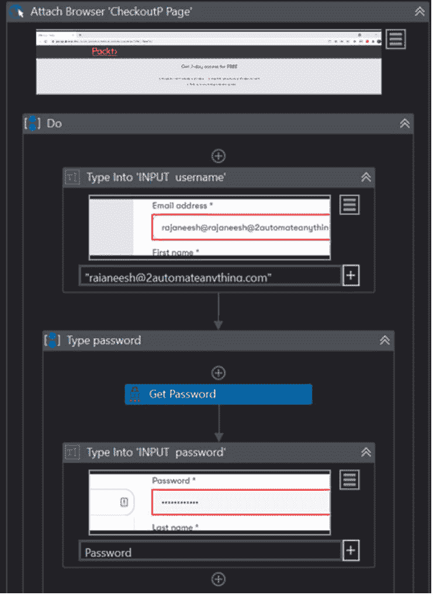

图 10.45 – Web 录制活动验证

- 9. 验证是否记录了 **名** 和 **姓**，如图 10.46 所示：

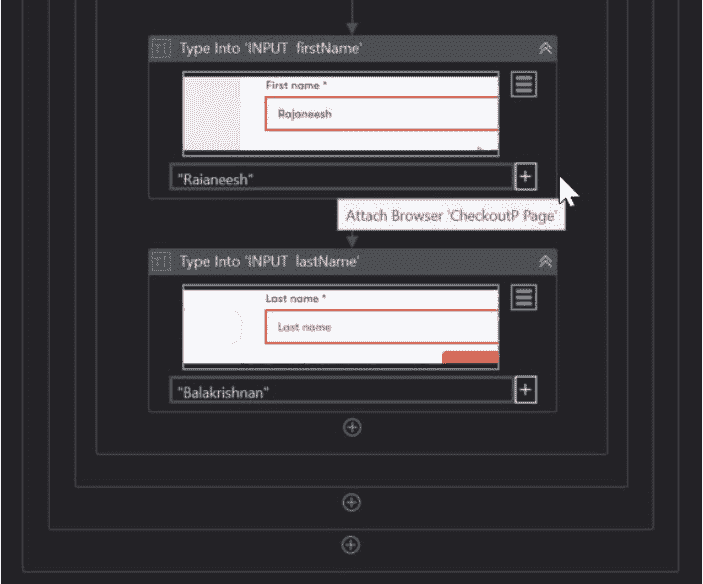

图 10.46 – Web 录制活动验证（续）

- 10. 单击选项菜单 (1)，然后从活动中单击 **编辑选择器** (2)，如图 10.47 所示：

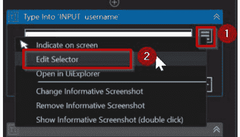

图 10.47 – 编辑选择器

- 11. 验证 **编辑选择器** 部分，以确保显示了选择器的完整 HTML 片段，且部分片段不可编辑。这就是我们称 Web 录制为部分选择器的原因，如图 10.48 所示：

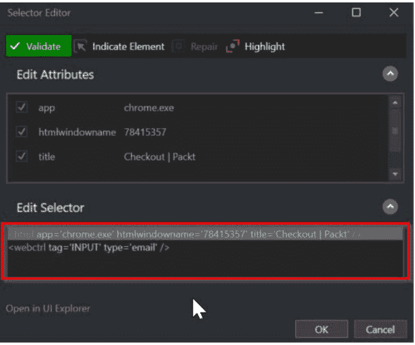

图 10.48 – 编辑选择器

- 12. 请注意，这种录制速度最快，最适合 Web 应用程序录制。您会发现 **打开浏览器** 或 **Attach Browser** 等活动记录在 **Web 录制** 序列中，如图 10.49 所示：

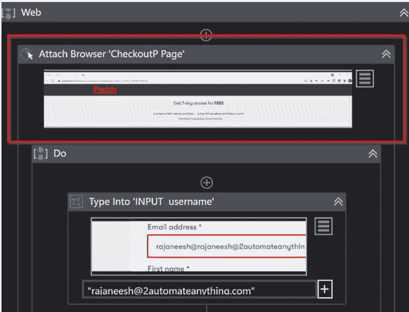

图 10.49 – 容器验证

我们已经了解如何使用 Web 录制来记录 Web 应用程序，并体验了在浏览器中记录每个事件是多么快速和简单。我们还看到 Web 录制使用部分选择器，并且是所有录制选项中最快的。

到目前为止，我们已经了解了 UiPath 中的不同录制选项，并通过示例探索了一些关键录制概念。现在，您对如何根据要自动化的给定应用程序选择正确的录制器有了更好的了解。我们遇到了不同的活动和属性，并在示例中应用了它们。在下一节中，让我们探索一些更高级的录制选项。

## 何时使用哪种录制类型？

让我们讨论不同类型的可用录制、它们的用途、优势和劣势，如图 10.50 所示：

| 录制类型 | 用途、优势和劣势 |
|---|---|
| 基础 | • 最适合涉及较少窗口或网页的线性工作流。<br>• 它是最慢的录制类型。<br>• 可自动化桌面和 Web 应用程序。<br>• SimulateType / SimulateClick 默认未启用 (False)。 |
| 桌面 | • 适用于涉及多个窗口和网页的所有类型的桌面应用程序。<br>• 为每个活动生成部分选择器。<br>• 比基础录制更快。 |
| Web | • 最适合记录涉及多个页面和操作的 Web 应用程序。<br>• 为每个活动生成部分选择器（例如，Attach Browser）。<br>• 比基础录制更快。<br>• SimulateType / SimulateClick 默认启用 (True)。 |
| 图像 | • 仅当您想要记录虚拟化环境（如虚拟网络计算、虚拟机和 Citrix）或 SAP 时才使用它。<br>• 它仅允许图像、文本和键盘自动化，并需要显式定位。 |
| 原生 Citrix | • 仅用于原生 Citrix 自动化项目。<br>• 作为先决条件，您需要在客户端计算机上安装 UiPath Citrix 扩展，并在应用程序服务器上安装 UiPath Remote Runtime 组件 (Citrix XenApp)。<br>• 您可以使用 Click、Type Into、Get Text 和 Extract Data 等活动。<br>• 选择器为 Citrix 应用程序元素原生生成。 |
| 计算机视觉 | • 它使用计算机视觉神经网络来识别按钮、文本和复选框等 UI 元素。<br>• 它不使用选择器。<br>• 用于记录虚拟化环境（如 VNC、虚拟机、Citrix 和远程桌面）。<br>• 自动化其他提到的录制选项不可靠的本地应用程序。 |

图 10.50 – 不同类型的录制及其用途


这让我们对录制有了更清晰的认识，并指导我们为不同场景选择合适的录制工具。

## 高级 UI 自动化工具

让我们讨论几种可用于自动化复杂 GUI（如 Citrix、SAP 和大型机）的高级录制选项：

- **图像**：此录制用于录制图像、文本和键盘输入，适用于 VM、Citrix、SAP 和大型机等虚拟环境自动化。它会捕获元素的精确用户界面位置以及元素的坐标值，以实现 GUI 自动化。

- **原生 Citrix**：此录制用于录制图像、文本和键盘输入，适用于 Citrix 环境中的应用程序。它类似于桌面录制器，可用于录制 Citrix 环境中的不同类型的应用程序。

- **计算机视觉**：此录制主要用于录制图像、文本和键盘输入，适用于 Citrix 环境和 Windows 环境中的应用程序（在这些环境中，之前讨论的任何其他录制选项均无法识别 UI 元素）。它是一种智能录制器，使用内置神经网络更准确地捕获 UI 元素，以克服任何选择器不一致的问题。

- **对象存储库**：一种高级功能，用于从应用程序中捕获 UI 元素并将其作为**可重用对象**存储在存储库中，以便按需使用或与其他项目共享。这些对象可以从对象存储库拖放到工作流中，以便更快地开发自动化，且易于管理、可重用且可靠。

我们已讨论几种高级概念，并了解了如何使用不同的工具和技术来自动化 Citrix、大型机和 SAP 等 GUI。在下一部分中，我们将进一步了解输入和输出方法，以开发更高效的自动化解决方案。

## 输入操作和方法

自动化需要配置某些属性，以便在流程执行期间无缝运行。要执行前台或后台自动化，输入需要由用户或机器人在 GUI 中直接执行。有三种输入方法，我们将立即讨论。

### 默认或硬件事件

默认应用程序使用硬件驱动程序模拟鼠标事件或键盘事件，以与 GUI 通信。当 **发送窗口消息** 和 **模拟键入** 默认禁用时会选中此项，如图 10.51 所示。在这种情况下，机器人会精确模拟人类操作，例如移动光标和单击 UI 元素。UI 元素需要可见，此事件才能成功。

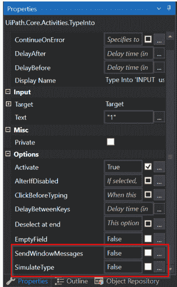

图 10.51 – 默认方法

默认方法的主要特征如下：

- 与所有应用程序 100% 兼容。
- 仅在前台运行，无法进行后台执行。
- 执行速度通常较慢，仅为模拟键入的 50%。
- 默认支持热键。
- 默认不会自动清空输入字段，这意味着它不会清除输入字段中可能包含空格或先前执行的输入值等任何现有值。

### 发送窗口消息

发送窗口消息通过直接向 GUI 元素发送特定消息来模拟鼠标事件或键盘事件。在“选项”部分中选择“发送窗口消息”时可激活此功能，如图 10.52 所示。此事件无需 UI 元素可见即可成功，因为它在后台工作。

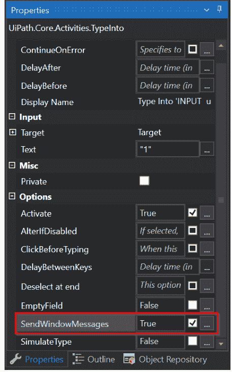

图 10.52 – 发送窗口消息

发送窗口消息方法的主要特征如下：

- 与所有应用程序 80% 兼容。
- 仅在后台运行。
- 执行速度略好于默认方法，约为模拟键入的 50%。
- 默认支持热键。
- 默认不会自动清空输入字段。

### 模拟键入

模拟键入方法通过使用 API 进行通信来模拟鼠标事件或键盘事件，API 提供了一组函数，允许应用程序访问目标应用程序的特定功能或数据，并且是所有三种输入方法中最快的一种。在“选项”部分中选择“模拟键入”方法时会选中此项，如图 10.53 所示。它与桌面应用程序和 Web 应用程序兼容，并且此事件无需 UI 元素可见即可成功，因为它在后台工作。

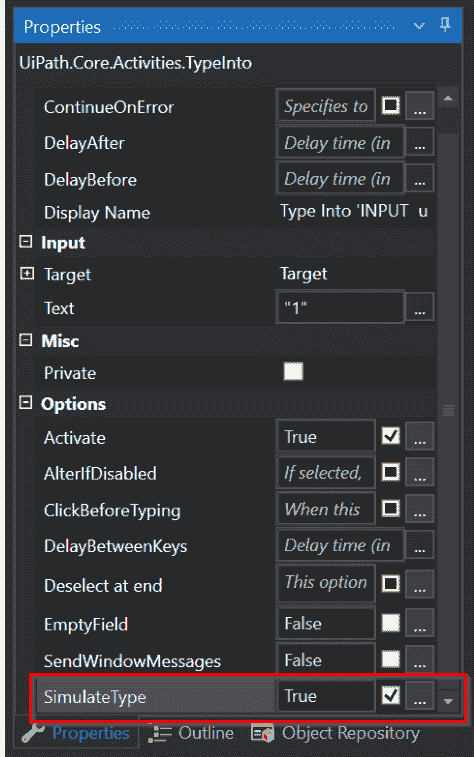

图 10.53 – 模拟键入

模拟键入方法的主要特征如下：

- 与 Web 应用程序 99% 兼容，与桌面应用程序 60% 兼容。
- 在前台和后台执行中均可运行。
- 执行速度是所有三种输入操作中最快的。
- 默认不支持热键。
- 默认会自动清空输入字段。

在本节中，我们探索了不同的输入方法，并了解了如何在实际情况下使用它们。在下一节中，我们将了解使用**输出方法**进行输出数据提取。

## 输出操作和方法

自动化需要配置某些屏幕抓取方法和抓取选项，以便从 GUI 元素、PDF 或文档中提取值。这里有三种输出方法，我们将在此讨论。

### 全文

**全文** 是默认输出方法，也是使用最频繁的方法。使用全文方法需要遵循以下步骤：

- 1. 从**设计**面板中单击**屏幕抓取**，如 _图 10.54_ 所示，这将为您提供一个光标来选择**目标**元素：

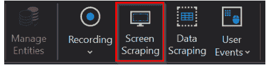

图 10.54 – 屏幕抓取

- 2. 单击要提取的元素，这将打开**屏幕抓取向导**，然后完成以下操作：

- I. 为抓取方法选择 **全文 (1)**。
- II. 在“抓取选项”下选中**忽略隐藏 (2)**，以忽略任何隐藏文本。
- III. 如果“抓取选项”中有任何更改，请单击**刷新 (3)** 按钮。
- IV. 在**抓取结果预览 (4)** 中验证输出。

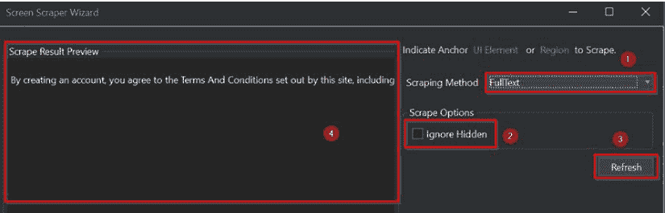

图 10.55 – 屏幕抓取向导

**全文** 抓取方法的特征如下：

- 所有抓取方法中执行速度最快。
- 该方法的准确率为 100%。
- 支持后台执行。
- 不提取文本位置。
- 可以提取隐藏文本。
- 不提取来自 Citrix 的输出。

### 原生

原生方法能够从与 **图形设备接口 (GDI)** 和 **Microsoft API** 兼容的应用程序中提取数据，这些接口用于识别图形对象。


图 10.56 – 屏幕抓取向导 – 原生

原生抓取方法的特征如下：

- 执行速度最快，速度为全文的 80%。
- 该方法的准确率为 100%。
- 不支持后台执行。
- 可以提取文本位置。
- 不能提取隐藏文本。
- 不提取来自 Citrix 的输出。

### 光学字符识别

如果其他两种方法无法提供所需结果，则建议使用 **光学字符识别**。它从扫描的文档或图像中提取数据，并将输入转换为可机器读取的文本。它的准确率不是 100%，并且适用于不同类型的应用程序。默认情况下，光学字符识别 使用 **Google Tesseract** 和 **Microsoft Modi OCR** 引擎。


图 10.57 – 屏幕抓取向导 – OCR

本机抓取方法的特点如下：

- 它是所有三种输出方法中最慢的一种，速率为 FullText 的 30%。
- 该方法的准确率为 98%。
- 它不支持后台执行。
- 它可以提取文本位置。
- 它不能提取隐藏文本。
- 它可以从 Citrix 提取文本输出。

在本节中，我们探索了不同的输出方法，并了解了各种方法在从各种应用程序中提取输出时的应用。

## 摘要

本章我们探索了关于 UI 自动化交互的所有内容：分析如何处理不同的 UI 自动化活动、不同类型的录制，以及不同类型的输入和输出方法。我们进一步探索了活动，并执行了几个项目从 Web 应用程序和桌面应用程序中抓取数据。我们还介绍了一些高级 UI 自动化概念，例如图像和计算机视觉录制。

在下一章中，您将使用 PDF 自动化，您可以使用 UI 交互的概念通过“获取完整文本”以及 OCR 从 PDF 中检索数据。您还将实现大部分活动、输入和输出方法来处理 PDF 数据。
