## 自动化 PDF 数据提取

在前几章中，我们讨论了可用于与多个应用程序交互的不同交互方法。此外，我们讨论了 PDF 文件在日常运营中发挥着重要作用。PDF 文件是组织/个人之间共享信息时最常用的文档类型之一。PDF 文件中共享的信息可能包括发票、采购订单、信函、财务信息、法律文档等。因此，您必须了解如何使用 UiPath 从 PDF 文件中提取数据以自动执行手动操作。

本章着重介绍如何使用 UiPath 自动化 PDF 文件以及可用于成功执行 PDF 自动化的活动。

本章包含以下各节：

- 创建可读取 PDF 文本的机器人
- 使用提取 PDF 文本和使用 OCR 提取 PDF 活动从 PDF 提取文本
- 使用屏幕抓取提取 PDF 文本
- 从 PDF 文件中提取单个动态值
- 使用锚点基活动提取单个值

在本章结束时，您将对执行 PDF 自动化所使用的最常见方法有清晰的了解。

## 技术要求

在开始本章之前，请确保已安装 UiPath Studio 和机器人。

本章要求您大致了解如何使用 Studio 创建变量和简单工作流。此外，了解如何使用 UI 选择器（如第 10 章 探索用户界面和用户/机器人交互中所述）将有助于您理解本章中介绍的一些概念。此外，您的机器上必须安装 Adobe Reader。

## 创建可读取 PDF 文件的机器人

基于我们在创建自动化解决方案方面的以往经验，我们知道 UiPath 解决方案默认包含以下依赖项：

- UiPath.Excel.Activities
- UiPath.System.Activities
- UiPath.UIAutomation.Activities
- UiPath.Mail.Activities

但是，默认活动不包含用于 PDF 自动化的专用活动。因此，我们需要向需要 PDF 交互的自动化项目添加新依赖项。请执行以下步骤，创建包含 PDF 自动化活动的项目：

- 1. 打开 UiPath Studio，提供 **项目名称** 和 **路径** 详细信息以创建新项目。
- 2. 项目打开后，单击 **设计** 选项卡顶级功能区上的 **管理程序包** 按钮。这将打开 **管理程序包** 窗口，如下所示：

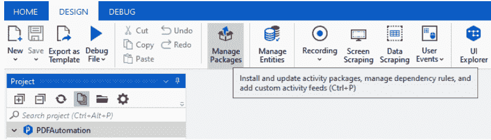

图 11.1 – 管理程序包选项

- 3. 在 **管理程序包** 窗口中选择 **所有程序包** 选项，并使用搜索选项搜索 UiPath.PDF.Activities。
- 4. 从程序包列表面板中选择 UiPath.PDF.Activities。然后，单击 **安装** 按钮为您的解决方案安装该程序包：

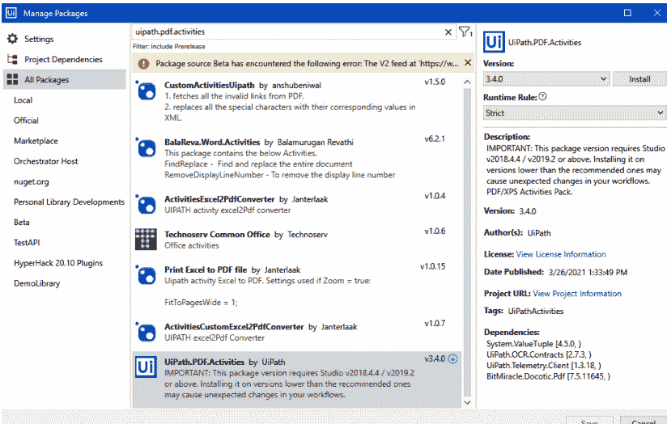

图 11.2 – 正在安装 UiPath.PDF.Activities

- 5. 单击 **保存** 按钮以完成安装过程并关闭 **管理程序包** 窗口。
- 6. 单击 **活动** 面板，导航到 **应用集成** 和 **PDF**，以查找所有与 PDF 交互相关的活动。

现在我们准备构建第一个 PDF 自动化。但是，首先，我们需要了解每个活动的用法：

- **将 PDF 页面导出为图像**：此选项允许用户将 PDF 文件的指定页面导出为图像文件。当用户需要将大型 PDF 文件中的指定页面导出为多个文件以供以后使用时，可以使用此功能。
- **从 PDF 提取图像**：此选项允许用户提取 PDF 文件中的所有图像，并将其保存在指定文件夹中以供以后使用。
- **提取 PDF 页面范围**：此选项允许用户将指定页面或页面范围提取到另一个 PDF 文件中。使用此活动仅提取所需页面可以减少下游流程操作中的任何不必要的处理时间。用户可以提供由逗号分隔的页面范围或单个页码，如以下示例所示："1, 2, 10, 15-20"。
- **获取 PDF 页数**：此选项返回指定 PDF 文件中可用的页数。
- **合并 PDF 文件**：此选项允许用户将两个指定的 PDF 文件合并为一个 PDF 文件。
- **管理 PDF 密码**：此选项允许用户对 PDF 文件进行密码保护或取消保护。
- **读取 PDF 文本**：此选项读取指定 PDF 文件中的所有文本，并将提取的文本存储在字符串变量中。此活动只能读取计算机生成的 PDF 文件中的文本。请注意，PDF 文件中的图像或扫描文档不会通过此活动提取。
- **使用 OCR 读取 PDF**：此选项允许用户使用任何 OCR 引擎提取和读取 PDF 文件文本。此活动使用户能够从包含扫描文档的 PDF 文件中提取文本。
- **读取 XPS 文本**：除了 PDF 文件之外，PDF 活动还允许用户从 XPS 文件读取文本，并将数据存储在字符串变量中。此活动类似于 **读取 PDF 文本** 活动。
- **使用 OCR 读取 XPS**：此选项允许用户使用 OCR 引擎读取 XPS 文件的所有字符。此活动类似于 **使用 OCR 读取 PDF** 活动。

现在您已经初步了解了 PDF 包中可用的活动，我们将了解如何使用其中一些活动。在下一节中，我们将重点介绍使用一些已讨论的活动来生成一些输出。

## 使用提取 PDF 文本和使用 OCR 提取 PDF 活动从 PDF 提取文本

可以按文本列或单个元素从 PDF 文件中提取数据。首先，我们将了解如何提取页面中的所有数据。使用 **读取 PDF 文本** 和 **使用 OCR 读取 PDF** 活动，用户可以读取大型文本文件。PDF 文件的一页可能包含计算机生成的文本，也可能包含图像格式的文本。一旦文件在 Adobe Reader 中打开，您可以轻松地单独高亮显示计算机生成的文本，而图像格式的文本则会作为一部分被高亮显示。找到包含此类文本的 PDF 文件，并尝试用于我们的作业。让我们通过执行以下步骤，使用先前提到的活动构建一个简单的工作流：

- 1. 打开在上一节中创建的 UiPath Studio 解决方案。
- 2. 打开 `Main.xaml` 工作流文件以开始编辑工作流。
- 3. 通过搜索从 **活动** 面板拖放 **读取 PDF 文本** 活动。
- 4. 选择该活动以查看活动属性。
- 5. 为活动的 **FileName** 属性提供完整文件路径。
- 6. 通过按 `Ctrl + K` 在 **输出文本** 属性中创建一个字符串变量以保存提取的文本。
- 7. 默认情况下，**范围** 属性设置为 `All`。`All` 的默认值意味着它将从文档的所有页面提取文本。但是，如果您只想从特定页面或页面范围提取数据，可以使用此属性定义该范围。如果要提供特定页面，可以输入页码。如果是页面范围，可以提供用 "-" 分隔的起始页和结束页，例如 `12, 15, 20-24`。对于我们的场景，我们将使用默认值。


- 8. 活动的 **保留格式** 属性允许用户在提取 PDF 文件中的文本时保留文本格式。例如，如果文档包含两栏文本，如 *图 11.3* 所示，该选项可让您按原样提取文本。将活动属性设置为 `True`：

It was November. Although it was not yet late, the sky was dark when I turned into Laundress Passage. I closed the door and put the shop key in its usual place behind Bailey's Advanced Principles of Geometry. Poor Bailey. No one has wanted his fat gray book for thirty years. Sometimes I wonder what he makes of his role as guardian of the bookshop keys. I don't suppose it's the destiny he had in mind for the masterwork that he spent two decades writing. heavily embellished capitals and curly flourishes, my first impression was that it had been written by a child. The letters seemed untrained. Their uneven strokes either faded into nothing or were heavily etched into the paper. There was no sense of flow in the letters that spelled out my name. Each had been undertaken separately -- M A R G A R E T L E A -- as a new and daunting enterprise. But I knew no children. That is when I thought, It is the hand of an invalid. It gave me a queer feeling. Yesterday or the day before, while I had been going about my business, quietly and in private, a letter. For me. That was something of an event. The crisp-cornered envelope, puffed up with its thickly folded contents, was addressed in a hand that must have given the postman a certain amount of trouble. Although the style of the writing was old-fashioned, with its

Figure 11.3 – 用于保留格式的双栏文本示例 PDF 文件

- 9. 将 **写入文本文件** 活动拖放到位。
- 10. 通过将先前创建的字符串变量提供给 **文本** 属性来配置 **写入文本文件** 活动。
- 11. 通过在 **写入到文件名** 属性中提供新文本文件的输出文件路径来配置 **写入文本文件** 活动。
- 12. 配置完成后，您的工作流应类似于以下截图：

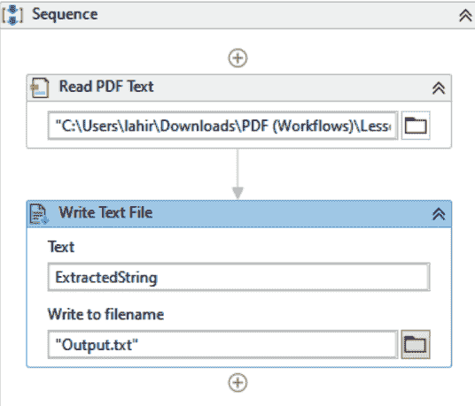

Figure 11.4 – 使用读取 PDF 文本读取 PDF 文件

- 13. 运行工作流并检查文本文件中提取数据的输出。我们在此练习中使用的示例 PDF 文件及工作流结果如下截图所示：

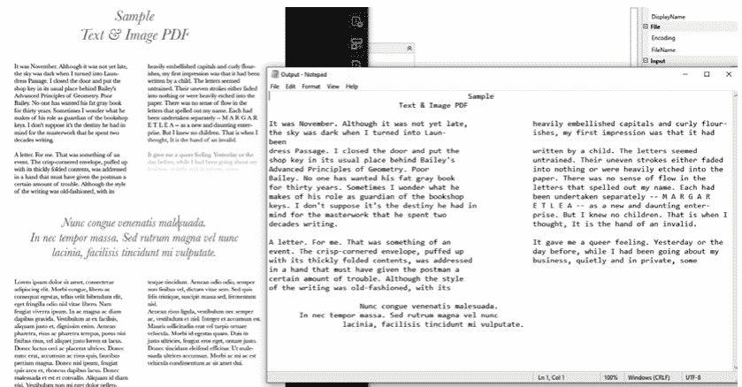

Figure 11.5 – 读取 PDF 文本的输出

仔细查看输出和 PDF 文件中的文本。您会发现，**读取 PDF 文本** 活动未提取居中对齐语句下方两栏中的文本。原因是居中对齐文本下方的文本是图像。因此，我们需要使用 **使用 OCR 读取 PDF** 活动来提取图像中的文本。要更改工作流以捕获缺失的文本，请执行以下步骤：

- 1. 删除 **读取 PDF 文本** 活动。
- 2. 搜索 **使用 OCR 读取 PDF** 活动，并将其放置在 **读取 PDF 文本** 活动之前所在的顶部位置。
- 3. 检查活动属性时，您应会看到与 **读取 PDF 文本** 活动中看到的类似属性。像之前为 **读取 PDF 文本** 活动所做的那样，使用文件路径更改 **FileName** 属性。
- 4. 默认情况下，**范围** 属性已设置。目前，我们不会更改它，只需使用相同的值。
- 5. 提供您先前创建的字符串变量来更改输出 **文本** 属性。配置应类似于 *图 11.6*：

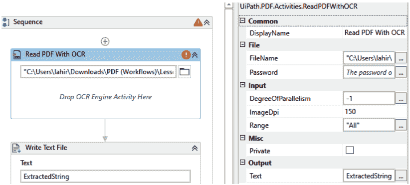

Figure 11.6 – 配置使用 OCR 读取 PDF 活动

- 6. 您还可以看到，有一些特定于 OCR 的其他属性。您需要将 OCR 引擎拖放到使用 OCR 读取 PDF 活动中，此活动才能正常工作。在活动面板中搜索 OCR 以找到所有可用的 OCR 引擎。您在活动面板中的搜索应类似于图 11.7：

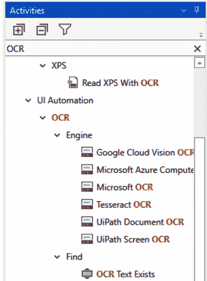

Figure 11.7 – 在活动面板中搜索可用的 OCR 引擎

- 7. 我们可用多种 OCR 引擎。使用 Microsoft OCR 活动。将 Microsoft OCR 活动拖放到使用 OCR 读取 PDF 活动中以完成配置。

- 8. 删除输出文本文件并运行工作流，以根据 OCR 配置生成新输出。

- 9. 打开输出文本文件并比较生成的结果。您会发现，数据提取未保留格式。所有文本都以原始形式显示，如下截图所示。但是，它能够提取页面图像部分中的所有文本：

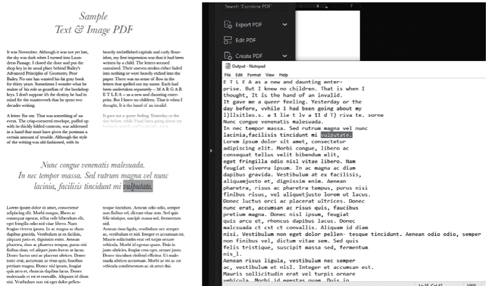

Figure 11.8 – 使用使用 OCR 读取 PDF 活动的示例数据提取

从本示例中吸取的教训是，使用 OCR 无法为我们提供格式。此外，使用 OCR 引擎提取的文本的准确性可能取决于 PDF 文件中图像的质量。您可以尝试将 ImageDPI 属性更改为不同的值，以确定哪种配置能为您提供最高级别的准确性。

如您现在所了解的，两个基本活动使我们能够从 PDF 文件中提取文本。您可以在 XPF 文件中自行练习 XPF 特定的活动。此外，探索其余活动，了解如何获取页数和提取页面范围，以熟悉这些活动。既然您已对 PDF 交互有基本了解，我们将进入下一节，该节说明如何使用屏幕抓取向导从 PDF 文件中提取文本。

## 使用屏幕抓取提取 PDF 文本

UiPath 中的屏幕抓取提供了从特定应用程序或 UI 元素提取文本的功能。与我们在 *第 10 章，探索用户界面和用户/机器人交互* 中使用的同一屏幕抓取向导一样，可以从 PDF 文件中提取数据。既然您已对屏幕抓取有总体了解，让我们尝试构建一个新工作流，使用屏幕抓取从同一个 PDF 文件中提取文本：

- 1. 打开需要进行屏幕抓取的 PDF 文档。
- 2. 打开本章前一部分中您正在处理的同一 UiPath 解决方案。
- 3. 创建一个新的 **序列** 工作流文件。
- 4. 单击顶部功能区中的 **设计** 选项卡。
- 5. 找到 **屏幕抓取** 选项并单击它以打开 **屏幕抓取向导**。单击后将自动激活 UI 元素检测，您移动鼠标指针时即可高亮显示元素。

- 6. 用鼠标高亮显示整个页面区域并左键单击。向导将检测该区域，提取给定区域的数据，并在屏幕抓取向导屏幕中向您显示：

It was November. Although it was not yet late, the sky was dark when I turned into Laundress Passage. I closed the door and put the shop key in its usual place behind Bailey’s Advanced Principles of Geometry. Poor Bailey. No one has wanted his fat gray book for thirty years. Sometimes I wonder what he makes of his role as guardian of the bookshop keys. I don’t suppose it’s the destiny he had in mind for the masterwork that he spent two decades writing.

A letter. For me. That was something of an event. The crisp-cornered envelope, puffed up with its thickly folded contents, was addressed in a hand that must have given the postman a certain amount of trouble. Although the style of the writing was old-fashioned, with its

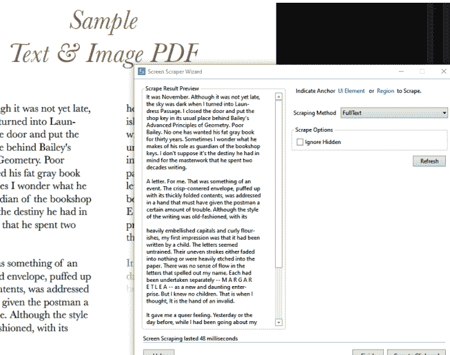

Figure 11.9 – 使用屏幕抓取向导的示例数据提取

如图 11.9 所示，您可以看到使用了 FullText 方法来抓取数据。使用 FullText 方法也在一定程度上保留了格式。尝试更改抓取方法并刷新结果，以查看您收到的不同输出。


7. 准备好继续后，将抓取方法设置回 FullText，然后单击 Finish 按钮完成向导。UiPath Studio 将根据您的配置在工作流文件中自动创建一些活动。向导完成后，您应该能看到如图 11.10 所示的工作流。此外，Variables 面板中应该会自动创建一个新变量，用于保存屏幕抓取输出：

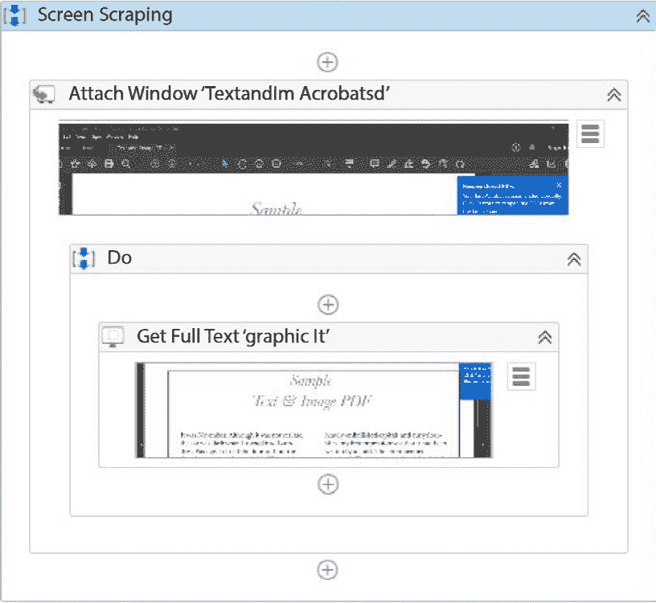

图 11.10 – 通过屏幕抓取自动创建的工作流片段

- 8. 添加 **写入文本文件** 活动，并像之前一样对其进行配置，以便将屏幕抓取活动的输出写入文本文件。

- 9. 重新运行工作流以检查输出。您应该能看到由空白分隔的段落。但是，文档的最后一部分未被提取，因为它是图像。

- 10. 尝试将屏幕抓取方法更改为 Native 或 OCR，查看每种配置下的输出效果。

到现在为止，我们已经尝试了从 PDF 文件中提取文本的不同方法。但是，我们使用的所有方法都提取了整页或指定 UI 元素中的文本。在某些场景中，您可能需要提取带有动态值的特定元素——例如，提取固定结构发票的总价格。本章下一节将重点介绍如何从文档的特定 UI 元素中提取动态值。

## 从 PDF 文件中提取单个动态值

提取单个动态值需要使用 UI 自动化活动。但是，这种方法仅支持固定结构的文档，因为元素是基于选择器标识的。运用您在第 10 章《探索用户界面和用户/机器人交互》中关于选择器和 UI 自动化所学的概念，让我们构建一个简单的工作流，从发票文档中提取特定值。我们将使用一个与图 11.11 类似的示例发票 PDF 文件。想象一下这样一个场景：我们收到多个结构相同的类似 PDF 文件。我们将继续构建工作流：

ThisWebHost LTD
337 Bath Road
Slough
Berkshire
SL1 5P
United Kingdom

发票 #38645

发票日期：2016 年 9 月 21 日
到期日期：2016 年 9 月 28 日

开票至

Some Company LTD - Robotic Automations
3216 Maple Court. California, MO 63101 USA

| 描述 | 总计 |
|---|---|
| 入门级共享托管 - (28/08/2016 - 27/10/2016) 托管位置：英国 (UK) | $30.00 美元 |
| 滞纳金 (添加于 02/10/2016) | $10.00 美元 |
| 小计 | $40.00 美元 |
| 信用 | $0.00 美元 |
| 总计 | $40.00 美元 |

| 交易日期 | 网关 | 交易 ID | 金额 |
|---|---|---|---|
| 2016 年 10 月 4 日 | 电汇 | 44M54677JH991194L | $40.00 美元 |
| 余额 | | | $0.00 美元 |

图 11.11 – 用于单值提取的示例发票文档

如图 11.11 所示，该文档是一个结构良好的原生 PDF 文件。现在是时候专注于如何从该文档中提取发票号码了：

- 1. 打开在上一节中创建的同一 UiPath 解决方案。
- 2. 创建一个新的序列工作流文件。
- 3. 在 Adobe Reader 中打开文档，因为我们需要使用 UI 自动化从文档中捕获发票号码。
- 4. 使用一个 **赋值** 活动，并使用 `Directory.GetFiles ("FolderPath")` 命令配置活动的 **值** 部分，以检索指定文件夹中的所有 PDF 文件。使用该命令并将文件夹路径替换为您的文件夹路径。
- 5. 创建一个名为 `FileList` 的 **字符串数组** 变量，并将其添加到 **赋值** 活动的 **到** 部分。此配置将用指定目录中可用的所有文件的文件路径填充字符串数组。
- 6. 现在，使用 **For Each** 活动循环遍历每个文件。拖放一个 **For Each** 活动，并将活动的 **类型参数** 设置配置为 `String`。
- 7. 将 **字符串数组** 变量添加到 **For Each** 活动的 **值** 属性中。到目前为止，配置应类似于 *图 11.12*：

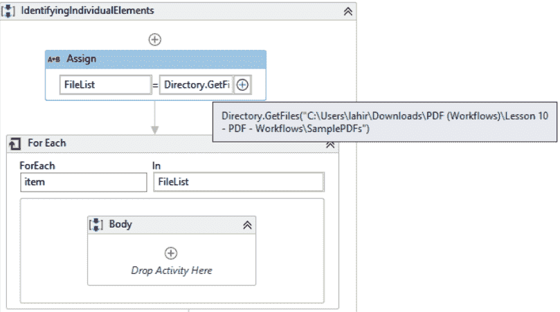

图 11.12 – 构建用于读取单个字段的工作流

- 8. 如我们在 UI 自动化章节中所学，需要使用 **获取文本** 活动来检索 UI 元素的数据。从 **活动面板** 中搜索 **获取文本** 活动并将其添加到新的工作流文件中。
- 9. 确保 Adobe Reader 是计算机上的第二个活动窗口。单击 **获取文本** 活动中的“指示屏幕上的元素”选项以启用 UI 识别模式。识别模式激活后，您只需将光标悬停在 PDF 文件的元素上方即可突出显示元素。
- 10. 将光标悬停在文档的发票号码部分上并使其突出显示该区域。单击它以指示要捕获的区域。此操作将配置 **获取文本** 活动，以从文档的该 UI 元素捕获数据。
- 11. 选择 **获取文本** 活动，并检查 **选择器** 属性，使其动态化以支持多个文档。单击 **选择器** 属性旁边的带三个点的按钮，打开选择器编辑器屏幕。
- 12. 单击“在 UI Explorer 中打开”选项，在 UI Explorer 窗口中打开选择器以获得更好的可见性。UI Explorer 窗口将类似于图 11.13：

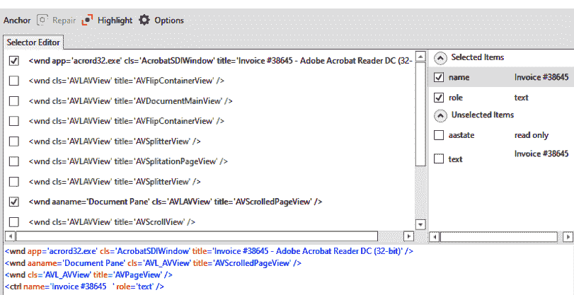

图 11.13 – 打开 UI Explorer 以查看选择器属性

- 13. 在检查选择器时，您应该会看到 `title` 标签明确聚焦于您打开的特定发票文档。此外，`name` 标签查找特定的发票号码。在所选项目部分中找到 name 标签并取消选中它。此操作将从选择器中删除 name 标签，以便选择器可以处理任何打开的文档。应用更改后，选择器将类似于图 11.14：

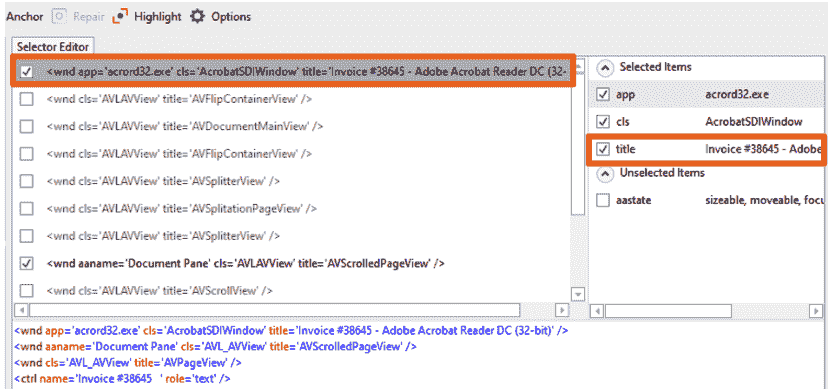

图 11.14 – 打开 UI Explorer 以查看选择器属性

- 14. 下一步更改是使 name 标签动态化，以捕获具有相同布局和结构的文档中的任何发票号码。我们可以在 name 标签中引入通配符字符来替代发票号码。name 标签应配置为：name = 'invoice *'。应用更改后，完整选择器将类似于图 11.15：

```
`<wnd app='acrord32.exe' cls='AcrobatSDIWindow' />
<wnd aaname='Document Pane' cls='AVL_AVView' title='AVScrolledPageView' />
<wnd cls='AVL_AVView' title='AVPageView' />
<ctrl name='Invoice *' role='text' />`
```

图 11.15 – 已更新的发票号码选择器

- 15. 单击“验证”按钮并启用“高亮显示”选项。选择器应突出显示文档中的发票号码字段，并将“验证”按钮变为绿色。
- 16. 单击 **保存** 按钮保存并关闭 **UI Explorer** 窗口。
- 17. 通过创建并提供一个新字符串变量来配置 **获取文本** 活动的 **输出值**。
- 18. 在 **获取文本** 活动下方添加一个 **写入行** 活动，并对其进行配置以打印您创建的字符串变量中的值。
- 19. 运行流程以查看机器人是否可以提取发票号码。您应该能在 **输出** 面板中看到提取的数字。

使用相同的概念并提取其他文档值，以更熟悉文档数据提取。理解选择器及其使用最佳实践非常重要。运用在第 10 章《探索用户界面和用户/机器人交互》中获得的知识，尝试找到最佳选择器来捕获值。在探索过程中，您可能会意识到无法构建可靠的选择器来提取某些值。在下一节中，我们将描述在无法构建可靠选择器从文档中提取值的场景下可以采用的方法。

## 使用 Anchor Base 活动提取单个值

我们之所以能够为文档构建可靠的选择器，是因为文档中始终存在单词 "invoice"。但是，如果您查看 **小计**、**信用** 和 **总计** 等值，它们只包含一个可能会更改的数字。图 11.16 显示了 **小计** 字段提取的选择器：

```
<wnd app='acrord32.exe' cls='AcrobatSDIWindow' title='Invoice #38645 - Adobe Acrobat Reader DC (32-bit)' />
<wnd aaname='Document Pane' cls='AVL_AVView' title='AVScrolledPageView' />
<wnd cls='AVL_AVView' title='AVPageView' />
<ctrl name='$40.00 USD ' role='text' />
```

图 11.16 – 小计字段的选择器

如示例选择器所示，它不包含我们可以依赖的字段来定位正确的字段。我们有一个简单的解决方法来处理此类场景。我们可以使用 **锚点基** 活动来查找锚点（即，我们可以依赖的其他字段）来提取相应的值。**锚点基** 活动包含两个部分：**锚点** 部分和 **值** 部分：

- • **锚点** 部分专门用于查找带有可靠选择器的适当 UI 元素，该元素位于需要提取的值旁边。**锚点基** 活动的 **锚点** 部分使用 **查找元素** 活动进行配置，以查找锚点元素。


- 锚点基准活动的 Value 部分配置了需要与要读取或写入的字段执行的交互。

现在，我们将尝试通过引入“锚点基准”活动来更新相同的工作流，以提取 Credit Total 值。由于我们要读取一个值，可以在“锚点基准”活动的 Value 部分中使用“获取文本”活动。我们将使用单词 Credit Total 作为可靠的锚点，因为文本是静态的，但值不是。

为此，请执行以下步骤：

- 1. 从活动面板中搜索“锚点基准”活动，并将其放置在“写入行”活动下方。
- 2. 搜索“查找元素”活动，并将其放置在“锚点基准”活动的锚点部分中。
- 3. 单击“查找元素”活动的“在屏幕上指示”选项，并在文档中指示单词 Credit Total。
- 4. 如您已知，指示元素后，选择器将指向特定文档。因此，如同在上一节中所做的那样，我们需要编辑选择器的 title 标记，使其动态化。导航到 UI 探测器，为选择器 title 标记中波动的部分引入通配符字符 ` * `，并保存更改。修改后的选择器类似于图 11.17：

```
<wnd app='acrord32.exe' cls='AcrobatSDIWindow' title='*' - Adobe Acrobat Reader DC (32-bit)' />
<wnd aaname='Document Pane' cls='AVL_AVView' title='AVScrolledPageView' />
<wnd cls='AVL_AVView' title='AVPageView' />
<ctrl name='Credit ' role='text' />
```

图 11.17 - Credit Total 标签的动态选择器

- 5. 现在，使用“获取文本”活动，并将其放置在“锚点基准”活动的 Value 部分（右侧部分）中。
- 6. 通过“在屏幕上指示”选项，在文档中指示 Credit Total 标签的 Value 部分，以配置“获取文本”活动。
- 7. 为 Output Value 属性提供一个字符串变量，以完成“获取文本”活动的配置。
- 8. 在 **锚点基准** 活动中还有一个其他属性需要定义，即相对于需要从中获取值的 UI 元素，锚定元素的位置。在我们的场景中，`total_Credit` 标签位于信用总额值的左侧。因此，需要将 **锚点基准** 活动的 **锚点位置** 属性更改为 **左侧**。
- 9. 添加另一个 **写入行** 活动，并打印变量中的 **CreditTotal** 值。完成的进程工作流应类似于图 11.18：

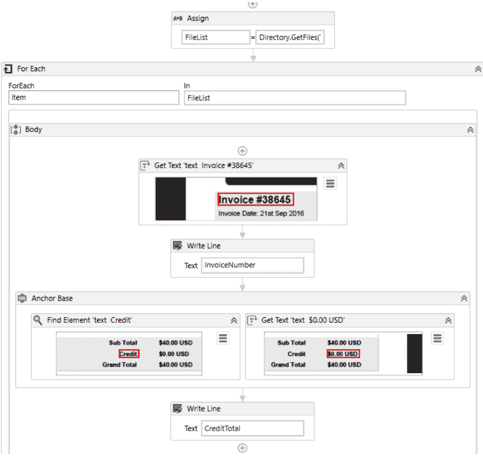

图 11.18 – 使用锚点基准提取单个值

- 10. 运行进程并检查输出。示例输出如图 11.19 所示：

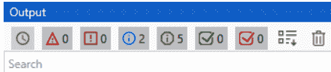

图 11.19 – 单个值提取的示例输出

到此，您将熟悉可以对 PDF 文件执行以提取数据的基本操作。您可以将更多高级函数应用于文档，以生成不同类型的非固定结构文档。但是，这不在本章的范围内。文档处理是一个令人兴奋的领域，您可以在其中使用多种技术，正如您在阅读本章各节时所经历的那样。我们强烈建议您应用迄今所获得的知识，并继续练习处理不同类型的文档。

## 摘要

本章向您介绍了使用 UiPath 处理 PDF 文件的主题。PDF 文件是我们每天交互的一种普遍文件类型。当今，所有组织都要处理文档，这是一个非常耗时的过程。本章涵盖的概念将帮助您使用一组简单的活动，轻松从 PDF 文件中提取图表、文本和其他信息。此外，本章还涵盖了 PDF 自动化中涉及的活动、从页面提取文本/图像，以及使用 UI 自动化从 PDF 文件中提取关键字段。

您在本章学到的概念在未来项目中将非常有帮助。掌握如何最佳地与 PDF 文件交互以及根据不同场景使用什么活动至关重要。与 PDF 处理类似，电子邮件在我们的日常活动中也发挥着重要作用。我们阅读和发送电子邮件以与其他各方通信。UiPath 还支持电子邮件自动化，以改善员工的工作生活。在下一章中，我们将探讨如何自动化您在电子邮件中执行的操作。电子邮件自动化是当今我们构建的几乎所有自动化解决方案的一部分。因此，即使您自动化的进程不包含电子邮件处理活动，学习如何与电子邮件交互也是至关重要的。
