## 12 探索 UiPath 电子邮件自动化

**电子邮件**是最流行的数字通信形式之一，被个人和组织广泛使用。在日常生活中，就手动和重复性任务而言，读取电子邮件、根据电子邮件输入执行业务流程以及回复电子邮件等活动消耗了我们大部分时间。UiPath 提供了多种电子邮件方式来读取电子邮件、筛选电子邮件和回复电子邮件，以帮助我们自动化重复的业务流程。

作为本章的一部分，您将熟悉 **电子邮件自动化**、不同的电子邮件自动化类型以及支持电子邮件自动化的不同活动。您将学习如何发送和接收电子邮件、回复电子邮件、附加和下载文档附件，以及为电子邮件使用定义的消息模板。

本章包含以下部分：

- 探索电子邮件活动
- 使用接收消息提取电子邮件内容
- 自动化发送电子邮件消息
- 从电子邮件筛选和下载附件

### 技术要求

本章要求您已安装 UiPath Studio 和 Robot，并且对变量、数据类型、控制流、数据操作、Excel 和数据表以及选择器有良好的理解。您可以参考第 5 至第 10 章来获取所需的所有知识。

### 探索电子邮件活动

电子邮件活动包用于自动化使用 IMAP、POP3 和 SMTP 等协议执行的电子邮件相关任务，我们将在即将到来的章节中探讨这些协议。要识别可用的不同电子邮件活动，需要在 UiPath Studio 中安装 UiPath Mail Activities 包。在本节中，我们将探讨如何安装 UiPath.Mail.Activities 包，然后使用逐步说明调查不同的电子邮件活动。

让我们开始吧：

- 1. 创建新项目

通过在 UiPath 主页视图的新建项目部分中单击 Process，创建新的电子邮件项目。这将打开新建空白进程窗口。填写名称 (1) 和描述 (2) 的详细信息，然后单击创建按钮 (3)，如图 12.1 所示：

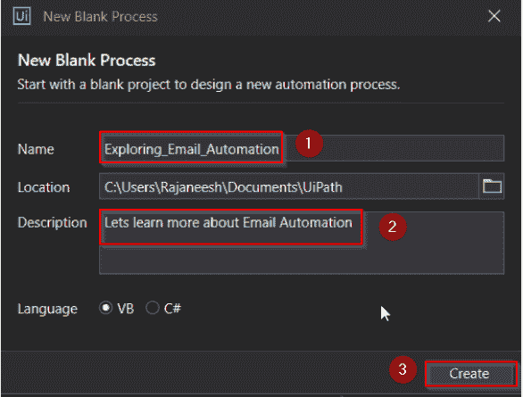

图 12.1 – 创建新进程

- 2. 验证邮件活动

在创建进程时，UiPath.Mail.Activities 选项默认可用于项目的依赖项分支中，如图 12.2 所示：

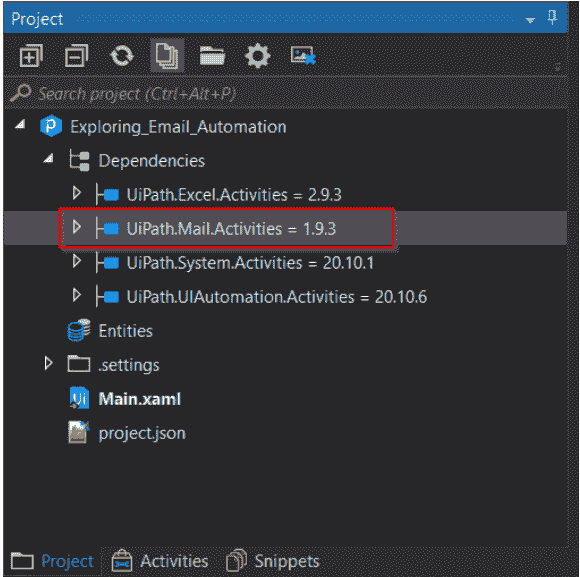

图 12.2 – 电子邮件活动依赖项

但是，如果它被意外卸载或删除，您可能需要从包中手动安装电子邮件依赖项。

- 3. 安装 UiPath.Mail.Activities

确保 Dependencies 部分中没有 UiPath.Mail.Activities 选项，如图 12.3 所示。如果已存在，可以单击依赖项并单击卸载按钮进行卸载，如以下屏幕截图所示：

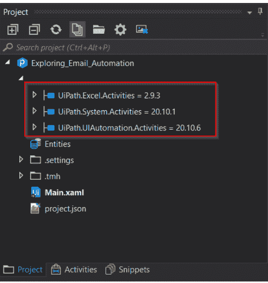

图 12.3 – 电子邮件活动依赖项不可用

现在，单击设计选项卡中的管理包，并执行以下步骤，如图 12.4 所示：

- I. 在搜索文本框 (1) 中输入 UiPath.Mail.Activities。
- II. 单击左侧的“官方” (2) 选项。这将填充所需的包 (3)。
- III. 单击包 (3)，然后单击安装 (4)。

## IV. 在屏幕底部单击“保存”按钮以安装包：

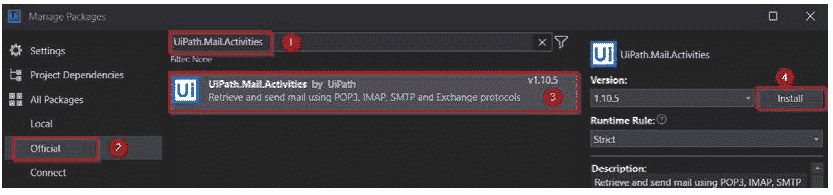

图 12.4 - 安装电子邮件依赖项

## 4. 验证已安装的包

在 Project 中展开 Dependencies 部分，以验证已安装的 UiPath.Mail.Activities 依赖项，如图 12.5 所示：

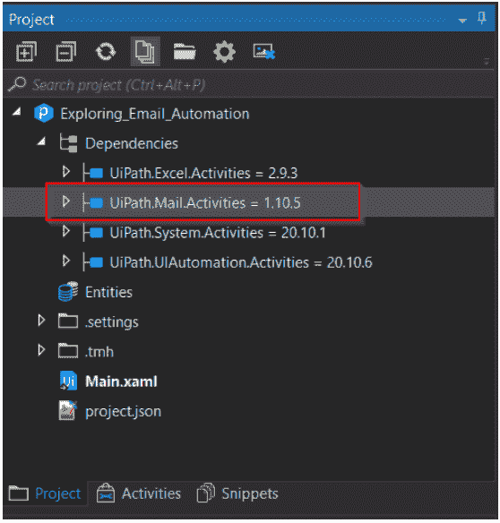

图 12.5 – 验证已安装的依赖项

## 5. 验证活动

单击 **“活动”** (1) 选项卡并在搜索字段中键入 **“邮件”** (2) 以验证邮件活动。您将看到六个不同的类别，Exchange、IBM Notes、IMAP、Outlook、POP3 和 SMTP，以及 **“创建 HTML 内容”**、**“保存附件”** 和 **“保存邮件消息”**，如 **图 12.6** 中的 (3) 所示：

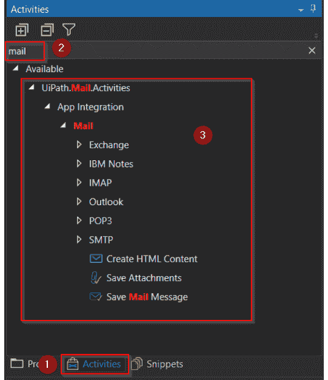

图 12.6 - 验证已安装的活动

这些活动用于不同的自动化目的，我们将在即将推出的章节中了解它们。请注意，如果不安装 `UiPath.Mail.Activities` 包，这些活动将不会显示。现在让我们来看看不同的邮件活动：

### I. Exchange

**Exchange** 是指 Microsoft 企业级电子邮件解决方案，这些活动可用于执行各种电子邮件操作，例如发送电子邮件、接收电子邮件、在文件夹之间移动电子邮件以及删除电子邮件。可用活动如 **图 12.7** 所示：

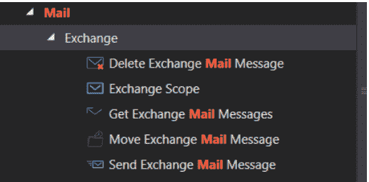

图 12.7 – Exchange

### II. IBM Notes

IBM Notes 活动可用于在 IBM Notes 客户端中自动执行各种电子邮件任务，用于发送电子邮件、接收电子邮件、在文件夹之间移动电子邮件以及删除电子邮件。可用活动如图 12.8 所示：

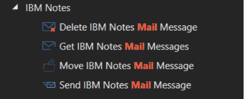

图 12.8 – IBM Notes

### III. IMAP

互联网消息访问协议 (IMAP) 仅用于接收电子邮件。还有其他功能可将电子邮件标记为已读，并在文件夹内移动电子邮件。可用活动如图 12.9 所示：

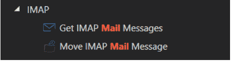

图 12.9 – IMAP

### IV. Outlook

Outlook 活动用于自动执行已配置 Outlook 帐户上的电子邮件任务。它们可以执行各种自动化任务，包括发送电子邮件、接收电子邮件、在文件夹之间移动电子邮件和删除电子邮件。作为先决条件，您的计算机上应安装 Microsoft Outlook 应用程序，以便活动能够正常运行。可用活动如图 12.10 所示：

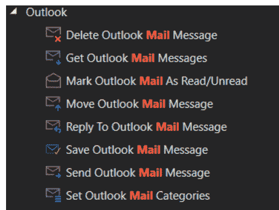

图 12.10 – Outlook

### V. POP3

邮局协议 (POP3) 是最古老且使用频率较低的协议之一，仅用于接收电子邮件。可用活动如图 12.11 所示：

图 12.11 – POP3

### VI. SMTP

简单邮件传输协议 (SMTP) 是最基本的协议之一，仅用于发送电子邮件。可用活动如图 12.12 所示：

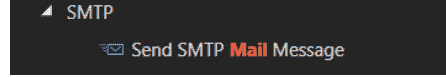

图 12.12 – SMTP

在本节中，我们探讨了如何安装 UiPath.Mail.Activities 包并验证了已安装的依赖项。我们还查看了每个活动的高级别介绍，并将在即将推出的章节中探讨所有重要的电子邮件活动。

## 使用“接收消息”提取电子邮件内容

在本节中，我们将学习如何自动接收电子邮件，机器人将读取 Google (Gmail) 帐户中电子邮件的内容。我们将使用 IMAP 来实现此目标。假设电子邮件地址和密码已作为参数在工作流中传递，我们仅考虑前五封未读电子邮件：

- 1. **创建进程**
  在 UiPath Studio 中创建名为 `Email_Automation` 的新进程。要继续此开发，您需要向 Gmail 帐户发送一封示例电子邮件。

- 2. **发送电子邮件**
  向需要自动化的 Google 电子邮件发送一封测试电子邮件，如图 12.13 所示：

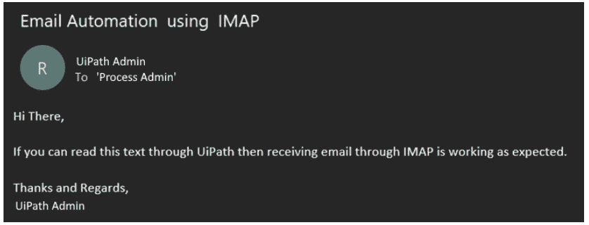

图 12.13 – 示例电子邮件

### 3. 在 Gmail 设置中启用 IMAP

您需要在 Gmail 设置中启用 IMAP，如图 12.14 所示。为此，首先登录您的 Gmail 帐户并单击设置图标，然后单击“查看所有设置”按钮。在设置屏幕上单击“转发和 POP/IMAP”，如图 12.14 所示：

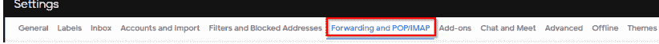

图 12.14 – 设置屏幕

在 IMAP 访问部分单击“启用 IMAP”，如图 12.15 所示：

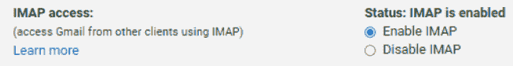

图 12.15 – 启用 IMAP

### 4. 在 Google 中创建应用密码

接下来，您需要创建一个应用密码，以便在 UiPath Studio 中用于访问 Gmail 并连接到 IMAP。为此，请访问 https://myaccount.google.com/apppasswords 创建应用密码。单击“生成”按钮（如图 12.16 所示）并复制生成的密码，该密码将在即将进行的步骤中复制到 UiPath 活动中。

选择要为其生成应用密码的应用和设备。

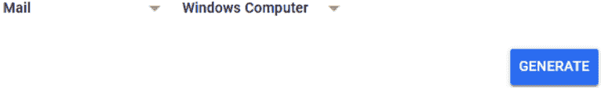

图 12.16 – 生成应用密码

### 5. 创建接收电子邮件的工作流

- I. 按以下步骤创建用于自动接收电子邮件的进程工作流。将“获取密码”活动拖入工作流，如图 12.17 所示：

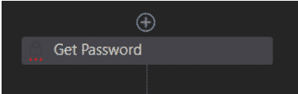

图 12.17 – “获取密码”活动

- II. 创建以下变量以存储电子邮件 ID、密码和实际电子邮件。在 **“默认”** 字段中输入要自动化的电子邮件地址，如图 12.18 所示：

| 名称 | 变量类型 | 作用域 | 默认值 |
| :--- | :--- | :--- | :--- |
| email | String | Sequence | "processadminhr@gmail.com" |
| password | String | Sequence | 输入 VB 表达式 |
| Emails | List<MailMessage> | Sequence | 输入 VB 表达式 |

图 12.18 – 进程的变量

- III. 单击步骤 I 中的“获取密码”活动，将上一节步骤 4 中复制的密码输入到属性窗格中的“密码” (1) 字段，并将结果存储在名为 password (2) 的变量中，如图 12.18 所示：

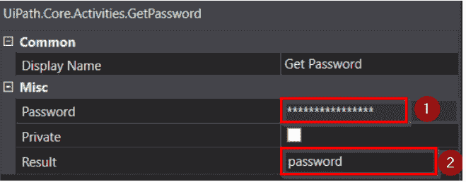

图 12.19 – “获取密码”属性

- IV. 将“获取 IMAP 邮件消息”活动拖入工作流，如图 12.19 所示：

图 12.20 – “获取 IMAP 邮件消息”活动

- V. 配置 **IMAP** 设置属性以访问 Gmail 中的电子邮件，如 *图 12.21* 和以下步骤所示：
  - i. 在 **“邮件文件夹”** (**1**) 中，输入 "`Inbox`"。
  - ii. 在 **“端口”** (**2**) 中，输入 993。
  - iii. 在 **“服务器”** (**3**) 中，输入 "`imap.gmail.com`"。
  - iv. 在 **“电子邮件”** (**4**) 中，输入 `email` 字符串变量，在变量面板中定义要自动化的电子邮件地址，如步骤 II 中“5. 创建接收电子邮件的工作流”所述。
  - v. 在 **“密码”** (**5**) 中，输入从步骤 III 中“5. 创建接收电子邮件的工作流”获得的 `password` 变量。
  - vi. 选中 **“仅未读邮件”** (**6**) 复选框。
  - vii. 在 **“数量”** (**7**) 中，输入 5，以仅读取前五封未读电子邮件。
  - viii. 在 **“消息”** (**8**) 中，输入 `Emails List<MailMessage>` 变量以存储所有电子邮件。

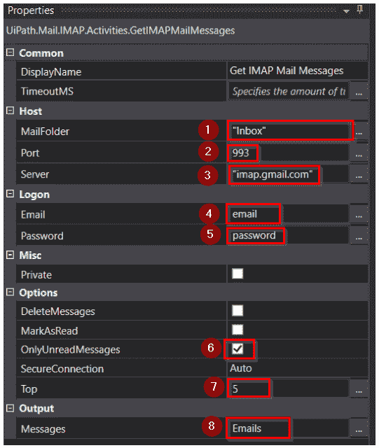

图 12.21 – 配置 IMAP 设置属性

- VI. 鉴于您已阅读了前一步骤中描述的前五封电子邮件，现在，您可以使用邮件变量 (1) 通过 **“For Each”** 活动循环每封电子邮件 (2) 以查找预期的电子邮件，如图 12.22 所示：

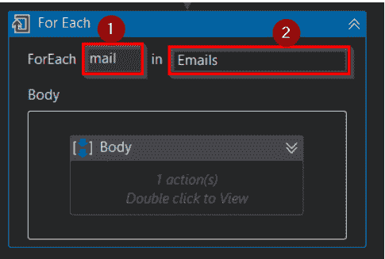

图 12.22 – “For Each”活动

- VII. 配置 **“For Each”** 活动的属性，以验证 **“TypeArgument”** 是 `System.Net.Mail.MailMessage`，如图 12.23 所示：

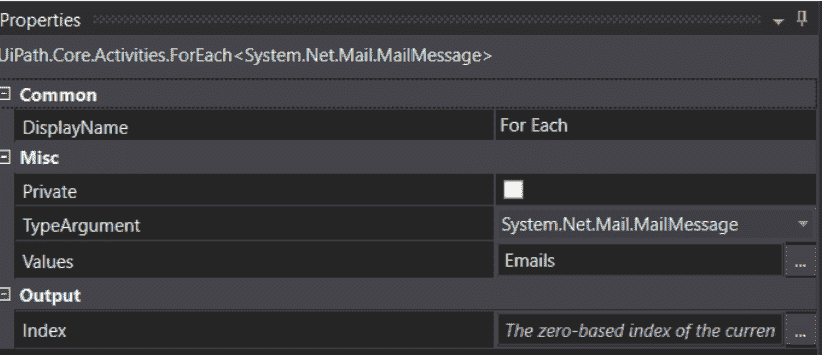

图 12.23 – “For Each”活动属性

## VIII. 执行以下步骤以过滤包含 IMAP 主题的电子邮件，如图 12.25 所示：

- i. 添加一个 If 活动。
- ii. 在条件 (1) 中，输入 mail.Subject.Contains("IMAP")。
- iii. 在 Then 部分添加一个 Assign 活动，并将匹配的电子邮件存储到 emailBody (2) 变量中，如图 12.24 所示：

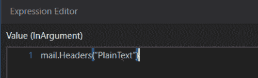

图 12.24 – Assign 活动的值

- iv. 使用 Write Line 活动 (3) 输出捕获的电子邮件。

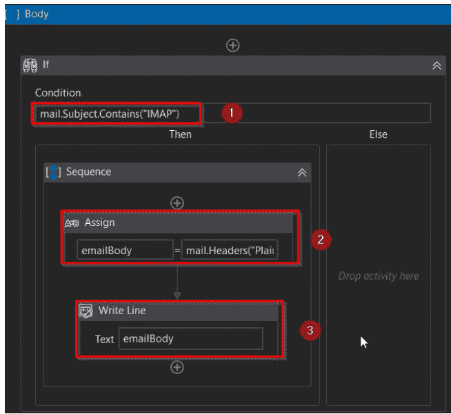

图 12.25 – For Each 内的 If 条件

## IX. 使用 **运行** 按钮或 `Ctrl + F5` 运行项目，以验证 **输出** 面板中的输出是否按预期工作。确保在 *步骤 2* 中发送的电子邮件显示为输出，如 *图 12.26* 所示：

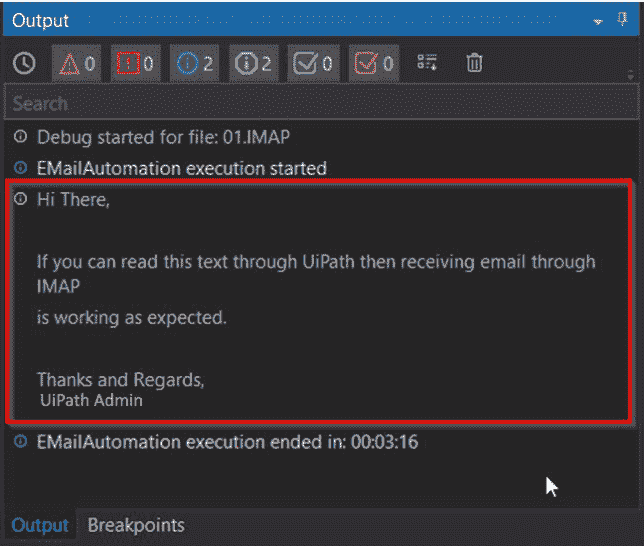

图 12.26 - 输出面板

在本节中，我们了解了如何在 UiPath Studio 中使用 IMAP 自动化接收来自 Gmail 的电子邮件。此外，我们了解了如何使用 Gmail 安全地创建密码并将其传递到 UiPath Studio。最后，我们探索了许多不同的活动，例如 Get Password 和 Get IMAP Mail Messages，并了解了如何在电子邮件自动化中实现它们。现在，让我们看看如何在下一节中自动化发送电子邮件，我们将使用 UiPath Studio 自动发送带有附件的电子邮件。

## 自动化发送电子邮件消息

在本节中，我们将了解如何自动化发送电子邮件，机器人将读取 Gmail 账户中电子邮件的内容。我们将使用 SMTP 来实现此目标。假设电子邮件地址和密码已作为参数在工作流中传递，我们只关注前五条未读电子邮件，就像我们在上一节“使用接收消息提取电子邮件内容”中阅读电子邮件的示例一样。你只需要一个 Gmail 账户来发送带有附件的电子邮件，以及一个配置在 Outlook 中的另一个电子邮件来接收 UiPath 机器人发送的电子邮件。

以下提供了从 UiPath Studio 发送电子邮件的逐步说明：

- 1. **创建进程**
  在 UiPath Studio 中创建一个新的 `SMTPMailMessages` 进程。

- 2. **使用 Get Password 配置 Gmail 密码**

- 3. 向工作流中添加一个新活动，**Get Password**，如图 12.27 所示：

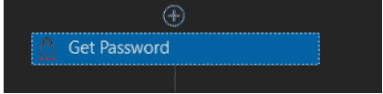

图 12.27 – Get Password

配置在上一节“步骤 4，在 Google 中创建应用密码”中创建的应用密码，如图 12.28 所示：

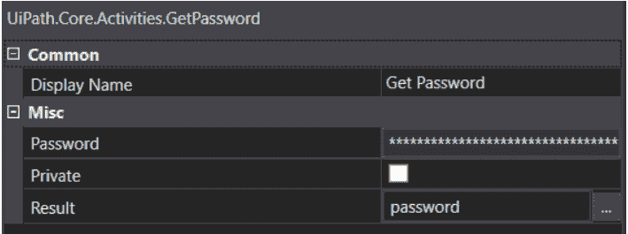

图 12.28 – Get Password 属性

- 4. 设置包含要处理的输入文件的输入文件夹

将要处理的输入文件保留在输入文件夹中。我们有两个文件，Invoice1.pdf 和 Invoice2.pdf，需要附加到电子邮件中，如图 12.29 所示：

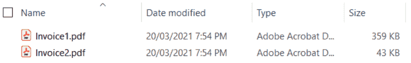

图 12.29 – 输入文件夹

- 5. 定义输入变量

创建一个用于发票的字符串变量数组以定义输入文件，如图 12.30 所示：

| 名称 | 变量类型 | 作用域 | 默认值 |
|---|---|---|---|
| invoices | String[] | _02_SMTPEmailMessages | ["Invoice1.pdf","Invoice2.pdf"] |

图 12.30 – 已定义的输入文件

- 6. 处理附件

将 For Each 活动添加到工作流，并使用变量 invoice (1) 循环每个 invoices (2)，为每个发票发送单独的电子邮件，如图 12.31 所示：

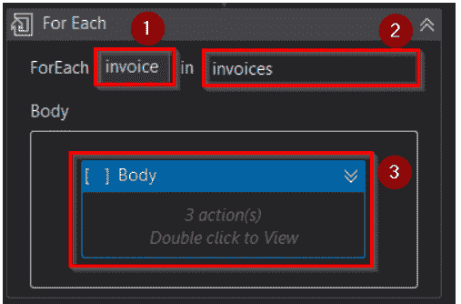

图 12.31 – 每个发票文件的 For Each

- 7. 发送 SMTP 电子邮件活动

使用两个 **Assign** 活动分配 `filename` (1) 和使用变量 `filefullPath` (2) 的文件完整路径。接下来，添加 **Send SMTP Mail Message** (3) 活动，如 *图 12.32* 所示：

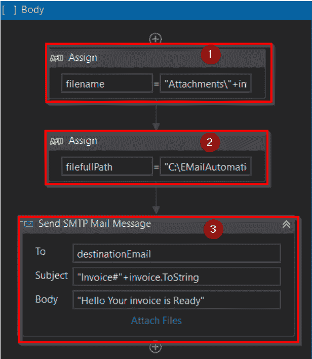

图 12.32 – For Each 内的 Send SMTP Mail Message

确保将正确的变量分配给 filename，如图 12.33 所示：

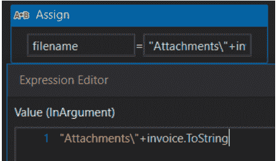

图 12.33 – 作为字符串的文件名

确保将正确的变量分配给 filefullPath，以便机器人可以访问正确的文件名，如图 12.34 所示：

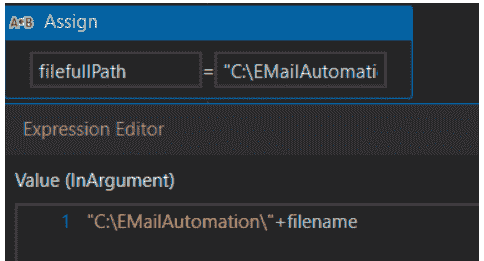

图 12.34 – 分配输入文件的完整路径

- 8. 配置 Send SMTP Mail Message 活动的属性

在 (集合) 字段 (1) 中配置 Attachments 文件名变量，用主题和正文内容更新电子邮件部分 (2)，更新主机详细信息（如端口和服务器）以发送 SMTP 电子邮件 (3)，传递电子邮件登录详细信息（如电子邮件和密码）(4)，最后，在 To 字段 (5) 中传递接收者详细信息变量，即接收者的电子邮件 ID，如图 12.35 所示：

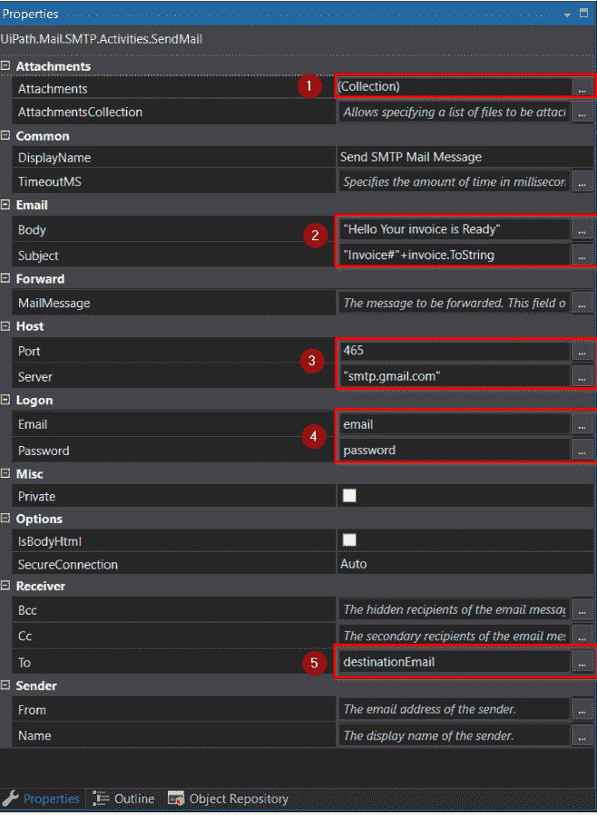

图 12.35 – Send SMTP Mail Message 的属性

确保将正确的变量分配给 **附件**，以便机器人在发送电子邮件时可以附加正确的文档，如图 12.36 所示：

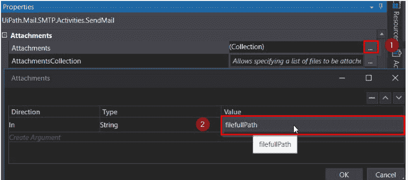

图 12.36 – Send SMTP Mail Message 的附件

- 9. 输出验证

使用 **运行** 按钮或 *Ctrl + F5* 运行项目以验证输出。检查目标电子邮件，看是否收到了两封带有附件的电子邮件。确保在 *步骤 7* 中发送的电子邮件显示为电子邮件中的输出，如 *图 12.37* 所示：

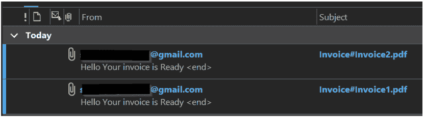

图 12.37 – 目标电子邮件中的输出验证

在本节中，我们已使用 UiPath 机器人和 SMTP 自动化了电子邮件发送。我们使用 Gmail 账户通过 **附件** 属性发送带有附件文档的电子邮件，并使用 Outlook 账户接收电子邮件。最后，我们执行了机器人以验证输出。在下一节中，我们将了解如何自动处理来自电子邮件的附件。

## 自动化过滤和下载来自电子邮件的附件

在电子邮件自动化中，处理附件是最基本的任务之一。在 UiPath Studio 中，我们将使用 Get Outlook Message 活动来读取附件并将其存储在目标文件夹中。我们将使用上一节（自动化发送电子邮件中的步骤 9）生成的输出电子邮件中的附件文档来处理附件。对于所有 Outlook 活动，Outlook 应用程序需要安装在执行自动化的计算机上。最后，我们将了解各种筛选选项，例如电子邮件地址和主题行。

使用以下逐步说明下载附件：

- 1. **创建新项目**
  从 UiPath Studio 后台视图创建一个新进程。

- 2. **获取 Outlook 邮件消息**
  在 Main 文件中，从 **活动** 面板拖动 **Get Outlook Mail Message** 活动，如图 12.38 所示：

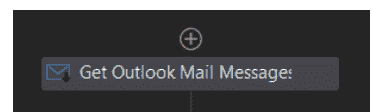

图 12.38 – Get Outlook Mail Message 活动

- 3. 配置 Get Outlook Mail Message 属性

单击 Get Outlook Mail Message 活动以查看属性面板。在输入部分，在 Account 字段 (1) 中输入 Outlook 账户的电子邮件地址，以及将访问电子邮件的相应 MailFolder (2)。现在，是时候使用 Options 部分中的 Filter 字段 (3) 筛选预期的电子邮件了，您需要在其中输入发件人的电子邮件地址。或者，您可以使用 Subject 或任何其他电子邮件参数来筛选电子邮件。启用 OnlyUnreadEmails 选项 (4) 并将 Top 字段设置为 10 (5) 以读取前 10 封未读电子邮件。最后，将所有读取的电子邮件保存到输出字段 (6) 中的 emails 变量中，如图 12.39 所示：

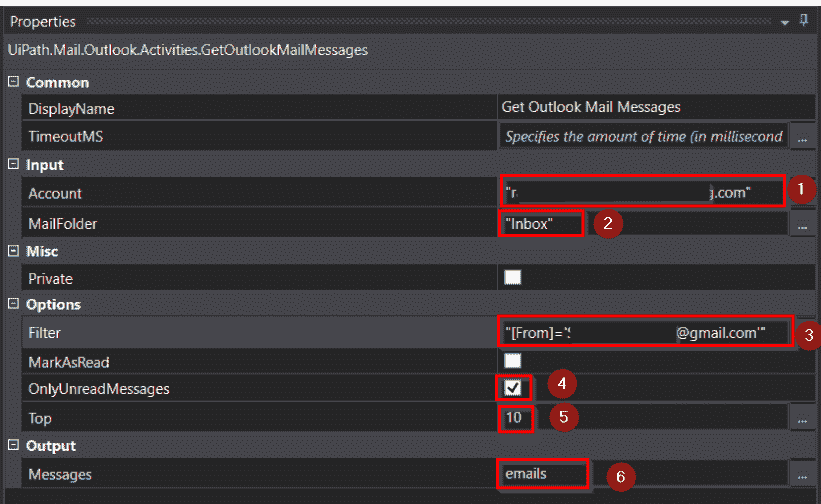

图 12.39 – Get Outlook Mail Message 属性

## 4. 使用“保存附件”活动提取并保存附件

到目前为止，我们已读取所有筛选后的电子邮件，并将其保存到名为 emails 的变量中。现在，我们将使用 For Each 活动 (1) 处理每封电子邮件，并在“条件”字段 (2) 中检查主题行包含 Invoice# 的电子邮件。使用 Split 函数 (3) 从主题行中提取发票号，以创建输出文件夹来保存附件。现在，使用“保存附件”活动 (4) 提取附件，如图 12.40 所示：

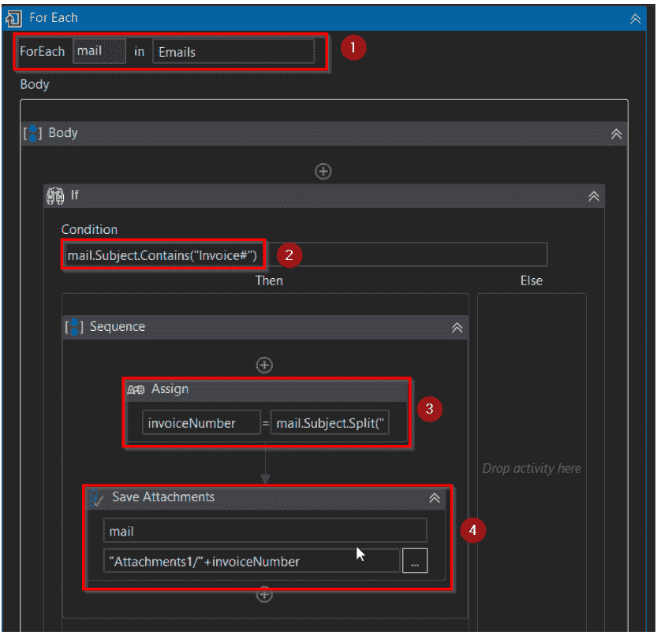

图 12.40 – “保存附件”属性

有关创建输出文件夹以保存附件的更多信息，如图 12.41 所示：

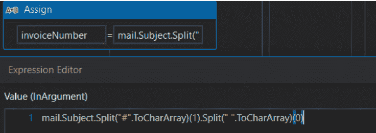

图 12.41 – 使用 Split 函数创建输出文件夹

## 5. 输出验证

使用“运行”按钮或 Ctrl + F5 运行项目以验证输出。检查目标文件夹以验证附件。确保您从 Gmail 发送的文件显示为项目中的输出，如图 12.42 所示：

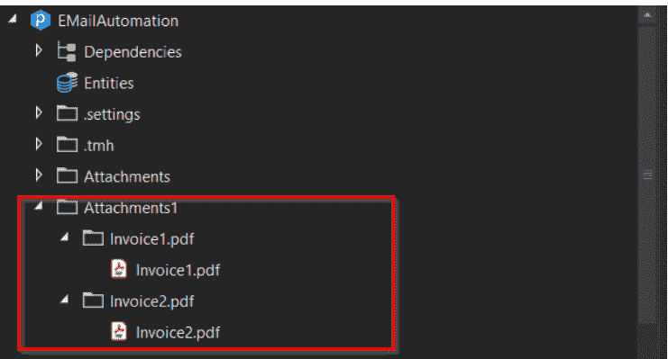

图 12.42 – 运行项目并验证输出

在本节中，我们探索了不同功能，以处理来自指定输入电子邮件的电子邮件，读取主题、电子邮件内容并下载附件。我们还探索了 **获取 Outlook 邮件消息** 活动的属性，其中了解了 **帐户** 和 **邮件文件夹** 等字段的用法。最后，我们使用不同选项根据某些条件筛选电子邮件，例如来自电子邮件列表的 **仅未读消息 from**，比如前 100 封电子邮件。这些概念可以轻松应用于处理电子邮件中的附件。

## 摘要

本章我们探索了电子邮件自动化的所有内容。我们执行了大部分电子邮件操作，例如发送电子邮件、接收电子邮件以及使用 UiPath Studio 自动下载附件——这些是我们经常手动执行的操作。此外，我们讨论了各种电子邮件协议，例如 IMAP、SMTP、POP3、Exchange 和 Outlook，以及它们的用法。我们还实现了实际示例，以理解所有基本的电子邮件自动化概念，从发送电子邮件到接收电子邮件、筛选电子邮件和处理附件。

在下一章中，我们将了解更多关于调试的内容。我们将使用 UiPath 轻松故障排除、识别错误，并在创建自动化项目时的任何挑战性情况下练习解决问题。
