## 13 调试

软件开发项目很少完美，因为各种错误可能会阻碍项目执行。**调试**是一个多步骤过程，涉及识别并从给定项目中删除这些错误/缺陷，使其按预期正确运行且无错误。

就像任何其他 **集成开发环境 (IDE)** 一样，UiPath Studio 提供了多个选项，帮助您快速定位错误，特别是在大型和复杂的工作流中。它可以帮助您查看每个活动的执行情况，验证它获取的数据，并检查生成输出时是否存在错误。此外，它提供了一个实时引擎，在使用工作流时检查错误。

在本章中，您将学习如何从 **调试** 功能区使用不同的调试操作，以及不同的调试面板和断点如何在调试过程中帮助纠正错误。您还将学习如何测试单个活动并使用活动创建测试平台，然后如何使用 **从此活动运行** 选项。

本章包含以下主题：

- 了解调试操作
- 使用调试面板
- 测试活动

## 技术要求

在开始本章之前，请安装 UiPath Studio 和 Robot。

本章稍后，我们将介绍一个会导致运行时异常的过程，并使用 UiPath Studio 中的调试选项修复它。

您可以从 GitHub 仓库下载该过程：https://github.com/PacktPublishing/UiPath-Associate-Certification-Guide.git。

## 了解调试操作

可以从“设计”和“调试”功能区对单个工作流或整个项目进行调试。单击功能区中的调试选项将打开调试面板。以下截图显示了 UiPath Studio 中的 **调试** 功能区：

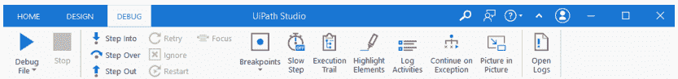

图 13.1 – **调试** 功能区

调试选项卡允许用户对单个文件或整个项目进行调试。功能区包含多个调试操作。让我们详细了解每个操作。

## 调试文件

单击“调试文件”将启动该特定工作流的调试过程。

## 停止

单击“停止”按钮将结束调试过程，无论哪个活动正在执行。“停止”按钮的键盘快捷键是 `F12`。

## 逐过程

当您想要一次调试一个活动时，请从调试功能区选择“逐过程”选项。触发“逐过程”操作时，调试器将打开并高亮显示工作流容器（如流程图或序列活动）中的活动。单击一次“逐过程”将高亮显示即将执行的活动。再次单击“逐过程”将执行高亮显示的活动，然后高亮显示下一个活动。

将 **逐过程** 与 `Invoke Workflow File` 活动一起使用时，工作流会在新标签页中以 _只读_ 模式打开，其中的每个活动会逐个执行。

**逐过程** 的键盘快捷键是 `F11`。

> 注意
> `Sequence`、`Flowchart` 和 `Invoke Workflow File` 等活动称为 **容器**。

## 跳过

**跳过** 是 **逐过程** 的相反操作。它不会打开当前容器并逐个调试活动，而是一次性执行容器及其中的所有活动。当您想要跳过不太可能在执行期间触发任何问题的容器及其中的所有活动时，这非常有用。

另外，当调试器位于容器内且您执行 **跳过** 操作时，它将像 **逐过程** 一样一个接一个地跳过其中的所有活动，但不会高亮显示特定活动。

**跳过** 的键盘快捷键是 `F10`。

## 跳出

**跳出** 操作完成当前容器中所有活动的执行。执行完所有活动后，控制权会移出该容器并暂停调试。当您处理嵌套序列时，此操作非常有用。

**跳出** 的键盘快捷键是 `Shift + F11`。

## 重试

调试过程中，当某个活动抛出异常且您想要再次调试此活动时，请选择 **重试** 操作。**重试** 会重新执行前一个活动，如果在调试过程中再次遇到异常，则会抛出异常。抛出异常的活动会被高亮显示，错误详细信息会在 **本地变量** 和 **调用堆栈** 面板中显示（您将在 _使用调试面板_ 部分了解 **本地变量** 和 **调用堆栈** 面板）。


### 忽略

调试时，您可以使用 **Ignore** 操作跳过当前异常，并从流中的下一个活动恢复执行。

您可以通过忽略或跳过抛出异常的活动，继续调试其余活动。

> **注意**
> 当抛出异常且调试过程进入暂停状态时，**Retry** 和 **Ignore** 操作可用。

### 重新启动

在调试过程中，有时如果您想从头开始调试项目，请选择 **Restart** 操作。该操作将从项目的第一个活动重新启动调试过程。

### 中断

调试过程启动后，**Break** 操作即可用。您可以随时使用 **Break** 操作暂停调试过程。应用 **Break** 操作后，当前正在执行的活动将停止并在 Studio 中高亮显示。

根据情况，您可以选择 **Continue** 操作来恢复调试过程，或选择 **Step Into**、**Step Out** 或 **Stop** 操作。

### 聚焦

理想情况下，在调试过程中，当发生异常或遇到断点时，执行会进入暂停状态。**Focus** 操作可让您在调试流程处于暂停状态时，返回流中提到的断点或错误位置。**Focus** 操作是返回该特定活动并恢复调试过程的简便方法。

### 慢步

**Slow Step** 操作可在调试前或调试过程中启用。启用后，**Slow Step** 操作会高亮显示正在执行的活动。**Slow Step** 操作提供四种不同速度 – _1x_、_2x_、_3x_ 和 _4x_。

每次单击 **Slow Step** 按钮，调试速度会在 1x 到 4x 之间变化一级。因此，使用 **Slow Step** 以 1x 调试运行最慢，以 4x 最快。速度决定调试器从一个活动跳转到下一个活动的快慢。

### 执行轨迹

**Execution Trail** 显示调试过程中的执行路径。默认情况下，**Execution Trail** 按钮处于禁用状态。在执行每个活动时，它们会根据执行状态被高亮显示并用颜色代码标记：

- 部分执行的活动标记为金色黄色时钟符号：


- 成功执行的活动标记为绿色复选框符号：

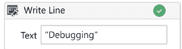

- 抛出异常的活动标记为红色：


### 高亮显示元素

如果启用了 **Highlight Elements** 操作，则在调试过程中，每个活动的 UI 元素都会被高亮显示。因此，您可以将其与常规调试和逐步调试一起使用 – 例如，如果将 `Type Into` 活动放置在 Web 表单的文本字段上，在执行期间，Web 表单的文本字段会在机器人输入该文本字段之前先被高亮显示。

**Log Activities** 帮助您确定流中可能出现问题的位置。如果启用了 **Log Activities** 操作，所有调试的活动都会在 **Output** 面板中显示为 _跟踪日志_。如果禁用日志功能，则 _跟踪日志_ 不会在 **Output** 面板中显示；相反，您只能看到调试开始和结束时间以及任何抛出的异常。

此外，如果已连接到 UiPath Orchestrator，日志会自动发送到 Orchestrator。如果在 **Add** 或 **Edit** 用户窗口的 **Robot Settings** 选项卡中禁用 **Allow Development Logging** 选项，则可以将日志本地存储。

> 注意
> **Highlight Elements** 和 **Log Activities** 操作只能在调试前启用，并且在下次重新打开自动化项目时会保持启用状态。

### 发生异常时继续

在调试过程中启用 **Continue on Exception** 操作且抛出异常时，该异常会在 **Output** 面板中记录，并且执行会在不停止调试过程的情况下继续进行后续活动。

### 打开日志

单击 **Open Logs** 按钮将打开本地存储的日志文件夹。存储日志的文件夹路径是 `%localappdata%\UiPath\Logs`。日志的命名约定是 `YYYY-DD-MM_Component.log` – 例如，`2021-07-08_Studio.log`。

在本节中，您已了解功能区上的调试操作菜单。在本章的下一节中，您将看到 UiPath Studio 中可用的不同调试面板。

## 使用调试面板

除了 **DEBUG** 功能区中可用的操作外，UiPath Studio 还提供了一系列面板来帮助您进行调试过程。

UiPath 中有五个可用于调试的面板：

- 1. Locals 面板
- 2. Watch 面板
- 3. Immediate 面板
- 4. Call Stack 面板
- 5. Breakpoints 面板

以下截图中标记了每个面板。每个数字对应前面列表中面板的位置：

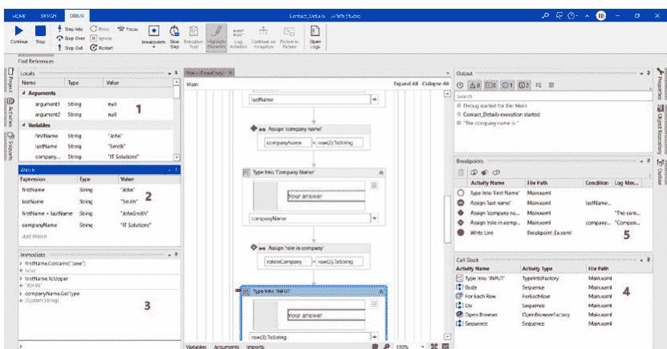

图 13.5 – 调试面板

一旦调试开始，所有五个面板都会变得可见。但是，首先，让我们来看看每个面板并了解它们的用途。

### Locals 面板

Locals 面板窗口有三个属性 – Name、Type 和 Value。该面板显示带有相应属性的以下信息：

- Variables：显示执行容器范围内的所有变量
- Arguments：显示执行工作流的所有参数
- Activity Properties：显示先前执行的活动和当前活动的属性
- Exceptions：显示异常的描述和类型

| Name | Type | Value |
|---|---|---|
| Variables | | |
| firstName | String | "Jane" |
| lastName | String | "Dorsy" |
| companyName | String | "MediCare" |
| row | DataRow | DataRow HasErrors=false... |
| DT_Contact | DataTable | [First Name,Last Name...] |
| ContextTarget | Object | Browser ... |
| Properties of Assign 'company name' (previous) | | |
| To | OutArgument | "MediCare" |
| Value | InArgument | "MediCare" |
| DisplayName | String | "Assign ' company name ' -" |
| Properties of Type into 'INPUT' (current) | | |
| Text | InArgument<string> | InArgument<string> ... |
| DeselectAfter | InArgument<Boolean> | ... |
| SimulateType | InArgument<Boolean> | ... |
| SendWindowMessages | InArgument<Boolean> | ... |
| AlterIfDisabled | InArgument<Boolean> | ... |
| DelayMS | InArgument<int32> | ... |
| DelayBefore | InArgument<int32> | ... |
| DelayBetweenKeys | InArgument<int32> | ... |

图 13.6 - Locals 面板

Locals 面板中的所有 Arguments、Properties 和 Variables 类别都可以压缩或展开。

当调试处于暂停状态时，单击 Value 属性下的铅笔图标按钮，可以修改变量和参数的值：

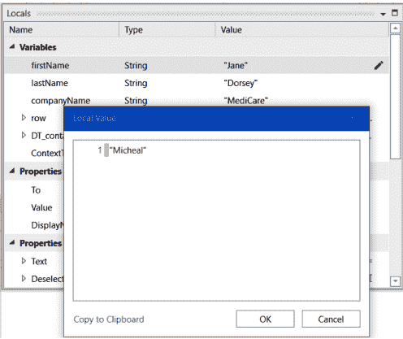

图 13.7 - 通过单击铅笔图标，将 firstName 变量的值从 Jane 更改为 Michael

同样，当调试处于暂停状态时，您可以单击放大镜按钮来检查 Value 属性列中项目的值：

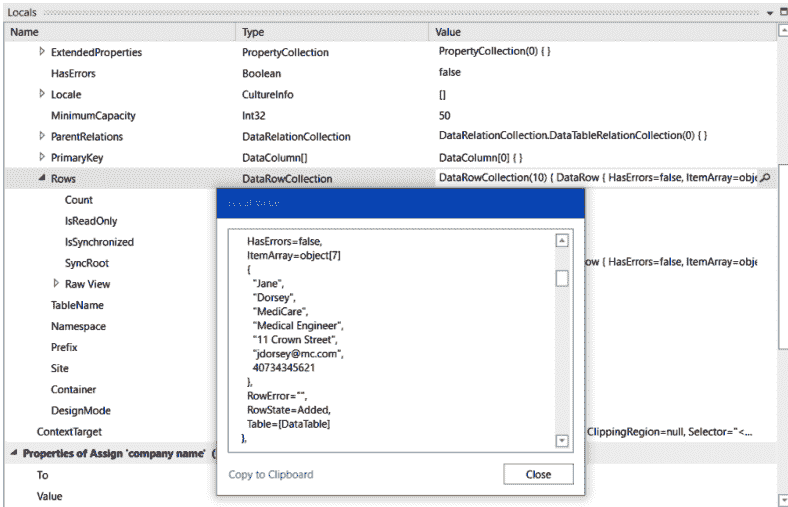

图 13.8 – 通过单击放大镜按钮检查 DataTable 变量中的所有行

### Watch 面板

Watch 面板窗口有三个属性 – Expression、Type 和 Value。

您可以显示执行容器范围内的变量、参数和用户定义表达式的值。Watch 面板中的值会根据调试过程中相关活动的执行情况进行更新 – 例如，调试 For Each 活动内部的过程。Watch 面板中的值会在每次迭代时更新：

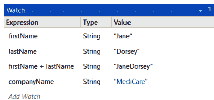

图 13.9 – Watch 面板显示变量和表达式的类型和值


您可以通过在 **Expression** 属性中单击 **Add Watch** 选项，将变量、参数或表达式添加到 **Watch** 面板。

您也可以使用 **Locals** 面板，通过右键单击变量或参数并选择 **Add to Watch**，将变量或参数添加到 **Watch** 面板：

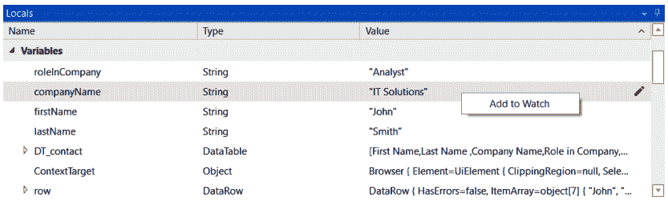

图 13.10 – 从 Locals 面板向 Watch 面板添加变量

或者，您可以使用 **Variables** 和 **Arguments** 面板将变量或参数添加到 **Watch** 面板。为此，请右键单击变量或参数并选择 **Add to Watch**：

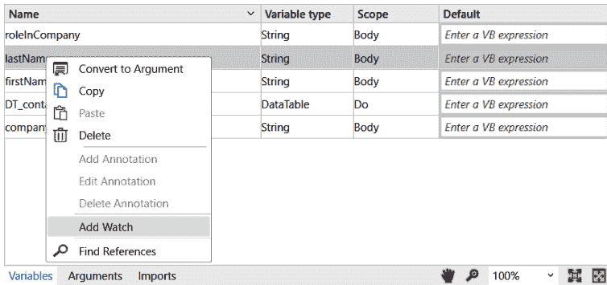

图 13.11 – 从 Variables 面板向 Watch 面板添加变量

## The Immediate panel

**Immediate** 面板可用于在调试过程的特定点检查变量、参数或语句的数据/输出：

```
Immediate
> firstName.Contains("Jane")
< true
> firstName.ToUpper
< "JANE"
> companyName.GetType
< [System.String]
>
```

图 13.12 – Immediate 面板

要获取输出，请在 **Immediate** 窗口中键入变量或参数名称并按 *Enter* 键。输出在调试过程中不会更新；相反，它会保留先前评估过的语句的历史记录。

使用上下文菜单，您可以复制先前评估过的表达式，或使用 **Clear All** 选项清除面板中的所有行。使用 *Ctrl + 空格* 可打开 IntelliPrompt，这有助于选择与变量或参数关联的所需函数或属性：

```
Immediate
> firstName.Contains("Jane")
< true
> firstName.ToUpper
< "JANE"
> companyName.GetType
< [System.String]
CompareTo
Concat(Of ...)
Contains
Contains(Of ...)
ContainsUnmatchedParentheses
CopyTo
Count(Of ...)
>
companyName.co
```

图 13.13 – 使用 Ctrl + 空格的 IntelliPrompt

### The Call Stack panel

当调试处于暂停状态时，**Call Stack** 面板会显示要执行的活动及其父容器：

| 活动名称 | 活动类型 | 文件路径 |
| :--- | :--- | :--- |
| Type Into 'INPUT' | TypeIntoFactory | Main.xaml |
| Body | Sequence | Main.xaml |
| For Each Row | ForEachRow | Main.xaml |
| Do | Sequence | Main.xaml |
| Open Browser | OpenBrowserFactory | Main.xaml |
| Sequence | Sequence | Main.xaml |

图 13.14 – Call Stack 面板

**Call Stack** 面板在以下两种情况下会被填充：

- 使用 **Step Into**、**Break** 和 **Slow Step** 时
- 如果执行因遇到错误或断点而进入暂停状态

在 **Call Stack** 面板中双击活动名称会在 **Designer** 面板中突出显示该活动。此外，当活动在调试期间抛出异常时，它会在 **Call Stack** 面板中被标记，并且该特定活动会以红色突出显示。

### The Breakpoints panel

在开始介绍 **Breakpoints** 面板之前，让我们先了解什么是 **breakpoints**。与其他任何 IDE 一样，UiPath Studio 支持断点。它们用于在可能触发执行问题的活动上有意暂停调试过程。断点还可用于监控该点处变量或参数的值，并通过使用 **Step Into**、**Step Over** 和 **Step Out** 操作来控制执行。

现在让我们看看如何在 UiPath Studio 中添加、禁用或删除断点。我们需要知道如何先添加断点，因为 **Breakpoint Settings** 选项卡仅在该点之后可用。

### How to place a breakpoint

您可以通过以下三种方式在活动上添加断点：

- 右键单击要为其添加断点的特定活动，并从上下文菜单中单击 Toggle Breakpoint：

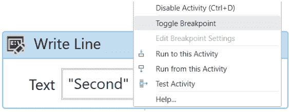

图 13.15 – 从上下文菜单应用断点

- 单击 Toggle Breakpoint 会将断点应用到该特定活动，并且它会在活动的左上角标记一个红色磁盘。断点始终标记为红色磁盘：

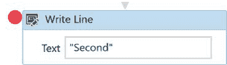

图 13.16 – 应用于 Write Line 活动的断点

- 选择一个活动，然后从 DEBUG 功能区栏中单击 Breakpoints 操作：

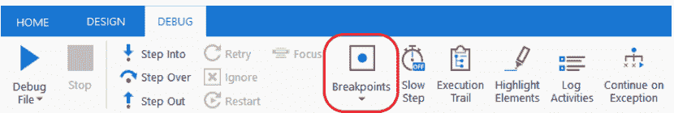

图 13.17 – 单击 Breakpoints 按钮以应用断点

- 选择所需的活动并按键盘上的 F9 键。

您可以根据偏好使用上述任何方法来应用断点。

### How to disable a breakpoint

禁用断点不会在特定活动上暂停调试过程。禁用的断点在活动的左上角标记为红色圆圈：

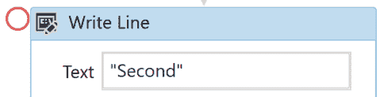

图 13.18 – Write Line 活动上的禁用断点

您可以使用创建断点时使用的三种方式中的任何一种来禁用断点。因此，您可以选择断点活动，然后从上下文菜单中单击 **Toggle Breakpoint**，单击 **DEBUG** 面板上的 **Breakpoints** 按钮，或按键盘上的 F9 键来禁用断点。

### How to delete a breakpoint

您可以通过重复用于创建和禁用断点的三个步骤中的任何一个来删除已禁用的断点。要么选择断点活动，然后从上下文菜单中单击 **Toggle Breakpoint**，单击 **DEBUG** 面板上的 **Breakpoints** 按钮，或按键盘上的 F9 键来删除断点。

现在我们已经了解如何在活动上添加、禁用和删除断点，让我们看看在哪里可以一起查看特定进程的所有断点。

### The Breakpoints panel

**Breakpoints** 面板显示当前项目中的所有断点，以及它们所在的工作流名称：

| 活动名称 | 文件路径 | 条件 | 日志消息 |
|---|---|---|---|
| Type Into 'First Name' | Main.xaml | | |
| Assign 'last name' | Main.xaml | lastName... | |
| Assign 'company name' | Main.xaml | | "The comp... |
| Assign 'role in company' | Main.xaml | companyN... | "Company... |
| Write Line | Breakpoint_Ex.xaml | | |

图 13.19 – Breakpoints 面板

Condition 列显示特定断点上设置的条件（如果有），Log Message 列显示在该断点上设置的记录消息。

您可以通过从 Breakpoints 面板中选择相应操作来删除、启用或禁用项目中的所有断点。

单击 Delete all breakpoints 按钮会删除工作流中存在的所有断点：

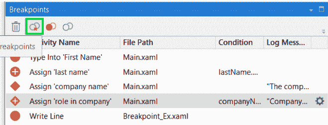

图 13.20 – 删除所有断点

单击 Enable all breakpoints 按钮会启用工作流中存在的所有已禁用断点：

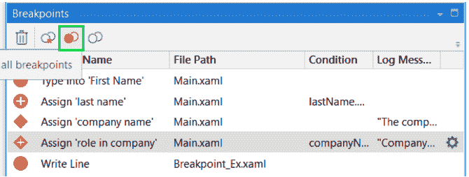

图 13.21 – 启用所有断点

单击 **Disable all breakpoints** 按钮会禁用工作流中存在的所有断点：

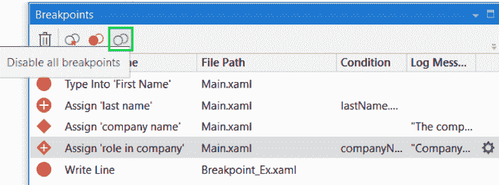

图 13.22 – 禁用所有断点

现在让我们看看如何为各个断点参数化，以满足断点执行所需的特定条件。

### Breakpoint Settings

可以通过从 **Breakpoints** 面板中单击齿轮图标来进一步修改各个断点。这将为该特定断点打开 **Breakpoint Settings** 选项卡：

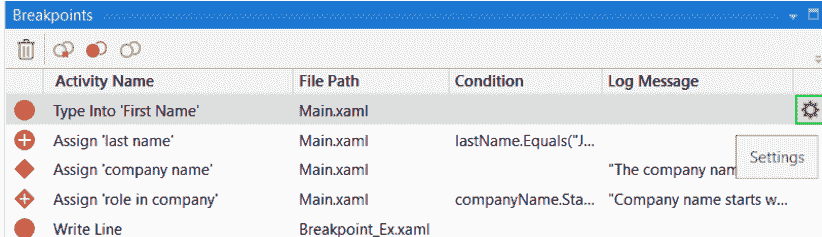

图 13.23 – Breakpoint Settings 的齿轮图标

**Breakpoint Settings** 选项卡有四个参数，分别名为 **Condition**、**Hit Count**、**Log Message** 和 **Continue execution when logging**：

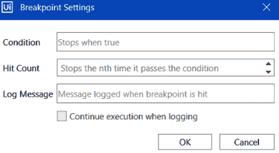

图 13.24 – Breakpoint Settings 选项卡

让我们详细了解这四个参数：

- **Condition**：提供用于中断执行的条件语句。如果断点上的条件变为 TRUE，则调试暂停，并且相应的活动会被突出显示。

- **Hit Count**：这指定在调试进入暂停状态之前条件被满足的次数 – 例如，变量 `num` 的默认值设置为 1。如果在 `While` 活动中带有 `num Mod 2 = 0` 条件的断点且 **Hit Count** 设置为 2，则当条件第二次被满足时，调试将进入暂停状态：

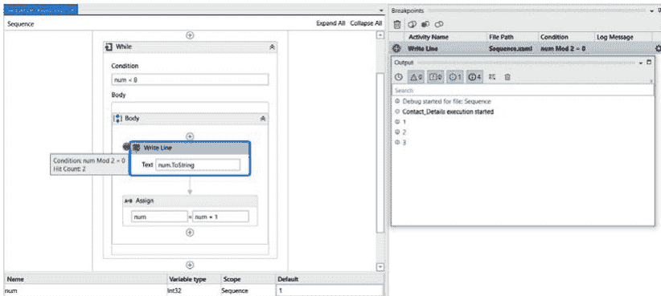

图 13.25 – 带有条件的 Hit Count


注意
最大命中计数值为 32,767。

- **日志消息:** 当条件满足时，您可以向断点添加 `trace_level` 日志消息。即使未提供条件，也可以添加日志消息。
- **记录时继续执行:** 仅当设置了 **日志消息** 参数时，此复选框才可用。如果选中该复选框，则在满足条件时不会暂停执行，并将指定消息记录在 **输出** 面板中：

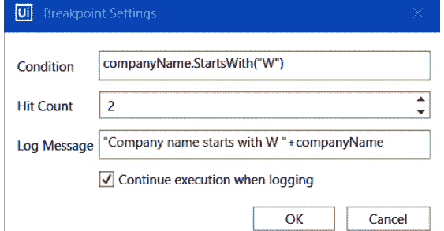

图 13.26 – 已初始化所有参数的断点设置

对活动的断点可根据 **断点设置** 选项卡中应用的参数分为四类。四个类别如下：

- 标准断点
- 条件断点
- 跟踪点
- 条件跟踪点

让我们详细了解每一类。

## 标准断点

标准断点是在 **断点设置** 选项卡中未添加 **条件**、**命中计数** 和 **日志消息** 参数的断点。

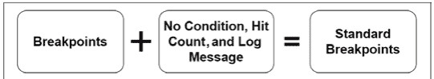

图 13.27 – 断点

## 条件断点

在 **断点设置** 选项卡中仅添加 **条件** 和/或 **命中计数** 参数的断点称为条件断点：

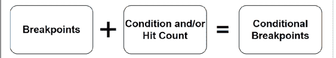

图 13.28 – 条件断点

## 跟踪点

在 **断点设置** 选项卡中仅添加 **日志消息** 参数的断点称为跟踪点：

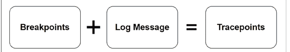

图 13.29 – 跟踪点

## 条件跟踪点

在 **断点设置** 选项卡中添加 **条件** 和/或 **命中计数** 以及 **日志消息** 参数的断点称为条件跟踪点：

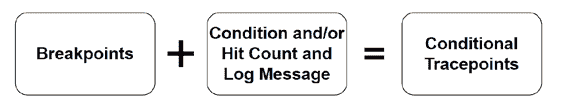

图 13.30 – 条件跟踪点

UiPath Studio 为不同类型的断点提供了不同图标。如下所示：

| 图标 | 断点 |
|---|---|
| 🔴 | 已启用的断点 |
| ⚪ | 已禁用的断点 |
| ⊕ | 已启用的条件断点 |
| ⊕ | 已禁用的条件断点 |
| ◆ | 已启用的跟踪点 |
| ◇ | 已禁用的跟踪点 |
| ◆⊕ | 已启用的条件跟踪点 |
| ◇⊕ | 已禁用的条件跟踪点 |

图 13.31 – 断点分类摘要

现在让我们查看 **断点** 面板中各个断点可用的上下文菜单。

## 断点的上下文菜单

从 **断点** 面板右键单击某个断点将打开该断点的上下文菜单：

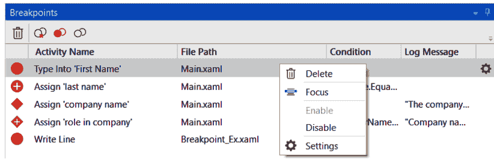

图 13.32 – 断点上下文菜单

上下文菜单显示五个选项：

- **删除**: 从项目中删除所选断点。
- **聚焦**: 导航到 **设计器** 面板中的断点。
- **启用**: 此选项仅在禁用的断点上可用。它启用所选断点。
- **禁用**: 此选项仅在启用的断点上可用。它禁用所选断点。
- **设置**: 打开 **断点设置** 选项卡，您可以在其中通过传递参数对其进行自定义。

现在我们已经了解了 UiPath Studio 中可用的不同调试面板以及如何使用它们来检测和纠正工作流中的错误。接下来，让我们看看如何在 UiPath Studio 中对活动进行测试。

## 测试活动

UiPath Studio 允许您在流程自动化的设计阶段测试活动。根据 Studio 中的场景，您可以以四种不同的方式对活动进行测试：

- 测试活动
- 创建测试台
- 运行至此活动
- 从此活动运行

让我们详细了解每一种方式。

### 测试活动

在所选活动的上下文菜单中选择 **测试活动** 选项，可以对该特定活动运行测试。选择 **测试活动** 选项将以调试模式打开它，并突出显示所选活动。

您可以在以下场景中使用测试活动：

- 为属性添加默认值，然后对其进行测试
- 使用 **局部变量** 面板为测试活动添加值

让我们通过一个用例详细了解测试活动。在此，我们将编程一个机器人，用于检查用户输入的数字是偶数还是奇数：

1. 创建一个名为 **Even_Odd** 的新序列，并在其中创建一个名为 **num** 的变量，数据类型为 **Int32**（请注意，未为该变量分配默认值）：

| 名称 | 变量类型 | 作用域 | 默认值 |
|---|---|---|---|
| num | Int32 | Even_Odd | 输入 VB 表达式 |

图 13.33 – 整型变量 "num" 的声明

2. 将以下三组活动拖放到 Even_Odd 序列中：

  - 输入对话框：要求用户输入一个数字
  - If：检查数字是偶数还是奇数并显示相应消息
  - 写入行：显示偶数和奇数消息：

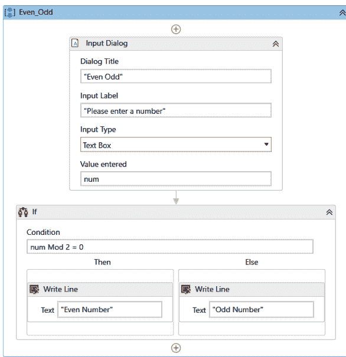

图 13.34 – 偶奇数序列

3. 在运行序列之前，我们将测试 If 活动以检查条件逻辑是否正确。为此，请选择 If 活动并右键单击以打开上下文菜单。然后，从上下文菜单中选择 测试活动：

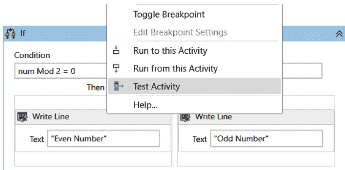

图 13.35 – 从上下文菜单中选择 测试活动

4. 单击 测试活动 将以调试模式打开 If 活动并突出显示该活动。所有调试操作和面板均可用：

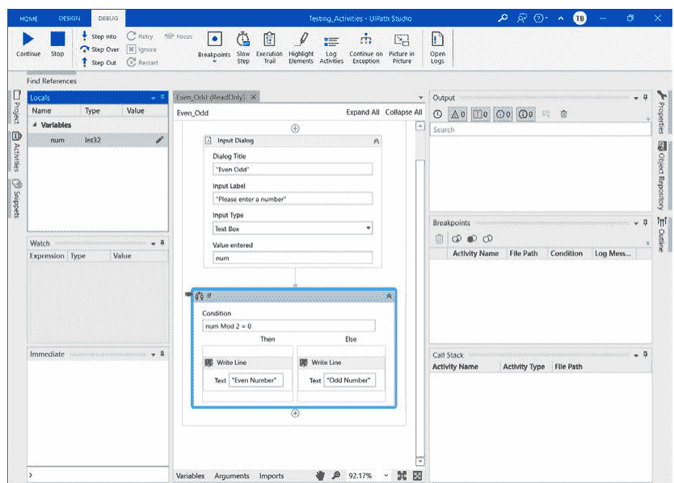

图 13.36 – 在调试模式下打开的 If 活动

5. 由于 num 变量未分配默认值，我们可以在测试 If 活动之前使用 **局部变量** 面板为变量添加值。单击铅笔图标可让我们编辑变量的值。这里，我们将 5 作为值传递给 num 变量：

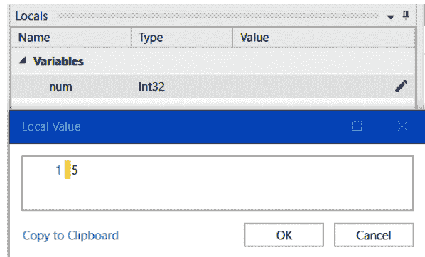

图 13.37 – 将 num 变量赋值为 5

太棒了！既然变量已赋值，您可以运行 If 活动了。

6. 为此，请从 **调试** 功能区单击 步入 或 继续。

在这种情况下，If 活动 else 块中的 写入行 活动已执行，并在 **输出** 面板中写入了消息 奇数，这意味着 If 活动中编写的条件是正确的：

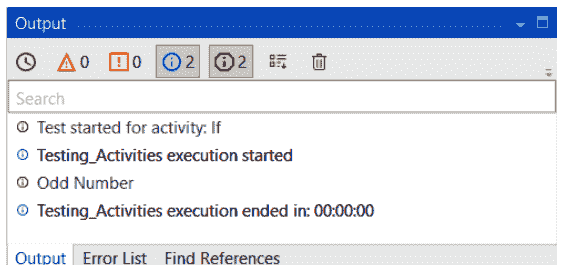

图 13.38 – **输出** 面板中打印的 奇数

### 创建测试台

在 UiPath Studio 中构建自动化就像玩乐高一样，您不断添加积木以完成一个角色。例如，假设您正在构建一个乐高机器人。理想情况下，您会单独构建机器人的手或腿，以测试它们是否按预期移动，然后将其连接到机身上。借助 **创建测试台**，在构建机器人时可以在 UiPath Studio 中创建相同的场景。因此，使用 **创建测试台** 允许您创建自动化构建块，然后可以单独测试并添加到最终工作流中。

从 **活动** 面板中，您可以选择任何活动并为其创建测试台：

1. 为此，请右键单击所选活动，并从上下文菜单中选择 创建测试台：

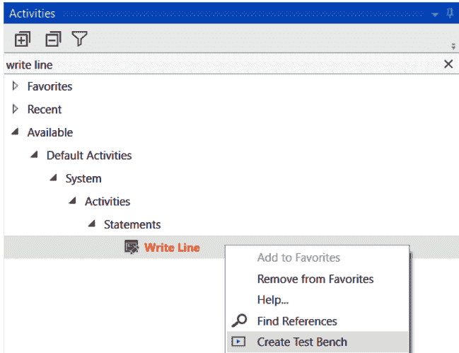

图 13.39 – 为 写入行 活动创建测试台

单击 创建测试台 将在测试台工作流中打开它。测试台工作流是一个临时序列，不属于当前项目，关闭时会被丢弃：

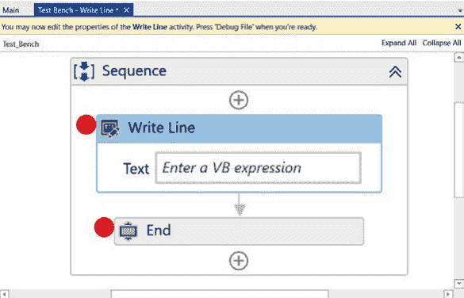

图 13.40 – 创建的临时测试台工作流

所选活动会自动添加到不包含在您的项目中的新临时序列文件中。您可以编辑此活动的属性或添加新活动，然后再调试测试台工作流。

2. 要保存文件，请使用 **设计** 功能区中的 **另存为** 选项添加文件名，并将其保存到与项目相同的文件路径中。稍后，您可以使用 **调用工作流文件** 活动并在所需工作流中调用该序列。

> **注意**
> **创建测试台** 不适用于 `Pick Branch` 活动，因为它需要 `Pick` 活动作为容器来执行。

### 运行至此活动

例如，假设工作流中有五个活动，您只想运行到第二个活动为止。那么，请选择第三个活动，并从上下文菜单中选择 运行至此活动 选项。


让我们通过一个示例来理解这一概念。在 Main.xaml 文件中，一个 Sequence 活动内包含五个 Write Line 活动。这些 Write Line 活动将打印从“First”、“Second”开始直至“Fifth”的消息：

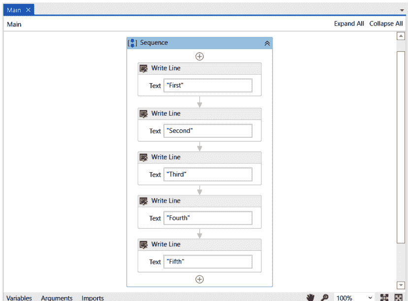

图 13.41 – 序列中的 Write Line 活动

在我们的场景中，我们希望打印直到第二个 Write Line 活动的输出。为此，在 Designer 面板中右键单击第三个 Write Line 活动，并从上下文菜单中单击“运行至此活动”：

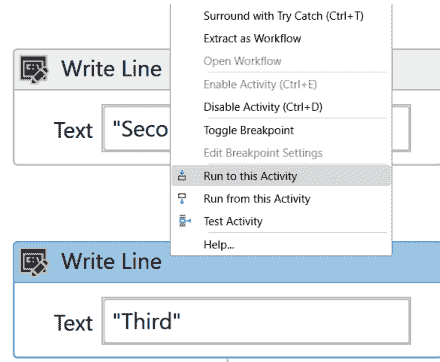

图 13.42 – 运行至此活动

这将启动调试过程，在 Output 面板中打印值，并在第三个 Write Line 活动执行前暂停，同时在 Designer 面板中将其高亮显示：

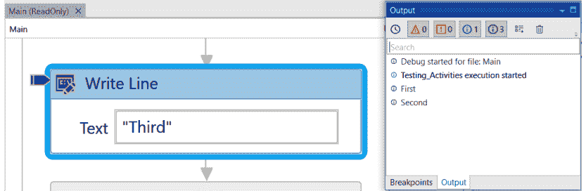

图 13.43 – 与 Output 面板一起高亮显示的 Write Line 活动

> **注意**
> 调试期间，如果工作流处于暂停状态并且触发了“运行至此活动”，则执行将继续直到到达此活动。

## 从此活动运行

“从此活动运行”选项与“运行至此活动”相反。在这里，您可以从任何特定活动开始运行自动化。让我们以之前的示例为例，进一步了解“从此活动运行”。

在这个场景中，我们希望打印来自第四个 Write Line 活动的输出。为此，在 Designer 面板中右键单击第四个 Write Line 活动，并从上下文菜单中单击“从此活动运行”：

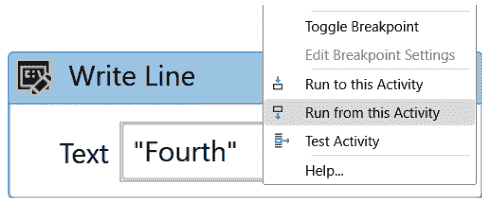

图 13.44 – 从此活动运行

它将以暂停状态进入调试，允许您从 Locals 面板更改变量和参数的值。然后，您可以从 DEBUG 功能区中选择“继续”、“步入”、“步过”或“步出”操作来启动调试过程。在我们的案例中，最后两个 Write Line 活动的值将在 Output 面板中打印：

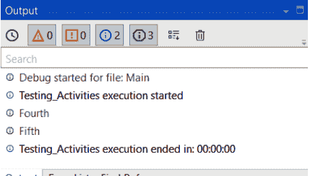

图 13.45 – 在 Output 面板中打印的 Write Line 活动

> 注意
> 在 Try Catch、Switch、Parallel、Pick、Trigger Scope 或 Retry Scope 容器内添加的活动上使用“从此活动运行”将导致错误。
> 如果在使用“从此活动运行”操作后使用 DEBUG 功能区中的“重启”操作，调试将从先前指示的活动重新开始。

在构建阶段，测试活动在消除任何错误方面起着至关重要的作用。**测试活动** 可调试现有工作流中的某个活动，您可以使用 **Locals** 面板传递变量或参数的值。**创建测试基准** 允许您在将活动添加到工作流之前创建一个临时序列来试用这些活动。最后，**运行至此活动** 或 **从此活动运行** 允许您调试到工作流中的特定活动或从中调试。在下一节中，您将获得调试工作流的实践经验。

## 修复工作流

既然您已经了解了 UiPath Studio 中关于调试的所有知识，让我们应用迄今所学的技能来调试工作流并修复一个错误。

您的同事被指派为 **选民登记** 活动构建一个机器人。机器人需要从 Excel 文件中获取 **名字**、**姓氏**、**电子邮件**、**年龄** 和 **州** 信息，并将其插入到 Web 选民登记表单的正确字段中。

机器人在某个点抛出错误，您的同事需要您的帮助使其正常工作。因此，让我们应用迄今所学的所有调试知识来修复此工作流。您可以从本章 *技术要求* 部分中提到的 GitHub 仓库下载代码。

让我们检查输入数据文件和工作流。**Voters Details.xlsx** 文件包含名为 **名字**、**姓氏**、**电子邮件**、**年龄** 和 **州** 的四列。此外，它还有多行需要输入到 Web 表单中的数据：

| 名字 | 姓氏 | 电子邮件 | 年龄 | 州 |
| :--- | :--- | :--- | :--- | :--- |
| Marie | Kenny | marie.kenny@ui.com | 28 | Maharashtra |
| Lloyd | Wong | lloyd.wong@ri.com | 37 | Karnataka |

图 13.46 – Voters Details.xlsx 文件的片段

Main.xaml 文件包含两个主要的 Sequence 活动：

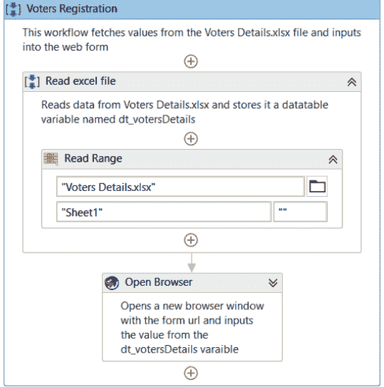

图 13.47 – 选民登记序列

这两个活动如下：

- **读取 Excel 文件** 活动：从 Voters Details.xlsx 读取数据并将其存储在名为 dt_votersDetails 的 datatable 变量中。
- **打开浏览器** 活动：使用表单 URL 打开一个新的浏览器窗口，并将 dt_votersDetails 变量中的值输入到选民登记表单中。为 Web 表单的相应字段声明了五个名为 firstName、lastName、email、age 和 state 的变量：

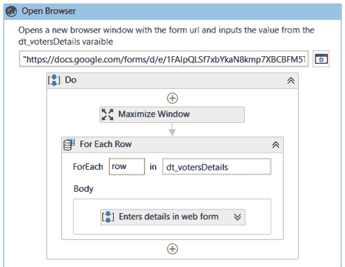

图 13.48 – 打开浏览器序列

此外，Open Browser 活动在一个 For Each Row 活动内包含五个 Type Into 活动，用于在 Web 表单中输入详细信息：

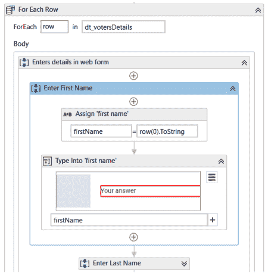

图 13.49 – 用于向表单输入值的 Type Into 活动

选民登记 Web 表单总共有五个字段（在这里，我们只向您展示两个）：

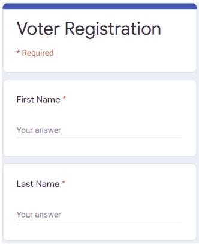

图 13.50 – 选民登记表单的片段

既然我们已经查看了所有输入文件和代码，让我们调试自动化并查看错误是什么。机器人成功完成了前两个人的登记。

在输入第三个人的年龄时，它抛出一个异常，调试进入暂停状态。用于年龄的 `Type Into` 活动在 **Designer** 面板中被高亮显示，因为它导致了异常。一个错误日志在 **Output** 面板中记录：

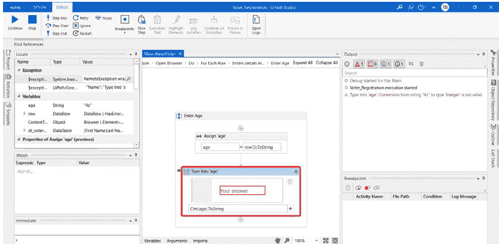

图 13.51 – 在 Type Into 活动中抛出的异常

有关异常的更多信息可以通过单击 **Exceptions** 部分中的放大镜图标从 **Locals** 面板中找到：

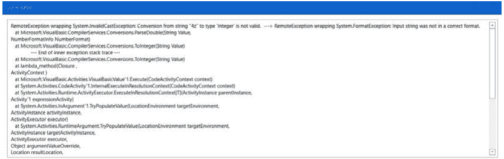

图 13.52 - 异常窗口

从异常中我们可以看出，这是 **InvalidCastException**，当不支持将一个数据类型的实例转换为另一个数据类型时会发生此异常。在用于输入年龄的 **Type Into** 活动中，使用 **CInt()** 函数将 **String** 转换为 **Integer**。由于类型转换无法进行，因此抛出了异常：

- 在该 Type Into 活动上应用条件为 Not age.IsNumeric 的条件断点并重新启动调试过程：

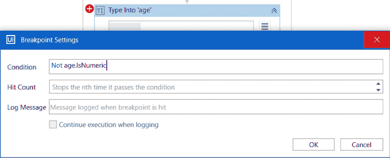

图 13.53 - Type Into 活动上的条件断点

然后，当年龄无法转换为整数时，执行将进入暂停状态。如预期，在输入第三个人的年龄时，调试进入暂停状态而不抛出异常。

- 使用 Immediate 面板检查 age 变量中是否存在数值数据。使用 age.IsNumeric 将打印答案为 false：

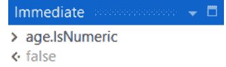

图 13.54 – 立即面板

- 将 age 变量添加到 Watch 面板以检查它当前持有的值：

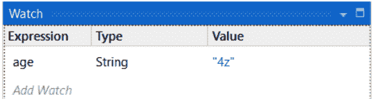

图 13.55 – 监视面板

现在，我们可以看到 `age` 的值是 4z。因为 z，类型转换无法进行，因此抛出了异常。

- 导航到 Locals 面板，通过单击铅笔图标将 age 的值从 4z 更改为 48。
- 单击 Continue 以恢复调试：

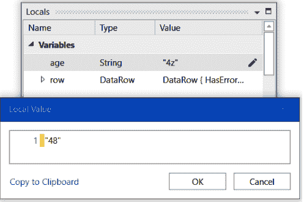

图 13.56 – 局部面板

工作流继续执行，没有任何进一步的错误。您已成功调试了自动化的选民登记流程！


## 摘要

在本章中，您了解了什么是调试以及它如何帮助排查并从进程中移除 bug。首先，您看到了 DEBUG 功能区条中存在的各种调试操作菜单，这些菜单可帮助您导航以对单个文件或整个项目进行调试。接着，您了解了多个调试面板，它们可帮助您修复错误。您还了解了在流程开发的构建阶段内，UiPath Studio 中的测试活动。最后，您使用之前学到的所有技能调试了一个工作流以修复 bug。

在下一章中，您将学习如何使用分发器和执行器的概念构建自动化项目。
