## 发票处理 - 分发器

**亨利食品超市** 是美国的一家连锁便利店，总部位于纽约，目前在美国有 400 多家门店。**发票处理** 流程已被选为 RPA 自动化，作为亨利食品超市财务和会计部门内更大规模项目计划的一部分。

此流程自动化的目标与项目商业案例相关，主要旨在完成以下任务：

- 加快发票处理速度。
- 减少发票处理中的冗余活动。
- 通过消除错误来提升整体性能和可靠性。

发票处理流程会读取电子邮件，并下载以电子邮件附件形式接收的 PDF 发票。然后，它从发票中提取客户信息和发票详情，并将其录入到 **订单录入 CRM** 中。

您将分两部分构建此流程。您将遵循 **分发器-执行器** 模型并创建两个不同的流程。在本章中，您将构建分发器模型，在下一章中，您将构建执行器模型。

作为 *发票处理 – 分发器* 项目的一部分，您将学习以下内容：

- 创建和使用 Orchestrator 资产
- 使用邮件自动化
- 在 UiPath Studio 中操作数据
- 自动化 PDF 文件以读取数据
- 修改选择器
- 使用正则表达式
- 使用 UiPath Studio 数据抓取向导
- 创建并上传数据到 Orchestrator 队列
- UiPath Studio 中的异常处理
- UiPath Studio 中的日志记录

## 技术要求

让我们了解本项目的要求：

- UiPath Studio Community/Enterprise/Academic Alliance Edition 版本 20.10 及以上，已连接到 UiPath Orchestrator
- 访问 UiPath Orchestrator 服务
- 一个 Gmail 账户
- Adobe Acrobat PDF Reader
- 访问互联网
- 在安装了 UiPath Studio 的计算机上具有读写权限

您可以在 GitHub 上获取发票处理分发器的完整代码：`https://github.com/PacktPublishing/UiPath-Associate-Certification-Guide.git`。

## 项目概述

在本章中，您将设计发票处理的分发器模型。让我们详细了解流程。以下是您需要执行的步骤：

- 1. 编程一个机器人，以从您的 Gmail 账户中读取最后一封未读邮件。
- 2. 编程一个机器人，以下载已读邮件中的所有发票附件。下载附件的条件如下：
  - 邮件主题行必须为 Invoice-Henry-FM-Invoice Number-Customer Name。
  - 附件的命名规范必须为 Invoice-Henry FM-Invoice Number-Customer Name.pdf。
- 3. 编程一个机器人，将所有发票附件保存在项目目录中名为 Invoice 的文件夹中。
- 4. 编程一个机器人，从发票中提取以下相关字段：
  - 客户详细信息：
    - 客户姓名
    - 客户地址
    - 客户电话号码
    - 客户电子邮件 ID
  - 发票详情：
    - 发票日期
    - 发票编号
  - 订单信息：
    - 商品数量
    - 商品描述
    - 商品单价
    - 行总金额
  - 小计金额
  - 运费金额
  - 总金额
- 5. 编程一个机器人，将以下详细信息上传到 Orchestrator 队列：
  - 客户详细信息
  - 发票详情
- 6. 对剩余发票重复步骤 4–5。
- 7. 编程机器人，如果步骤 2 中从邮件下载的所有附件都已处理，则成功结束流程。

让我们借助流程图来了解整个流程：

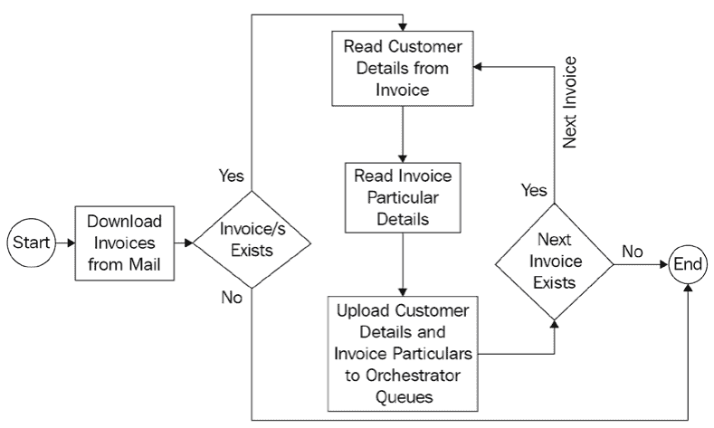

图 14.1 – 高级流程图

在开始设计流程自动化之前，请从此 GitHub 仓库的 Input File – Invoice 文件夹下载所有提供的发票：https://github.com/PacktPublishing/UiPath-Associate-Certification-Guide/tree/main/Chapter14/Input%20File%20%E2%80%93%20Invoice。

从您自己的 Gmail 账户为每张单独的发票发送一封单独的邮件，机器人将从此处读取邮件。主题行必须为 Invoice-Henry-FM-Invoice Number-Customer Name（发票编号和客户姓名出现在发票文件名中）– 例如，如果客户姓名是 Adam Smith，发票编号是 8745，那么邮件的主题行应为 Invoice-Henry-FM-8745-Adam Smith。

以下是一些示例：

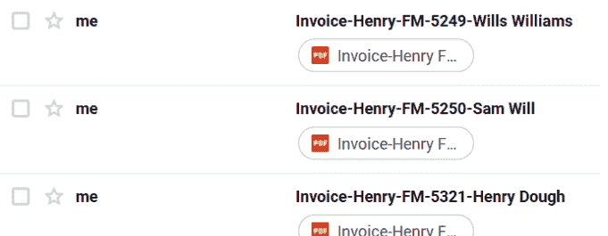

图 14.2 – 显示主题行和附件的 Gmail 收件箱片段

现在您已将发票发送到您的邮件 ID，让我们开始构建自动化。

## 设置项目

在开始构建流程之前，让我们先正确设置所有 UiPath Studio 配置：

- 1. 打开 UiPath Studio，创建名为 Invoice_Processing_Dispatcher 的新流程：

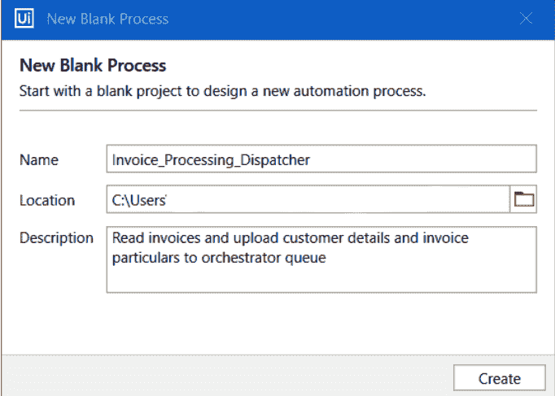

图 14.3 – 创建新流程

- 2. 单击设计器功能区条上的管理程序包，并将项目依赖项更新为以下版本：
  - UiPath.Excel.Activities – v2.10.4
  - UiPath.Mail.Activities – v1.10.5
  - UiPath.System.Activities – v21.4.1
  - UiPath.UIAutomation.Activities – v21.4.4

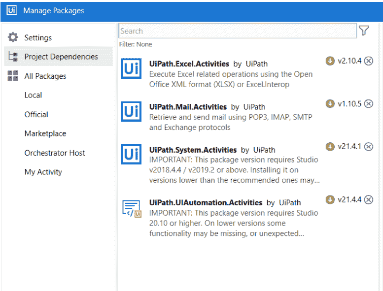

图 14.4 – 更新依赖项

- 3. 现在您已将依赖项更新为正确版本，让我们再安装一个依赖项，UiPath.PDF.Activities – v3.4.0：

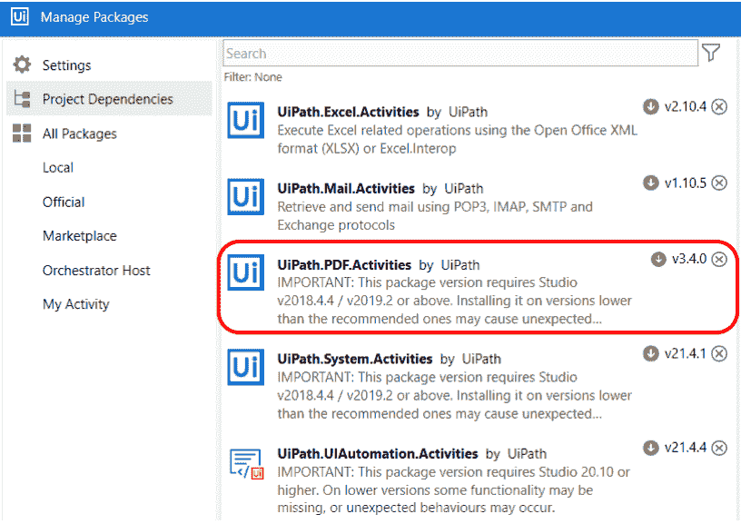

图 14.5 – 已添加 PDF 依赖项

- 4. 在 Orchestrator 网页的您的租户下，导航到 **文件夹** 部分并创建名为 Packt 的新文件夹。

现在您已配置好所需的一切，让我们开始构建流程。

## 下载发票

在本节中，您将设计机器人以从 Gmail 账户下载所有发票。以下流程图说明了下载发票的高级流程：

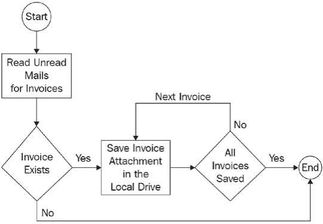

图 14.6 – 下载发票

下载发票是整个流程的第一步。让我们构建它：

- 1. 单击 **设计** 功能区条上的 **新建** 按钮，并选择 **序列**。
- 2. 将序列命名为 `Download_Invoice` 并单击 **创建** 按钮：

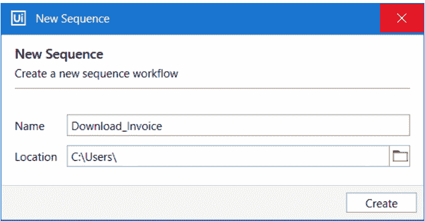

图 14.7 – 创建 Download_Invoice 序列

- 3. 登录到您的 `cloud.uipath.com` 账户并启动 Orchestrator 服务。在 **资产** 部分下，创建一个名为 `Mail Credential` 的资产，并为 **类型** 选择 **凭据**。接着，输入您的 Gmail ID **用户名** 和 **密码** 详细信息，然后单击 **创建** 按钮：

资产 / 添加资产

**资产名称** `Mail Credential` **类型** `Credential`

**描述** `Gmail email id and password`

**凭据存储** `Orchestrator Database`

**全局值**
**用户名** `@gmail.com` **密码** `********`

启用全局值后，每个用户都将收到它，除非在下表中特别替换。

图 14.8 - 创建凭据资产以存储 Gmail 凭据

在此场景中，**Mail Credential** 资产是在个人工作区文件夹中创建的。如果您愿意，可以在 `Packt` 文件夹中创建该资产。


- 4. 在 Studio 中，在 `Download_Invoice` 序列内，拖放 Try Catch 活动，然后将 `Get Credential` 活动放入 Try 块中。接下来，单击 `Get Credential` 活动的 **属性** 面板。对于 **输入** 属性，在 **资产名称** 下提供 "Mail Credential"。然后，在 **输出** 下，使用 `Ctrl + K` 为 **密码** 和 **用户名** 属性创建新变量。为 **密码** 键入 `pwd` 并按 `Enter`，然后为 **用户名** 键入 `email` 并再次按 `Enter`：

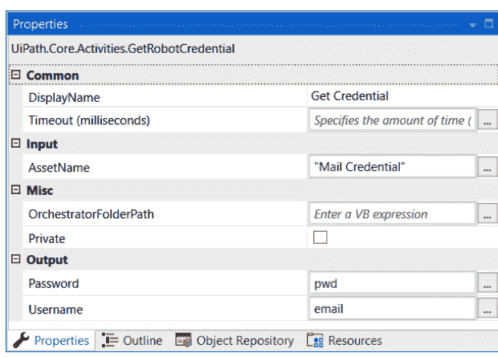

图 14.9 – Get Credential 活动的属性面板

- 5. 在 `Get Credential` 活动之后拖放 `Get IMAP Mail Messages` 活动。单击 `Get IMAP Mail Messages` 的 **属性** 面板，按如下配置属性：
  - **邮件文件夹** - "Inbox"。
  - **端口** - 993。
  - **服务器** - "imap.gmail.com"。
  - **电子邮件** - 传递 email 变量。
  - **安全密码** - 传递 pwd 变量。
  - **筛选表达式** - "SUBJECT Invoice-Henry-FM"。
  - 选中 **标记为已读** 选项。
  - **顶部** - 10。
  - 在 **输出** 下的 Messages 属性中添加名为 mails 的新变量：

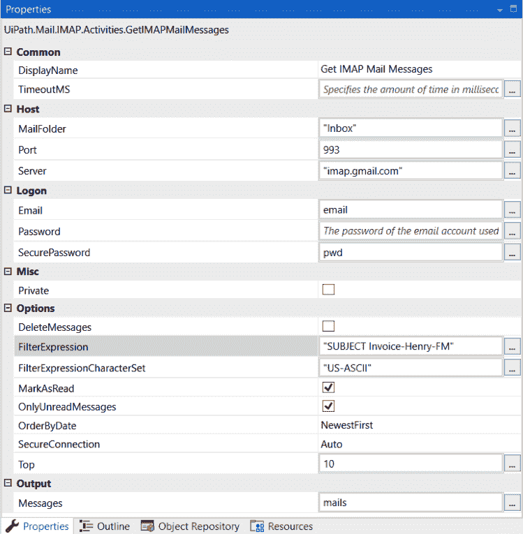

图 14.10 – Get IMAP Mail Messages 活动的属性面板

- 6. 接下来，使用 For Each 活动遍历所有邮件。然后，在 **值** 部分传递 mails 变量，将参数名从 item 改为 mail，并将 TypeArgument 更改为 System.Net.Mail.MailMessage。

- 7. 在 For Each 活动的主体内，使用 If 活动来检查邮件是否将发票作为附件。在 If 活动条件下，键入 mail.Attachments.Count > 0 And mail.Attachments.Count < 2 And mail.Attachments.Item(0).Name.ToString.StartsWith("Invoice-Henry FM-") And mail.Attachments.Item(0).Name.ToString.EndsWith(".pdf"。

- 8. 布尔条件检查单个附件和发票的命名约定。如果布尔条件为 TRUE，则保存附件；否则，记录一条消息，日志级别为 Info，消息内容为 "No invoice attachment in the mail"。

- 9. 然后，将 Save Attachments 活动拖放到 If 活动的 Then 块中以下载发票。最后，在 Message 属性中传递 mail 参数。现在，在 Save Attachments 活动的 FolderPath 属性中键入 "Invoice"（保存发票的文件夹名）。

- 10. 在 **参数** 面板中，创建名为 out_isMail 的参数。将其方向设置为 Out，并将参数类型选择为 boolean。

- 11. 然后，在 Save Attachments 下方使用 Assign 活动，在 **To** 部分传递 out_isMail，在 **值** 部分传递 True。您稍后将在 Main.xaml 中使用 out_isMail 参数来读取发票：

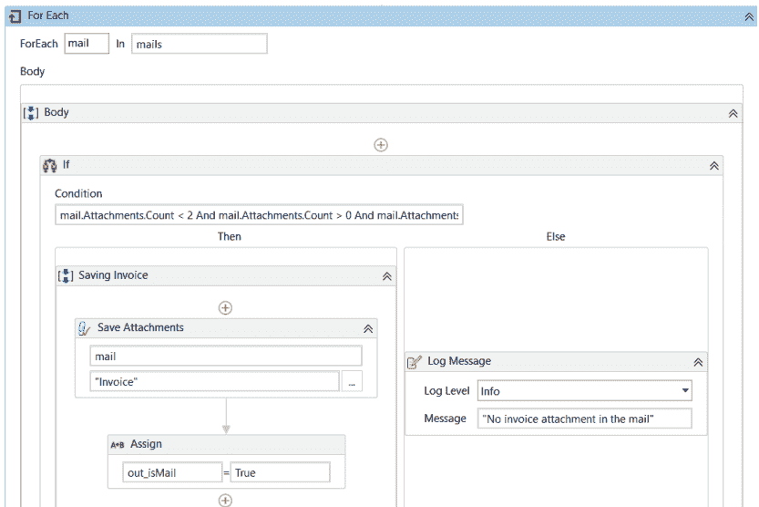

图 14.11 – 从邮件中保存发票附件

- 12. 最后，在 Catches 块内，捕获 SystemException 并记录一条消息。
Log Level 值应为 Error，Message 应为 "Unable to fetch the mail, please check Logon or host properties setting"+vbLf+exception.Message+vbLf+exception.Source：

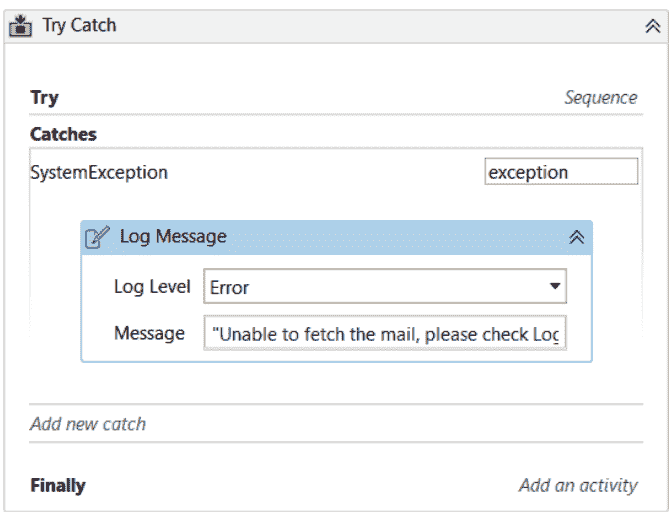

图 14.12 – 带有 Log Message 活动的 Catches 块

在完成此 Download_Invoice 序列之前，让我们对其进行最终检查。Download_Invoice 序列的 **变量** 面板应包含三个变量，如以下屏幕截图所示：

| 名称 | 变量类型 | 作用域 | 默认值 |
|---|---|---|---|
| pwd | SecureString | Download_Invoice | 输入 VB 表达式 |
| email | String | Download_Invoice | 输入 VB 表达式 |
| mails | List<MailMessage> | Download_Invoice | 输入 VB 表达式 |

图 14.13 – 变量面板

Download_Invoice 序列的 **参数** 面板应包含一个 Out 参数，如以下屏幕截图所示：

| 名称 | 方向 | 参数类型 | 默认值 |
|---|---|---|---|
| out_isMail | Out | Boolean | 不支持默认值 |

图 14.14 – 参数面板

现在我们已完成从邮件中下载发票，让我们查看下一节，了解如何读取下载的发票以从中提取所需信息。

## 读取发票

在本节中，您将读取从邮件中下载的发票。以下图表说明了读取发票的高级流程：

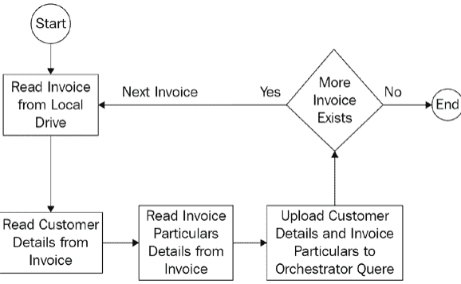

图 14.15 – 读取发票详细信息

在此过程中，您将从已读取的发票中提取客户详细信息和发票明细。让我们开始设计此过程：

- 1. 让我们先创建一个名为 Read_Invoice 的新序列。
- 2. 然后，在 **变量** 面板中，创建名为 `currentDirectoryPath` 的变量，将类型选择为 `String`，并在 **默认** 部分键入 `Directory.GetCurrentDirectory()`。
- 3. 另外，再创建两个变量，第一个名为 `invoices`，类型为 `String[]`（`String` 数组），第二个名为 `invoicePath`，类型为 `String`。
- 4. 在 `Read_Invoice` 序列中，拖放第一个 `Assign` 活动。在 **To** 部分传递 `invoices` 变量，在 **值** 部分传递 `Directory.GetFiles(currentDirectoryPath+"\Invoice")`。这将从 `Invoice` 文件夹获取所有发票名称，并将其存储在名为 `invoices` 的变量中。

- 5. 接下来，拖放 `For Each` 活动，以便您可以遍历每个发票并从中提取信息。然后，在 **值** 部分传递 `invoices`，并在 `For Each` 活动中将 `item` 更改为 `invoice`。

- 6. 在 `For Each` 活动的主体内添加一个 `Assign` 活动，在 **To** 部分传递 `InvoicePath` 变量，在 **值** 部分传递 `invoice.ToString`：

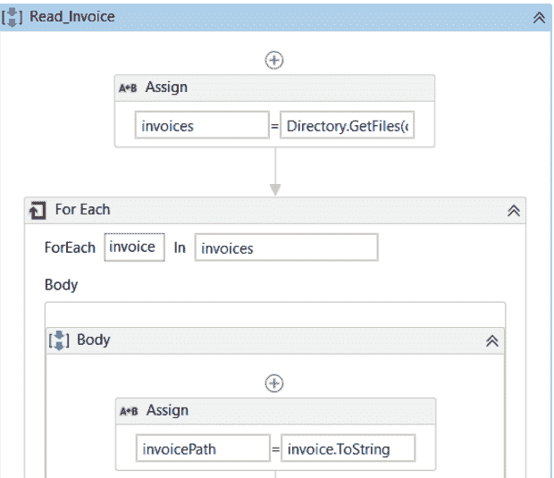

图 14.16 – Read_Invoice 序列

现在我们可以遍历每个发票，先从发票中提取客户详细信息。之后，我们也将提取发票明细。

### 提取客户详细信息

在本节中，您将从已读取的发票中提取客户详细信息。以下图表说明了从发票中提取客户详细信息的高级流程：

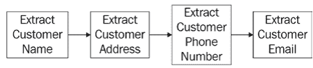

图 14.17 – 提取客户详细信息

在此序列中，您将从发票中提取客户的姓名、地址、电话号码和电子邮件：

- 1. 让我们先创建一个新序列并将其命名为 Extract_Customer_Details。
- 2. 创建四个 Out 参数和一个 In 参数，如以下屏幕截图所示：

| 名称 | 方向 | 参数类型 | 默认值 |
|---|---|---|---|
| out_customerPhoneNo | Out | String | 不支持默认值 |
| out_customerName | Out | String | 不支持默认值 |
| out_customerEmail | Out | String | 不支持默认值 |
| out_customerAddress | Out | String | 不支持默认值 |
| in_invoicePath | In | String | 输入 VB 表达式 |

图 14.18 – 参数面板

- 3. 要提取客户姓名，拖放一个 Sequence 活动并将其重命名为 Customer Name。
- 4. 如果您查看发票名称，它中间已包含客户姓名。因此，您可以使用字符串操作方法，仅从完整字符串中提取客户姓名。
- 5. 在 Customer Name 序列中，添加一个 Assign 活动并在 **To** 部分传递 out_customerName。然后，在 **值** 部分键入 `in_invoicePath.Split({" -"},StringSplitOptions.None)(3).Split({"."},StringSplitOptions.None)(0)`：

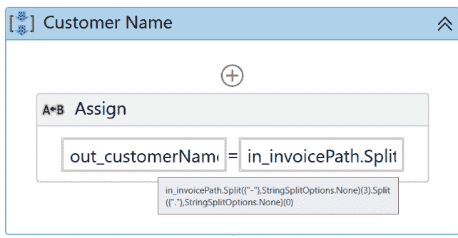

图 14.19 – 提取客户姓名

- 6. 现在让我们提取客户地址。我们将使用 Read PDF Text 活动来读取发票。在 **文件名** 属性下传递 `in_invoicePath` 参数。接下来，使用 `Ctrl + K` 在 **输出** 下的 **文本** 属性中创建新变量；然后键入 `invoiceData` 并按 `Enter`。使用 Read PDF Text 活动读取的所有发票数据都将保存在 `invoiceData` 变量中：

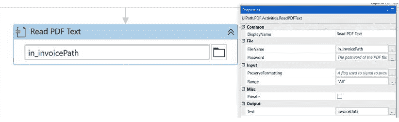

图 14.20 – Read PDF Text 活动

- 7. 如果您查看发票，客户地址位于客户姓名和电话号码之间。因此，要查找客户地址，您将再次使用字符串操作方法。
- 8. 拖放一个 Sequence 活动并将其重命名为 `Customer Address`。
- 9. 创建一个名为 `custNameIndex`（用于从发票中获取客户姓名的索引位置）的 `Int32` 类型新变量。
- 10. 在 `Customer Address` 序列中，添加一个 `Assign` 活动，在 **To** 部分传递 `custNameIndex`，并在 **值** 部分键入 `invoiceData.IndexOf(out_customerName)`。


- 11. 将另一个 Assign 活动拖放进来，在 **目标** 部分传入 out_customerAddress 参数，并在 **值** 部分键入 `invoiceData.Substring(custNameIndex + out_customerName.Length, invoiceData.IndexOf(" Ph No:", custNameIndex + out_customerName.Length) - custNameIndex - out_customerName.Length)`：

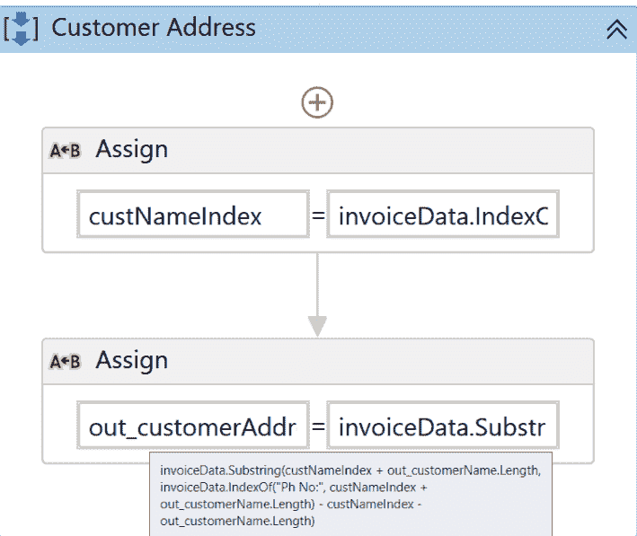

### 图 14.21 – 提取客户地址

让我们现在提取客户的电话号码。您将遵循与客户地址相同的逻辑。客户电话号码位于 **电话号码:** 和 **电子邮件:** 文本之间。同样，您将在此处使用字符串操作方法。

- 12. 将一个 Sequence 活动拖放进来，并将其重命名为 Customer Phone Number。

- 13. 创建一个名为 `custPhoneNoIndex`（用于从发票中获取 **电话号码:** 的索引位置）的 `Int32` 类型变量。

- 14. 在 Customer Phone Number 序列内，添加一个 Assign 活动，在 To 部分传入 custPhoneNoIndex，并在 Value 部分键入 invoiceData.IndexOf("Ph No: ")。  

- 15. 将另一个 Assign 活动拖放进来，在 To 部分传入 out_customerPhoneNo 参数，并在 Value 部分键入 `invoiceData.Substring(custPhoneNoIndex + 6, invoiceData.IndexOf("Email:", custPhoneNoIndex + 6) - custPhoneNoIndex - 6)`：

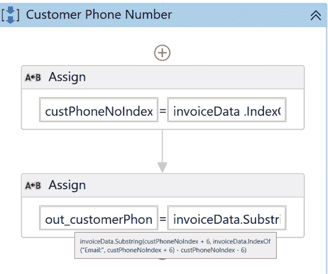

### 图 14.22 - 提取客户电话号码

- 16. 让我们现在提取客户的电子邮件地址。为此，您将使用第 7 章“使用 UiPath 操作数据”中介绍的正则表达式 (RegEx) 技术。将一个 Sequence 活动拖放进来，并将其重命名为 Customer Email。

- 17. 接下来，在 Customer Email 序列内，拖放 Matches 活动。

- 18. 单击配置正则表达式按钮以传入电子邮件正则表达式。

- 19. 在 **正则表达式生成器** 窗口中，从 **正则表达式** 下拉菜单中选择 **电子邮件**，并单击 **保存** 按钮：

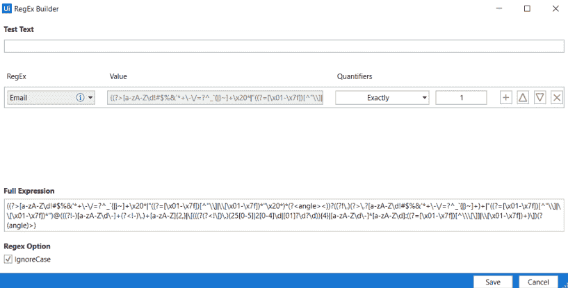

### 图 14.23 – 从正则表达式生成器中选择电子邮件

- 20. 在 Matches 活动的属性部分，在 **输入** 下传入 invoiceData。然后，在 **结果** 部分，创建一个新变量（使用 `Ctrl + K`），命名为 emails。

- 21. 在 Matches 活动之后，拖放一个 Assign 活动以分配从正则表达式中提取的电子邮件。在 **目标** 部分传入 out_customerEmail 参数。然后，在 Assign 活动的 **值** 部分键入 emails.ElementAt(0).ToString。

由于发票只有一个电子邮件地址，您将仅通过第 0 个索引访问它：

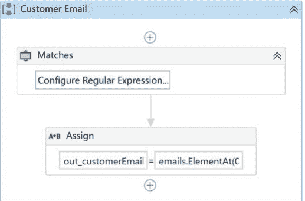

### 图 14.24 – 提取客户电子邮件

- 22. 返回到 Read_Invoice 序列。从 **项目** 面板中，将 Extract_Customer_Details.xaml 工作流拖放到 For Each 活动主体中的 Assign 活动下方：

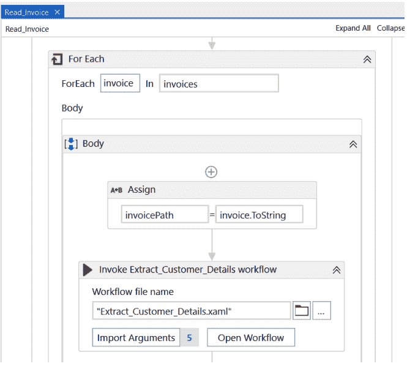

### 图 14.25 – 调用 Extract_Customer_Details.xaml

- 23. 单击 **导入参数** 按钮，并将 `invoicePath` 变量作为值传递给 `in_InvoicePath` 参数。

- 24. 使用 `Ctrl + K` 创建四个新变量，名为 `customerName`、`customerAddress`、`customerEmail` 和 `customerPhoneNo`。然后，将它们作为 **值** 传递给所有 **输出** 参数，如下截图所示：

| 名称 | 方向 | 类型 | 值 |
| :--- | :--- | :--- | :--- |
| in_invoicePath | 输入 | 字符串 | invoicePath |
| out_customerName | 输出 | 字符串 | customerName |
| out_customerAddress | 输出 | 字符串 | customerAddress |
| out_customerEmail | 输出 | 字符串 | customerEmail |
| out_customerPhoneNo | 输出 | 字符串 | customerPhoneNo |

### 图 14.26 – 导入参数

现在我们已成功提取客户的姓名、电话号码、地址和电子邮件，让我们来看看如何提取发票明细。

## 提取发票明细

在本节中，您将从已读取的发票中提取发票明细。下图说明了从发票中提取客户详细信息的高级流程：

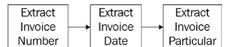

### 图 14.27 – 提取发票明细

在此序列中，我们将提取发票日期、发票编号和订单信息：

- 1. 让我们先创建一个新序列，并将其命名为 `Extract_Invoice_Particular`。

- 2. 现在，创建三个 `Out` 参数和一个 `In` 参数，如下截图所示：

| 名称 | 方向 | 参数类型 | 默认值 |
|---|---|---|---|
| out_invoiceNumber | 输出 | 字符串 | 不支持默认值 |
| out_invoiceDate | 输出 | 字符串 | 不支持默认值 |
| out_dt_invoiceParticulars | 输出 | 数据表 | 不支持默认值 |
| in_invoicePath | 输入 | 字符串 | 输入 VB 表达式 |

### 图 14.28 – 参数面板

- 3. 将 Start Process 活动拖放进来，并在 FileName 属性部分传入 in_invoicePath 参数。当机器人运行时，此场景中的 Start Process 活动将在 Adobe Acrobat Reader 中打开发票 PDF 文件：

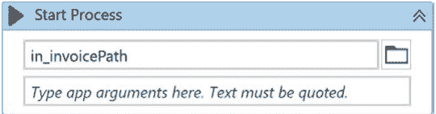

### 图 14.29 – Start Process 活动

- 4. 现在，在后台，在 Adobe Acrobat Reader 中打开任意一张发票（注意，此流程中使用的 Adobe Acrobat Reader 是 32 位版本）。然后，在 UiPath Studio 中，在 Start Process 活动之后，拖放 Attach Window 活动。

- 5. 接下来，单击“指示屏幕上的窗口”，将鼠标悬停在 Adobe Reader (Invoice) 上，然后右键单击它。这将捕获发票 PDF：

- 6. 让我们来看看 Attach Window 活动的选择器。选择器代码如下：

```
<wnd app='acrord32.exe' cls='AcrobatSDIWindow'
title='Invoice-Henry FM-Henry Dough.pdf - Adobe Acrobat
Reader DC (32-b*' />
```

- 7. 如果您查看 title 属性，其值为 'Invoice-Henry FM-Henry Dough.pdf - Adobe Acrobat Reader DC (32-b*'。在此处，还包含了客户名称，这意味着这将仅针对名为 Henry Dough 的客户运行，但我们有多张发票并需要遍历它们，因此此选择器对其他发票无效。因此，我们需要使选择器动态化，以便它适用于所有发票。

- 8. 为此，向选择器添加 * 通配符（如第 8 章“探索 UiPath 选择器”中所述）。编辑选择器，将客户名称部分替换为 *，并单击 **验证** 按钮。这将变为绿色，表明新选择器正确。

- 9. 添加 * 通配符后，新的选择器代码应如下所示 – <wnd app='acrord32.exe' cls='AcrobatSDIWindow' title='Invoice-Henry FM-*.pdf - Adobe Acrobat Reader DC (32-b*' />：

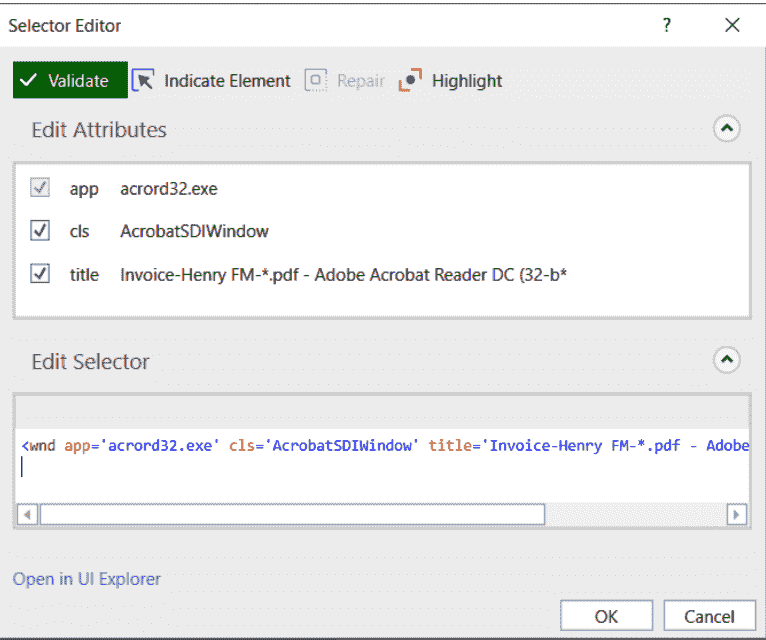

### 图 14.30 – Attach Window 活动的选择器编辑器窗口

- 10. 将 Get Text 活动拖放到 Attach Window 活动内部。您将使用此 Get Text 活动从 PDF 中捕获发票日期。单击 Get Text 活动的 **指示窗口内元素** 操作。然后，将鼠标光标悬停在发票的 **日期** 字段上，并通过右键单击将其记录下来，如下截图所示：

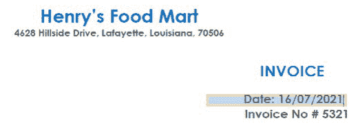

### 图 14.31 – 从发票中捕获日期

- 11. 让我们来看看此 Get Text 活动的选择器。在此例中，发票中提到的日期由选择器捕获。以下是选择器的一部分：

```
<ctrl name=' Date: 16/07/2021 ' role='text' />
```

由于我们希望它能动态化以适用于任何其他日期，我们将再次使用动态选择器概念。将 16/07/2021 部分替换为 * 并单击 **验证** 按钮。验证按钮将变为绿色，表明新选择器正确。新的选择器代码应如下所示：

```
<ctrl name=' Date: * ' role='text' />
```

* 将确保其适用于发票中提供的任何日期：

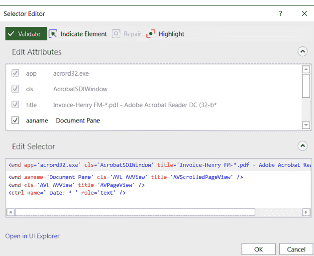

### 图 14.32 – 用于发票日期的 Get Text 活动的选择器编辑器窗口


- 12. 既然我们已捕获发票日期，请将其保存到已创建的参数中。在**属性**面板下，将 out_invoiceDate 传递到**输出**属性的**值**部分。

我们已成功提取发票日期。现在，让我们提取发票号码。

- 13. 将“获取文本”活动拖放到发票日期的“获取文本”活动下方。您将使用此“获取文本”活动从 PDF 中捕获发票号码。

- 14. 单击**指示窗口内元素**，将鼠标光标悬停在发票的**发票号码**字段上，然后通过右键单击将其记录下来。

- 15. 让我们来看看此“获取文本”活动的选择器。在此示例中，发票中提到的发票号码由选择器捕获。以下是选择器的部分内容：

```
<ctrl name=' Invoice No # 5321 ' role='text' />
```

由于我们希望选择器具有动态性，以适用于任何其他提供的发票号码，我们将再次使用动态选择器概念。将 5321 部分替换为 * 并单击**验证**按钮。**验证**按钮会变为绿色，这确认新选择器是正确的。您的新选择器代码应如下所示：

```
<ctrl name=' Invoice No # * ' role='text' />
```

* 将确保它适用于发票中提供的任何发票号码：

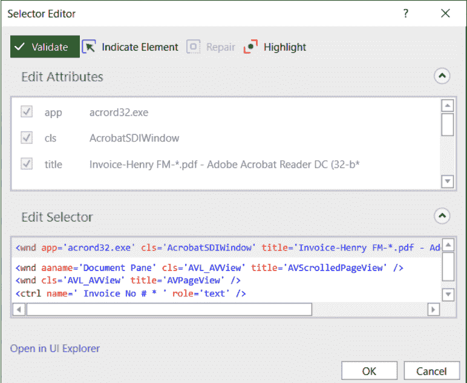

图 14.33 – 发票号码的“获取文本”活动的选择器编辑器窗口

- 16. 既然我们已捕获发票号码，请将其保存到已创建的参数中。在**属性**面板下，将 out_invoiceNumber 传递到**输出**属性的**值**部分。

> > **注意**
> >
> > 发票日期和发票号码的选择器是部分生成的，因为两个“获取文本”活动都在“附加窗口”活动内部使用。

让我们现在提取发票详细信息。由于数据是以表格形式呈现的结构化数据，我们将使用 UiPath Studio 的数据抓取向导工具来提取它：

- 1. 单击 DESIGN 功能区中的“数据抓取”按钮。将打开一个新的“提取向导”窗口；然后，单击“下一步”按钮以启动数据抓取过程：

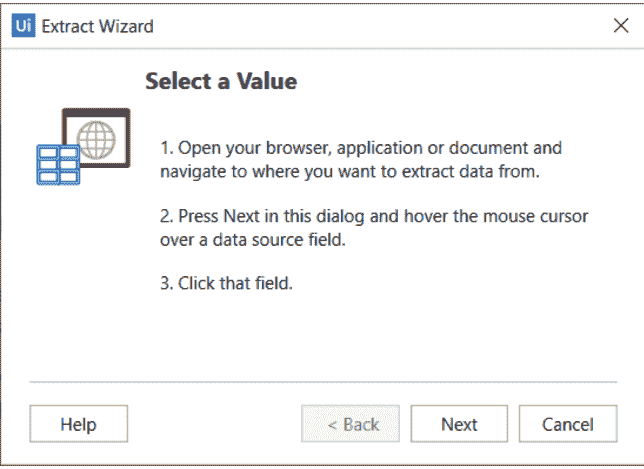

图 14.34 – 数据抓取向导

- 2. 将光标悬停在表格的任何单元格上并右键单击：

| 数量 | 描述 | 单价 | 行总计 |
| --- | --- | --- | --- |
| 2 | 牛油果和鹰嘴豆意面 | 10.00 | 20.00 |
| 5 | 牛油果和西柚贝果 | 8.00 | 40.00 |
| 1 | 杏枣碎蛋糕 | 10.00 | 10.00 |
| 1 | 车切达干枣沙拉 | 15.00 | 15.00 |
| 1 | 马斯卡彭和桑葚沙拉 | 20.00 | 20.00 |
| | | 小计 | 105.00 |
| | | 运费 | 2.00 |
| | | 总计 | $107.00 |

图 14.35 – 选择表格单元格

- 3. 将出现一个新窗口，显示所有提取的表格单元格值。在**最大结果数**字段中输入 0（零），然后单击**完成**按钮：

### 预览数据

| 数量 | 描述 | 单价 | 行总计 |
| --- | --- | --- | --- |
| 2 | 牛油果和鹰嘴豆意面 | 10.00 | 20.00 |
| 5 | 牛油果和西柚贝果 | 8.00 | 40.00 |
| 1 | 杏枣碎蛋糕 | 10.00 | 10.00 |
| 1 | 车切达干枣沙拉 | 15.00 | 15.00 |
| 1 | 马斯卡彭和桑葚沙拉 | 20.00 | 20.00 |
| | | 小计 | 105.00 |
| | | 运费 | 2.00 |
| | | 总计 | $107.00 |

编辑数据定义 最大结果数（0 表示全部）0

帮助 < 返回 完成 取消

- 4. 单击**完成**按钮会将**提取结构化数据**活动放置在 Studio 中的**附加窗口**活动内：

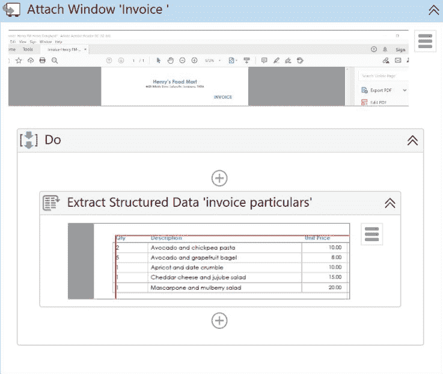

图 14.37 – **提取结构化数据**活动

- 5. 编辑**附加窗口**活动的选择器，因为它包含客户姓名。编辑后的选择器应如下所示：

```
<wnd app='acrord32.exe' cls='AcrobatSDIWindow'
title='Invoice-Henry FM-*.pdf - Adobe Acrobat Reader DC
(32-b*' />
```

- 6. 数据抓取向导将以**数据表**格式提取数据。将其保存到已创建的**数据表**参数中。在**属性**面板下，在**输出**属性的**数据表**部分传递 **out_dt_invoiceParticulars**。

- 7. 最后，拖放**关闭应用程序**活动，单击**指示窗口内元素**，将鼠标悬停在 Adobe Acrobat Reader 上并右键单击它。这将在从 PDF 读取器中提取所有所需字段后将其关闭。

- 8. 返回 Read_Invoice 序列。从**项目**面板，将 Extract_Invoice_Particular.xaml 工作流拖放到 For Each 活动主体中 InvokeExtract_Customer_Details 工作流活动下方：

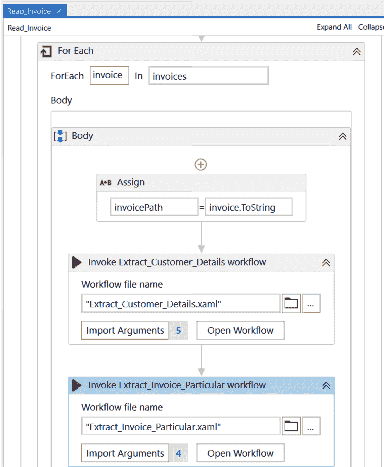

图 14.38 – 调用 Extract_Invoice_Particular.xaml

- 9. 单击**导入参数**按钮，并将 `invoicePath` 变量作为值传递给 `in_InvoicePath` 参数。

- 10. 使用 `Ctrl + K` 创建三个新变量，命名为 `invoiceDate`、`invoiceNumber` 和 `dt_invoiceParticulars`，并将它们作为**值**传递给所有**输出**参数，如下图所示：

| 名称 | 方向 | 类型 | 值 |
| :--- | :--- | :--- | :--- |
| in_invoicePath | In | String | invoicePath |
| out_invoiceDate | Out | String | invoiceDate |
| out_invoiceNumber | Out | String | invoiceNumber |
| out_dt_invoiceParticulars | Out | DataTable | dt_invoiceParticulars |

图 14.39 – 导入参数

恭喜！您已从发票中提取所有必要字段。让我们将所有这些值上传到 Orchestrator 队列。

## 将发票数据上传到 Orchestrator 队列

在本节中，您将客户详细信息和发票详细信息上传到 Orchestrator 队列。以下图表说明了将数据上传到队列的高级流程：

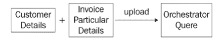

图 14.40 – 上传到 Orchestrator 队列

将客户详细信息和发票详细信息上传到队列将帮助您构建此过程的执行者模型，您可以在其中从队列中取用数据并对其进行处理。

让我们开始吧：

- 1. 首先，让我们在 Orchestrator 中创建一个队列。单击队列部分并创建一个新队列。输入 HenryFoodMartInvoice 作为队列名称，然后单击“添加”按钮创建队列：

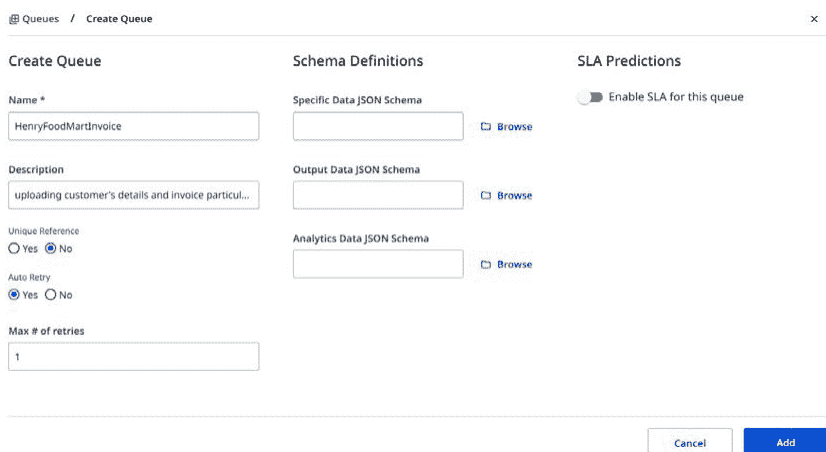

图 14.41 – 创建队列

- 2. 在 Studio 中，创建一个新序列并将其命名为 Upload_To_Queue。

- 3. 然后，单击“导入”面板并搜索 Newtonsoft.Json 命名空间并将其添加。您将使用它来序列化 in_dt_invoiceParticulars 参数，以便整个数据表可以作为单个事务添加到队列中：

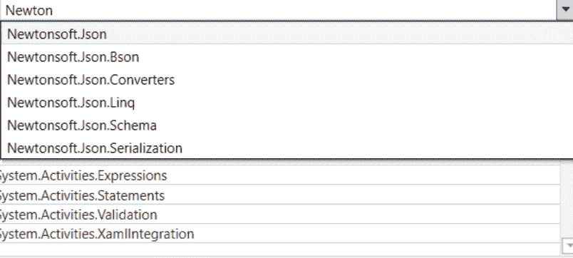

图 14.42 – 添加 Newtonsoft.Json 命名空间

- 4. 创建七个输入参数，如下图所示：

| 名称 | 方向 | 参数类型 | 默认值 |
|---|---|---|---|
| in_invoiceDate | In | String | 输入 VB 表达式 |
| in_invoiceNumber | In | String | 输入 VB 表达式 |
| in_customerName | In | String | 输入 VB 表达式 |
| in_customerAddress | In | String | 输入 VB 表达式 |
| in_customerPhoneNo | In | String | 输入 VB 表达式 |
| in_customerEmail | In | String | 输入 VB 表达式 |
| in_dt_invoiceParticulars | In | DataTable | 输入 VB 表达式 |

图 14.43 – 参数面板

- 5. 将 Try Catch 活动拖放为第一个活动。

- 6. 然后，将“添加队列项”活动拖放到 Try 块内。然后，在“添加队列项”活动的“属性”面板下，在 QueueName 部分中输入 "HenryFoodMartInvoice" 作为队列名称。

- 7. 在此场景中，队列是在 Orchestrator 中名为 Packt 的文件夹下创建的，因此您必须在“添加队列项”活动属性中传递文件夹名称。在 Folder Path 部分中，输入 "Packt"：

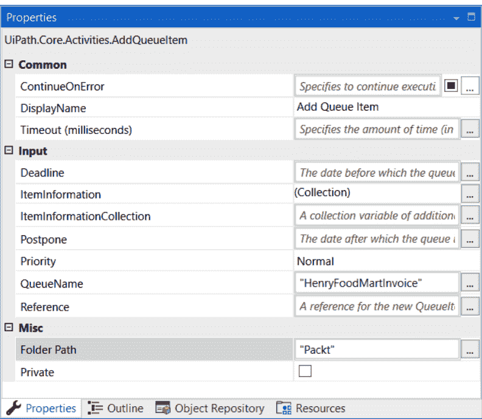

图 14.44 – “添加队列项”活动的属性面板


8. 在 **属性** 面板下，单击 **ItemInformation** 属性的省略号图标：

| 属性 | 值 |
|---|---|
| 截止日期 | 队列...之前的日期 |
| ItemInformation | (集合) |
| ItemInformationCollection | 用于添加...的集合变量 |
| 推迟日期 | 队列...之后的日期 |
| 优先级 | 正常 |
| 队列名称 | "HenryFoodMartInvoice" |

图 14.45 – ItemInformation 集合属性

9. 在 **ItemInformation** 窗口中，创建名为 invoiceDate、invoiceNumber、customerName、customerAddress、customerPhoneNo、customerEmail 和 invoiceParticulars 的七个 String 类型参数。

10. 让我们为所有参数赋值：

- invoiceDate = in_invoiceDate.Split(":", StringSplitOptions.None)(1).ToString.Trim
- invoiceNumber = in_invoiceNumber.Split("#", StringSplitOptions.None)(1).ToString.Trim
- customerName = in_customerName
- customerAddress = in_customerAddress
- customerPhoneNo = in_customerPhoneNo
- customerEmail = in_customerEmail
- invoiceParticulars = JsonConvert.SerializeObject(in_dt_invoiceParticulars)

在 **值** 部分为所有值赋值后，您的 **ItemInformation** 窗口应如下所示：

| 名称 | 方向 | 类型 | 值 |
|---|---|---|---|
| invoiceDate | In | String | in_invoiceDate.Split(":", StringSplitOptions.None)(1).ToString.Trim |
| invoiceNumber | In | String | in_invoiceNumber.Split("#", StringSplitOptions.None)(1).ToString.Trim |
| customerName | In | String | in_customerName |
| customerAddress | In | String | in_customerAddress |
| customerPhoneNo | In | String | in_customerPhoneNo |
| customerEmail | In | String | in_customerEmail |
| invoiceParticulars | In | String | JsonConvert.SerializeObject(in_dt_invoiceParticulars) |

图 14.46 – 已分配所有值的 ItemInformation 窗口

11. 发票日期和发票号中包含额外字符。要去除这些字符，请使用带有适当分隔符的 Split() 函数。如前所述，DataTable 参数在上传到队列之前必须序列化。JsonConvert 类的 SerializeObject() 函数可帮助将其序列化为 JSON 对象。

12. 最后，在 Catches 块中，捕获 SystemException。

13. 另外，记录一条消息，日志级别为 Error，消息为 "Unable to Upload to Queue" + vbLf + exception.Message + vbLf + exception.Source。

14. 返回到 Read_Invoice 序列，从 **项目** 面板将 Upload_To_Queue.xaml 工作流拖放到 For Each 活动主体中 Invoke_Extract_Invoice_Particular 工作流活动的下方：

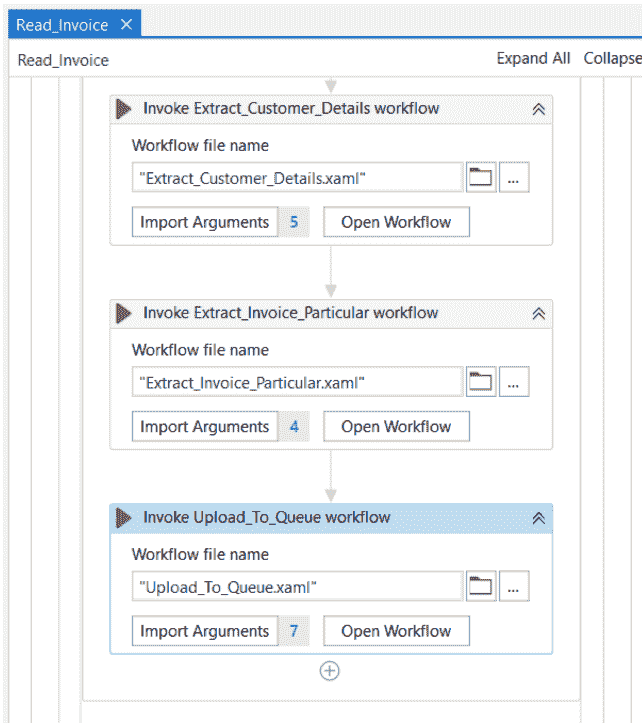

图 14.47 – 调用 Upload_to_Queue.xaml

15. 单击 **导入参数** 按钮，为所有七个 In 参数传递变量，如下图所示：

| 名称 | 方向 | 类型 | 值 |
|---|---|---|---|
| in_invoiceDate | In | String | invoiceDate |
| in_invoiceNumber | In | String | invoiceNumber |
| in_customerName | In | String | customerName |
| in_customerAddress | In | String | customerAddress |
| in_customerPhoneNo | In | String | customerPhoneNo |
| in_customerEmail | In | String | customerEmail |
| in_dt_invoiceParticulars | In | DataTable | dt_invoiceParticulars |

图 14.48 – 导入参数

现在，您已完成上传到队列部分，是时候组装 Main.xaml 文件以运行流程了。

## 组装 Main.xaml

是时候运行流程了，但在运行流程之前，让我们先在 Main.xaml 文件中调用 Download_Invoice.xaml 和 Read_Invoice.xaml 工作流：

1. 在 Main.xaml 工作流中，创建名为 isMail 的布尔类型变量。然后，从 **项目** 面板将 Download_Invoice.xaml 工作流拖放到 Main.xaml 工作流中。

2. 单击 **导入参数** 按钮，将 isMail 变量作为值传递给 out_isMail 参数：

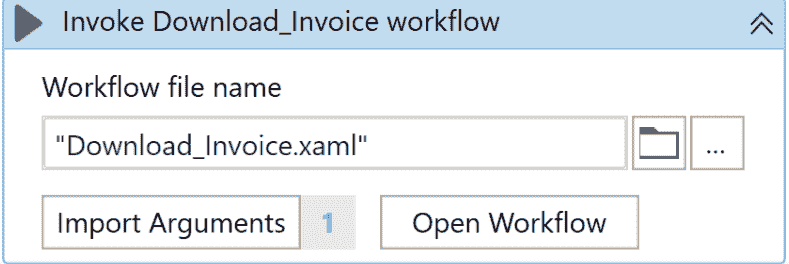

| 名称 | 方向 | 类型 | 值 |
|---|---|---|---|
| out_isMail | Out | Boolean | isMail |
| 创建参数 | | | |

图 14.49 – 调用 Download_Invoice 工作流

3. 接下来，拖放 **如果** 活动，并在 **条件** 中传递 **isMail** 变量。如果 **isMail** 变量的值为 **真**，则可以开始读取发票；否则，将停止流程。

4. 从 **项目** 面板将 **Read_Invoice.xaml** 工作流拖放到 **如果** 活动的 **然后** 块中。

5. 在其下方，添加 **记录消息** 活动，日志级别设为 **信息**，并将消息设置为 "All invoices details uploaded to queue"。

6. 在 **否则** 块中，添加 **信息** 级别的 **记录消息** 活动，并将消息设置为 "No invoice to process"：

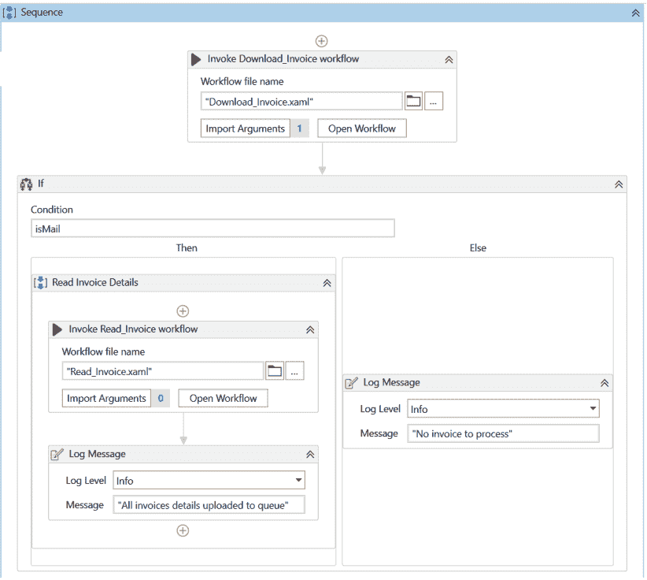

图 14.50 – Main.xaml 工作流

7. 现在，通过单击 **设计** 功能区选项卡上的 **运行** 按钮运行整个流程。流程在没有任何错误的情况下完成，所有发票详细信息都已上传到 Orchestrator 队列：

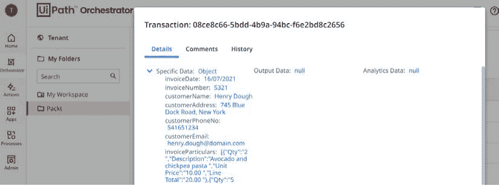

图 14.51 – 队列中的事务项目

恭喜！您已成功构建发票处理分派器模型的自动化。现在，您可以将代码发布到 Orchestrator，以便从 Orchestrator 页面或 UiPath Assistant 运行机器人。

## 摘要

在本章中，您开发了一个从发票中提取相关数据以供进一步处理的自动化流程。首先，机器人阅读电子邮件并下载以电子邮件附件形式以 PDF 接收的发票。然后，它从发票中提取特定数据并将其上传到 Orchestrator 队列。

在下一章中，您将学习如何构建执行者模型，以从 Orchestrator 队列中获取值并将其输入到订单录入 CRM 中。
