## 15

## 发票处理 - 执行者

在 Henry's Food Mart，财务和会计部门已选择发票处理流程进行自动化。发票处理流程阅读电子邮件并下载以电子邮件附件形式以 PDF 接收的发票。然后，它从发票中提取客户信息和发票详细信息，并将其输入到订单录入 CRM 网页中。

您通过遵循分派器-执行者模型开始构建此流程。在第 14 章“发票处理 – 分派器”中，您学习了如何构建一个从电子邮件下载未读发票、从每张发票中提取客户详细信息和发票详细信息，然后将其上传到名为 HenryFoodMartInvoice 的 Orchestrator 队列的自动化流程。

在本章中，您将构建执行者模型，以将发票数据输入到订单录入 CRM 网页中。

以下是您将在本发票处理 – 执行者项目中学习的内容列表：

- 浏览器自动化
- 使用不同类型的工作流
- 使用 Orchestrator 队列
- 修改选择器
- 在 UiPath Studio 中记录日志
- 处理异常
- 反序列化 JSON
- 使用 DataTables
- 更新队列状态

### 技术要求

让我们了解此项目所需的要求：

- UiPath Studio Community/Enterprise/Academic Alliance Edition 20.10 及更高版本，且必须连接到 UiPath Orchestrator 服务。
- 访问 UiPath Orchestrator 服务
- 订单录入 CRM 网页
- Google Chrome 浏览器
- 互联网访问权限

您可以从 GitHub 上的 https://github.com/PacktPublishing/UiPath-Associate-Certification-Guide/tree/main/Chapter15/Solution 获取发票处理分派器的完整代码。

### 项目概览

在本章中，您将设计发票处理流程的执行者模型。让我们详细了解此过程。以下是您应该执行的步骤：

1. 编写机器人以启动订单录入 CRM 网页。
2. 编写机器人以从 Orchestrator 工作流中名为 **HenryFoodMartInvoice** 的队列读取事务项目。
3. 编写机器人以从从队列中读取的事务项目中提取以下相关字段：
    - **客户详细信息：**
        - 客户姓名
        - 客户地址
        - 客户电话号码
        - 客户电子邮件 ID
    - **发票详细信息：**
        - 发票日期
        - 发票号
    - **订单信息：**
        - 项目数量
        - 项目描述
        - 项目单价
        - 行总金额
        - 小计金额
        - 运费金额
        - 总金额


- 4. 程序化机器人，在 **订单录入 CRM** 网页上输入以下详细信息：
  - 客户详细信息
  - 发票详情
- 5. 对剩余的队列项目重复步骤 2、3 和 4。
- 6. 如果 Orchestrator 中没有新的队列项目，则程序化机器人成功结束流程。

让我们通过图表来了解整个流程：

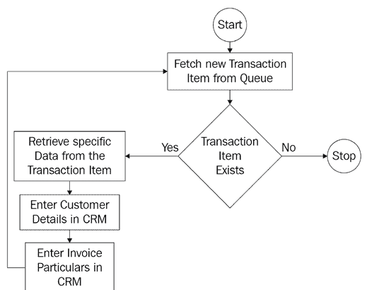

图 15.1 – 高级别流程图

现在您已了解流程概览，让我们开始构建自动化。

## 设置项目

在开始构建流程之前，首先，让我们正确设置所有 UiPath Studio 配置：

- 1. 打开 UiPath Studio，创建名为 *Invoice_Processing_Performer* 的新流程：

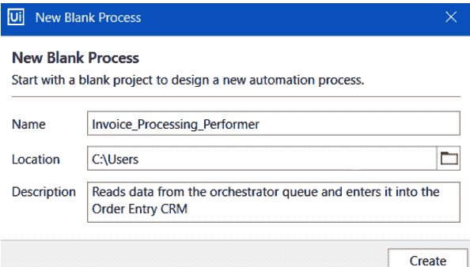

图 15.2 – 创建新流程

- 2. 单击设计器功能区中的管理包，并将当前项目依赖项更新为以下版本：
  - UiPath.Excel.Activities - v2.10.4
  - UiPath.Mail.Activities – v1.10.5
  - UiPath.System.Activities – v21.4.1
  - UiPath.UIAutomation.Activities – v21.4.4：

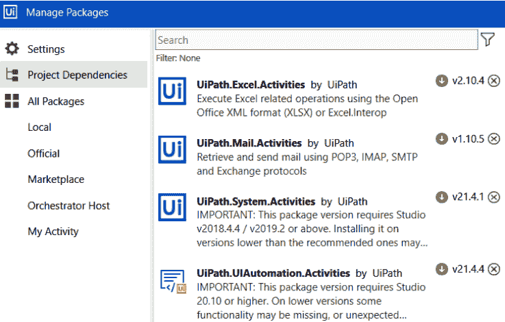

图 15.3 – 已更新的依赖项

- 3. 现在您已将依赖项更新为正确版本，还需安装另一个依赖项，UiPath.WebAPI.Activities – v1.7.0：

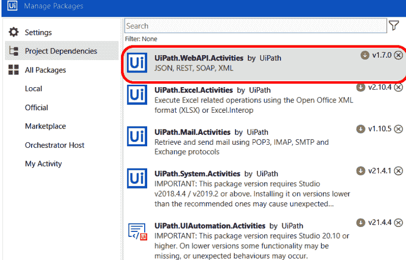

图 15.4 – 已添加 WebAPI 依赖项

现在您已配置好所需的一切，让我们开始构建流程。

## 启动 CRM

在本节中，您将启动订单录入 CRM。在继续构建机器人之前，请从 https://github.com/PacktPublishing/UiPath-Associate-Certification-Guide/tree/main/Chapter15/Input%20File%20-%20Order%20Entry%20CRM 的 GitHub 仓库中的输入文件 – 订单录入 CRM 文件夹下载订单录入 CRM。

订单录入 CRM 具有与发票对应的字段，如下面的屏幕截图所示：

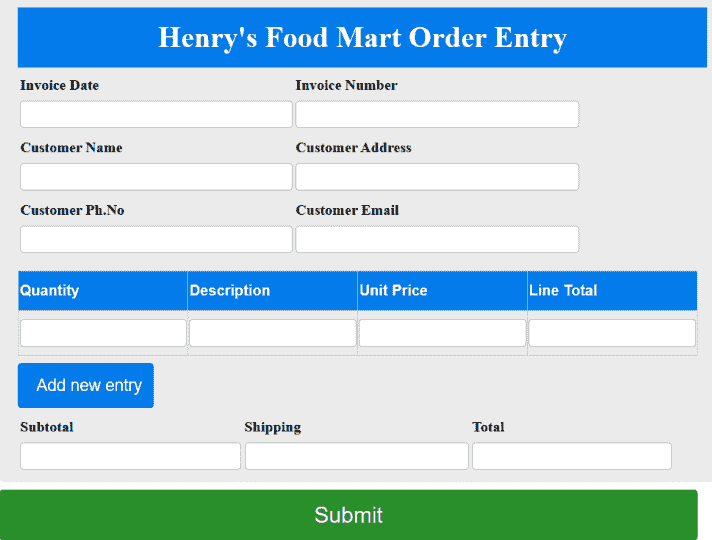

图 15.5 – 订单录入 CRM

在项目目录中创建名为 CRM 的文件夹，并将订单录入 CRM 页面移入此文件夹：

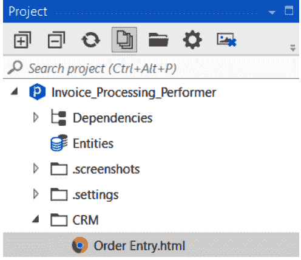

图 15.6 – 订单录入 CRM 已移入 CRM 文件夹

现在您已下载 CRM，让我们开始构建自动化：

- 1. 在 UiPath Studio 中，打开 Main.xaml 文件。
- 2. 将 **活动** 面板中的 Open Browser 活动拖放到 **设计器** 面板中。
- 3. 接下来，单击 Open Browser 活动的 **属性** 面板，并在 **URL** 下方键入 Environment.CurrentDirectory+"\CRM\Order Entry.html"。
- 4. 将 **Chrome** 选为 **浏览器类型** 选项：

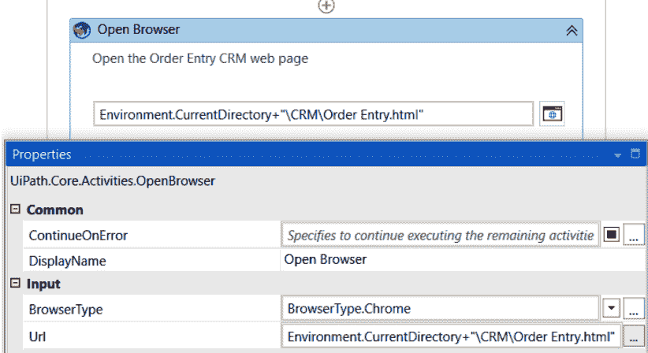

图 15.7 – Open Browser 活动

- 5. 将 Maximize Window 活动拖放到 Open Browser 活动内部。这将确保订单录入 CRM 网页始终在最大化窗口中打开。

太棒了！现在您已打开订单录入 CRM 网页，让我们开始从队列读取数据。然后，我们将把记录输入到 CRM 中。

## 处理队列

在本节中，您将从队列读取事务项目，并将其输入到订单录入 CRM 网页中。

让我们从构建工作流开始：

- 1. 创建名为 Read_From_Queue 的新流程图工作流。
- 2. 接下来，拖放一个序列活动，将其重命名为获取事务项目，并将其设置为起始节点：

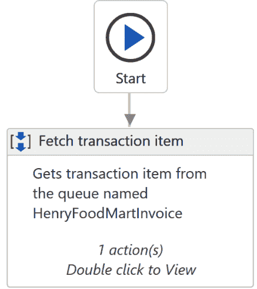

图 15.8 – 获取事务项目序列已设置为起始节点

- 3. 在获取事务项目序列内部，拖放 Try Catch 活动。
- 4. 在 `Try Catch` 活动的 **尝试** 块内部，拖放 `Get Transaction Item` 活动：

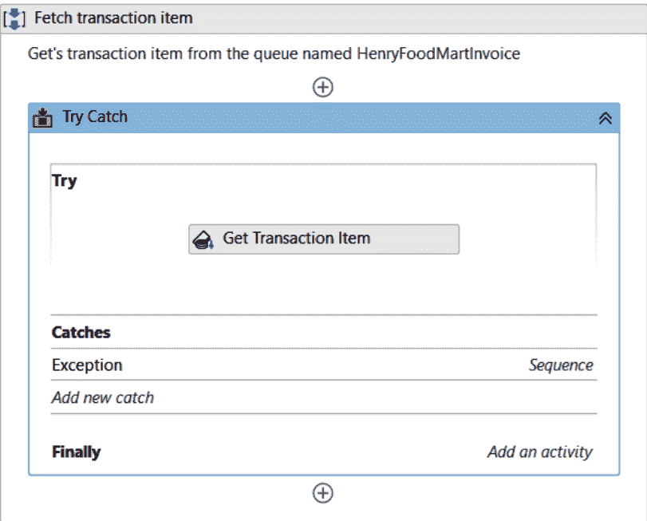

图 15.9 – 获取事务项目活动

- 5. 单击 **获取事务项目** 活动的 **属性** 面板，并传入以下属性：
  - `QueueName = "HenryFoodMartInvoice"`
  - `Folder Path = "Packt"`

在此示例中，Orchestrator 中的队列位于名为 `Packt` 的文件夹中。因此，要从 `Packt` 文件夹获取队列，已在 **文件夹路径** 部分中传入 `Packt`。

- 6. 向 **输出** 下的 **事务项目** 属性添加名为 `transactionItem` 的新变量：

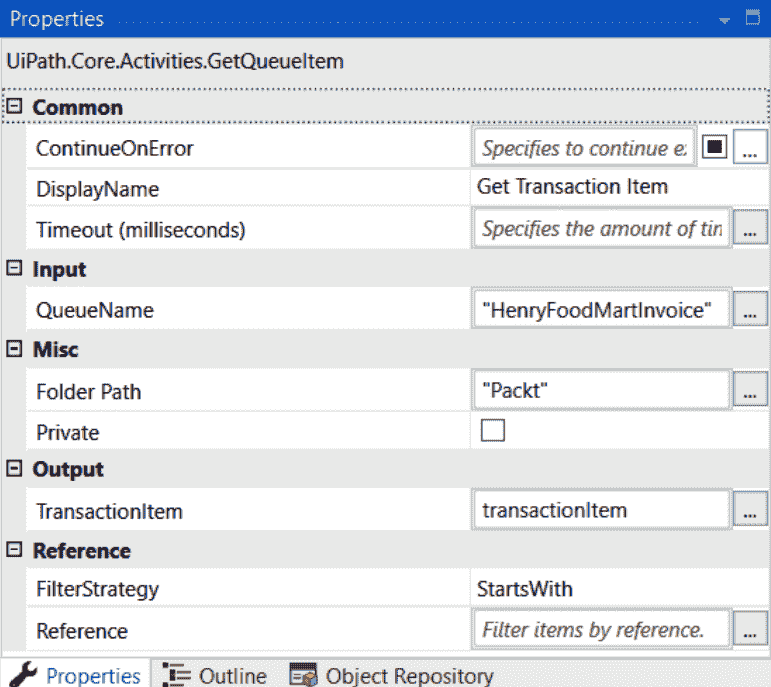

图 15.10 - 属性面板

- 7. 在 Try Catch 活动的 **捕获** 块内部，捕获 `Exception` 值并添加 `Log Message` 活动。**日志级别** 属性应为 `Error`，而 **消息** 部分应为 "No queue found at the mentioned folder path"+vbLf+exception.Message+vbLf+exception.Source。
- 8. 导航到 Read_From_Queue 流程图工作流，并拖放与获取事务项目序列相连的流程决策活动。
- 9. 在流程决策活动的 **条件** 属性下键入 transactionItem IsNot Nothing：

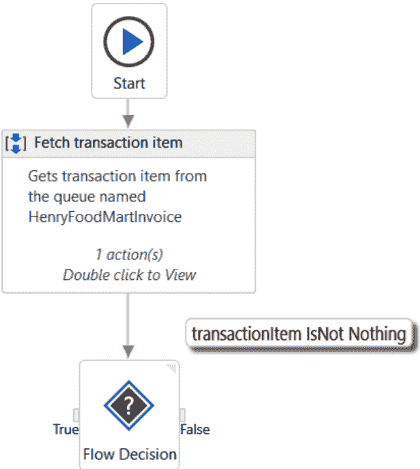

图 15.11 – 用于检查事务项目的流程决策活动

此布尔条件将为您提供两种结果：当队列中存在事务项目时为 TRUE，或当没有事务项目时为 FALSE。

- 10. 拖放连接到 FALSE 分支的记录消息活动。将日志级别属性设置为 Info，并将 "No more transaction items present" 键入消息部分：

获取事务项目
从名为
HenryFoodMartInvoice
的队列获取事务项目
1 个操作
双击查看

流程决策

记录消息
记录消息以通知
没有更多事务项目可供处理
双击查看

图 15.12 – 显示队列中没有新事务项目

如果流程决策活动条件为 TRUE，您可以继续从事务项目中检索客户详细信息和发票详情。因此，让我们构建从事务项目中检索发票详细信息的流程。

### 从事务项目中检索数据

在本节中，您将从已从队列中读取的事务项目中提取 **客户详细信息** 和 **发票详情**：

- 1. 拖放一个序列活动，并将其连接到流程决策活动的 TRUE 分支。然后，将序列活动重命名为从事务中检索数据：

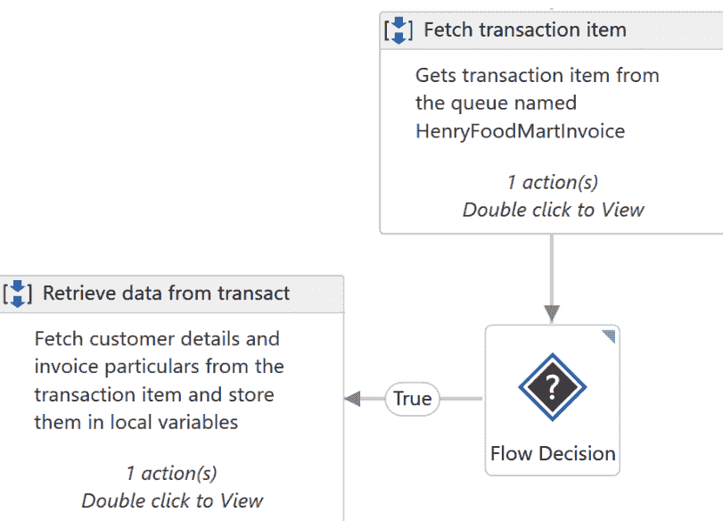

图 15.13 – 从事务中检索数据的序列

- 2. 在从事务中检索数据序列内部，拖放 Try Catch 活动。
- 3. 在 Try Catch 活动的 **尝试** 块内部，拖放一个序列活动，并将其重命名为获取发票日期。
- 4. 在获取发票日期序列内添加一个赋值活动。在 **属性** 面板下，将 `transactionItem.SpecificContent("invoiceDate").ToString` 键入 **值** 部分。接下来，在 **至** 部分中，创建名为 invoiceDate、类型为 String 的新变量：

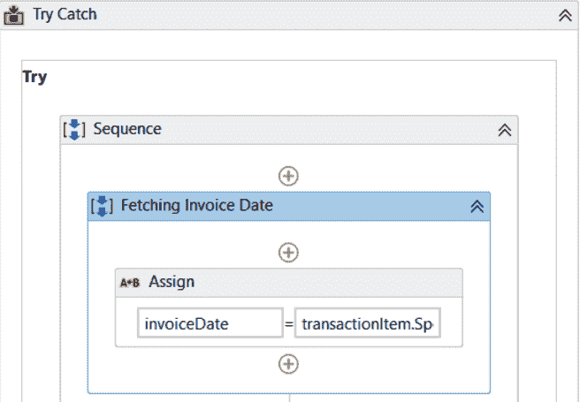

图 15.14 – 获取发票日期

- 5. 在获取发票日期序列下方拖放一个序列活动，并将其重命名为获取发票编号。
- 6. 在获取发票编号序列内添加一个赋值活动。在 **属性** 面板下，将 `transactionItem.SpecificContent("invoiceNumber").ToString` 键入 **值** 部分。接下来，在 **至** 部分中，创建名为 `invoiceNumber`、类型为 `String` 的新变量。
- 7. 在获取发票编号序列下方拖放一个序列活动，并将其重命名为获取客户姓名。
- 8. 在获取客户姓名序列内添加一个赋值活动。在 **属性** 面板下，将 `transactionItem.SpecificContent("customerName").ToString` 键入 **值** 部分。接下来，在 **至** 部分中，创建名为 `customerName`、类型为 `String` 的新变量。
- 9. 在获取客户姓名序列下方拖放一个序列活动，并将其重命名为获取客户地址。
- 10. 在获取客户地址序列内添加一个赋值活动。在 **属性** 面板下，将 `transactionItem.SpecificContent("customerAddress").ToString` 键入 **值** 部分。接下来，在 **至** 部分中，创建名为 `customerAddress`、类型为 `String` 的新变量。


- 11. 将一个 Sequence 活动拖放到 Fetching CustomerAddress 序列下方，并将其重命名为 Fetching CustomerPhone Number。

- 12. 在 Fetching CustomerPhone Number 序列内添加一个 Assign 活动。在 **属性** 面板中，将 transactionItem.SpecificContent( "customerPhoneNo" ).ToString 输入到 **值** 部分。接下来，在 **到** 部分，创建一个名为 customerPhoneNo 的 String 类型新变量。

- 13. 将一个 Sequence 活动拖放到 Fetching CustomerPhone Number 序列下方，并将其重命名为 Fetching CustomerEmail。

- 14. 在 Fetching CustomerEmail 序列内添加一个 Assign 活动。在 **属性** 面板中，将 transactionItem.SpecificContent( "customerEmail" ).ToString 输入到 **值** 部分。接下来，在 **到** 部分，创建一个名为 customerEmail 的 String 类型新变量。

- 15. 将一个 Sequence 活动拖放到 Fetching CustomerEmail 序列下方，并将其重命名为 Fetching Invoice Particulars。

- 16. 在 Fetching Invoice Particulars 序列内添加一个 Assign 活动。在 **属性** 面板中，将 transactionItem.SpecificContent( "invoiceParticulars" ).ToString 输入到 **值** 部分。接下来，在 **到** 部分，创建一个名为 invoiceParticulars 的 String 类型新变量。

- 17. 最后，在 **尝试** 块中，在 Fetching Invoice Particulars 序列下方添加一个 Assign 活动。然后，在 **属性** 面板中，在 **到** 部分创建一个名为 flag 的 Boolean 变量，并在 **值** 部分输入 True。

您将使用此 flag 变量作为检查器，以验证是否发生了异常。如果引发任何异常，则 flag 变量将初始化为 False；否则，它将初始化为 True 以继续执行。

- 18. 在 Try Catch 活动的 **捕获** 块内，捕获一个 Exception 值并添加一个 Log Message 活动。**日志级别** 属性应设置为 Error，**消息** 部分应为 "Transaction Item with the specified data not found "+vbLf+exception.Message+vbLf+exception.Source。

- 19. 最后，在 **捕获** 块中，在 `Log Message` 活动下方添加一个 `Assign` 活动。然后，在 **属性** 面板中，将 `flag` 布尔变量传递到 **到** 部分，并在 **值** 部分输入 `False`。

- 20. 返回到 `Read_From_Queue` 流程图，并拖放连接到 `Retrieve data from transaction` 序列的 `Flow Decision` 活动。

- 21. 将 `flag` 变量传递到 `Flow Decision` 活动的 **条件** 属性下方。这样做可确保，如果 `flag` 变量的结果为 `True`，则可以继续将详细信息输入 CRM。否则，如果 `flag` 变量的结果为 `False`，则表示在从事务项目检索数据时发生了异常：

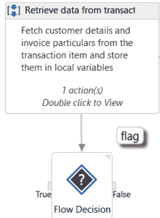

图 15.15 – 从事务项目获取数据后的流程决策活动

您现已成功从事务项目中检索客户详细信息和发票详细信息。接下来，让我们开始将客户详细信息和发票详细信息输入 Order Entry CRM 网页。

## 输入客户详细信息

在本节中，您将在 Order Entry CRM 网页中输入客户姓名、地址、电话号码和电子邮件：

- 1. 创建一个名为 Enter_Customer_Details 的新 Sequence 工作流。

- 2. 创建四个入方向参数和一个出方向参数，如以下屏幕截图所示：

| 名称 | 方向 | 参数类型 | 默认值 |
| --- | --- | --- | --- |
| in_customerName | 入 | 字符串 | 输入一个 VB 表达式 |
| in_customerAddress | 入 | 字符串 | 输入一个 VB 表达式 |
| in_customerPhoneNo | 入 | 字符串 | 输入一个 VB 表达式 |
| in_customerEmail | 入 | 字符串 | 输入一个 VB 表达式 |
| out_flag | 出 | 布尔值 | 不支持默认值 |

图 15.16 – 参数面板

- 3. 将 Try Catch 活动拖放到 Enter_Customer_Details 序列内。

- 4. 在 Try Catch 活动的 **尝试** 块内，拖放 Attach Browser 活动并附加已打开的 Order Entry CRM 网页。

- 5. 拖放 Type Into 活动并指示 Order Entry CRM 网页中的客户姓名文本字段。在 Text 属性下方输入 in_customerName.Trim：

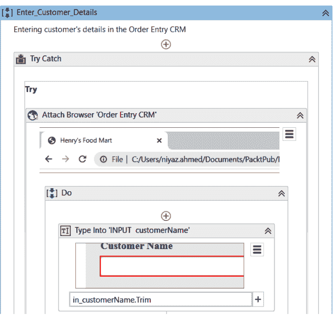

图 15.17 – 输入客户姓名

- 6. 在客户姓名 Type Into 活动下方，拖放一个新的 Type Into 活动并指示 Order Entry CRM 网页上的客户地址文本字段。在 Text 属性下输入 in_customerAddress.Trim。

- 7. 在客户地址 Type Into 活动下方，拖放一个新的 Type Into 活动并指示 Order Entry CRM 网页中的客户电话号码文本字段。在 Text 属性下输入 in_customerPhoneNo.Trim。

- 8. 在客户电话号码 Type Into 活动下方，拖放一个新的 Type Into 活动并指示 Order Entry CRM 网页中的客户电子邮件文本字段。在 Text 属性下输入 in_customerEmail.Trim。

- 9. 接下来，拖放一个 Assign 活动。将 out_flag 参数传递到 To 部分，并在 Value 部分输入 True。

- 10. 在 Try Catch 活动的 Catches 块内，捕获一个 Exception 值并添加一个 Log Message 活动。Log Level 属性应设置为 Error，Message 部分应为 "Error while entering Customer Details"+vbLf+exception.Message+vbLf+exception.Source。

- 11. 在 Log Message 活动下方，添加一个 Assign 活动。将 out_flag 参数传递到 To 部分，并在 Value 部分输入 False。

- 12. 返回到 Read_From_Queue 流程图。从 Project 面板，将 Enter_Customer_Details.xaml 工作流拖放到 Designer 面板，并将其连接到 Flow Decision 活动的 True 分支：

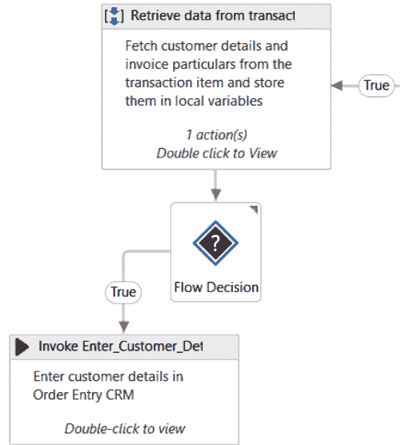

图 15.18 – 调用 Enter_Customer_Details.xaml 工作流

- 13. 单击 Invoke Enter_Customer_Details 工作流活动的 Import Arguments 按钮，以打开被调用工作流的参数窗口：

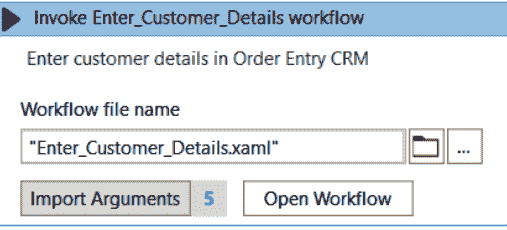

图 15.19 – 导入参数

- 14. 将 flag、customerName、customerAddress、customerPhoneNo 和 customerEmail 变量传递到 Value 部分，如以下屏幕截图所示：

| 名称 | 方向 | 类型 | 值 |
| --- | --- | --- | --- |
| in_customerName | 入 | 字符串 | customerName |
| in_customerAddress | 入 | 字符串 | customerAddress |
| in_customerPhoneNo | 入 | 字符串 | customerPhoneNo |
| in_customerEmail | 入 | 字符串 | customerEmail |
| out_flag | 出 | 布尔值 | flag |

图 15.20 – 被调用工作流的参数窗口

- 15. 最后，拖放连接到 Invoke Enter_Customer_Details 工作流活动的 Flow Decision 活动。

- 16. 将 flag 变量传递到 Flow Decision 活动的 Condition 属性下。这样做可确保，如果 flag 变量的结果为 True，则可以继续将发票详细信息输入 CRM。否则，如果 flag 变量的结果为 False，则表示在将客户详细信息输入 Order Entry CRM 网页时发生了异常：

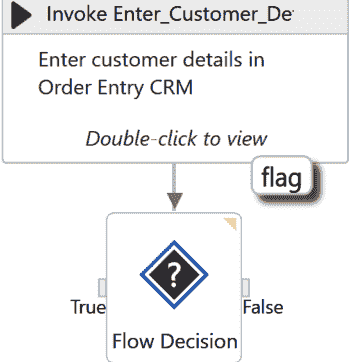

图 15.21 – 流程决策活动

既然您已在 Order Entry CRM 网页上完成客户详细信息的输入，接下来让我们在 CRM 中输入发票详细信息。

## 输入发票详细信息

在本节中，您将在 Order Entry CRM 网页上输入发票详细信息的详情。为此，请执行以下步骤：

- 1. 创建一个名为 Enter_Invoice_Particulars 的新 Sequence 工作流。

- 2. 创建三个入方向参数和一个出方向参数，如以下屏幕截图所示：

| 名称 | 方向 | 参数类型 | 默认值 |
| --- | --- | --- | --- |
| in_invoiceDate | 入 | 字符串 | 输入一个 VB 表达式 |
| in_invoiceNumber | 入 | 字符串 | 输入一个 VB 表达式 |
| in_invoiceParticulars | 入 | 字符串 | 输入一个 VB 表达式 |
| out_flag | 出 | 布尔值 | 不支持默认值 |

图 15.22 – 参数面板

- 3. 将 Try Catch 活动拖放到 Enter_Invoice_Particulars 序列内。

- 4. 在 Try Catch 活动的 Try 块内，拖放 Deserialize JSON 活动并按如下方式配置属性：

  - 将 in_invoiceParticulars 传递给 JsonString 字段。

  - 将 TypeArguments 属性选择为 System.Data.DataTable。

  - 在 JsonObject 字段下使用 Ctrl + K 创建一个名为 dt_invoiceParticulars 的新变量：


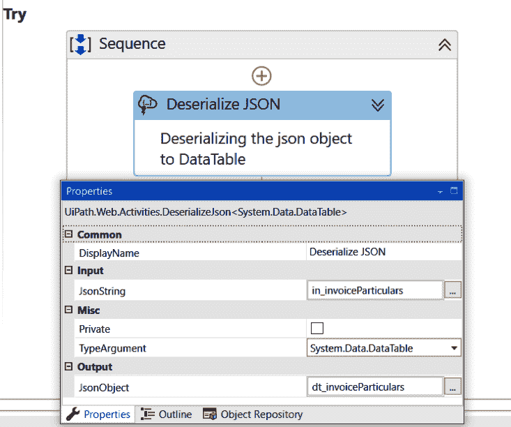

图 15.23 - 连同属性面板一起反序列化 JSON 活动

请注意，发票详细信息以 DataTable 变量的形式存在，在第 14 章“发票处理 – 调度程序”中，您已将 DataTable 变量序列化为 JSON。在此示例中，Deserialize JSON 活动将存储在 in_invoiceParticulars 参数中的 JSON 输出反序列化为名为 dt_invoiceParticulars 的新 DataTable 变量。

- 5. 将 Attach Browser 活动拖放并附加到已打开的 Order Entry CRM 网页上。
- 6. 在 Attach Browser 活动范围内，拖放 Type Into 活动，并指示 Order Entry CRM 网页上的 Invoice Date 文本字段。在 Text 属性下输入 in_invoiceDate.Trim。
- 7. 在发票日期 Type Into 活动下方，拖放新的 Type Into 活动，并指示 Order Entry CRM 网页上的 Invoice Number 文本字段。在 Text 属性下输入 in_invoiceNumber.Trim。
- 8. 使用 Variables 面板，创建三个名为 dtCount、tableRow 和 rowCount 的新变量，并为所有三个变量选择 Int32 作为变量类型。

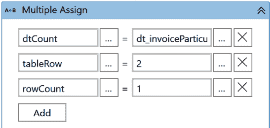

图 15.24 – Multiple Assign 活动

dtCount 变量确定 dt_invoiceParticulars DataTable 变量中存在的总行数。

rowCount 变量将确定循环中 dt_invoiceParticulars DataTable 变量的当前行。rowCount 变量初始化为 1，在每次迭代中，您将值加 1。

tableRow 变量用于将发票详细信息输入到 Order Entry CRM 网页中。tableRow 变量初始化为 2，在每次迭代中，您将值加 1。

以下屏幕截图显示了如何在 Order Entry CRM 网页上标记表格行：

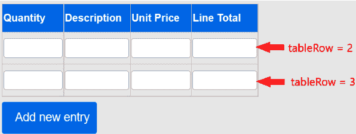

图 15.25 – Order Entry CRM 网页上的表格行

- 10. 在 Multiple Assign 活动下方，使用 For Each Row 活动，并将 dt_invoiceParticulars 传递给 **数据表** 属性字段。
- 11. 在 For Each Row 活动体内，拖放 Type Into 活动，并指示 Order Entry CRM 网页上的 **数量** 文本字段。在 **文本** 属性下输入 row(0).ToString.Trim。

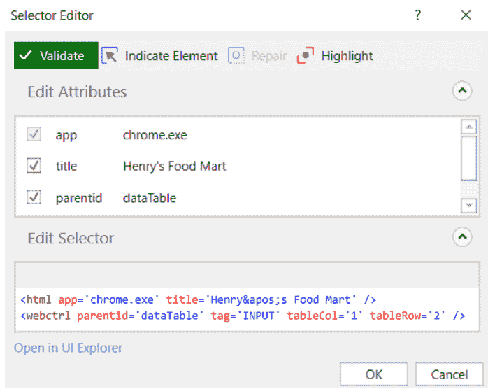

图 15.26 - 数量文本字段 Type Into 活动的选择器

如果查看选择器，它有一个 `tableRow='2'` 属性，这意味着每次迭代都会在表格的第二行中输入内容。但是，您需要为每个新的行项目输入新行；因此，请用 `tableRow` 变量替换 2。

新选择器应如下所示：

```
<webctrl parentid='dataTable' tag='INPUT' colName='Quantity' tableCol='1' tableRow='{{tableRow}}' />
```

> **注意**
> 如果选择器中没有 tableCol 和 tableRow 属性，请使用 **UI 浏览器** 窗口并将它们添加到选择器中。

- 12. 在项目数量 Type Into 活动下方，拖放新的 Type Into 活动，并指示 Order Entry CRM 网页上的 **描述** 文本字段。然后，在 **文本** 属性下输入 row(1).ToString().Trim。
  还要在此处编辑选择器以包含 tableRow 变量。新选择器应如下所示：

  ```
  <webctrl parentid='dataTable' tag='INPUT' colName='Description' tableCol='2' tableRow='{{tableRow}}' />
  ```

- 13. 在项目描述 Type Into 活动下方，拖放新的 Type Into 活动。指示 Order Entry CRM 网页上的 **单价** 文本字段。然后，在 **文本** 属性下输入 row(2).ToString().Trim。
  还要在此处编辑选择器以包含 tableRow 变量。新选择器应如下所示：

  ```
  <webctrl parentid='dataTable' tag='INPUT' colName='Unit Price' tableCol='3' tableRow='{{tableRow}}' />
  ```

- 14. 在项目单价 Type Into 活动下方，拖放新的 Type Into 活动，并指示 Order Entry CRM 网页上的 **行总计** 文本字段。然后，在 **文本** 属性下输入 row(3).ToString().Trim。
  还要在此处编辑选择器以包含 tableRow 变量。新选择器应如下所示：

  ```
  <webctrl parentid='dataTable' tag='INPUT' colName='Line Total' tableCol='4' tableRow='{{tableRow}}' />
  ```

- 15. 接下来，拖放 If 活动，并将条件输入为 rowCount = (dtCount-3)。此条件将允许您输入 dt_invoiceParticulars 变量中存在的所有数据，不包括小计、运费和总计值。小计、运费和总计值存在于 dt_invoiceParticulars 变量的最后三行中。
- 16. 在 If 活动的 **则** 块中，添加 Break 活动。一旦机器人到达 dt_invoiceParticulars 变量中的小计字段，它在遇到 Break 活动时将退出 For Each Row 活动。
- 17. 在 If 活动的 **否则** 块中，添加以下两个活动：
  - Click 活动：指示 Order Entry CRM 网页上的 **添加新条目** 按钮。
  - Multiple Assign 活动：将 tableRow 和 rowCount 变量的值加 1：

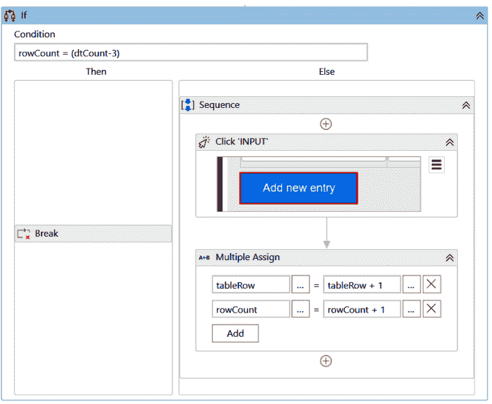

图 15.27 – If 活动

- 18. 在 `For Each Row` 活动下方，拖放 `Type Into` 活动，并指示 Order Entry CRM 网页上的 **小计** 文本字段。然后，在 **文本** 属性下输入 `dt_invoiceParticulars.Rows(dtCount-3)(3).ToString.Trim`。
- 19. 在小计 `Type Into` 活动下方，拖放新的 `Type Into` 活动，并指示 Order Entry CRM 网页中的 **运费** 文本字段。然后，在 **文本** 属性下输入 `dt_invoiceParticulars.Rows(dtCount-2)(3).ToString.Trim`。
- 20. 在运费 `Type Into` 活动下方，拖放新的 `Type Into` 活动，并指示 Order Entry CRM 网页上的 **总计** 文本字段。然后，在 **文本** 属性下输入 `dt_invoiceParticulars.Rows(dtCount-1)(3).ToString.Trim.Split({ "$" }, StringSplitOptions.None)(1)`。
- 21. 使用 `Click` 活动并指示 **提交** 按钮。机器人将单击 **提交** 按钮，CRM 中输入的所有值都将被保存。
- 22. 在 `Attach Browser` 活动下方，拖放 `Assign` 活动。将 `out_flag` 传递到 **“至”** 部分，并在 **“值”** 部分输入 `True`。

- 23. 在 Try_Catch 活动的 **捕获** 块内，捕获一个 Exception 变量并添加 **日志消息** 活动。**日志级别** 属性应为 Error，**消息** 部分应为 "Error while entering Invoice Particular"+vbLf+exception.Message+vbLf+exception.Source。
- 24. 在 Log Message 活动下方，添加 Assign 活动。将 out_flag 参数传递到 **“至”** 部分，并在 **“值”** 部分输入 False。
- 25. 返回到 Read_From_Queue 流程图。从 **项目** 面板，将 Enter_Invoice_Particulars.xaml 工作流拖放到 **设计器** 面板，并将其连接到 **流程决策** 活动的 **“真”** 分支：

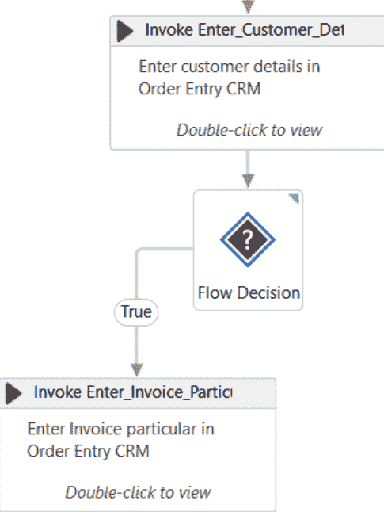

图 15.28 – 调用 Enter_Invoice_Particulars.xaml 工作流

- 26. 单击 **Invoke Enter_Invoice_Particulars** 工作流活动的 **导入参数** 按钮，以打开 **Invoked workflow's arguments** 窗口：

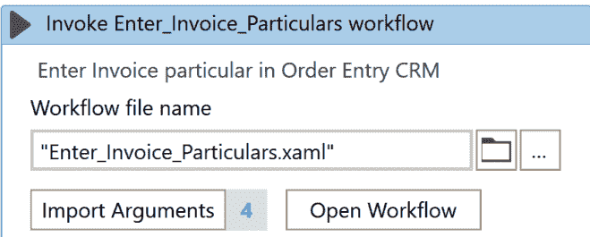

图 15.29 - 导入参数

- 27. 将 flag、invoiceDate、invoiceNumber 和 invoiceParticulars 变量传递到 **“值”** 部分，如下面的屏幕截图所示：

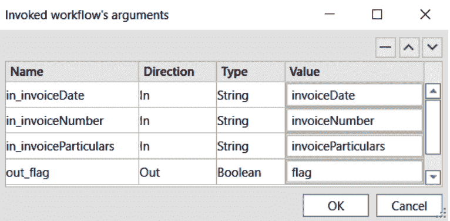

图 15.30 - 调用工作流的参数窗口

- 28. 最后，拖放连接到 **Invoke Enter_Invoice_Particulars** 工作流活动的 **流程决策** 活动。


- 29. 将 `flag` 变量传递给 `Flow Decision` 活动的 **Condition** 属性。这样做可确保如果 `flag` 变量的结果为 True，则可以继续处理新的事务项目。否则，如果 `flag` 变量的结果为 False，则表示在将发票详细信息输入到 Order Entry CRM 网页时发生了异常：

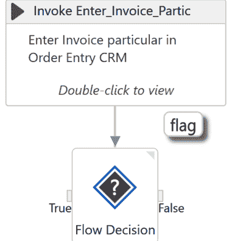

图 15.31 – Flow Decision 活动

现在，您已完成在 Order Entry CRM 网页中输入发票详细信息。在下一节中，我们将根据 `Flow Decision` 活动中 `flag` 变量的结果设置事务项目的状态。

## 设置事务项目状态

在本节中，对于读取和处理的每个事务项目，您将状态设置为 **Successful** 或 **Failed**：

- 对于来自 `Invoke Enter_Invoice_Particulars` 工作流活动的 `Flow Decision` 活动的 `True` 分支，您将事务项目的 **Status** 设置为 **Successful**。
- 对于其余 `Flow Decision` 活动的 `False` 分支，您将事务项目的 **Status** 设置为 **Failed**。

那么，让我们设置事务项目的状态：

- 1. 将连接 `True` 分支的 `Set Transaction Status` 活动拖放到工作流中：

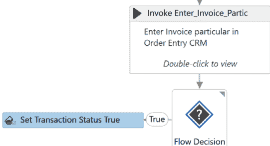

图 15.32 – 成功的事务

- 2. 编辑 Set Transaction Status 的属性，如下所示：

  - 将 Status 设置为 Successful。
  - 将 transactionItem 变量传递到 TransactionItem 文本字段中。
  - 对于此流程，队列已在 Orchestrator 工作流中名为 Packt 的文件夹内创建。因此，您将在 Folder Path 部分键入 "Packt"：

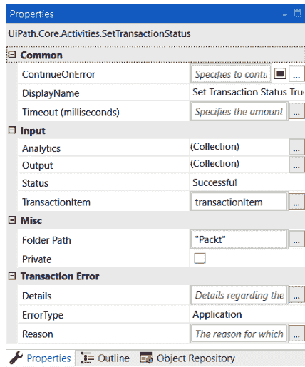

图 15.33 – 成功的 Set Transaction Status 活动的属性面板

- 3. 将 Set Transaction Status 活动连接到 Fetch transaction item 序列。这样做将允许机器人从队列中获取下一个事务项目并对其进行处理。

- 4. 将新的 Set Transaction Status 活动拖放到工作流中以连接 False 分支，如下图所示：

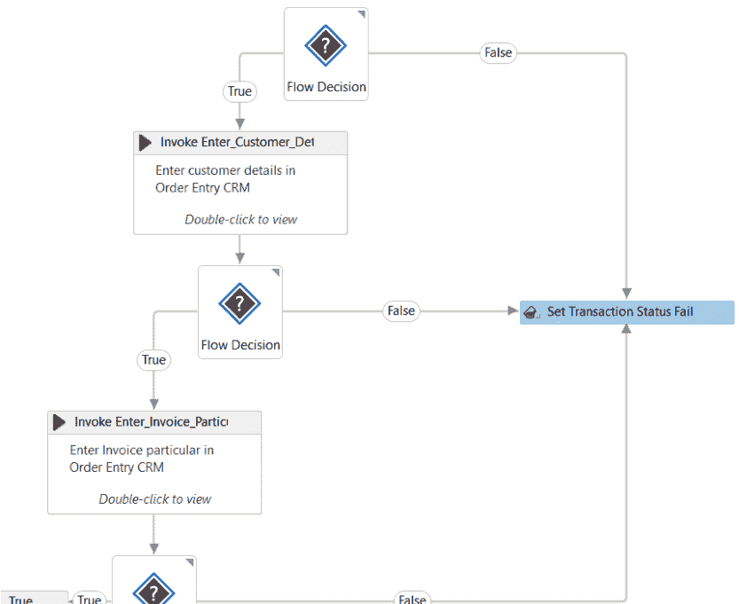

图 15.34 – 失败的事务

- 5. 编辑 Set Transaction Status 的属性，如下所示：

  - 将 Status 设置为 Failed。
  - 将 transactionItem 变量传递到 TransactionItem 文本字段中。
  - 在 Folder Path 部分键入 "Packt"。
  - 将 ErrorType 设置为 Application。
  - 在 Reason 部分键入 "Failed while retrieving the transaction item or entering invoice data"：

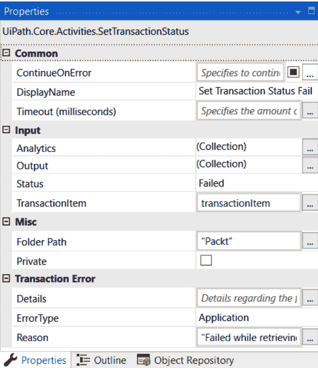

图 15.35 – 失败的 Set Transaction Status 活动的属性面板

将 transactionItem 状态设置为 Failed 将把 Orchestrator 中的状态从 In Progress 更新为 Retried。对于每个 Retried 状态，都会向队列添加一个具有 New 状态的新事务项目。

既然 transactionItem 的状态已设置为 Failed，让我们看看如何从队列中获取下一个事务项目。

## 关闭和打开 CRM

由于事务项目的状态已设置为失败，在从队列中获取下一个事务之前，您需要关闭 Order Entry CRM 网页并再次打开 CRM：

- 1. 在 Read_From_Queue 工作流中，将连接到 Set Transaction Status (Failed) 活动的 Sequence 活动拖放到工作流中。然后，将其重命名为关闭和打开 CRM。

- 2. 在关闭和打开 CRM 序列内，将元素存在活动拖放到工作流中，并在 Order Entry CRM 网页上指示 Henry's Food Mart Order Entry。在属性面板中，使用 Ctrl + K 在 Exists 下创建一个名为 isCrmExists 的新变量。

以下屏幕截图显示了元素存在活动指示 Henry's Food Mart Order Entry：


图 15.36 – CRM 页面上的元素存在活动

在关闭 CRM 之前，您可以检查 CRM 是打开还是已关闭。元素存在活动将返回一个布尔值作为输出：

- TRUE 表示 CRM 仍然打开。
- FALSE 表示 CRM 不可用。

TRUE 表示机器人需要关闭 CRM 并再次打开 CRM，FALSE 表示机器人只需再次打开 CRM，因为它已关闭。

- 3. 为实现前述逻辑，您将在元素存在活动下方使用如果活动。将 isCrmExists 传递到 Condition 字段中。

- 4. 在如果活动的 Then 块中，将附加浏览器活动拖放到工作流中，附加已打开的 Order Entry CRM 网页，并将关闭选项卡活动放置在附加浏览器活动的范围内。

- 5. 在附加浏览器活动下方，将打开浏览器活动拖放到工作流中，并将 Environment.CurrentDirectory+"\\CRM\\Order Entry.html" 键入 Url 字段中。然后，将最大化窗口活动放置在打开浏览器活动的范围内。

- 6. 在如果活动的 Else 块中，将打开浏览器活动拖放到工作流中，并将 Environment.CurrentDirectory+"\\CRM\\Order Entry.html" 键入 Url 字段中。然后，将最大化窗口活动放置在打开浏览器活动的范围内：

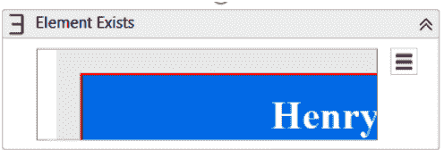

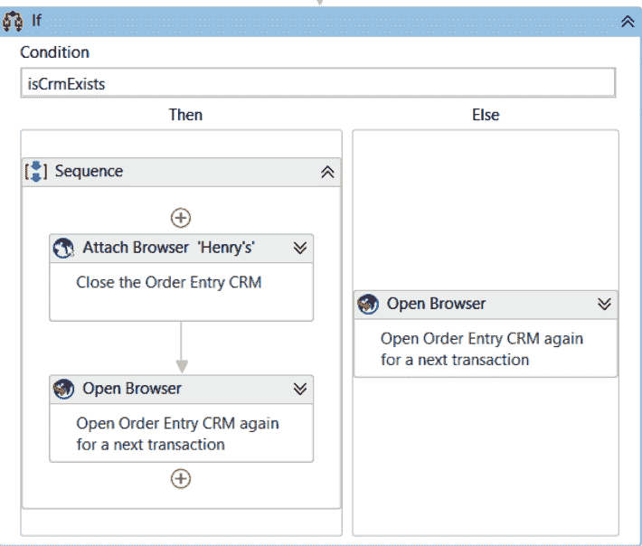

图 15.37 – 关闭和打开 CRM 序列

- 7. 返回 Read_From_Queue 工作流，并将关闭和打开 CRM 序列连接到获取事务项序列。

如果事务项目失败，您已成功构建一段逻辑来关闭并再次打开 CRM。接下来，是时候组装 Main.xaml 文件以运行流程了。

## 组装 Main.xaml 文件

是时候运行流程了，但在运行流程之前，让我们先在 Main.xaml 文件中调用 Read_From_Queue 工作流：

- 1. 在 Main.xaml 工作流中，从 **Project** 面板将 Read_From_Queue 工作流拖放到最大化窗口活动下方。
- 2. 在其下方添加关闭选项卡活动：

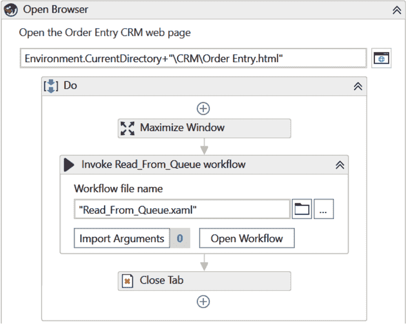

图 15.38 – Main.xaml 工作流

现在，让我们单击 **Design** 功能区上的 **Run** 按钮来运行整个流程。流程无错误完成，队列中的所有新事务项目均已处理并标记为成功：

## 队列/事务：HenryFoodMartInvoice

| 状态 | 参考 | 修订 | 优先级 |
| :--- | :--- | :--- | :--- |
| Successful | | None | Normal |
| Successful | | None | Normal |
| Successful | | None | Normal |
| Successful | | None | Normal |

图 15.39 – 队列中的成功事务项目

恭喜！您已成功构建发票处理流程的执行者模型自动化。现在您可以将代码发布到 Orchestrator，以便从 Orchestrator 页面或使用 UiPath 助手运行机器人。

## 总结

在本章中，您开发了一个从名为 **HenryFoodMartInvoice** 的队列中获取事务项目的自动化流程。随后，您从事务项目中检索了所有特定数据并将其存储在局部变量中。一旦从事务项目中检索完所有数据，您就在 Order Entry CRM 网页上输入了客户详细信息和发票详细信息。

最后，您为 Henry's Food Mart 完成了发票处理流程的调度-执行者模型。在 _第 14 章，发票处理 – 调度器_ 中，您从邮件中下载了发票并从发票中提取了客户详细信息和发票详细信息，并将其上传到队列。在本章中，您从队列中检索了客户详细信息和发票详细信息，并将它们输入到 Order Entry CRM 中。

在下一章中，您将了解更多有关 **UiPath RPA Associate Exam (UiRPA)** 的信息。


