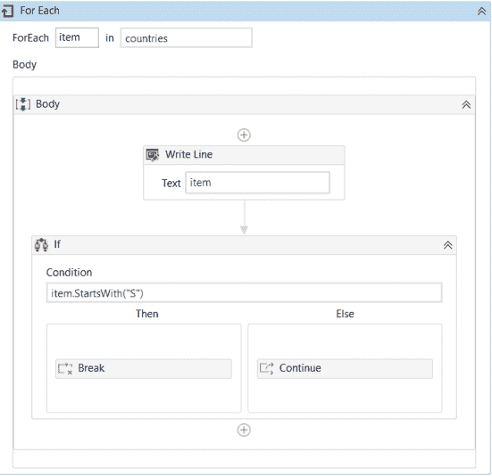
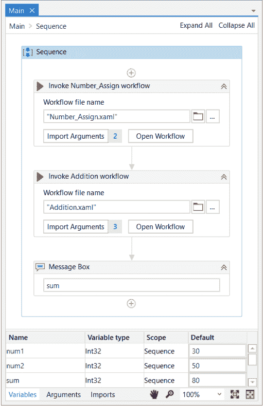
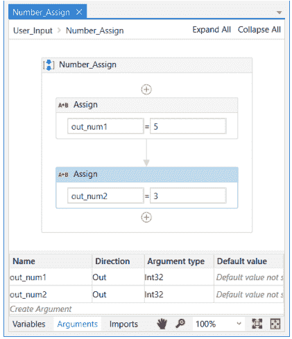
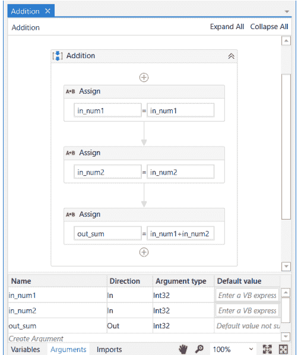
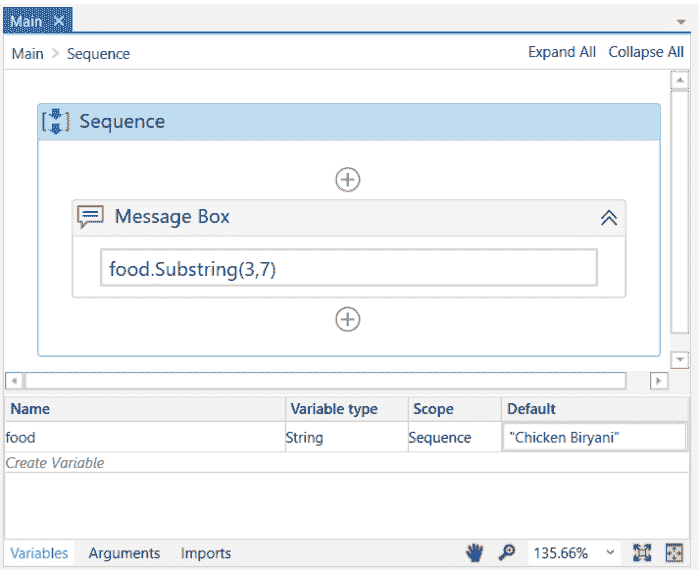

## 18 模拟考试 2

这是模拟考试2。它用于测试您的知识，并让您了解实际考试的情况。此模拟考试不包含实际考试问题。如果您觉得已准备好，请不要查看答案直接参加此考试。如果在此考试中得分达到70%或以上，您可以确信自己已准备好参加实际考试，并且通过的机会很大。

那么，您还在等什么？马上行动吧！回答以下问题：

- 1. 以下哪种流程不应选择用于RPA？
- A. 基于规则
- B. 量大
- C. 重复性
- D. 异常率高的流程

- 2. 调试时如何在特定活动之前暂停执行？
- A. 使用Break活动
- B. 使用MessageBox活动
- C. 在调试模式下使用断点
- D. 使用Wait Attribute活动

- 3. 哪个组合键允许您从活动的属性字段自动创建Out方向参数？
- A. Ctrl + Shift + E
- B. Ctrl + Shift + M
- C. Ctrl + K
- D. Ctrl + P

- 4. 是否可以将选择器存储在变量中？
- A. 不可以。
- B. 可以，但数据类型应为Boolean。
- C. 可以，但数据类型应为String。
- D. 可以，但数据类型应为Int32。

- 5. 名为countries的字符串数组已按以下内容初始化：
{"India","Dubai","Singapore","Nepal","Sweden","Maldives"}。
变量面板如下：

| 名称 | 变量类型 | 作用域 | 默认值 |
|---|---|---|---|
| countries | String[] | Sequence | {"India","Dubai","Singapore","Nepal","Sweden","Maldives"} |

## Main.xaml工作流如下：

根据图形，**输出**面板中的**写入行**活动打印了哪些国家名称？

- A. India
  Dubai
  Singapore
  Nepal
- B. India
- C. India
  Dubai
  Singapore
- D. India
  Dubai
  Nepal

- 6. 以下哪个`string`方法将返回字符串中字符第一次出现的基于零的索引？
- A. Concat
- B. Format
- C. IndexOf
- D. SubString

- 7. 一个名为`Inspection.xlsx`的文件包含许多重复条目。如果开发人员想直接从`Inspection.xlsx`文件中删除重复项，应使用哪个活动？
- A. Remove Data Row
- B. Remove Duplicate Rows
- C. Remove Data Column
- D. Remove Duplicates Range

- 8. 队列项目会经历多种状态。**进行中**状态指的是什么？
- A. 该项目刚使用**添加队列项目**活动添加到队列中。
- B. 该项目是由于先前的队列项目失败（启用了自动重试）而添加的。
- C. 该项目已处理并发送到**设置事务状态**活动。
- D. 该项目已使用**添加事务项目**活动进行处理。

- 9. 以下哪个UiPath组件确保在机器人之间自动分配工作负载？
- A. Robot
- B. Studio
- C. Orchestrator
- D. 状态机器

- 10. 设计功能区选项卡中的**管理包**选项用于什么？
- A. 它使您可以下载活动包、库和框架并更新它们，以及添加和删除它们。
- B. 它使您可以下载活动包、库和框架，查看计算机上已安装的包，并更新它们。
- C. 它使您可以下载活动包、库和框架，查看计算机上已安装的包并更新它们，以及添加和删除它们。
- D. 它使您可以下载活动包和框架，查看计算机上已安装的包并更新它们，以及添加和删除它们。

- 11. 开发人员创建了一个包含Main.xaml的自动化流程，如下图所示：

Main.xaml文件使用以下参数调用Number_Assign.xaml工作流：

| 名称 | 方向 | 类型 | 值 |
|---|---|---|---|
| out_num1 | Out | Int32 | num1 |
| out_num2 | Out | Int32 | num2 |

Main.xaml文件使用以下参数调用Addition.xaml工作流：

| 名称 | 方向 | 类型 | 值 |
|---|---|---|---|
| in_num1 | In | Int32 | num1 |
| in_num2 | In | Int32 | num2 |
| out_sum | Out | Int32 | sum |

Number_Assign.xaml工作流如下：

Addition.xaml工作流如下：

根据上图信息，Main.xaml文件中MessageBox活动的输出是什么？

- A. 80
- B. 5
- C. 8
- D. 50

- 12. UI Explorer窗口中的高亮按钮有什么作用？
- A. 它指示一个新UI元素以替换先前的元素。
- B. 它将目标元素带到前台。
- C. 它使您可以相对于目标UI元素选择锚点。
- D. 它通过检查选择器定义的有效性以及目标元素在屏幕上的可见性来显示选择器的状态。

- 13. Try/Catch活动的Finally块何时执行？
- A. 当Try块中的活动无错误执行时
- B. 当Try块中的活动执行并出现错误时
- C. 每次执行，无论是否发生异常
- D. 当Catch块中的活动执行并出现错误时

- 14. 开发人员创建了一个自动化流程，如下图所示：

根据图中信息，消息框活动的输出是什么？
- A. icken
- B. cken Bi
- C. icken B
- D. cken B

- 15. 读取CSV活动支持的唯一分隔符类型是什么？
- A. 制表符、逗号(,)、分号(;)、插入符号(^)和管道符(|)
- B. 制表符、逗号(,)、分号(;)、斜杠(/)和大括号({ })
- C. 制表符、逗号(,)、分号(;)、斜杠(/)和管道符(|)
- D. 制表符、逗号(,)、分号(;)、插入符号(^)和大括号({ })

- 16. 在以下选项中，队列项目何时进入修订类型的状态？
- A. 当项目已处理并发送到设置事务状态活动时
- B. 当项目在进行中状态保持较长时间（约24小时）未被处理时
- C. 当项目已从事务页面手动选择并标记为删除时
- D. 当事务项目被推迟时

- 17. 以下哪些UiPath组件用于设计复杂的有人值守、无人值守和测试自动化？
- A. Robot
- B. Studio
- C. Orchestrator
- D. 状态机器

- 18. 活动的测试台可以从哪里创建？
- A. 设计器面板
- B. 活动面板
- C. 本地变量面板
- D. 监视面板

- 19. 如何将数据从一个工作流传递到另一个工作流？
- A. 使用变量
- B. 使用活动
- C. 使用参数
- D. 使用包

20. UI 探查器窗口中灰色的 **验证** 按钮代表什么？

- A. 选择器正在验证中。
- B. 无效选择器。
- C. 选择器已修改，需重新验证。
- D. 有效选择器。

21. 您会选择哪个活动来循环遍历所有数据表行？

- A. Do While
- B. For Each Row
- C. For Row
- D. While

22. 您正在使用 **写入范围** 活动向不存在的 .xlsx 文件写入数据。执行此活动时会发生什么？

- A. 将执行但不写入数据。
- B. 它将创建该文件并向其中写入数据。
- C. 将抛出运行时异常。
- D. 由于验证错误，流程将不予运行。
