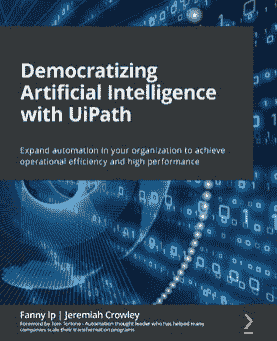
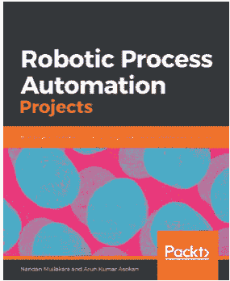

## 附录

### 模拟试卷 1 答案

- 1 - C
- 2 - D
- 3 - B
- 4 - B, C
- 5 - B
- 6 - D
- 7 - B
- 8 - C
- 9 - C
- 10 - C
- 11 - B
- 12 - B
- 13 - D
- 14 - C
- 15 - C
- 16 - A
- 17 - A
- 18 - B
- 19 - B
- 20 - D
- 21 - D
- 22 - C

### 模拟试卷 2 答案

- 1 - D
- 2 - C
- 3 - B
- 4 - C
- 5 - C
- 6 - C
- 7 - D
- 8 - D
- 9 - C
- 10 - C
- 11 - C
- 12 - B
- 13 - C
- 14 - B
- 15 - A
- 16 - B
- 17 - B
- 18 - B
- 19 - C
- 20 - A
- 21 - B
- 22 - B

### A

- 操作中心 29
- 操作屏幕，UiPath 云平台 48, 49
- 活动面板，UiPath Studio 界面 40
- 添加数据列活动 250
- 添加数据行活动 250
- 添加队列项活动 78
- 添加到集合活动 203
- 添加事务项活动 78
- 管理页面，UiPath 云平台
  - 关于 53
  - 帐户和组页面 55
  - 审核日志页面 56, 57
  - 许可页面 56
  - 组织设置页面 57
  - 租户页面 54
- 高级 UI 自动化工具
  - 关于 314
  - 计算机视觉 314
  - 图像 314
  - 原生 Citrix 314
  - 对象存储库 314
- AI Fabric 28
- AI Fabric 屏幕，UiPath 云平台 53
- 锚点基础活动
  - 提取单独值 341-344
- 追加范围活动 265
- 追加到 CSV 活动 265
- 应用程序生命周期管理 (ALM) 28
- 应用程序编程接口 (APIs) 5
- Apps 29
- Apps 屏幕，UiPath 云平台 49, 50
- 参数面板，UiPath Studio 界面 42
- 参数
  - 关于 125, 137
  - 创建 138-145
  - 属性 137, 138
- 数组 203
- 人工智能 (AI) 5
- 资产 72
- 资产，活动
  - 获取资产 75
  - 获取凭据 75
  - 设置资产 75
  - 设置凭据 75
- Assistant 29
- 有监督机器人 29
- 自动填充范围活动 266
- 自动化中心 26
- 自动化流程
  - 创建 116-118
  - 执行，从 UiPath Assistant 119-121
- 自动化，用例
  - 呼叫中心自动化 10
  - 客户信息管理 9
  - 财务报表对账 10
  - 发票处理 10
  - 贷款处理 11
  - 薪资处理 9

### B

- BA 20
- 后台流程 280
- 基础录制
  - 关于 292-297
  - 示例 298, 299
- 布尔变量 145
- 断点
  - 删除 386
  - 禁用 386
  - 放置 385
- 断点上下文菜单
  - 关于 392
  - 删除 393
  - 禁用 393
  - 启用 393
  - 聚焦 393
  - 设置 393
- 断点设置选项卡
  - 关于 388, 390
  - 条件 389
  - 记录时继续执行 390
  - 命中次数 389
  - 日志消息 390
- 断点面板 384-388
- 生成数据表活动 249
- 构建阶段，UiPath 企业版 RPA 平台
  - 关于 27
  - Studio 27
  - Studio Pro 27
  - StudioX 27
- 批量添加队列项活动 79

### C

- 呼叫中心自动化 10
- 调用堆栈面板 384
- 单元格 248
- 单元格颜色活动
  - 获取单元格颜色 267
  - 设置范围颜色 267
- 卓越中心 (CoE) 26
- CertMetrics
  - 参考链接 495
- 经典文件夹
  - 功能 60
- 清除集合活动 203
- 清除数据表活动 250
- 客户信息管理 9
- 关闭工作簿活动 267
- 集合类型变量 147
- 列 248
- 社区版，UiPath 30
- 计算机视觉 314
- Concat 函数
  - 关于 185
  - 示例 185, 186
- 条件断点 391
- 条件跟踪点 391
- Contains 函数
  - 关于 187
  - 示例 187-189
- 控制流 150
- 复制粘贴范围活动 266
- 复制工作表活动 267
- 创建透视表活动 268
- 创建表活动 266
- 创建测试环境 397, 398
- CRM
  - 关于 456-458
  - 关闭 484, 485
  - 打开 484, 485
- CSV 活动
  - 追加到 CSV 265
  - 读取 CSV 265
  - 写入 CSV 265

### D

- 数据
  - 提取，来自字典变量 217
  - 修改，在列表中 207-210
  - 删除，来自列表 207
- 数据操作
  - 关于 184
  - 优势 184
  - 日期和时间操作 199
  - 字典操作 213
  - 函数 184
  - 列表操作 203
  - 数值计算 210-213
  - 字符串操作 184
- 数据抓取活动 249
- Data Service 28
- Data Service 屏幕，UiPath 云平台 52
- 数据表
  - 关于 247, 248
  - 创建 249
  - 创建，活动 249-251
  - 连接规则 251-254
  - 缺少架构处理选项 254
  - 变量，创建 255-262
  - 变量，自定义 255-262
- DataTable 变量 146
- 数据类型 145-147
- 日期和时间操作
  - 功能 199
  - 工作流示例 200-203
- 日期和时间变量 146
- 调试 373
- 调试操作
  - 关于 374
  - 中断 376
  - 异常时继续 378
  - 调试文件 374
  - 执行痕迹 377
  - 聚焦 376
  - 高亮元素 378
  - 忽略 376
  - 打开日志按钮 378
  - 重启 376
  - 重试 375
  - 慢步 377
  - 步入 374, 375
  - 步出 375
  - 步过 375
  - 停止按钮 374
- 调试面板
  - 断点面板 384
  - 调用堆栈面板 384
  - 立即窗口 383
  - 局部变量面板 379-381
  - 监视面板 381, 382
  - 使用 378, 379
- 决策活动 165
- 默认方法
  - 关于 315
  - 特性 315
- 删除列活动 266
- 删除队列项活动 79
- 删除范围活动 266
- 设计器面板，UiPath Studio 界面 38
- 桌面录制
  - 关于 300
  - 示例 300-305
- 字典
  - 关于 214
  - 初始化 214, 215
  - 项，添加到 216, 217
  - 操作 213
- 字典变量
  - 数据，从中提取 217
- 数字化转型 3, 7
- 发现阶段，UiPath 企业版 RPA 平台
  - 关于 26
  - 自动化中心 26
  - 流程挖掘 26
  - 任务捕获 26
  - 任务挖掘 26
- Do While 循环
  - 关于 170
  - 示例 170-173
- 动态选择器 235

### E

- 版本，UiPath Studio
  - 社区版 30
  - 企业云版 30
  - 企业服务器版 30
- 电子邮件
  - 关于 345
  - 内容，使用接收消息提取 353
- 电子邮件活动
  - 电子邮件项目，创建 346
  - Exchange 350
  - 探索 346
  - IBM Notes 活动 351
  - 已安装活动，验证 350
  - 已安装包，验证 349
  - 互联网消息访问协议 (IMAP) 351
  - Outlook 352
  - 邮局协议 (POP3) 352
  - 简单邮件传输协议 (SMTP) 352
  - UiPath.Mail.Activities，安装 348
  - 验证 347
- 电子邮件自动化
  - 关于 345
  - 附件，下载 366-370
  - 附件，处理 366
  - 筛选附件，自动化 366
  - 进程工作流，创建用于自动化接收电子邮件 354-359
  - 接收电子邮件，自动化 353, 354
  - 发送电子邮件，自动化 360-365
- 参与阶段，UiPath 企业版 RPA 平台
  - 关于 29
  - 操作中心 29
  - Apps 29
  - Assistant 29
- 企业云版，UiPath 30
- 企业服务器版，UiPath 30
- 环境功能 62
- Excel 活动 263
- Excel 应用程序作用域
  - 关于 265
  - 单元格颜色活动 267
  - CSV 活动 265
  - Excel 文件活动 267
  - Excel 表活动 266
  - 宏活动 268
  - 透视表活动 268
  - 范围活动 266
  - 工作表活动 267
- Excel 自动化
  - 练习 268-277
- Excel 文件活动
  - 关闭工作簿 267
  - 保存工作簿 267
- Excel 文件
  - 交互 263, 264
- Excel 表活动
  - 创建表 266
  - 筛选表 267
  - 排序表 267
- Exchange 350
- 执行宏活动 268
- 集合中是否存在活动 203
- 将 PDF 页面导出为图像选项 326
- 从 PDF 提取图像选项 326
- 提取 PDF 页面范围选项 326
- 提取 PDF 文本
  - 文本，从 PDF 提取 327-332
- 带 OCR 的提取 PDF 活动
  - 文本，从 PDF 提取 327-332

### F

- 筛选数据表活动 251
- 筛选表活动 267
- 财务报表对账 10
- 流程图
  - 关于 150, 157
  - 示例 157-164
- 流程决策活动 165
- 文件夹 60
- For Each 活动
  - 关于 178
  - 示例 179-181
- 数据表的 For Each Row 活动 251
- 前台流程 280
- Format 函数
  - 关于 189
  - 示例 189-191
- 完整选择器
  - 关于 233, 292
  - 与部分选择器相比 234
- FullText 方法
  - 关于 318
  - 特性 319

### G

- 生成数据表活动 249
- 泛型值变量 147
- 获取资产活动 75
- 获取单元格颜色活动 267
- 获取凭据活动 75

- 获取 PDF 页数选项 326
- 获取队列项目活动 79
- 获取所选范围活动 266
- 获取表格范围活动 265
- 获取事务项目活动 78
- 获取工作簿工作表活动 267
- 获取工作簿工作表集活动 267
- Google Tesseract 320
- 图形用户界面 (GUI) 280
- 图形设备接口 (GDI) 320

## H
- Henry's Food Mart 409
- 主屏幕，UiPath Cloud Platform 48
- 超自动化 12, 25

## I
- IBM Notes 351
- If activity
    - 关于 150, 165
    - 示例 165-169
- 图像 314
- 即时面板 383
- 实施经理 21
- 索引 203
- IndexOf function
    - 关于 193
    - 示例 193, 194
- individual values
    - 提取，使用锚点基活动 341-344
- 基础设施工程师/经理 21
- 输入操作 314
- 输入方法
    - 关于 314
    - 默认方法 315
- 硬件事件 315
- SendWindowMessages 方法 316
- SimulateType 方法 317
- 插入列活动 266
- 插入/删除列活动 266
- Insights 28
- 智能字符识别 (ICR) 5
- 互联网消息访问协议 (IMAP) 351
- 发票处理 10
- invoice processing project
    - CRM，456-458
    - CRM，关闭 484, 485
    - CRM，打开 484, 485
    - 客户详细信息，提取 423-430
    - 调度模型，设计 411
    - 发票数据，上传到 Orchestrator 队列 440-447
    - 发票，下载 416-422
    - 发票详情，提取 430-440
    - 发票，读取 422, 423
    - Main.xaml 文件，组装 486, 487
    - 概述 411-413
    - 项目概述 453, 454
    - 项目，设置 454-456
    - 队列，处理 459-463
    - 运行 447-450
    - 设置 413-415
    - 事务项目状态，设置 480-483
- 调用 VBA 活动 268
- items
    - 添加，到字典 216, 217
    - 添加，到列表 205, 206

## J
- 作业 66
- 合并数据表活动 251, 252
- Join function
    - 关于 198
    - 示例 199
- 合并 PDF 文件选项 326
- macro activities
    - 执行宏 268
    - 调用 VBA 268
    - Main.xaml 文件
        - 组装 447-450, 486, 487
    - 管理 PDF 密码选项 326
    - Manage phase, UiPath Enterprise RPA platform
        - 关于 28
        - AI Fabric 28
        - Data Service 28
        - Insights 28
        - Orchestrator 28
        - Test Suite 28

## K
- 键值对 213

## L
- list manipulation
    - 关于 203
    - 方法 204-210
- lists
    - 关于 203
    - 数据，在其中修改 207-210
    - 数据，从其中移除 207
    - 项目，添加到 205, 206
    - list variables
        - 声明 204, 205
        - 合并 206
- 贷款处理 11
- 局部变量面板 379-381
- 查找数据表函数 254
- 查找范围活动 266
- loops
    - 关于 151, 169
    - Do While 170-173
    - For Each 178-181
    - While 174-178
- 合并数据表活动 254
- Microsoft API 320
- Microsoft MODI OCR 320
- modern folders
    - 功能 60

## N
- 原生 Citrix 314
- Native method
    - 关于 320
    - 特性 320
- 自然语言处理 (NLP) 12
- 数字变量 146
- 数值计算 210
- numeric data manipulation
    - 工作流示例 211-213

## M
- 机器学习 (ML) 5
- machine template
    - 创建，在 Orchestrator 中 82-85

## O
- 对象存储库 314
- OCR method
    - 关于 320
    - 特性 321
- 按需作业 66
- OnVUE 495
- 光学字符识别 (OCR) 12
- Orchestrator
    - 关于 25, 28
    - 最新版本，使用已发布的包 114-116
    - 机器模板，创建 82-85
    - 包，管理 114
    - 机器人，连接到 82
- Orchestrator queues
    - 发票数据，上传 440-447
- Orchestrator service
    - 创建 46
- 组织单位 62
- 大纲面板，UiPath Studio 界面 44
- Outlook 352
- 输出操作 318
- 输出数据表活动 254
- output methods
    - 关于 318
    - FullText 方法 318
    - Native 方法 320
    - OCR 方法 320
- 输出面板，UiPath Studio 界面 43

## P
- packages
    - 关于 62
    - 管理，在 Orchestrator 中 114
- partial selectors
    - 关于 233, 300
    - 与完整选择器相比 234
- pattern-based data extraction
    - 使用正则表达式 218-220
- 工资处理 9
- PDF files
    - 关于 323
    - 单个动态值，从中提取 336-341
- PDF text
    - 提取，使用屏幕抓取 333-336
- Pearson VUE 考试中心 495
- pivot table activities
    - 创建数据透视表 268
    - 刷新数据透视表 268
- 邮局协议 (POP3) 352
- 延期事务项目活动 78
- 流程评估矩阵 16
- 流程定义文档 (PDD) 17
- processes
    - 关于 64
    - 识别，用于 RPA 13-16
- 流程屏幕，UiPath Cloud Platform 51
- 流程挖掘 26
- 项目面板，UiPath Studio 界面 38
- 属性面板，UiPath Studio 界面 40, 41

## Q
- queue
    - 关于 75
    - 优势 75
    - 客户详细信息，输入 468-472
    - 数据，从事务项目中检索 464-467
    - 发票详情，输入 472-480
    - 处理 459-463
- queues, activities
    - 添加队列项目 78
    - 添加事务项目 78
    - 批量添加队列项目 79
    - 删除队列项目 79
    - 获取队列项目 79
    - 获取事务项目 78
    - 推迟事务项目 78
    - 设置事务进度 78
    - 设置事务状态 78
    - 等待队列项目 79
- 队列触发器 68-72

## R
- range activities
    - 自动填充范围 266
    - 复制粘贴范围 266
    - 删除列 266
    - 删除范围 266
    - 获取所选范围 266
    - 插入列 266
    - 插入/删除列 266
    - 插入/删除行 266
    - 查找范围 266
    - 删除重复范围 266
    - 选择范围 266
- 读取单元格活动 264
- 读取单元格公式活动 264
- 读取列活动 264
- 读取 CSV 活动 249, 265
- 读取 PDF 文本选项 326
- 使用 OCR 读取 PDF 选项 326
- 读取范围活动 249, 264
- 读取行活动 265
- 读取 XPS 文本选项 326
- 使用 OCR 读取 XPS 选项 327
- 录制 292
- recording methods
    - 关于 292
    - 优势 313
    - 基础录制 292-297, 300
    - 桌面录制 300, 305
    - 劣势 313
    - 用法 313
    - Web 录制 305, 312
- 刷新数据透视表活动 268
- 正则表达式生成器屏幕 219
- regexes
    - 基于模式的数据提取 218-220
- 删除数据列活动 250
- 删除数据行活动 250
- 删除重复范围活动 266
- 删除重复行活动 250
- 从集合中移除活动 203
- Replace function
    - 关于 191
    - 示例 191-193
- 投资回报率 (ROI) 13
- 可重用对象 314
- Robot account
    - 创建 86-92
- robot development
    - 有监督机器人 29
    - 无人值守机器人 29
- robotic process automation (RPA)
    - 关于 3, 5
    - 功能 6
    - 在商业中实施 7, 9
    - 流程，识别用于 13-16
- Robots
    - 关于 25, 59
    - 连接，到 Orchestrator 82
    - 创建，以读取 PDF 文件 324, 325
- 行 248
- RPA 开发人员 20
- RPA process
    - 创建 92-114
    - 创建，先决条件 98, 99
- RPA project, stages
    - 关于 17
    - 构建 18
    - 发现 17, 18
    - 参与 19
    - 管理 19
    - 度量 19
    - 运行 19
- RPA robots
    - 自动化操作 11
- RPA 解决方案架构师 20
- RPA 支持 21
- 从此活动运行选项 401, 402
- 运行阶段，UiPath Enterprise RPA 平台 29
- 运行至此活动选项 398, 400

## S
- 保存工作簿活动 267
- 计划作业 66
- Screen Scraping
    - PDF 文本，提取 333-336
- Selector Editor tool
    - 关于 226
    - 选项 227-230
- selectors
    - 属性 224
    - 动态场景 236-244
    - 示例 224
    - 完整选择器 233
    - 部分选择器 233
    - 结构 224
    - 标记 224
    - 类型 232
- 选择范围活动 266
- SendWindowMessages method
    - 关于 316
    - 特性 316
- sequence
    - 关于 150, 151
    - 示例 152-156
    - 可重用性 151
- 服务级别协议 (SLA) 75
- 设置资产活动 75
- 设置凭据活动 75
- 设置范围颜色活动 267
- 设置事务进度活动 78
- 设置事务状态活动 78
- sheet activities
    - 复制工作表 267
    - 获取工作簿工作表 267
    - 获取工作簿工作表集 267
- 简单邮件传输协议 (SMTP) 352
- SimulateType method
    - 关于 317
    - 特性 318
- single dynamic values
    - 提取，从 PDF 文件中 336-341
- 解决方案设计文档 (SDD) 18
- 排序数据表活动 251
- 排序表格活动 267
- Split function
    - 关于 196
    - 示例 196, 197
- 标准断点 390
- 先进 (SOTA) 平台 3
- 静态选择器 235

- 字符串操作
    - 关于 185
    - Concat 185, 186
    - Contains 187-189
    - Format 189-191
    - IndexOf 193, 194
    - Join 198, 199
    - Replace 191-193
    - Split 196, 197
    - SubString 195
- 字符串 184
- 字符串变量 145
- Studio 27
- Studio Pro 27
- StudioX 27
- SubString 函数
    - 关于 195
    - 示例 195
- Switch 活动 151, 165
- 触发器
    - 关于 68
    - 队列触发器 68
    - 基于时间的触发器 68

### T

- Task Capture 26
- Task Mining 26
- Test Activity 选项
    - 关于 393
    - 用例 394-396
    - 测试活动 393
- 测试套件 28
- 基于时间的触发器 68, 70
- 跟踪点 391
- 事务项目
    - 数据，从...检索 464-467
    - 状态，设置 480-483
- 事务项目 75

### U

- UI 自动化元素
    - 活动 280
    - 输入和输出 283
    - 录制 282
    - 目标 282
- UI 探查器
    - 关于 230
    - 选项 231, 232
- UI 交互
    - 关于 280
    - 活动 284
    - 前台自动化，与后台自动化相对 280
    - 属性 284-291
- UiPath 3
- UiPath Apps 49
- UiPath Assistant
    - 从...执行自动化流程 119-121
- UiPath 认证专业人员计划
    - 关于 4
    - 高级认证 4
    - 助理认证 4
- UiPath 云平台
    - 关于 47
    - 操作屏幕 48, 49
    - 管理页面 53
    - AI Fabric 屏幕 53
    - 应用屏幕 49, 50
    - 数据服务屏幕 52
    - 功能 47
    - 主页 48
    - 流程屏幕 51
    - 资源中心 48
- UiPath 企业 RPA 平台
    - 构建阶段 27
    - 发现阶段 26
    - 互动阶段 29
    - 管理阶段 28
    - 概述 24-26
    - 运行阶段 29
- UiPath.Mail.Activities 348
- UiPath Orchestrator
    - 关于 58
    - 资产 72-75
    - 功能 58
    - 环境 62
    - 文件夹 60, 61
    - 作业 66-68
    - 组织单元 62
    - 包 62, 63
    - 流程 64-66
    - 队列 75-78
    - 机器人 59
    - 触发器 68, 70
- UiPath 解决方案
    - 依赖项 324
- UiPath Studio
    - 关于 25
    - 版本 30
    - 安装 31-36
    - 设置 30
- UiPath Studio 界面
    - 活动面板 40
    - 参数面板 42
    - 设计器面板 38
    - 浏览 36, 38
    - 大纲面板 44
    - 输出面板 43
    - 项目面板 38
    - 属性面板 40, 41
    - 变量面板 41
- UiRPA 认证考试
    - 关于 490
    - 认证，管理 495
    - 考试详情 494
    - 考试报名 495
    - 通用轨道 490
    - 模拟测试 493, 494
    - 题型 493, 494
    - RPA 开发者轨道 490
    - 节和主题 491
    - 目标受众 490
- 无人值守机器人 29

### V

- 变量
    - 关于 125, 126
    - 创建 127-131
    - 用于修改值的方法 126
    - 属性 126, 127
    - 变量修改范围，对工作流的影响 132-137
- 变量面板，UiPath Studio 界面 41
- 虚拟机 (VMs) 13
- 等待队列项目活动 79
- 监视面板 381, 382
- Web 录制
    - 关于 305, 312
    - 示例 306-312

### W

- While 循环
    - 关于 174
    - 示例 174-178
- 工作簿
    - 关于 248
    - 活动 263
- 工作流
    - 修复 402-407
- 工作表 248
- 写入单元格活动 264
- 写入 CSV 活动 265
- 写入范围活动 264

Packt.com

订阅我们的在线数字图书馆，即可完整访问超过 7,000 本书籍和视频，以及行业领先的工具，帮助您规划个人发展并促进职业发展。如需了解更多信息，请访问我们的网站。

## 为什么订阅？

- 花更少的时间学习，花更多的时间编码，利用来自 4,000 多名行业专业人士的实用电子书和视频
- 使用专为您构建的技能计划改善您的学习
- 每月获取一本免费电子书或视频
- 支持全文搜索，轻松访问重要信息
- 复制粘贴、打印和收藏内容

您知道吗？Packt 为每本出版的图书提供电子书版本，并提供 PDF 和 ePub 文件。您可以在 packt.com 上升级到电子书版本，作为印刷书籍客户，您有权享受电子书副本的折扣。如需了解更多详情，请通过 customercare@packtpub.com 联系我们。

在 www.packt.com 上，您还可以阅读一系列免费技术文章，注册多种免费通讯，并获取 Packt 图书和电子书的独家折扣和优惠。

## 您可能还喜欢的其他图书

如果您喜欢这本书，可能会对 Packt 的这些其他图书感兴趣：

## 让人人皆可用的人工智能与 UiPath

Fanny Ip, Jeremiah Crowley

ISBN: 978-1-80181-765-3

- 探索如何弥合 RPA 与认知自动化之间的差距
- 了解如何在 UiPath 中配置、部署和维护 ML 模型
- 探索开箱即用模型，用于管理文档、聊天、电子邮件等
- 为用户验收测试 (UAT) 准备测试数据和测试用例
- 构建 UiPath 自动化以响应 Druid 响应
- 了解如何将自定义模型连接到 RPA

## 机器人流程自动化项目

Nandan Mullakara, Arun Kumar Asokan

ISBN: 978-1-83921-735-7

- 使用示例驱动方法探索 RPA 原理、技术和工具
- 通过构建帮助台工单生成系统了解 UiPath 基础知识
- 使用 UiPath 自动化 CRM 系统中 Excel 的读写操作
- 使用 UiPath 和 Google Cloud Vision API 构建基于 AI 的社交媒体审核平台
- 通过构建简单的销售订单处理系统，探索如何使用 Automation Anywhere
- 使用 Automation Anywhere 构建自动化员工紧急报告系统
- 通过有趣的练习测试您构建自动化工作流的知识

## Packt 正在寻找像您这样的作者

如果您有兴趣成为 Packt 的作者，请访问 authors.packtpub.com 并立即申请。我们与成千上万像您一样的开发人员和技术专业人士合作，帮助他们向全球技术社区分享见解。您可以提交通用申请，申请我们正在招募作者的特定热门主题，或提交您自己的想法。

您好！

我们 Niyaz、Lahiru 和 Raj，作为《UiPath 助理认证指南》的作者，非常希望您喜欢阅读本书，并认为它对提高 RPA-UiPath 领域的生产力和效率有用。

如果您能在 Amazon 上留下评论，分享您对本书内容的看法，这将对我们（以及其他潜在读者）非常有帮助。

请访问下面的链接或扫描二维码，留下您的评论：

https://packt.link/r/1801072736

您的评论将帮助我们了解本书中哪些方面做得好，哪些方面可以在未来版本中改进，因此我们非常感谢。

祝好，

## N.ahmed

## Lahiru Fernando

## Ricscvell

