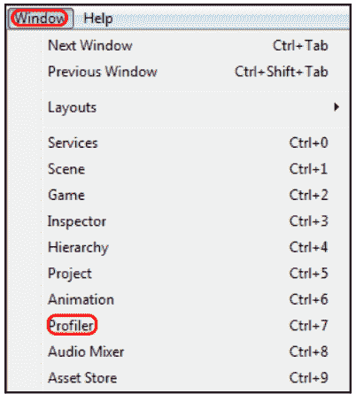
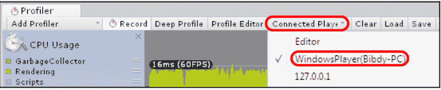
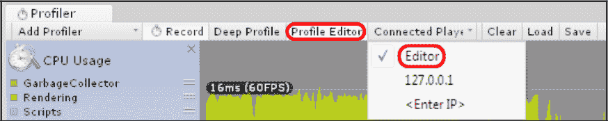
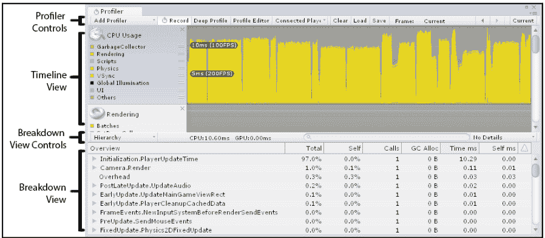
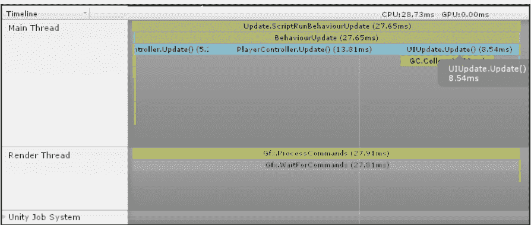
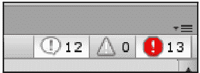

# 追踪性能问题

大多数软件产品的性能评估是一个非常科学的过程。首先，我们确定支持的最大/最小性能指标，例如允许的内存使用量、可接受的 CPU 消耗量、并发用户数量等。接下来，我们针对为目标平台构建的应用程序版本，在特定场景下对应用程序进行负载测试，并在收集仪器数据的同时进行测试。收集这些数据后，我们分析并搜索其中的性能瓶颈。如果发现问题，我们完成根本原因分析，对配置或应用程序代码进行更改以修复问题，并重复此过程。

尽管游戏开发是一个非常艺术的过程，但它仍然非常技术化，因此有充分的理由以类似客观的方式对待它。我们的游戏应该有一个目标受众，这可以告诉我们游戏可能运行在什么样的硬件限制下，并可能告诉我们需要满足的具体性能目标（特别是在主机和移动游戏的情况下）。我们可以对应用程序进行运行时测试，从多个子系统（CPU、GPU、内存、物理引擎、渲染管线等）收集性能数据，并将其与我们认为可接受的数据进行比较。我们可以使用这些数据来识别应用程序中的瓶颈，进行额外的仪器测量，并确定问题的根本原因。最后，根据问题的类型，我们应该能够应用多种修复措施来改善应用程序的性能，使其更符合预期的行为。


然而，在花费任何时间进行性能修复之前，我们首先需要证明确实存在性能问题。在没有充分理由的情况下，花时间重写和重构代码是不明智的，因为预优化通常不值得麻烦。一旦我们有了性能问题的证据，下一步就是找出瓶颈的确切位置。确保我们了解性能问题发生的原因非常重要，否则我们可能会浪费更多时间来应用几乎只是凭经验猜测的修复措施。这样做通常意味着我们只修复了问题的症状，而不是其根本原因，因此我们冒着风险，即问题将来以其他方式表现出来，或者以我们尚未发现的方式表现出来。

在本章中，我们将探讨以下内容：

- 如何使用 Unity Profiler 收集分析数据
- 如何分析 Profiler 数据以查找性能瓶颈
- 隔离性能问题并确定其根本原因的技术

在彻底理解给定问题后，您将准备好阅读其余章节中提供的信息，在其中您将了解针对我们检测到的问题有哪些可用解决方案。

# Unity Profiler

Unity Profiler 内置于 Unity Editor 本身中，通过在运行时生成大量 Unity3D 子系统的使用情况和统计报告，为缩小性能瓶颈搜索范围提供了一种便捷的方式。它可以收集数据的不同子系统列表如下：

- CPU 消耗（按主要子系统）
- 基本和详细的渲染及 GPU 信息
- 运行时内存分配和总体消耗
- 音频源/数据使用情况
- 物理引擎（2D 和 3D）使用情况
- 网络消息和操作使用情况
- 视频播放使用情况
- 基本和详细的用户界面性能（Unity 2017 中的新功能）
- 全局光照统计信息（Unity 2017 中的新功能）

通常有两种方法可以使用分析工具：**插桩**和**基准测试**（虽然，诚然，这两个术语经常被混用）。

插桩通常意味着通过观察目标函数调用的行为、内存分配的位置和数量，来深入了解应用程序的内部工作原理，并通常获得正在发生的事情的准确图景，希望找到问题的根本原因。然而，这通常不是开始查找性能问题的有效方法，因为对任何应用程序进行分析本身都会带来性能开销。

当 Unity 应用程序以开发模式编译（由 **Build Settings** 菜单中的 **Development Build** 标志确定）时，会启用其他编译器标志，导致应用程序在运行时生成特殊事件，这些事件会被 Profiler 记录和存储。自然，由于应用程序承担了所有额外的工作量，这会在运行时造成额外的 CPU 和内存开销。更糟糕的是，如果应用程序是通过 Unity Editor 进行分析的，那么将花费更多的 CPU 和内存，以确保 Editor 更新其界面、渲染其他窗口（例如 **Scene** 窗口）并处理后台任务。这种分析成本并不总是可以忽略不计。在过大的项目中，启用 Profiler 时有时会导致行为极不一致。在某些情况下，不一致性足以导致由于事件时序变化和异步行为中的潜在竞争条件而引起完全意外的行为。这是我们为深入分析代码在运行时的行为而支付的必要代价，我们应该始终意识到它的存在。

在开始分析应用程序中的每一行代码之前，对应用程序进行表面级测量会更明智。我们应该在游戏在目标硬件上运行的运行时会话期间收集一些基本数据并执行测试场景；测试用例可以简单地是几秒钟的游戏性、过场动画的播放、关卡的部分通关等等。这项活动的目的是大致了解用户可能的体验，并留意性能变得明显变差的时刻。此类问题可能足够严重，值得进一步分析。

这项活动通常被称为基准测试，我们感兴趣的重要指标通常是渲染的 **每秒帧数（FPS）**、总体内存消耗、CPU 活动的行为（寻找活动中的大幅尖峰），有时还有 CPU/GPU 温度。这些都是相对容易收集的指标，可以作为性能分析的最佳初步方法，原因很重要；从长远来看，它将为我们节省大量时间，因为它确保我们只花时间调查用户会注意到的问题。

只有在基准测试表明需要进一步分析后，我们才应该深入进行插桩。如果我们想要获得真实的数据样本，尽可能模拟实际平台行为进行基准测试也非常重要。因此，我们绝不应该接受通过 Editor Mode 生成的基准测试数据作为真实游戏玩法的代表，因为 Editor Mode 带来了一些额外的开销成本，可能会误导我们，或隐藏真实应用程序中的潜在竞争条件。相反，我们应该在应用程序在目标硬件上以独立格式运行时，将分析工具连接到应用程序。

许多 Unity 开发者惊讶地发现，Editor 有时计算操作结果的速度比独立应用程序快得多。在处理音频文件、预制体和 Scriptable Objects 等序列化数据时，这种情况尤其常见。这是因为 Editor 会缓存先前导入的数据，并且能够比真实应用程序快得多地访问它。

让我们介绍如何访问 Unity Profiler 并将其连接到目标设备，以便我们可以开始进行准确的基准测试。

已经熟悉将 Unity Profiler 连接到其应用程序的用户可以跳转到标题为 _The Profiler window_ 的部分。

# 启动 Profiler

我们将从简要教程开始，了解如何在各种上下文中将我们的游戏连接到 Unity Profiler：

- 应用程序的本地实例，无论是通过 Editor 还是独立实例
- 在浏览器中运行的 WebGL 应用程序的本地实例
- iOS 设备（例如 iPhone 或 iPad）上的应用程序远程实例
- Android 设备（例如 Android 平板电脑或手机）上的应用程序远程实例
- 对 Editor 本身进行分析

## Editor 或独立实例

访问 Profiler 的唯一方法是通过 Unity Editor 启动它，并将其连接到我们应用程序的运行实例。无论我们是在 Editor 的 Play Mode 中执行游戏、在本地或远程设备上运行独立应用程序，还是希望对 Editor 本身进行分析，情况都是如此。

要打开 **Profiler**，请在 Editor 中导航到 **Window | Profiler**：



如果 Editor 已经在 Play Mode 中运行，那么我们应该看到 **Profiler** 窗口中正在主动收集报告数据。

要对独立项目进行分析，请确保在构建应用程序时启用了 **Development Build** 和 **Autoconnect Profiler** 标志。

可以通过 **Profiler** 窗口中的 **Connected Player** 选项，选择对基于 Editor 的实例（通过 Editor 的 Play Mode）还是独立实例（与 Editor 分开构建和运行）进行分析：



请注意，在分析单独的独立项目时，切换回 Unity Editor 将停止所有数据收集，因为应用程序在后台时不会更新。

请注意，在 Unity 5 中，**Development Build** 选项名为 **Use Development Mode**，而 **Connected Player** 选项名为 **Active Profiler**。

## 连接到 WebGL 实例

Profiler 也可以连接到 Unity WebGL Player 的实例。可以通过确保在从 Editor 构建和运行 WebGL 应用程序时启用 **Development Build** 和 **Autoconnect Profiler** 标志来实现。然后应用程序将通过操作系统的默认浏览器启动。这使我们能够通过目标浏览器在更真实的场景中分析我们的基于 Web 的应用程序，并测试多种浏览器类型以查找行为不一致（尽管这需要我们不断更改默认浏览器）。

不幸的是，Profiler 连接只能在应用程序首次从 Editor 启动时建立。它目前（至少在 Unity 2017 的早期构建中）无法连接到已经在浏览器中运行的独立 WebGL 实例。这限制了 WebGL 应用程序基准测试的准确性，因为会有一些基于 Editor 的开销，但这是我们目前唯一可用的选项。


# 远程连接到 iOS 设备

Profiler 还可以连接到在 iOS 设备（例如 iPad 或 iPhone）上远程运行的应用程序的活动实例。这可以通过共享 Wi-Fi 连接来实现。

请注意，只有当 Unity（因此也是 Profiler）在 Apple Mac 设备上运行时，才能远程连接到 iOS 设备。

按照给定步骤将 Profiler 连接到 iOS 设备：

- 1. 构建应用程序时，确保已启用 **Development Build** 和 **Autoconnect Profiler** 标志。
- 2. 将 iOS 设备和 Mac 设备都连接到本地 Wi-Fi 网络，或连接到临时 Wi-Fi 网络。
- 3. 通过 USB 或 Lightning 电缆将 iOS 设备连接到 Mac。
- 4. 照常使用 **Build & Run** 选项开始构建应用程序。
- 5. 在 Unity Editor 中打开 Profiler 窗口，并在 **Connected Player** 下选择设备。

现在，您应该能在 **Profiler** 窗口中看到 iOS 设备的分析数据正在收集中。

Profiler 使用 54998 到 55511 端口来广播分析数据。如果网络上有防火墙，请确保这些端口可用于出站流量。

有关构建 iOS 应用程序以及将 Profiler 连接到它们时出现问题的故障排除，请参阅以下文档页面：`https://docs.unity3d.com/Manual/TroubleShootingIPhone.html`。

# 远程连接到 Android 设备

将 Android 设备连接到 Unity Profiler 有两种不同的方法：通过 Wi-Fi 连接或使用 **Android Debug Bridge**（ADB）工具。无论哪种方法，都可以在 Apple Mac 或 Windows PC 上使用。

按照以下步骤通过 Wi-Fi 连接连接 Android 设备：

1. 构建应用程序时，确保已启用 **Development Build** 和 **Autoconnect Profiler** 标志。
2. 将 Android 设备和桌面设备都连接到本地 Wi-Fi 网络。
3. 通过 USB 电缆将 Android 设备连接到桌面设备。
4. 照常使用 **Build & Run** 选项开始构建应用程序。
5. 在 Unity Editor 中打开 **Profiler** 窗口，并在 Connected Player 下选择设备。

然后，应用程序应该会通过 USB 连接构建并推送到 Android 设备，Profiler 应该通过 Wi-Fi 连接进行连接。然后，您应该能在 **Profiler** 窗口中看到 Android 设备的分析数据正在收集中。

第二种方法是使用 ADB。这是一套随 Android **Software Development Kit (SDK)** 捆绑提供的调试工具。对于 ADB 分析，请执行以下步骤：

1. 通过遵循 Unity 的 Android SDK/NDK 设置指南，确保已安装 Android SDK：`https://docs.unity3d.com/Manual/android-sdksetup.html`。
2. 通过 USB 电缆将 Android 设备连接到桌面计算机。
3. 构建应用程序时，确保已启用 **Development Build** 和 **Autoconnect Profiler** 标志。
4. 照常使用 **Build & Run** 选项开始构建应用程序。
5. 在 Unity Editor 中打开 **Profiler** 窗口，并在 **Connected Player** 下选择设备。

现在，您应该能在 **Profiler** 窗口中看到 Android 设备的分析数据正在收集中。

有关构建 Android 应用程序以及将 Profiler 连接到它们时出现问题的故障排除，请参阅以下文档页面：`https://docs.unity3d.com/Manual/TroubleShootingAndroid.html`。

# Editor 分析

我们可以对 Editor 本身进行分析。这通常用于尝试分析自定义 Editor 脚本的性能。这可以通过在 Profiler 窗口中启用 **Profile Editor** 选项，并将 **Connected Player** 选项配置为 **Editor** 来实现，如下面的屏幕截图所示：



请注意，如果我们想要对 Editor 进行分析，则必须将这两个选项都这样配置。将 **Connected Player** 设置为 **Editor** 而不启用 **Profile Editor** 按钮是默认情况，即 Profiler 正在为我们的应用程序在 Play Mode 运行时收集数据。

# Profiler 窗口

我们现在将介绍 Profiler 的基本功能，这些功能可以在界面中找到。

Profiler 窗口分为四个主要部分：

- Profiler Controls
- Timeline View
- Breakdown View Controls
- Breakdown View

这些部分在下面的屏幕截图中显示：



我们将详细介绍每个部分。

# Profiler 控件

上一张屏幕截图中的顶部栏包含多个下拉和切换按钮，我们可以使用它们来影响正在分析的内容以及从子系统中收集数据的深度。它们将在下一小节中介绍。

## 添加 Profiler

默认情况下，Profiler 将为几个不同的子系统收集数据，这些子系统涵盖了 Timeline View 中 Unity Engine 的大部分子系统。这些子系统被组织到包含相关数据的各个区域中。**Add Profiler** 选项可用于添加其他区域，或在它们被删除后将其恢复。有关我们可以分析的子系统的完整列表，请参阅 _Timeline View_ 部分。

## 记录

启用 **Record** 选项会使 Profiler 记录分析数据。只要启用此选项，就会持续进行此操作。请注意，只有当应用程序正在主动运行时，才能记录运行时数据。对于在 Editor 中运行的应用程序，这意味着必须启用 Play Mode，并且不应暂停；或者，对于独立应用程序，它必须是活动窗口。如果启用了 **Profile Editor**，那么出现的数据将是为 Editor 本身收集的。

## 深度分析

普通分析只会记录常见 Unity 回调方法（例如 `Awake()`、`Start()`、`Update()` 和 `FixedUpdate()`）所做的时间和内存分配。启用 **Deep Profile** 选项会以更深层次的插桩级别重新编译我们的脚本，从而允许它测量每个被调用的方法。这会导致运行时的插桩成本比正常情况高得多，并且使用大量更多的内存，因为运行时正在为整个调用堆栈收集数据。因此，在大型项目中，Deep Profiling 甚至可能不可能，因为 Unity 在测试开始之前可能会内存不足，或者应用程序运行得太慢以至于测试毫无意义。

请注意，切换 **Deep Profile** 需要在分析再次开始之前完全重新编译整个项目，因此最好避免在测试之间反复切换该选项。

由于此选项盲目地测量整个调用堆栈，在大多数分析测试中保持其启用是不明智的。当默认分析无法提供足够的细节来找出根本原因，或者我们正在测试一个小型测试场景（用于隔离某些活动）的性能时，最好保留此选项。

如果需要对大型项目和场景进行 Deep Profiling，但 **Deep Profile** 选项在运行时过于妨碍，那么可以使用即将在 _Targeted profiling of code segments_ 部分中介绍的替代方法来进行更详细的分析。

## Profile Editor

Profile Editor 选项启用 Editor 分析，即为 Unity Editor 本身收集分析数据。这对于分析我们开发的任何自定义 Editor 脚本很有用。

请记住，**Connected Player** 也必须设置为 **Editor** 选项，Editor 分析才会发生。

## Connected Player

**Connected Player** 下拉菜单提供选择我们要分析的 Unity 目标实例的选项。这可以是当前的 Editor 应用程序、我们应用程序的本地独立实例，或在远程设备上运行的我们应用程序的实例。

## 清除

**Clear** 按钮会清除 Timeline View 中的所有分析数据。

## 加载

**Load** 按钮将打开一个对话框窗口，以加载之前保存的任何 Profiler 数据（从使用 **Save** 选项）。


# Save

The **Save** button saves any Profiler data currently presented in the Timeline View to a file.
Only 300 frames of data can be saved in this fashion at a time, and a new file must be
manually created for any more data. This is typically sufficient for most situations, since
when a performance spike occurs we then have about five to ten seconds to pause the
application and save the data for future analysis (such as attaching it to a bug report) before
it gets pushed off the left side of the Timeline View. Any saved Profiler data can be loaded
into the Profiler for future examination using the **Load** option.

# Frame Selection

The **Frame Counter** shows how many frames have been profiled and which frame is
currently selected in the Timeline View. There are two buttons to move the currently
selected frame forward or backward by one frame and a third button (the **Current** button)
that resets the selected frame to the most recent frame and keeps that position. This will
cause the Breakdown View to always show the profiling data for the current frame during
runtime profiling and will display the word **Current**.

# Timeline View

The Timeline View reveals profiling data that has been collected during runtime, organized
into a series of Areas. Each Area focuses on profiling data for a different subsystem of the
Unity Engine and each is split into two sections: a graphical representation of profiling data
on the right, and a series of checkboxes to enable/disable different activities/data types on
the left. These colored boxes can be toggled, which changes the visibility of the
corresponding data types within the graphical section of the Timeline View.

When an Area is selected in the Timeline View, more information for that
subsystem will be revealed in the Breakdown View (beneath the Timeline View) for the
currently selected frame. The kinds of information displayed in the Breakdown View varies
depending on which Area is currently selected in the Timeline View.

Areas can be removed from the Timeline View by clicking on the X at the top-right corner of
an Area. Recall that Areas can be restored to the Timeline View through the **Add Profiler**
option in the Controls bar.

At any time, we can click at a location in the graphical part of the Timeline View to reveal information about a given frame. A large vertical white bar will appear (usually with some additional information on either side coinciding with the line graphs), showing us which frame is selected.

Depending on which Area is currently selected (determined by which Area is currently highlighted in blue), different information will be available in the Breakdown View, and different options will be available in the Breakdown View Controls. Changing the Area that is selected is as simple as clicking on the relevant box on the left-hand side of the Timeline View or on the graphical side, although clicking inside the graphical Area might also change which frame has been selected, so be careful clicking in the graphical Area if you wish to see Breakdown View information for the same frame.

# Breakdown View Controls

Different drop-downs and toggle button options will appear within the Breakdown View Controls, depending on which Area is currently selected in the Timeline View. Different Areas offer different controls, and these options dictate what information is available, and how that information is presented in the Breakdown View.

# Breakdown View

The information revealed in the Breakdown View will vary enormously based on which Area is currently selected and which Breakdown View Controls options are selected. For instance, some Areas offer different modes in a drop-down within the Breakdown View Controls, which can provide a simpler or detailed view of the information or even a graphical layout of the same information so that it can be parsed more easily.

Let's cover each Area and the different kinds of information and options available in the Breakdown View.

# The CPU Usage Area

This Area shows data for all CPU usage and statistics. This Area is perhaps the most complex and useful since it covers a large number of Unity subsystems, such as `MonoBehaviour` Components, cameras, some rendering and physics processes, user interface (including the Editor's interface, if we're running through the Editor), audio processing, the Profiler itself, and more.

There are three different modes of displaying CPU usage data in the Breakdown View:

- Hierarchy mode
- Raw Hierarchy mode
- Timeline mode

Hierarchy mode reveals most callstack invocations, while grouping similar data elements and global Unity function calls together for convenience. For instance, rendering delimiters, such as `BeginGUI()` and `EndGUI()` calls, are combined together in this mode. Hierarchy mode is helpful as an initial first step to determine which function calls cost the most CPU time to execute.

Raw Hierarchy mode is similar to Hierarchy mode, except it will separate global Unity function calls into separate entries rather than being combined into one bulk entry. This will tend to make the Breakdown View more difficult to read, but may be helpful if we’re trying to count how many times a particular global method is invoked or determining whether one of these calls is costing more CPU/memory than expected. For example, each `BeginGUI()` and `EndGUI()` calls will be separated into different entries, making it more clear how many times each is being called compared to the Hierarchy mode.

Perhaps, the most useful mode for the CPU Usage Area is the Timeline mode option (not to be confused with the main Timeline View). This mode organizes CPU usage during the current frame by how the call stack expanded and contracted during processing.

Timeline mode organizes the Breakdown View vertically into different sections that represent different threads at runtime, such as **Main Thread**, **Render Thread**, and various background job threads called **Unity Job System**, used for loading activity such as scenes and other assets. The horizontal axis represents time, so wider blocks are consuming more CPU time than narrower blocks. The horizontal axis also represents relative time, making it easy to compare how much time one function call took compared to another. The vertical axis represents the callstack, so deeper chains represent more calls in the callstack at that time.

Under Timeline mode, blocks at the top of the Breakdown View are functions (or technically, callbacks) called by the Unity Engine at runtime (such as `Start()`, `Awake()`, or `Update()`), whereas blocks underneath them are functions that those functions had called into, which can include functions on other Components or regular C# objects.

The Timeline mode offers a very clean and organized way to determine which particular method in the callstack consumes the most time and how that processing time measures up against other methods being called during the same frame. This allows us to gauge the method that is the biggest cause of performance problems with minimal effort.

For example, let’s assume that we are looking at a performance problem in the following screenshot. We can tell, with a quick glance, that there are three methods that are causing a problem, and they each consume similar amounts of processing time, due to their similar widths:



In the previous screenshot, we have exceeded our 16.667 millisecond budget with calls to three different `MonoBehaviour` Components. The good news is that we have three possible methods through which we can find performance improvements, which means lots of opportunities to find code that can be improved. The bad news is that increasing the performance of one method will only improve about one-third of the total processing for that frame. Hence, all three methods may need to be examined and optimized in order get back under budget.

> It’s a good idea to collapse the **Unity Job System** list when using Timeline mode, as it tends to obstruct the visibility of items shown in the **Main Thread** block, which is probably what we’re most interested in.


一般来说，CPU 使用率区域对于检测可以通过第 2 章“脚本策略”中探讨的解决方案解决的问题最为有用。

# GPU 使用率区域

GPU 使用率区域与 CPU 使用率区域类似，不同之处在于它显示在 GPU 上发生的方法调用和处理时间。此区域中相关的 Unity 方法调用将涉及相机、绘制、不透明和透明几何体、光照和阴影等。

GPU 使用率区域提供与 CPU 使用率区域类似的层级信息，并估计调用各种渲染函数（例如 `Camera.Render()`）所花费的时间（前提是当前在时间线视图中选定的帧期间实际发生了渲染）。

在阅读第 6 章“动态图形”时，GPU 使用率区域将是一个有用的参考工具。

# 渲染区域

渲染区域提供一些通用的渲染统计信息，这些信息倾向于关注与为渲染准备 GPU 相关的活动，这是一组发生在 CPU 上的活动（与在 GPU 内部处理的渲染行为相反，后者在 GPU 使用率区域中详细说明）。分解视图提供有用的信息，例如 SetPass 调用次数（也称为绘制调用）、用于渲染场景的批次总数、动态批处理和静态批处理节省的批次数量及其生成方式，以及纹理占用的内存。

渲染区域还提供一个按钮来打开帧调试器，这将在第 3 章“批处理的优势”中进一步探讨。此区域的其余信息在阅读第 3 章“批处理的优势”和第 6 章“动态图形”时将证明很有用。

# 内存区域

内存区域允许我们在**分解视图**中检查应用程序的内存使用情况，有以下两种模式：

- 简单模式
- 详细模式

简单模式仅提供子系统内存消耗的高级概览。
这包括 Unity 的底层引擎、Mono 框架（垃圾回收器正在监视的总堆大小）、图形资产、音频资产和缓冲区，甚至包括分析器收集的数据所使用的内存。

详细模式显示单个 `GameObjects` 和 `MonoBehaviours` 的 `Native` 和 `Managed` 表示的内存消耗。它还有一个列，解释对象可能消耗内存的原因以及何时可能被释放。

垃圾回收器是 Unity 支持的各种语言提供的常见功能，它会自动释放我们分配用于存储数据的任何内存，但如果处理不当，它有可能会使我们的应用程序短暂停顿。本主题以及许多相关主题（例如 Native 和 Managed 内存空间）将在 _第 8 章，精通内存管理_ 中探讨。

请注意，信息仅通过单击 **Take Sample: <<TargetName>>** 按钮进行手动采样才会出现在详细模式中。这是使用详细模式收集信息的唯一方法，因为为每次更新自动执行此类分析的成本过高。

分解视图还提供一个标记为 **Gather Object References** 的按钮，可以收集某些对象的更深层内存信息。

当我们深入研究内存管理的复杂性、Native 与 Managed 内存以及垃圾回收器时，内存区域将是一个有用的工具，这些内容将在 _第 8 章，精通内存管理_ 中介绍。

# 音频区域

音频区域提供音频统计信息的概览，可用于测量音频系统的 CPU 使用率以及由音频源（无论是正在播放还是暂停）和音频剪辑消耗的总内存。

分解视图提供了大量有关音频系统运行方式以及各种音频通道和组如何被使用的有用洞察。

当我们探索 _第 4 章，启动你的艺术_ 中的艺术资产时，音频区域可能会派上用场。


在性能优化方面，音频常常被忽视，但如果管理不当，由于所需的硬盘访问和 CPU 处理量可能很大，音频可能会成为一个惊人的瓶颈来源。不要忽视它！

# 物理 3D 和物理 2D 区域

有两个不同的物理区域，一个用于 3D 物理（Nvidia 的 PhysX），另一个用于 2D 物理系统（Box2D）。此区域提供各种物理统计信息，例如刚体、碰撞体和接触点数量。

每个物理区域的分解视图提供了一些关于子系统内部工作原理的基本洞察，但我们可以通过探索物理调试器获得更深入的洞察，我们将在第 5 章“更快的物理”中介绍它。

# 网络消息和网络操作区域

这两个区域提供关于 Unity 网络系统的信息，该系统是在 Unity 5 发布周期中引入的。存在的信息将取决于应用程序是使用 Unity 提供的高级 API（HLAPI）还是传输层 API（TLAPi）。HLAPI 是一个更易于使用的系统，用于自动管理玩家和 GameObject 的网络同步，而 TLAPI 是一个在套接字级别上方运行的薄层，允许 Unity 开发者构建他们自己的网络系统。

优化网络流量本身就是一个填满整本书的主题，正确的解决方案通常非常依赖于应用程序的特定需求。这不是 Unity 特有的问题，因此，网络流量优化的主题不会在本书中探讨。

# 视频区域

如果我们的应用程序恰好使用了 Unity 的 VideoPlayer API，那么我们可能会发现此区域对于分析视频播放行为很有用。

媒体播放优化也是一个复杂的、非 Unity 特有的主题，不会在本书中探讨。

# UI 和 UI 详情区域

这些区域是 Unity 2017 中的新功能，提供了关于使用 Unity 内置用户界面系统的应用程序的洞察。如果我们使用自定义构建的或第三方用户界面系统（例如 NGUI），那么这些区域可能提供的好处很少。

优化不良的用户界面通常会影响 CPU 和 GPU 中的一个或两个，因此我们将在 `第 2 章，脚本策略` 中探讨 UI 的一些代码优化策略，并在 `第 6 章，动态图形` 中探讨图形相关的方法。

# 全局光照区域

全局光照区域是 Unity 2017 中的另一个新区域，它为我们提供了大量关于 Unity **全局光照 (GI)** 系统的详细信息。如果我们的应用程序使用 GI，那么我们应该参考此区域来验证其是否正常运行。

当我们探索 `第 6 章，动态图形` 中的光照和阴影时，此区域可能会变得有用。

# 性能分析的最佳方法

良好的编码实践和项目资产管理通常使查找性能问题的根本原因变得相对简单，此时唯一的真正问题是弄清楚如何改进代码。例如，如果该方法只处理一个巨大的 `for` 循环，那么可以相当安全地假设问题要么在于循环执行的迭代次数，要么在于循环是否通过以非顺序方式读取内存而导致缓存未命中，要么在于每次迭代完成了多少工作，或者在于为下一次迭代做准备需要多少工作。

当然，无论我们是单独工作还是在团队环境中工作，我们的代码并不总是以最清晰的方式编写，我们应该时不时地期望对一些糟糕的编码工作进行性能分析。有时我们被迫为了速度而实现一个 `hacky` 的解决方案，我们并不总有时间回去重构一切以跟上我们的最佳编码实践。事实上，许多以性能优化为名的代码更改往往看起来非常奇怪或晦涩，常常使我们的代码库更难以阅读。软件开发的共同目标是编写干净、功能丰富且快速的代码。实现其中一个目标相对容易，但现实是实现两个目标将花费大得多的时间和精力，而实现所有三个目标几乎是不可能的。


在最基本的层面上，性能优化只是另一种形式的问题解决，而在问题解决过程中忽略显而易见的问题可能是一个代价高昂的错误。我们的目标是使用基准测试来观察应用程序，寻找问题行为的实例，然后使用描桩来在代码中搜寻线索，找出问题的根源。不幸的是，我们很容易被无效数据分散注意力，或者因为过于不耐烦而忽略了细微的细节，从而跳到结论。我们中的许多人在软件调试过程中都遇到过这样的情况：如果我们只是挑战并验证了之前的假设，本可以更快地找到问题的根源。追踪性能问题也无不同。

一个任务清单将有助于让我们专注于问题，而不浪费时间去追逐所谓的 _ghosts_。当然，每个项目都不同，都有其独特的挑战需要克服，但以下清单足够通用，应该能够应用于任何 Unity 项目：

- 验证目标脚本是否存在于场景中
- 验证脚本在场景中出现的次数是否正确
- 验证事件的正确顺序
- 最大限度地减少正在进行的代码更改
- 最大限度地减少内部干扰
- 最大限度地减少外部干扰

# 验证脚本存在性

有时，我们期望看到某些东西，但却看不到。这些通常很容易发现，因为人类大脑在模式识别和发现意外差异方面非常擅长。与此同时，有时我们假设某事正在发生，但实际上没有发生。这些通常更难被注意到，因为我们往往在扫描第一种类型的问题，并且假设我们看不到的东西都按预期工作。在 Unity 的上下文中，一种以这种方式表现的问题是验证我们期望运行的脚本是否实际上存在于场景中。

可以通过在 **Hierarchy** 窗口文本框中输入以下内容来快速验证脚本存在性：

```
`t:<monobehaviour name>;`
```

# 验证脚本计数

如果我们正在查看 Profiler 数据，并注意到某个 `MonoBehaviour` 方法被执行的次数超出预期，或者执行时间比预期长，我们可能想要双重检查它在场景中出现的次数是否符合预期。完全有可能有人在场景文件中创建了比预期更多的对象，或者我们从代码中意外实例化了比预期更多次的对象。如果是这样，问题可能是由于冲突或重复的方法调用生成性能瓶颈。我们可以使用 *Best approaches to performance analysis* 部分中使用的相同短列表方法来验证计数。

如果我们期望特定数量的组件出现在场景中，但短列表揭示了更多（或更少！）的数量，那么编写一些初始化代码来防止这种情况再次发生可能是明智的。我们还可以编写一些自定义编辑器助手，向可能犯此错误的关卡设计师显示警告。

防止这种粗心的错误对于良好的生产力至关重要，因为经验告诉我们，如果我们不明确禁止某事，那么有人，在某个地方，在某个时刻，出于任何理由，都会这样做。这很可能会让我们花费一个令人沮丧的下午来追踪一个最终发现是由人为错误引起的问题。

例如，将 `t:MyTestMonoBehaviour`（注意它不区分大小写）输入到 **Hierarchy** 文本框中，将显示当前至少有一个 `MyTestMonoBehaviour` 脚本作为组件附加的所有 `GameObjects` 的短列表。

请注意，此短列表功能还包括任何与给定脚本名称 *派生* 的组件的 `GameObjects`。

我们还应该双重检查它们附加到的 `GameObjects` 是否仍然启用，因为我们可能在早期测试中禁用了它们，因为有人或某物可能意外停用了对象。


# 验证事件顺序

Unity 应用程序主要作为一系列从原生代码到托管代码的回调来运行。这个概念将在第 8 章《精通内存管理》中更详细地解释，但为了简要总结，Unity 的主线程不像简单的控制台应用程序那样运行。在这样的应用程序中，代码会从某个明显的起点（通常是 main() 函数）开始执行，然后我们将直接控制游戏引擎，初始化主要子系统，然后游戏在一个大的 while 循环（通常称为游戏循环）中运行，该循环检查用户输入、更新游戏、渲染当前场景并重复。这个循环只有在玩家选择退出游戏时才会退出。

相反，Unity 为我们处理游戏循环，我们期望 Awake()、Start()、Update() 和 FixedUpdate() 等回调在特定时刻被调用。最大的区别是，我们无法精确控制同类型事件被调用的顺序。当加载新场景时（无论是游戏的第一个场景还是后续场景），每个 MonoBehaviour 组件的 Awake() 回调都会被调用，但无法知道调用的顺序。

因此，如果我们有一组对象在其 Awake() 回调中配置一些数据，然后另一组对象在其自身的 Awake() 回调中对这些配置好的数据做些什么，那么场景对象的某些重组或重新创建，或者代码库或编译过程中的随机更改（不清楚究竟是什么原因导致的）可能会导致这些 Awake() 调用的顺序发生变化，然后依赖的对象可能会尝试对未按我们预期初始化的数据做些什么。MonoBehaviour 组件提供的所有其他回调（如 Start() 和 Update()）也是如此。

无法知道同一类型的回调在一组 MonoBehaviour 组件中被调用的顺序，因此我们应该非常小心，不要假设对象回调正在按特定顺序发生。事实上，绝对不应该编写假设这些回调需要按特定顺序调用的代码，因为它随时可能出错。

处理后期初始化的更好位置是在 MonoBehaviour 组件的 Start() 回调中，它总是在每个对象的 Awake() 被调用之后，在其第一个 Update() 之前被调用。后期更新也可以在 LateUpdate() 回调中完成。

如果我们难以确定事件的实际顺序，那么最好通过使用 IDE（MonoDevelop、Visual Studio 等）进行逐步调试，或者通过使用 `Debug.Log()` 打印简单的日志语句来处理。


请注意，Unity 的日志记录器以昂贵著称。日志记录不太可能改变回调的顺序，但如果过于频繁地使用，可能会导致性能中出现一些不需要的尖峰。要聪明，只在代码库中最相关的部分进行有针对性的日志记录。

协程通常用于脚本化某些事件序列，触发时间取决于使用的 `yield` 类型。最难调试且最不可预测的类型可能是 `WaitForSeconds` yield 类型。Unity 引擎是非确定性的，这意味着即使在相同的硬件上，一次会话与下一次会话之间也会有略微不同的行为。例如，在一次会话中，应用程序运行的第一秒内可能会有 60 次 Update 调用，下一次会话中有 59 次，再下一次会话中有 62 次。在另一次会话中，第一秒内可能有 61 次 Update 调用，然后是 60 次，接着是 59 次。

在协程开始和结束之间，会调用可变数量的 `Update()` 回调，因此如果协程依赖于某个东西的 `Update()` 被调用特定次数，我们就会遇到问题。最好让协程行为简单明了，并且在开始后不依赖于其他行为。打破这条规则可能很诱人，但基本可以肯定，某些未来的更改会以意想不到的方式与协程交互，导致一个长时间、痛苦的调试会话，处理一个非常难以复现的游戏破坏性错误。

# 最大限度地减少正在进行的代码更改

为追踪性能问题而对应用程序进行代码更改最好谨慎进行，因为随着时间的推移，这些更改很容易被遗忘。向代码中添加调试日志语句可能很诱人，但请记住，引入这些调用、重新编译代码以及在分析完成后删除这些调用都需要时间。此外，如果我们忘记删除它们，那么它们可能会在最终构建中造成不必要的运行时开销，因为 Unity 的调试 **Console** 窗口日志记录在 CPU 和内存方面可能都非常昂贵。


一个很好的解决此问题的方法是在每处更改的位置添加带有我们姓名的标记或注释，以便日后轻松找到并移除。希望我们也足够明智，为代码库使用源代码控制工具，从而轻松区分任何修改过的文件的内容，并将其恢复到原始状态。这是确保不必要的更改不会进入最终版本的绝佳方式。当然，如果我们同时也应用了修复，并且在提交更改之前没有仔细检查所有修改过的文件，这绝非万无一失的解决方案。

在运行时调试期间使用断点是首选方法，因为我们可以跟踪完整的调用堆栈、变量数据和条件代码路径（例如，`if-else` 块），而无需冒任何代码更改的风险或浪费时间进行重新编译。当然，这并非总是可行的，例如，当我们试图找出导致一千帧中出现一次奇怪情况的原因时。在这种情况下，最好确定一个要查找的阈值，并添加一个带有内部断点的 `if` 语句，当该值超过阈值时将触发该断点。

# 最大限度地减少内部干扰

Unity 编辑器有其自身的小怪癖和细微差别，有时会使调试某些类型的问题变得令人困惑。

首先，如果单帧处理时间很长，以至于游戏明显卡顿，则 Profiler 可能无法捕获结果并将其记录在 Profiler 窗口中。如果我们希望在应用程序/场景初始化期间捕获数据，这尤其令人恼火。即将到来的“自定义 CPU 性能分析”部分将提供一些替代方案来解决此问题。

一个常见的错误（我坦诚地在撰写本书期间多次中招）是，如果我们试图通过按键启动测试并打开了 **Profiler**，则不应忘记在触发按键之前单击回到编辑器的 Game 窗口。如果 Profiler 是最近被点击的窗口，则编辑器会将按键事件发送到该窗口，而不是运行时应用程序，因此没有 `GameObject` 会捕获该按键的事件。这也适用于用于渲染任务的 GameView 以及使用 `WaitForEndOfFrame yield` 类型的协程。如果 **Game** 窗口在编辑器中不可见且未激活，则没有任何内容被渲染到该视图，因此，任何依赖 **Game** 窗口渲染的事件都不会被触发。请注意！

垂直同步（又称 VSync）用于将应用程序的帧率与显示设备的帧率匹配，例如，显示器可能以 60 赫兹（每秒 60 个周期）运行，如果游戏中的渲染循环运行速度快于此，则它会等待直到该时间过去后才输出渲染帧。此功能可减少屏幕撕裂，屏幕撕裂发生在新图像在前一图像完成之前被推送到显示器时，短暂瞬间新图像的一部分与旧图像重叠。

在启用 **VSync** 的情况下执行 **Profiler** 可能会在 CPU 使用率区域的 **WaitForTargetFPS** 标题下产生大量噪声尖峰，因为应用程序故意减速以匹配显示器的帧率。这些尖峰在编辑器模式下通常看起来非常大，因为编辑器通常渲染到一个非常小的窗口，渲染不需要大量 CPU 或 GPU 工作。

这会产生不必要的杂乱，使发现真正的问题变得更加困难。在性能测试期间寻找 CPU 尖峰时，我们应确保在 CPU 使用率区域下禁用 **VSync** 复选框。我们可以通过导航到 **Edit | Project Settings | Quality**，然后转到当前选定平台的子页面来完全禁用 VSync 功能。

我们还应确保性能下降不是编辑器 **Console** 窗口中大量异常和错误消息的直接结果。Unity 的 `Debug.Log()` 和类似方法，如 `Debug.LogError()` 和 `Debug.LogWarning()` 在 CPU 使用率和堆内存消耗方面臭名昭著地昂贵，这可能导致垃圾回收发生，并浪费更多 CPU 周期（有关这些主题的更多信息，请参阅第 8 章，精通内存管理）。

这种开销通常对于在编辑器模式下查看项目的人来说是不可察觉的，其中大多数错误来自编译器或配置错误的对象。然而，在任何类型的运行时过程中使用它们可能会很麻烦，尤其是在性能分析期间，我们希望在没有外部干扰的情况下观察游戏的运行情况。例如，如果我们缺少本应通过编辑器分配的对象引用，并且它在 `Update()` 回调中被使用，那么单个 `MonoBehaviour` 可能会在每次更新时抛出新异常。这会给我们的性能分析数据增加大量不必要的噪声。

请注意，我们可以使用下一张截图中显示的按钮隐藏不同的日志级别类型。额外的日志记录仍然会消耗 CPU 和内存来执行，即使它们没有被渲染，但这确实允许我们过滤掉不想要的垃圾。不过，保持所有这些选项都启用通常是一种良好的做法，以验证我们没有遗漏任何重要内容。



# 最大限度地减少外部干扰

这一点简单但绝对必要。我们应双重检查是否没有后台进程消耗 CPU 周期或占用大量内存。可用内存不足通常会干扰我们的测试，因为它可能导致更多缓存未命中、用于虚拟内存页面文件交换的硬盘访问，以及应用程序响应速度普遍变慢。如果我们的应用程序突然表现得比预期差得多，请双重检查系统的任务管理器（或等效工具）中的任何 CPU/内存/硬盘活动，这些活动可能正在引起问题。

# 针对代码段的定向性能分析

如果先前提到的检查清单未能解决我们的性能问题，那么我们可能确实面临一个需要进一步分析的真实问题。Profiler 窗口能有效地向我们展示性能的广泛概览；它可以帮助我们找到要调查的特定帧，并快速告知我们哪个 `MonoBehaviour` 和/或方法可能正在引起问题。然后我们需要弄清楚问题是否可复现，在什么情况下会出现性能瓶颈，以及问题在有问题的代码块中的具体位置。

为了实现这些，我们需要对代码的目标部分进行一些性能分析，并且有几种有用的技术可用于此任务。对于 Unity 项目，它们基本上分为两类：

- 从脚本代码控制 Profiler
- 自定义计时和日志记录方法

请注意，下一部分侧重于如何通过 C# 代码调查脚本瓶颈。其他引擎子系统中瓶颈源的检测将在相关章节中讨论。

# Profiler 脚本控制

Profiler 可以通过 `Profiler` 类在脚本代码中进行控制。这个类中有几种有用的方法，我们可以在 Unity 文档中探索，但最重要的方法是分隔符方法，它们在运行时激活和停用性能分析。这些方法可以通过 `UnityEngine.Profiling.Profiler` 类的 `BeginSample()` 和 `EndSample()` 方法访问。

请注意，分隔符方法 `BeginSample()` 和 `EndSample()` 仅在开发构建中编译，因此，在未勾选 **Development Mode** 的发布构建中，它们不会被编译或执行。这通常被称为 _非操作_ 或 _no-op_ 代码。

`BeginSample()` 方法有一个重载，允许为样本自定义名称以便在 CPU 使用率区域的层次结构模式下显示。例如，以下代码将对该方法的调用进行性能分析，并使数据在 **Breakdown View** 下以自定义标题显示，如下所示：

```csharp
void DoSomethingCompletelyStupid() {
    Profiler.BeginSample("My Profiler Sample");
    List<int> listOfInts = new List<int>();
    for(int i = 0; i < 1000000; ++i) {
        listOfInts.Add(i);
    }
    Profiler.EndSample();
}
```

您可以从 http://www.packtpub.com 的帐户下载您购买的所有 Packt Publishing 图书的示例代码文件。如果您在其他地方购买了此书，可以访问 http://www.packtpub.com/support 并注册，以便文件直接发送到您的电子邮件。


# 自定义 CPU 性能分析

性能分析器只是我们可用的工具之一。有时，我们可能希望对代码进行自定义性能分析和日志记录。也许我们不确定 Unity 性能分析器是否给出了正确的答案，也许我们认为其开销成本过高，或者也许我们只是喜欢对应用程序的每个方面拥有完全控制权。无论我们的动机是什么，了解一些独立分析代码的技能是很有用的。毕竟，我们不太可能在整个游戏开发生涯中都只使用 Unity。

性能分析工具通常非常复杂，因此我们不太可能在合理的时间内自己生成一个可比拟的解决方案。在测试 CPU 使用率时，我们真正需要的只是一个准确的计时系统、一种快速且低成本的记录该信息的方法，以及一段用于测试的代码。幸运的是，.NET 库（或者更准确地说是 Mono 框架）在 System.Diagnostics 命名空间下提供了一个 Stopwatch 类。我们可以随时启动和停止 Stopwatch 对象，并轻松获取自 Stopwatch 启动以来经过的时间。

不幸的是，这个类并不完全准确；它最多只能精确到毫秒或毫秒的十分之一。当我们开始深入研究时，使用 CPU 时钟计算高精度实时可能是一项出乎意料的困难任务；因此，为了避免详细讨论这个话题，我们应该尝试找到一种方法让 Stopwatch 类满足我们的需求。

如果精度很重要，那么提高精度的一种有效方法是多次运行相同的测试。假设测试代码块既容易重复又不特别长，我们应该能够在合理的时间内运行成千上万甚至数百万次测试，然后将总耗时除以刚刚执行的测试次数，以获得单次测试的更准确时间。

在沉迷于高精度话题之前，我们应该先问自己是否真的需要它。大多数游戏期望以 30 FPS 或 60 FPS 运行，这意味着它们分别只有大约 33 毫秒或 16 毫秒来计算整个帧的所有内容。因此，假设我们只需要将某个特定代码块的性能控制在十毫秒以内，那么重复测试数千次以获得微秒精度与目标相差太多数量级，不值得这样做。

以下是一个类定义，用于自定义计时器，它使用 Stopwatch 来计算给定测试次数的时间：

```csharp
using System;
using System.Diagnostics;
public class CustomTimer : IDisposable {
    private string _timerName;
    private int _numTests;
    private Stopwatch _watch;
    // give the timer a name, and a count of the
    // number of tests we're running
    public CustomTimer(string timerName, int numTests) {
        _timerName = timerName;
        _numTests = numTests;
        if (_numTests <= 0) {
            _numTests = 1;
        }
        _watch = Stopwatch.StartNew();
    }
    // automatically called when the 'using()' block ends
    public void Dispose() {
        _watch.Stop();
        float ms = _watch.ElapsedMilliseconds;
        UnityEngine.Debug.Log(string.Format("{0} finished: {1:0.00} " +
        "milliseconds total, {2:0.000000} milliseconds per-test " +
        "for {3} tests", _timerName, ms, ms / _numTests, _numTests));
    }
}
```

在成员变量名前加下划线是区分类成员变量（也称为字段）与方法参数和局部变量的一种常见且有用的方法。

以下是 `CustomTimer` 类用法示例：

```csharp
const int numTests = 1000;
using (new CustomTimer("My Test", numTests)) {
    for(int i = 0; i < numTests; ++i) {
        TestFunction();
    }
} // the timer's Dispose() method is automatically called here
```

使用此方法时有三点需要注意。首先，我们只是对多次方法调用求平均值。如果调用之间的处理时间差异巨大，那么最终平均值将无法很好地反映这一点。

其次，如果内存访问很常见，那么反复请求相同的内存块会导致人为更高的缓存命中率（CPU 可以非常快速地在内存中找到数据，因为它最近访问过同一区域），与典型调用相比，这会降低平均时间。

第三，由于类似的人为原因，**即时编译（JIT）**的效果将被有效隐藏，因为它只影响方法的第一次调用。JIT 编译是 .NET 的一项功能，将在第 8 章 *精通内存管理* 中更详细地介绍。

`using` 块通常用于安全地确保非托管资源在超出作用域时被正确销毁。当 `using` 块结束时，它会自动调用对象的 `Dispose()` 方法来处理任何清理操作。为了实现这一点，对象必须实现 IDisposable 接口，这强制它定义 `Dispose()` 方法。

然而，同样的语言特性可以用于创建一个独立的代码块，该代码块创建一个短期对象，并在代码块结束时自动处理一些有用的事情，这正是前面代码块中使用它的方式。

> 请注意，`using` 块不应与 `using` 语句混淆，后者用于脚本文件开头以引入其他命名空间。C# 中用于管理命名空间的关键字与另一个关键字存在命名冲突，这极具讽刺意味。

因此，`using` 块和 `CustomTimer` 类为我们提供了一种干净的方式来包装测试代码，使其使用的时间和地点变得显而易见。

另一个需要担心的问题是应用程序预热时间。当场景开始时，Unity 有相当大的启动开销，因为需要从磁盘加载大量数据，初始化复杂的子系统（如物理系统和渲染系统），并且在其他任何事情发生之前，需要解决大量对各种 `Awake()` 和 `Start()` 回调的调用。这种早期开销可能只持续一秒钟，但如果代码也在早期初始化期间执行，这会对测试结果产生重大影响。因此，如果我们想要准确的测试，那么任何运行时测试都应在应用程序达到稳定状态后才开始。

理想情况下，我们应该能够在其初始化完成后在独立的场景中执行目标代码块。但这并不总是可能的，因此作为备选方案，我们可以将目标代码块包装在 `Input.GetKeyDown()` 检查中，以便控制其调用时间。例如，以下代码仅在按下空格键时执行我们的测试方法：

```csharp
if (Input.GetKeyDown(KeyCode.Space)) {
    const int numTests = 1000;
    using (new CustomTimer("Controlled Test", numTests)) {
        for(int i = 0; i < numTests; ++i) {
            TestFunction();
        }
    }
}
```

如前所述，Unity 的 **Console** 窗口日志记录机制开销极高。因此，我们应该尽量避免在性能分析测试过程中（或在游戏过程中）使用这些日志记录方法。如果我们确实需要详细的性能分析数据并打印出大量单独的消息（例如，对循环进行计时测试以找出哪次迭代耗时更多），那么最好缓存日志数据并在最后一次性全部打印出来，就像 `CustomTimer` 类所做的那样。这将降低运行时开销，代价是一些内存消耗。另一种选择是，在测试过程中打印每个 `Debug.Log()` 消息会损失许多毫秒，这会污染结果。

`CustomTimer` 类还使用了 `string.Format()`。这将在第 8 章 *精通内存管理* 中更详细地介绍，但简短的解释是，之所以使用此方法，是因为使用 `+` 运算符生成自定义 `string` 对象（例如 `Debug.Log("Test: " + output);` 这样的代码）可能会导致惊人的大量内存分配，从而引起垃圾回收器的注意。这样做将与我们实现准确计时和分析的目标相冲突，应予以避免。

# 关于性能分析与分析的最后思考

思考性能优化的一种方式是 _剔除消耗宝贵资源的不必要任务的行为_。我们也可以通过尽量减少任何浪费的努力来最大化自己的生产力。有效利用我们现有的工具至关重要。通过了解一些最佳实践和技术来优化我们自己的工作流程，这对我们大有裨益。

关于如何正确使用任何数据收集工具的大部分（如果不是全部）建议可以总结为三种不同的策略：

- 理解工具
- 减少噪声
- 关注问题


# 了解性能分析器

性能分析器（Profiler）是一个设计精良且直观的工具，因此，通过花一两个小时在测试项目中探索其选项并阅读其文档，就能掌握其大部分功能。我们对工具的了解越多——包括其优点、陷阱、功能和局限性——就越能理解它提供的信息，因此值得花时间在试验环境中使用它。我们不希望在距离发布还有两周时，面对一百个待修复的性能缺陷，却不知道如何高效地进行性能分析。

例如，始终要意识到 **时间线视图（Timeline View）** 图形显示的相对性。**时间线视图** 的垂直轴不提供数值，并且会根据最后 300 帧的内容自动重新调整该轴；由于相对变化，它可能会让微小的尖峰看起来比实际更严重。因此，仅仅因为时间线中的尖峰或静止状态看起来很大且具有威胁性，并不一定意味着存在性能问题。

时间线视图中的几个区域提供了有用的基准条，它们表现为带有计时和 FPS 值的水平线。这些基准条应用于确定问题的严重程度。不要让性能分析器欺骗我们，认为大尖峰总是不好的。一如既往，只有当用户会注意到它时才重要。

例如，如果大的 CPU 使用率尖峰没有超过 60 FPS 或 30 FPS 基准条（取决于应用程序的目标帧率），那么明智的做法是忽略它，并在其他地方寻找 CPU 性能问题，因为无论我们改进有问题的代码片段多少，最终用户可能都不会注意到它，因此它不是影响用户体验的关键问题。

# 减少噪声

计算机科学领域中噪声的经典定义（至少）是无意义的数据，而盲目捕获且没有特定目标的性能分析数据批次总是充满了我们不感兴趣的数据。更多的数据来源需要更多时间来心理处理和过滤，这会非常分散注意力。避免这种情况的最佳方法之一，就是简单地减少我们需要处理的数据量，剔除任何被认为与当前情况无关的数据。

减少性能分析器图形界面中的杂乱，将更容易确定哪些子系统正在导致资源使用量激增。请记住，使用每个时间线视图区域中的彩色复选框来缩小搜索范围。


请注意，这些设置会在编辑器中自动保存，因此请确保在下一次性能分析会话中重新启用它们，因为这可能会导致我们下次错过重要的内容。

另外，可以停用 `GameObjects` 以防止它们生成性能分析数据，这也有助于减少性能分析数据中的杂乱。这自然会为每个停用的对象带来轻微的性能提升。但是，如果我们逐渐停用对象，并且在停用特定对象后性能突然变得显著更好，那么显然该对象与问题的根本原因有关。

# 专注于问题

鉴于我们已经讨论了减少噪声，这一类别可能看起来有些多余。我们剩下的不应该只是手头的问题吗？不完全是。专注是不让自己被无关紧要的任务和徒劳的追寻所分散注意力的技能。

请记住，使用 Unity 性能分析器进行性能分析会带来轻微的性能开销。使用 **深度性能分析（Deep Profiling）** 选项时，这种开销会更加严重。我们甚至可能通过额外的日志记录向应用程序引入更多轻微的性能开销。如果搜索持续数小时，很容易忘记何时何地引入了性能分析代码。

我们实际上是在通过测量来改变结果。在数据采样期间实施的任何更改有时会导致我们追逐应用程序中不存在的错误，而如果我们尝试在没有额外性能分析插件的情况下复制场景，本可以节省大量时间。如果瓶颈在没有性能分析的情况下也可复现且明显，那么它就是开始调查的候选对象。但是，如果在现有调查过程中不断出现新的瓶颈，请记住，它们可能是我们测试代码引入的瓶颈，而不是新暴露的现有问题。

最后，当我们完成性能分析，完成修复，并准备好进行下一次调查时，我们应该确保最后一次性能分析应用程序，以验证更改是否产生了预期的效果。

# 总结

在本章中，你学到了大量关于如何检测和分析应用程序中性能问题的知识。你了解了性能分析器的许多功能和秘密，探索了各种以更实践为导向的调查性能问题的策略，并接触了各种不同的技巧和策略。只要你理解其背后的智慧，并在情况允许时记住利用它们，就可以利用这些来极大地提高你的生产力。

本章向我们介绍了寻找需要改进的性能问题所需的技巧、策略和方法。在剩余章节中，我们将探讨在可能的情况下如何修复问题并提高性能的方法。所以，为自己先度过枯燥的部分而鼓掌，让我们继续学习一些优化 C# 脚本的方法。
