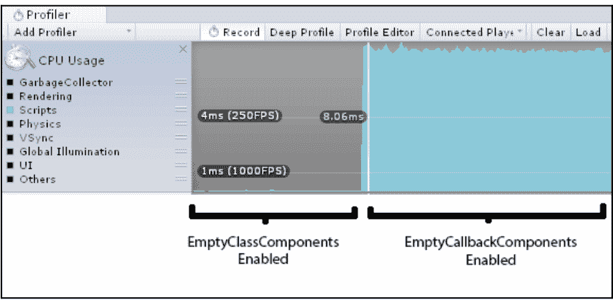
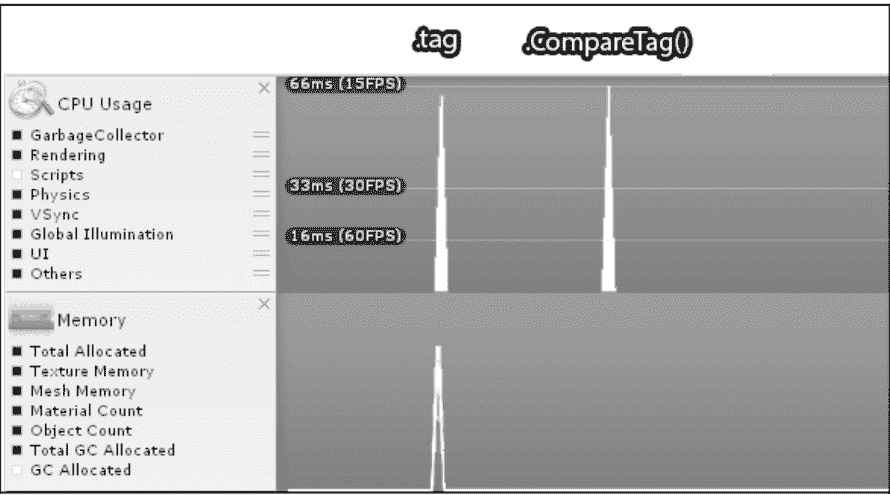
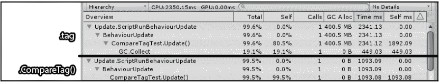
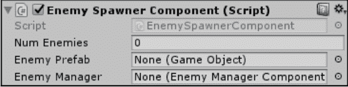

# 2 脚本策略

由于脚本编写将占用我们大量的开发时间，因此学习一些最佳实践将大有裨益。脚本编写是一个非常广泛的术语，因此我们将在本章中将接触范围限制在非常特定于 Unity 的情况上，重点关注围绕 MonoBehaviours、GameObjects 和相关功能的问题。

> 我们将在第 8 章《精通内存管理》中讨论 C# 语言、.NET 库和 Mono 框架的细微差别和高级主题。

在本章中，我们将探讨将性能增强应用于以下领域的方法：

- 访问组件
- 组件回调（Update()、Awake() 等）
- 协程
- GameObject 和 Transform 的使用
- 对象间通信
- 数学计算
- 反序列化，例如场景和预制体加载

无论你是有想要解决的特定问题，还是只是想学习一些技术以备将来参考，本章都将向你介绍一系列广泛的方法，你可以用它们来改善当前和未来的脚本编写工作。在每种情况下，我们将探讨性能问题如何以及为何产生，问题出现的示例情况，以及一种或多种解决该问题的方案。

# 使用最快方法获取组件

`GetComponent()` 方法有几种变体，它们各自的性能开销不同，因此调用此方法的最快版本变得明智。可用的三个重载是 `GetComponent(string)`、`GetComponent<T>()` 和 `GetComponent(typeof(T))`。事实证明，最快的版本取决于我们运行的 Unity 版本，因为多年来对这些方法进行了多项优化；但是，在 Unity 5 的所有后续版本以及 Unity 2017 的初始版本中，最好使用 `GetComponent<T>()` 变体。

让我们通过一些简单的测试来证明这一点：

```csharp
int numTests = 1000000;
TestComponent test;
using (new CustomTimer("GetComponent(string)", numTests)) {
 for (var i = 0; i < numTests; ++i) {
 test = (TestComponent)GetComponent("TestComponent");
 }
}
using (new CustomTimer("GetComponent<ComponentName>", numTests)) {
 for (var i = 0; i < numTests; ++i) {
 test = GetComponent<TestComponent>();
 }
}
using (new CustomTimer("GetComponent(typeof(ComponentName))", numTests)) {
 for (var i = 0; i < numTests; ++i) {
 test = (TestComponent)GetComponent(typeof(TestComponent));
 }
}
```

前面的代码对每个 `GetComponent()` 重载进行了百万次测试。这远超典型项目合理的测试次数，但有助于清楚地说明相对成本。

测试完成后我们得到的结果如下：

```
! GetComponent(string) finished: 6413.00ms total, 0.006413ms per test for 1000000 tests
UnityEngine.Debug:Log(Object)
! GetComponent<ComponentName> finished: 89.00ms total, 0.000089ms per test for 1000000 tests
UnityEngine.Debug:Log(Object)
! GetComponent(typeof(ComponentName)) finished: 95.00ms total, 0.000095ms per test for 1000000 tests
UnityEngine.Debug:Log(Object)
```


As you can see, the `GetComponent<T>()` method is only a tiny fraction faster than `GetComponent(typeof(T))`, whereas `GetComponent(string)` is significantly slower than the alternatives. Therefore, it is pretty safe to use either of the type-based versions of `GetComponent()` because of the small performance difference. However, we should ensure that we never use `GetComponent(string)` since the outcome is identical, and there is no benefit for the costs incurred. There are some very rare exceptions, like if we were writing a custom debug console for Unity, which might parse a user-inputted `string` to acquire a Component. In any case, these would be used for debugging and diagnostics situations only, where performance isn't too important. For a production-level application, the use of `GetComponent(string)` is just a needless waste.

# Remove empty callback definitions

The primary means of scripting in Unity is to write callback functions in classes derived from `MonoBehaviour`, which we know Unity will call when necessary. Perhaps the four most commonly used callbacks are `Awake()`, `Start()`, `Update()`, and `FixedUpdate()`.

`Awake()` is called the moment a `MonoBehaviour` is first created, whether this occurs during Scene initialization or when a new `GameObject` containing the `MonoBehaviour` is instantiated at runtime from a Prefab. `Start()` will be called shortly after `Awake()` but before its first `Update()`. During Scene initialization, every `MonoBehaviour` Component's `Awake()` callback will be called before any of their `Start()` callbacks are.

After this, `Update()` will be called repeatedly, each time the Rendering Pipeline presents a new image. `Update()` will continue to be called provided the `MonoBehaviour` is still present in the Scene, it is still enabled, and its parent `GameObject` is active.

Finally, `FixedUpdate()` is called just prior to when the Physics Engine updates. Fixed Updates are used whenever we want activity similar in behavior to `Update()` but that isn't tied directly to the render frame rate and is called more consistently over time.

Refer to the following page in the Unity documentation for an accurate picture of when various Unity callbacks are called: https://docs.unity3d.com/Manual/ExecutionOrder.html.

Whenever a MonoBehaviour is first instantiated in our Scene, Unity will add any defined callbacks to a list of function pointers, which it will call at key moments. However, it is important to realize that Unity will hook into these callbacks even if the function body is empty. The core Unity Engine has no awareness that these function bodies may be empty and only knows that the method has been defined and, therefore, that it must acquire it and then call it when necessary. Consequently, if we leave empty definitions of these callbacks scattered throughout the codebase, then they will waste a small amount of CPU due to the overhead cost of the engine invoking them.

This can be a problem since any time we create a new MonoBehaviour script file in Unity, it will automatically generate two boilerplate callback stubs for us for Start() and Update():

```
// Use this for initialization
void Start () {
}

// Update is called once per-frame
void Update () {
}
```

It can be easy to accidentally leave these empty definitions on scripts that don't actually need them. An empty Start() definition is liable to cause any object to initialize a little slower, for no good reason. This effect may not be particularly noticeable for a handful of MonoBehaviours, but as development on the project continues and we populate our scenes with thousands of custom MonoBehaviours with lots of empty Start() definitions, it could start to become a problem, causing slow Scene initialization and wasting CPU time whenever a new Prefab is created via GameObject.Instantiate().

Such calls typically happen during key gameplay events; for instance, when two objects collide, we might spawn a Particle Effect, create some floating damage text, play a sound effect, and so on. This can be a critical moment for performance, because we've suddenly requested that the CPU make a lot of complicated changes, but with only a finite amount of time to complete them before the current frame ends. If this process takes too long, then we would experience a frame drop as the Rendering Pipeline isn't allowed to present a new frame until all of the Update() callbacks (counted across all MonoBehaviours in the Scene!) have finished. Ergo, a bunch of empty Start() definitions being called at this time is a needless waste and could potentially cut into our tight time-budget at a critical moment.

Meanwhile, if our Scene contains thousands of MonoBehaviours with these empty Update() definitions, then we would be wasting a lot of CPU cycles every frame, potentially causing havoc on our frame rate.

Let's prove all of this with a simple test. Our test Scene should have GameObjects with two types of Component, EmptyClassComponent with no methods defined at all and EmptyCallbackComponent with an empty Update() callback defined:

```
public class EmptyClassComponent : MonoBehaviour {
}

public class EmptyCallbackComponent : MonoBehaviour {
void Update () {}
}
```

The following are the test results for 30,000 Components of each type. If we enable all GameObjects with attached EmptyClassComponents during runtime, then nothing interesting happens under the CPU Usage Area of the Profiler. There will be a small amount of background activity, but none of this activity will be caused by the EmptyClassComponents. However, as soon as we enable all objects with EmptyCallbackComponent, we will observe a huge increase in CPU usage:



It’s hard to imagine a Scene with more than 30,000 objects in it, but keep in mind that `MonoBehaviour`s contain the `Update()` callback, not `GameObject`s. A single `GameObject` can contain multiple `MonoBehaviour`s at once, and each of their children can contain even more `MonoBehaviour`s, and so on. A few thousand or even a hundred empty `Update()` callbacks will inflict a noticeable impact on frame rate budget, for zero potential gain. This is particularly common with Unity UI Components which tend to attach a lot of different Components in a very deep hierarchy.

The fix for this is simple: delete the empty callback definitions. Unity will have nothing to hook into, and nothing will be called. Finding such empty definitions in an expansive codebase may be difficult, but if we use some basic regular expressions (known as _regex_), we should be able to find what we’re looking for relatively easily.

All common code-editing tools for Unity, such as MonoDevelop, Visual Studio, and even Notepad++, provide a way to perform a regex-based search on the entire codebase. Check out the tool’s documentation for more information, since the method can vary greatly depending on the tool and its version.

The following regex search should find any empty `Update()` definitions in our code:

`void\\s*Update\\s*\\((\\s*?)\\s*?\\n*?\\{(\\n*?\\s*?)*?\\}`

This regex checks for a standard method definition of the `Update()` callback, while including any surplus whitespace and newline characters that can be distributed throughout the method definition.

Naturally, all of the above is also true for the non-boilerplate Unity callbacks, such as `OnGUI()`, `OnEnable()`, `OnDestroy()`, and `LateUpdate()`. The only difference is that only `Start()` and `Update()` are defined automatically in a new script. Check out the `MonoBehaviour` Unity Documentation page for a complete list of these callbacks at `http://docs.unity3d.com/ScriptReference/MonoBehaviour.html`.

It might also seem unlikely that someone generated so many empty versions of these callbacks in our codebase, but never say never. For example, if we use a common base class `MonoBehaviour` throughout all of our custom Components, then a single empty callback definition in that base class will permeate the entire game, which can cost us dearly. Be particularly careful of the `OnGUI()` method, as it can be invoked multiple times within the same frame or UI event.


也许 Unity 脚本中性能问题最常见的根源，就是滥用 `Update()` 回调，具体表现为以下一种或多种行为：

- 反复重新计算一个很少或根本不会改变的值
- 让过多的组件为本可以共享的结果执行工作
- 执行工作的频率远高于必要程度

值得养成的习惯是牢记：我们在 `Update()` 回调以及由这些回调调用的函数中编写的每一行代码，都会侵蚀我们的帧率预算。要达到 60 fps，我们每帧只有 16.667 毫秒来完成所有 `Update()` 回调中的所有工作。在开始原型制作时，这似乎是充足的时间，但在开发中期，我们可能会开始注意到事情变得越来越慢、响应越来越迟钝，因为我们一直在逐渐消耗这个预算，原因是我们不受控制地想往项目中塞入更多内容。

让我们来看看一些直接解决这些问题的技巧。

# 缓存组件引用

在 Unity 中编写脚本时，反复重新计算一个值是一个常见的错误，尤其是在涉及 `GetComponent()` 方法时。例如，以下脚本代码试图检查生物的生命值，如果生命值低于 `0`，它将禁用一系列组件，为死亡动画做准备：

```c
void TakeDamage() {
    RigidBody rigidbody = GetComponent<RigidBody>();
    Collider collider = GetComponent<Collider>();
    AIControllerComponent ai = GetComponent<AIControllerComponent>();
    Animator anim = GetComponent<Animator>();

    if (GetComponent<HealthComponent>().health < 0) {
        rigidbody.enabled = false;
        collider.enabled = false;
        ai.enabled = false;
        anim.SetTrigger("death");
    }
}
```

每次执行这个优化不佳的方法时，都会重新获取五个不同的组件引用。这对 CPU 使用率并不友好。如果主方法是在 `Update()` 中调用的，这尤其成问题。即使不是，它仍然可能与其他重要事件同时发生，例如创建粒子效果、用布娃娃替换对象（从而触发物理引擎中的各种活动）等等。这种编码风格看似无害，但可能会带来很多长期问题和运行时工作，而收益却很小。

缓存这些引用以供将来使用，只需花费少量内存空间（每次仅 32 或 64 位；取决于 Unity 版本、平台和碎片情况）。因此，除非你在内存上极度瓶颈，否则更好的方法是在初始化期间获取引用，并保留它们直到需要：

```c
private HealthComponent _healthComponent;
private Rigidbody _rigidbody;
private Collider _collider;
private AIControllerComponent _ai;
private Animator _anim;

void Awake() {
    _healthComponent = GetComponent<HealthComponent>();
    _rigidbody = GetComponent<Rigidbody>();
    _collider = GetComponent<Collider>();
    _ai = GetComponent<AIControllerComponent>();
    _anim = GetComponent<Animator>();
}

void TakeDamage() {
    if (_healthComponent.health < 0) {
        _rigidbody.detectCollisions = false;
        _collider.enabled = false;
        _ai.enabled = false;
        _anim.SetTrigger("death");
    }
}
```

以这种方式缓存组件引用，可以避免每次需要时都重新获取它们，每次都能节省一些 CPU 开销。代价是少量额外的内存消耗，这通常是值得的。

同样的技巧适用于我们决定在运行时计算的几乎任何数据。没有必要让 CPU 在每次 `Update()` 中不断重新计算同一个值，我们可以直接将其存储在内存中以供将来引用。

# 共享计算输出

通过让多个对象共享某个计算的结果，可以节省性能；当然，这只有在所有对象都会生成相同结果时才有效。这种情况通常容易发现，但重构起来可能比较棘手，因此利用这一点高度依赖于具体实现。

一些示例可能包括：在场景中查找对象、从文件读取数据、解析数据（如 XML 或 JSON）、在大列表或深层信息字典中查找某物、为一组 **人工智能（AI）** 对象计算路径、复杂的类似轨迹的数学计算、射线检测等等。

考虑每次执行昂贵操作时，思考它是否从多个位置调用但始终产生相同的输出。如果是这种情况，那么最好重构事物，使结果只计算一次，然后分发给每个需要它的对象，以尽量减少重新计算的数量。最大的成本通常只是代码简单性的微小损失，尽管传递值可能会带来一些额外开销。

请注意，很容易养成将某个大型复杂函数隐藏在基类中的习惯，然后定义使用该函数的派生类，完全忘记该函数有多昂贵，因为我们很少再查看那段代码。最好使用 Unity 性能分析器来告诉我们那个昂贵函数可能被调用多少次，一如既往，除非已被证明是性能问题，否则不要过早优化那些函数。无论它多么昂贵，如果它不会导致我们超过性能限制（如帧率和内存消耗），那么它就不算真正的性能问题。

# Update、协程和 InvokeRepeating

另一种容易陷入的习惯是在 `Update()` 回调中以远高于必要的频率反复调用某些东西。例如，我们可能从以下情况开始：

```c
void Update() {
    ProcessAI();
}
```

在这种情况下，我们每帧都在调用某个自定义的 `ProcessAI()` 子例程。这可能是一项复杂的任务，需要 AI 系统检查某个网格系统来确定它应该移动到哪里，或确定一组飞船的舰队机动，或者我们游戏 AI 所需的任何其他内容。

如果这项活动过度侵蚀了我们的帧率预算，并且该任务可以以低于每帧一次的频率完成且没有显著缺点，那么一个改善性能的好技巧就是简单地降低 `ProcessAI()` 被调用的频率：

```c
private float _aiProcessDelay = 0.2f;
private float _timer = 0.0f;
void Update() {
    _timer += Time.deltaTime;
    if (_timer > _aiProcessDelay) {
        ProcessAI();
        _timer -= _aiProcessDelay;
    }
}
```

在这种情况下，我们通过每秒仅调用 `ProcessAI()` 约五次，降低了 `Update()` 回调的总体开销，这比之前的情况有所改进，代价是代码乍一看可能需要一点时间才能理解，以及少量额外内存来存储一些浮点数据。不过，归根结底，我们仍然让 Unity 比必要时更频繁地调用一个空回调函数。

这个函数是一个完美的示例，我们可以将其转换为协程，以利用其延迟调用属性。如前所述，协程通常用于编写短事件序列，无论是一次性还是重复动作。它们不应与线程混淆，线程会在完全不同的 CPU 核心上以并发方式运行，并且多个线程可以同时运行。相反，协程在主线程上以顺序方式运行，这样在任何给定时刻只处理一个协程，并且每个协程通过 `yield` 语句决定何时暂停和恢复。以下代码是将上述 `Update()` 回调重写为协程的示例：

```c
void Start() {
    StartCoroutine(ProcessAICoroutine());
}
```


IEnumerator ProcessAICoroutine () {
    while (true) {
        ProcessAI();
        yield return new WaitForSeconds (_aiProcessDelay);
    }
}

前面的代码演示了一个协程，它调用 `ProcessAI()`，然后在 `yield` 语句处暂停指定的秒数（即 `_aiProcessDelay` 的值），直到主线程再次恢复该协程。此时，它将返回到循环的开头，调用 `ProcessAI()`，再次在 `yield` 语句处暂停，并永远重复（通过 `while(true)` 语句），直到被要求停止。

这种方法的主要好处是，该函数的调用频率仅由 `_aiProcessDelay` 的值决定，并且在该时间到来之前将保持空闲状态，从而减少了在大多数帧中造成的性能损耗。然而，这种方法也有其缺点。

首先，启动协程相对于标准函数调用会带来额外的开销成本（大约慢三倍），并且还需要一些内存分配来存储当前状态，直到下次调用时才会被使用。这种额外的开销也不是一次性成本，因为协程通常会不断调用 `yield`，这会一次又一次地造成相同的开销成本，因此我们需要确保降低频率带来的好处大于这一成本。

在对 1,000 个具有空 `Update()` 回调的对象进行测试时，处理耗时 1.1 毫秒，而 1,000 个在 `WaitForEndOfFrame` 上 `yield` 的协程（其频率与 `Update()` 回调相同）耗时 2.9 毫秒。因此，相对成本几乎是三倍。

其次，一旦初始化，协程将独立于触发它的 `MonoBehaviour` 组件的 `Update()` 回调运行，并且无论组件是否被禁用都会继续被调用，如果我们进行大量的 `GameObject` 构建和销毁，这可能会使它们难以处理。

第三，无论出于何种原因（无论是被设置为非活动状态还是其父对象之一被设置为非活动状态），协程都会在包含它的 `GameObject` 变为非活动状态的那一刻自动停止，并且如果 `GameObject` 再次设置为活动状态，它不会自动重新启动。

最后，通过将方法转换为协程，我们可能减少了在大多数帧中造成的性能损耗，但如果方法体的单次调用导致我们超出了帧率预算，那么无论我们调用该方法的频率多么低，预算仍然会被超出。因此，这种方法最适合于仅由于方法在给定帧中被调用的次数过多而导致超出帧率预算的情况，而不是因为该方法本身开销过大。在这些情况下，我们别无选择，只能深入研究并改进方法本身的性能，或降低其他任务的成本以腾出时间来完成其工作。

在生成协程时，我们有几种可用的 `yield` 类型。`WaitForSeconds` 相当直观；协程将在 `yield` 语句处暂停指定的秒数。然而，它不是精确的定时器，因此当此 `yield` 类型实际恢复时，请预期会有少量的变化。

`WaitForSecondsRealTime` 是另一个选项，它与 `WaitForSeconds` 的区别仅在于它使用未缩放时间。`WaitForSeconds` 与缩放时间进行比较，后者受全局 `Time.timeScale` 属性的影响，而 `WaitForSecondsRealTime` 则不受影响，因此如果您正在调整时间缩放值（例如，用于慢动作效果），请小心选择使用哪种 `yield` 类型。

还有 `WaitForEndOfFrame`，它将在下一个 `Update()` 结束时继续，还有 `WaitForFixedUpdate`，它将在下一个 `FixedUpdate()` 结束时继续。最后，Unity 5.3 引入了 `WaitUntil` 和 `WaitWhile`，我们提供一个委托函数，协程将暂停直到给定的委托分别返回 true 或 false。请注意，提供给这些 `yield` 类型的委托函数将在每个 `Update()` 中执行，直到它们返回停止所需的布尔值，这使得它们非常类似于在 `while` 循环中使用 `WaitForEndOfFrame` 并在满足特定条件时结束的协程。当然，我们提供的委托函数执行开销也不应过大。

> 委托函数是 C# 中非常有用的构造，它允许我们将局部方法作为参数传递给其他方法，通常用于回调。有关委托的更多信息，请参阅 MSDN C# 编程指南 https://docs.microsoft.com/en-us/dotnet/csharp/programming-guide/delegates/。

某些 `Update()` 回调的编写方式可能可以压缩为简单的协程，这些协程始终在上述类型之一上调用 `yield`，但我们应该注意前面提到的缺点。协程可能难以调试，因为它们不遵循正常的执行流程；调用堆栈中没有我们可以直接指责的调用者来解释为什么协程在给定时间触发，如果协程执行复杂任务并与其他子系统交互，则可能导致一些极其困难的错误，因为它们恰好在某些其他代码未预期的时刻被触发，这也往往是那些难以重现的棘手错误。如果您确实希望使用协程，最好的建议是保持它们简单且独立于其他复杂的子系统。

确实，如果我们的协程足够简单，可以归结为始终在 `WaitForSeconds` 或 `WaitForSecondsRealtime` 上调用 `yield` 的 `while` 循环（如上述示例所示），那么我们通常可以用 `InvokeRepeating()` 调用来替换它，这更容易设置并且开销略小。以下代码与之前使用协程定期调用 `ProcessAI()` 方法的实现功能等效：

void Start() {
    InvokeRepeating("ProcessAI", 0f, _aiProcessDelay);
}

`InvokeRepeating()` 与协程之间的一个重要区别是，`InvokeRepeating()` 完全独立于 `MonoBehaviour` 和 `GameObject` 的状态。停止 `InvokeRepeating()` 调用的唯一方法是调用 `CancelInvoke()`（它将停止给定 `MonoBehaviour` 发起的所有 `InvokeRepeating()` 回调，请注意它们不能单独取消）或销毁关联的 `MonoBehaviour` 或其父 `GameObject`。禁用 `MonoBehaviour` 或 `GameObject` 都不会停止 `InvokeRepeating()`。

对 1,000 个 `InvokeRepeating()` 调用的测试大约在 2.6 毫秒内处理完毕；略快于耗时 2.9 毫秒的 1,000 个等效协程 `yield` 调用。

这就涵盖了与 `Update()` 回调相关的大部分有用信息。让我们来看看一些其他有用的脚本技巧。

# 更快的 GameObject null 引用检查

事实证明，对 `GameObject` 执行 `null` 引用检查会导致一些不必要的性能开销。与典型的 C# 对象相比，`GameObject` 和 `MonoBehaviour` 是特殊的对象，因为它们在内存中有两种表示：一种存在于管理我们编写的 C# 代码的同一系统管理的内存中（托管代码），而另一种存在于单独处理的不同内存空间中（原生代码）。数据可以在这两个内存空间之间移动，但每次发生这种情况都会导致额外的 CPU 开销，并可能产生额外的内存分配。

这种效果通常被称为跨越 `Native-Managed Bridge`。如果发生这种情况，可能会为对象的数据生成额外的内存分配以跨越桥梁进行复制，这将需要垃圾回收器最终为我们执行一些自动内存清理。本主题将在第 8 章《精通内存管理》中更详细地探讨，但暂时请考虑，有许多微妙的方式可能会意外触发这种额外开销，而对 `GameObject` 进行简单的 `null` 引用检查就是其中之一：

```csharp
if (gameObject != null) {
    // do stuff with gameObject
}
```

一种替代方案是 `System.Object.ReferenceEquals()`，它生成功能等效的输出，运行速度大约快两倍（尽管它会稍微模糊代码的目的）：

```csharp
if (!System.Object.ReferenceEquals(gameObject, null)) {
    // do stuff with gameObject
}
```

这适用于 `GameObject` 和 `MonoBehaviour`，以及其他 Unity 对象，例如 `WWW` 类，它们都具有原生和托管表示。然而，一些初步测试表明，无论哪种 `null` 引用检查方法，在 Intel Core i5 3570K 处理器上都只消耗几个纳秒。因此，除非您正在进行大量的 `null` 引用检查，否则收益可能微乎其微。然而，这是一个值得牢记的警告，因为它将在未来频繁出现。


# 避免从 GameObjects 检索字符串属性

通常，从对象检索 `string` 属性与在 C# 中检索任何其他引用类型属性相同；它应该在没有额外内存成本的情况下获取。但是，从 `GameObjects` 检索 `string` 属性是意外跨越原生 - 托管桥的另一种微妙方式。

受此行为影响的 `GameObject` 的两个属性是 `tag` 和 `name`。因此，在游戏过程中使用其中任何属性都是不明智的，你应该只在性能无关紧要的区域使用它们，例如编辑器脚本。但是，标签系统通常用于运行时对象识别，这可能使这对某些团队来说成为一个重大问题。

例如，以下代码会在循环的每次迭代期间导致额外的内存分配：

```c
for (int i = 0; i < listOfObjects.Count; ++i) {
    if (listOfObjects[i].tag == "Player") {
    // do something with this object
    }
}
```

通常，更好的做法是通过组件和类类型来识别对象，并识别不涉及 `string` 对象的值，但有时我们被迫无路可走。也许当我们开始时并不知道得更好，我们继承了别人的代码库，或者我们将其用作某种东西的变通方法。让我们假设，出于任何原因，我们被困在标签系统中，并且我们想要避免原生 - 托管桥的开销成本。

幸运的是，`tag` 属性最常用于比较情况，而 `GameObject` 提供了 `CompareTag()` 方法，这是比较 `tag` 属性的一种替代方法，它完全避免了原生 - 托管桥。

让我们执行一个简单的测试，以证明这个简单的改变可以带来天壤之别：

```c
void Update() {
    int numTests = 10000000;

    if (Input.GetKeyDown(KeyCode.Alpha1)) {
    for(int i = 0; i < numTests; ++i) {
        if (gameObject.tag == "Player") {
            // do stuff
        }
    }
}
if (Input.GetKeyDown(KeyCode.Alpha2)) {
for(int i = 0; i < numTests; ++i) {
if (gameObject.CompareTag ("Player")) {
// do stuff
}
}
}
}
```

我们可以通过按 1 和 2 键来执行这些测试以触发各自的 for 循环。
以下是结果：



查看每个尖峰的分解视图，我们可以看到两种完全不同的结果：



值得注意的是，时间轴视图中的两个尖峰看起来高度相似，但一次操作的时间却是另一次的两倍。当我们超过 15FPS 标记时，性能分析器没有必要的垂直分辨率来生成相对准确的峰值。无论如何，两者都会导致糟糕的游戏体验，所以准确性并不重要。

检索 `tag` 属性 1000 万次（在现实中远远超出合理范围，但这对于比较很有用）会导致仅为 `string` 对象分配约 400 兆字节的内存。我们可以在时间轴视图的内存区域中 **GC 已分配** 元素内的尖峰中看到这种内存分配正在发生。此外，这个过程大约需要 2000 毫秒来处理，一旦 `string` 对象不再需要，还会花费另外 400 毫秒进行垃圾回收。

与此同时，使用 `CompareTag()` 1000 万次大约需要 1000 毫秒来处理，并且不会导致任何内存分配，因此也不会产生垃圾回收。这从时间轴视图的内存区域中 **GC 已分配** 元素中缺乏尖峰可以明显看出。这应该让我们清楚地认识到，我们必须尽可能避免访问 `name` 和 `tag` 属性。如果标签比较变得必要，那么我们应该使用 `CompareTag()`。不幸的是，`name` 属性没有等效方法，所以我们应该尽可能使用标签。

请注意，将 `string` 文本（例如 "Player"）传递给 `CompareTag()` 不会导致运行时内存分配，因为应用程序在初始化期间分配像这样的硬编码字符串，并且在运行时仅引用它们。

# 使用适当的数据结构

C# 在 `System.Collections` 命名空间中提供了许多不同的数据结构，我们不应该过于习惯于反复使用相同的数据结构。软件开发中常见的性能问题是，仅仅因为方便就为我们试图解决的问题使用了不合适的数据结构。最常用的两个可能是列表（`List<T>`）和字典（`Dictionary<K, V>`）。

如果我们想要遍历一组对象，则首选列表，因为它实际上是一个动态数组，其中的对象和/或引用在内存中相互紧邻，因此遍历会导致最小的缓存未命中。如果两个对象相互关联，并且我们希望快速获取、插入或删除这些关联，则最适合使用字典。例如，我们可能会将关卡编号与特定的场景文件关联起来，或者将代表角色不同身体部位的 `enum` 与这些身体部位的 `Collider` 组件关联起来。

但是，我们经常希望有一个同时处理这两种场景的数据结构；我们希望快速找出哪个对象映射到另一个对象，同时还能遍历整个组。通常，该系统的开发人员会使用字典，然后遍历它。但是，与遍历列表相比，这个过程非常慢，因为它必须检查字典中的每个潜在哈希才能完全遍历它。

在这种情况下，通常最好将数据同时存储在列表和字典中，以更好地支持这种行为。这将增加额外的内存开销来维护多个数据结构，并且插入和删除每次都需要从两个数据结构中添加和删除对象，但列表上的遍历好处（通常发生频率要高得多）与遍历字典相比将形成鲜明对比。

# 避免在运行时重新设置 Transform 的父级

在早期版本的 Unity（5.3 及更早版本）中，`Transform` 组件的引用在内存中通常以随机顺序排列。这意味着遍历多个 `Transform` 相当缓慢，因为缓存未命中的可能性很大。好处是，将一个 `GameObject` 重新设置为另一个 `GameObject` 的子级不会造成显著的性能损失，因为 `Transform` 的操作很像堆数据结构，插入和删除通常相对较快。这种行为是我们无法控制的，所以我们只是接受了它。

但是，自 Unity 5.4 及更高版本以来，`Transform` 组件的内存布局发生了重大变化。从那以后，`Transform` 组件的父子关系更像动态数组，Unity 会尝试将所有共享相同父级的 `Transform` 存储在预分配内存缓冲区中，并在 **层级** 窗口中按其深度排序，位于父级下方。这种数据结构允许对整个组进行更快得多的遍历，这对于物理和动画等多个子系统特别有益。这种变化的缺点是，如果我们将一个 `GameObject` 重新设置为另一个 `GameObject` 的子级，父级必须将新子级放入其预分配内存缓冲区，并根据新深度对所有这些 `Transform` 进行排序。此外，如果父级没有预分配足够的空间来容纳新子级，则必须扩展其缓冲区，以便按深度优先顺序容纳新子级及其所有子级。对于深层和复杂的 `GameObject` 结构，这可能需要一些时间才能完成。

当我们通过 `GameObject.Instantiate()` 实例化一个新的 `GameObject` 时，其参数之一是我们希望将 `GameObject` 设置为子级的 `Transform`，默认值为 `null`，这会将 `Transform` 放置在 **层级** 窗口的根目录下。**层级** 窗口根目录下的所有 `Transform` 都需要分配一个缓冲区来存储当前的子级以及以后可能添加的子级（子级 `Transform` 不需要这样做）。但是，如果我们在实例化后立即将 Transform 重新设置为另一个 Transform 的子级，那么它就会丢弃我们刚刚分配的缓冲区！为了避免这种情况，我们应该将父级 `Transform` 参数提供给 `GameObject.Instantiate()` 调用，这将跳过此缓冲区分配步骤。

降低此过程成本的另一种方法是在需要之前让根 `Transform` 预分配一个更大的缓冲区，这样我们就不需要在同一帧中既扩展缓冲区又将另一个 `GameObject` 重新设置为子级。这可以通过修改 `Transform` 组件的 `hierarchyCapacity` 属性来实现。如果我们可以估计父级将包含多少个子级 `Transform`，那么我们可以节省大量不必要的内存分配。

# 考虑缓存 Transform 更改

`Transform` 组件仅存储相对于其自身父级的数据。这意味着访问和修改 `Transform` 组件的 `position`、`rotation` 和/或 `scale` 属性可能会导致大量未预料的矩阵乘法计算，以通过其父级 `Transform` 生成对象的正确 `Transform` 表示。对象在 **层级** 窗口中的层级越深，确定最终结果所需的计算就越多。


然而，这也意味着使用 `localPosition`、`localRotation` 和 `localScale` 所关联的成本相对较低，因为这些值直接存储在给定的 `Transform` 中，无需任何额外的矩阵乘法即可检索。因此，应尽可能使用这些本地属性值。

不幸的是，将数学计算从世界空间更改为本地空间可能会使原本简单（且已解决）的问题变得过于复杂，因此做出此类更改可能会破坏我们的实现并引入大量意外错误。有时，为了更轻松地解决复杂的 3D 数学问题，接受轻微的性能损失是值得的。

不断更改 `Transform` 组件属性的另一个问题是，它还会向 `Collider`、`Rigidbody`、`Light` 和 `Camera` 等组件发送内部通知，这些通知也必须被处理，因为物理系统和渲染系统都需要知道 `Transform` 的新值并相应地进行更新。

这些内部通知的速度在 Unity 5.4 中得到了显著提升，原因是 Unity 5.4 中 `Transform` 在内存中的重新组织，如前面所述，但我们仍需了解其成本。

在复杂的事件链中，在同一帧内多次替换 `Transform` 组件的属性并不罕见（尽管这可能是过度设计的警示信号）。这会导致每次发生这种情况时都会触发内部消息，即使它们发生在同一帧，甚至发生在同一函数调用中。因此，我们应考虑通过在成员变量中缓存 `Transform` 属性并在帧结束时仅提交一次来减少修改 `Transform` 属性的次数，如下所示：

```
private bool _positionChanged;
private Vector3 _newPosition;

public void SetPosition(Vector3 position) {
    _newPosition = position;
    _positionChanged = true;
}

void FixedUpdate() {
    if (_positionChanged) {
        transform.position = _newPosition;
        _positionChanged = false;
    }
}
```

这段代码将仅在下一个 `FixedUpdate()` 方法中提交对 `position` 的更改。

请注意，以这种方式更改 `Transform` 不会导致游戏过程中出现奇怪的行为或物体瞬移。这些内部事件的整个目的是确保物理系统和渲染系统始终与当前的 `Transform` 状态同步。因此，Unity 不会有任何延迟，每当更改通过 `Transform` 组件传递时都会触发内部事件，以确保不会遗漏任何内容。

# 避免在运行时使用 Find() 和 SendMessage()

`SendMessage()` 方法和 `GameObject.Find()` 方法系列臭名昭著地昂贵，应不惜一切代价避免。`SendMessage()` 方法比简单的函数调用慢约 2,000 倍，而 `Find()` 方法的成本随场景复杂度的增加而非常糟糕地扩展，因为它必须遍历场景中的每个 `GameObject`。在场景初始化期间（例如在 `Awake()` 或 `Start()` 回调中）调用 `Find()` 有时是可以原谅的。即使在这种情况下，也只应用于获取我们确定已经存在于场景中且场景中只有少量 `GameObject` 的对象。无论如何，在运行时使用这两种方法中的任何一种进行对象间通信都可能产生非常明显的开销，并可能导致掉帧。

依赖 `Find()` 和 `SendMessage()` 通常是设计不佳、缺乏 C# 和 Unity 编程经验，或者仅仅是原型开发时的懒惰的表现。它们的使用在初级和中级项目中已成为某种流行病，以至于 Unity Technologies 觉得有必要在文档和会议上反复提醒用户在真实游戏中避免使用它们。它们仅作为一种不那么“程序员化”的方式来向新用户介绍对象间通信，以及在某些可以负责任地使用它们的特殊情况下存在（这种情况少之又少）。换句话说，它们的成本如此高昂，以至于打破了不要过早优化代码的规则，如果我们的项目超出了原型阶段（这是一个明显的可能性，因为你正在阅读这本书），那么不惜一切代价避免使用它们是值得的。

公平地说，Unity 面向广泛的用户群体，从爱好者、学生、专业人士到自命不凡的人，团队规模也从个人开发者到同一团队中的数百人不等。这导致了软件开发能力的极其广泛的范围。当你刚开始使用 Unity 时，很难自己弄清楚应该做出哪些不同的做法，尤其是考虑到 Unity 引擎不遵循我们可能熟悉的许多其他游戏引擎的设计范式。它围绕场景和预制体有一些陌生和古怪的概念，没有内置的 God Class 入口点，也没有任何明显的原始数据存储系统可供使用。

God Class 是一个花哨的名称，指我们可能在应用程序中创建的第一个对象，其工作是根据当前上下文（要加载哪个关卡、激活哪些子系统等）创建我们需要的其他所有东西。如果我们想要一个单一的集中位置来控制整个应用程序生命周期中事件发生的顺序，这些类会特别有用。

这是一个重要的主题，不仅关乎性能，也关乎任何实时事件驱动系统设计（包括但不限于游戏），因此值得详细探讨该主题，评估一些对象间通信的替代方法。

让我们从检查一个最坏情况的示例开始，该示例同时使用 Find() 和 SendMessage() 在对象之间进行通信，然后探讨改进方法。

以下是一个简单的 EnemyManagerComponent 类定义，它跟踪游戏中代表敌人的 GameObject 列表，并在需要时提供 KillAll() 方法将它们全部销毁：

```
using UnityEngine;
using System.Collections.Generic;
class EnemyManagerComponent : MonoBehaviour {
    List<GameObject> _enemies = new List<GameObject>();
    public void AddEnemy(GameObject enemy) {
        if (!_enemies.Contains(enemy)) {
            _enemies.Add(enemy);
        }
    }
    public void KillAll() {
        for (int i = 0; i < _enemies.Count; ++i) {
            GameObject.Destroy(_enemies[i]);
        }
        _enemies.Clear();
    }
}
```

然后我们会在场景中放置一个包含此组件的 `GameObject`，并将其命名为 `EnemyManager`。

以下示例方法尝试从给定的预制体实例化若干敌人，然后通知 `EnemyManager` 对象它们的存在：

```
public void CreateEnemies(int numEnemies) {
    for(int i = 0; i < numEnemies; ++i) {
        GameObject enemy = (GameObject) GameObject.Instantiate(_enemyPrefab,
            5.0f * Random.insideUnitSphere,
            Quaternion.identity);
        string[] names = { "Tom", "Dick", "Harry" };
        enemy.name = names[Random.Range(0, names.Length)];
        GameObject enemyManagerObj = GameObject.Find("EnemyManager");
        enemyManagerObj.SendMessage("AddEnemy",
            enemy,
            SendMessageOptions.DontRequireReceiver);
    }
}
```

在任何类型的循环中初始化数据并放置方法调用，且始终输出相同的结果，是性能不佳的一个重大危险信号，当我们处理昂贵的方法（如 `Find()`）时，应始终寻找尽可能少地调用它们的方法。因此，我们可以做的一项改进是将 `Find()` 调用移出 `for` 循环，并将结果缓存在局部变量中，这样就不需要反复重新获取 `EnemyManager` 对象了。


将 `names` 变量的初始化移出 `for` 循环并不一定至关重要，因为编译器通常足够聪明，能够意识到不需要重新初始化在其他地方未更改的数据。然而，这通常能使代码更易于阅读。

我们可以实现的另一项重大改进是优化 `SendMessage()` 方法的使用，通过用 `GetComponent()` 调用来替换它。这用一个等价且便宜得多的替代方案取代了非常昂贵的方法。


# 这将给我们带来以下结果：

```csharp
public void CreateEnemies(int numEnemies) {
    GameObject enemyManagerObj = GameObject.Find("EnemyManager");
    EnemyManagerComponent enemyMgr =
        enemyManagerObj.GetComponent<EnemyManagerComponent>();
    string[] names = { "Tom", "Dick", "Harry" };

    for(int i = 0; i < numEnemies; ++i) {
        GameObject enemy = (GameObject)GameObject.Instantiate(_enemyPrefab,
                                                             5.0f * Random.insideUnitSphere,
                                                             Quaternion.identity);
        enemy.name = names[Random.Range(0, names.Length)];
        enemyMgr.AddEnemy(enemy);
    }
}
```

如果在场景初始化期间调用此方法，并且我们不太关心加载时间，那么我们大概可以认为优化工作已经完成了。

然而，我们经常需要在运行时实例化的新对象去查找现有对象以进行通信。在这个示例中，我们希望新的敌人对象能够向我们的 `EnemyManagerComponent` 注册，以便它能够执行所需操作来跟踪和控制场景中的敌人对象。我们还希望 `EnemyManager` 处理所有与敌人相关的行为，这样调用其函数的对象就不需要代表它执行工作。这将改善我们应用程序的 _耦合_（代码库分离相关行为的程度）和 _封装_（类防止外部对其管理数据进行更改的程度）。最终目标是找到一种可靠且快速的方法，让新对象在场景中查找现有对象，而无需不必要地使用 `Find()` 方法，从而最大限度地降低复杂性和性能开销。

我们可以采用多种方法来解决这个问题，每种方法都有其自身的优点和陷阱：

- 为预先存在的对象分配引用
- 静态类
- 单例组件
- 全局消息系统

# 为预先存在的对象分配引用

解决对象间通信问题的一种简单方法是使用 Unity 内置的序列化系统。软件设计纯粹主义者往往对这个功能颇有微词，因为它破坏了封装；它使得任何标记为 private 的字段（C# 中的成员变量术语）的行为都像公共字段一样。然而，它是改善开发工作流程的非常有效的工具。当艺术家、设计师和程序员都在同一个产品上摸索时，这一点尤其适用，因为每个人的计算机科学和软件编程知识水平参差不齐，有些人更愿意远离修改代码文件。有时，为了生产力，打破几条规则是值得的。

每当我们在 MonoBehaviour 中创建一个公共字段时，Unity 会在选择组件时自动序列化并在 Inspector 窗口中公开该值。然而，从软件设计的角度来看，公共字段始终是危险的。这些变量可以随时从任何地方通过代码更改，使得难以跟踪变量，并且很容易引入许多意外的错误。

更好的解决方案是，将类的任何私有或受保护的成员变量与 `[SerializeField]` 属性一起公开到 Inspector 窗口中。该值现在在 Inspector 窗口方面将表现得像公共字段，允许我们通过编辑器界面方便地更改它，但将数据安全地封装起来，不受代码库其他部分的影响。

例如，以下类将三个私有字段公开到 Inspector 窗口中：

```csharp
using UnityEngine;

public class EnemyCreatorComponent : MonoBehaviour {
    [SerializeField] private int _numEnemies;
    [SerializeField] private GameObject _enemyPrefab;
    [SerializeField] private EnemyManagerComponent _enemyManager;

    void Start() {
        for (int i = 0; i < _numEnemies; ++i) {
            CreateEnemy();
        }
    }

    public void CreateEnemy() {
        _enemyManager.CreateEnemy(_enemyPrefab);
    }
}
```

请注意，前面代码中显示的 `private` 访问说明符在 C# 中是冗余的关键字，因为字段和方法默认情况下是 `private`，除非另有说明。但是，明确说明预期的访问级别通常是最佳实践。

在 **Inspector** 窗口中查看此组件会显示三个值，初始默认值为 `0` 或 `null`，可以通过编辑器界面进行修改：



我们可以将 **Project** 窗口中的预制体引用拖放到 **Inspector** 窗口中显示的 **Enemy Prefab** 字段中。

请注意，Unity 会自动将驼峰式字段名称转换为 **Inspector** 窗口中方便的名称。`_numEnemies` 变为 **Num Enemies**，`_enemyPrefab` 变为 **Enemy Prefab**，以此类推。

与此同时，`_enemyManager` 字段很有趣，因为它是对特定 `MonoBehaviour` 类类型的引用。如果将 `GameObject` 拖放到此字段中，它将引用给定对象上的组件，而不是 `GameObject` 本身。请注意，如果 `GameObject` 不包含预期的 `MonoBehaviour`，则不会向该字段分配任何内容。

这种组件引用技术的常见用途是获取附加到组件所附加的同一个 `GameObject` 上的其他组件的引用。这是缓存组件的一种替代方法，零成本，如前面章节中 _缓存组件引用_ 部分所讨论的。

使用此方法存在一些危险。我们的大部分代码都会假设，预制体被分配给像预制体一样使用的字段，而 `GameObject` 被分配给引用 `GameObject` 实例的字段。但是，由于预制体本质上是 `GameObjects`，任何预制体或 `GameObject` 都可以分配给序列化的 `GameObject` 引用字段，这意味着我们可能会意外分配错误的类型。

如果我们确实分配了错误的类型，那么我们可能会意外地从之前修改过的现有 `GameObject` 实例化一个新的 `GameObject`，或者我们可能会对预制体进行更改，这将更改所有从中实例化的 `GameObjects` 的状态。更糟糕的是，对预制体的任何意外更改都会变成永久性的，因为无论播放模式是否激活，预制体都占据相同的内存空间。即使预制体仅在播放模式期间被修改，情况也是如此。

因此，这种方法是解决对象间通信问题的一种非常适合团队的方式，但由于团队成员意外留下 `null` 引用、将预制体分配给期望场景中 `GameObject` 实例的引用，或者反之，所涉及的所有风险，它并不理想。

还要注意的是，并非所有对象都可以序列化并在 **Inspector** 窗口中显示。Unity 可以序列化所有原始数据类型（`int`、`float`、`string` 和 `bool`）、各种内置类型（`Vector3`、`Quaternion` 等）；`enum`、`class`、`struct` 以及包含其他可序列化类型（如 `List`）的各种数据结构。但是，它无法序列化 `static` 字段、`readonly` 字段、属性和字典。


一些 Unity 开发者喜欢通过两个单独的列表（用于键和值）以及自定义编辑器脚本，或者通过单个包含键和值的 `struct` 对象列表，来实现字典的伪序列化。这两种解决方案都有点笨拙，而且很少像真正的字典那样高效，但它们仍然可能很有用。

解决对象间通信问题的另一个方案是尝试利用全局可访问的对象，以最大限度地减少我们需要进行的自定义分配数量。

# 静态类

这种方法涉及创建一个类，该类在任何时候都可以被整个代码库全局访问。任何类型的全局 _管理器_ 类在软件工程圈子里往往不受欢迎，部分原因是 _管理器_ 这个名称含糊不清，没有说明其用途，但主要是因为问题可能难以调试。更改可以随时从任何地方发生，并且在运行期间的任何时间点发生，这类倾向于维护其他系统依赖的状态信息。这也是最难更改或替换的方法，因为我们的许多类可能包含直接调用它的函数，如果将来要替换它，则需要修改每个类。尽管有所有这些缺点，但它是理解和实现起来最容易的解决方案。


Singleton 设计模式是一种常见的方式，用于确保内存中始终只存在某个对象类型的一个实例。该设计模式通过给类一个 `private` 构造函数来实现，并维护一个 `static` 变量来跟踪对象实例，该类只能通过其提供的 `static` 属性来访问。Singleton 在管理共享资源或 _大量数据流量_（例如文件访问、下载、数据解析和消息传递）时非常有用。Singleton 确保我们为这些活动提供一个单一的入口点，而不是让大量不同的子系统争夺共享资源并可能相互造成瓶颈。

Singleton 不一定必须是全局可访问的对象——它们最重要的特征是同一时间只存在该对象的一个实例。但是，在大多数项目中，Singleton 的主要用途是作为某些共享功能的全局访问点，并且设计为在应用程序初始化期间创建一次，贯穿整个应用程序生命周期，并且仅在应用程序关闭时销毁。因此，在 C# 中实现此类行为的更简单方法是使用静态类。换句话说，在 C# 中实现典型的 Singleton 设计模式只是提供了与静态类相同的行为，但实现起来花费更多时间和代码。

与前面示例中 `EnemyManagerComponent` 功能非常相似的静态类可以定义如下：

```csharp
using System.Collections.Generic;
using UnityEngine;
public static class StaticEnemyManager {
	private static List<Enemy> _enemies;
	public static void CreateEnemy(GameObject prefab) {
		string[] names = { "Tom", "Dick", "Harry" };
		GameObject enemy = GameObject.Instantiate(prefab, 5.0f *
			Random.insideUnitSphere, Quaternion.identity);
		Enemy enemyComp = enemy.GetComponent<Enemy>();
		enemy.gameObject.name = names[Random.Range(0, names.Length)];
		_enemies.Add(enemyComp);
	}
	public static void KillAll() {
		for (int i = 0; i < _enemies.Count; ++i) {
			_enemies[i].Die();
			GameObject.Destroy(_enemies[i].gameObject);
		}
		_enemies.Clear();
	}
}

```

请注意，静态类中的每个方法、属性和字段都必须附加 `static` 关键字，这意味着内存中始终只会驻留该对象的一个实例。这也意味着其 `public` 方法和字段可以从任何位置访问。静态类按定义不允许定义任何非 `static` 字段。

如果静态类的字段需要初始化（例如 `__enemies` 字段，初始设置为 `null`），则可以像下面这样在行内初始化静态类字段：

```csharp
private static List<Enemy> __enemies = new List<Enemy>() ;
```

但是，如果对象构造需要比这更复杂，那么可以为静态类提供一个 `static` 构造函数。静态类的构造函数会在类首次通过其任何字段、属性或方法被访问时自动调用，可以像下面这样定义：

```csharp
static StaticEnemyManager() {
    __enemies = new List<Enemy>() ;
    // more complicated initialization activity goes here
}
```

这次我们实现了 `CreateEnemy()` 方法，使其处理创建敌人对象的大部分活动。但是，静态类仍然必须获得一个预制体的引用，以便从中实例化敌人对象。静态类只能包含 `static` 成员变量，因此无法像 `MonoBehaviour` 那样轻松地与 **Inspector** 窗口交互，因此需要调用者向其提供一些特定于实现的信息。为了解决这个问题，我们可以为静态类实现一个配套组件，以保持代码的 _解耦_。以下代码演示了该类可能的样子：

```csharp
using UnityEngine;

public class EnemyCreatorCompanionComponent : MonoBehaviour {
    [SerializeField] private GameObject __enemyPrefab;

    public void CreateEnemy() {
        StaticEnemyManager.CreateEnemy(__enemyPrefab);
    }
}
```

尽管存在这些缺点，`StaticEnemyManager` 类说明了静态类如何用于在外部对象之间提供信息或通信的简单示例，这比使用 `Find()` 或 `SendMessage()` 提供了更好的替代方案。

# Singleton 组件

如前所述，静态类很难与 Unity 相关的功能交互，并且无法直接使用 `MonoBehaviour` 功能，例如事件回调、协程、层级设计和预制体。此外，由于 **Inspector** 窗口中没有可选择的对象，我们失去了通过 **Inspector** 窗口在运行时检查静态类数据的能力，这会使调试变得困难。这些是我们可能希望在全局类中使用的功能。

解决此问题的常见方法是实现一个像 Singleton 一样的组件——它提供 `static` 方法以授予全局访问权限，并且任何给定时间只允许存在一个 `MonoBehaviour` 实例。

以下是 `SingletonComponent` 类的定义：

```csharp
using UnityEngine;

public class SingletonComponent<T> : MonoBehaviour where T : SingletonComponent<T> {
    private static T __Instance;

    protected static SingletonComponent<T> __Instance {
        get {
            if(!__Instance) {
                T [] managers = GameObject.FindObjectsOfType(typeof(T)) as T[];
                if (managers != null) {
                    if (managers.Length == 1) {
                        __Instance = managers[0];
                        return __Instance;
                    } else if (managers.Length > 1) {
                        Debug.LogError("You have more than one " +
                            typeof(T).Name +
                            " in the Scene. You only need " +
                            "one - it's a singleton!");
                        for(int i = 0; i < managers.Length; ++i) {
                            T manager = managers[i];
                            Destroy(manager.gameObject);
                        }
                    }
                }
                GameObject go = new GameObject(typeof(T).Name, typeof(T));
                __Instance = go.GetComponent<T>();
                DontDestroyOnLoad(__Instance.gameObject);
            }
            return __Instance;
        }
        set {
            __Instance = value as T;
        }
    }
}
```

该类的工作原理是在首次访问时创建一个包含自身组件的 `GameObject`。由于我们希望这是一个全局且持久的对象，因此在 `GameObject` 创建后不久需要调用 `DontDestroyOnLoad()`。这是一个特殊函数，告诉 Unity 我们希望对象在应用程序运行期间在场景之间持续存在。从那时起，当加载新场景时，对象不会被销毁，并将保留其所有数据。

该类定义假设两点。首先，因为它使用 `generics` 来定义其行为，因此必须从中派生以创建具体类。其次，必须定义一个方法来分配 `__Instance` 属性（进而设置私有 `__Instance` 字段），并将其转换为/从正确的类类型。

例如，以下是成功生成名为 `EnemyManagerSingletonComponent` 的新 `SingletonComponent` 派生类所需的最少代码：

```csharp
public class EnemyManagerSingletonComponent : SingletonComponent<EnemyManagerSingletonComponent> {
    public static EnemyManagerSingletonComponent Instance {
        get { return ((EnemyManagerSingletonComponent)_Instance); }
        set { _Instance = value; }
    }

    public void CreateEnemy(GameObject prefab) {
        // same as StaticEnemyManager
    }

    public void KillAll() {
        // same as StaticEnemyManager
    }
}
```

该类可以在运行时由任何其他对象随时访问 `Instance` 属性来使用。如果组件在场景中不存在，则 `SingletonComponent` 基类将实例化其自己的 `GameObject` 并将派生类的一个实例作为组件附加到它上。从那时起，通过 `Instance` 属性的访问将引用创建的组件，并且任何给定时间只会存在该组件的一个实例。


请注意，这意味着我们不需要在单例组件类定义中实现 `static` 方法。例如，我们可以直接调用 `EnemyManagerSingletonComponent.Instance.KillAll()` 来访问 `KillAll()` 方法。

请注意，可以将 `SingletonComponent` 的实例放置在 **Hierarchy** 窗口中，因为它继承自 `MonoBehaviour`。但是，请注意 `DontDestroyOnLoad()` 方法永远不会被调用，这将阻止单例组件的 `GameObject` 在加载下一个场景时持续存在。我们可能需要在派生类的 `Awake()` 回调中调用 `DontDestroyOnLoad()` 才能使其工作，除非我们确实想要可销毁的单例。有时，允许此类单例在场景之间被销毁是有意义的，以便每次都能从头开始；这完全取决于我们的特定用例。

无论哪种情况，单例组件的关闭都可能有点复杂，因为 Unity 拆卸场景的方式。当对象在运行时被销毁时，会调用其 `OnDestroy()` 回调。在应用程序关闭期间，也会调用相同的方法，此时 Unity 会调用每个 `GameObject` 上每个组件的 `OnDestroy()` 回调。当我们在编辑器中结束播放模式并返回编辑模式时，也会发生相同的活动。但是，对象的销毁顺序是随机的，我们不能假设 `SingletonComponent` 对象会是最后一个被销毁的对象。

因此，如果任何对象在其 `OnDestroy()` 回调期间尝试对单例组件执行任何操作，则它们可能会调用 `SingletonComponent` 对象的 `Instance` 属性。但是，如果单例组件在此之前已经被销毁，则在应用程序关闭期间会创建一个新的 `SingletonComponent` 实例。这可能会损坏我们的场景文件，因为我们的单例组件的实例会留在场景中。如果发生这种情况，Unity 将抛出以下错误消息：

"Some objects were not cleaned up when closing the scene. (Did you spawn new GameObjects from OnDestroy?)"

显而易见的解决方法是，在任何 `MonoBehaviour` 组件的 `OnDestroy()` 回调期间，根本不要调用 `SingletonComponent` 对象。但是，我们确实有一些合法的理由可能希望这样做：最值得注意的是，单例通常设计为使用观察者设计模式。这种设计模式允许其他对象为某些任务向其注册/注销，类似于 Unity 如何挂钩回调方法，例如 `Start()` 和 `Update()`，但方式更严格。

使用观察者设计模式时，对象通常会在创建时向系统注册，在运行时使用它，然后在完成使用时在运行时注销，或在自身关闭期间注销以进行清理。我们将在即将到来的部分“全局消息系统”中看到这种设计模式的示例，但如果我们想象一个使用此类系统的 MonoBehaviour，那么执行关闭注销的最方便的位置将是在 OnDestroy() 回调中。因此，此类对象可能会遇到上述问题，即在应用程序关闭期间意外为 SingletonComponent 创建了一个新的 GameObject。

要解决此问题，我们需要进行三项更改。首先，我们需要为 SingletonComponent 添加一个额外的标志，以跟踪其活动状态并在适当的时间禁用它。这包括单例自身的销毁，以及应用程序关闭（OnApplicationQuit() 是 MonoBehaviours 的另一个有用 Unity 回调，在此期间会调用它）：

```
private bool _alive = true;
void OnDestroy() { _alive = false; }
void OnApplicationQuit() { _alive = false; }
```

其次，我们应该实现一种方法，让外部对象验证单例的当前状态：

```
public static bool IsAlive {
 get {
  if (__Instance == null)
   return false;
  return __Instance._alive;
 }
}
```

最后，任何在其自身 OnDestroy() 方法期间尝试调用单例的对象，都必须先使用 IsAlive 属性验证状态，然后再调用实例，如下所示：

```
public class SomeComponent : MonoBehaviour {
 void OnDestroy() {
  if (MySingletonComponent.IsAlive) {
   MySingletonComponent.Instance.SomeMethod();
  }
 }
}
```

这将确保没有人在销毁期间尝试访问单例实例。如果我们不遵循此规则，那么我们将遇到问题，即在返回编辑模式后，我们的单例对象的实例会留在场景中。

`SingletonComponent` 方法的讽刺之处在于，我们使用 `Find()` 调用来确定场景中是否已经存在此类 `SingletonComponent` 对象，然后再尝试分配 `__Instance` 引用变量。幸运的是，这只会在首次访问单例组件时发生，如果场景中没有太多 `GameObjects`，这通常不是问题，但单例组件的初始化不一定会在场景初始化期间发生，因此在游戏过程中首次获取实例并调用 `Find()` 时，可能会在不合适的时机导致性能尖峰。解决方法是让某个 God Class 通过简单访问每个单例的 `Instance` 属性，来确认重要的单例在场景初始化期间被实例化。

这种方法的另一个缺点是，如果我们后来决定想要同时运行多个此类单例，或者希望将其行为分离得更模块化，那么将需要修改大量代码。

我们将探讨的最后一种方法将尝试解决之前方案揭示的许多问题，并提供一种获得所有优点的方式，通过结合实现简便、扩展简便和严格使用，同时减少配置过程中人为错误的可能性。

# 全局消息系统

解决对象间通信问题的最后一种建议方法是实现一个全局消息系统，任何对象都可以访问并通过它向任何可能有兴趣监听特定类型消息的对象发送消息。对象可以发送消息或监听消息（有时两者都做！），监听者负责决定他们感兴趣的消息。消息发送者可以广播消息而不关心谁在监听，消息可以通过系统发送，而不考虑消息的具体内容。这种方法是迄今为止最复杂的，可能需要一些努力来实现和维护，但它是保持对象通信模块化、解耦和快速的绝佳长期解决方案，随着应用程序变得越来越复杂。

我们希望发送的消息类型可以有多种形式，包括数据值、引用、监听者指令等，但它们都应该有一个基本的共同定义，以便我们的消息系统可以用来确定消息是什么以及消息是发给谁的。

以下是 `Message` 对象的简单类定义：

```
public class Message {
    public string type;
    public Message() { type = this.GetType().Name; }
}
```

`Message` 类的构造函数将消息的 `type` 缓存在本地 `string` 属性中，以便以后用于编目和分发。缓存此值很重要，因为每次调用 `GetType().Name` 都会分配一个新字符串，我们之前学过，我们希望尽可能减少这种活动。

任何自定义消息都可以包含它们想要的任何多余数据，只要它们从这个基类派生，这将允许它们通过我们的消息系统发送。请注意，尽管在基类构造函数期间从对象获取了 `type`，但 `name` 属性仍然会包含派生类的名称，而不是基类的名称。

接下来是我们的 `MessagingSystem` 类，我们应该根据需要满足的要求来定义其功能：

- 它应该是全局可访问的
- 任何对象（`MonoBehaviour` 或非 `MonoBehaviour`）都应该能够注册/注销为监听者以接收特定消息类型（即观察者设计模式）
- 注册的对象应该提供一个方法，当给定消息从其他地方广播时调用该方法
- 系统应该在合理的时间范围内将消息发送给所有监听者，但不会因一次请求过多而卡顿

## 全局可访问的对象

第一个要求使消息系统成为单例对象的绝佳候选者，因为我们只需要系统的一个实例。但是，在决定实现单例之前，仔细考虑这是否确实是明智的。


如果我们后来决定希望这个对象存在多个实例，希望允许系统在运行时创建/销毁，甚至希望创建测试用例以便在测试过程中伪造或创建/销毁它们，那么将单例从代码库中重构出来可能是一项困难的任务。这是因为随着我们越来越多地使用该系统，会逐渐向代码中引入所有这些依赖。

如果由于上述缺点而希望避免使用单例，那么更简单的方法可能是在初始化期间创建一个消息系统的单个实例，然后根据需要在子系统之间传递它，或者我们可能希望进一步探索依赖注入的概念，它试图解决此类问题。但是，为了简单起见，我们将假设单例符合我们的需求，并相应地设计我们的 `MessagingSystem` 类。

# 注册

第二和第三个要求可以通过提供一些公共方法来实现，这些方法允许对象与消息系统进行注册。如果我们强制监听对象为我们提供一个委托函数，以便在消息广播时调用，那么这将允许监听器自定义哪个方法用于处理哪个消息。如果我们将委托命名为其旨在处理的消息，那么我们可以使代码库非常易于理解。

在某些情况下，我们可能希望广播一个通用通知消息，并让所有监听器做出响应，例如 `Enemy Created` 消息。其他时候，我们可能会发送一条专门针对一组中单个监听器的消息。例如，我们可能希望发送一条 `Enemy Health Value Changed` 消息，该消息旨在供受损敌人附加的特定 `Health Bar` 对象使用。但是，场景中可能有许多健康条对象，它们都对这种消息类型感兴趣，但每个对象只关心它们正在提供健康信息的敌人的健康更新消息。因此，如果我们实现一种方法，让系统在消息被处理后停止检查，那么当有许多监听器等待同一消息类型时，我们可能可以节省大量 CPU 周期。

因此，我们定义的委托应该提供一种通过参数检索消息的方法，并返回一个响应，以确定当监听器处理完消息后是否应停止处理该消息。是否停止处理的决定可以通过返回一个简单的布尔值来实现，其中 `true` 表示该监听器已处理该消息且消息处理必须停止，而 `false` 表示该监听器未处理该消息且消息系统应尝试下一个监听器。

以下是委托的定义：

```csharp
public delegate bool MessageHandlerDelegate(Message message);
```

监听器必须定义这种形式的方法，并在注册期间将委托引用传递给消息系统，从而为消息系统提供一种手段，在广播消息时通知监听对象。

# 消息处理

我们消息系统的最终要求是，该对象应具备某种基于时间的机制，以防止其在一次处理过多消息时出现卡顿。这意味着，在代码库的某个地方，我们需要使用 `MonoBehaviour` 事件回调来告诉我们的消息系统在 Unity 的 `Update()` 期间执行工作，从而使其能够计时。

这可以通过静态类单例（我们之前定义过）来实现，但这需要另一个基于 `MonoBehaviour` 的上帝类来调用它，告知它场景已更新。或者，我们可以使用单例组件来实现同样的事情，它有自己的方式来确定何时调用 `Update()`，从而独立于任何上帝类处理其工作负载。两种方法之间最显著的区别在于系统是否依赖于其他对象的控制，以及管理单例组件的各种优缺点（例如，它不会在场景之间被销毁；我们不希望在关闭期间意外重新创建它）。

单例组件方法可能是最好的，因为很少有场景我们不希望该系统独立运行，即使我们的大部分游戏逻辑都依赖于它。例如，即使游戏暂停了，我们也不希望游戏逻辑暂停我们的消息系统。我们仍然希望消息系统继续接收和处理消息，以便例如在游戏处于暂停状态时，让与 UI 相关的组件继续相互通信。

# 实现消息系统

让我们通过从 `SingletonComponent` 类派生来定义我们的消息系统，并提供一个方法让对象与其注册：

```csharp
using System.Collections.Generic;
using UnityEngine;

public class MessagingSystem : SingletonComponent<MessagingSystem> {
    public static MessagingSystem Instance {
        get { return ((MessagingSystem)_Instance); }
        set { _Instance = value; }
    }

    private Dictionary<string, List<MessageHandlerDelegate>> _listenerDict =
        new Dictionary<string, List<MessageHandlerDelegate>>();

    public bool AttachListener(System.Type type, MessageHandlerDelegate handler) {
        if (type == null) {
            Debug.Log("MessagingSystem: AttachListener failed due to having no "
            +
            "message type specified");
            return false;
        }

        string msgType = type.Name;
        if (!_listenerDict.ContainsKey(msgType)) {
            _listenerDict.Add(msgType, new List<MessageHandlerDelegate>());
        }

        List<MessageHandlerDelegate> listenerList = _listenerDict[msgType];
        if (listenerList.Contains(handler)) {
            return false; // listener already in list
        }

        listenerList.Add(handler);
        return true;
    }
}
```

`_listenerDict` 字段是一个字典，将字符串映射到包含 `MessageHandlerDelegate` 的列表中。此字典根据监听器希望监听的消息类型，将我们的监听器委托组织成列表。因此，如果我们知道正在发送的消息类型，就可以快速检索所有已为该消息类型注册的委托列表。然后我们可以遍历该列表，询问每个监听器，看是否有监听器想要处理它。

`AttachListener()` 方法需要两个参数：以 `System.Type` 形式的消息类型，以及当给定消息类型通过系统时要发送消息的 `MessageHandlerDelegate`。

# 消息队列和处理

为了处理消息，我们的消息系统应维护一个传入消息对象的队列，以便我们可以按广播顺序处理它们：

```csharp
private Queue<Message> _messageQueue = new Queue<Message>();
public bool QueueMessage(Message msg) {
    if (!_listenerDict.ContainsKey(msg.type)) {
        return false;
    }
    _messageQueue.Enqueue(msg);
    return true;
}
```

`QueueMessage()` 方法只是在将消息添加到队列之前检查给定的消息类型是否存在于我们的字典中。这实际上在将消息排队以供以后处理之前，测试对象是否实际上关心监听该消息。我们为此目的引入了一个新的私有字段 `_messageQueue`。

接下来，我们将添加 `Update()` 的定义。此回调将由 Unity 引擎定期调用。其目的是遍历消息队列的当前内容，一次一条消息，验证自开始处理以来是否已过去太多时间，如果没有，则将它们传递给流程中的下一阶段：

```csharp
private const int _maxQueueProcessingTime = 16667;
private System.Diagnostics.Stopwatch timer = new System.Diagnostics.Stopwatch();
void Update() {
    timer.Start();
    while (_messageQueue.Count > 0) {
        if (_maxQueueProcessingTime > 0.0f) {
            if (timer.Elapsed.Milliseconds > _maxQueueProcessingTime) {
                timer.Stop();
                return;
            }
        }
        Message msg = _messageQueue.Dequeue();
        if (!TriggerMessage(msg)) {
            Debug.Log("Error when processing message: " + msg.type);
        }
    }
}
```


基于时间的保障机制旨在确保处理时间不会超过设定的阈值。这可以防止消息系统在短时间内推送过多消息时导致游戏冻结。如果总时间限制被超出，则所有消息处理将停止，剩余的消息将留待下一帧处理。

请注意，我们在创建 `Stopwatch` 对象时使用了完整的命名空间。我们本可以添加 `using System.Diagnostics`，但这会导致 `System.Diagnostics.Debug` 与 `UnityEngine.Debug` 之间出现命名空间冲突。省略它使我们能够继续使用 `Debug.Log()` 调用 Unity 的调试日志记录器，而无需每次都显式调用 `UnityEngine.Debug.Log()`。

最后，我们需要定义 `TriggerMessage()` 方法，该方法用于将消息分发给监听器：

```csharp
public bool TriggerMessage(Message msg) {
    string msgType = msg.type;
    if (!listenerDict.ContainsKey(msgType)) {
        Debug.Log("MessagingSystem: Message \"" + msgType + "\" has no listeners!");
        return false; // no listeners for message so ignore it
    }

    List<MessageHandlerDelegate> listenerList = _listenerDict[msgType];
    for(int i = 0; i < listenerList.Count; ++i) {
        if (listenerList[i](msg))
            return true; // message consumed by the delegate
    }
    return true;
}
```

上述方法是消息系统的核心工作机制。`TriggerEvent()` 方法的目的是获取给定消息类型的监听器列表，并让每个监听器都有机会处理该消息。如果某个委托返回 `true`，则当前消息的处理将停止，方法退出，从而允许 `Update()` 方法处理下一条消息。

通常，我们希望使用 `QueueEvent()` 来广播消息，但我们也提供对 `TriggerEvent()` 的直接访问作为替代方案。直接使用 `TriggerEvent()` 允许消息发送者强制立即处理其消息，而无需等待下一个 `Update()` 事件。这绕过了限流机制，这对于需要在游戏关键时刻发送的消息可能是必要的，因为多等一帧可能会导致出现奇怪的行为。

例如，如果我们希望两个对象在碰撞瞬间被销毁并创建粒子效果，而这项工作由另一个子系统处理（因此需要发送一个事件），那么我们希望通过 `TriggerEvent()` 发送消息，以防止对象在事件被处理前继续存在一帧。相反，如果我们想要做一些不那么关键帧的事情，例如当玩家进入新区域时创建弹出消息，我们可以安全地使用 `QueueEvent()` 调用来处理它。

尽量避免习惯性地为所有事件使用 `TriggerEvent()`，因为我们可能会在同一帧中同时处理过多调用，导致帧率突然下降。决定哪些事件是关键帧的，哪些不是，并适当使用 `QueueEvent()` 和 `TriggerEvent()` 方法。

# 实现自定义消息

我们已经创建了消息系统，但一个如何使用它的示例将帮助我们理解这一概念。让我们从定义一对简单的类开始，这些类派生自 `Message`，我们可以用它们来创建一个新敌人，并通知代码库的其他部分敌人已被创建：

```csharp
public class CreateEnemyMessage : Message {}
public class EnemyCreatedMessage : Message {
    public readonly GameObject enemyObject;
    public readonly string enemyName;
    public EnemyCreatedMessage(GameObject enemyObject, string enemyName) {
        this.enemyObject = enemyObject;
        this.enemyName = enemyName;
    }
}
```

`CreateEnemyMessage` 是最简单的消息形式，不包含任何特殊数据，而 `EnemyCreatedMessage` 将包含对敌人 GameObject 的引用及其名称。消息对象的良好做法是将其成员变量不仅设为 public，还要设为 readonly。这确保了数据易于访问，但在对象构建后无法更改。这保护了我们的消息内容，防止其在监听器之间传递时被篡改。

# 消息发送

要发送这些消息对象之一，我们只需调用 `QueueEvent()` 或 `TriggerEvent()` 并传递我们希望发送的消息实例即可。以下代码演示了当按下空格键时如何广播一个 `CreateEnemyMessage` 对象：

```csharp
public class EnemyCreatorComponent : MonoBehaviour {
    void Update() {
        if (Input.GetKeyDown(KeyCode.Space)) {
            MessagingSystem.Instance.QueueMessage(new CreateEnemyMessage());
        }
    }
}
```

如果我们现在测试这段代码，将不会发生任何事情，因为尽管我们通过消息系统发送了一条消息，但没有针对该消息类型的监听器。让我们介绍如何向消息系统注册监听器。

# 消息注册

以下代码包含一对简单的类，它们向消息系统注册，每个类都请求在代码库任何位置广播某些类型的消息时调用其方法之一：

```csharp
public class EnemyManagerWithMessagesComponent : MonoBehaviour {
    private List<GameObject> _enemies = new List<GameObject>();
    [SerializeField] private GameObject _enemyPrefab;

    void Start() {
        MessagingSystem.Instance.AttachListener(typeof(CreateEnemyMessage),
        this.HandleCreateEnemy);
    }

    bool HandleCreateEnemy(Message msg) {
        CreateEnemyMessage castMsg = msg as CreateEnemyMessage;

        string[] names = { "Tom", "Dick", "Harry" };
        GameObject enemy = GameObject.Instantiate (_enemyPrefab,
        5.0f * Random.insideUnitSphere,
        Quaternion.identity);
        string enemyName = names[Random.Range (0, names.Length)];
        enemy.gameObject.name = enemyName;
        _enemies.Add (enemy);
        MessagingSystem.Instance.QueueMessage (new EnemyCreatedMessage (enemy,
        enemyName));
        return true;
    }
}

public class EnemyCreatedListenerComponent : MonoBehaviour {
    void Start () {
        MessagingSystem.Instance.AttachListener (typeof (EnemyCreatedMessage),
        HandleEnemyCreated);
    }

    bool HandleEnemyCreated (Message msg) {
        EnemyCreatedMessage castMsg = msg as EnemyCreatedMessage;
        Debug.Log (string.Format ("A new enemy was created! {0}",
        castMsg.enemyName));
        return true;
    }
}
```

在初始化期间，`EnemyManagerWithMessagesComponent` 类注册以接收 `CreateEnemyMessage` 类型的消息，并将通过其 `HandleCreateEnemy ()` 委托处理该消息。在此方法中，它可以将消息类型转换为适当的派生消息类型，并以其独特的方式解析消息。其他类可以为同一消息注册，并通过其自定义委托方法以不同方式解析它（假设早期的监听器没有从其自身委托返回 `true`）。

我们知道 `HandleCreateEnemy ()` 方法的 `msg` 参数将提供什么类型的消息，因为我们在通过 `AttachListener ()` 调用注册时已定义它。因此，我们可以确信类型转换是安全的，并可以节省时间，无需进行 `null` 引用检查，尽管从技术上讲，没有什么能阻止我们使用同一个委托来处理多种消息类型。不过，在这些情况下，我们需要实现一种方法来确定传递的是哪个消息对象并相应地处理它。然而，最佳方法是为每种消息类型定义一个唯一的方法，以保持适当的解耦。试图使用一个单体方法来处理所有消息类型几乎没有好处。

请注意，`HandleEnemyCreated()` 方法定义与 `MessageHandlerDelegate` 的函数签名匹配（即，它具有相同的返回类型和参数列表），并且它在 `AttachListener()` 调用中被引用。这就是我们告诉消息系统在广播给定消息类型时调用什么方法，以及委托如何确保类型安全。如果函数签名具有不同的返回值或不同的参数列表，那么它将是 `AttachListener()` 方法的无效委托，我们将得到编译器错误。另外，请注意 `HandleEnemyCreated()` 也是一个私有方法，但我们的 `MessagingSystem` 类仍然能够调用它。这是委托的一个有用特性，允许我们只允许我们授权的系统调用此消息处理程序。公开该方法可能会导致我们代码 API 的一些混淆，开发人员可能会认为他们应该直接调用该方法，但这并非其预期用途。

美妙之处在于，我们可以随意为委托方法命名。最合理的方法是根据它处理的消息来命名该方法。这使得任何阅读我们代码的人都清楚该方法的用途，以及必须发送什么消息对象类型才能调用它。这使得未来对我们代码的解析和调试变得更加简单，因为我们可以通过消息及其处理委托的匹配名称来跟踪事件链。

在 `HandleCreateEnemy()` 方法期间，我们还排队了另一个事件，该事件广播一个 `EnemyCreatedMessage`。第二个类 `EnemyCreatedListenerComponent` 注册以接收这些消息，然后打印出包含该信息的消息。这就是我们实现子系统之间相互通知变化的方式。在实际应用中，我们可能会注册一个 UI 系统来监听这些类型的消息，并更新屏幕上的计数器以显示当前有多少个敌人处于活动状态。在这种情况下，敌人管理系统和 UI 系统被适当地解耦，因此它们不需要知道对方如何运行的任何特定信息即可完成各自的任务。

如果我们现在将 `EnemyManagerWithMessagesComponent`、`EnemyCreatorComponent` 和 `EnemyCreatedListenerComponent` 添加到场景中，并多次按下空格键，我们应该会在控制台窗口中看到日志消息出现，告知我们测试成功：


请注意，在场景初始化期间，将创建一个 `MessagingSystem` 单例对象，当 `EnemyManagerWithMessagesComponent` 对象或 `EnemyCreatedListenerComponent` 对象的 `Start()` 方法被调用时（以先发生者为准），因为这是它们向消息系统注册其委托的时候，而消息系统会访问 `Instance` 属性，从而创建包含单例组件所需的 `GameObject`。我们无需额外努力来创建 `MessagingSystem` 对象。

# 消息清理

由于消息对象是类，它们会在内存中动态创建，并在消息被处理并分发给所有监听器后很快被销毁。然而，正如你在第 8 章《精通内存管理》中将学到的，这最终会导致垃圾回收，因为内存会随时间累积。如果我们的应用程序运行足够长的时间，最终会导致偶尔发生垃圾回收，这是 Unity 应用程序中意外且突然的 CPU 性能激增的最常见原因。因此，明智的做法是谨慎使用消息系统，并避免在每次更新时过于频繁地发送消息。

更需要考虑的重要清理操作是，如果对象需要被销毁，则注销委托。如果我们不妥善处理此问题，消息系统将保留委托引用，这会阻止对象被完全销毁并从内存中释放。

本质上，我们需要将每个 `AttachListener()` 调用与适当的 `DetachListener()` 调用配对，当对象被销毁、禁用，或者我们决定不再需要它在发送消息时被查询时。

`MessagingSystem` 类中的以下方法定义将为特定事件分离监听器：

```csharp
public bool DetachListener(System.Type type, MessageHandlerDelegate handler) {
    if (type == null) {
        Debug.Log("MessagingSystem: DetachListener failed due to having no " +
            "message type specified");
        return false;
    }

    string msgType = type.Name;

    if (!_listenerDict.ContainsKey(type.Name)) {
        return false;
    }

    List<MessageHandlerDelegate> listenerList = _listenerDict[msgType];
    if (!listenerList.Contains(handler)) {
        return false;
    }
    listenerList.Remove(handler);
    return true;
}
```

以下是将 `DetachListener()` 方法添加到我们的 `EnemyManagerWithMessagesComponent` 类中的示例用法：

```csharp
void OnDestroy() {
    if (MessagingSystem.IsAlive) {
        MessagingSystem.Instance.DetachListener(typeof(EnemyCreatedMessage),
            this.HandleCreateEnemy);
    }
}
```

请注意，此定义如何使用在 `SingletonComponent` 类中声明的 `IsAlive` 属性。这保护我们免受上述问题的影响，即在应用程序关闭期间意外创建一个新的 `MessagingSystem`，因为我们无法保证单例总是最后被销毁。

# 总结消息系统

恭喜，我们终于构建了一个功能齐全的全局消息系统，任何对象都可以与之交互，并使用它相互发送消息。这种方法的一个有用特性是它是类型无关的，这意味着消息发送者和监听器甚至不需要派生自任何特定类即可与消息系统交互；它只需要是一个提供消息类型和匹配函数签名的委托函数的类，这使得它对普通类和 MonoBehaviours 都可访问。

就对 MessagingSystem 类进行基准测试而言，我们会发现它能够在单帧内处理数百甚至数千条消息，且 CPU 开销极小（当然取决于 CPU）。无论一条消息被分发给 100 个不同的监听器，还是 100 条消息被分发给一个监听器，CPU 使用率基本相同。无论哪种情况，成本大约相同。

即使我们主要在 UI 或游戏事件期间发送消息，这可能也远超我们所需。因此，如果它似乎确实造成了性能问题，那么更有可能是由监听器委托对消息所做的操作引起的，而不是消息系统处理这些消息的能力。

有许多方法可以增强消息系统，以提供我们将来可能需要的更多有用功能，如下：

- 允许消息发送者建议在消息传递给其监听器之前延迟（按时间或帧数计算）
- 允许消息监听者定义优先级，以决定与等待同一消息类型的其他监听者相比，它接收消息的紧迫程度。这使得监听者可以在注册晚于其他监听者时跳到队列前面
- 实现一些安全检查，以处理当监听者被添加到特定消息的监听者列表中，而该类型的消息仍在处理中的情况。目前，C# 会向我们抛出 EnumerationException，因为委托列表会被 AttachListener() 更改，而它仍在 TriggerEvent() 中被遍历

到此，我们可能已经充分探索了消息系统，因此这些任务将作为学术练习留给你，如果你在游戏中熟悉使用此解决方案，可以自行实施。让我们继续探索通过脚本代码提高性能的更多方法。

# 禁用未使用的脚本和对象

场景有时会变得非常繁忙，尤其是在构建大型开放世界时。调用 `Update()` 回调的对象越多，扩展性就越差，游戏运行就越慢。然而，如果对象在玩家视野之外，或者仅仅是太远而无关紧要，那么正在处理的许多内容可能完全没有必要。在大型城市建设模拟游戏中，这可能不可行，因为整个模拟必须始终处理，但在第一人称和赛车游戏中通常是可行的，因为玩家在广阔的区域中游荡，非可见对象可以暂时禁用，而不会对游戏玩法产生任何明显影响。

# 按可见性禁用对象

有时，我们可能希望当组件或 `GameObject` 不可见时将其禁用。Unity 自带内置渲染功能，用于避免渲染对玩家相机不可见的对象（通过一种称为 `Frustum Culling` 的技术，这是一个自动过程），以及避免渲染被其他对象遮挡的对象（遮挡剔除，将在 `第 6 章，动态图形` 中讨论），但这些仅是渲染优化。它们不影响在 CPU 上执行任务的组件，例如 AI 脚本、用户界面和游戏逻辑。我们必须自己控制该行为。

解决此问题的一个好方法是使用 `OnBecameVisible()` 和 `OnBecameInvisible()` 回调。正如名称所暗示的，当场景中任何相机视角下的可渲染对象变得可见或不可见时，会调用这些回调方法。此外，当场景中有多个相机时（例如，本地多人游戏），只有当对象对任意一个相机可见且对所有相机不可见时，才会调用回调。这意味着上述回调将在我们预期的准确时刻被调用；如果无人能看到它，`OnBecameInvisible()` 会被调用，如果至少有一个玩家能看到它，`OnBecameVisible()` 会被调用。

由于可见性回调必须与渲染管道通信，`GameObject` 必须附加一个可渲染组件，例如 `MeshRenderer` 或 `SkinnedMeshRenderer`。我们必须确保我们希望接收可见性回调的组件也附加到与可渲染对象相同的 `GameObject` 上，而不是父级或子级 `GameObject`，否则它们不会被调用。


# 通过距离禁用对象

在其他情况下，我们可能希望组件或 `GameObjects` 在距离玩家足够远、几乎不可见但又远到无关紧要时被禁用。这种活动的一个很好候选对象是我们希望在远处看到的漫游 AI 生物，但不需要它处理任何事情，它可以保持空闲状态，直到我们靠近。

以下代码是一个简单的协程，它会定期检查与给定目标对象的总距离，如果偏离太远，则禁用自身：

```
[SerializeField] GameObject _target;
[SerializeField] float _maxDistance;
[SerializeField] int _coroutineFrameDelay;
void Start() {
    StartCoroutine(DisableAtADistance());
}
```

请注意，Unity 也会将 **Scene** 窗口的隐藏摄像机计入 `OnBecameVisible()` 和 `OnBecameInvisible()` 回调中。如果我们发现这些方法在 Play Mode 测试期间未被正确调用，请确保将 **Scene** 窗口摄像机转向远离所有内容，或完全禁用 **Scene** 窗口。

要使用可见性回调启用/禁用单个组件，我们可以添加以下方法：

```
void OnBecameVisible() { enabled = true; }
void OnBecameInvisible() { enabled = false; }
```

另外，要启用/禁用组件所附加的整个 `GameObject`，我们可以这样实现这些方法：

```
void OnBecameVisible() { gameObject.SetActive(true); }
void OnBecameInvisible() { gameObject.SetActive(false); }
```

但是，请注意，禁用包含可渲染对象的 `GameObject` 或其任何父对象，将使 `OnBecameVisible()` 无法被调用，因为现在没有图形表示供摄像机看到并触发回调。我们应该将组件放在子 `GameObject` 上，并让脚本禁用该子对象，而让可渲染对象始终保持可见（或稍后找到另一种方式重新启用它）。

```
IEnumerator DisableAtADistance() {
    while(true) {
        float distSqrd = (transform.position -
        _target.transform.position).sqrMagnitude;
        if (distSqrd < _maxDistance * _maxDistance) {
            enabled = true;
        } else {
            enabled = false;
        }

        for (int i = 0; i < _coroutineFrameDelay; ++i) {
            yield return new WaitForEndOfFrame();
        }
    }
}
```

我们应该将玩家角色对象（或我们想要比较的任何对象）分配给 **Inspector** 窗口中的 `_target` 字段，在 `_maxDistance` 中定义最大距离，并使用 `_coroutineFrameDelay` 字段修改协程被调用的频率。每当对象距离分配给 `_target` 的对象超过 `_maxDistance` 距离时，它将被禁用。如果它返回该距离内，将被重新启用。

此实现的一个微妙的性能增强特性是比较距离的平方而不是原始距离。这便引出了我们的下一节。

# 考虑使用距离平方而非距离

可以安全地说，CPU 对相乘浮点数相对擅长，但对从中计算平方根相对糟糕。每次我们要求 `Vector3` 使用 `magnitude` 属性或 `Distance()` 方法计算距离时，我们都在要求它执行平方根计算（根据勾股定理），与许多其他类型的向量数学计算相比，这可能会带来大量的 CPU 开销。

然而，`Vector3` 类还提供了一个 `sqrMagnitude` 属性，它提供与距离相同的结果，只是值被平方了。这意味着，如果我们也对要比较距离的值进行平方，那么我们就可以在不承担昂贵的平方根计算成本的情况下，执行基本相同的比较。

例如，考虑以下代码：
```
float distance = (transform.position - other.transform.position).Distance();
if (distance < targetDistance) {
    // do stuff
}
```

这可以替换为以下代码，并实现几乎相同的结果：
```
float distanceSqrd = (transform.position -
other.transform.position).sqrMagnitude;
if (distanceSqrd < (targetDistance * targetDistance)) {
    // do stuff
}
```

结果几乎相同的原因是浮点精度。由于值将被调整到具有不同可表示数字密度的区域，我们可能会失去使用平方根值时拥有的某些精度；它可能正好落在，或更接近一个更准确的可表示数字，或者更可能的是，它会落在一个精度较低的数字上。因此，比较并不完全相同，但在大多数情况下，它足够接近以至于无法察觉，而以这种方式替换的每条指令，性能提升可能非常显著。

如果这种微小的精度损失不重要，那么应该考虑这个性能技巧。但是，如果精度非常重要（例如运行准确的大规模银河系太空模拟），那么你可能想跳过这个技巧。

请注意，此技术可用于任何平方根计算，而不仅仅是距离。这只是你可能遇到的最常见的例子，它揭示了 `Vector3` 类的重要 `sqrMagnitude` 属性。Unity Technologies 故意暴露了这个属性，以便我们以这种方式使用它。

# 最小化反序列化行为

Unity 的序列化系统主要用于场景、预制体、ScriptableObjects 和各种资源类型（这些类型通常派生自 ScriptableObject）。当这些对象类型之一保存到磁盘时，它会被转换为使用 **Yet Another Markup Language (YAML)** 格式的文本文件，以后可以反序列化回原始对象类型。当预制体或场景被序列化时，所有 `GameObjects` 及其属性都会被序列化，包括 `private` 和 `protected` 字段、所有组件及其子 `GameObjects` 和组件，等等。

当我们构建应用程序时，这些序列化数据会在内部捆绑在大型二进制数据文件中，在 Unity 中称为序列化文件。在运行时从磁盘读取和反序列化这些数据是一个极其缓慢的过程（相对而言），因此所有反序列化活动都伴随着显著的性能开销。

每当我们调用 `Resources.Load()` 加载位于名为 `Resources` 的文件夹下的文件路径时，就会发生这种反序列化。一旦数据从磁盘加载到内存中，以后重新加载相同引用会快得多，但首次访问时总是需要磁盘活动。自然，我们需要反序列化的数据集越大，这个过程花费的时间就越长。由于预制体的每个组件都会被序列化，层级越深，需要反序列化的数据就越多。这对于层级非常深的预制体、包含许多空 `GameObjects` 的预制体（因为每个 `GameObject` 始终至少包含一个 `Transform` 组件）来说可能是个问题，对于用户界面（UI）预制体尤其成问题，因为它们通常包含比典型预制体多得多的组件。

加载这些大型序列化数据集在首次加载时可能会导致 CPU 显著峰值，如果它们需要在场景开始时立即使用，往往会增加加载时间。更重要的是，如果它们在运行时加载，可能会导致帧率下降。我们可以使用几种方法来最小化反序列化的开销。

# 减少序列化对象大小

我们应该尽量使序列化对象尽可能小，或者将它们分区为较小的数据片段，逐块组合，以便可以逐块随时间加载。对于预制体来说，这可能难以管理，因为 Unity 不原生支持嵌套预制体，因此我们需要自己实现这样的系统，这在 Unity 中是一个臭名昭著的难题。UI 预制体是分割成较小片段的良好候选对象，因为我们通常不需要在任何给定时刻加载整个 UI，因此我们通常可以负担得起一次加载一个片段。

# 异步加载序列化对象

预制体和其他序列化内容可以通过 `Resources.LoadAsync()` 异步加载，这将把从磁盘读取卸载到工作线程，从而减轻主线程的负担。序列化对象需要一些时间才能可用，可以通过调用前一方法返回的 `ResourceRequest` 对象上的 `isDone` 属性来检查。


这对于我们在游戏开始时立即需要的 Prefab 来说并不理想，但所有未来的 Prefab 都是异步加载的良好候选者，前提是我们愿意创建系统来管理这种行为。

# 将先前加载的序列化对象保留在内存中

如前所述，一旦序列化对象加载到内存中，它就会一直保留在那里，如果我们以后需要，可以对其进行副本，例如实例化更多 Prefab 副本。我们可以通过显式调用 `Resources.Unload()` 稍后释放这些数据，这将释放内存空间以供以后重复使用。但是，如果应用程序预算中有大量剩余内存，我们可以选择将这些数据保留在内存中，这将减少以后从磁盘重新加载的需求。这自然会随着越来越多的序列化数据而消耗大量内存，使其成为内存管理的一种风险策略，因此我们只有在必要时才应该这样做。

# 将常用数据移至 ScriptableObjects

如果我们有许多不同的 Prefab，其组件包含大量倾向于共享数据的属性，例如生命值、力量、速度等游戏设计值，那么所有这些数据都将被序列化到使用它们的每个 Prefab 中。更好的方法是将这些常用数据序列化在 `ScriptableObject` 中，由它们加载和使用。这减少了存储在 Prefab 序列化文件中的数据量，并可以通过避免过多重复工作来显著减少场景加载时间。

# 加载场景时使用叠加加载和异步加载

场景可以加载以替换当前场景，也可以叠加加载以将其内容添加到当前场景中而不卸载前一个场景。这可以通过 `SceneManager.LoadScene()` 函数系列的 `LoadSceneMode` 参数进行切换。

另一种场景加载模式是同步或异步完成加载，两者都有充分的理由使用。同步加载是加载场景的典型方式，通过调用 `SceneManager.LoadScene()` 实现，主线程会阻塞直到给定场景加载完成。这通常会导致糟糕的用户体验，因为游戏在加载内容时（无论是替换还是叠加加载）看起来会冻结。如果我们希望玩家尽快进入游戏，或者没有时间等待场景对象出现，则最适合使用此方式。这通常用于加载游戏的第一关或返回主菜单。

然而，对于未来的场景加载，我们可能希望降低性能影响，以便继续让玩家保持在游戏中。加载场景需要大量工作，场景越大，所需时间越长。但是，异步叠加加载的选项提供了巨大的好处；我们可以让场景在后台逐渐加载，而不会对用户体验造成显著影响。这可以通过 `SceneManager.LoadSceneAsync()` 结合为加载模式参数传递 `LoadSceneMode.Additive` 来实现。

重要的是要意识到，场景并不严格遵循游戏关卡的概念。在大多数游戏中，玩家通常一次只被困在一个关卡中，但 Unity 可以通过叠加加载支持同时加载多个场景，允许每个场景代表关卡的一小部分。因此，我们可以初始化关卡的第一个场景（`Scene-1-1a`），当玩家接近下一部分时，异步且叠加地加载下一个场景（`Scene-1-1b`），并在玩家穿越关卡时不断重复此过程。


Unity Technologies 在 Unity 5 的中期版本中重构了场景系统，将其改为全局 `SceneManager` 类，尽管这更多是一种命名约定的更改，以明确关卡和场景不是同一回事。旧版 Unity 中也有完全相同的功能，只是通过 `Application` 类使用略有不同的 API。

利用此功能需要一个系统，该系统要么不断检查玩家在关卡中的位置直到他们靠近，要么使用触发体积广播消息，表明玩家正在接近下一部分，并在适当的时间开始异步加载。另一个重要考虑因素是，场景内容不会立即出现，因为异步加载有效地将加载分散到几帧中，以尽可能减少可见影响。我们需要确保在有足够的时间余量的情况下触发异步场景加载，以便玩家不会看到对象突然出现在游戏中。

场景也可以卸载以将其从内存中清除。这将通过删除不再需要的使用 `Update()` 的组件来节省一些内存或运行时性能。同样，这可以使用 `SceneManager.UnloadScene()` 和 `SceneManager.UnloadSceneAsync()` 同步或异步完成。这可以带来巨大的性能优势，因为我们只根据玩家在关卡中的位置使用所需内容，但请注意，无法卸载单体场景的小部分。如果原始场景文件非常大，那么卸载它将卸载所有内容。原始场景必须拆分为较小的场景，然后根据需要加载和卸载。同样，只有在确定玩家不再能看到场景的组成对象时，才应开始卸载场景，否则玩家会看到对象凭空消失。最后一个考虑因素是，场景卸载将触发许多对象的销毁，这可能会释放大量内存并触发垃圾回收器。在使用此技巧时，高效利用内存也很重要。

这种方法需要大量的场景重新设计工作、脚本编写、测试和调试，不容小觑，但改善用户体验的好处是非凡的。游戏区域之间的无缝过渡是玩家和评论家经常称赞的好处，因为它不会让玩家脱离游戏。如果我们适当使用它，可以节省大量运行时性能，进一步改善用户体验。

# 创建自定义 Update() 层

在本章前面的“Update、协程和 InvokeRepeating”部分中，我们讨论了使用这些 Unity 引擎功能作为避免大多数帧中过度 CPU 工作量的相对优缺点。无论我们可能采用哪种方法，都有额外的风险，即有大量 `MonoBehaviours` 编写为定期调用某个函数，即在同一帧中同时触发太多方法。

想象一下，成千上万个 `MonoBehaviours` 在场景开始时一起初始化，每个都同时启动一个协程，每 500 毫秒处理一次 AI 任务。它们很可能会在同一帧中全部触发，导致 CPU 使用率在短时间内大幅飙升，暂时平息，然后在几分钟后下一轮 AI 处理到来时再次飙升。理想情况下，我们希望将这些调用分散到一段时间内。

以下是解决此问题的可能方案：

- 每次计时器过期或协程触发时生成一个随机等待时间
- 分散协程初始化，使每帧只启动少数几个协程
- 将调用更新的责任交给某个上帝类，该类限制每帧发生的调用次数

前两个选项很有吸引力，因为它们相对简单，并且我们知道协程可能为我们节省大量不必要的开销。但是，正如我们讨论的，这种剧烈的设计变更与许多危险和意外的副作用相关联。

优化更新的一种潜在更好方法是根本不使用 `Update()`，或者更准确地说，只使用一次。当 Unity 调用 `Update()` 时，实际上任何回调函数，都会跨越上述的原生-托管桥接器，这可能是一项昂贵的任务。换句话说，执行 1000 个单独的 `Update()` 回调的处理成本将比执行一个调用 1000 个常规函数的 `Update()` 回调更昂贵。正如我们在“删除空回调定义”部分所见，为 CPU 调用数千次 `Update()` 并非微不足道的工作，主要是因为桥接器。因此，我们可以通过让一个上帝类 `MonoBehaviour` 使用其自身的 `Update()` 回调来调用我们自定义的更新式系统（由我们的自定义组件使用），来最大限度地减少 Unity 跨越桥接器的频率。

事实上，许多 Unity 开发者更喜欢从项目一开始就实现这种设计，因为它使他们能够更精细地控制更新在系统中传播的时间和方式；这可用于菜单暂停、冷却时间操纵效果，或者在检测到即将达到当前帧 CPU 预算时优先处理重要任务和/或挂起低优先级任务。

所有希望与这种系统集成的对象都必须有一个共同的入口点。我们可以通过使用 `interface` 关键字的接口类来实现这一点。接口类本质上建立了一个契约，即任何实现接口类的类都必须提供一组特定的方法。换句话说，如果我们知道对象实现了接口类，那么我们可以确定哪些方法可用。在 C# 中，类只能从单个基类派生，但可以实现任意数量的接口类（这避免了 C++ 程序员熟悉的“致命菱形继承”问题）。


下面的接口类定义就足够了，它只要求实现类定义一个名为 OnUpdate() 的单一方法：

```csharp
public interface IUpdateable {
    void OnUpdate(float dt);
}
```

将接口类定义以大写字母 'I' 开头是常见做法，以便明确我们处理的是接口类。接口类的优点在于它们能提高代码库的解耦度，允许替换庞大的子系统，只要遵循接口类，我们就能更有信心地确保其按预期继续运行。


接下来，我们将定义一个实现此接口类的自定义 MonoBehaviour 类型：

```csharp
public class UpdateableComponent : MonoBehaviour, IUpdateable {
    public virtual void OnUpdate(float dt) {}
}
```

请注意，我们将方法命名为 OnUpdate() 而不是 Update()。我们定义的是同一概念的自定义版本，但希望避免与内置的 Update() 回调发生名称冲突。

UpdateableComponent 类的 OnUpdate() 方法会获取当前的增量时间（dt），从而避免大量不必要的 Time.deltaTime 调用，后者通常用于 Update() 回调中。我们还将该函数设为 virtual，以便派生类可以对其进行自定义。

按当前编写方式，此函数永远不会被调用。Unity 会自动捕获并调用名为 Update() 的方法，但对我们的 OnUpdate() 函数一无所知，因此我们需要实现一些东西，在合适的时机调用此方法。例如，可以使用某种 GameLogic 神类来实现此目的。

在初始化此组件期间，我们应该做些事情来通知 GameLogic 对象它的存在和销毁，以便它知道何时开始和停止调用其 OnUpdate() 函数。

在以下示例中，我们假设 GameLogic 类是一个 SingletonComponent，如前面“单例组件”部分所定义，并具有适当的静态函数用于注册和注销。请记住，它也可以同样轻松地使用上述的 MessagingSystem 来通知 GameLogic 其创建/销毁情况。

对于 MonoBehaviour 要挂钩到此系统，最合适的位置是在其 Start() 和 OnDestroy() 回调中：

```csharp
void Start() {
    GameLogic.Instance.RegisterUpdateableObject(this);
}
```

```csharp
void OnDestroy() {
    if (GameLogic.Instance.IsAlive) {
        GameLogic.Instance.DeregisterUpdateableObject(this);
    }
}
```

最好使用 Start() 方法来完成注册任务，因为使用 Start() 意味着我们可以确定所有其他预先存在的组件至少在此时之前已调用过它们的 Awake() 方法。这样一来，在我们开始对对象调用更新之前，任何关键的初始化工作都已经完成。

请注意，由于我们在 MonoBehaviour 基类中使用 Start()，如果在派生类中定义 Start() 方法，它将有效地覆盖基类定义，Unity 会将派生类的 Start() 方法作为回调捕获。因此，明智的做法是实现一个 virtual Initialize() 方法，以便派生类可以覆盖它来自定义初始化行为，而不会干扰基类通知 GameLogic 对象我们组件存在的任务。

以下代码提供了如何实现 virtual Initialize() 方法的示例：

```csharp
void Start() {
    GameLogic.Instance.RegisterUpdateableObject(this);
    Initialize();
}
protected virtual void Initialize() {
    // derived classes should override this method for initialization code,
    // and NOT reimplement Start()
}
```

最后，我们需要实现 GameLogic 类。无论它是 SingletonComponent 还是 MonoBehaviour，以及是否使用 MessagingSystem，实现方式基本相同。无论如何，我们的 UpdateableComponent 类都必须作为 IUpdateable 对象进行注册和注销，而 GameLogic 类必须使用其自身的 Update() 回调遍历每个已注册对象并调用其 OnUpdate() 函数。

# 以下是我们 GameLogic 类的定义：

```csharp
public class GameLogicSingletonComponent :
    SingletonComponent<GameLogicSingletonComponent> {
    public static GameLogicSingletonComponent Instance {
        get { return (GameLogicSingletonComponent)_Instance; }
        set { _Instance = value; }
    }

    List<IUpdateable> _updateableObjects = new List<IUpdateable>();

    public void RegisterUpdateableObject(IUpdateable obj) {
        if (!_updateableObjects.Contains(obj)) {
            _updateableObjects.Add(obj);
        }
    }

    public void DeregisterUpdateableObject(IUpdateable obj) {
        if (_updateableObjects.Contains(obj)) {
            _updateableObjects.Remove(obj);
        }
    }

    void Update()
    {
        float dt = Time.deltaTime;
        for (int i = 0; i < _updateableObjects.Count; ++i) {
            _updateableObjects[i].OnUpdate(dt);
        }
    }
}
```

如果我们确保所有自定义组件都继承自 UpdateableComponent 类，那么我们就有效地将 N 次 Update() 回调调用替换为仅一次 Update() 回调加上 N 次虚函数调用。这可以节省大量性能开销，因为尽管我们在调用虚函数（与非虚函数调用相比，虚函数调用会产生微小的额外开销，因为需要将调用重定向到正确位置），但我们仍然将绝大部分更新行为保留在托管代码中，并尽可能避免原生-托管桥接。此类甚至可以扩展以提供优先级系统，以便在检测到当前帧耗时过长时跳过低优先级任务，以及许多其他可能性。

取决于你当前项目的进度，此类更改可能会非常艰巨、耗时，并且在子系统更新以使用完全不同的依赖项集时很可能引入大量错误。但是，如果时间允许，其收益可能超过风险。明智的做法是在与当前场景文件设计相似的场景中对一组对象进行一些测试，以验证收益是否超过成本。

## 总结

本章向你介绍了许多改进 Unity 引擎脚本编写实践的方法，其目的是在（且仅在）你已经证明它们是性能问题根源的情况下提升性能。其中一些技术在实施前需要一些前期思考和性能分析调查，因为它们通常伴随着引入额外风险或使新开发人员难以理解我们代码库的问题。工作流程往往与性能和设计同样重要，因此在对代码进行任何性能更改之前，你应该考虑是否在性能优化的祭坛上牺牲了过多东西。

我们将在后续的第 8 章《精通内存管理》中探讨更高级的脚本改进技术，但现在让我们暂时放下代码，探索一些使用一对内置 Unity 功能（即动态批处理和静态批处理）来改进图形性能的方法。
