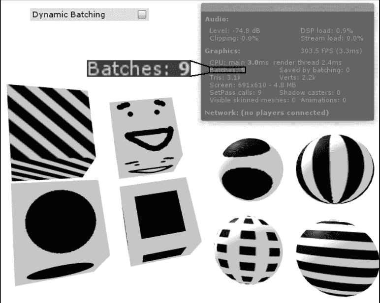
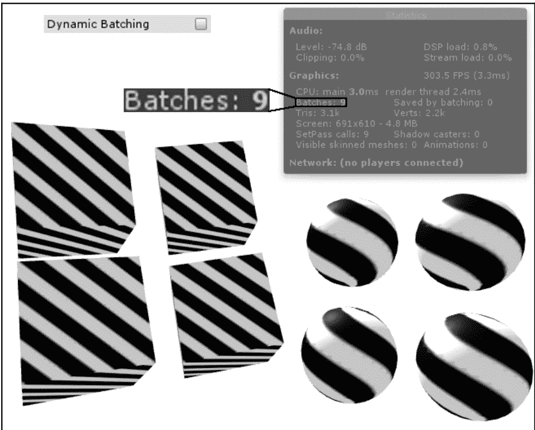
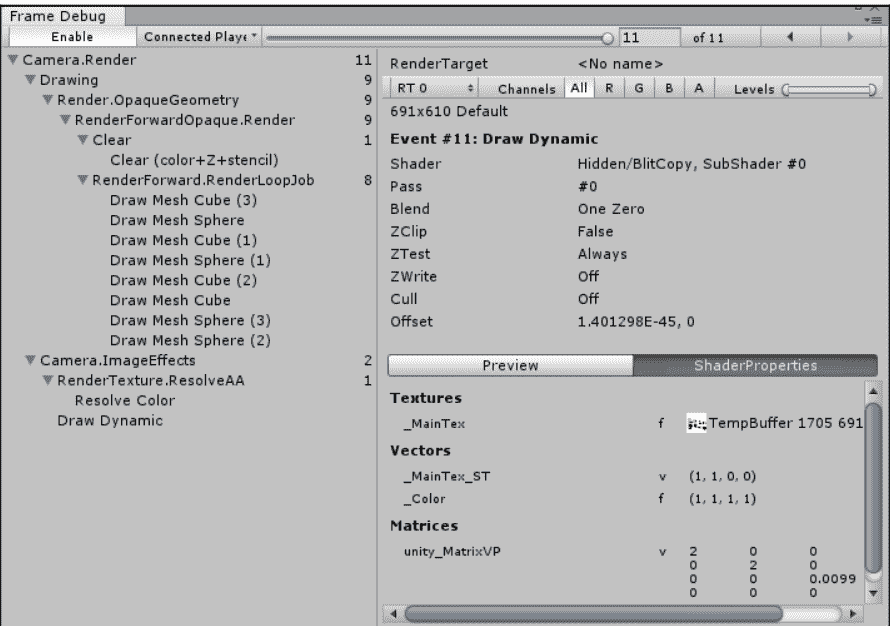
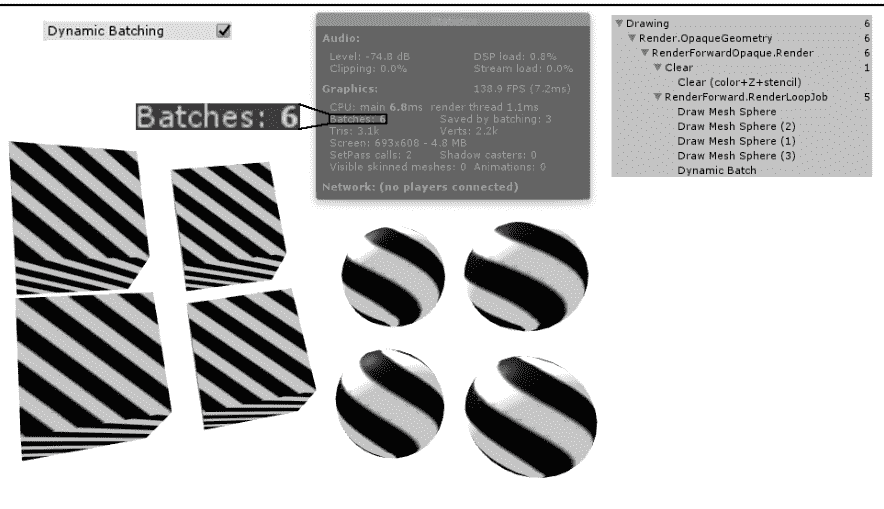

## 3 批处理的优势

在 3D 图形和游戏中，批处理是一个非常通用的术语，描述的是将大量零散的数据片段组合在一起并将其作为单个大数据块进行处理的过程。这种情况对 CPU（尤其是 GPU）非常理想，因为它们可以利用多个核心同时处理多个任务。单个核心在内存中不同位置之间来回切换需要时间，因此这种情况越少越好。

在某些情况下，批处理指的是用于表示 3D 对象的大量网格、顶点、边缘、UV 坐标和其他不同数据类型的集合。但是，该术语也同样可以指批处理音频文件、精灵、纹理文件和其他大型数据集的行为。

因此，为了消除任何混淆，当在 Unity 中提到批处理主题时，它通常是指 Unity 提供的用于批处理网格数据的两种主要机制：动态批处理和静态批处理。这些方法本质上是两种不同的几何合并形式，我们将多个对象的网格数据合并在一起，并在单个指令中渲染它们，而不是分别准备和绘制每个对象。

将多个网格批处理为单个网格的过程是可能的，因为网格对象没有理由必须占据 3D 空间中的连续体积。渲染管线完全乐于接受一组未通过边缘相互连接的顶点，因此我们可以将多个可能导致多个渲染指令的独立网格合并为一个网格，从而使用单个指令将其渲染出来。

多年来，关于动态批处理（Dynamic Batching）和静态批处理（Static Batching）系统在什么条件下激活，以及在哪些情况下可能会看到性能提升，一直存在诸多困惑。毕竟，在某些情况下，如果批处理使用不当，实际上可能会降低性能。正确理解这些系统将为我们提供所需的知识，以显著提升应用程序的图形性能。

本章旨在消除关于这些系统的大量错误信息。我们将通过解释、探索和示例，观察这两种批处理方法是如何运作的。这将使我们能够做出明智的决策，利用其中大部分来改善应用程序的性能。

本章将涵盖以下主题：

- 渲染管线（Rendering Pipeline）和绘制调用（Draw Calls）概念的简要介绍
- Unity 的材质（Materials）和着色器（Shaders）如何协同工作以渲染我们的对象
- 使用帧调试器（Frame Debugger）可视化渲染行为
- 动态批处理（Dynamic Batching）的工作原理及其优化方法
- 静态批处理（Static Batching）的工作原理及其优化方法

# 绘制调用（Draw Calls）

在独立讨论动态批处理和静态批处理之前，让我们先了解它们在渲染管线中都试图解决的问题。我们将尽量保持技术细节较为浅显，因为我们将在第 6 章《动态图形》（Dynamic Graphics）中更详细地探讨这个主题。

这些批处理方法的主要目标是减少渲染当前视图中所有对象所需的绘制调用数量。在最基本的形式下，绘制调用是从 CPU 发送到 GPU 的请求，要求其绘制一个对象。

> 绘制调用是该过程的常见行业术语，尽管在 Unity 中有时也被称为 SetPass 调用，因为某些底层方法是如此命名的。可以将其视为在启动当前渲染通道之前配置选项。在本书的其余部分，我们将称其为绘制调用。

# 批处理的好处

在请求绘制调用之前，需要完成几项任务。首先，网格和纹理数据必须从 CPU 内存（RAM）推送到 GPU 内存（VRAM），这通常发生在场景初始化期间，但仅适用于场景文件已知的纹理和网格。如果我们在运行时使用尚未出现在场景中的纹理和网格数据动态实例化对象，则必须在实例化时加载它们。场景无法预先知道我们计划在运行时实例化哪些预制体，因为许多预制体隐藏在条件语句背后，且应用程序的许多行为取决于用户输入。接下来，CPU 必须通过配置处理绘制调用目标对象所需的选项和渲染功能来准备 GPU。

CPU 和 GPU 之间的这些通信任务通过底层图形 API 进行，该 API 可能是 DirectX、OpenGL、OpenGLES、Metal、WebGL 或 Vulkan，具体取决于我们针对的平台和某些图形设置。这些 API 调用通过一个称为驱动程序的库进行，该库维护着一长串复杂且相互关联的设置、状态变量和数据集，这些可以从我们的应用程序中配置和执行（尽管驱动程序设计为同时服务于多个应用程序，以及来自多个线程的渲染调用）。可用功能根据我们使用的显卡和针对的图形 API 版本而发生巨大变化；更先进的显卡支持更先进的功能，这些功能需要由较新版本的 API 支持，因此需要更新的驱动程序来启用它们。多年来创建的设置、支持的功能以及一个版本与另一个版本之间的兼容性数量之多（特别是对于较旧的 API，如 DirectX 和 OpenGL），简直令人难以置信。幸运的是，在一定的抽象级别上，所有这些 API 都倾向于以类似的方式运行；因此 Unity 能够通过一个共同接口支持许多不同的图形 API。

在渲染对象之前准备渲染管线所必须配置的这组极其庞大的设置，通常被浓缩为一个称为渲染状态（Render State）的单一术语。在更改这些渲染状态选项之前，GPU 将对所有传入对象保持相同的渲染状态，并以类似的方式渲染它们。

更改渲染状态可能是一个耗时的过程。例如，如果我们将渲染状态设置为使用蓝色纹理文件，然后要求它渲染一个巨大的网格，那么它将被非常快速地渲染，整个网格都呈现蓝色。然后我们可以渲染另外 9 个完全不同的网格，它们都将被渲染为蓝色，因为我们没有更改正在使用的纹理。但是，如果我们想要使用 10 个不同的纹理渲染 10 个网格，那么这将花费更长时间。这是因为我们需要在为每个网格发送绘制调用指令之前，使用新纹理准备渲染状态。

用于渲染当前对象的纹理在图形 API 中实际上是一个全局变量，在并行系统中更改全局变量说起来容易做起来难。在像 GPU 这样大规模并行的系统中，我们必须有效地等待所有当前作业都到达同一个同步点（换句话说，最快的核心需要停止并等待最慢的核心赶上，浪费了他们本可用于其他任务的处理时间），然后才能进行渲染状态更改，此时我们需要重新启动所有并行作业。这可能会浪费大量时间，因此我们越少要求渲染状态更改，图形 API 处理我们请求的速度就越快。

可能触发渲染状态同步的事物包括——但不限于——立即将新纹理推送到 GPU 以及更改着色器、光照信息、阴影、透明度以及我们能想到的几乎任何图形设置。

一旦渲染状态配置完成，CPU 必须决定绘制哪个网格，应该使用哪些纹理和着色器，以及根据对象的位置、旋转和缩放（均表示为一个称为变换的 4x4 矩阵，Transform 组件由此得名）在哪里绘制对象，然后向 GPU 发送绘制指令。为了保持 CPU 和 GPU 之间通信的高度动态性，新指令被推送到一个称为命令缓冲区（Command Buffer）的队列中。此队列包含 CPU 创建的指令，GPU 在完成前一条指令后每次从中拉取。

批处理改进此过程性能的诀窍在于，新的绘制调用不一定意味着必须配置新的渲染状态。如果两个对象共享完全相同的渲染状态信息，那么 GPU 可以立即开始渲染新对象，因为在上一个对象完成后，相同的渲染状态仍然保持。这消除了由于渲染状态同步而浪费的时间。它还减少了需要推送到命令缓冲区的指令数量，从而减轻了 CPU 和 GPU 的工作负载。

# 材质和着色器

Unity 中的渲染状态本质上通过材质向我们公开。材质是围绕着色器的容器，着色器是定义 GPU 应如何渲染传入顶点和纹理数据的短程序。着色器本身并不具备完成任何有价值工作所需的状态知识。着色器需要漫反射纹理、法线贴图和光照信息等输入，并有效地规定为了渲染传入数据需要设置哪些渲染状态变量。

> 着色器之所以这样命名，是因为多年前其实现最初仅用于处理对象的光照和着色（应用阴影，原本没有阴影）。自那时以来，其目的已大大扩展，现在它们具有更通用的目的，即作为访问多种不同并行任务的编程访问点，但旧名称仍然保留。

每个着色器都需要一个材质，每个材质必须有一个着色器。即使是未分配材质的新导入网格引入场景中，也会自动分配一个默认（隐藏）材质，这为它们提供了一个基本的漫反射着色器和白色着色。因此，无法摆脱这种关系。

> 请注意，单个材质只能支持一个着色器。在同一网格上使用多个着色器需要为同一网格的不同部分分配单独的材质。

因此，如果我们想要尽量减少渲染状态更改的频率，可以通过减少场景中使用的材质数量来实现。这将同时带来两项性能改进；CPU 每帧花费更少的时间生成和传输指令到 GPU，GPU 不需要频繁地停止并重新同步状态更改。

让我们从一个简单的场景开始，以可视化材质和批处理的行为。但是，在开始之前，我们应该禁用一些渲染选项，因为它们会增加一些额外的绘制调用，这可能会分散注意力：

1. 导航到 **Edit | Project Settings | Quality** 并将 **Shadows** 设置为 **Disable Shadows**（或选择默认的 **Fastest** 质量级别）
2. 导航到 **Edit | Project Settings | Player**，打开 **Other Settings** 选项卡，如果启用了 **Static Batching** 和 **Dynamic Batching**，则将其禁用

接下来，我们将创建一个场景，其中包含一个方向光、四个立方体和四个球体，每个对象都有其独特的材质、位置、旋转和缩放：

在上述截图中，在 **Game** 窗口的 **Stats** 弹出窗口的 **Batching** 值中，我们可以看到总共有 9 个批次。这个值密切代表了用于渲染场景的绘制调用数量。当前视图将消耗其中一个批次来渲染场景的背景，该背景可以设置为 **Skybox** 或 **Solid Color**。这由相机对象的 **Clear Flags** 设置决定。

剩余的 8 个批次用于绘制我们的 8 个对象。在每种情况下，绘制调用涉及使用材质的属性准备渲染管线，并要求 GPU 在当前变换下渲染给定的网格。我们已确保每个材质都是唯一的，为此给每个材质分配了一个唯一的纹理文件进行渲染。因此，每个网格都需要不同的渲染状态，因此，我们的 8 个网格中的每一个都需要一个唯一的绘制调用。

如前所述，我们可以通过减少导致系统更改渲染状态信息的频率，从理论上将绘制调用的数量最小化。因此，目标的一部分是减少我们使用的材质数量。但是，如果我们将所有对象都设置为使用相同的材质，我们仍然看不到任何好处，批次数量仍保持在 9：

这是因为我们并没有实际减少渲染状态更改的数量，也没有有效地对网格信息进行分组。不幸的是，渲染管线不够智能，无法意识到我们正在覆盖完全相同的渲染状态值，然后一遍又一遍地要求它渲染相同的网格。

# 帧调试器

在深入了解批次如何帮助我们节省绘制调用之前，让我们先探索一个有用的工具，它可以帮助我们确定批次如何影响我们的场景——帧调试器。

我们可以通过从主窗口选择 **Window | Frame Debugger**，或者单击 Profiler 渲染区域的 **Breakdown View Options** 中的 **Frame Debugger** 按钮来打开帧调试器。这两种方法都将打开 **Frame Debug** 窗口。

单击 **Frame Debug** 窗口中的 **Enable** 按钮将允许我们观察场景是如何构建的，一次一个绘制调用。以下截图显示了帧调试器的用户界面，左侧面板中有一组 GPU 指令列表，右侧面板中有更详细的信息：

这个窗口中有大量信息，如果我们想要调试单个绘制调用的行为，这些信息可以提供有用的信息，但最有用的区域是左侧面板中的 **Drawing** 部分，它列出了场景中所有的绘制调用。

此部分下的每个项目都代表一个唯一的绘制调用及其渲染的内容。这个工具一个非常有用的功能是能够单击其中任何一个项目，并立即在 **Game** 窗口中观察渲染场景直到该点所需的绘制调用。这让我们可以对两个连续的绘制调用进行快速的可视 _diff_。这可以轻松地确定哪个对象（或哪些对象）是由给定的绘制调用渲染的。这可以帮助确定一组对象是否被批次处理在一起，方法是查看在该绘制调用期间出现了多少个对象。

> 帧调试器的一个奇怪 bug（在 Unity 2017 的早期构建中仍然存在）是，如果我们正在观察使用天空盒的场景，并单击 **Drawing** 部分下的各个项目，则只能在 **Game** 窗口中观察到最终的场景呈现。我们需要暂时通过相机的 **Clear Flags** 设置禁用天空盒，将其设置为 **Solid Color**，以查看绘制调用进度如何在 **Game** 窗口中显示。

正如我们在前面的帧调试器截图中看到的，一个绘制调用被用于清除屏幕（标记为 **Clear** 的项目），然后我们的 8 个网格正在 8 个单独的绘制调用中渲染（标记为 `RenderForward.RenderLoopJob` 的项目）。

> 请注意，左侧面板中每个项目旁边的数字实际上代表一个图形 API 调用，绘制调用只是其中一种 API 调用类型。这些可以在 `Camera.Render`、`Camera.ImageEffects` 和 `RenderTexture.ResolveAA` 项目中看到。任何 API 调用都可能和绘制调用一样昂贵，但在复杂场景中，我们将进行的绝大多数 API 调用都以绘制调用的形式出现，因此通常最好先专注于最小化绘制调用，然后再担心后处理效果等内容的 API 通信开销。

# 动态批次

动态批次具有以下三个重要特性：

- 批次在运行时生成（批次是动态生成的）
- 包含在批次中的对象可以从一帧到下一帧发生变化，具体取决于哪些网格当前对 **Main Camera** 视图可见（批次内容是动态的）
- 即使可以在场景中移动的对象也可以被批次处理（它适用于动态对象）

因此，这些属性使我们得出了动态批次的名称。

如果我们返回 **Player Settings** 页面并启用 **Dynamic Batching**，我们应该看到批次数量从 9 下降到 6。动态批次会自动识别我们的对象共享材质和网格信息，因此将其中一些组合成一个更大的批次进行处理。我们还应该在帧调试器中看到不同的项目列表，证明网格现在正在被动态批次处理。

从帧调试器可以看到，我们的四个立方体已被合并为一个名为 **Dynamic Batch** 的绘制调用，但我们的四个球体仍然使用四个单独的绘制调用进行渲染。这是因为四个球体不符合动态批次的要求。尽管它们都使用相同的材质，但我们必须满足更多要求。

成功动态批次处理网格所需的要求列表可以在 Unity 文档中找到，网址为 http://docs.unity3d.com/Manual/DrawCallBatching.html。

> 在本书出版时，上述页面有些过时，更好的详细说明可以在这篇博客文章中找到：https://blogs.unity3d.com/2017/04/03/how-to-see-why-your-draw-calls-are-not-batched-in-5-6/。

以下列表涵盖了为给定网格启用动态批次所需的要求：

- 所有网格实例必须使用相同的材质引用
- 只有 `ParticleSystem` 和 `MeshRenderer` 组件会被动态批次处理。`SkinnedMeshRenderer` 组件（用于动画角色）和所有其他可渲染组件类型不能被批次处理
- 每个网格的顶点数限制为 300 个
- 着色器使用的顶点属性总数不得超过 900 个
- 要么所有网格实例都应使用统一缩放，要么所有网格都应使用非统一缩放，但不能两者混合
- 网格实例应引用相同的光照贴图文件
- 材质的着色器不应依赖于多个通道
- 网格实例不得接收实时阴影
- 整个批次中网格索引的总数有一个上限，该上限因所使用的图形 API 和平台而异，大约为 32k-64k 个索引（有关具体信息，请查看文档/上述博客文章）

需要注意的是 _材质引用_ 这个术语，因为如果我们碰巧使用两个设置相同的不同材质，渲染管线不够智能，无法意识到这一点，它们将被视为不同的材质，因此将被取消动态批次处理资格。其余大多数要求已经解释过了；但是，其中一些要求从描述中并不完全直观或清晰，值得进一步解释。

# 顶点属性

顶点属性仅仅是网格文件中按顶点存储的一段信息，每个属性通常由多个浮点数值组成。这包括但不限于顶点位置（相对于网格根点）、法线向量（指向物体表面外侧的向量，最常用于光照计算）、一组或多组纹理 UV 坐标（用于定义一张或多张纹理如何包裹网格），甚至可能包含每顶点颜色信息（通常用于自定义光照或平面着色低多边形风格物体）。只有 Shader 使用的顶点属性总数少于 900 的网格才能包含在动态批处理中。

请注意，查看网格的原始数据文件可能包含的顶点属性信息少于 Unity 加载到内存中的信息，这是因为引擎将网格数据从多种原始数据格式之一转换为内部格式的方式。因此，不要假设我们的 3D 建模工具告诉我们的网格使用的属性数量就是最终数量。验证属性数量的最佳方法是在 **Project** 窗口中深入网格对象，直到找到 `MeshFilter` 组件，并查看 **Inspector** 窗口 **Preview** 子部分中出现的 **verts** 值。

在伴随 Shader 中每顶点使用更多属性数据将消耗我们 900 个属性的预算，从而减少网格在无法再用于动态批处理之前允许拥有的顶点数量。例如，一个简单的漫反射 Shader 可能每顶点只使用 3 个属性：位置、法线和一组 UV 坐标。因此，动态批处理将能够支持使用此 Shader 的网格，其合计顶点总数为 300 个。然而，一个更复杂的 Shader，每顶点需要 5 个属性，只能支持使用不超过 180 个顶点的网格进行动态批处理。另外，请注意，即使我们在 Shader 中每顶点使用少于 3 个顶点属性，动态批处理仍然只支持最多 300 个顶点的网格，因此只有相对简单的对象才是动态批处理的候选对象。

这就是为什么我们的场景在启用动态批处理后仅节省 3 个 Draw Call 的原因，尽管所有对象共享相同的 Material 引用。Unity 自动生成的立方体网格仅包含 8 个顶点，每个顶点都有位置、法线和 UV 数据，总共 24 个属性。这远低于 300 个顶点的限制和 900 个顶点属性的限制。然而，自动生成的球体网格包含 515 个顶点，因此总共有 1,545 个顶点属性。这些网格明显超过了 300 个顶点和 900 个顶点属性的限制，因此无法进行动态批处理。

如果我们在帧调试器中点击其中一个 Draw Call 项，将出现一个标记为“Why this draw call can't be batched with the previous one”的部分。大多数情况下，下方的说明文本会告诉我们哪个要求未满足（以及/或至少它检测到的第一个），这对于调试批处理行为可能很有用。

请注意，在 Unity 2017 的早期构建中，出现的说明文本目前有点 buggy，有时实际原因会在点击 DynamicBatch 项时出现。例如，在前面的场景示例中，Draw Mesh Sphere (3) 给出的解释是“The material doesn't have GPU instancing enabled”，这有点令人困惑。然而，查看 DynamicBatch 项给出了真正的原因，即“a submesh we are trying to dynamic-batch has more than 300 vertices”。

# 网格缩放

文档建议，对象应共享统一缩放，或者每个对象应具有唯一的非统一缩放，才能包含在动态批处理中。统一缩放意味着缩放向量的三个分量（x、y 和 z）彼此相同（但不一定跨网格相同），而非统一缩放意味着这些值中至少有一个与其他值不同，且属于这两组的网格将被放置在两个不同的批次中。

让我们通过一个示例来解释这一点。假设我们有以下四个对象：A 缩放为 (1, 1, 1)，B 缩放为 (2, 1, 1)，C 缩放为 (2, 2, 1)，D 缩放为 (2, 2, 2)。对象 A 和 D 具有统一缩放，因为所有三个分量都有相同的值。尽管两个网格的缩放不完全相同，但它们的缩放仍然被视为统一，因此它们将被放置在同一个动态批次中。与此同时，B 和 C 都具有非统一缩放，因为至少有一个分量与其他分量不同。它们的缩放差异很大（C 在 y 轴上的缩放是 B 的两倍），但它们仍然都被视为非统一，因此它们将被合并在一个单独的批次中。

但是，请注意，使用负缩放对动态批处理有奇怪的影响。负缩放通常是镜像场景中网格的快速方法，可以避免为仅在一个轴上翻转的对象创建和导入完全不同的网格。这种技巧通常用于一对门，或者只是为了让场景看起来更加多样化。但是，如果我们仅在一条或三条轴上对网格进行负缩放，那么它将被放置在与在零条或两条轴上负缩放的网格不同的动态批次中。三个值（x、y 或 z）中哪些为负并不重要，只看负值的总数是奇数还是偶数。

# 动态批处理总结

当我们想要渲染非常大量的简单网格时，动态批处理是一个非常有用的工具。该系统的设计使其非常适合在我们使用大量外观几乎相同的简单网格时使用。可能应用动态批处理的情况如下：

- 一片充满岩石、树木和灌木的大森林
- 一座建筑、工厂或空间站，包含许多简单的常见元素（计算机、走廊部件、管道等）
- 一款包含许多动态、非动画对象的游戏，具有简单的几何体和粒子效果（例如《几何战争》这样的游戏）

这种批次拆分行为的另一个奇怪副产品是，对象的渲染顺序可以决定哪些对象被批处理在一起。如果前一个对象会出现在与当前对象不同的批次组中，那么它们无法被批处理。这最好通过以下示例来解释。假设我们有四个对象：V 缩放为 (1, 1, 1)，W 缩放为 (-1, 1, 1)，X 缩放为 (-1, -1, 1)，Y 缩放为 (-1, -1, -1)，最后 Z 缩放与 V 相同，为 (1, 1, 1)。对象 V 和 Z 共享常见的统一缩放，因此我们可能期望它们被批处理在一起。但是，如果所有这些对象按上述顺序渲染到场景中，那么对象 V 将被渲染，Unity 将测试对象 W 和 V 是否可以共享一个批次。它们不能，因为对象 W 的奇数负缩放，因此不进行批处理。Unity 然后将对象 X 与对象 W 进行比较，检查它们是否可以被批处理，它们不能，因为 W 具有奇数负缩放而 X 具有偶数负缩放。接下来的 W-Y 和 Y-Z 之间的比较出于同样的原因失败。最终结果是，所有五个对象都将使用五个单独的 Draw Call 进行渲染，并且没有机会将对象 V 和 Z 合并。请注意，这种奇怪的效果仅在使用负缩放时才会出现。如果所有缩放差异都是统一与非统一，那么 Unity 应该能够适当地批处理对象。

推测，这全都是用于检测有效可批处理组的算法的副产品，因为在两个维度上镜像网格在数学上等同于绕相同轴旋转网格 180 度，而在一条或三条轴上镜像网格没有旋转等效物。因此，我们观察到的行为可能只是动态批处理系统自动为我们转换对象，尽管这并不完全清楚。无论如何，希望这能让我们为在生成动态批次时可能遇到的许多奇怪情况做好准备。

# 静态批处理

Unity 通过静态批处理（Static Batching）提供了第二种批处理机制。该批处理功能与动态批处理（Dynamic Batching）在几个方面相似，例如，哪些对象被批处理是在运行时根据相机可见内容来确定的，并且这些批处理的内容会随帧而变化。但是，有一个非常重要的区别：它仅适用于标记为 **Static** 的对象，因此得名 _Static Batching_。

静态批处理系统有自己的一组要求：

- 顾名思义，网格必须被标记为 **Static**（具体来说，是 **Batching Static**）
- 必须为每个被静态批处理的网格预留额外内存
- 静态批处理中可合并的顶点数量有上限，该上限因图形 API 和平台而异，大约为 32k-64k 个顶点（具体请参阅文档/上述博客文章）
- 网格实例可以来自任何源网格，但它们必须共享相同的 Material 引用

让我们详细介绍其中一些要求。

## Static 标志

静态批处理只能应用于启用了 **static** 标志的对象，或者更具体地说，是 **Batching Static** 子标志（这些子标志称为 **StaticEditorFlags**）。单击 `GameObject` 的 **Static** 选项旁边的小向下箭头，将显示 **StaticEditorFlags** 的下拉菜单，这些标志可以更改对象在各种 **Static** 过程中的行为。

这有一个明显的副作用，即对象的变换（transform）无法更改，因此，任何希望使用静态批处理的对象都不能以任何方式移动、旋转或缩放。

## 内存要求

静态批处理的额外内存要求会有所不同，具体取决于批处理网格中发生的复制量。静态批处理的工作原理是将所有标记且可见的网格的数据复制到一个单一的大型网格数据缓冲区中，并通过单个 Draw Call 将其传递到渲染管道，同时忽略原始网格。如果所有被静态批处理的网格都是唯一的，那么与正常渲染对象相比，这不会增加我们的内存使用量，因为存储网格所需的内存空间是相同的。

但是，由于数据实际上被复制了，这些静态批处理的副本会使我们额外消耗内存，其大小等于网格数量乘以原始网格的大小。通常情况下，渲染一个、十个或一百万个相同对象的克隆体所需的内存量是相同的，因为它们都引用相同的网格数据。在这种情况下，对象之间的唯一区别是每个对象的变换。但是，由于静态批处理需要将数据复制到大缓冲区中，这种引用关系就丢失了，因为原始网格的每个副本都被复制到缓冲区中，并带有硬编码到顶点位置中的唯一数据和变换。

因此，使用静态批处理渲染 1,000 个相同的树对象，将比不使用静态批处理渲染相同的树多消耗 1,000 倍的内存。如果静态批处理使用不当，这会导致严重的内存消耗和性能问题。

## Material 引用

我们已经知道，共享 Material 引用是减少渲染状态更改的一种手段，因此这一要求相当明显。此外，有时我们会静态批处理需要多个 Material 的网格。在这种情况下，所有使用不同 Material 的网格将被分组到它们自己的静态批处理中，并且对于每个使用的唯一 Material 也是如此。

这一要求的缺点是，最好的情况下，静态批处理只能使用等于所需 Material 数量的 Draw Call 来渲染所有静态网格。

## 静态批处理的注意事项

静态批处理系统有一些额外的缺点。由于其批处理解决方案的工作方式，即将网格合并为单个更大的网格，静态批处理系统有一些我们需要注意的注意事项。这些问题从小不便到重大缺点不等，具体取决于场景：

- Draw Call 节省效果在 **Stats** 窗口中不会立即显示，直到运行时
- 在运行时引入场景中标记为 **Batching Static** 的对象不会自动包含在静态批处理中

让我们更详细地探讨这些问题。

## 静态批处理的编辑模式调试

尝试确定静态批处理对场景的整体影响可能有点棘手，因为在 **Edit Mode** 中没有任何内容被静态批处理。所有的魔法都发生在运行时，这使得在没有手动测试的情况下很难确定静态批处理能提供哪些好处。我们应该使用帧调试器（Frame Debugger）来验证我们的静态批处理是否正确生成，以及它们是否包含预期的对象。

如果我们将此功能的实现留到项目生命周期的后期，这可能会特别成问题，因为我们可能会花费大量时间启动、调整和重新启动场景，以确保我们获得预期的 Draw Call 节省。因此，最好在构建新场景的早期就开始进行静态批处理优化。

不用说，静态批处理的创建工作并非完全轻而易举，如果有许多批处理需要创建和/或有许多大对象需要批处理，它还可能大大增加场景初始化时间。

## 在运行时实例化静态网格

我们在运行时添加到场景中的任何新对象都不会被静态批处理系统自动合并到任何现有批处理中，即使它们被标记为 **Batching Static**。这样做会在重新计算网格和与渲染管道同步之间造成巨大的运行时开销，因此 Unity 甚至不会尝试自动执行此操作。

# Static Batching 总结

Static Batching 是一种强大但危险的工具。如果我们不明智地使用它，很容易通过内存消耗（可能导致应用程序崩溃）和渲染成本给我们的应用程序带来巨大的性能损失。它还需要大量的手动调整和配置，以确保批次被正确生成，并且我们不会意外地引入使用各种 **Static** 标志的任何非预期副作用。但是，它确实有一个显著的优势，即它可以用于不同形状和巨大尺寸的网格，而这是 Dynamic Batching 无法提供的。

在大多数情况下，我们应该尝试将任何希望进行静态批处理的网格保留在原始场景文件中。但是，如果需要动态实例化，或者我们正在使用加法场景加载，那么我们可以使用 `StaticBatchUtility.Combine()` 方法来控制静态批处理资格。此实用程序方法有两个重载：要么我们提供一个根 `GameObject`，在这种情况下，所有带有网格的子 `GameObject` 都将被转换为新的静态批处理组（如果它们共享多个材质，可能会创建多个组），要么我们提供一个 `GameObject` 列表和一个根 `GameObject`，它会自动将它们作为子项附加到根上，并以同样的方式生成新的静态批处理组。

我们应该对该函数的使用进行性能分析，因为如果有许多顶点需要合并，这可能是一项相当昂贵的操作。它还不会将给定的网格与任何预先存在的静态批处理组合并，即使它们共享相同的材质。因此，我们将无法通过实例化或加法加载与场景中已存在的其他静态批处理组使用相同材质的 **Static** 网格来节省 Draw Calls（它只能与在 `Combine()` 调用中分组的网格合并）。

请注意，如果我们使用 `StaticBatchUtility.Combine()` 方法批处理的任何 `GameObject` 在批处理之前未标记为 **Static**，则这些 `GameObject` 将保持非 **Static** 状态，但网格本身将是 **Static**。这意味着我们可能会意外移动 `GameObject`、其 `Collider` 组件以及任何其他重要对象，但网格将保持在同一位置。要小心不要在静态批处理对象中意外混合 **Static** 和非 **Static** 状态。

# 总结

很明显，Dynamic Batching 和 Static Batching 系统并非万能药。我们不能盲目地将它们应用于任何给定的场景并期望有所改善。如果我们的应用程序和场景恰好符合一组特定的参数，那么这些方法在减少 CPU 负载和渲染瓶颈方面非常有效。但是，如果不符合，则需要一些额外的工作来准备我们的场景以满足批处理功能要求。最终，只有对这些批处理系统及其工作原理有良好的理解，才能帮助我们确定在何处以及何时可以应用此功能，希望本章为我们提供了做出明智决策所需的所有信息。

您将在 `Chapter 6, Dynamic Graphics` 中了解更多关于渲染管道和性能改进技术的内容。在此之前，让我们转到另一个主题，探讨一些我们可以通过以智能方式管理艺术资产来实现的更微妙的性能改进。
