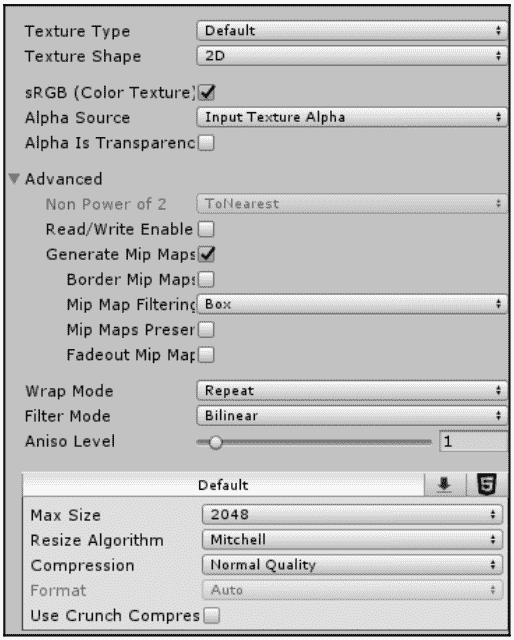

# 4 启动您的艺术资产

艺术是一个非常主观的领域，由个人意见和偏好主导。很难说一件艺术品是否以及为什么比另一件更好，而且我们很可能无法在意见上达成完全一致。支持游戏艺术性的艺术资产背后的技术方面也可能非常主观。有多种变通方法可以实施以提高性能，但这些方法往往会以牺牲质量为代价来换取速度。如果我们试图达到峰值性能，那么每当我们决定对艺术资产进行任何更改时，咨询团队成员非常重要，因为这主要是一个平衡行为，本身也可以是一种艺术形式。

无论我们是试图最小化运行时内存占用、保持尽可能小的可执行文件大小、最大化加载速度，还是保持帧率的一致性，都有很多选项可以探索。有些方法显然总是理想的，但大多数方法在采用之前需要多加小心和预先考虑，因为它们会导致质量降低或增加在其他子系统中出现瓶颈的可能性。

在本章中，我们将探讨如何为以下资产类型提高性能：

- 音频文件
- 贴图文件
- 网格和动画文件
- 资源包和资源

在每种情况下，我们将调查 Unity 在应用程序构建时和运行时如何存储、加载和操作这些资产。我们还将检查在出现性能问题时的选项，以及我们可以做什么来避免可能生成性能瓶颈的行为。

# 音频

Unity 作为一个框架，可以用于构建从只需要少量音效和单个背景音轨的小型应用程序，到需要数百万行对话、音乐音轨和环境音效的大型角色扮演游戏的任何东西。无论应用程序的实际范围如何，音频文件通常是构建后应用程序大小（有时称为其“磁盘占用”）的主要贡献者之一。此外，许多开发人员惊讶地发现，运行时音频处理可能会成为 CPU 和内存消耗的重要来源。

音频在游戏行业的两个方面都常常被忽视；开发人员往往直到最后一刻才投入许多资源，而用户很少将注意力集中在音频上。当音频处理得当时，没人会注意到，但我们都知道糟糕的音频听起来是什么样子——它立即可辨识，令人不适，并注定会引起不必要的注意。这使得在性能的名义下不要牺牲太多音频清晰度变得至关重要。

音频瓶颈可能来自各种来源。过度压缩、过多的音频操作、过多的活动音频组件、低效的内存存储方法和访问速度，都是导致内存和 CPU 性能不佳的方式。但是，只要付出一点努力和理解，只需在此处和那里进行一些小调整，就能让我们免于用户体验灾难。

# 导入音频文件

当我们在 **Project** 窗口中选择导入的音频文件时，**Inspector** 窗口将显示多个导入设置。这些设置决定了从加载行为、压缩行为、质量、采样率，到（在较新版本的 Unity 中）是否支持全景声音（多声道音频，通过球谐波结合音轨以创建更真实的音频体验）的所有内容。

许多音频导入选项可以按平台配置，允许我们在不同目标平台之间自定义行为。


# 加载音频文件

以下是决定音频文件加载方式的三个设置：

- Preload Audio Data
- Load In Background
- Load Type

我们的音频文件最初被打包为与应用程序捆绑在一起的二进制数据文件，存储在设备的硬盘上（尽管在某些情况下，它们是从互联网上的某个位置下载的）。加载音频数据只是将其拉入主内存（RAM），以便稍后由音频解码器处理，然后将数据转换为发送到耳机或扬声器的音频信号。但是，加载的方式将根据前三个设置而有很大差异。第一个设置 Preload Audio Data 决定音频数据是否会在场景初始化期间自动加载，或在稍后加载。当加载音频数据发生时，第二个设置 Load In Background 决定此活动是阻塞主线程直到完成，还是在后台异步加载。最后，Load Type 设置定义拉入内存的数据类型以及一次拉入多少数据。如果不明智地使用，这三个设置都可能对性能产生极大的负面影响。

音频文件的典型用例是将其分配给 AudioSource 对象的 audioClip 属性，这将把它包装在 AudioClip 对象中。然后我们可以通过 AudioSource.Play() 或 AudioSource.PlayOneShot() 触发播放。以这种方式分配的每个音频剪辑都会在场景初始化期间加载到内存中，因为场景包含对这些文件的直接引用，必须在需要之前解析它们。当 Preload Audio Data 启用时，这是默认情况。

禁用 Preload Audio Data 告诉 Unity 引擎在场景初始化期间跳过音频文件资产加载，从而将加载活动推迟到首次需要时，即调用 Play() 或 PlayOneShot() 时。禁用此选项将加快场景初始化速度，但也意味着第一次播放文件时，CPU 需要立即访问磁盘、检索文件、将其加载到内存中、解压缩并播放它。这是一个同步操作，会阻塞主线程直到完成。我们可以通过一个简单的测试来证明这一点：

```csharp
public class PreloadAudioDataTest : MonoBehaviour {
[SerializeField] AudioSource _source;

void Update() {
if (Input.GetKeyDown(KeyCode.Space)) {
using (new CustomTimer("Time to play audio file", 1)) {

```


如果我们向场景中添加一个 AudioSource，为其分配一个较大的音频文件，并将其分配给 PreloadAudioDataTest 组件的 _source 字段，我们可以按下空格键，查看 Play() 函数完成所需时间的打印输出。针对一个 10 MB 的音频文件，在启用 Preload Audio Data 的情况下对这段代码进行简单测试，会发现该调用几乎是瞬间完成的。然而，禁用 Preload Audio Data，应用文件更改，并重复测试会发现，所需时间要长得多（在搭载 Intel i5 3570K 的台式机上大约为 700 毫秒）。这完全超出了单帧的时间预算，因此为了负责任地使用这个开关，我们需要将大部分音频资产提前加载到内存中。

这可以通过调用 AudioClip.LoadAudioData() 来实现（可以通过 AudioSource 组件的 clip 属性获取）。但是，这个操作仍然会阻塞主线程，阻塞的时间与之前示例中加载所需的时间相同，因此无论我们是否选择提前加载音频文件，加载音频文件仍然会导致帧率下降。数据也可以通过 AudioClip.UnloadAudioData() 卸载。

这时 Load In Background 选项就派上用场了。这个选项将音频加载变为异步任务；因此，加载不会阻塞主线程。启用此选项后，对 AudioClip.LoadAudioData() 的实际调用会立即完成，但请记住，文件在单独的线程上加载完成之前不会准备好播放。我们可以通过 AudioClip.loadState 属性来双重检查 AudioClip 组件的当前加载状态。如果启用了 Load In Background，并且在不先加载数据的情况下调用 AudioSource.Play()，Unity 仍然需要将文件加载到内存中才能播放，因此从调用 AudioSource.Play() 到音频文件实际开始播放之间会有延迟。如果我们尝试在音频文件完全加载之前访问它，这可能会导致突兀的行为，使其与其他任务（例如动画）不同步。

现代游戏通常会在关卡中实现方便的停止点，以执行加载或卸载音频数据等任务——例如楼层之间的电梯或长走廊，那里几乎没有什么动作发生。通过这些方法涉及音频数据自定义加载和卸载的解决方案，需要根据特定游戏量身定制，取决于何时需要音频文件、需要多长时间、场景是如何组装的，以及玩家如何穿越它们。

这可能需要大量的特殊情况更改、测试和资产管理调整。因此，建议将此方法保留为核选方案，仅在生产后期使用，以防所有其他技术都未能如我们所愿地成功。

最后，还有 Load Type 选项，它决定了音频数据加载时的方式。有三个选项可用：

- Decompress On Load
- Compressed in Memory
- Streaming

这三个选项的详细说明如下：

- Decompress On Load：此设置在磁盘上压缩文件以节省空间，并在首次加载时将其解压到内存中。这是加载音频文件的标准方法，应在大多数情况下使用。解压文件需要一些时间，这会在加载过程中带来额外的开销，但减少了播放音频文件时所需的工作量。
- Compressed In Memory：此设置仅将压缩文件从磁盘直接复制到内存中加载。它只会在运行时播放音频文件时才进行解压。这会在播放 Audio Clip 时牺牲运行时 CPU，但提高了加载速度，并在 Audio Clip 保持休眠状态时减少了运行时内存消耗。因此，此选项最适合用于非常大的且使用频率较高的音频文件，或者如果我们在内存消耗方面遇到严重瓶颈，并愿意牺牲一些 CPU 周期来播放 Audio Clip。
- Streaming：最后，此设置（也称为 Buffered）将在运行时实时加载、解码和播放文件，通过将文件逐步推送到一个小缓冲区中，一次只有一小部分文件存在于内存中。此方法对特定 Audio Clip 使用的内存最少，但运行时 CPU 占用最大。由于每次播放文件的实例都需要生成自己的缓冲区，因此此设置带来的不幸缺点是，多次引用 Audio Clip 会导致内存中存在多个相同 Audio Clip 的副本，所有副本都必须单独处理，如果使用不当会导致运行时 CPU 成本。因此，此选项最适合保留给单实例 Audio Clip，这些音频片段定期播放，并且永远不需要与自身的其他实例甚至其他流式 Audio Clip 重叠。例如，此设置最适合用于背景音乐和环境音效，这些音频需要在场景生命周期的大部分时间内播放。

那么，让我们总结一下。默认情况下，启用 **Preload Audio Data**，禁用 **Load In Background**，且 **Load Type** 为 **Decompress On Load**，会导致场景加载时间较长，但确保我们在场景中引用的每个 Audio Clip 在需要时都立即可用。当需要 Audio Clip 时，不会有加载延迟，并且在调用 `Play()` 时音频片段会立即播放。改善场景加载时间的一个好折衷方案是为我们稍后才需要的 Audio Clips 启用 **Load In Background**，但这不应该用于场景初始化后不久就需要的 Audio Clips。我们然后通过 `AudioClip.LoadAudioData()` 和 `AudioClip.UnloadAudioData()` 手动控制音频数据的加载时间。我们应该愿意在单个场景中使用所有这些方法，以达到最佳性能。

# Encoding formats and quality levels

Unity 支持三种通用的音频片段编码格式，这由查看 Audio Clip 属性时 **Inspector** 窗口中的 **Compression Format** 选项决定：

- **Compressed**（此选项的实际文本可能因平台而异）
- **PCM**
- **ADPCM**

我们导入到 Unity 引擎中的音频文件可以是许多流行的音频文件格式之一，例如 Ogg Vorbis、MPEG-3（MP3）和 Wave，但打包到可执行文件中的实际编码将被转换为不同的格式。

**Compressed** 设置使用的压缩算法将取决于目标平台。独立应用程序和其他非移动平台会将文件转换为 Ogg-Vorbis 格式，而移动平台使用 MP3。

有一些平台始终使用特定类型的压缩，例如 PS Vita 的 HEVAG、XBox One 的 XMA 和 WebGL 的 AAC。


在 **Inspector** 窗口中，为当前选定的格式提供统计信息，位于 **Compression Format** 选项之后的区域，以了解压缩节省了多少磁盘空间。请注意，第一个值显示原始文件大小，第二个值显示磁盘上的大小成本。音频文件加载后在运行时将消耗多少内存，将由所选压缩格式的效率决定。例如，Ogg Vorbis 压缩通常会解压缩到其压缩大小的约 10 倍，而 ADPCM 会解压缩到压缩大小的约四倍。

**Inspector** 窗口中为音频文件显示的成本节省仅适用于当前选定的平台和最近应用的设置。确保编辑器在 **File | Build Settings** 中切换到正确的平台，并在对设置进行更改后单击 **Apply**，以查看当前配置的实际成本节省（或成本膨胀）。这对于 WebGL 应用程序尤其重要，因为 AAC 格式通常会导致音频文件大小非常膨胀。

使用的编码/压缩格式会对音频文件在运行时的质量、文件大小和内存消耗产生巨大影响，而只有 **Compressed** 设置让我们能够在不影响文件采样率的情况下更改质量。与此同时，**PCM** 和 **ADPCM** 设置不提供这种奢侈，我们只能接受这些压缩格式决定的文件大小——除非我们愿意为了文件大小而降低音频质量，通过降低采样率来实现。

**PCM** 格式是一种无损且未压缩的音频格式，提供了对模拟音频的近似逼近。它以较大的文件大小换取更高的音频质量，最适合用于需要很高清晰度的非常短的音效，任何压缩都会扭曲体验。

与此同时，**ADPCM** 格式在大小和 CPU 消耗方面都比 **PCM** 高效得多，但压缩会产生相当多的噪声。如果将其保留用于充满混乱的短音效，例如爆炸、碰撞和撞击声，这种噪声可以被掩盖，因为我们可能不会注意到产生的任何伪影。


最后，**Compressed** 格式会生成体积较小的文件，其质量低于 **PCM**，但显著优于 **ADPCM**，代价是额外的运行时 CPU 占用。在大多数情况下应使用此格式。此选项允许我们自定义压缩算法的最终质量级别，以在质量和文件大小之间进行权衡。**Quality** 滑块的最佳实践是寻找尽可能小但用户无法察觉的质量级别。可能需要进行一些用户测试，以找到每个文件的 _sweet spot_。

> 请记住，运行时应用于文件的任何额外音频效果都不会在 _Edit Mode_ 下通过编辑器播放，因此任何更改都应通过应用程序在 _Play Mode_ 下进行完整测试。

# 音频性能增强

现在我们对音频文件格式、加载方法和压缩模式有了更好的了解，让我们探讨一些可以通过调整音频行为来提升性能的方法。

# 最小化活动音频源数量

由于每个正在播放的音频源都会消耗一定量的 CPU，因此可以通过禁用场景中冗余的音频源来节省 CPU 周期，这很合理。一种方法是限制同一个音频片段可以同时播放的实例数量。这涉及通过一个中介来发送音频播放请求，该中介控制我们的音频源，从而对同一个音频片段同时播放的实例数量设置上限。

Unity 资产商店中几乎每个音频管理资产都实现了某种音频节流功能（通常称为 _Audio Pooling_），而且有充分的理由；这是在尽量减少过多音频播放的同时以最低质量代价实现的最佳权衡。例如，同时播放 20 个脚步声和同时播放 10 个脚步声听起来差别不大，而且不太可能因为音量过大而分散注意力。出于这个原因，并且因为这些工具通常提供更多微妙的性能增强功能，建议使用现有解决方案而不是自己开发，因为需要考虑音频文件类型、立体声/3D 音频、分层、压缩、滤镜、跨平台能力、高效内存管理等方面的复杂性。

说到环境音效，它们仍然需要放置在场景中的特定位置，以利用对数音量效果，这能产生伪 3D 效果，因此音频池系统可能不是理想的解决方案。限制环境音效播放的最佳方法是减少音频源的总数。最佳方法是删除其中一些音频源，或者将它们减少为一个更大、更响亮的音频源。当然，这种方法会影响用户体验质量，因为声音会显得来自单一来源而不是多个来源，因此应谨慎使用。

# 为 3D 声音启用强制单声道

在立体声音频文件上启用强制单声道设置会将两个音频通道的数据混合到单个通道中，有效节省 50% 的文件总磁盘和内存空间占用。对于某些 2D 音效来说，启用此选项通常不是个好主意，因为立体声效果常用于创建特定的音频体验。但是，我们可以为某些 3D 位置音频片段启用此选项以节省大量空间，因为这两个通道实际上是相同的。这些音频源类型会让音频源与玩家之间的方向决定音频文件如何播放到左/右耳，在这种情况下播放立体声效果通常没有意义。如果不需要立体声效果，将 2D 声音（无论与音频源的距离/方向如何，都会以全音量播放到玩家耳朵中的声音）强制为单声道也可能有意义。

# 重采样到较低频率

将导入的音频文件重采样到较低频率会减小文件大小和运行时内存占用。可以通过将音频文件的 **Sample Rate Setting** 设置为 **Override Sample Rate** 来实现，此时可以通过 **Sample Rate** 选项配置采样率。某些文件需要高采样率才能听起来合理，例如高音调文件和大多数音乐文件。但是，在大多数情况下，较低的设置可以在没有明显质量下降的情况下减小文件大小。22,050 赫兹是涉及人声和古典音乐的音源的常见采样率。某些音效可能可以使用更低的频率值。但是，每个音效都会以独特的方式受到此设置的影响，因此在最终确定采样率决定之前，花些时间运行一些测试是明智的。

# 考虑所有压缩格式

如前所述，**Compressed**、**PCM** 和 **ADPCM** 压缩格式各有利弊。在适当的情况下，为不同文件使用不同的编码格式，可以在内存占用、磁盘占用、CPU 占用和音频质量之间做出一些权衡。我们应该愿意在同一个应用程序中使用所有这些格式，并制定一套适合我们使用的音频文件类型的系统，这样就不需要逐个文件处理。否则，我们需要进行大量测试，以确保每个文件的音频质量没有下降。

# 谨慎使用流式传输

**Streaming** 加载类型的优点是运行时内存成本低，因为分配了一个小缓冲区，文件像数据队列一样不断通过它。这看起来很有吸引力，但从磁盘流式传输文件应仅限于大型单实例文件，因为它需要运行时硬盘访问；这是我们可用的最慢的数据访问形式之一（仅次于通过网络拉取文件）。分层或过渡的音乐片段使用 **Streaming** 选项可能会遇到严重卡顿，此时明智的做法是考虑使用不同的 **Load Type** 并手动控制加载/卸载。我们还应避免同时流式传输多个文件，因为这可能会在磁盘上造成大量缓存未命中，从而中断游戏。这就是为什么此选项主要用于背景音乐/环境音效，因为我们一次只需要一个。

# 通过混音器组应用滤镜效果以减少重复

滤镜效果可用于修改通过音频源播放的音效，并可以通过 `FilterEffect` 组件实现。每个单独的滤镜效果都会占用一定的内存和 CPU，并且可以是节省磁盘空间的好方法，同时在音频播放中保持大量多样性，因为一个文件可以通过不同的滤镜组进行调整，生成完全不同的音效。

由于额外的开销，在场景中过度使用滤镜效果可能会对性能造成严重后果。更好的方法是利用 Unity 的音频混音器实用程序（**Window | Audio Mixer**）生成常见的滤镜效果模板，多个音频源可以引用这些模板，以最大限度地减少内存开销。

关于音频混音器的官方教程详细介绍了该主题：

`https://unity3d.com/learn/tutorials/modules/beginner/5-pre-order-beta/ audiomixer-and-audiomixer-groups`

# 负责任地使用远程内容流式传输

可以通过 Unity 通过 Web 动态加载游戏内容，这可以是减少应用程序磁盘占用的有效手段，因为需要捆绑到可执行文件中的数据文件更少，并且还提供了一种通过 Web 服务来呈现动态内容的手段，以确定在运行时向用户呈现什么。资产流式传输可以通过 Unity 5 中的 `WWW` 类或 Unity 2017 中的 `UnityWebRequest` 类来实现。

`WWW` 类提供 `audioClip` 属性，用于访问 `AudioClip` 对象，如果它是通过 `WWW` 对象下载的音频文件。但是，请注意，访问此属性每次调用都会分配一个全新的 `AudioClip` 资源，其他 `WWW` 资源获取方法也是如此。一旦不再需要此资源，必须使用 `Resources.UnloadAsset()` 方法将其释放。

与托管资源不同，丢弃引用（将其设置为 `null`）不会自动释放资源，因此它将继续占用内存。因此，我们应该只通过 `audioClip` 属性获取一次 `AudioClip`，并且从那时起只使用该引用，并在不再需要时将其释放。

同时，在 Unity 2017 中，`WWW` 类已被 `UnityWebRequest` 类有效取代，后者使用新的 HLAPI 和 LLAPI 网络层。此类提供各种实用程序来下载和访问主要是文本文件。基于多媒体的请求应通过 `UnityWebRequestMultimedia` 辅助类进行。因此，如果请求 `AudioClip`，我们应该调用 `UnityWebRequestMultimedia.GetAudioClip()` 来创建请求，并在下载完成后调用 `DownloadHandlerAudioClip.GetContent()` 来检索它。


这个新版本的 API 旨在更高效地存储和提供我们请求的数据，因此通过 `DownloadHandlerAudioClip.GetContent()` 多次重新获取 `AudioClip` 不会导致额外的内存分配。相反，它将仅返回对最初下载的 `AudioClip` 的引用。

# 考虑音频模块文件用于背景音乐

音频模块文件，也称为 **Tracker Modules**，是节省大量空间且几乎无音质损失的绝佳方式。Unity 支持的文件扩展名为 `.it`、`.s3m`、`.xm` 和 `.mod`。与常见的音频格式不同，常见格式被读取为必须在运行时解码才能生成特定声音的比特流，而 Tracker Modules 包含大量小型高质量采样，并将整个音轨组织得类似于乐谱；定义每个采样应在何时、何地、以多大音量、以什么音调以及带有什么特殊效果播放。这可以在保持高质量采样的同时实现显著的体积节省。因此，如果我们有机会使用音乐文件的 Tracker Module 版本，那么值得探索。

# 纹理文件

在游戏开发中，_纹理_（texture）和 _精灵_（sprite）这两个术语经常被混淆，因此有必要加以区分——纹理只是一个图像文件，是一大串颜色数据，告诉解析程序图像中每个像素应该是什么颜色，而精灵是网格的 2D 等效物，通常只是一个单一的 _四边形_（quad，由两个三角形组合而成的矩形网格），平面渲染在当前相机上。还有称为 Sprite Sheets 的东西，它们是包含在较大纹理文件中的大量单独图像的集合，通常用于包含 2D 角色的动画。这些文件可以通过工具（例如 Unity 的 Sprite Atlas 工具）拆分，以形成角色动画帧的单独纹理。

网格和精灵都使用纹理将图像渲染到其表面。纹理图像文件通常在 Adobe Photoshop 或 Gimp 等工具中生成，然后以与音频文件非常相似的方式导入我们的项目。在运行时，这些文件被加载到内存中，推送到 GPU 的 VRAM，并在给定的 Draw Call 中由 Shader 在目标精灵或网格上进行渲染。

# 纹理压缩格式

与音频文件类似，Unity 将使用默认设置列表导入纹理文件，这些设置倾向于保持简单并在一般情况下工作正常，但有许多可用的导入设置，允许我们通过一些自定义调整来提高纹理的质量和性能。当然，如果我们在不完全理解内部运行的内部过程的情况下盲目进行更改，那么更改同样可能会降低质量和性能。

第一个选项是文件的 **Texture Type**。此设置将确定可用的其他选项，特别是在 **Advanced** 下拉菜单下。并非所有导入选项都适用于所有类型，因此最好根据纹理的预期用途配置此选项，无论它是设置为 **Normal Map**、**Sprite**、**Lightmap** 等等，因为这将揭示适用于该类型的选项：



与音频文件类似，我们可以以多种常见格式（例如 .jpg 和 .png）导入纹理文件，但构建到应用程序中的实际压缩格式可能是多种不同的纹理压缩格式之一，这些格式非常适合给定平台的 GPU。这些格式代表了组织纹理颜色信息的不同方式；这包括用于表示每个通道的位数不同（使用的位数越多，可以表示的颜色越多）、每通道的位数不同（例如，红色通道可能比绿色通道使用更多位）、所有通道使用的总位数不同（位数自然意味着更大的纹理和更多的磁盘和内存消耗）、是否包含 alpha 通道，以及也许最重要的是，将数据打包在一起的不同方式，这可以允许 GPU 进行高效的内存访问（或者如果选择了错误的打包类型，则会进行极其低效的访问！）。

更改压缩的简单方法是使用 **Compression** 纹理导入选项从以下选项中选择一个：

- None
- Low Quality
- Normal Quality
- High Quality

选择 **None** 表示不会应用压缩。在这种情况下，最终纹理仍然会从我们导入的文件类型更改格式，但它将选择不尝试压缩的格式，因此我们应该以大纹理文件为代价，看到很少或没有质量损失。其他三个设置将选择一个压缩格式，同样，这将取决于平台，Unity 将尝试选择与选项匹配的压缩格式。例如，选择 **Low Quality** 将意味着 Unity 选择一个大大减小纹理大小但会生成一些压缩伪影的压缩格式，而选择 **High Quality** 将消耗更多内存，具有更大的纹理大小和极少的伪影。同样，这是 Unity 自动做出的选择。

Unity 为每个平台为每个这些 **Compression** 设置选择的确切格式可以在 https://docs.unity3d.com/Manual/class-TextureImporterOverride.html 上找到。


# 纹理性能增强

让我们探讨我们可以对纹理文件做的一些更改，这些更改可能有助于提高性能，具体取决于情况以及我们导入的文件的内容。在每种情况下，我们将探讨需要做出的更改及其整体效果，无论这对内存或 CPU 产生积极还是消极的影响，纹理质量是提高还是降低，以及在什么条件下我们可以期望使用这些技术。

# 减小纹理文件大小

给定纹理文件越大，推送纹理时消耗的 GPU 内存带宽就越多。如果每秒推送的总内存超过显卡的总内存带宽，那么我们将遇到瓶颈，因为 GPU 必须等待所有纹理上传完毕，下一个渲染通道才能开始。较小的纹理自然比较大的纹理更容易通过管道推送，因此我们需要在高质量和性能之间找到一个良好的平衡点。

Unity 为每个平台选择的确切压缩格式可以被覆盖，尽管可用选项因平台而异，因为几乎每个平台都有自己最适合它的自定义格式。如果我们单击 **Default** 选项卡旁边的平台特定选项卡之一（就在 **Max Size** 选项上方），我们将暴露特定平台的设置，并可以选择希望 Unity 使用的确切压缩格式。

还有 **Crunch Compression** 设置，它将在 DXT 压缩格式之上应用额外的有损压缩级别。只有当其他压缩设置导致了 DXT 级别的压缩时，才会显示此选项。此设置可以节省更多空间，但代价是可能出现明显的压缩伪影，具体取决于 **Compressor Quality** 设置。

纹理的几个导入设置相当平凡，例如确定文件是否包含 alpha 通道、如何在纹理边缘处包裹纹理、过滤方法以及文件的最大可能分辨率（一个全局限制，以防止我们在某些平台上意外将纹理放大超过其原始大小）。然而，这些导入设置中还有几个其他有趣的选项，我们将在适当的其他部分中介绍。


一个简单的测试，以了解我们是否在内存带宽上遇到瓶颈，是减少游戏中最丰富和最大的纹理文件的分辨率并重新启动场景。如果帧率突然提高，那么该应用程序很可能受纹理吞吐量限制。如果帧率没有提高或提高很少，那么要么我们仍然有可用的内存带宽，要么渲染管道的其他地方存在瓶颈，阻止我们看到任何进一步的改进。

# 明智地使用 Mip Maps

如果玩家永远无法看到那些细节，那么用高细节纹理渲染小的远处物体（如岩石和树木）就没有意义了。当然，他们可能会看到一些轻微的改进，但性能成本可能不值得微小的细节增加。Mip Maps 的发明是为了解决这个问题（同时也帮助消除当时困扰视频游戏的混叠问题），方法是预先生成同一纹理的低分辨率替代品，并将它们保存在同一内存空间中。在运行时，GPU 根据表面在透视视图中出现的大小（本质上基于对象渲染时的纹素到像素比率）选择适当的 Mip Map 级别。

通过启用 **Generate Mip Maps** 设置，Unity 会自动处理这些较低分辨率纹理副本的生成。这些替代品是在编辑器中使用高质量重采样和过滤方法生成的，而不是在运行时生成。Mip Map 生成还有几个其他可用选项，它们会影响生成级别的质量，因此可能需要一些调整才能获得高质量的 Mip Map 集。我们需要决定花费时间调整这些值是否值得，因为 Mip Maps 的整个目的是故意降低质量以节省性能。

下图显示了一个 1024 x 1024 的图像被 Mip Map 成多个较低分辨率的副本：


这些图像将被打包在一起以节省空间，本质上会创建一个最终纹理文件，其大小大约比原始图像大 33%。这将占用一些磁盘空间和 GPU 内存带宽来上传。

可以通过将 **场景** 窗口的 **绘制模式** 设置为 **Mipmaps**，来观察应用程序在某些点上使用哪些 Mip Map 级别。如果纹理大小超过了玩家当前视角所需的大小（额外细节被浪费），则会以红色高亮显示；而如果纹理太小（玩家观察到低质量纹理，纹理素子与像素比率差），则会以蓝色高亮显示。

请记住，只有当我们有需要从相机不同距离渲染的纹理时，Mip Mapping 才有用。如果我们有始终在与主相机相同距离处渲染的纹理，以至于从不使用 Mip Mapped 替代方案，那么启用 Mip Maps 只是浪费空间。同样，如果我们有一个始终解析为相同 Mip Map 级别的纹理，因为玩家的相机永远不会太近或太远以切换级别，那么简单地降低原始纹理的分辨率会更明智。

这的良好示例包括任何用于 2D 游戏的纹理文件、UI 系统使用的纹理，或用于天空盒或远处背景的纹理，因为从设计上讲，这些纹理始终与相机保持大约相同的距离，因此 Mip Mapping 基本上是多余的。其他良好示例包括仅出现在玩家附近的对象，例如以玩家为中心的粒子效果、角色、仅出现在玩家附近的对象，以及仅玩家可以拿取/携带的对象。

## 在外部管理分辨率缩减

Unity 致力于让事物尽可能易于使用，并允许我们将外部工具的项目文件放入项目工作区，例如 .PSD 和 .TIFF 文件，这些文件通常很大且分为多个分层图像。Unity 会自动从文件内容生成纹理文件供引擎其余部分使用，这非常方便，因为我们只需通过源代码控制维护文件的单个副本，当艺术家进行更改时，Unity 副本会自动更新。

问题是，Unity 的自动纹理生成和压缩技术从这些文件中引入的混叠可能不如我们使用的纹理编辑工具生成的效果好。Unity 功能非常丰富，首先和最重要的是专注于成为游戏开发平台，这意味着它可能难以与其他全职从事该领域的软件开发者竞争。Unity 可能会因为为我们缩减图像而引入混叠伪影，因此我们可能会发现自己通过导入比必要分辨率更高的图像文件来规避它，以保持预期的质量水平。但是，如果我们先通过外部应用程序缩减图像，可能会遭受更少的混叠。在这些情况下，我们可以使用较低分辨率达到可接受的质量水平，同时消耗更少的总体磁盘和内存空间。

我们可以养成习惯避免在 Unity 项目中使用 .PSD 和 .TIFF 文件（将它们存储在其他地方，并将缩减后的版本导入 Unity），或者只是进行一些偶尔的测试，以确保我们没有使用比必要更大分辨率的文件而浪费文件大小、内存和 GPU 内存带宽。这会给我们的项目文件管理带来一些不便，但如果我们愿意花时间比较不同的缩减版本，可以为某些纹理带来显著的节省。

## 调整各向异性过滴级别

各向异性过滴是一项功能，可改善纹理在非常倾斜（浅）角度下查看时的图像质量。以下截图显示了在道路上应用和未应用各向异性过滴的绘制线条的经典示例：

无论哪种情况，靠近相机的绘制线条看起来都相当清晰，但随着线条远离相机，情况会发生变化。没有各向异性过滴时，远处的绘制线条会变得越来越模糊和扭曲，而应用各向异性过滴后，这些线条依然清晰锐利。

应用于纹理的各向异性过滴的强度可以通过 **各向异性级别** 设置按纹理手动修改，也可以使用 **编辑 | 项目 | 质量** 设置中的各向异性纹理选项全局启用/禁用。

与 Mip Mapping 类似，这种效果有时可能代价高昂且不必要。如果我们场景中有确定永远不会以倾斜角度查看的纹理（例如远处背景对象、UI 元素和广告牌粒子效果纹理），则可以安全地为它们禁用各向异性过滴以节省运行时开销。我们还可以考虑按纹理调整各向异性过滴效果的强度，以找到质量和性能之间的最佳平衡点。

## 考虑图集

图集是将许多较小的孤立纹理组合成一个大纹理文件的技术，以尽量减少我们需要使用的材质数量，从而减少绘制调用数量。这实际上是一种利用动态批处理的方法。从概念上讲，这种技术与你在 `第 3 章` _批处理的优势_ 中学习的尽量减少材质使用的方法非常相似。

每个唯一材质都需要额外的绘制调用，但每个材质只支持一个主纹理。当然，它们也可以支持多个次级纹理，例如法线贴图和自发光贴图。但是，通过将多个主纹理组合成一个大纹理文件，我们可以尽量减少渲染共享该纹理的对象所使用的绘制调用：

需要额外的工作来修改网格或精灵对象使用的 UV 坐标，以仅采样较大纹理文件中它需要的部分，但好处很明显；减少绘制调用会导致 CPU 工作量减少，如果我们的应用程序在 CPU 上存在瓶颈，则会提高帧率。假设合并后的纹理文件分辨率等于所有合并图像的分辨率，则不会有质量损失，内存消耗也基本相同。请注意，图集不会导致内存带宽消耗减少，因为推送到 GPU 的数据量也相同。它只是被捆绑在一个更大的纹理文件中。

> 只有当所有给定纹理都需要相同的着色器时，图集才是一个选项。如果某些纹理需要通过着色器应用独特的图形效果，则必须将它们隔离到各自的材质中，并分别进行图集处理。

图集是应用于 UI 元素和具有大量 2D 图形的游戏的常见策略。在使用 Unity 开发移动游戏时，图集几乎是必不可少的，因为绘制调用往往是这些平台上最常见的瓶颈。但是，我们不希望手动生成这些图集文件。如果我们能继续单独编辑纹理并自动化将它们组合成更大文件的任务，生活会简单得多。

Unity 资产商店中许多 GUI 相关工具提供自动纹理图集功能。互联网上散布着一些独立程序，可以处理这项工作，Unity 还可以以资产形式为精灵生成图集。这些可以通过 **资产 | 创建 | 精灵图集** 创建。

查看 Unity 文档以了解更多关于此有用功能的信息，网址为 https://docs.unity3d.com/Manual/SpriteAtlas.html。

请注意，精灵图集功能实际上取代了旧版 Unity 中的精灵打包工具。

图集也不一定只应用于 2D 图形和 UI 元素。如果我们正在创建大量低分辨率纹理，也可以将此技术应用于 3D 网格。具有简单纹理分辨率或平面着色低多边形艺术风格的 3D 游戏，是以这种方式进行图集处理的理想候选者。

但是，由于动态批处理仅影响非动画网格（即 MeshRenderer，但不包括 SkinnedMeshRenderer），因此没有理由将动画角色的纹理文件合并到图集中。由于它们是动画的，GPU 需要将每个对象的骨骼乘以当前动画状态的变换。这意味着每个角色都需要独特的计算，无论我们如何尝试让它们共享材质，都会导致额外的绘制调用。

因此，仅出于便利和节省空间的目的，才应将动画角色的纹理合并；例如，在平面着色低多边形艺术风格游戏中，如果一切都碰巧使用共享调色板，我们可以为整个游戏世界、对象和角色使用单个纹理来节省一些空间。

图集的缺点主要在于开发时间和工作流成本。对现有项目进行大规模改造以使用图集需要付出大量努力，仅仅为了弄清楚是否值得付出努力就可能是一项大工作。此外，我们需要注意生成对目标平台来说太大的纹理文件。


某些设备（特别是移动设备）对可加载到 GPU 最低级内存缓存中的纹理大小有相对较低的限制。如果 Atlased 纹理文件过大，则必须将其拆分为较小的纹理，以便适应目标内存空间。如果设备的 GPU 在每隔几个 Draw Call 时恰好需要来自 Atlas 不同部分的纹理，那么我们不仅会造成大量缓存未命中，还可能发现我们阻塞了内存带宽，因为纹理不断从 VRAM 和较低级别缓存中拉取。

如果 Atlas 保持为单独的纹理，我们可能就不会遇到这个问题。同样的纹理交换会发生，但代价是增加额外的 Draw Calls，从而交换的文件要小得多。在这个阶段，我们的最佳选择是降低 Atlas 分辨率或生成多个较小的 Atlases，以便更好地控制它们如何动态批处理。

Atlasing 显然不是一个完美的解决方案，如果不确定它是否会带来性能收益，那么我们应该小心不要在其实现上浪费太多时间。非常概括地说，具有非常简约 2D 美术风格的移动游戏可能不需要使用 Atlasing。然而，试图通过高质量资产竞争或使用任何类型的 3D 图形的移动游戏，可能应该从开发初期就开始集成 Atlasing，因为项目很可能会很快达到纹理吞吐量限制。它们甚至可能需要应用许多针对平台和设备的优化，以便覆盖广泛的受众。

同时，我们应该只在 Draw Call 数量超过合理硬件预期时才考虑将 Atlasing 应用于高质量桌面游戏，因为我们希望许多纹理保持高分辨率以获得最大质量。低质量桌面游戏可能可以避免 Atlasing，因为 Draw Calls 不太可能是最大的瓶颈。

当然，无论产品是什么，如果我们因过多的 Draw Calls 而受到 CPU 限制，并且已经耗尽了许多替代技术，那么在大多数情况下 Atlasing 是一种非常有效的性能增强手段。

# 调整非方形纹理的压缩率

纹理文件通常以方形、二的幂次方格式存储，这意味着它们的高度和宽度相等，且大小为二的幂次方。例如，典型的尺寸有 256 x 256 像素、512 x 512、1024 x 1024 等等。

可以提供矩形二的幂次方纹理（例如 256 x 512）或非二的幂次方格式的纹理（例如 192 x 192），但不建议创建此类纹理。某些 GPU 要求方形纹理格式，因此 Unity 会通过自动扩展纹理来添加额外的空白空间，以符合 GPU 期望的外形规格，这会导致额外的内存带宽开销，将本质上未使用且无用的数据推送到 GPU。其他 GPU 可能支持非二的幂次方纹理，但这可能会导致比方形纹理更慢的采样。

因此，第一条建议是完全避免非方形和/或非二的幂次方纹理。如果图像可以放置在方形、二的幂次方纹理中，并且不会因挤压/拉伸而导致过多的质量下降，那么我们应该应用这些更改，以让 CPU 和 GPU 保持满意。作为第二种选择，我们可以通过纹理文件的 `Non Power of 2` 导入设置在 Unity 中自定义此缩放行为，但由于这是一个自动化过程，可能无法给我们带来预期的图形质量。

# 稀疏纹理

稀疏纹理，也称为 **Mega-Textures** 或 **Tiled-Textures**，提供了一种在运行时从磁盘有效流式传输纹理数据的方法。相对而言，如果 CPU 以秒为单位执行操作，那么磁盘的操作则以天为单位。因此，通常的建议是，在游戏过程中应尽可能避免硬盘访问，因为任何此类技术都有可能导致超过可用的磁盘访问量，从而导致我们的应用程序卡死。

然而，如果我们聪明地在需要纹理部分之前启动数据传输，稀疏纹理提供了一些有趣的性能节省技术。稀疏纹理是通过将许多纹理合并为一个巨大的纹理文件来准备的，该文件太大，无法作为单个纹理文件加载到图形内存中。这与 Atlasing 的概念类似，只是包含纹理的文件非常大——例如 32,768 x 32,768 像素——并且将包含相当多的颜色细节，例如每像素 32 位（这将导致一个占用 4 GB 磁盘空间的纹理文件）。其理念是通过手动选择纹理的小子部分从磁盘动态加载，在需要它们之前片刻从磁盘中拉取，从而节省大量运行时内存和内存带宽。这种技术的主要成本是文件大小要求和潜在的持续磁盘访问。这种技术的其他成本可以克服，但通常需要大量的场景准备工作。

游戏世界需要以一种方式创建，以最大限度地减少发生的纹理交换量。为了避免非常明显的 *纹理弹出* 问题，纹理子部分必须在有足够的时间余量的情况下从磁盘拉取到 RAM 中，这样 GPU 就不需要等待传输到 VRAM 开始（就像它通常不需要等待预加载到 RAM 中的普通纹理文件一样）。这发生在纹理文件本身的设计中，即将给定场景的常见元素保留在纹理的同一大致区域，以及场景的设计中，即在游戏过程中关键时刻触发新纹理子部分加载，并确保磁盘能够快速定位新瓦片而不会出现极端的缓存未命中。如果小心处理，稀疏纹理可以在场景质量和内存节省方面都带来令人印象深刻的好处。

这是游戏行业中一种高度专业化的技术，尚未被广泛采用，部分原因是它需要专用硬件和平台支持，部分原因是它很难做好。Unity 关于稀疏纹理的文档随着时间的推移有所改进，并提供了一个示例场景来展示效果，可以在 `http://docs.unity3d.com/Manual/SparseTextures.html` 处找到。

对于认为自己足够高级、可以尝试稀疏纹理的 Unity 开发者来说，花些时间进行一些研究以检查稀疏纹理是否适合他们的项目可能是值得的，因为它承诺带来一些显著的性能节省。

# 程序化材质

程序化材质，也称为 **Substances**，是一种在运行时通过将小的高质量纹理样本与自定义数学公式相结合来程序化生成纹理的方法。程序化材质的目标是在初始化期间通过数学操作而非静态颜色数据生成纹理，以牺牲额外的运行时内存和 CPU 处理为代价，最大限度地减少应用程序的磁盘占用。

纹理文件有时是游戏项目中最大的磁盘空间消耗者，而且众所周知，下载时间对完成下载率和让人们尝试我们的游戏（即使是免费的）有着巨大的负面影响。程序化材质为我们提供了牺牲一些初始化和运行时处理能力以换取更快下载速度的能力。这对于试图通过图形保真度竞争的移动游戏非常重要。

# 异步纹理上传

我们尚未介绍的最后一个纹理导入选项是 **Read/Write Enabled** 选项。默认情况下，此选项处于禁用状态，这是好事，因为这允许纹理使用异步纹理上传功能，该功能有两个好处：纹理将从磁盘异步上传到 RAM，并且当 GPU 需要纹理数据时，传输发生在渲染线程上，而不是主线程。纹理将被推入一个循环缓冲区，只要缓冲区包含新数据，它就会持续将数据推送到 GPU。否则，它会提前退出进程并等待直到请求新的纹理数据。

最终，这减少了为每个帧准备渲染状态所花费的时间，并允许更多 CPU 资源用于游戏逻辑、物理引擎等等。当然，主线程上仍然花费一些时间来准备渲染状态，但将纹理上传任务移至单独的线程，在主线程上节省了大量 CPU 时间。

然而，启用纹理的读写访问本质上告诉 Unity 我们可能随时读取和编辑此纹理。这意味着 GPU 每次都需要对其进行新的访问，因此它会禁用该纹理的异步纹理上传；所有上传都必须在主线程上发生。我们可能希望为诸如在画布上模拟绘制颜色或将互联网上的图像数据写入预制纹理等内容启用此选项，但缺点是 GPU 必须始终等待对纹理所做的任何更改完成后才能上传，因为它无法预测这些更改何时发生。

此外，异步纹理上传仅适用于我们明确导入到项目中并在构建时存在的纹理，因为该功能仅在纹理被打包到特殊可流式传输资产中时才起作用。因此，任何通过 `LoadImage(byte[])` 生成的纹理、从外部位置导入/下载的纹理资产，或通过 `Resources.Load()` 从 `Resources` 文件夹加载的纹理（这些都隐式调用了 `LoadImage(byte[])`）都不会被转换为可流式传输内容，因此无法使用异步纹理上传。

Unity 关于程序化材质的文档相当详尽，因此建议阅读文档以更清楚地了解 Substances 的工作原理以及它们如何为我们提供性能优势。查看以下 Unity 文档页面以获取有关程序化材质的更多信息：`http://docs.unity3d.com/Manual/ProceduralMaterials.html`。


可以调整用于异步纹理上传的最大允许时间上限，以及 Unity 用于推送要上传纹理的总循环缓冲区大小。这些设置可以在 Edit | Project Settings | Quality | Other 下进行调整，分别名为 Async Upload Time Slice 和 Async Upload Buffer Size。我们应将 Async Upload Time Slice 值设置为希望 Unity 在渲染线程上花费在异步纹理上传上的最大毫秒数。将 Async Upload Buffer Size 值设置为可能需要使用的最大纹理文件大小，再加上一点额外缓冲（如果同一帧中需要多个新纹理），可能是明智的。纹理数据被复制到其中的循环缓冲区会根据需要扩展，但这通常代价高昂。由于我们很可能预先知道该循环缓冲区需要多大，不妨将其设置为预期的最大大小，以避免在需要调整缓冲区大小时出现潜在的帧率下降。

# 网格和动画文件

最后，让我们介绍网格和动画文件。这些文件类型本质上是顶点和蒙皮骨骼数据的大型数组，我们可以应用各种技术来最小化文件大小，同时保持相似（如果不是相同的话）的外观。还有通过批处理技术降低渲染大量此类对象成本的方法。让我们看看可以应用于此类文件的一系列性能增强技术。

# 减少多边形数量

这是获得性能的最明显方法，并且应始终考虑。事实上，由于我们无法对使用 Skinned Mesh Renderers 的对象进行批处理，这是减少动画对象 CPU 和 GPU 运行时开销的好方法之一。

减少多边形数量简单、直接，并且为艺术家清理网格所需的时间提供了 CPU 和内存成本节省。在今天，物体的大部分细节几乎完全由详细的纹理和复杂的着色提供，因此我们通常可以去除现代网格上的大量顶点，而大多数用户无法分辨出区别。

# 调整网格压缩

Unity 为导入的网格文件提供四种不同的 **网格压缩** 设置：**关闭**、**低**、**中** 和 **高**。提高此设置将把浮点数据转换为固定值，降低顶点位置/法线方向的精度，简化顶点颜色信息，等等。这对包含许多彼此靠近的小部件的网格（例如栅栏或格栅）可能有明显影响。如果我们以程序方式生成网格，可以通过调用 `MeshRenderer` 组件的 `Optimize()` 方法来实现相同类型的压缩（当然，这需要一些时间才能完成）。

还有在 **Edit | Project Settings | Player | Other Settings** 中找到的两个全局设置，可以影响网格数据的导入方式。这些设置名为 **顶点压缩** 和 **优化网格数据**。

我们可以使用 **顶点压缩** 选项来配置在启用 **网格压缩** 导入网格文件时将被优化的数据类型，因此如果我们想要准确的法线数据（用于光照），但对位置数据不太担心，则可以在此处配置。不幸的是，这是一个全局设置，会影响所有导入的网格（虽然由于它是 **Player** 设置，可以按平台配置）。

启用 **优化网格数据** 将剥离网格中未被分配给它的材质所需的任何数据。因此，如果网格包含切线信息，但着色器从不需要它，则 Unity 在构建时将忽略它。

在每种情况下，好处是以额外的加载网格时间为代价减少应用程序的磁盘占用，因为在需要数据之前必须花费额外时间来解压缩数据。


3D 网格构建/动画工具通常提供自己的自动网格优化内置方式，形式为估计整体形状并将网格剥离到更少的总多边形数。这可能导致显著的质量损失，如果使用，应进行严格测试。

# 适当使用读写启用

**读写启用** 标志允许通过脚本或在运行时由 Unity 自动对网格进行更改，类似于它用于纹理文件的方式。在内部，这意味着它将在内存中保留原始网格数据，直到我们想要复制它并动态进行更改。禁用此选项将允许 Unity 在确定要使用的最终网格后从内存中丢弃原始网格数据，因为它知道它永远不会更改。

# 考虑烘焙动画

此提示将需要通过我们正在使用的 3D 绑定和动画工具对资产进行更改，因为 Unity 本身不提供此类工具。动画通常作为关键帧信息存储，它跟踪特定的网格位置并在运行时使用蒙皮数据（骨骼形状、分配、动画曲线等）在它们之间进行插值。同时，烘焙动画意味着有效地采样并将每帧每个顶点的每个位置硬编码到网格/动画文件中，而不需要插值和蒙皮数据。

使用烘焙动画有时可以比混合/蒙皮动画产生更小的文件大小和内存开销，因为蒙皮数据可能占用惊人的存储空间。这最可能发生在相对简单的对象或具有短动画的对象上，因为我们实际上是用硬编码的顶点位置系列替换过程数据。因此，如果网格的多边形数量足够低，以至于存储大量顶点信息比蒙皮数据更便宜，那么我们可能会通过这一简单更改看到一些显著的节省。

如果我们在整个游戏中只使用网格的统一缩放版本，那么禁用此选项将节省运行时内存，因为我们不再需要原始网格数据来制作网格的进一步重新缩放副本（顺便说一句，这就是 Unity 在动态批处理方面按缩放因子组织对象的方式）。因此，Unity 可以提前丢弃这些不需要的数据，因为我们在下次启动应用程序之前都不再需要它。

但是，如果网格在运行时经常以不同的比例重新出现，那么 Unity 需要将此数据保留在内存中，以便它可以更快地重新计算新网格，因此启用 **读写启用** 标志可能是明智的。禁用它将要求 Unity 不仅在每次重新引入网格时重新加载网格数据，而且同时制作重新缩放的副本，从而导致潜在的性能卡顿。

Unity 尝试在初始化时检测此设置的正确行为，但当网格在运行时以动态方式实例化和缩放时，我们必须通过启用此设置来强制执行。这将提高对象的实例化速度，但会带来一些内存开销，因为原始网格数据会一直保留直到需要它。


> 请注意，使用 **生成碰撞器** 选项时，这种潜在的开销成本也适用。

此外，烘焙样本采样的频率通常可以由导出应用程序自定义。应测试不同的采样率，以找到一个良好的值，使动画的关键时刻仍能在本质上是简化估计的情况下闪耀出来。

# 合并网格

强制将网格合并为一个大的单一网格可以方便地减少绘制调用，特别是如果网格太大而不适合动态批处理，并且与其他静态批处理组不兼容。这本质上相当于静态批处理，但是手动执行，因此有时如果静态批处理可以为我们处理这个过程，则是徒劳的努力。

请注意，如果网格的任何单个顶点在场景中可见，则整个对象将作为一个整体一起渲染。如果网格大部分时间只部分可见，这可能会导致大量浪费的处理。这种技术还带来了生成一个我们必须存入场景的全新网格资产文件的缺点，这意味着我们对原始网格所做的任何更改都不会反映在合并的网格中。每次需要更改时，这都会导致大量繁琐的工作流程努力，因此如果静态批处理是一个选项，则应改用它。

网上有几种可用的工具，可以为我们在 Unity 中合并网格文件。它们只需在资产商店或 Google 搜索即可找到。

# 资源包和资源

我们在第 2 章“脚本策略”中涉及了资源和序列化的主题，并且应该相当清楚，资源系统在原型制作阶段以及项目早期阶段可以带来很大好处，并且可以在范围有限的游戏中相对有效地使用。

但是，专业的 Unity 项目应该倾向于使用资源包系统。有许多原因。首先，资源系统在构建方面不太可扩展。所有资源都合并到一个巨大的序列化文件二进制数据 blob 中，并带有一个索引列表，指示各种资产可以在其中找到的位置。随着我们向列表中添加更多数据，这可能难以管理，并且构建时间会很长。


其次，资源系统从序列化文件获取数据的能力以 Nlog(N) 方式扩展，这应该让我们非常谨慎地增加 N 的值。第三，资源系统使得我们的应用程序难以按设备提供不同的资源数据，而资源包则倾向于使这件事变得简单。最后，资源包可以用于向应用程序提供小型、定期的自定义内容更新，而资源系统则需要完全替换整个应用程序的更新才能达到同样的效果。

资源包与资源共享许多常见功能，例如从文件加载、异步加载数据以及卸载不再需要的数据。但是，它们还提供更多功能，例如内容流式传输、内容更新以及内容生成和共享。这些都可以用于大幅提升我们应用程序的性能。我们可以交付磁盘占用量更小的应用程序，并让用户在游戏前或游戏过程中下载额外内容，在运行时流式传输资源以最小化应用程序的初始加载时间，并按平台向应用程序提供更优化的资源，而无需向用户推送完整的应用程序覆盖更新。

当然，资源包也有缺点。它们比资源更难设置和维护，由于使用了比资源系统更复杂的系统来访问资源数据，因此更难理解，并且充分利用其功能（例如流式传输和内容更新）需要大量额外的 QA 测试，以确保服务器正确交付内容，并且游戏正在读取和更新其内容以匹配。因此，资源包最好仅在我们的团队规模能够支持其所需的额外工作量时才使用。

关于资源包系统的教程超出了本书的范围，但在线和 Unity 文档中有数十个有用的指南。

查看以下 Unity 教程以了解有关资源包系统的更多信息：

https://unity3d.com/learn/tutorials/topics/best-practices/guide-assetbundles-and-resources.

如果你需要进一步的说服，那么 2017 年 4 月的以下 Unity 博客文章应该有助于揭示资源包系统如何在运行时更高效地使用内存，而资源系统无法通过内存池提供这种方式：https://blogs.unity3d.com/2017/04/12/asset-bundles-vs-resources-a-memory-showdown/.

# 摘要

我们可以通过调整导入的资源来探索许多不同的机会，以实现应用程序的性能提升。或者，从另一个角度来看，有很多方法会通过资源管理不善来破坏我们应用程序的性能。几乎每一个导入配置机会都是一个性能指标或工作流任务与另一个之间的权衡。通常，这意味着通过压缩节省磁盘占用，但以运行时解压数据的 CPU 为代价，或者在降低最终呈现质量级别的同时实现更快的访问。因此，我们必须保持警惕，只为正确的资源出于正确的原因选择正确的技术。

这结束了我们通过艺术资源操作来提高性能的探索。在下一章中，我们将调查如何改善我们对 Unity 物理引擎的使用。
