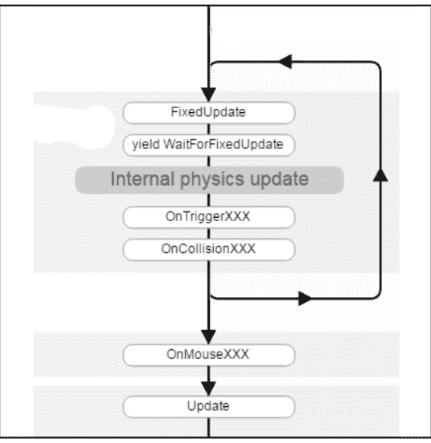
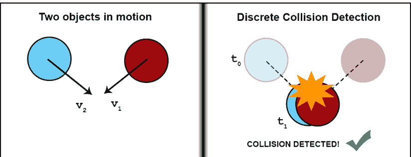
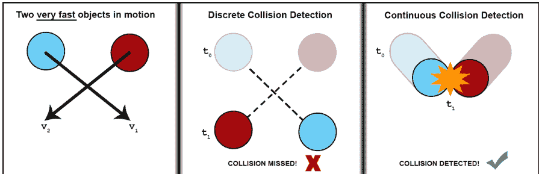
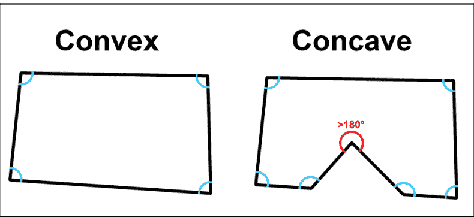
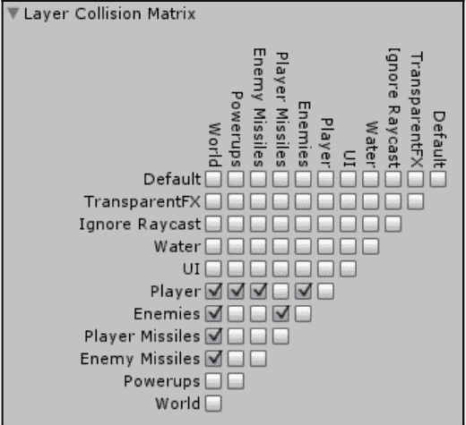
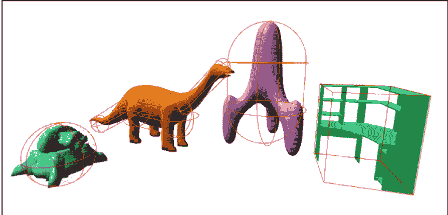
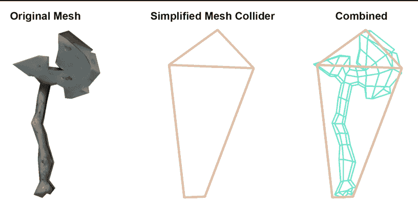

# 5 更快的物理

我们迄今探索的每一条性能增强建议主要都集中在降低资源成本和避免帧率问题上。但是，在最基本的层面上，追求峰值性能意味着改善用户体验。这是因为每一个帧率卡顿、每一个崩溃以及每一个对于给定市场来说成本过高的系统要求最终都会损害产品的质量。物理引擎属于独特的子系统类别，其行为和一致性对产品质量起着重要作用，花时间改善其行为通常是值得的。

如果重要的碰撞事件被遗漏，游戏在计算复杂物理事件时会冻结，或者玩家掉进地板里，那么这些都会对游戏玩法的质量产生明显且显著的负面影响。少数故障通常是可以忍受的，但持续的问题会妨碍游戏进行。这往往会让玩家脱离体验，而用户是觉得不便、恼火还是好笑则是未知数。除非我们的游戏专门针对喜剧物理类型（例如 QWOP 或 山羊模拟器之类的游戏），否则这些是我们应该努力避免的情况。

有些游戏可能根本不使用物理，而其他游戏则需要物理引擎在游戏过程中处理大量任务，例如数百个对象之间的碰撞检测、用于启动过场动画的触发体积、用于玩家攻击和 UI 行为的射线投射、收集给定区域内的对象列表，或者仅仅是将物理作为视觉装饰，让大量物理粒子四处飞舞。其重要性也取决于正在创建的游戏类型。例如，在平台游戏和动作游戏中，正确调整物理至关重要——玩家角色对输入的反应以及世界对玩家角色的反应是使游戏感觉灵敏且有趣的两个最重要的方面。而在大型多人在线（MMO）游戏中，精确的物理可能稍微不那么重要，这类游戏往往具有有限的物理交互。

因此，在本章中，我们将介绍通过 Unity 的物理引擎减少 CPU 峰值、开销和内存消耗的方法，但也将包括改变物理行为的方法，旨在优化性能的同时改善或至少保持游戏质量。在本章中，我们将涵盖以下领域：

- 了解 Unity 的物理引擎的工作原理：
  - 时间步长和 FixedUpdate
  - 碰撞体类型
  - 碰撞
  - 射线投射
  - 刚体活动状态
- 物理性能优化：
  - 如何构建场景以实现最佳物理行为
  - 使用最合适的碰撞体类型
  - 优化碰撞矩阵
  - 改善物理一致性并避免容易出错的行为
  - 布娃娃和其他基于关节的对象

# 物理引擎内部

Unity 从技术上讲具有两个不同的物理引擎：用于 3D 物理的 Nvidia PhysX 和用于 2D 物理的开源项目 Box2D。但是，它们的实现高度抽象，从我们通过主 Unity 引擎配置的高级 Unity API 角度来看，两个物理引擎解决方案的运作方式在功能上是相同的。

无论哪种情况，我们对 Unity 的物理引擎了解得越多，就越能理解可能的性能增强。因此，首先我们将介绍一些关于 Unity 如何实现这些系统的理论。

# 物理与时间

物理引擎通常假设时间以固定值推进，Unity 的两个物理引擎都以这种方式运行。每次迭代都称为时间步长。物理引擎将仅使用非常特定的时间值来解决每个时间步长，这与渲染前一帧花费的时间无关。在 Unity 中，这称为固定更新时间步长，默认设置为 20 毫秒（每秒 50 次更新）。

如果物理引擎使用可变时间步长，由于架构差异（浮点值的表示方式）以及客户端之间的延迟，在两台不同的计算机上为碰撞和力生成一致的结果可能非常困难。此类物理引擎往往会在多客户端之间或在录制的重放过程中产生非常不一致的结果。

以下图表显示了 Unity 执行顺序图表的重要片段：




完整的执行顺序图可以在 http://docs.unity3d.com/Manual/ExecutionOrder.html 找到。

如上图所示，Fixed Update 在物理引擎执行其自身更新之前处理，两者密不可分。该过程始于确定是否已过去足够的时间以开始下一个 Fixed Update。一旦确定，解决它的结果将因自上次 Fixed Update 以来过去了多少时间而异。

如果过去了足够的时间，则 Fixed Update 进程将调用场景中所有活动 MonoBehaviours 上定义的所有 `FixedUpdate()` 回调，随后是任何与 Fixed Update 绑定的协程（具体指那些 `yield` 给 `WaitForFixedUpdate` 的协程）。请注意，在这两个过程中调用的方法没有执行顺序保证，因此我们绝不应基于此假设编写代码。完成这些任务后，物理引擎可以开始处理当前时间步并调用任何必要的 Trigger 和 Collider 回调。

相反，如果自上次 Fixed Update 以来过去的时间太少（即少于 20 毫秒），则当前 Fixed Update 将被跳过，先前列出的所有任务在当前迭代中都不会发生。此时，输入、游戏逻辑和渲染将被允许正常进行。完成这些活动后，Unity 检查是否需要下一个 Fixed Update。

在高帧率下，渲染更新可能会在物理引擎有机会更新自身之前完成多次。此过程在运行时重复，实际上使 Fixed Update 和物理引擎优先于渲染，同时也将物理模拟强制固定帧率。

为了确保对象在 Fixed Update 之间平滑移动，物理引擎（包括 Unity 的）会根据距下一个 Fixed Update 还剩多少时间，将每个对象的可见位置在上一个状态和解决当前状态后应处的位置之间进行插值。这种插值确保对象看起来移动平滑，尽管它们的物理位置、速度等更新频率低于渲染帧率。


`FixedUpdate()` 回调是定义我们希望与帧率无关的任何游戏行为的有用位置。AI 计算通常在 Fixed Update 中解决，因为如果我们假设固定更新频率，它们往往更容易处理。

# 最大允许时间步

需要注意的是，如果自上次 Fixed Update 以来过去了大量时间（例如，游戏短暂冻结），则 Fixed Update 将继续在同一个 Fixed Update 循环中计算，直到物理引擎 *赶上* 当前时间。例如，如果上一帧花费了 100 毫秒来渲染（例如，突然的 CPU 峰值导致主线程长时间阻塞），则物理引擎需要更新五次。因此，`FixedUpdate()` 方法将在 `Update()` 再次被调用之前被调用五次，这是由于默认的 Fixed Update 时间步为 20 毫秒。当然，如果在这五个 Fixed Update 中有大量物理活动需要处理，以至于解决它们全部花费超过 20 毫秒，则物理引擎需要调用第六次更新。

因此，在物理活动密集的时刻，物理引擎处理一个 Fixed Update 所花费的时间可能超过它模拟的时间量。例如，如果处理模拟 20 毫秒游戏玩法的 Fixed Update 花费了 30 毫秒，那么它就落后了，需要处理更多时间步来尝试跟上，但这可能导致它落后得更远，需要处理更多时间步，以此类推。在这些情况下，物理引擎永远无法逃离 Fixed Update 循环并允许另一帧渲染。这个问题通常被称为 **死亡螺旋**。然而，为了防止物理引擎在这些时刻锁定我们的游戏，物理引擎每个 Fixed Update 循环允许处理的时间量有一个最大值。这个阈值称为 **最大允许时间步**，如果当前批次的 Fixed Update 处理时间太长，它将简单地停止并放弃进一步处理，直到下一个渲染更新完成。这种设计允许渲染管道至少渲染当前状态，并在物理引擎失控（双关语）的罕见时刻允许用户输入和游戏逻辑做出一些决策。

此设置可通过 **Edit | Project Settings | Time | Maximum Allowed Timestep** 访问。

# 物理更新和运行时更改

当物理引擎处理给定时间步时，它必须移动任何活动 Rigidbody 对象（带有 Rigidbody 组件的 GameObject），检测任何新碰撞，并对相应对象调用碰撞回调。Unity 文档明确指出，出于这个原因，对 Rigidbody 对象的更改应在 FixedUpdate() 和其他物理回调中处理。这些方法与物理引擎的更新频率紧密耦合，而不是与游戏循环的其他部分（例如 Update()）耦合。

这意味着 FixedUpdate() 和 OnTriggerEnter() 等回调是进行 Rigidbody 更改的安全位置，而 Update() 和在 WaitForSeconds 或 WaitForEndOfFrame 上 yield 的协程等方法则不是。忽略此建议可能导致意外的物理行为，因为在物理引擎有机会捕获并处理所有更改之前，可能会对同一对象进行多次更改。

在 Update() 回调中对对象施加力或冲动而不考虑这些调用的频率尤其危险。例如，当玩家按住键时每次 Update 施加 10 牛顿的力，会导致两个不同设备之间的最终速度完全不同，而如果我们在 Fixed Update 中做同样的事情则不会，因为我们无法依赖 Update() 调用次数的一致性。但是，在 FixedUpdate() 回调中这样做会一致得多。因此，我们必须确保所有与物理相关的行为都在适当的回调中处理，否则我们将冒引入一些特别令人困惑且非常难以复现的游戏错误的风险。

逻辑上，我们在任何给定的 Fixed Update 迭代中花费的时间越多，用于下一个游戏玩法和渲染通道的时间就越少。大多数情况下，这会导致次要的、不易察觉的后台处理任务，因为物理引擎几乎没有工作要做，而 FixedUpdate() 回调有大量时间完成工作。但是，在某些游戏中，物理引擎可能在每个 Fixed Update 中执行大量计算。这种物理处理时间的瓶颈会影响我们的帧率，导致随着物理引擎承担越来越大的工作负载，帧率急剧下降。本质上，渲染管道会尝试正常进行，但每当到了需要进行 Fixed Update 且物理引擎处理时间较长时，渲染管道在帧到期前生成当前显示的时间就很少，导致突然卡顿。这还加上物理引擎因为达到了最大允许时间步而提前停止的视觉效果。所有这些加在一起会产生非常糟糕的用户体验。

因此，为了保持平滑且一致的帧率，我们需要尽可能为渲染腾出时间，通过尽量减少物理引擎处理任何给定时间步所花费的时间。这既适用于最佳情况（没有任何移动），也适用于最坏情况（所有东西同时相互碰撞）。我们可以在物理引擎中调整许多与时间相关的功能和值，以避免此类性能陷阱。

# 静态碰撞器和动态碰撞器

Unity 中 _static_ 和 _dynamic_ 这两个术语存在相当极端的命名空间冲突。当使用 _static_ 时，它通常意味着讨论中的对象或进程不移动、保持不变或只存在于一个位置，而 _dynamic_ 简单地意味着相反——倾向于移动或变化的对象或进程。但是，重要的是要记住，这些是各自独立的主题，_static_ 和 _dynamic_ 这两个术语在每种情况下的含义都不同。我们已经介绍了 `GameObjects` 的 **Static** 子标志、动态批处理和静态批处理系统，以及 C# 语言中静态类、`static` 变量和 `static` 函数的概念。所以，为了更加令人困惑，Unity 也有静态碰撞器和动态碰撞器的概念。

动态碰撞器简单地指同时包含 `Collider` 组件（可能是几种类型之一）和 `Rigidbody` 组件的 `GameObjects`。通过将 Rigidbody 附加到与 Collider 相同的对象上，物理引擎将该 Collider 视为物理对象的边界体积，该物理对象必须对外部力（如重力）和与其他 Rigidbody 的碰撞做出反应。如果我们让一个动态碰撞器与另一个动态碰撞器碰撞，它们都将根据牛顿运动定律做出反应（或者至少是计算机使用浮点运算所能做到的最好程度）。

我们也可以有不附加 `Rigidbody` 组件的 Collider，这些被称为静态碰撞器。它们实际上充当动态碰撞器可以碰撞的不可见屏障，但静态碰撞器本身不会做出反应。换个角度来看，想象没有 `Rigidbody` 组件的对象具有无限质量。无论你多么用力地将一块石头扔向无限质量的对象，它都不会移动，但你仍然可以期望石头像撞上坚固的墙壁一样做出反应。这使得静态碰撞器非常适合世界边界和其他不得移动的障碍物。


# 碰撞检测

Unity 中有三种碰撞检测设置，可以在 `RigidBody` 组件的 **碰撞检测** 属性中配置：**离散**、**连续** 和 **连续动态**。**离散** 设置启用离散碰撞检测，它会根据对象的速度和经过的时间，在每个时间步长内将对象“瞬移”一小段距离。所有对象移动完成后，它会执行包围体积检查以查找任何重叠，将其视为碰撞，并根据其物理属性和重叠方式进行解决。如果小对象移动速度过快，此方法可能会错过碰撞。

下图展示了离散碰撞检测如何捕捉两个对象在不同位置之间“瞬移”的过程：



其余两种设置中的任何一种都会启用连续碰撞检测，其原理是根据 Collider 在当前时间步长内的起始位置和结束位置进行插值，并检查路径上的任何碰撞。与离散碰撞检测相比，这降低了错过碰撞的风险，并能生成更准确的模拟，但代价是 CPU 开销显著增加。

**连续** 设置仅在给定 Collider 与静态 Collider 之间启用连续碰撞检测。同一 Collider 与动态 Collider 之间的碰撞仍将使用离散碰撞检测。与此同时，**连续动态** 设置在 Collider 与所有静态和动态 Collider 之间启用连续碰撞检测，因此在资源消耗方面是最昂贵的。

下图展示了离散和连续碰撞检测方法在一对小型快速移动对象上的工作原理：



这是一个仅用于说明的极端示例。在离散碰撞检测的情况下，我们可以观察到对象在单个时间步长内“瞬移”的距离大约是其自身大小的四倍，这通常只发生在速度极高的非常小的对象身上，因此如果我们的游戏运行良好，这种情况非常罕见。在绝大多数情况下，对象在单个 20 毫秒时间步长内移动的距离相对于对象的大小要小得多，因此离散碰撞检测方法可以轻松捕捉到碰撞。

# Collider 类型

Unity 中有四种不同的 3D Collider 类型。按性能开销从低到高排序，它们分别是球体、胶囊体、盒体和网格 Collider。前三种 Collider 类型通常称为 _原始体_，并保持非常特定的形状，尽管它们通常可以在不同方向上缩放以满足特定需求。然而，网格 Collider 可以根据分配的网格自定义为特定形状。还有三种 2D Collider 类型——圆形、盒体和多边形——它们在功能上分别与球体、盒体和网格 Collider 相似。以下所有信息基本上都可以转移到等效的 2D 形状。

请注意，我们也可以在 Unity 中生成圆柱形 3D 对象，但这仅用于其图形表示。自动生成的圆柱体形状使用胶囊体 Collider 来表示其物理包围体积，这可能无法产生预期的物理行为。

此外，网格 Collider 有两种变体：**凸形** 和 **凹形**。区别在于，凹形至少有一个内角（形状两个内边之间的角）大于 180 度。为了说明这一点，下图展示了凸形和凹形之间的区别：



记住凸形和凹形区别的简单方法是：凹形内部至少有一个 _凹陷_。

两种网格 Collider 类型使用相同的组件（一个 `MeshCollider` 组件）。生成的网格 Collider 类型通过 **凸形** 复选框切换。启用此选项将允许对象与所有原始形状（球体、盒体等）以及启用了 **凸形** 的其他网格 Collider 发生碰撞。此外，如果为具有凹形的网格 Collider 启用了 **凸形** 复选框，则物理引擎将自动简化它，生成一个尽可能接近凸形的 Collider。在前面的示例中，如果我们导入右侧的凹形网格并启用 **凸形** 复选框，它将生成一个更接近左侧凸形的 Collider 形状。在任何情况下，物理引擎都会尝试生成一个与附加网格形状匹配的 Collider，顶点上限为 255 个。如果目标网格的顶点数超过此限制，则在网格生成期间会抛出错误。

Collider 组件还包含 `IsTrigger` 属性，允许它们被视为非物理对象，但当其他 Collider 进入或离开它们时仍会调用物理事件。这些称为触发体积。通常，当另一个 Collider 触碰、保持触碰（每个时间步长）或停止触碰 Collider 时，分别会调用 Collider 的 `OnCollisionEnter()`、`OnCollisionStay()` 和 `OnCollisionExit()` 回调。但是，当 Collider 用作触发体积时，将改用 `OnTriggerEnter()`、`OnTriggerStay()` 和 `OnTriggerExit()` 回调。

请注意，由于解决对象间碰撞的复杂性，凹形网格 Collider 不能也是动态 Collider。凹形只能用作静态 Collider 或触发体积。如果我们尝试向凹形网格 Collider 添加 `Rigidbody` 组件，Unity 将简单地忽略它。

# 碰撞矩阵

物理引擎具有一个碰撞矩阵，用于定义哪些对象允许与哪些其他对象发生碰撞。不符合此矩阵的对象，在解决包围体积重叠和碰撞时会被物理引擎自动忽略。这在碰撞检测阶段节省了物理处理开销，并允许对象相互穿过而不发生任何碰撞。

碰撞矩阵可通过 **编辑 | 项目设置 | (物理 / 物理 2D) | 层碰撞矩阵** 访问。

碰撞矩阵系统通过 Unity 的层系统工作。矩阵表示每一种可能的层对层组合，启用复选框意味着在碰撞检测阶段将检查这两个层中的 Collider。请注意，无法仅允许两个对象中的一个响应碰撞。如果一个层可以与另一个层碰撞，则两者都必须响应碰撞。但是，静态 Collider 是例外，因为它们不允许对碰撞做出物理响应（尽管它们仍会接收 `OnCollision...()` 回调）。

请注意，我们整个项目总共仅限于 32 个层（因为物理引擎使用 32 位掩码来确定层间碰撞机会），因此我们必须将对象组织成合理的层，这些层将贯穿整个项目生命周期。如果出于任何原因，32 个层不足以满足我们的项目需求，那么我们可能需要找到巧妙的方法来重用层或移除不必要的层。

# Rigidbody 活动和休眠状态

每个现代物理引擎都共享一种常见的优化技术，即处于静止状态的对象会将其内部状态从活动状态更改为休眠状态。当 Rigidbody 处于休眠状态时，在固定更新期间几乎不会花费处理器时间来更新对象，直到它被外部力或碰撞事件唤醒。

用于确定什么是 _静止_ 的测量值在不同物理引擎中往往有所不同；它可以使用线速度和旋转速度、动能、动量或 Rigidbody 的其他一些物理属性来计算。Unity 的两个物理引擎都通过评估对象的 _质量归一化动能_ 来工作，这基本上归结为 _其速度平方的大小_。

如果对象的速度在短时间内未超过某个阈值，物理引擎将假设该对象在发生新碰撞或施加新力之前不再需要移动。在此之前，休眠对象将保持其当前位置。将阈值设置得太低会导致对象不太可能进入休眠，因此即使对象没有做任何重要事情，我们也会在每个固定更新中为物理引擎支付少量处理开销。与此同时，将阈值设置得太高会导致移动缓慢的对象在物理引擎决定它们需要进入休眠时，看起来会突然停顿。控制休眠状态的阈值可以在 **编辑 | 项目设置 | 物理 | 休眠阈值** 下修改。我们还可以从 **分析器** 窗口的 **物理区域** 获取活动 Rigidbody 对象的总数。

请注意，休眠对象并未完全从模拟中移除。如果移动的 Rigidbody 接近休眠对象，则它仍必须执行检查以查看附近的对象是否与其发生了碰撞，这将重新唤醒休眠对象，并将其重新引入模拟进行处理。

# 射线和对象投射

物理引擎的另一个常见功能是能够从一个点向另一个点 _投射射线_，并生成与其路径中一个或多个对象的碰撞信息。这称为 **射线投射**。通过射线投射实现多种游戏机制非常常见，例如开枪射击。这通常通过从玩家到目标位置执行射线投射，并找到其路径中任何可行的目标（即使只是一堵墙）来实现。


我们还可以使用 `Physics.OverlapSphere()` 检查来获取空间中固定点周围有限距离内的目标列表。这通常用于实现范围伤害类游戏功能，例如手榴弹或火球爆炸。我们甚至可以使用 `Physics.SphereCast()` 和 `Physics.CapsuleCast()` 将整个对象向空间中投射。这些方法常用于模拟宽激光束，或者当我们只想查看移动角色路径上会有什么时使用。

# 调试物理

物理错误通常分为两类：对象对在不应该碰撞/应该碰撞时发生了碰撞/未发生碰撞，或者对象发生了碰撞但随后发生了意外情况。前一种情况通常更容易调试；它往往是由于碰撞矩阵错误、射线检测中使用了错误的图层，或者对象碰撞体大小或形状不正确引起的。后一种情况通常要难得多，因为存在三个大问题：

- 确定是哪些发生碰撞的对象导致了问题
- 确定解决碰撞前的碰撞条件
- 复现碰撞

这三条信息中的任何一条都会让解决问题变得容易得多，但在某些情况下，它们都可能很难获得。

性能分析器在 **Physics** 和 **Physics (2D) 区域**（分别用于 3D 和 2D 物理）中提供了一些信息，这可能 moderately 有用。我们可以了解所有刚体和不同类型的刚体组（如动态碰撞体、静态碰撞体、运动学对象、触发体积、约束（用于模拟铰链和其他连接的物理对象）以及接触点）所花费的 CPU 活动量。**Physics 2D 区域**包含更多信息，例如休眠和活动刚体的数量以及处理时间步长所花费的时间。**详细分解视图**在两种情况下都提供了更多信息。这些信息有助于我们关注物理性能，但当我们发现物理行为出现错误时，它不能告诉我们太多哪里出了问题。

更适合帮助我们调试物理问题的工具是 **物理调试器**，可以通过 **Window | Physics Debugger** 打开。此工具可以帮助我们从 **场景** 窗口中过滤掉不同类型的碰撞体，以便更好地了解哪些对象发生了碰撞。当然，这对于确定问题条件和复现问题帮助不大。

> 请注意，物理调试器中的设置不会影响 **游戏** 窗口中对象的可见性。

不幸的是，对于剩余的问题，没有太多秘诀可分享。在碰撞发生前或发生时捕获信息通常涉及在 `OnCollisionEnter()` 或 `OnTriggerEnter()` 回调中设置大量有针对性的断点，以捕捉问题发生的瞬间，并使用逐步调试直到问题源头清晰。作为最后手段，我们可以添加 `Debug.Log()` 语句，在问题发生前记录重要信息，但这可能是一项令人沮丧的练习，因为我们有时不知道需要记录什么信息，或者从哪些对象记录，因此最终会在所有地方添加日志。

另一个常见的头痛来源是尝试复现物理问题。复现碰撞始终是一项挑战，因为用户输入（通常在 `Update()` 中处理）与物理行为（在 `FixedUpdate()` 中处理）之间存在不确定性。尽管物理时间步长相对规律地发生，但每次会话之间每个 `Update()` 的模拟时序都会不同，因此即使我们记录了用户输入时序并自动重放场景，尝试在输入应用的时刻应用记录的输入也不会每次都完全相同，因此我们可能无法得到完全相同的结果。

将用户输入处理移动到 `FixedUpdate()` 是可能的，并且有帮助，如果用户输入控制刚体行为，例如在玩家按住某些键时向不同方向施加力。然而，这往往会导致输入延迟或 _滞后_，因为物理引擎响应按键可能需要 0 到 20 毫秒（基于固定更新频率）。瞬时输入，例如跳跃或激活技能，最好始终在 `Update()` 中处理，以避免漏掉按键。像 `Input.GetKeyDown()` 这样的辅助函数仅在玩家按下给定键的那一帧返回 `true`，并在下一个 `Update()` 期间返回 `false`。如果我们尝试在 `FixedUpdate()` 中读取 _按键按下_ 事件，除非物理时间步长恰好在这两帧之间发生，否则我们永远不会知道用户按下了键。这可以通过输入缓冲/跟踪系统来解决，但如果我们只是为了复现物理错误而实现它，这肯定是得不偿失。

最终，经验和坚持是调试大多数物理问题的唯一好方法。我们对物理引擎的经验越多，找到问题源头的直觉就越强，但不幸的是，由于可复现性有限且行为有时模糊不清，它们几乎总是需要花费大量时间来解决，因此我们应该预期物理问题比大多数逻辑错误花费更长时间来解决，并在解决前预留额外时间。

# 物理性能优化

现在我们对 Unity 物理引擎的大多数功能有了了解，可以介绍几种优化技术来改善游戏的物理性能。

## 场景设置

首先，我们可以在场景中应许多最佳实践来提高物理模拟的一致性。请注意，其中几种技术不一定会改善 CPU 或内存使用，但它们会降低物理引擎出现不稳定的可能性。

## 缩放

我们应尽可能将世界中所有物理对象的缩放保持在 `(1,1,1)` 附近。默认情况下，Unity 假设我们模拟的游戏相当于在地球表面。地球表面的重力加速度为 9.81 米每秒平方，因此默认重力值设置为 `-9.81` 以匹配。Unity 世界空间中的 1 个单位相当于 1 米，负号表示它会将对象向下拉。我们的对象大小应反映有效的世界缩放，因为将它们缩放得太大会导致重力看起来移动对象的速度比我们预期的慢得多。如果所有对象都缩放了五倍，那么重力看起来会弱五倍。反之亦然；将对象缩放得太小会使它们看起来下落太快，不够真实。

我们可以通过修改 **Edit | Project Settings | Physics / Physics 2D | Gravity** 下的重力强度来调整世界的隐含缩放。但是，请注意，浮点数运算在值接近 0 时会更准确，因此如果我们有一些对象的缩放值远高于 `(1, 1, 1)`，即使它们与隐含的世界缩放匹配，我们仍然可能观察到不稳定的物理行为。因此，在项目早期，我们应将最常见的物理对象导入并缩放到 `(1, 1, 1)` 左右，然后调整重力值以匹配。这将为我们在引入新对象时提供一个参考点。

## 定位

同样，将所有对象保持在世界空间位置 `(0, 0, 0)` 附近将提高浮点精度，改善模拟的一致性。太空模拟器和跑酷游戏试图模拟 incredibly 大的空间，通常使用一种技巧，要么悄悄将玩家传送回世界中心，要么将位置固定在那里，在这种情况下，要么空间被分割成体积，使物理计算始终使用接近 0 的值，要么移动其他一切来模拟旅行，而玩家的运动只是一种幻觉。

大多数游戏不会面临浮点不准确性的风险，因为大多数游戏关卡持续约 10 到 30 分钟，这不给玩家太多时间去旅行 absurdly 长的距离，但如果我们正在处理 exceptionally 大的场景，或者在整个游戏过程中异步加载场景，以至于玩家旅行了数万米，那么我们可能会开始注意到随着他们旅行得更远而出现一些奇怪的物理行为。

因此，除非我们已经深入项目，以至于在后期阶段更改和重新测试一切太麻烦，否则我们应尽量将所有物理对象保持在 `(0, 0, 0)` 附近。此外，这对我们的项目工作流程是很好的实践，因为它使在游戏世界中查找对象和调整事物变得更快。

## 质量

质量存储为 `Rigidbody` 组件的 `mass` 属性下的浮点值，由于物理引擎的更新，其用法文档多年来发生了相当大的变化。在 Unity 的近期版本（Unity 5 后期和 Unity 2017 早期），我们基本上可以自由选择 `1.0` 代表什么，然后相应地缩放其他值。


传统上，质量值为 `1.0` 用于表示 1 千克的质量，但我们可以决定一个人类的质量为 `1.0`（约 130 千克），在这种情况下，一辆汽车将被赋予质量值 `10.0`（约 1,300 千克），物理碰撞的解决方式将与我们预期的类似。最重要的是质量的相对差异，这使得这些对象之间的碰撞看起来可信，而不会对引擎造成太大压力。浮点精度也是一个问题，因此我们不想使用过于荒谬的大质量值。


请注意，如果我们打算使用 Wheel Colliders，其设计假设质量为 `1.0` 代表 1 千克，因此我们应该适当分配质量值。

理想情况下，我们应将质量值维持在 `1.0` 左右，并确保最大相对质量比约为 `100`。如果两个对象的碰撞质量比远大于此，则巨大的动量差异可能会从冲量转变为突然的巨大速度变化，导致物理不稳定和潜在的浮点精度丢失。具有显著尺寸差异的对象对可能应使用碰撞矩阵进行剔除以避免问题（稍后详述）。


不当的质量比是 Unity 中物理不稳定和异常行为的最常见原因。这在使用 Joints 处理 Ragdolls 等对象时尤其如此。

请注意，地球中心的重力对所有物体的影响相同，无论其质量如何，因此无论我们将质量属性值 `1.0` 视为橡胶球的质量还是军舰的质量都无关紧要。无需调整重力来补偿。然而，重要的是给定物体在下落时所受到的空气阻力量（这就是为什么降落伞下落缓慢）。因此，为了保持现实的行为，我们可能需要为这些对象自定义 `drag` 属性，或按对象自定义重力。例如，我们可以禁用 **Use Gravity** 复选框，并在 Fixed Update 期间应用我们自己的自定义重力。

# 适当使用静态碰撞体

如前所述，物理引擎会自动生成两个独立的数据结构，将静态碰撞体与动态碰撞体分开存储。不幸的是，如果在运行时将新对象引入静态碰撞体数据结构，则必须重新生成，类似于为静态批处理调用 `StaticBatchingUtility.Combine()`。这可能会导致显著的 CPU 峰值。因此，在游戏过程中避免实例化新的静态碰撞体至关重要。

此外，仅仅移动、旋转或缩放静态碰撞体也会触发此重新生成过程，应予以避免。如果我们有希望移动而不以物理方式响应与其他对象碰撞的碰撞体，则应附加 Rigidbody 使其成为动态碰撞体并启用 **Kinematic** 标志。该标志防止对象响应来自对象间碰撞的外部冲量，类似于静态碰撞体，不同之处在于该对象仍可通过其 `Transform` 组件或施加到其 `Rigidbody` 组件的力进行移动（最好在 Fixed Update 期间）。由于运动学对象不会响应其他对象撞击它，它在移动时往往会简单地将其他动态碰撞体推开。


正因如此，玩家角色对象通常被制作成运动学碰撞体。

# 负责任地使用触发体积

如前所述，我们可以将物理对象视为普通碰撞体或触发体积。这两种类型之间的一个重要区别在于，`OnCollider...()` 回调将 `Collision` 对象作为参数提供给回调，该对象包含有用信息，例如碰撞的确切位置（有助于定位粒子效果）和接触法线（如果我们想在碰撞后手动移动对象，则很有用）。而 `OnTrigger...()` 回调不提供此类信息。

因此，我们不应尝试使用触发体积来实现碰撞反应行为，因为我们没有足够的信息来使碰撞看起来准确。触发体积最适合用于其预定目的，即跟踪对象进入/退出特定区域，例如在玩家待在岩浆坑中时处理伤害，在玩家进入建筑物时触发过场动画，以及在玩家靠近或远离另一个主要区域时启动场景的异步加载/卸载。

如果触发体积碰撞绝对需要联系信息，则常见的解决方法是执行以下任何一项：

- 通过将触发体积与碰撞对象的质量中心之间的距离减半来粗略估计接触点（这假设它们大小大致相等）
- 在碰撞时从触发体积中心向碰撞对象的质量中心执行射线检测（如果两个对象都是球形，效果最佳）
- 创建一个非触发体积对象，给它一个无穷小的质量（这样碰撞对象几乎不受其存在的影响），并在碰撞时立即销毁它（因为与如此大的质量差异发生碰撞可能会将这个小对象弹入轨道）

当然，这些方法各有缺点；物理精度有限、碰撞期间额外的 CPU 开销和/或额外的场景设置（以及看起来相当 hacky 的碰撞代码），但在紧急情况下可能很有用。

# 优化碰撞矩阵

众所周知，物理引擎的碰撞矩阵定义了分配给某些层的对象允许与分配给其他层的对象碰撞，或者更简洁地说，哪些对象碰撞对被物理引擎视为可行。其他每个对象-层对都会被物理引擎简单地忽略，这使得这成为最小化物理引擎工作量的重要途径，因为它减少了每次 Fixed Update 必须执行的包围体积检查数量，以及在应用程序生命周期内可能需要处理的碰撞数量（这将节省移动设备的电池寿命）。

> 请注意，碰撞矩阵可以通过 Edit | Project Settings | Physics（或 Physics2D）| Layer Collision Matrix 访问。

以下截图显示了街机射击游戏的常见碰撞矩阵：



在前面的示例中，我们有标记为 **Player**、**Enemies**、**Player Missiles**、**Enemy Missiles** 和 **Powerups** 的对象，我们已将物理引擎需要检查的可能对象间碰撞数量最小化。

从标记为 **Player** 的第一行复选框开始，我们希望 **Player** 对象能够与 **World** 对象碰撞、拾取 **Powerups**、被 **Enemy Missiles** 击中，并与 **Enemies** 碰撞。但是，我们不希望它们与自己的 **Player Missiles** 或自身碰撞（尽管这一层可能只有一个对象）。因此，**Player** 行中的启用复选框反映了这些要求。我们只希望 **Enemies** 与 **World** 对象和 **Player Missiles** 碰撞，因此在 **Enemies** 行中选中这些项。请注意，**Player**-to-**Enemies** 碰撞对已由前一行处理；因此无需在 **Enemies** 行中出现。我们还希望 **Player Missiles** 和 **Enemy Missiles** 在击中 **World** 对象时爆炸，因此这些项被标记，最后我们不在乎 **Powerups** 与除 **Player** 以外的任何东西碰撞，也不希望 **World** 对象与其他 **World** 对象碰撞，因此最后两行没有标记任何复选框。


在任何给定时刻，我们可能只有一个 **Player** 对象，2 个 **Powerups**，7 个 **Player Missiles**，10 个 **Enemies** 和 20 个 **Enemy Missiles**，总共 780 个潜在碰撞对（计算方式为：40 个不同的对象每个都可能与另外 39 个对象碰撞，得到 1,560 个潜在碰撞对，然后将总数除以 2 以忽略重复对）。仅通过优化这个矩阵，我们就将其减少到不到 100，潜在碰撞检查减少了近 90%。当然，Unity 物理引擎会在对象彼此距离太远时高效地剔除许多对象对，因此它们几乎不可能发生碰撞（这是在名为 **Broadphase Culling** 的隐藏过程中计算的），所以实际节省的可能永远达不到这么好，但几乎不费吹灰之力就能释放一些 CPU 周期。另一个巨大好处是简化了游戏逻辑编码；如果我们告诉物理引擎忽略 **Powerups** 和 **Enemy Missiles** 之间的碰撞，就不需要去弄清楚它们碰撞时应该发生什么。

我们应该对碰撞矩阵中的所有潜在图层组合进行像这样的逻辑合理性检查，以查看是否在浪费宝贵时间去检查不必要的对象对之间的互相碰撞。

# 优先使用离散碰撞检测

离散碰撞检测成本较低，因为在单个时间步内将对象瞬移一次并对附近的对象对执行一次重叠检查，所需的工作量微不足道。而连续碰撞检测所需的计算量要大得多，因为它涉及在对象起始位置和结束位置之间进行插值，同时分析这些点之间在时间步内可能发生的任何轻微包围体积重叠。

因此，**Continuous** 碰撞检测选项的开销比 **Discrete** 检测方法大一个数量级，而 **ContinuousDynamic** 碰撞检测设置的开销又比 **Continuous** 大一个数量级。在复杂场景中，如果有太多对象配置为使用任一连续碰撞检测类型，会导致严重的性能下降。无论哪种情况，成本都会乘以在任何给定帧中需要比较的对象数量，以及比较的 Collider 是静态还是动态。

因此，对于绝大多数对象，我们应该优先使用 **Discrete** 碰撞检测设置，而仅在极端情况下才使用任一连续碰撞检测设置。当重要碰撞经常与游戏世界中较静态的部分错过时，应使用 **Continuous** 设置。例如，如果我们希望确保玩家角色永远不会掉出游戏世界，或者在移动过快时不会意外穿墙，那么可能只想对这些对象应用连续碰撞检测。最后，**ContinuousDynamic** 设置仅应在相同情况适用且我们希望捕捉一对非常快速移动的动态 Collider 之间碰撞时使用。

# 修改固定更新频率

在某些情况下，**Discrete** 碰撞检测在大规模下可能效果不佳。也许我们的整个游戏围绕大量小型物理对象展开，而离散碰撞检测根本无法捕捉足够的碰撞以维持产品质量。然而，将连续碰撞检测设置应用到所有对象对性能来说将过于高昂。在这种情况下，我们可以尝试一个选项：可以自定义物理时间步长，通过修改引擎检查固定更新的频率，让离散碰撞检测系统更有机会捕捉此类碰撞。

如前所述，固定更新和物理时间步长处理是强耦合的；因此，通过修改固定更新检查的频率，我们不仅改变了物理引擎计算和解析下一个回调的频率，还改变了 `FixedUpdate()` 回调和协程被调用的频率。因此，如果我们深入项目且有大量依赖这些回调的行为，更改此值可能有风险，因为我们正在改变关于这些方法调用频率的一个非常重要的假设。

更改固定更新频率可以通过编辑器中的 **Edit | Project Settings | Time | Fixed Timestep** 属性，或通过脚本代码中的 `Time.fixedDeltaTime` 属性来实现。

降低此值（增加频率）将迫使物理引擎更频繁地处理，从而让离散碰撞检测更有机会捕捉碰撞。当然，这伴随着额外的 CPU 成本，因为我们正在调用更多的 `FixedUpdate()` 回调，并要求物理引擎更频繁地更新，让它更频繁地移动对象并验证碰撞。

相反，增加此值（降低频率）为 CPU 在再次处理物理处理之前提供了更多时间来完成其他任务，或者从另一个角度看，给物理引擎更多时间来处理上一个时间步长，然后再开始处理下一个。不幸的是，降低固定更新频率基本上会降低对象在物理引擎无法再使用离散碰撞检测捕捉碰撞之前能够移动的最大速度（取决于对象的大小）。我们也可能开始看到对象以奇怪的方式改变速度，因为它本质上正在成为现实世界物理行为的一个更弱的近似。

因此，每次更改固定时间步长值时，进行大量测试至关重要。即使完全理解此值的工作原理，也很难预测游戏过程中的整体结果会是什么样子，以及结果是否达到质量标准。因此，应在项目生命周期早期对该值进行更改，然后尽量少更改，以便针对尽可能多的物理情况进行足够的测试。

创建一个测试场景，将我们的一些高速对象相互抛出以验证结果是否可接受，并在每次更改固定时间步长时运行此场景可能会有所帮助。但是，实际游戏玩法往往相当复杂，有许多后台任务和未预料到的玩家行为，这些行为会给物理引擎带来额外工作或让它处理当前迭代的时间更少。实际游戏条件无法在真空中复制。此外，没有什么能替代真实情况，所以我们针对固定时间步长的当前值进行的测试越多，就越有信心更改符合可接受的质量标准。

> 来自开发软件自动化工具职业生涯的人的建议：软件测试自动化在许多情况下都有帮助，但当涉及到实时事件和用户输入驱动的应用程序，这些程序与多个硬件设备和复杂子系统（如物理引擎）同步，并且由于反馈迭代而倾向于快速变化时，自动化测试的支持和维护成本往往会变得不值得，使得手动测试成为最明智的方法。

我们始终将连续碰撞检测作为最后手段，以抵消我们观察到的一些不稳定性。不幸的是，即使更改是有针对性的，由于连续碰撞检测的开销成本，这比我们开始时更可能导致进一步的性能问题。在启用连续碰撞检测之前和之后对场景进行性能分析以验证收益是否超过成本将是明智的。


# 调整最大允许时间步长

如果我们经常超过最大允许时间步长（提醒一下，它决定了物理引擎在必须提前退出之前解析时间步长所拥有的时间），那么将会导致一些相当奇怪的物理表现。刚体会出现减速或突然停止的情况，因为物理引擎需要在完全解析完整的时间配额之前不断提前退出时间步长计算。在这种情况下，这清楚地表明我们需要从其他角度优化物理表现。不过，至少我们可以确信，阈值将防止游戏在物理处理过程中出现尖峰时完全卡死。


提醒：此设置可通过 **Edit | Project Settings | Time | Maximum Allowed Timestep** 访问。

默认设置是最多消耗 0.333 秒，如果超过此值，将表现为非常明显的帧率下降（仅 3 FPS）。如果你觉得需要更改此设置，那么你显然在物理工作负载方面存在一些大问题，因此建议只有在耗尽所有其他方法后才调整此值。

# 最小化射线投射和包围体检查

所有射线投射方法都非常有用，但它们相对较为昂贵，特别是 `CapsuleCast()` 和 `SphereCast()`。我们应避免在 `Update()` 回调或协程中定期调用这些方法，仅在脚本代码中的关键事件时保留它们。

如果我们在场景中使用持久的线、射线或区域效果碰撞区域（例如安全激光、持续燃烧的火焰、光束武器等），且对象保持相对静止，那么或许最好使用简单的触发体积来模拟它们。

如果无法进行此类替换，并且我们确实需要使用这些方法进行持续的投射检查，则应通过利用 LayerMasks 来最小化每次射线投射的处理量。如果我们使用 `Physics.RaycastAll()`，这一点尤其正确。例如，此类射线投射的使用不当情况如下所示：

```csharp
void PerformRaycast() {
    RaycastHit[] hits;
    hits = Physics.RaycastAll(transform.position, transform.forward, 100.0f);
    for (int i = 0; i < hits.Length; ++i) {
        RaycastHit hit = hits[i];
        EnemyComponent e = hit.transform.GetComponent<EnemyComponent>();
        if (e.GetType() == EnemyType.Orc) {
            e.DealDamage(10);
        }
    }
}
```

在前面的示例中，我们正在收集射线路径上每个对象的射线投射碰撞数据，但我们只处理其持有特定 EnemyComponent 的对象的效果。因此，我们要求物理引擎完成比必要多得多的工作。

更好的方法是使用 RaycastAll() 的另一个重载，该重载接受 LayerMask 值作为参数。这将以类似于碰撞矩阵的方式过滤射线的碰撞，使其仅针对给定图层中的对象进行测试。以下代码通过提供额外的 LayerMask 属性进行了微妙的改进；我们将通过检查器窗口为此组件配置 LayerMask，它将过滤列表得快得多，并且仅包含与掩码匹配的对象的命中：

```csharp
[SerializeField] LayerMask _layerMask;
void PerformRaycast() {
    RaycastHit[] hits;
    hits = Physics.RaycastAll(transform.position, transform.forward, 100.0f, _layerMask);
    for (int i = 0; i < hits.Length; ++i) {
        // as before ...
    }
}
```

此优化对于 `Physics.RaycastHit()` 函数的效果不佳，因为该版本仅提供射线与第一个碰撞对象的碰撞信息，无论我们是否使用 `LayerMask`。

请注意，由于 `RaycastHit` 和 `Ray` 类由 Unity 引擎的原生内存空间管理，它们实际上不会导致引起 **垃圾回收器** 注意的内存分配。我们将在 **第 8 章** _精通内存管理_ 中了解更多此类活动。

# 避免复杂的网格碰撞体

按碰撞检测效率排序，各种碰撞体依次为球体、胶囊体、盒体、凸网格碰撞体，而凹网格碰撞体则远远是最昂贵的。碰撞始终涉及一对对象，解析碰撞所需的工作量（数学）取决于两个对象的复杂程度。两个基本对象之间的碰撞检测可以归结为一组相对简单的数学方程，这些方程经过高度优化。对一对凸网格碰撞体进行比较是一个更复杂的方程，使其比两个基本对象之间的碰撞昂贵一个数量级。然后，两个凹网格碰撞体之间的碰撞非常复杂，无法归结为简单公式，需要在两个网格的每对三角形之间解析碰撞检查，这使其比其他碰撞体类型之间的碰撞昂贵多个数量级。当我们解析不同组形状之间的碰撞时，所涉及的工作量也会类似地增加。例如，基本对象与凹网格碰撞体之间的碰撞比两个基本对象之间的碰撞慢，但比两个凹网格碰撞体之间的碰撞快。

还有一个问题，即参与碰撞的对象中是否有一个或两个在移动（其中一个对象是静态碰撞体比两个对象都是动态碰撞体更容易处理）。还有场景中有多少此类对象的问题，因为如果我们不小心将多少形状引入模拟，碰撞检测的总处理成本将会迅速增长。

在 3D 应用程序中表示物理和图形之间的一个巨大讽刺是，如何在两者之间处理球体和立方体对象是多么困难。完美的球形网格需要生成无限数量的多边形，使得此类对象在图形上无法表示。

然而，在物理引擎中处理两个球体之间的碰撞可能是解决接触点和碰撞最简单的问题（接触点始终位于任一球体半径的边缘，接触法线始终是它们质心之间的向量）。相反，立方体是图形上最简单的对象之一（只需 8 个顶点和 12 个三角形），但却需要大量的数学和处理能力来查找接触点并解析碰撞（解析碰撞的数学取决于碰撞发生在面、边、角之间，还是混合搭配）。轶事地讲，这意味着创建大量对象最有效的方法是用球体碰撞体填充我们的世界，使用立方体对象。然而，这对人类观察者来说完全没有意义，因为他们会看到立方体像球体一样滚动。

前面的轶事提醒我们，对象的物理表示不一定需要与其图形表示匹配。这很有好处，因为图形网格通常可以压缩为更简单的形状，同时仍然产生非常相似的物理行为，并消除使用过于复杂的网格碰撞体的需求。

图形和物理之间的这种表示分离使我们能够优化一个系统的性能，而不一定会对另一个系统产生负面影响。只要游戏玩法没有明显的负面影响（或者我们愿意做出牺牲），我们就可以使用更简单的物理形状来表示复杂的图形对象，而玩家不会察觉。此外，如果玩家从未察觉，那么也就没有造成任何伤害。

因此，我们可以用两种方式之一来解决这个问题：要么使用一个（或多个）标准基本体来近似复杂形状的物理行为，要么使用一个更简单的网格碰撞体。

# 使用更简单的基本体

大多数形状可以使用三种基本碰撞体之一来近似。事实上，我们不需要仅使用一个碰撞体来表示对象。如果它们能满足我们创建复杂碰撞形状的需求，我们可以自由使用多个碰撞体，方法是附加带有自己碰撞体的其他子 `GameObjects`。这几乎总是比使用单个网格碰撞体更便宜，并且应优先选择。


下图展示了由一个或多个更简单的原始 Collider 形状表示的几个复杂图形对象：



对这些对象中的任何一个使用 Mesh Collider 将比这里所示的原始 Collider 昂贵得多，因为它们包含的多边形数量较多。值得探索任何和所有机会，尽可能使用这些原始体来简化我们的对象，因为它们可以带来显著的性能提升。

例如，凹面 Mesh Collider 的独特之处在于它们可以带有间隙或孔洞，允许其他网格掉入其中，甚至穿过它们，如果此类 Collider 用于世界碰撞区域，这会引入对象掉出世界的机会。为此目的，通常更好的做法是在战略位置放置 Box Collider。

# 使用更简单的 Mesh Collider

同样，分配给 Mesh Collider 的网格不一定需要与同一对象的图形表示相匹配（Unity 只是将其选为默认值）。这为我们提供了一个机会，可以为 Mesh Collider 的 `mesh` 属性分配一个更简单的网格，该网格与我们用于图形表示的网格不同。

下图展示了一个复杂图形网格的示例，该网格为其 Mesh Collider 提供了一个更简化的网格：



以这种方式将渲染网格简化为多边形数量较少的凸形，将大大减少确定与其他 Collider 的包围体积重叠所需的开销。取决于原始对象被估算得有多好，应该几乎没有可察觉的游戏玩法差异，尤其是在这个斧头的例子中，我们预计它在生物攻击时挥动时会快速移动，使得玩家不太可能注意到两个网格作为 Collider 之间的差异。事实上，简化的网格不太可能被离散碰撞检测遗漏，出于这个原因也是更可取的。

# 避免复杂的物理组件

某些特殊的物理 Collider 组件，例如 `TerrainCollider`、`Cloth` 和 `WheelCollider`，在某些情况下比所有原始 Collider 甚至 Mesh Collider 昂贵几个数量级。除非绝对必要，否则我们根本不应该在场景中包含此类组件。例如，如果我们在远处有玩家永远不会接近的地形对象，那么附加 `TerrainCollider` 几乎没有理由。

带有 Cloth 组件的游戏应该考虑在低质量设置下运行时实例化不带它们的不同对象，或者简单地对布料行为进行动画制作（尽管如果团队已经对布料的移动方式产生了依恋并喜爱上它，那是完全可以理解的）。

使用 WheelCollider 组件的游戏应该简单地尝试使用更少的 Wheel Collider。拥有超过四个轮子的大型车辆，可能能够仅使用四个轮子来模拟类似的行为，同时对额外轮子的图形表示进行伪造。

# 让物理对象进入睡眠状态

物理引擎的睡眠功能可能会给我们的游戏带来几个问题。首先，一些开发者没有意识到他们的许多 Rigidbody 在应用程序的大部分生命周期中都处于睡眠状态。这往往会导致开发者假设他们可以（例如）将游戏中的 Rigidbody 数量翻倍，而总成本也会简单地翻倍以匹配它。这不太可能。碰撞的频率和活动对象的总累积时间更有可能以指数方式而非线性方式增加。这导致每次将新物理对象引入模拟时都会出现意外的性能成本。当我们决定增加场景的物理复杂性时，应该牢记这一点。

其次，在运行时更改 Rigidbody 组件上的任何属性，例如 mass、drag 和 useGravity，也会唤醒对象。如果我们经常更改这些值（例如，对象大小和质量随时间变化的游戏），那么它们将比平时保持活动状态更长时间。应用力的情况也是如此，因此如果我们使用自定义重力解决方案（例如在 Mass 部分中建议的），我们应该尝试避免在每个 Fixed Update 中应用重力，否则对象将无法入睡。我们可以检查其质量归一化动能（只需取 velocity.sqrMagnitude 的值），并在检测到其非常低时手动禁用自定义重力。

第三，存在睡眠物理对象岛屿生成的危险。当大量 Rigidbody 相互接触，并且系统的动能降低到足够低时，它们会逐渐进入睡眠状态，从而创建岛屿。然而，由于它们仍然相互接触，一旦这些对象中的任何一个被唤醒，它就会引发连锁反应，唤醒附近所有其他 Rigidbody。突然，我们会看到 CPU 使用率大幅飙升，因为几十个对象已重新进入模拟。更糟糕的是，由于对象非常接近，会有许多潜在的碰撞对必须不断解决，直到对象再次入睡。

避免这些情况的最佳方法是减少场景的复杂性，但如果我们发现自己无法做到这一点，我们可以寻找检测岛屿形成的方法，然后战略性地销毁/取消生成其中一些，以防止生成太多大型岛屿。然而，在所有 Rigidbody 之间执行常规距离比较并不是一项廉价的任务，可能会很昂贵。物理引擎本身已经在 Broadphase Culling 期间执行此类检查，但不幸的是，Unity 不通过物理引擎 API 暴露此数据。对此问题的任何解决方案将取决于游戏的设计方式；例如，一个要求玩家将大量物理对象移动到某个区域的游戏（例如，涉及将羊群赶入羊圈的游戏）可以选择在玩家将羊移动到位置后立即移除羊的 Collider，将对象锁定在其最终目的地，减轻物理引擎的工作量，并防止岛屿成为问题。

睡眠对象既是福音也是祸根。它们可以为我们节省大量处理能力，但如果太多对象同时唤醒，或者我们的模拟太忙碌无法让足够多的对象入睡，那么我们在游戏过程中可能会承担一些不幸的性能成本。我们应尽可能通过让对象尽可能多地进入睡眠状态，并避免将它们聚集在大型集群中，来尽可能限制这些情况。

> 请注意，睡眠阈值可以在 **Edit | Project Settings | Physics | Sleep Threshold** 下修改。

# 修改求解器迭代次数

使用 Joints、Springs 以及其他将 Rigidbody 连接在一起的方式在物理引擎中是相当复杂的模拟。由于连接两个对象而产生的代码依赖交互性（内部表示为运动约束），系统通常需要多次尝试求解必要的数学方程。每当对象链中任何单个部分的速度发生变化时，都需要这种多迭代方法来计算准确的结果。

因此，这成为一项平衡行为：限制求解器解决特定情况的最大尝试次数，与我们能够接受的结果准确性之间取得平衡。我们不希望求解器在单个碰撞上花费太多时间，因为物理引擎在同一迭代中还有许多其他任务需要完成。然而，我们也不希望将最大迭代次数降低得太低，因为它只能近似最终解决方案，使其运动看起来不如给予更多时间计算结果时那么可信。


同一个求解器在解决对象间碰撞和接触时也会介入。对于简单的碰撞，它几乎总是可以通过单次迭代确定正确结果，Mesh Collider 的一些非常罕见和复杂的碰撞情况除外。主要是在通过 Joints 影响附加对象时，求解器才需要额外的努力来集成最终结果。

求解器允许尝试的最大迭代次数称为求解器迭代次数，可以在 Edit | Project Settings | Physics | Default Solver Iterations 下修改。在大多数情况下，默认的六次迭代是完全可以接受的。然而，包含非常复杂 Joint 系统的游戏可能希望增加此次数以抑制任何不规则（或直接爆炸性的）CharacterJoint 行为，而某些项目可能能够降低此次数。更改此值后必须进行测试，以检查项目是否仍然保持预期的质量水平。请注意，此值是默认求解器迭代次数——即应用于任何新创建 Rigidbody 的值。我们可以通过 Physics.defaultSolverIterations 属性在运行时更改此值，但这仍然不会影响预先存在的 Rigidbody。如果有必要，我们可以在构建后通过 Rigidbody.solverIterations 属性修改它们的求解器迭代次数。

如果我们发现游戏经常出现与基于 Joint 的复杂对象（例如 Ragdoll）相关的刺耳、不规则和物理破坏性情况，那么我们应该考虑逐渐增加求解器迭代次数，直到问题被抑制。这些问题通常发生在我们的 Ragdoll 从碰撞对象吸收了太多能量，而求解器在被要求放弃之前无法将解决方案迭代到合理的程度时。此时，其中一个 Joint 会发生超新星爆发，将其余的 Joint 也拖入轨道。Unity 有一个针对此问题的单独设置，可以在 Edit | Project Settings | Physics | Default Solver Velocity Iterations 下找到。增加此值将使求解器在基于 Joint 的对象碰撞期间有更多机会计算合理的速度，并帮助避免上述场景。同样，这是一个默认值，因此仅应用于新创建的 Rigidbody。该值可以通过 Physics.defaultSolverVelocityIterations 属性在运行时修改，并可以通过 Rigidbody.solverVelocityIterations 属性在特定 Rigidbody 上自定义。


# 优化布娃娃

说到基于关节的对象，布娃娃之所以非常受欢迎是有充分理由的；它们非常有趣！暂且不论在游戏世界中抛来抛去尸体的血腥之处，看着一串复杂的对象四处乱动并撞击东西，总有一种能击中许多心理乐趣按钮的东西。这使得我们很想让许多布娃娃同时存在于我们的场景中，但我们很快就会发现，当太多布娃娃在运动和/或与其他对象碰撞时，由于求解器需要进行大量迭代来解决它们，这将带来巨大的性能损失。因此，让我们探索一些改善布娃娃性能的方法。

## 减少关节和碰撞体

Unity 在 **GameObject | 3D Object | Ragdoll...** 下提供了一个简单的布娃娃生成工具（布娃娃向导）。该工具可以通过为给定的身体部位或肢体选择适当的子 `GameObjects` 来附加 `Joint` 和 `Collider` 组件，从而从给定对象创建布娃娃。此工具始终会创建 13 个不同的碰撞体及其关联关节（骨盆、胸部、头部、每只手臂两个碰撞体，每条腿三个碰撞体）。

请注意，一个 bug 会导致布娃娃向导在未分配 **左脚** 或 **右脚** `Transform` 组件引用时不报错（就像它对其他部位所做的那样），但如果我们尝试在未分配它们的情况下创建网格，Unity 会抛出 `NullReferenceException`。当我们尝试创建布娃娃时，请确保已分配所有 13 个 `Transform` 组件引用。

但是，可以只使用七个碰撞体（骨盆、胸部、头部，以及每条肢体一个碰撞体）来大幅降低开销，代价是牺牲布娃娃的真实感。这可以通过删除不需要的碰撞体，并手动将角色关节的 `connectedBody` 属性重新分配到正确的父关节来实现（将手臂碰撞体连接到胸部，将腿部碰撞体连接到骨盆）。

请注意，我们在使用布娃娃向导创建布娃娃时会分配一个 `mass` 值。这个质量值会根据需要分布到各个关节上，因此代表对象的总质量。我们应确保不要将质量值设置得与游戏中其他对象相比过高或过低，以避免潜在的不稳定性。

## 避免布娃娃之间的碰撞

当允许布娃娃与其他布娃娃碰撞时，布娃娃的性能开销会呈指数级增长，因为任何关节碰撞都要求求解器计算施加到与其连接的所有关节上的结果速度，然后再计算与这些关节连接的每个关节的速度，使得两个布娃娃都必须被多次完全解决。此外，如果布娃娃的多个部分在同一次碰撞中很可能相互碰撞，情况会变得复杂得多。

这对求解器来说是一项艰巨的任务，因此我们应该避免这种情况。最好的方法是简单地使用碰撞矩阵。将所有布娃娃分配到它们自己的图层，并在碰撞矩阵中取消勾选相应的复选框，这样给定图层中的对象就不能与同一图层中的对象发生碰撞，这是明智的做法。

## 替换、停用或移除非活动布娃娃

在某些游戏中，一旦布娃娃到达了其最终 _目的地_，我们就不再需要它作为可交互对象留在游戏世界中。当不再需要布娃娃时，我们可以停用、销毁它，或者用更简单的替代品替换它（一个好技巧是用前面建议的只使用七个关节的更简单版本替换它们）。这种简化通常被实现为一种降低较弱硬件/较低质量设置开销的手段，或者作为允许更多布娃娃在我们的场景中共存的一种妥协。如果已经存在特定数量的布娃娃，甚至可以动态使用。

我们需要一个对象来跟踪所有布娃娃，在每次创建布娃娃时收到通知，跟踪当前存在多少个布娃娃，观察每个布娃娃直到它们通过 `RigidBody.IsSleeping()` 进入睡眠状态，然后对它们做一些适当的处理。同一个对象也可以选择在场景中已经包含比合理数量更多的布娃娃时实例化更简单的布娃娃变体。这将是另一个利用我们在 _第 2 章，脚本策略_ 中探索的消息系统的好机会。

无论我们选择哪种方法来改善布娃娃的性能，无疑都会导致将布娃娃作为游戏玩法功能受到限制，无论是通过实例化更少的布娃娃，赋予它们更少的复杂性，还是赋予它们更短的生命周期，但考虑到性能节省的机会，这些是合理的妥协。

## 了解何时使用物理

改善功能性能最明显的方法是尽可能避免使用它。对于游戏中所有可移动对象，我们应该花点时间问问自己是否真的需要让物理引擎介入。如果不需要，我们应该寻找机会用更简单、成本更低的东西来替换它们。

也许我们正在使用物理来检测玩家是否掉入了死亡区域（水、岩浆、死亡深渊等等），但我们的游戏足够简单，只有在特定高度才有死亡区域。在这种情况下，我们可以完全避免使用物理碰撞体，只需检查玩家的 y 位置是否低于某个特定值即可。

考虑以下示例——我们正在尝试模拟流星雨，我们的第一直觉是让许多下落的物体通过物理刚体移动，通过碰撞体检测与地面的碰撞，然后在撞击点生成爆炸。然而，也许地面始终是平坦的，或者我们可以访问地形的高度图来进行一些基本的碰撞检测。在这种情况下，可以通过手动对对象的 `transform.position` 随时间进行补间动画来简化对象的移动，以模拟相同的移动行为而不需要任何物理组件。在这两种情况下，我们都可以通过简化情况并将工作推送到脚本代码中来减少物理开销。

> 补间动画（Tweening）是中间帧生成的常见简称，即随时间逐渐将变量从一个值插值到另一个值的行为。Unity 资产商店上有许多有用（且免费）的补间动画库可用，可以提供大量有用的功能。但是，要小心这些库中可能存在的优化不佳问题。

反过来也是可能的。可能存在这样的情况：我们正在通过脚本代码进行大量计算，而这些计算可以通过物理相对简单地处理。例如，我们可能实现了一个带有许多可拾取物体的物品系统。当玩家按下 `拾取物体` 键时，这些物体中的每一个可能都会与玩家的位置进行比较，以找出哪个物体最近。

我们可以考虑用单个 `Physics.OverlapSphere()` 调用来替换所有脚本代码，在按下键时获取附近的物体，然后从结果中找出最近的拾取物体（或者，更好的做法是，直接自动拾取所有物体。为什么要让玩家反复点击不必要的次数呢？）。这可以大大减少每次按下键时必须比较的对象总数，尽管应该进行比较以确保确实如此。

确保你寻求从场景中移除不必要的物理繁重工作，或者使用物理来替换通过脚本代码执行成本高昂的行为。机会就像你自己的创造力一样广泛而深远。识别这种机会的能力需要经验，但在当前和未来的游戏开发项目中节省性能时，这是一项将对你大有裨益的重要技能。

# 总结

我们已经介绍了许多改善游戏物理模拟的方法，无论是性能还是一致性方面。对于物理引擎等昂贵系统，最好的技术就是简单地避免。我们越不需要使用该系统，就越不需要担心它产生瓶颈。在最坏的情况下，我们可能需要缩小游戏的范围，将物理活动压缩到仅限基本要素，但正如我们所学到的，有很多方法可以降低物理复杂性而不会造成任何明显的游戏性影响。

在下一章中，我们将深入 Unity 的渲染管线，并发现如何通过利用前几章性能优化所释放的所有 CPU 周期，来最大限度地提高我们应用程序的图形保真度。


