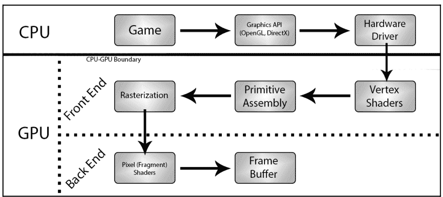
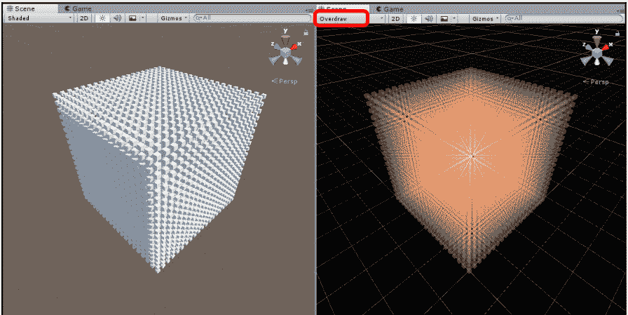
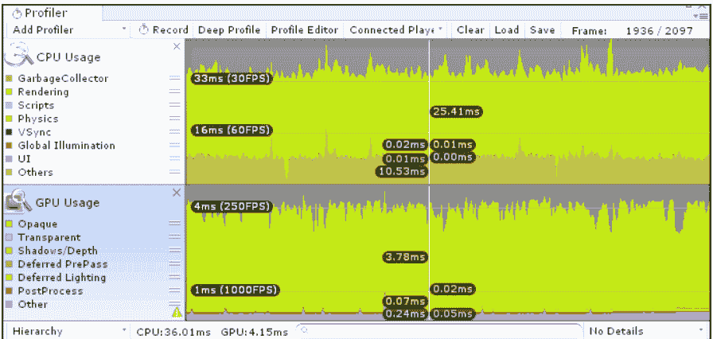
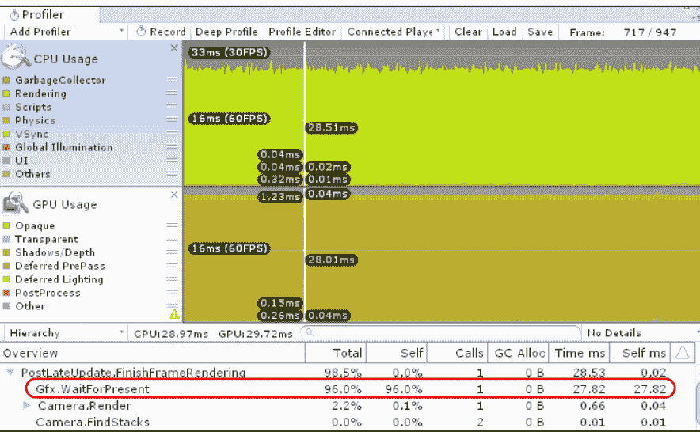
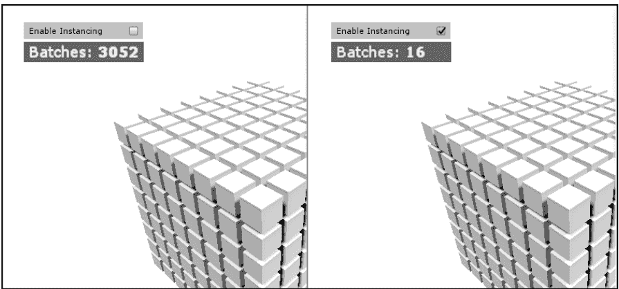
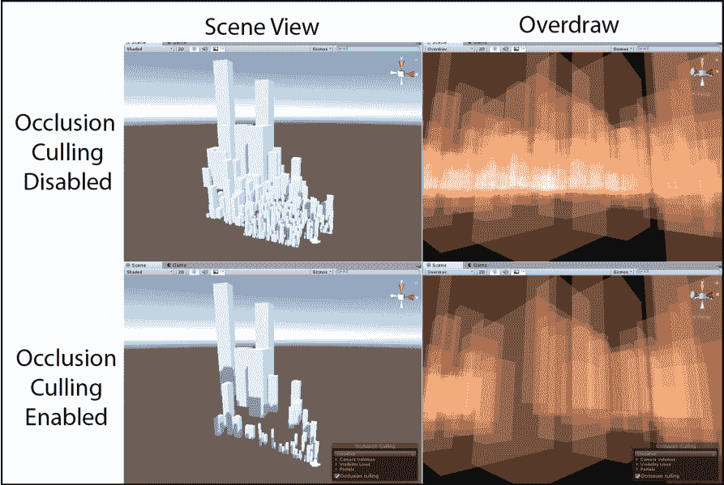
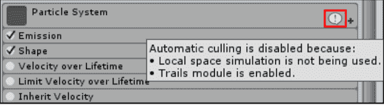

# 动态图形

毫无疑问，现代图形设备的渲染管线（Rendering Pipeline）非常复杂。即使只将一个三角形渲染到屏幕上，也需要大量的图形 API 调用，涵盖创建与操作系统（通常通过某种窗口系统）挂钩的相机视图缓冲区、为顶点数据分配缓冲区、设置用于将顶点和纹理数据从内存（RAM）传输到显存（VRAM）的数据通道、将每个内存空间配置为使用特定数据格式、确定相机可见的对象、为三角形设置并启动绘制调用（Draw Call）、等待渲染管线完成任务，最后将渲染后的图像呈现到屏幕上。然而，这种看似繁琐且过度设计的绘制简单对象的方式，背后有一个简单的原因——渲染通常涉及反复执行相同的任务，而所有这些初始设置使得未来的渲染任务变得非常快速。

CPU 设计用于处理几乎任何计算场景，但无法同时处理太多任务，而 GPU 设计用于处理大量并行任务，但在不破坏并行性的情况下，其可处理的复杂度有限。其并行特性要求大量数据必须非常快速地在各处复制。在设置渲染管线期间，我们为图形数据配置内存数据通道。因此，如果这些通道针对我们将传递的数据类型进行了正确配置，那么它们将更高效地运行。然而，设置不当会产生相反的结果。

CPU 和 GPU 在所有图形渲染过程中都会被使用，这使得它成为一场跨越软件、硬件、多个内存空间、编程语言（各适用于不同的优化）、处理器和处理器类型，以及大量可加入其中的特殊情况功能的高速处理与内存管理之舞。

为了让事情变得更加复杂，我们遇到的每种渲染情况都各不相同。在两个不同的 GPU 上运行同一应用程序，由于它们支持的功能和 API 不同，通常会导致南辕北辙的比较。要确定瓶颈在如此复杂的硬件和软件系统网络中的位置可能很困难，如果我们想要对现代渲染管线中性能问题的来源有强烈的、直接的直觉，可能需要在 3D 图形行业工作一辈子。

幸运的是，性能分析（Profiling）再次来拯救我们，这使得成为*渲染管线巫师*（Rendering Pipeline wizard）不再是必需。如果我们能收集每个设备的数据，使用多个性能指标进行比较，并调整场景以观察不同渲染功能如何影响其行为，那么我们应该有足够的证据来找到问题的根本原因并做出适当的更改。因此，在本章中，你将学习如何收集正确的数据，深入渲染管线足以找到问题的真正根源，并探索各种潜在问题的解决方案和变通方法。

在提升渲染性能方面，有许多主题需要涵盖。因此，在本章中，我们将探讨以下主题：

- 渲染管线的简要探索，重点介绍 CPU 和 GPU 发挥作用的部分
- 如何确定渲染是受 CPU 还是 GPU 限制的一般技术
- 一系列性能优化技术和功能，如下：
  - GPU 实例化（GPU Instancing）
  - 细节层次（Level Of Detail，LOD）和其他剔除组
  - 遮挡剔除（Occlusion Culling）
  - 粒子系统（Particle Systems）
  - Unity 用户界面（Unity UI）
  - 着色器优化（Shader optimization）
  - 光照和阴影优化（Lighting and Shadow optimization）
  - 移动端特定的渲染增强（Mobile-specific rendering enhancements）

# 渲染管线

渲染性能不佳可能以多种方式表现出来，具体取决于设备是受 CPU 活动（我们是 CPU 受限）还是 GPU 活动（我们是 GPU 受限）的限制。调查 CPU 受限的应用程序可能相对简单，因为所有 CPU 工作都包含从磁盘/内存加载数据和调用图形 API 指令。然而，GPU 受限的应用程序可能更难以分析，因为根本原因可能源自渲染管线中大量潜在位置的任何一个。我们可能发现需要依赖一些猜测或_排除法_（_process of elimination_）来确定 GPU 瓶颈的来源。无论哪种情况，一旦问题被发现并解决，我们就可以期待显著的改进，因为在修复渲染管线问题时，小修复往往能带来巨大的回报。

我们在_第 3 章，批处理的优势_（_chapter 3, The Benefits of Batching_）中简要提及了渲染管线。为了简要总结要点，我们知道 CPU 通过图形 API 发送渲染指令，这些指令通过硬件驱动程序传输到 GPU 设备，从而导致一系列渲染指令在称为命令缓冲区（Command Buffer）的队列中累积。这些命令由 GPU 逐个处理，直到命令缓冲区为空。只要 GPU 能在下一帧开始前跟上指令的速度和复杂度，我们就能保持帧率。然而，如果 GPU 落后，或者 CPU 花费太多时间生成命令，帧率就会开始下降。

以下是现代 GPU 上典型渲染管线的极度简化图表（也可能因设备、技术支持和自定义优化而异），展示了发生步骤的广泛视图：



第一行代表 CPU 中发生的工作，包括通过硬件驱动程序调用图形 API 以及将命令推送到 GPU 的行为。接下来的两行代表 GPU 中发生的步骤。由于 GPU 的复杂性，其内部过程通常分为两个不同的部分——**前端**（**Front End**）和**后端**（**Back End**），这两部分需要稍作解释。

# GPU 前端

前端指的是渲染过程中 GPU 处理顶点数据的部分。它将从 CPU 接收网格数据（大量顶点信息），并发出一个绘制调用（Draw Call）。然后 GPU 从网格数据中收集所有顶点信息，并将其传递给顶点着色器（Vertex Shaders），顶点着色器有机会对其进行修改并以一对一的方式输出。从此，GPU 现在有一个要处理的原始图元（Primitives）列表（三角形——3D 图形中最基本的形状）。接下来，光栅化器（Rasterizer）获取这些原始图元，并根据其顶点的位置和当前相机视图，确定最终图像中哪些像素需要绘制以创建原始图元。此过程生成的像素列表称为**片段**（**fragments**），它们将在后端中处理。

顶点着色器是小型的类 C 程序，用于确定它们感兴趣的输入数据以及操作数据的方式，然后为光栅化器生成片段输出一组信息。它也是细分（Tessellation）过程的所在地，细分由几何着色器（Geometry Shaders，有时称为**细分着色器**，**Tessellation Shaders**）处理，类似于顶点着色器，因为它们是上传到 GPU 的小型脚本，不同之处在于它们允许以一对多的方式输出顶点，从而以编程方式生成额外的几何体。

> 术语_着色器_（_Shader_）是一个陈旧的说法，源于这些脚本主要处理光照和着色任务的时代，在其角色扩展到包括当今所用的所有任务之前。


# GPU 后端

后端代表了渲染管线中处理片段的部分。每个片段都会经过片段着色器（也称为**像素着色器**）。与顶点着色器相比，这些着色器通常涉及更复杂的活动，例如深度测试、Alpha 测试、颜色化、纹理采样、光照、阴影以及各种后期处理效果，仅举几例。然后，这些数据会被绘制到帧缓冲区中，帧缓冲区保存了当前图像，在当前帧的渲染任务完成后，该图像最终会被发送到显示设备（我们的显示器）。

图形 API 默认通常使用两个帧缓冲区（尽管可以为自定义渲染场景生成更多）。在任何给定时刻，一个帧缓冲区包含我们刚刚渲染完的帧的数据，并正在呈现到屏幕上，而另一个帧缓冲区正在被 GPU 主动绘制，以完成命令缓冲区中的命令。一旦 GPU 达到 `swap buffers` 命令（CPU 要求其为给定帧完成的最后一条指令），帧缓冲区就会互换，以便呈现新帧。然后，GPU 将使用旧的帧缓冲区来绘制下一帧。每渲染一帧，这个过程就会重复一次，因此 GPU 只需要两个帧缓冲区来处理此任务。

这个整个过程，从进行图形 API 调用到交换帧缓冲区，会对每个网格、顶点、片段和帧连续重复，只要我们的应用程序仍在渲染。

有两个指标往往是后端瓶颈的根源：填充率和内存带宽。让我们来探讨一下。

# 填充率

填充率是一个非常宽泛的术语，指的是 GPU 绘制片段的速度。然而，这仅包括那些在给定片段着色器中启用的各种条件测试中存活下来的片段。片段只是一个 _潜在像素_，如果它未能通过任何启用的测试，则会被立即丢弃。这可以大大节省性能，因为渲染管线可以跳过昂贵的绘制步骤，转而处理下一个片段。

一个可能剔除片段的测试示例是 Z 测试，它检查来自更近物体的片段是否已经绘制到了同一个片段位置（Z 指的是相机视角的深度维度）。如果是，则当前片段被丢弃。如果不是，则片段被推送到片段着色器并绘制到目标像素上，这正好消耗一次填充率。现在，想象一下将此过程乘以成千上万个重叠的物体，每个物体生成数百或数千个可能的片段（更高的屏幕分辨率需要处理更多片段）。仅从主相机的视角来看，所有可能的重叠就很容易导致每帧需要处理数百万个片段。除此之外，我们每秒还要重复这个过程几十次。这就是为什么在渲染管线中进行大量初始设置很重要，而且显而易见，尽可能跳过这些绘制操作将带来巨大的渲染成本节省。

显卡制造商通常会将特定的填充率作为卡片的功能进行宣传，通常以每秒吉像素的形式出现，但这有点不准确，因为更准确的说法应该是每秒吉片段；不过，这个争论大多属于学术范畴。无论如何，较大的值告诉我们，该设备可能能够将更多片段推送到渲染管线中。因此，以每秒 30 吉像素的预算和 60 Hz 的目标帧率，我们可以在受到填充率瓶颈限制之前，每帧处理 30,000,000,000 / 60 = 5 亿个片段。以 2560 x 1440 的分辨率，以及每个像素仅被绘制一次的最佳情况，我们理论上可以绘制整个场景约 125 次而不会出现任何明显问题。

遗憾的是，这并非完美世界。填充率也会被其他高级渲染技术消耗，例如阴影和后期处理效果，它们需要对相同的片段数据进行自己的帧缓冲区通道。即便如此，由于对象渲染的顺序，我们总会在相同像素上产生一定量的重绘。这被称为过度绘制，它是衡量我们填充率利用效率的有用指标。

# 过度绘制

我们有多少过度绘制，可以通过使用加法 Alpha 混合和平面颜色渲染所有对象来直观地表示。高过度绘制区域会显示得更亮，因为同一个像素被多次用加法混合绘制。这正是场景窗口的过度绘制着色模式揭示我们场景中有多少过度绘制的方式。

以下截图显示了一个场景，左侧是绘制了数千个方框的正常场景，右侧是场景窗口的过度绘制着色模式：



过度绘制越多，我们通过覆盖片段数据而浪费的填充率就越多。我们可以应用几种技术来减少过度绘制，我们将在后面探讨。

请注意，实际上有几个不同的渲染队列，可以分为两种类型：不透明队列和透明队列。在不透明队列中渲染的对象可以像之前解释的那样通过 Z 测试剔除片段。然而，在透明队列中渲染的对象无法这样做，因为它们的透明特性意味着我们不能假设无论前面有多少其他对象，它们都不需要被绘制，这会导致大量的过度绘制。所有 Unity UI 对象始终在透明队列中渲染，使它们成为过度绘制的重要来源。

# 内存带宽

后端的另一个潜在瓶颈来源来自内存带宽。
每当纹理必须从 GPU VRAM 的某个部分拉取到较低的内存级别时，就会消耗内存带宽。这通常发生在纹理被采样时，片段着色器尝试为给定位置的给定片段挑选匹配的纹理像素（或纹素）来绘制。GPU 包含多个核心，每个核心都可以访问相同的 VRAM 区域，但它们还各自包含一个更小的本地纹理缓存，用于存储 GPU 最近正在处理的纹理。这在设计上与允许内存在链条上上下传输的众多 CPU 内存缓存级别相似。这是一种硬件设计权宜之计，用于解决更快的内存必然更难且更昂贵生产的事实。因此，与其拥有一个巨大且昂贵的 VRAM 块，不如拥有一个大而便宜的 VRAM 块，但使用一个更小、非常快速的低级纹理缓存来进行采样，这让我们两全其美，即以较低的成本实现快速采样。

如果核心本地纹理缓存中已经有所需的纹理，那么采样通常会变得快如闪电，几乎不可感知。如果没有，则必须在采样之前从 VRAM 中拉取纹理。这实际上是纹理缓存的缓存未命中，因为现在需要时间从 VRAM 中查找并拉取所需的纹理。这种传输会消耗一定量的可用内存带宽，具体等于存储在 VRAM 中的纹理文件的总大小（由于 GPU 级压缩技术，这可能不是原始文件的确切大小或 RAM 中的大小）。

如果我们在内存带宽上遇到瓶颈，GPU 将继续获取必要的纹理文件，但整个过程会被限速，因为纹理缓存在处理给定批次的片段之前一直在等待数据出现。GPU 将无法及时将数据推回帧缓冲区以在屏幕上呈现，从而阻塞整个过程并最终导致帧率低下。

合理使用内存带宽是另一个预算问题。例如，以每核心每秒 96 GB 的内存带宽和每秒 60 帧的目标帧率，GPU 在受到内存带宽瓶颈限制之前，每帧可以拉取大约 1.6 GB（96/60）的纹理数据。当然，这不是一个精确的预算，因为存在缓存未命中的可能性，但它确实为我们提供了一个可供使用的粗略值。


# 光照与阴影

在现代游戏中，单个对象很少能在单个步骤中完全完成渲染，这主要归因于光照与阴影。这些任务通常在片段着色器的多个通道中处理，每个光源对应一个通道，最终结果会被合并，以便多个光源都有机会被应用。结果看起来更加逼真，或者至少更具视觉吸引力。

需要多个通道来收集阴影信息。我们首先会设置场景，使其包含阴影投射者和阴影接收者，分别用于创建或接收阴影。然后，每次渲染阴影接收者时，GPU 会从光源的视角渲染任何阴影投射者对象到纹理中，目的是收集每个片段的距离信息。然后它会对阴影接收者做同样的处理，只不过现在它知道从光源来看哪些片段会被阴影投射者遮挡，因此可以将这些片段渲染得更暗，因为它们将处于光源在阴影投射者上方投射的阴影中。

内存带宽通常按每个核心列出，但一些 GPU 厂商可能会通过将内存带宽乘以核心数量来误导用户，以列出一个更大但不太实用的数字。因此，可能需要进行研究才能公平比较。

请注意，这个值不是我们游戏在项目中可以包含的纹理数据量的最大限制，也不是 CPU 内存，甚至不是 VRAM 的限制。它本质上是一个指标，限制了在一帧内可以发生多少次纹理交换。同一张纹理可能在单帧内被多次来回拉取，具体取决于有多少个着色器需要使用它们、对象的渲染顺序以及纹理采样发生的频率。只有少数几个对象就可能消耗整个 GB 的内存带宽，因为可用的纹理缓存空间是有限的。需要大量大纹理的着色器更可能导致缓存未命中，从而造成内存带宽瓶颈。如果我们考虑多个对象需要不同的高质量纹理和多个次要纹理贴图（法线贴图、发光贴图等），并且这些贴图没有批处理在一起，那么这种情况出乎意料地容易触发。在这种情况下，纹理缓存无法长时间保留单个纹理文件，以便在下一个渲染通道中立即对其进行采样。


然后，这些信息会变成一种称为 _阴影贴图_ 的额外纹理，并在从主相机视角渲染阴影接收者时与其表面混合。这将使其表面在光源与给定对象之间有其他物体的位置显得更暗。创建 _光照贴图_ 使用类似的过程，光照贴图是为场景中较静态部分预先生成的光照信息。

光照与阴影在渲染管道的所有部分都倾向于消耗大量资源。我们需要每个顶点提供法线方向（指向表面外的矢量）来确定光照应如何从该表面反射，并且可能需要额外的顶点颜色属性来应用一些额外着色。这为 CPU 和前端提供了更多可传递的信息。由于完成最终渲染需要多个片段着色器通道，后端在填充率（大量需要绘制、重绘和合并的像素）和内存带宽（为光照贴图和阴影贴图拉入或拉出额外纹理）方面都保持忙碌。这就是为什么实时阴影相比大多数其他渲染功能异常昂贵，并且在启用时会显著增加绘制调用数量的原因。

然而，光照与阴影或许是游戏美术与设计中最重要的两个部分，做好它们通常值得额外的性能开支。良好的光照与阴影可以将平庸的场景变得非凡，因为专业着色带来的视觉吸引力有种神奇之处。即使是低多边形艺术风格（例如，手机游戏《纪念碑谷》）也高度依赖良好的光照与阴影配置，以便让玩家能够区分不同对象并创建出视觉上令人愉悦的场景。

Unity 提供了多种影响光照与阴影的功能，从实时光照与阴影（每种都有多种类型）到称为 _光照贴图_ 的静态光照。有很多选项可以探索，当然，如果我们不小心，也有很多事情可能会导致性能问题。

> Unity 文档详细介绍了各种光照功能。请从以下页面开始，逐一学习；这样做非常值得花时间，因为这些系统会影响整个渲染管道；请参阅 https://docs.unity3d.com/Manual/LightingOverview.html https://unity3d.com/learn/tutorials/topics/graphics/introduction-lighting-and-rendering。

有两种不同的渲染格式，可以极大地影响我们的光照性能，即 **前向渲染和延迟渲染**。这些渲染选项的设置位于 **编辑 | 项目设置 | 播放器 | 其他设置 | 渲染**，并可按平台进行配置。

# 前向渲染

前向渲染是我们场景中渲染光照的传统形式，如前所述。在前向渲染期间，每个对象都会通过同一个着色器进行多个通道渲染。需要多少个通道取决于光源的数量、距离和亮度。Unity 会尝试优先处理影响对象最大的 `DirectionalLight` 组件，并将对象在 _基础通道_ 中渲染为起点。然后，它会获取附近几个最强大的 `PointLight` 组件，并通过同一个片段着色器多次重新渲染同一个对象。每个点光源都将按顶点处理，所有剩余的光源将通过一种称为球谐函数的技术浓缩为 _平均_ 颜色。

通过将光照的 **渲染模式** 设置为 **不重要** 等值，并更改 **编辑 | 项目设置 | 质量 | 像素光照数量** 的值，可以简化其中一些行为。该值限制了前向渲染将收集的光照数量，但会被任何 **渲染模式** 设置为 **重要** 的光照覆盖。因此，由我们负责任地使用这组设置组合。

正如我们所想象的，在存在大量点光源的场景中，使用前向渲染会因配置的渲染状态数量和所需着色器通道而迅速导致绘制调用数量激增。

> 有关前向渲染的更多信息，请参阅 Unity 文档 http://docs.unity3d.com/Manual/RenderTech-ForwardRendering.html。

# 延迟渲染

延迟渲染，有时也称为 _延迟着色_，是一种在 GPU 上可用约十年的技术，但由于涉及的注意事项以及在移动设备上支持有限，它并未完全取代前向渲染方法。

延迟着色之所以得名，是因为实际着色直到过程的后期才会发生，也就是说，它被推迟到以后。它的工作原理是创建一个几何缓冲区（称为 G-Buffer），其中场景最初在不应用任何光照的情况下进行渲染。有了这些信息，延迟着色系统可以在单个通道内生成光照配置文件。

从性能角度来看，结果非常出色，因为它可以以很少的绘制调用生成非常好的逐像素光照。一个缺点是，抗锯齿、透明度以及对动画角色应用阴影等效果无法仅通过延迟着色来管理。在这种情况下，前向渲染技术将作为回退方案应用以完成这些任务，因此需要额外的绘制调用来完成。延迟着色的一个更大问题是，它通常需要更强大、更昂贵的硬件，并且并非所有平台都可用，因此能够使用它的用户较少。

> Unity 文档包含关于延迟着色技术及其优点和陷阱的优秀信息来源，可在 http://docs.unity3d.com/Manual/RenderTech-DeferredShading.html 找到。

# 顶点光照着色（旧版）

从技术上讲，不止两种光照方法。其余两种是顶点光照着色和一种非常原始、功能宽松的延迟渲染版本。顶点光照着色是光照的大幅简化，因为光照仅按顶点考虑，而不按像素考虑。换句话说，整个面基于入射光照颜色被涂成相同的颜色，而不是通过单个像素在面上混合光照颜色。

不指望有多少，或者说真的有任何 3D 游戏会使用这种旧版技术，因为缺乏阴影和适当的光照使得深度可视化非常困难。它主要被不需要使用阴影、法线贴图和各种其他光照功能的简单 2D 游戏使用。

# 全局光照

全局光照，简称 GI，是烘焙光照贴图的一种实现。光照贴图与阴影技术创建的阴影贴图类似，即为每个对象生成一张或多张纹理，表示额外的光照信息，并在片段着色器的光照通道期间稍后应用到对象上，以模拟静态光照效果。


Lightmaps 与其他形式的照明之间的主要区别在于，Lightmaps 是在编辑器中预先生成（或烘焙）并打包到游戏构建中的。这确保了我们不需要在运行时不断重新生成这些信息，从而节省大量的 Draw Call 和显著的 GPU 活动。由于我们可以烘焙这些数据，我们有充裕的时间来生成非常高质量的 Lightmaps（当然，代价是需要处理更大的生成纹理文件）。

由于这些信息是预先烘焙的，它无法响应游戏过程中的实时活动，因此默认情况下，任何 Lightmapping 信息都只会应用于生成 Lightmap 时场景中存在且位于确切位置的静态对象。但是，可以将 Light Probe 添加到场景中，以生成一组额外的 Lightmap 纹理，这些纹理可以应用于附近移动的动态对象，从而使这些对象受益于预先生成的照明。这不会具有像素级的准确性，并且会占用额外 Light Probe 贴图的磁盘空间以及运行时的内存带宽来交换它们，但它确实会生成更可信、更悦目的照明配置。

多年来，开发出了几种生成 Lightmaps 的技术，Unity 自初始发布以来使用了几种不同的解决方案。全局光照（Global Illumination）只是 Lightmapping 背后数学技术的最新一代，它通过计算不仅照明如何影响给定对象，而且光线如何反射到附近表面，从而提供非常逼真的着色，使对象能够影响周围对象的照明配置。这种效果由名为 Enlighten 的内部系统计算。该工具既用于创建静态 Lightmaps，也用于创建所谓的预计算实时光照（Pre-computed Real-time GI），后者是实时和静态着色的混合体，允许我们模拟诸如一天中的时间（太阳光的方向随时间变化）等效果，而无需依赖昂贵的实时照明效果。

生成 Lightmaps 的一个典型问题是生成它们并获得当前设置的视觉反馈所需的时间，因为 Lightmapper 通常试图在一次通过中生成全细节 Lightmaps。如果用户尝试修改其配置，则整个任务必须取消并重新开始。为了解决这个问题，Unity Technologies 实现了渐进式 Lightmapper，它更逐渐地随时间执行 Lightmapping 任务，但也允许在计算过程中对其进行修改。这使得场景中的 Lightmaps 在后台工作时看起来变得越来越详细，同时还允许我们在它仍在工作时更改某些属性，而无需重新启动整个任务。这提供了几乎即时的反馈，并极大地改善了生成 Lightmaps 的工作流程。

# 多线程渲染

多线程渲染在大多数系统上默认启用，例如桌面和主机平台，其 CPU 提供多个内核。其他平台仍然支持许多低端设备默认启用此功能，因此对于它们来说，这是一个可切换的选项。对于 Android，可以通过 **Edit | Project Settings | Player | Other Settings | Multithreaded Rendering** 下的复选框启用它，而对于 iOS，可以通过配置应用程序以使用 Apple 的 Metal API 在 **Edit | Project Settings | Player | Other Settings | Graphics API** 下启用多线程渲染。在撰写本书时，WebGL 不支持多线程渲染。

对于场景中的每个对象，有三个任务需要完成：确定对象是否需要渲染（通过一种称为 _视锥体剔除（Frustum Culling）_ 的技术），如果是，则生成渲染对象的命令（因为渲染单个对象可能会导致几十个不同的命令），然后使用相关的图形 API 将命令发送到 GPU。如果没有多线程渲染，所有这些任务都必须在 CPU 的主线程上发生，因此主线程上的任何活动都成为所有渲染的关键路径的一部分。启用多线程渲染后，将命令推送到 GPU 的任务由 _渲染线程（render thread）_ 处理，而其他任务（如剔除和生成命令）则分布在多个 _工作线程（worker threads）_ 上。这种设置可以为主线程节省大量的 CPU 周期，主线程是其他大多数 CPU 任务（例如物理和脚本代码）发生的地方。

启用此功能将影响 CPU 瓶颈的含义。没有多线程渲染时，主线程正在执行为命令缓冲区生成指令所需的所有工作，这意味着我们在其他地方节省的任何性能都将为 CPU 生成命令腾出更多时间。但是，当多线程渲染正在进行时，大部分工作负载被推送到单独的线程上，这意味着对主线程的改进对通过 CPU 的渲染性能的影响会较小。

> 请注意，无论是否进行多线程渲染，GPU 瓶颈都是一样的。GPU 始终以多线程方式执行其任务。

# 低级别渲染 API

Unity 通过其 `CommandBuffer` 类向我们公开一个渲染 API。这允许我们通过 C# 代码直接控制渲染管道，通过发出高级别渲染命令，例如 `使用此材质渲染此对象，使用此着色器`，或 `绘制此程序化几何体的 N 个实例`。这种自定义不如直接访问图形 API 那么强大，但对于 Unity 开发者自定义独特的图形效果来说，这是一个正确的方向。

查看 Unity 关于 `CommandBuffer` 的文档，以使用此功能，网址为 `http://docs.unity3d.com/ScriptReference/Rendering.CommandBuffer.html`。

如果需要更直接的渲染控制级别，例如我们希望对 OpenGL、DirectX 和 Metal 进行直接图形 API 调用，那么请注意，可以创建一个原生插件（专为目标平台架构编译的 C++ 代码编写的小型库），它挂钩到 Unity 的渲染管道，为特定渲染事件发生时设置回调，类似于 `MonoBehaviours` 挂钩到 Unity 主引擎的各种回调。这对于大多数 Unity 用户来说当然是一个高级话题，但随着我们对渲染技术和图形 API 的知识成熟，将来有用知道。

Unity 提供了关于在原生插件中生成渲染接口的良好文档，网址为 `https://docs.unity3d.com/Manual/NativePluginInterface.html`。

# 检测性能问题

由于涉及大量复杂过程，GPU 可能会以多种不同的方式成为瓶颈，这应该是显而易见的。既然我们已经彻底了解了渲染管道以及瓶颈可能发生的方式，让我们探讨如何检测这些问题。

# 分析渲染问题

分析器（Profiler）可用于快速缩小我们在渲染管道中使用的两个设备之一的瓶颈范围——无论是 CPU 还是 GPU。我们必须使用 **分析器（Profiler）** 窗口的 **CPU 使用率（CPU Usage）** 和 **GPU 使用率（GPU Usage Areas）** 区域来检查问题，因为这可以告诉我们哪个设备工作最努力。

以下屏幕截图显示了 CPU 瓶颈应用程序的 **分析器（Profiler）** 数据。测试涉及创建数千个简单的立方体对象，没有进行批处理或阴影技术。这导致 CPU 需要为其生成命令的极大量 Draw Call 数量（约 32,000），但由于渲染对象的简单性，GPU 有相对较少的工作要做：



此示例显示，CPU 的 **渲染（Rendering）** 任务正在消耗大量周期（每帧约 25 毫秒），而 GPU 处理时间少于 4 毫秒，表明瓶颈在于 CPU。请注意，此分析测试是针对独立应用程序进行的，而不是在编辑器中。我们现在知道我们的渲染是 CPU 瓶颈，可以开始应用一些节省 CPU 的性能改进（注意不要通过这样做在其他地方引入渲染瓶颈）。

与此同时，通过分析器分析 GPU 瓶颈应用程序要棘手一些。这次，测试涉及创建一个需要最少 Draw Call 的简单对象，但使用了非常昂贵的着色器，该着色器采样纹理数千次，在后端产生荒谬的活动量。


# Dynamic Graphics 第 6 章

要执行公平的 GPU 绑定分析测试，你应该通过 Edit | Project Settings | Quality | Other | V Sync Count 禁用垂直同步，否则很可能会污染我们的数据。

以下截图显示了在独立应用程序中运行此测试时的分析器数据：



如前一张截图所示，CPU 使用率区域的渲染任务与 GPU 使用率区域的总渲染开销高度吻合。我们还可以看到，图像底部的 CPU 和 GPU 时间开销相对相似（各约 29 毫秒）。这有些令人困惑，因为我们似乎在两个设备上都同样受到瓶颈限制，而我们预期 GPU 应该比 CPU 工作得更辛苦。

实际上，如果我们使用 **层次结构模式** 深入研究 **CPU 使用率区域** 的 **细分视图**，我们会注意到大部分 CPU 时间都花在标记为 **Gfx.WaitForPresent** 的任务上。这是 CPU 在等待 GPU 完成当前帧时浪费的时间。因此，我们实际上是受到 GPU 瓶颈限制，尽管看起来像是两者都受到限制。即使启用了多线程渲染，CPU 也必须等待渲染管道完成，然后才能开始下一帧。


**Gfx.WaitForPresent** 也用于指示 CPU 正在等待垂直同步完成，因此需要为此测试禁用它。

# 暴力测试

如果我们正在仔细研究分析数据，仍然不确定问题所在，或者我们受到 GPU 限制并需要确定在渲染管道的哪个位置存在瓶颈，我们应该尝试暴力法，即从场景中剔除特定活动并检查是否会导致性能大幅提升。如果小的变化带来巨大的速度提升，那么我们就有了关于瓶颈所在的强烈线索。如果我们消除了足够多的未知变量以确保数据引导我们走向正确方向，那么这种方法没有任何坏处。

针对 CPU 限制的明显暴力测试是减少绘制调用以检查性能是否突然提升。然而，这通常是不可能的，因为我们可能已经通过静态批处理、动态批处理和图集等技术将绘制调用减少到最小。这意味着我们进一步减少绘制调用的空间非常有限。

不过，我们可以通过引入更多对象或禁用静态批处理和动态批处理等节省绘制调用的功能，有意地小幅增加绘制调用次数，并观察情况是否比以前显著恶化。如果是，那么我们就有证据表明我们要么非常接近 CPU 限制，要么已经成为 CPU 限制。

有两个很好的暴力测试可以应用于受 GPU 限制的应用程序，以确定我们是受填充率还是内存带宽限制：分别是降低屏幕分辨率或降低纹理分辨率。

通过降低屏幕分辨率，我们将要求光栅化器生成显著更少的片段，并将它们映射到更小的像素画布上供后端处理。这将减少应用程序的填充率消耗，为渲染管道的这一关键部分提供一些额外的喘息空间。因此，如果降低屏幕分辨率后性能突然提升，那么填充率应该是我们的主要关注点。


从 2560 x 1440 分辨率降低到 800 x 600 分辨率，性能提升因子约为八倍，这通常足以大幅降低填充率开销，使应用程序再次运行良好。

同样，如果我们受到内存带宽瓶颈限制，那么降低纹理质量可能会导致显著的性能提升。这样做，我们缩小了纹理的大小，大大降低了片段着色器的内存带宽开销，使 GPU 能够更快地获取所需的纹理。全局降低纹理质量可以通过转到 **Edit | Project Settings | Quality | Texture Quality** 并将值设置为 **Half Res**、**Quarter Res** 或 **Eighth Res** 来实现。

受 CPU 限制的应用程序有大量机会通过本书中几乎每个性能增强技巧来提升性能。如果我们从其他活动中释放 CPU 周期，那么我们就可以通过更多绘制调用来渲染更多对象，当然要记住，每个对象都会增加 GPU 的活动。然而，在尝试改进渲染管道的其他部分时，还有额外的机会来间接改进绘制调用数量。这包括遮挡剔除、调整光照和阴影行为以及修改着色器。这些将在后续部分中解释，因为我们将调查各种性能增强。

与此同时，我们可能需要应用一些暴力测试和猜测来确定受 GPU 限制的应用程序是如何被瓶颈限制的。大多数应用程序受到填充率或内存带宽瓶颈限制，因此我们应该从这里开始。在桌面应用程序中，很少在前端发现性能瓶颈，因此只有在验证了其他来源不是问题后才值得检查。顶点着色器通常与片段着色器相比微不足道，因此导致前端处理出现问题的唯一真正机会要么是推送过多几何体，要么是具有过于复杂的几何着色器。

最终，这项调查应该帮助我们确定我们是受 CPU 限制还是受 GPU 限制，在后一种情况下，是受前端还是后端限制，再在后一种情况下，是受填充率还是内存带宽限制。有了这些知识，我们可以应用许多技术来提升性能。

# 渲染性能增强

我们现在应该拥有理解性能瓶颈所需的所有信息，以便开始应用修复。在本章的其余部分，我们将介绍一系列技术，以提高受 CPU 限制和受 GPU 限制应用程序的渲染管道性能。

# 启用/禁用 GPU 皮肤动画

第一个技巧涉及一个设置，它以牺牲另一个设备为代价来减轻 CPU 或 GPU 前端的负担，即 GPU 皮肤动画。皮肤动画是根据动画骨骼的当前位置转换网格顶点的过程。动画系统在 CPU 上工作，转换用于确定对象当前姿态的骨骼，但动画过程中的下一个重要步骤是将网格顶点包裹在骨骼周围，将网格置于最终姿态。这是通过遍历每个顶点并对连接到这些顶点的骨骼进行加权平均来实现的。

此顶点处理任务可以在 CPU 上或在 GPU 的前端中进行，具体取决于是否启用了 **GPU 皮肤动画** 选项。此功能可以在 **Edit | Project Settings | Player Settings | Other Settings | GPU Skinning** 下切换。启用此选项将皮肤动画活动推送到 GPU，但请记住，CPU 仍然必须将数据传输到 GPU 并为该任务生成命令缓冲区上的指令，因此它并没有完全消除 CPU 的工作量。禁用此选项通过让 CPU 在传输网格数据之前解析网格的姿态，然后简单地要求 GPU 按原样绘制它，从而减轻 GPU 的负担。显然，如果我们在场景中有大量动画网格，此功能很有用，可以通过将工作推送到最不繁忙的设备来帮助任何一种受限情况。


# 减少几何复杂度

此技巧涉及 GPU 前端。我们在第四章“启动您的美术工作”中已经介绍了一些网格优化技术，这些技术可以帮助减少网格的顶点属性。作为快速提醒，使用包含大量不必要的 UV 和法线数据的网格并不罕见，因此我们应该对网格进行双重检查，以排除这种多余的冗余内容。我们还应该让 Unity 为我们优化结构，以最大限度地减少缓存未命中，因为顶点数据在前端中被读取。

目标是简单地减少实际顶点数量。有三种解决方案。首先，我们可以通过让美术团队手动调整和生成低多边形数量的网格，或者使用网格简化工具来为我们完成此操作，从而简化网格。其次，我们可以简单地从场景中移除网格，但这应该是最后的手段。第三种选择是通过实现诸如细节层次（LOD）等功能来实现自动剔除，这将在本章后面解释。

# 减少细分

通过几何着色器进行细分可以非常有趣，因为这是一种相对未被充分利用的技术，可以真正使我们的图形效果在仅使用最常见效果的游戏中脱颖而出。然而，它可能会极大地增加前端中进行的处理工作量。

除了改进我们的细分算法或减轻其他前端任务造成的负担，以给细分任务更多喘息空间之外，并没有真正简单的技巧可以利用来改进细分。无论如何，如果我们在前端存在瓶颈并且正在使用细分技术，我们应该双重检查它们是否没有消耗前端预算的大部分。

# 使用 GPU 实例化

GPU 实例化是一种快速渲染相同网格多个副本的方法，它利用了这些网格将具有相同的渲染状态，因此需要最少的绘制调用的事实。这实际上与动态批处理相同，只是它不是自动过程。事实上，我们可以将动态批处理视为穷人的 GPU 实例化，因为 GPU 实例化可以实现更好的节省，并通过允许参数化变体来实现更多自定义。

GPU 实例化在材质级别应用，使用**启用实例化**复选框，并且可以通过修改着色器代码来引入变体。这样，我们可以为不同的实例赋予不同的旋转、缩放、颜色等。这对于渲染森林和岩石区域等场景非常有用，我们希望在这些场景中渲染数百或数千个带有轻微变化的网格副本。

> 请注意，蒙顶网格渲染器无法实例化，原因与它们无法动态批处理相似，并且并非所有平台和 API 都支持 GPU 实例化。

以下截图显示了 GPU 实例化对一组 512 个立方体对象（应用了一些额外的光照和阴影以增加总绘制调用数量）的好处：



与动态批处理相比，该系统要通用得多，因为我们对对象如何批处理在一起有更多控制权。当然，如果我们以低效的方式批处理事物，就会有更多出错的机会，因此我们应该谨慎使用。

有关 GPU 实例化的更多信息，请查看 Unity 文档 https://docs.unity3d.com/Manual/GPUInstancing.html。

# 使用基于网格的细节层次（LOD）

LOD 是一个广义术语，指根据功能与摄像机的距离和/或它们在摄像机视图中占据的空间大小来动态替换功能。由于在很远的距离很难分辨低质量和高质量对象之间的区别，因此很少有理由渲染高质量版本，所以我们可以动态地将远处的对象替换为更简单的东西。LOD 最常见的实现是基于网格的 LOD，其中网格会随着摄像机越来越远而动态替换为细节较低的版本。

可以通过在场景中放置多个对象并将其作为带有附加 `LODGroup` 组件的 `GameObject` 的子对象来实现基于网格的 LOD。LOD 组的目的是从这些对象生成一个包围盒，并根据包围盒在摄像机视野中的大小来决定应该渲染哪个对象。如果对象的包围盒占据当前视图的大面积，则会启用分配给较低 LOD 组的网格；如果包围盒非常小，则会将网格替换为较高 LOD 组中的网格。如果网格太远，可以配置为隐藏所有子对象。因此，通过正确的设置，我们可以让 Unity 用更简单的替代品替换网格，或者完全剔除它们，从而减轻渲染过程的负担。

有关基于网格的 LOD 功能的更详细信息，请查看 Unity 文档 `http://docs.unity3d.com/Manual/LevelOfDetail.html`。

此功能的完全实现可能会花费大量开发时间；艺术家必须生成同一对象的低多边形数量版本，关卡设计师必须生成 LOD 组、配置它们并测试它们，以确保它们在摄像机靠近或远离时不会造成突兀的过渡。

> > 请注意，一些游戏开发中间件公司提供用于自动化 LOD 网格生成的第三方工具。这些工具可能值得调查，以比较其易用性、质量损失和成本效益。

基于网格的 LOD 还会在磁盘占用空间以及 RAM 和 CPU 方面带来成本；替代网格需要打包、加载到 RAM 中，并且 `LODGroup` 组件必须定期测试摄像机是否移动到了需要更改 LOD 级别的新位置。然而，对渲染管道的好处相当显著。动态渲染更简单的网格减少了我们需要传递的顶点数据量，并可能减少渲染对象所需的绘制调用、填充率和内存带宽。

由于基于网格的 LOD 要正常工作需要做出许多牺牲，开发者应避免通过自动假设基于网格的 LOD 会有所帮助而进行预优化。过度使用该功能会给我们应用程序性能的其他部分带来负担，并消耗宝贵的开发时间，这一切都只是出于多疑。只有当我们开始观察到渲染管道出现问题，并且有 CPU、RAM 和开发时间可用时，才应该使用它。

话虽如此，那些具有广阔世界视图和大量摄像机移动的场景，可能会考虑非常早地实现此技术，因为增加的距离和大量可见对象可能会极大地增加顶点数量。作为反例，那些始终在室内或摄像机视角俯视世界的场景，从该技术中获益甚微，因为对象始终与摄像机保持相似距离。示例包括**即时战略（RTS）**和**多人在线战术竞技场（MOBA）**游戏。

# 剔除组

剔除组是 Unity API 的一部分，它有效地允许我们创建自己的自定义 LOD 系统，作为动态替换某些游戏玩法或渲染行为的一种方式。我们可能想要应用 LOD 的一些示例包括将动画角色替换为骨骼更少的版本、应用更简单的着色器、在远距离跳过粒子系统生成、简化 AI 行为等等。

由于剔除组系统在最基本级别上只是告诉我们对象是否对摄像机可见以及它们有多大，因此它在游戏玩法领域还有其他用途，例如确定某些敌人生成点当前是否对玩家可见，或者玩家是否正在接近某些区域。剔除组系统有广泛的可能性，值得考虑。当然，实现、测试和重新设计场景以利用它所花费的时间可能是巨大的。


# 利用遮挡剔除

减少填充率消耗和过度绘制的最佳方法之一是使用 Unity 的遮挡剔除系统。该系统通过将世界划分为一系列小单元，并让虚拟相机在场景中飞行，根据对象的大小和位置，记录哪些单元从其他单元不可见（即被_遮挡_）。

请注意，这与视锥剔除技术不同，视锥剔除会剔除当前相机视图外的对象。视锥剔除始终处于活动状态且自动执行。因此，由此过程剔除的对象会被遮挡剔除系统自动忽略。

遮挡剔除数据只能为在 **StaticFlags** 下拉菜单中正确标记为 **Occluder Static** 和/或 **Occludee Static** 的对象生成。**Occluder Static** 是静态对象的常规设置，我们预期这些对象足够大，既会遮挡其他对象，也会被其他对象遮挡，例如摩天大楼或山脉，它们可以隐藏其后的其他对象，也可能彼此遮挡，等等。**Occludee Static** 是一种特殊情况，适用于透明对象等情况，这些对象始终需要渲染其后的其他对象，但如果有大型物体阻挡其可见性，则它们自身需要被隐藏。

自然地，因为必须启用 **Static** 标志才能使用遮挡剔除，因此此功能对动态对象无效。

以下截图展示了遮挡剔除在减少场景中渲染对象数量方面的效果（从外部视角演示）。从主相机的角度来看，两种情况看起来相同。


渲染管道不会浪费时间渲染被更近的对象遮挡的对象：



启用遮挡剔除功能会增加磁盘空间、RAM 和 CPU 时间的开销。需要额外的磁盘空间来存储遮挡数据，需要额外的 RAM 来保持数据结构在内存中，并且每帧都会产生 CPU 处理开销来确定哪些对象被遮挡。遮挡剔除数据结构必须正确配置，以便为我们的场景创建适当大小的单元，单元越小，生成数据结构所需的时间越长。但是，如果针对场景正确配置，遮挡剔除可以通过减少过度绘制来节省填充率，并通过剔除不可见对象来节省绘制调用。

> 请注意，即使对象可能被遮挡剔除，其阴影仍必须计算，因此我们不会从这些任务中节省任何绘制调用或填充率。

# 优化粒子系统

粒子系统适用于大量不同的视觉效果，通常生成的粒子越多，效果看起来越好。但是，我们需要对生成的粒子数量和使用的着色器复杂度负责，因为它们可能触及渲染管道的所有部分；它们会为前端生成大量顶点（每个粒子是一个四边形），并且可能使用多个纹理，这些纹理在后端会消耗填充率和内存带宽，因此如果使用不当，它们可能导致应用程序在任何地方都成为瓶颈。

降低粒子系统密度和复杂度相当简单——使用更少的粒子系统、生成更少的粒子，和/或使用更少的特效。图集也是降低粒子系统性能开销的另一种常见技术。但是，粒子系统背后有一个不太为人所知的重要性能考量，并且发生在幕后，那就是自动粒子系统剔除过程。

# 利用粒子系统剔除

Unity Technologies 发布了一篇关于此主题的优秀博客文章，可在 `https://blogs.unity3d.com/2016/12/20/unitytips-particlesystem-performance-culling/` 找到。

基本思想是，所有粒子系统要么是可预测的，要么是不可预测的（确定性与非确定性），这取决于各种设置。当粒子系统可预测且对主视图不可见时，整个粒子系统可以自动剔除以节省性能。一旦可预测的粒子系统重新进入视图，Unity 就可以计算出粒子系统在该时刻应该呈现的样子，就好像它在不可见期间一直在生成粒子一样。只要粒子系统以非常程序化的方式生成粒子，状态就可以立即在数学上求解。

但是，如果任何设置迫使粒子系统变得不可预测或 `nonprocedural`，那么它将无法知道如果之前被隐藏，粒子系统当前的状态应该是什么，因此无论是否可见，都需要每帧完全渲染它。破坏粒子系统可预测性的设置包括但不限于让粒子系统在世界空间中渲染、应用外部力、碰撞和轨迹，或使用复杂的动画曲线。请查看前面提到的博客文章，了解非程序化条件的严格列表。

请注意，当某些事情会导致粒子系统中断自动剔除时，Unity 会提供有用的警告，如以下截图所示：



# 避免递归粒子系统调用

`ParticleSystem` 组件可用的许多方法都是递归调用。调用它们会遍历粒子系统的每个子项，然后在每个子项上调用 `GetComponent<ParticleSystem>()`，如果组件存在，它将调用相应的方法。然后这会对原始父级下的每个子 `ParticleSystem`、其孙级等重复。这在粒子系统层次结构很深时可能是一个巨大的问题，这在复杂效果中有时是常见的情况。

受此行为影响的几个 `ParticleSystem` API 调用包括 `Start()`、`Stop()`、`Pause()`、`Clear()`、`Simulate()` 和 `isAlive()`。我们显然不能完全避免这些方法，因为它们代表了我们最希望在粒子系统上调用的最常用方法。但是，每个方法都有一个默认为 `true` 的 `withChildren` 参数。通过将 `false` 传递给此参数（例如，通过调用 `Clear(false)`），它会禁用递归行为，不会调用其子项。因此，方法调用将仅影响给定的粒子系统，从而降低调用的开销成本。

这并不总是理想的，因为我们通常确实希望粒子系统的所有子项都受到方法调用的影响。因此，另一种方法是，像我们在 _Chapter 2, Scripting Strategies_ 中学到的那样，缓存 `ParticleSystem` 组件，并手动遍历它们（确保每次都为 `withChildren` 参数传递 `false`）。

# 优化 Unity UI

Unity 最初几次尝试内置 UI 系统并不特别成功；它们通常很快被资产商店上的产品所取代。但是，他们最新一代的解决方案（简单称为 Unity UI）已成为一个更受欢迎的解决方案，以至于许多开发人员开始依赖它来满足他们的 UI 需求，事实上，Unity Technologies 在 2017 年初收购了 Text Mesh Pro 资产背后的公司，并将其合并到 Unity UI 作为内置功能。

让我们探讨一些可以用来提高 Unity 内置 UI 性能的技术。

# 使用更多画布

`Canvas` 组件的主要任务是管理用于绘制 **Hierarchy** 窗口中其下方 UI 元素的网格，并发出渲染这些元素所需的绘制调用。画布的一个重要任务是将这些网格批量处理在一起（只有当它们共享相同的材质时才能发生），以减少绘制调用。但是，当对画布或其任何子项进行更改时，这被称为使画布“脏化”。当画布“脏”时，它需要在发出绘制调用之前为其下方的所有 UI 元素重新生成网格。这个重新生成过程并非简单任务，是 Unity 项目中性能问题的常见来源，因为不幸的是，有很多事情会导致画布被脏化。即使在画布中更改单个 UI 元素也会导致这种情况。导致脏化的事情太多，而不导致脏化的事情太少（并且通常仅在特定情况下），因此最好谨慎行事，假设任何更改都会导致这种效果。


也许唯一不会导致脏化的显著操作是更改 UI 元素的 `Color` 属性。


如果我们发现 UI 在任何内容发生变化时（有时甚至每帧都会变化）都会导致 CPU 使用率大幅飙升，那么我们可以采用的一个解决方案就是简单地使用更多的 Canvas。一个常见的错误是将整个游戏的 UI 构建在单个 Canvas 中，并随着游戏代码及其 UI 变得越来越复杂而一直保持这种状态。

这意味着 UI 中任何内容发生变化时，都需要检查每个元素，随着更多元素被塞进单个 Canvas，这对性能的影响会变得越来越灾难性。然而，每个 Canvas 都是独立的，不需要与 UI 中的其他 Canvas 进行交互，因此通过将 UI 拆分为多个 Canvas，我们可以分离工作负载并简化任何单个 Canvas 所需的任务。

确保将 `GraphicsRaycaster` 组件添加到与子 Canvas 相同的 `GameObject` 上，以便其自身的子元素仍然可以进行交互。相反，如果 Canvas 的子元素都不可交互，那么我们可以安全地从中移除任何 `GraphicsRaycaster` 组件以降低性能开销。

在这种情况下，即使某个元素仍然发生变化，响应而需要重新生成的其他元素也会减少，从而降低性能开销。这种方法的缺点是不同 Canvas 之间的元素不会被合并批处理，因此我们应该尽可能将具有相同材质的相似元素保持在同一个 Canvas 中分组。

也可以将一个 Canvas 作为另一个 Canvas 的子级，以便于组织，并且相同的规则适用。如果一个 Canvas 中的元素发生变化，另一个 Canvas 将不受影响。

# 在静态和动态 Canvas 之间分离对象

我们应努力以一种基于元素更新时间来分组元素的方式生成我们的 Canvas。我们应该将元素视为属于以下三组之一：_静态_、_偶发动态_和_连续动态_。静态 UI 元素是那些永远不会改变的元素，良好的示例包括背景图像、标签等等。动态元素是那些可以改变的元素，其中偶发动态对象是那些仅响应某些内容（例如 UI 按钮点击或悬停操作）而改变的 UI 元素，而连续动态对象是那些定期更新的 UI 元素，例如动画元素。

我们应该尝试将 UI 中任何给定部分的这三组元素分割到三个不同的 Canvas 中，因为这将最大限度地减少重新生成过程中的浪费努力。

# 为非交互元素禁用射线检测目标

UI 元素具有 **Raycast Target** 选项，该选项使它们能够通过点击、轻触和其他用户行为进行交互。每次发生这些事件之一时，`GraphicsRaycaster` 组件将执行像素到包围盒检查，以找出哪个元素已被交互，这是一个简单的迭代 `for` 循环。通过为非交互元素禁用此选项，我们减少了 `GraphicsRaycaster` 需要迭代的元素数量，从而节省性能。

# 通过禁用父级 Canvas 组件来隐藏 UI 元素

UI 使用单独的布局系统来处理某些元素类型的重新生成，其运作方式类似于使 Canvas 脏化。`UIImage`、`UIText` 和 `LayoutGroup` 都是属于此系统的组件示例。有很多事情可能导致布局系统变脏，最明显的是启用和禁用此类元素。但是，如果我们想要禁用 UI 的一部分，可以通过简单地禁用它们作为子级的 `Canvas` 组件，来避免来自布局系统的这些昂贵重新生成调用。这可以通过将 `Canvas` 组件的 `enabled` 属性设置为 `false` 来完成。这种方法的缺点是，如果任何子对象具有某些 `Update()`、`FixedUpdate()`、`LateUpdate()` 或协程代码，那么我们还需要手动禁用它们，否则它们将继续运行。通过禁用 `Canvas` 组件，我们只是停止 UI 的渲染和交互，并且应该期望各种更新调用将像往常一样继续发生。

# 避免使用 Animator 组件

Unity 的 `Animator` 组件从未打算与其 UI 系统的最新版本一起使用，它们与 UI 系统的交互是一种天真的实现。每一帧，Animator 都会更改 UI 元素上的属性，导致它们的布局变脏并引起大量内部 UI 信息的重新生成。我们应该完全避免使用 Animator，而是自己执行缓动或使用专门为此类操作设计的实用资产。

# 为世界空间 Canvas 显式定义事件相机

Canvas 可用于 2D 和 3D 中的 UI 交互。这取决于 Canvas 的 **Render Mode** 设置是配置为 **Screen Space**（2D）还是 **World Space**（3D）。每次发生 UI 交互时，`Canvas` 组件都会检查其 `eventCamera` 属性（在 **Inspector** 窗口中显示为 **Event Camera**）以找出要使用哪个相机。默认情况下，2D Canvas 会将此属性设置为主相机，但 3D Canvas 会将其保留为 `null`。这很不幸，因为每次需要事件相机时，它仍然会使用主相机，但会通过调用 `FindObjectWithTag()` 来实现。按标签查找对象的性能开销不算差，但其性能开销会随着项目中使用的标签数量线性增加。更糟糕的是，对于 **World Space** Canvas，在给定帧中会相当频繁地访问事件相机，这意味着将此属性保留为 `null` 将导致巨大的性能损失，而没有任何实际好处。我们应该为所有 **World Space** Canvas 手动将此属性设置为主相机。

# 不要使用 alpha 值来隐藏 UI 元素

在 `color` 属性中将 UI 元素的 alpha 值设置为 `0` 渲染时，仍然会发出绘制调用。我们应该优先更改 UI 元素的 `IsActive` 属性，以便在需要时隐藏它。另一种替代方案是通过 `CanvasGroup` 组件使用 Canvas 组，这些组件可用于控制其下所有子元素的 alpha 透明度。将 Canvas 组的 `alpha` 值设置为 `0` 将剔除其子对象，因此不会发出绘制调用。

# 优化 ScrollRect

`ScrollRect` 组件是用于滚动浏览其他 UI 元素列表的 UI 元素，在移动应用程序中非常常见。不幸的是，这些元素的性能随着大小而非常糟糕地下降，因为 Canvas 需要定期重新生成它们。我们可以做很多事情来改善 `ScrollRect` 组件的性能。

## 确保使用 RectMask2D

可以通过简单地将深度值低于 ScrollRect 元素的其他 UI 元素放置来创建滚动 UI 行为。但是，这是不良实践，因为 ScrollRect 中不会进行剔除，并且在 ScrollRect 移动的每一帧都需要重新生成每个元素。如果我们还没有这样做，应该使用 RectMask2D 组件来剪切和剔除不可见的子对象。此组件创建一个空间区域，其中任何子 UI 元素如果在 RectMask2D 组件的边界之外，都会被剔除。确定是否剔除对象的开销与渲染太多不可见元素所节省的开销相比，通常是值得的。

## 为 ScrollRect 禁用像素完美

像素完美是 Canvas 组件上的一个设置，它强制其子 UI 元素与屏幕上的像素直接对齐绘制。这通常是艺术和设计的要求，因为如果禁用它，UI 元素会显得更清晰。虽然这种对齐行为是一项相对昂贵的操作，但对于我们的大多数 UI 来说，启用它以保持清晰和清晰实际上是强制性的。但是，对于动画和快速移动的对象，由于涉及运动，这可能有点多余。为 ScrollRect 元素禁用像素完美是节省性能的好方法。但是，由于像素完美设置会影响整个 Canvas，我们应该确保将 ScrollRect 元素作为单独 Canvas 下的子对象启用，以便其他元素保持其像素对齐行为。

> 不同类型的动画 UI 元素在禁用像素完美时实际上看起来更好。请务必进行一些测试，因为它可以节省大量性能。

## 手动停止 ScrollRect 运动

即使速度每帧只移动一小部分像素，Canvas 也始终需要重新生成整个 ScrollRect 元素。我们可以在检测到其速度低于某个阈值时，使用 ScrollRect.velocity 和 ScrollRect.StopMovement() 手动冻结其运动。这可以大大降低重新生成的频率。


# 使用空的 UIText 元素实现全屏交互

大多数 UI 中常见的做法是激活一个覆盖整个屏幕的大型透明可交互元素，迫使玩家在继续之前先处理弹窗，同时仍允许玩家看到其后发生的事情（作为不让玩家完全脱离游戏体验的一种方式）。这通常是通过 `UIImage` 元素实现的，但不幸的是，这可能会破坏批处理操作，并且透明度在移动设备上可能会成为问题。

绕过此问题的一个 hacky 方法是使用没有定义 **Font** 或 **Text** 的 `UIText` 元素。这会创建一个不需要生成任何可呈现信息且仅处理交互边界框检查的元素。

# 检查 Unity UI 源代码

Unity 在 `https://bitbucket.org/Unity-Technologies/ui` 的 bitbucket 仓库中提供了其 UI 系统的代码。

如果我们的 UI 性能出现重大问题，可以查看源代码以找出究竟发生了什么，并希望找到绕过问题的方法。

一种更激进的措施，但也是一个潜在选项，是实际修改 UI 代码，对其进行编译，并手动将其添加到我们的项目中。

# 检查文档

先前提到的技巧是 UI 系统中一些更晦涩、未记录或关键的性能优化技巧。Unity 网站上有许多优秀的资源，解释了 UI 系统的工作原理以及如何最好地优化它，其内容之丰富远超本书逐字收录的范围。

从以下页面开始，逐一阅读，获取更多有用的 UI 优化技巧：`https://unity3d.com/learn/tutorials/temas/best-practices/guide-optimizing-unity-ui`。

# Shader 优化

片元着色器是填充率和内存带宽的主要消耗者。成本取决于其复杂度——进行多少纹理采样，使用多少数学函数，以及更多因素。GPU 的并行特性（在数百个线程之间共享整体工作的小片段）意味着，线程中的任何瓶颈都会限制在一帧内能通过该线程推送的片元数量。

经典的类比是车辆装配线。一辆完整的车辆需要多个制造阶段才能完成。完成的关键路径可能涉及冲压、焊接、喷漆、组装和检验，每个步骤由一个团队完成。对于任何给定的车辆，在前一阶段完成之前，任何阶段都不能开始，但处理上一辆车辆冲压的团队可以在完成后立即开始为下一辆车辆进行冲压。这种组织方式让每个团队成为其特定领域的专家，而不是试图将知识分散得太薄，这可能会导致车辆批次质量不一致。

我们可以通过将团队数量翻倍来翻倍总产量，但如果任何团队被阻塞，那么对于任何给定的车辆以及所有未来将通过同一团队的车辆，宝贵的时间都会损失。如果这些延迟很少发生，那么在整体上可以忽略不计，但如果不是这样，即使某个阶段每次完成任务都比正常时间长几分钟，也可能成为威胁整个批次发布的瓶颈。

GPU 并行处理器的工作方式类似：每个处理器线程是一条装配线，每个处理阶段是一个团队，每个片元是需要构建的东西。如果线程在处理单个阶段时花费很长时间，那么每个片元都会损失时间。这种延迟会乘积，使得所有未来通过同一线程的片元都会被延迟。这有点过于简化，但它通常有助于描绘一幅图景，说明一些编写不良的 Shader 代码如何迅速消耗我们的填充率，以及 Shader 优化中的小改进如何在后端性能方面带来巨大好处。

Shader 编程和优化是游戏开发中一个非常小众的领域。其抽象且高度专业化的性质需要与典型的游戏玩法或引擎代码非常不同的思维方式来生成高质量的 Shader 代码。它们通常包含数学技巧和后门机制，用于将数据拉入 Shader 中，例如预计算值并将其放入纹理文件。由于这一点以及优化的重要性，着色器往往非常难以阅读和逆向工程。

因此，许多开发者依赖于预写的着色器、来自资源商店的可视化着色器创建工具，例如 Shader Forge 或 Amplify Shader Editor。这简化了初始着色器代码生成的过程，但可能不会产生最高效的着色器形式。无论我们是编写自己的着色器，还是依赖预写/预生成的着色器，我们可能会发现使用一些经过验证的技术对其进行一些优化遍是有价值的。

## 考虑使用面向移动平台的着色器

Unity 中内置的移动着色器没有任何特定限制强制它们仅在移动设备上使用。它们只是针对最小资源使用进行了优化（并且往往包含本节中列出的其他一些优化）。

桌面应用程序完全能够使用这些着色器，但它们往往会导致图形质量下降。这只成为图形质量下降是否可接受的问题。因此，考虑对常见着色器的移动等效项进行一些测试，以检查它们是否适合您的游戏。

## 使用小数据类型

GPU 计算较小的数据类型比较大的类型更快（特别是在移动平台上），因此我们可以尝试的第一个调整是将我们的 `float` 数据类型（32 位浮点数）替换为较小的版本，例如 `half`（16 位浮点数）甚至 `fixed`（12 位定点数）。先前列出的数据类型大小将根据目标平台偏好的浮点格式而有所不同。列出的大小是最常见的。优化来自于格式之间的相对大小，因为需要处理的位数更少。

颜色值是精度降低的良好候选者，因为我们通常可以使用不太精确的颜色值而不会对颜色造成太多明显损失。然而，对于图形计算，降低精度的影响可能非常不可预测。因此，此类更改可能需要一些测试来验证降低的精度是否损失了过多的图形保真度。

> 请注意，这些调整的效果在不同 GPU 架构之间可能有很大差异（例如 AMD 与 Nvidia 与 Intel），甚至在同一制造商的不同 GPU 品牌之间也是如此。在某些情况下，我们可以付出微小努力就获得相当不错的性能提升。在其他情况下，我们可能根本看不到任何好处。

# 避免在 swizzling 时更改精度

Swizzling 是着色器编程技术，通过列出组件以我们希望将其复制到新结构中的顺序，从现有的 `vector`（值数组）创建新的 `vector`。

以下是一些 swizzling 示例：

```
float4 input = float4(1.0, 2.0, 3.0, 4.0); // initial test value (x, y, z, w)

// swizzle two components
float2 val1 = input.yz; // val1 = (2.0, 3.0)

// swizzle three components in a different order
float3 val2 = input.zyx; // val2 = (3.0, 2.0, 1.0)

// swizzle the same component multiple times
float4 val3 = input.yyy; // val3 = (2.0, 2.0, 2.0)

// swizzle a scalar multiple times
float sclr = input.w; // sclr = (4.0)
float3 val4 = sclr.xxx; // val4 = (4.0, 4.0, 4.0)
```

我们可以同时使用 `xyzw` 和 `rgba` 表示法来引用相同的组件，按顺序排列。无论它是 `color` 还是 `vector` 都无关紧要；它们只是让着色器代码更易读。我们还可以按任何喜欢的顺序列出组件以填充所需数据，必要时可重复使用。

在着色器中将一种精度类型转换为另一种可能是一项代价高昂的操作，但在同时进行 swizzling 时转换精度类型可能尤其痛苦。如果我们有使用 swizzling 的数学运算，请确保它们不同时转换精度类型。在这些情况下，最好从一开始就直接使用高精度数据类型，或者全面降低精度以避免精度变化的需求。

# 使用 GPU 优化的辅助函数

着色器编译器通常能很好地将数学计算减少为 GPU 的优化版本，但编译后的自定义代码不太可能与 Cg 库的内置辅助函数以及 Unity Cg 包含文件提供的其他辅助函数一样有效。如果我们使用包含自定义函数代码的着色器，也许可以在 Cg 或 Unity 库中找到等效的辅助函数，其效果优于我们的自定义代码。


这些额外的 `include` 文件可以添加到我们的 Shader 中的 `CGPROGRAM` 块，如下所示：
```
CGPROGRAM
// other includes
#include "UnityCG.cginc"
// Shader code here
ENDCG
```

可使用的 Cg 库函数示例包括用于求绝对值的 `abs()`、用于线性插值的 `lerp()`、用于矩阵乘法的 `mul()`，以及用于阶跃功能的 `step()`。有用的 `UnityCG.cginc` 函数包括用于计算朝向相机方向的 `WorldSpaceViewDir()` 和用于将颜色转换为灰度的 `Luminance()`。

请查看 http://http.developer.nvidia.com/CgTutorial/cg_tutorial_appendix_e.html 以获取 Cg 标准库函数的完整列表。

请查看 Unity 文档，获取可能的 `include` 文件及其伴随辅助函数的完整且最新列表，网址为 http://docs.unity3d.com/Manual/SL-BuiltinIncludes.html。

# 禁用不必要的功能

也许我们可以通过简单禁用非关键的 Shader 功能来节省开销。该 Shader 真的需要透明度、Z 写入、Alpha 测试和/或 Alpha 混合吗？调整这些设置或移除这些功能是否能在不损失太多图形保真度的情况下，获得我们想要效果的良好近似？做出此类更改是节省 Fill Rate 开销的好方法。

# 移除不必要的输入数据

有时，编写 Shader 的过程涉及大量的来回实验，即修改代码并在场景中查看效果。此过程的典型结果是，在 Shader 早期开发阶段所需的输入数据，一旦获得所需效果后就变成了多余的冗余数据，而且如果过程拖得很久，很容易忘记做了哪些更改。然而，这些冗余数据值会让 GPU 浪费宝贵时间，因为即使 Shader 没有显式使用它们，它们也必须从内存中获取。因此，我们应该仔细检查 Shader，确保其所有输入几何、顶点和片元数据实际上都被使用了。

# 仅暴露必要的变量

将不必要的变量从 Shader 暴露给伴随的 Material 可能会很昂贵，因为 GPU 不能假设这些值是常量，这意味着编译器无法将这些值编译掉。由于这些值可以随时通过 Material 对象的方法（如 `SetColor()` 和 `SetFloat()`）进行修改，因此每个 pass 都必须从 CPU 推送这些数据。如果我们发现，在项目后期，这些变量始终使用相同的值，那么应该将它们替换为 Shader 中的常量，以消除这种多余的运行时工作量。唯一的代价是模糊可能至关重要的图形效果参数，因此这应该在流程非常晚期才进行。

# 降低数学复杂度

复杂的数学计算会严重瓶颈化渲染过程，因此我们应该尽可能限制损害。完全可以通过预先计算复杂数学函数输出并将其作为浮点数据放入纹理文件中，来存储一个复杂数学函数输出的映射。毕竟，纹理文件只是一个巨大的浮点值集合，可以通过三个维度（x、y 和颜色 rgba）快速索引。我们可以将此纹理输入到 Shader 中，并在运行时在 Shader 中采样预生成的表，而不是在运行时完成复杂计算。

对于 `sin()` 和 `cos()` 等函数，我们可能看不到任何改进，因为它们已被大量优化以利用 GPU 架构，但 `pow()`、`exp()`、`log()` 等复杂方法以及我们自己的自定义数学计算只能优化有限，是简化的良好候选者。这假设我们可以轻松地使用 x 和 y 坐标从纹理中索引结果。如果生成这些坐标需要复杂计算，那么可能不值得付出努力。

此技术将花费额外的图形内存来在运行时存储纹理，并消耗一些内存带宽，但如果 Shader 已经在接收纹理（在大多数情况下确实如此），但 alpha 通道未被使用，那么我们可以通过纹理的 alpha 通道偷偷传入数据，这几乎不会带来性能损失，因为该数据无论如何已经被传递过了。这涉及手动编辑我们的美术资产以在任何未使用的颜色通道中包含此类数据，可能需要程序员和美术人员之间的协调，但这是在没有运行时牺牲的情况下节省 Shader 处理开销的非常好的方法。

# 减少纹理采样

纹理采样是所有内存带宽开销的核心。我们使用的纹理越少，且尺寸越小，效果越好。使用的越多，越可能触发缓存未命中，且尺寸越大，将其传输到纹理缓存所消耗的内存带宽就越多。应尽可能简化此类情况，以避免严重的 GPU 瓶颈。

更糟糕的是，以非顺序方式采样纹理可能会导致 GPU 遭受非常昂贵的缓存未命中。因此，如果正在这样做，则应重新排序纹理，以便可以按更顺序的方式进行采样。例如，如果我们通过反转 x 和 y 坐标进行采样（例如，tex2D (y, x) 而不是 tex2D (x, y)），纹理查找将垂直遍历纹理，然后水平遍历，几乎每次迭代都会触发缓存未命中。只需简单地旋转纹理文件数据并按正确顺序（tex2D (x, y)）执行采样，就可以节省大量性能。

# 避免条件语句

当条件语句在现代 CPU 上运行时，会经历大量巧妙的预测技术，以利用指令级并行性。这是一项功能，CPU 会在条件语句实际解析之前尝试预测其方向，并使用任何未用于解析条件的空闲核心，对条件最可能的结果进行投机性处理（从内存获取一些数据，将一些浮点值复制到未使用的寄存器中，等等）。如果决策结果错误，则当前结果被丢弃，改为采取正确路径。只要投机处理和丢弃错误结果的成本小于等待决定正确路径所花费的时间，且正确次数多于错误次数，这对 CPU 速度来说就是净收益。

然而，由于 GPU 架构的并行性，此功能对 GPU 来说不那么有益。GPU 的核心通常由某个更高级别的构造管理，该构造指示其指挥下的所有核心同时执行相同的机器码级指令，就像一台巨大的冲压机一次同时冲压一组金属板一样。因此，如果片元 Shader 要求将一个浮点数乘以 2，则过程将首先由所有核心在一个协调步骤中将数据复制到适当的寄存器。只有当所有核心都完成复制到寄存器后，核心才会被指示开始第二步：在第二个同时动作中将所有寄存器乘以 2。

因此，当此系统遇到条件语句时，它无法独立解析两个语句。它必须确定有多少子核心将走条件的每条路径，获取一条路径所需的机器码指令列表，为走该路径的所有核心解析它们，并对每条路径重复这些步骤，直到所有可能的路径都被处理。因此，对于 if-else 语句（两种可能性），它会告诉一组核心处理真路径，然后要求剩余核心处理假路径。除非每个核心都走相同的路径，否则它每次都必须处理两条路径。

因此，我们应该避免在 Shader 代码中使用分支和条件语句。当然，这取决于条件对于实现我们想要的图形效果是多么关键。然而，如果条件不依赖于每像素的行为，那么我们通常最好承受不必要数学计算的开销，而不是给 GPU 带来分支开销。

# 减少数据依赖

编译器会尽力将我们的 Shader 代码优化为更适合 GPU 的低级语言，以便它不必等待数据获取，而可以处理其他任务。例如，以下优化不佳的代码可能会写在我们的 Shader 中：

```
float sum = input.color1.r;
sum = sum + input.color2.g;
sum = sum + input.color3.b;
sum = sum + input.color4.a;
float result = calculateSomething(sum);
```

此代码存在数据依赖，即每个计算都必须等待上一个计算完成，因为依赖于 sum 变量。然而，此类情况通常会被 Shader 编译器检测到，并优化为使用指令级并行性的版本。以下代码是前一段代码编译后生成的机器码的高级代码等价物：

```
float sum1, sum2, sum3, sum4;
sum1 = input.color1.r;
sum2 = input.color2.g;
sum3 = input.color3.b;
sum4 = input.color4.a;
float sum = sum1 + sum2 + sum3 + sum4;
float result = CalculateSomething(sum);
```


在这种情况下，编译器会认识到它可以并行从内存中获取四个值，并在四个值都通过线程级并行独立获取完成后完成求和。与依次执行四次获取相比，这可以节省大量时间。

但是，无法被编译器消除的长数据依赖链绝对会严重损害 Shader 性能。如果我们在 Shader 的源代码中创建了强数据依赖，那么它就没有任何优化空间。例如，以下数据依赖会对性能造成严重影响，因为一个步骤在没有等待另一个步骤获取数据的情况下无法完成，因为采样每个纹理都需要先采样另一个纹理，且编译器不能假设在此期间数据没有发生变化。

以下代码表示指令之间存在非常强的数据依赖，因为每个指令都依赖于从上一条指令中采样的纹理数据：

```c
float4 val1 = tex2D(_tex1, input.texcoord.xy);
float4 val2 = tex2D(_tex2, val1.yz); // requires data from _tex1
float4 val3 = tex2D(_tex3, val2.zw); // requires data from _tex2
```

应尽可能避免这种强数据依赖。

# Surface Shaders

Unity 的 Surface Shaders 是 Fragment Shaders 的一种简化形式，使 Unity 开发者能够以更简化的方式掌握 Shader 编程。Unity 引擎会为我们转换 Surface Shader 代码，抽象掉我们刚刚介绍的一些优化机会。但是，它确实提供了一些可用作替代的杂项值，这些值会降低精度，但简化了生成代码中的数学运算。Surface Shaders 旨在相对高效地处理一般情况，但最佳优化是通过编写自己的 Shader 来实现个人化的优化。

`approxview` 属性会近似视图方向，节省昂贵的操作。`halfasview` 属性会降低视图向量的精度，但要注意其对涉及多种精度类型的数学运算的影响。`noforwardadd` 属性会将 Shader 限制为仅考虑一个方向光，减少 Draw Calls，因为 Shader 将仅在单个通道中渲染，并降低光照复杂度。最后，`noambient` 属性会禁用 Shader 中的环境光，移除一些我们可能不需要的额外数学运算。

# 使用基于 Shader 的 LOD

我们可以强制 Unity 使用更简单的 Shader 渲染远处的物体，这可以是节省填充率的有效方法，特别是如果我们要将游戏部署到多个平台或支持广泛的硬件功能。`LOD` 关键字可用于 Shader 中，以设置 Shader 支持的屏幕尺寸因子。如果当前 LOD 级别与此值不匹配，它将回退到下一个备用 Shader，依此类推，直到找到支持给定尺寸因子的 Shader。我们还可以在运行时使用 `maximumLOD` 属性更改给定 Shader 对象的 LOD 值。

此功能与前面介绍的基于网格的 LOD 类似，并使用相同的 LOD 值来确定物体形状因子，因此应相应配置。

有关基于 Shader 的 LOD 的更多信息，请查看 Unity 文档中的 `https://docs.unity3d.com/Manual/SL-ShaderLOD.html`。

# 使用更少的纹理数据

这种方法简单、直接，并且始终值得考虑。降低纹理质量（无论是通过分辨率还是比特率）对图形质量并非理想，但我们有时可以使用 16 位纹理而不会出现任何明显的质量下降。

Mip Maps（在 `Chapter 4, Kickstart Your Art` 中介绍）是减少在 VRAM 和纹理缓存之间来回推送的纹理数据量的另一种绝佳方法。请注意，**Scene** 窗口有一个 **Mipmaps** 着色模式，它会根据当前纹理比例是否适合当前 **Scene** 窗口的相机位置和方向，将场景中的纹理高亮显示为蓝色或红色。这将有助于识别哪些纹理是进一步优化的良好候选项。

# 测试不同的 GPU 纹理压缩格式

如你在 `Chapter 4, Kickstart Your Art` 中所学，有不同的纹理压缩格式，可以减少应用程序的磁盘占用（可执行文件大小）、运行时 CPU 和 RAM 使用量。这些压缩格式旨在支持给定平台的 GPU 架构。有多种不同的格式，例如 DXT、PVRTC、ETC 和 ASTC，但只有少数几种在给定平台上可用。

默认情况下，Unity 将根据纹理文件的 **Compression** 设置选择最佳压缩格式。如果我们深入研究给定纹理文件的平台特定选项，则会提供不同的压缩类型选项，列出给定平台支持的不同纹理格式。我们可能能够通过替换压缩的默认选择来找到一些空间或性能节省。

但是，请注意，如果我们到了需要单独调整纹理压缩技术的地步，那么希望我们已经耗尽了所有减少内存带宽的其他选择。走这条路，我们将承诺以各自特定的方式支持许多不同的设备。许多开发者更倾向于使用通用解决方案来保持简单，而不是为了微小的性能提升而进行个性化定制和耗时的手工操作。

有关所有不同纹理格式及其 Unity 默认偏好的格式的概述，请查看 Unity 文档 `https://docs.unity3d.com/ Manual/class-TextureImporterOverride.html`。

在旧版 Unity 中，所有格式都针对 **Advanced** 纹理类型公开，但如果平台不支持给定类型，则会在软件级别处理。换句话说，CPU 需要停下来将纹理重新压缩为 GPU 所需的格式，而不是由 GPU 使用专用硬件芯片来处理。Unity Technologies 决定在较新版本中移除此功能，以免我们意外引起这些问题。

# 最小化纹理交换

这一点相当直接。如果内存带宽是问题，那么我们需要减少正在进行的纹理采样量。这里没有什么特殊的技巧可利用，因为内存带宽完全关乎吞吐量，因此主要考虑的指标是我们推送的数据量。

减少数据量的一种方法是简单地降低纹理分辨率，从而降低质量。这显然不是理想的选择，因此另一种方法是找到巧妙的方法在不同网格上重复使用纹理，但使用不同的 Material 和 Shader 属性。例如，一个适当变暗的砖块纹理可能看起来像石墙。当然，这将需要不同的 Render State，因此我们不会节省 Draw Calls，但可能会减少内存带宽消耗。


你是否曾经注意到《超级马里奥兄弟》中的云和灌木看起来完全一样，只是颜色不同？这就是同样的概念。

也可以将纹理合并到 Atlas 中，以减少所需的交换次数。如果有一组纹理总是在类似的时间一起使用，那么它们可能可以合并在一起。这可以避免 GPU 在同一帧中反复加载单独的纹理文件。

最后，完全从应用程序中删除纹理始终是我们可以采用的最后手段。

# VRAM 限制

与纹理相关的最后一个考虑因素是我们可用的 VRAM 量。大多数从 CPU 到 GPU 的纹理传输发生在初始化期间，但也可能发生在当前视图首次需要不存在的纹理时。此过程通常是异步的，并会导致使用空白纹理，直到完整纹理准备好进行渲染（请参阅 Chapter 4, Kickstart Your Art，注意这假设纹理的读/写访问已禁用）。因此，我们应该避免在运行时过于频繁地引入新纹理。

# 使用隐藏 GameObject 预加载纹理

异步纹理加载期间使用的空白纹理在游戏质量方面可能令人不悦。我们希望有一种方法来控制并强制纹理在实际需要之前从磁盘加载到 RAM，然后再加载到 VRAM。

一种常见的解决方法是创建一个使用纹理的隐藏 GameObject，并将其放置在场景中玩家前往实际需要该纹理的区域的路径上。一旦玩家查看该对象，渲染管道就需要该纹理（即使它在技术上是隐藏的），它将开始将数据从 RAM 复制到 VRAM 的过程。这有点笨拙，但易于实现，并且在大多数情况下效果足够好。


# 避免纹理颠簸

我们也可以通过脚本代码来控制此类行为，方法是更改 Material 的 `texture` 属性：

`GetComponent<Renderer>().material.texture = textureToPreload;`

在极少数情况下，如果加载到 VRAM 中的纹理数据过多，且所需纹理不存在，GPU 将需要从 RAM 请求该纹理，并覆盖一个或多个现有纹理以腾出空间。随着内存碎片化，这种情况可能会随时间恶化，并且存在刚从 VRAM 中刷新的纹理需要在同一帧内再次拉取的风险。这将导致严重的内存 _thrashing_，应不惜一切代价避免。

对于 PS4、Xbox One 和 WiiU 等现代主机来说，这不太令人担忧，因为它们为 CPU 和 GPU 共享一个通用内存空间。鉴于设备始终运行单个应用程序，并且几乎总是渲染 3D 图形，这种设计是一种硬件级优化。然而，大多数其他平台必须与多个应用程序共享时间和空间，其中 GPU 只是一个可选设备，并不总是存在。因此，它们为 CPU 和 GPU 提供了独立的内存空间，我们必须确保任何给定时刻的总纹理使用量保持在目标硬件可用 VRAM 以下。

请注意，这种 _thrashing_ 与硬盘颠簸并不完全相同，硬盘颠簸是指内存与虚拟内存（交换文件）之间来回复制内存，但两者是类似的。在任何一种情况下，数据都在两个内存区域之间不必要地来回复制，因为在太短的时间内请求了太多数据，导致较小的内存区域无法容纳所有数据。

> 当游戏从现代主机移植到桌面平台时，这种颠簸可能是导致渲染性能糟糕的常见原因，应谨慎对待。

避免此行为可能需要针对每个平台和每个设备自定义纹理质量和文件大小。请注意，如果我们处理的是同一代主机或桌面 GPU 的硬件，一些玩家可能会注意到这些不一致之处。正如我们许多人所知，即使是硬件上的微小差异也可能导致大量的“苹果与橘子”比较，但硬核玩家往往期望在整体上获得相似的质量水平。

# 光照优化

我们在本章前面介绍了光照行为的理论，因此让我们快速了解一些可以用来降低光照开销的技术。

# 负责任地使用实时阴影

如前所述，阴影很容易成为 Draw Calls 和 Fill Rate 的最大消耗者之一，因此我们应该花时间调整这些设置，直到获得所需的性能和/或图形质量。在 Edit | Project Settings | Quality | Shadows 下可以找到多个重要的阴影设置。就 Shadows 选项而言，Soft Shadows 代价高昂，Hard Shadows 代价低廉，No Shadows 则是免费的。Shadow Resolution、Shadow Projection、Shadow Distance 和 Shadow Cascades 也是重要设置，会影响我们阴影的性能。

Shadow Distance 是运行时阴影渲染的全局乘数。在距离摄像机很远的地方渲染阴影意义不大，因此此设置应根据我们的游戏以及预期在游戏过程中目睹多少阴影来配置。它也是常见的设置，会在选项屏幕中暴露给用户，以便他们可以选择渲染阴影的距离，使游戏性能与其硬件相匹配（至少在桌面机上）。

Shadow Resolution 和 Shadow Cascades 的较高值会增加我们的内存带宽和 Fill Rate 消耗。这两个设置都可以帮助抑制阴影渲染产生的伪影，但代价是更大的 Shadowmap 纹理大小，增加了内存带宽和 VRAM 的消耗。


Unity 文档在 http://docs.unity3d.com/Manual/DirLightShadows.html 上对 Shadowmaps 的混叠效应以及 Shadow Cascades 功能如何帮助解决该问题进行了出色的总结。

值得注意的是，Soft Shadows 相对于 Hard Shadows 不会消耗更多内存或 CPU 开销，因为唯一的区别是一个更复杂的 Shader。这意味着拥有足够 Fill Rate 的应用程序可以享受 Soft Shadows 带来的更高图形保真度。

# 使用剔除掩码

`Light` 组件的 **Culling Mask** 属性是一个基于图层的掩码，可用于限制给定光照将影响的对象。这是减少光照开销的有效方法，前提是图层交互也符合我们使用图层进行物理优化的方式。对象只能属于一个图层，减少物理开销在大多数情况下可能比减少光照开销更重要；因此，如果存在冲突，这可能不是理想的方法。

> 请注意，在使用延迟着色时，对剔除掩码的支持有限。由于它以非常全局的方式处理光照，因此只能从掩码中禁用四个图层，限制了我们优化其行为的能力。

# 使用烘焙光照贴图

将光照和阴影烘焙到场景中，比在运行时生成它们要省处理器资源得多。缺点是增加了应用程序磁盘占用、内存消耗以及内存带宽滥用的潜在风险。最终，除非游戏的光照效果完全通过旧版顶点光照着色格式或通过单个 `DirectionalLight` 处理，否则它可能应该在某处包含光照贴图，以在光照计算上节省大量预算。完全依赖实时光照和阴影是灾难的配方，因为它们可能带来的性能开销。

然而，有几个指标会影响光照贴图的成本，例如分辨率、压缩、是否使用预计算实时全局光照，当然还有场景中对象的数量。光照贴图生成器会生成涵盖场景中所有标记为 **Lightmap Static** 的对象的纹理，因此对象越多，就需要为它们生成更多的纹理数据。这是一个使用加法或减法场景加载的机会，以尽量减少每帧需要处理的对象数量。当然，当加载多个场景时，这会带入更多光照贴图数据，因此我们每次发生这种情况时都应该预期内存消耗会大幅增加，直到旧场景卸载后才会释放。

# 优化移动设备的渲染性能

Unity 能够部署到移动设备，极大地促进了其在爱好者、小型和中型开发团队中的流行。因此，有必要介绍一些对移动平台比桌面和其他设备更有益的方法。

请注意，以下任何或所有方法最终都可能变得过时，至少对于较新的设备而言。移动设备的性能发展迅速，以下适用于移动设备的技术仅反映了过去半个多世纪的传统智慧。我们应该测试这些方法背后的假设，以检查移动设备的限制是否仍然符合移动市场。

# 避免 Alpha 测试

移动 GPU 尚未达到与桌面 GPU 相同的芯片优化水平，Alpha 测试在移动设备上仍然是一项特别昂贵的任务。在大多数情况下，应简单地避免使用它，而改用 Alpha 混合。

# 最小化 Draw Calls

移动应用程序更经常在 Draw Calls 而非 Fill Rate 上成为瓶颈。这并不是说可以忽略 Fill Rate 的问题（任何事情都不应忽略！），但这使得任何合理质量的移动应用程序几乎有必要从一开始就实现网格合并、批处理和图集技术。延迟渲染也是首选技术，因为它与其他移动特定问题（如避免透明度和拥有太多动画角色）非常契合，但当然并非所有移动设备和图形 API 都支持它。

查看 Unity 文档，了解有关哪些平台/API 支持延迟着色的更多信息，网址为 `https://docs.unity3d.com/Manual/RenderingPaths.html`。


# 最小化材质数量

此问题与批处理（Batching）和图集（Atlasing）的概念密切相关。我们使用的材质越少，所需的绘制调用（Draw Calls）就越少。此策略还将有助于解决与显存（VRAM）和内存带宽（Memory Bandwidth）相关的问题，而这些资源在移动设备上通常非常有限。

# 最小化纹理大小

大多数移动设备的纹理缓存（Texture Cache）相对于桌面 GPU 来说非常小。市面上仍然支持 OpenGL ES 1.1 或更低版本的设备非常少，例如 iPhone 3G，但这些设备只能支持最大 1024 x 1024 的纹理尺寸。支持 OpenGLES 2.0 的设备，例如从 iPhone 3GS 到 iPhone 6S 的所有设备，可以支持最大 2048 x 2048 的纹理。最后，支持 OpenGLES 3.0 或更高版本的设备，例如运行 iOS 7 的设备，可以支持最大 4096 x 4096 的纹理。

> Android 设备太多，无法在此一一列出，但 Android 开发者门户提供了 OpenGLES 设备支持的便捷明细。此信息会定期更新，以帮助开发者确定 Android 市场中受支持的 API，网址为 `https://developer.android.com/about/dashboards/index.html`

再次检查我们要针对的设备硬件，以确保其支持我们希望使用的纹理文件大小。但是，后一代设备在移动市场中从来都不是最常见的设备。如果我们希望游戏能触达广泛的受众（增加其成功的机会），那么我们就必须愿意支持性能较弱的硬件。

请注意，对于 GPU 来说过大的纹理会在初始化期间被 CPU 缩小。这会浪费宝贵的加载时间，并且会导致由于分辨率不受控制的降低而产生意外的质量损失。由于移动设备可用的显存（VRAM）和纹理缓存（Texture Cache）尺寸有限，因此纹理复用至关重要。

# 使纹理为正方形且为二的幂次方

我们在第四章“启动你的艺术”中已经讨论过这个话题，但有必要重新审视 GPU 级别纹理压缩这一主题。如果纹理不是正方形格式，GPU 会发现很难，或者根本无法压缩该纹理，因此请确保遵循常见的开发惯例，保持正方形且尺寸为二的幂次方。

# 在着色器中使用尽可能低的精度格式

移动 GPU 对其着色器中的精度格式特别敏感，因此应使用最小的格式，例如 half。同样，出于同样的原因，应不惜一切代价避免精度格式转换。

# 总结

如果你没有跳过前面的内容就读到这里，那么恭喜你。对于 Unity 引擎的一个子系统来说，这已经是大量需要吸收的信息了，但它显然是其中最复杂的一个，需要相应深度的解释。希望你已经学到了许多方法来帮助提高渲染性能，并了解了足够多的渲染管线知识，以便知道如何负责任地使用它们。

到目前为止，我们应该已经习惯了这样一个观念：除了算法改进之外，我们实现的每一项性能增强都会带来一些相关成本，我们必须愿意承担这些成本，以消除一个瓶颈。我们应该随时准备实施多种技术，直到消除所有瓶颈，并可能花费大量额外的开发时间来实现和测试一些性能增强功能。

在下一章中，让我们通过探索可以应用于虚拟现实和增强现实项目的一些性能改进，将性能优化带入现代时代。
