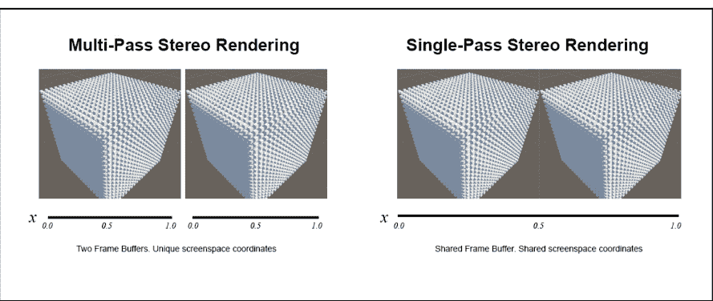

# 虚拟速度与增强加速

两种全新的娱乐媒介已经以 **虚拟现实**（VR，用户通过使用 **头戴式设备**（HMD）被传送到虚拟空间）和 **增强现实**（AR，虚拟元素被叠加在显示现实世界的显示器之上）的形式登上世界舞台。为简洁起见，这两个术语通常合并为单一术语 **XR**。还有 **混合现实**（MR，也称为 **混合现实** 或 **HR**），其中应用程序将现实世界和虚拟世界混合在一起，涵盖了之前提到的所有格式，同时还包括 **增强虚拟性**，其中现实世界的对象被扫描并叠加到大部分虚拟世界中。

这些媒体格式的市场迅速兴起并继续快速增长，得到了科技行业巨头的巨额投资。自然，Unity 等游戏引擎迅速跟风，为大多数顶尖竞争平台提供了充足的支持，例如 Google 的 Cardboard、HTC 的 Vive、Oculus 的 Rift、Microsoft 的 HoloLens 和 Samsung 的 GearVR 平台，以及更近期的进入者，例如 Apple 的 ARKit、Google 的 AR Core、Microsoft 的 Windows Mixed Reality 平台、PTC（最初是 Qualcomm 的）Vuforia，以及 Sony 的 PlayStation VR。

XR 为开发者和创意人员提供了一个全新的探索领域。这包括游戏和 360 度视频（或简称 _360 视频_）等娱乐产品，其中一系列摄像机被捆绑在一起，每个朝向不同的方向——这些摄像机捕获的内容被缝合在一起，随后作为电影在 VR 头显中播放，可在所有方向观看。创意行业工具在 XR 中也很常见，例如 3D 建模软件、工作流程可视化和生活质量小工具。很少有规则被定下来，因此有大量机会进行创新，为这股新技术浪潮做出贡献，并成为制定这些规则的人。这引起了大量的热议和兴奋，人们正在探索可能性，并试图在娱乐和交互体验的未来留下自己的印记。

当然，几乎每一种新兴和初创技术都会经历炒作周期（来自 Gartner 炒作周期，网址为 `https://www.gartner.com/technology/research/ methodologies/hype-cycle.jsp`）。炒作周期始于过度炒作的蜜月期，早期采用者会宣扬其优点。后来，当它进入 _幻灭低谷_ 时，情绪最终会冷却，因为它尚未进入主流，其优点尚未显现。这将持续下去，直到技术要么无法赢得人心而消失，要么牢固立足并继续稳步采用。下图展示了 Gartner 炒作周期的要点：

![](img/da79484c9b30dc915216dbc5454a9bbf_261_0.png）

可以说，XR 最近正在经历这个最终阶段，并开始享受比早期好得多的支持和更高质量的体验，尽管 XR 的采用率确实比最初预测的要慢。XR 是否会成长为一个数十亿美元的产业，还是会沦为小工具的利基市场，还有待观察。因此，在这个新媒介中开发并非没有风险，我们可以找到行业分析师，无论我们对 XR 的未来持何种立场，他们都会同意我们的观点。但是，有一点是肯定的，那就是每次有人亲身体验 VR 和 AR 的功能时，都会被沉浸感和媒介令人信服地将他们传送到另一个世界的能力所震撼。这种沉浸感和交互性是无与伦比的，并且随着平台支持的成熟和技术的不断进步，预示着更多的可能性。

在本章中，我们将探讨以下主题：

- 在 Unity 中开发 VR 或 AR 项目时需要牢记的问题以及必须避免的问题
- 特定于 XR 媒介的性能增强

# XR 开发

在 Unity 中开发 XR 产品涉及将几个 XR **软件开发工具包（SDK）** 之一导入我们的 Unity 项目，并进行一些专门的 API 调用以在运行时配置和使用平台。每个 SDK 都有其自身的不同之处，并提供不同的功能集。例如，Oculus Rift 和 HTC Vive SDK 提供用于控制 VR HMD 及其各自控制器的 API，而 Apple 的 ARKit 提供用于确定空间定位并将对象叠加到显示器上的实用程序。Unity 技术一直在努力创建支持所有这些变体的 API，因此过去几年中 Unity 中 XR 开发的 API 发生了很大变化。

Unity VR 开发的早期意味着将原生插件放入我们的 Unity 项目，直接从外部开发者门户导入 SDK，并在设置中进行各种烦人的琐碎工作，并手动应用更新。然而，从那以后，Unity 已经将其中几个 SDK 直接集成到编辑器中。此外，由于 AR 最近变得更加流行，主 API 在 Unity 2017.2.0 及更高版本中已从 `UnityEngine.VR` 重命名为 `UnityEngine.XR`，以便涵盖多个 AR SDK。导入各种 XR SDK 并对其进行配置可以通过 **编辑 | 项目设置 | 项目 | XR 设置** 区域进行管理。

目前，开发 XR 产品的体验可以说是喜忧参半。这涉及使用一些顶尖的硬件和软件，这意味着不断存在变更、重新设计、故障、补丁、错误、崩溃、兼容性问题、性能问题、渲染伪影、平台间功能不一致等等。所有这些问题都会拖慢我们的进度，使得在 XR 领域获得竞争优势变得异常困难。幸运的是，几乎所有人都面临着相同的问题，因此这些问题得到了开发者的大量关注，使得开发过程随着时间的推移变得更加容易。我们吸取了教训；API 得到了清理；并且随着每一次更新，新功能、工具和优化都会推出。

由于当前媒介的状态，性能问题对 XR 产品的成功限制可能比非 XR 项目更大。首先，我们的用户会花费大量资金购买 VR HMD 和传感器设备，或者具备 AR 功能的硬件。这两个平台都可能非常耗费资源，需要同样昂贵的图形硬件来支持。这通常会导致用户期望比典型游戏高得多的质量水平，以使投资感觉值得，或者换句话说，由于用户需要承担的资金投入，糟糕的使用体验变得不可原谅。其次，对于 VR 项目而言，也许比 AR 项目更甚，糟糕的应用性能会导致严重的用户身体不适，迅速将最坚定的拥护者变成批评者。第三，XR 平台的主要吸引力在于其沉浸感，而帧率下降、闪烁或任何迫使用户摘下头显或重启应用的应用程序故障，都会比任何事情都更快地打破这种沉浸感。

最终，我们必须做好早期对 XR 应用进行性能分析的准备，并确保我们没有超过运行时预算，因为这些媒介背后的技术复杂且资源密集，预算将会非常紧张。

# 模拟

Unity 提供了多种模拟选项，特别是针对 HoloLens 和 ARKit 的 AR 应用开发，称为 **Holographic Remoting / Simulation** 或 ARKitRemote。我们应该小心使用这些模拟功能，并按照其预期用途使用——作为开发工作流程中检查基本功能是否正常工作的便捷工具。在进行基准测试时，它们不能替代真实设备，不应被信任以提供准确的性能分析结果。此功能可通过 **Window | Holographic Emulation** 窗口访问。

# 用户舒适度

与典型的游戏和应用不同，VR 应用需要将用户舒适度作为优化指标。头晕、晕动症、眼睛疲劳、头痛，甚至因失去平衡导致的身体伤害，早期 VR 采用者不幸地经常遇到这些问题，责任在于我们要限制这些对用户的负面影响。本质上，内容对用户舒适度的重要性与硬件一样重要，如果我们要为这个媒介构建产品，就需要认真对待这个问题。

并非每个人都会遇到这些问题，少数幸运的人可能完全没有经历过。然而，绝大多数用户在某个时间点都报告过这些问题。此外，仅仅因为我们在测试游戏时自己没有触发这些问题，并不意味着它们不会在其他人身上触发。事实上，由于熟悉度，我们将是自己游戏中最有偏见的测试对象。在没有意识到的情况下，我们可能会开始预测应用程序产生的最令人不适的行为，从而使测试与新用户体验相同情况时不公平。不幸的是，这进一步增加了 VR 应用开发的成本，因为如果我们想弄清楚我们的体验是否会引起不适，就需要与大量不同的无偏见个体进行测试，这可能在每次影响运动和帧率的重大更改后都需要进行。

用户可以采取许多措施来改善 VR 舒适度，例如从短时间会话开始，逐渐增加时间以练习平衡并训练大脑预期不匹配的运动。更激进的选择是提前服用晕动症药物或喝一点姜茶来安抚胃部。然而，如果我们承诺用户需要经历几次晕动症的会话才能开始感到有趣，我们几乎无法说服他们尝试我们的应用。

用户在 VR 中可能会经历三种主要的不适效果：

- 晕动症
- 眼睛疲劳
- 方向感丧失

第一个问题，由晕动症引起的恶心，通常发生在用户眼睛认为地平线的位置与其他感官告诉大脑的信息（例如内耳的平衡感）之间存在感官脱节时。第二个问题，眼睛疲劳，源于用户盯着距离眼睛仅几英寸的屏幕，长时间使用后往往会导致大量眼睛疲劳，最终引起头痛。

最后，方向感丧失通常发生在 VR 用户有时站在封闭空间内，因此如果游戏包含任何基于加速度的运动，用户会本能地通过调整平衡来抵消该加速度，如果我们不小心确保用户体验平稳且可预测的运动，这可能导致方向感丧失、摔倒以及用户受伤。

> 请注意，术语 _加速度_ 的使用是有意为之，因为它是一个向量，这意味着它既有大小又有方向。任何类型的加速度都可能导致方向感丧失，这不仅包括向前、向后和向侧面加速，还包括旋转方式的加速度（转身）、下落、跳跃等等。

VR 应用的另一个潜在问题是引发癫痫发作的可能性。VR 处于独特的位置，能够将图像近距离投射到用户眼睛中，这带来了一些风险，即如果渲染行为出现故障并开始闪烁，我们可能会无意中导致易感用户癫痫发作。这些都是我们在开发过程中需要牢记的事情，需要尽早测试和修复，而不是拖延。

也许，VR 应用中最重要的性能指标是获得较高的 FPS 值，最好是 90 FPS 或更高，因为这将产生流畅的观看体验，用户的头部运动与世界的运动之间几乎没有脱节。任何长时间的帧率下降或 FPS 值始终低于此值的情况，都可能给我们的用户带来很多问题，因此我们的应用程序随时都必须表现良好至关重要。此外，我们应该非常小心如何控制用户的视角。我们应该避免自行更改 HMD 的视野（让用户决定其朝向），避免在长时间内产生加速度，或导致不受控的世界旋转和地平线运动，因为这些极有可能引发用户的晕动症和平衡问题。

一条不容置疑的严格规则是，我们绝不应该在产品的最终构建中对 HMD 的位置跟踪应用任何类型的增益、乘数效应或加速度效应。为了测试而这样做是可以的，但如果真实用户将头向侧面移动两英寸，那么在应用程序中应该感觉移动了相同的相对距离，并且在用户头部停止移动时应立即停止。否则，不仅会导致玩家头部感觉应该在的位置与实际位置之间出现脱节，而且如果相机相对于玩家的朝向和颈部铰链产生偏移，还可能引起严重的不适。

可以为玩家角色的运动使用加速度，但在用户开始过快地自我调整之前，它应该非常短暂且快速。最明智的做法是坚持使用依赖于恒定速度和/或瞬移的运动。

在赛车游戏中放置倾斜转弯似乎能极大地提高用户舒适度，因为用户会自然地倾斜头部并调整平衡以匹配转弯。

上述所有规则同样适用于 360 视频内容，如同适用于 VR 游戏一样。坦率地说，有令人尴尬数量的 360 视频发布到市场上，没有考虑到上述因素——它们包含过多的突兀移动、缺乏相机稳定、手动视口旋转等等。这些技巧通常用于确保用户面向我们预期的方向。然而，必须付出更多努力来做到这一点，而不引入这种引起恶心的行为。人类对移动的事物天生非常好奇。如果他们注意到眼角有东西在移动，那么他们很可能会转过身去面对它。这可以很好地利用，在用户观看视频时保持他们面向我们预期的方向。

在生成 VR 内容时，懒惰不是好办法。不要只是把一个 360 相机放在泥地拉力赛车上，并黑进一个意外的相机旋转到视频中以保持动作在中心。运动需要平滑且可预测。在制作过程中，我们需要不断记住我们期望用户看向哪里，以便我们正确地捕捉动作镜头。

幸运的是，对于 360 视频格式，行业标准帧率（如 24FPS 或 29.97FPS）似乎对用户舒适度没有灾难性的影响，但请注意，此帧率仅适用于视频播放。我们的渲染 FPS 是一个单独的 FPS 值，并决定位置头部跟踪的平滑程度。渲染 FPS 必须始终非常高以避免不适（理想情况下为 90 FPS）。

构建 VR 应用程序时会出现其他问题——不同的 HMD 和控制器支持不同的输入和行为，使得跨 VR 平台的功能对等变得困难。如果我们尝试将 2D 和 3D 内容合并在一起，可能会出现一种称为 **立体冲突** 的问题，其中 2D 对象似乎渲染在 3D 对象深处，因为眼睛无法正确区分距离；这通常是 VR 应用程序和 360 视频播放的用户界面的一个大问题，后者往往是一系列叠加在 3D 背景上的平面面板。立体冲突通常不会导致恶心，但可能会引起额外的眼睛疲劳。

虽然不适的影响在 AR 平台上不那么明显，但仍然不应忽视它。由于 AR 应用程序往往会消耗大量资源，低帧率应用程序可能会引起一些不适。如果 AR 应用程序使用将对象叠加到相机图像上（这是大多数应用程序的情况），这一点尤其正确，在那里背景相机图像和我们叠加在其上的对象之间可能会存在帧率的断开。我们应该尝试同步这些帧率以限制这种断开。

# 性能增强

关于行业和 XR 开发的讨论就到这里。让我们来介绍一些可以应用于 XR 项目的性能增强。

# 一切皆可

由于 AR 和 VR 应用程序是使用与任何其他 Unity 游戏相同的引擎、相同的子系统、资产、工具和实用程序构建的，因此本书中提到的几乎所有其他性能增强在某种程度上都可以帮助 VR 和 AR 应用程序，在深入研究 XR 特定的增强之前，我们应该尝试所有这些增强。这很令人放心，因为我们可以应用很多潜在的性能增强。缺点是，我们可能需要应用其中许多才能达到应用程序所需的性能水平。

VR 应用程序性能的最大威胁是 GPU 填充率，它已经是任何其他游戏中更可能的瓶颈之一，但对于 VR 来说要显著得多，因为我们总是试图将高分辨率图像渲染到更大的帧缓冲区（因为我们实际上是在渲染场景两次——一次为每只眼睛）。AR 应用程序通常会在 CPU 和 GPU 中都发现极端消耗，因为 AR 平台大量使用 GPU 的并行管道来解析对象的空间局部性并执行图像识别等任务，以及需要大量的绘制调用来支持这些活动。

当然，某些性能增强技术在 XR 中可能不会特别有效。VR 应用程序中的遮挡剔除可能难以设置，因为用户可以从下方、周围，有时甚至穿过场景中的物体观察（尽管它仍然可能非常有益）。与此同时，AR 应用程序通常在可触及的距离渲染对象，LOD 增强可能设置起来相当无用。我们必须在开始实施之前，运用我们的更好判断来确定一种性能优化技术是否值得实施，因为其中许多技术需要花费大量时间来实施和支持。

# 单通道与多通道立体渲染

对于 VR 应用程序，Unity 提供两种渲染模式；多通道和单通道。这可以在 Edit | Project Settings | Player | XR Settings | Stereo Rendering Method 下配置。多通道渲染将场景渲染到两个不同的图像，分别为每只眼睛显示。单通道立体渲染将两个图像合并为一个双宽度的渲染纹理，其中仅相关的一半显示给每只眼睛。

多通道立体渲染是默认情况。单通道渲染的优势在于，它通过减少绘制调用设置来显著节省主线程中的 CPU 工作量，并在 GPU 方面，因为不需要发生那么多纹理交换。当然，GPU 仍然需要同样努力地渲染对象，因为每个对象仍然从两个不同的视角渲染两次（这里没有免费的东西）。缺点是，这种效果目前仅在使用 OpenGL ES3.0 或更高版本时可用，因此并非在所有平台上都可用。此外，它对渲染管道的影响需要额外的注意和努力，特别是围绕任何使用屏幕空间效果（仅使用已绘制到帧缓冲区的数据的效果）的着色器。启用单通道立体渲染后，着色器代码不再能对传入的屏幕空间信息做出相同的假设。下图显示了屏幕空间坐标在多通道和单通道立体渲染之间的差异。

着色器始终被告知相对于整个输出渲染纹理的屏幕空间坐标，而不是仅相对于它感兴趣的部分。例如，我们通常期望 x 值为 0.5 对应屏幕的水平中点，在使用多通道立体渲染时情况如此，但是，如果我们使用单通道立体渲染，那么 x 值为 0.5 将对应两只眼睛渲染之间的中点（左眼的右边缘，或右眼的左边缘）。

Unity 为着色器提供了一些有用的屏幕空间转换辅助方法，可以在 `https://docs.unity3d.com/Manual/ SinglePassStereoRendering.html` 处找到。

另一个需要担心的问题是后处理效果。在 VR 中，我们基本上总是为应用于场景的任何后处理效果支付双倍成本，因为它需要为每只眼睛评估一次。单通道立体渲染可以减少设置效果所需的绘制调用，但我们不能盲目地将后处理效果同时应用于两个图像。因此，后处理效果着色器也必须进行调整，以确保它们渲染到输出渲染纹理的正确一半。如果不这样做，后处理效果会被拉伸到两只眼睛上两次，这对于镜头光晕等效果可能看起来非常奇怪。

单通道立体渲染功能自 Unity 5.4 以来就存在，但由于目前缺乏对所有平台的支持，在编辑器中仍然标记为 **预览**。我们可以期望它最终会推广到更多平台，但对于支持它的平台，我们需要对屏幕空间着色器进行一些性能分析和合理的健全性检查，以确保我们从启用此选项中获得积极收益。

# 应用抗锯齿

这个技巧更多是一种要求，而非性能增强。抗锯齿显著提高了 XR 项目的保真度，因为对象会更好地融合在一起，看起来不那么像素化，提高了沉浸感，这可能会消耗大量的填充率。我们应该尽早启用此功能，并尝试在假设它始终存在的前提下达到性能目标，只有在绝对最后的手段才禁用它。

# 优先使用前向渲染

延迟渲染的优势在于能够以最少的绘制调用处理多个光源。不幸的是，如果我们遵循前述建议并应用抗锯齿效果，在使用延迟渲染时，这必须作为后处理屏幕空间着色器来完成。与在前向渲染中作为多重采样效果应用相同技术相比，这可能会消耗相当多的性能，从而使前向渲染在两种选项中可能是性能更好的选择。

# VR 中的图像效果

法线贴图应用的效果在 VR 中很容易失效，此时纹理看起来像是涂在表面上，而不是营造出深度的错觉。法线贴图在观察角度与表面非常斜（浅）时通常会很快失效，这在典型游戏中并不常见。然而，在 VR 中，由于大多数头戴式显示器允许用户通过位置追踪在 3D 空间中移动头部（诚然，并非所有设备都支持），用户很快就会找到会破坏任何靠近摄像机物体效果的位置。法线贴图已知可以提高 VR 中高多边形数量物体的质量，但对于低多边形数量的物体，它很少提供好处，因此我们应该进行一些测试，以确保任何视觉改进都值得其在内存带宽方面的代价。

最终，我们不能依赖法线贴图来为低多边形数量的物体提供我们可能从非 VR 场景中期待的快速且廉价的图形保真度提升，因此需要进行测试以找出错觉是否按预期工作。应该改用位移贴图、细分曲面和/或视差贴图来创造更可信的深度外观。不幸的是，所有这些技术都比典型的法线贴图更昂贵，但这是我们为了在 VR 中获得良好的图形质量必须承受的负担。

其他后处理效果，如景深、模糊和镜头光晕，是典型 3D 游戏中看起来不错的效果，但通常不是我们在现实世界中会目睹的效果，在 VR 中会显得格格不入（至少在眼动追踪支持可用之前），通常应该避免使用。

# 背面剔除

背面剔除（移除永远不可见的物体面）对于 VR 和 AR 项目可能很棘手，因为靠近摄像机的物体，玩家的观察角度可能来自任何方向。如果我们想要避免破坏沉浸感的视角，靠近摄像机的资产应该是完全封闭的形状。此外，我们应该仔细考虑对远处物体应用背面剔除，特别是如果用户通过传送移动，因为完全限制用户位置可能很棘手。确保测试游戏世界的包围体积，以确保用户无法逃出。

# 空间化音频

音频行业正沸沸扬扬地讨论新技术，以呈现 VR（或者更准确地说是终于找到良好用途的旧技术）的音频体验，形式为空间音频。这些格式的音频数据不再代表来自特定声道的音频数据，而是包含某些音频谐波的数据，这些谐波在运行时合并在一起，以根据当前摄像机视口（特别是垂直方向）创造更可信的音频体验。上一句中的关键词是运行时，这意味着该效果与持续的非平凡成本相关联。这些技术将需要 CPU 活动，但也可能使用 GPU 加速来生成其效果，因此如果我们在使用空间音频时遇到性能问题，应该仔细检查两种设备的行为。

# 避免摄像机物理碰撞

在 VR 和 AR 中，用户有可能将摄像机移动到物体内部，这可能会破坏沉浸感。虽然添加物理碰撞体到这些表面以防止摄像机穿过它们可能很诱人，但这会在 VR 中引起定向失调，因为摄像机不会与用户的移动同步。这也可能破坏 AR 应用的位置追踪校准。更好的方法是要么允许用户看到物体内部，要么在摄像机和这些表面之间保持安全缓冲区。如果我们一开始就不允许玩家传送得太靠近它们，那么就没有将头伸进墙里的风险。

由于碰撞体数量减少，这将节省性能，但更应将其视为一种生活质量问题。我们不必过于担心这样做会冒破坏沉浸感的风险，因为研究表明，用户一旦意识到可以这样做，就倾向于避免查看物体内部。起初发生时，他们可能会感到一时的困惑或好笑，但幸运的是，人们倾向于希望留在我们创造的沉浸式体验中，并倾向于避免将头伸进墙里。当然，如果这样做能带来某种游戏优势，例如在策略游戏中透过墙壁观察敌人即将从哪个方向进来，情况就会改变，因此我们应该在开发场景时牢记这一点。

# 避免使用欧拉角

避免对任何类型的方向行为使用欧拉角。四元数设计用于更好地表示角度（唯一的缺点是调试时更抽象且更难以可视化），并在发生变化时保持精度，同时避免可怕的万向节锁。使用欧拉角进行计算可能会在大量旋转变化后最终导致不准确，这在 VR 和 AR 中极有可能发生，因为用户的视角每秒会多次发生微小变化。

万向节锁是欧拉角可能出现的问题。由于欧拉角通过三个轴表示方向，当其中一个轴旋转 90 度时会出现重叠，我们可能会意外地将它们锁定在一起，使其在数学上不可分离，并导致未来的方向变化同时影响两个轴。当然，人类可以想出如何旋转物体来解决这个问题，但万向节锁纯粹是一个数学问题。经典的例子是战斗机上的姿态气泡。飞行员永远不会遇到万向节锁的问题，但他们的抬头显示器中的姿态仪器可能会因此变得不准确。四元数通过包含第四个值来解决这个问题，该值有效地允许重叠的轴仍然相互区分。

# 保持克制

VR 应用的性能目标非常难以达到。因此，重要的是要认识到我们是否只是试图将当前一代 XR 设备和典型用户硬件所能容忍的质量过多地塞入应用中。最后的手段始终是从场景中剔除物体，直到达到性能目标。对于 XR 应用，我们应该比非 XR 应用更愿意这样做，因为性能不佳的成本通常远远超过更高质量带来的收益。如果渲染预算已经耗尽，我们必须克制自己不要向场景中添加更多细节。在沉浸式 VR 内容中，这可能很难承认，因为我们想要创造尽可能引人入胜的沉浸感，但直到技术赶上能力之前，我们需要保持节俭。

# 跟上最新进展

Unity 提供了一份包含 VR 设计和优化技巧的有用文章列表，随着媒介和市场的成熟以及新技术的发现，这些文章可能会更新。它比这本著作能保持更及时的更新，所以不时查看它们以捕捉最新技巧。相关文章可以在 `https://unity3d.com/learn/tutorials/topics/virtual-reality` 找到。

我们还应该关注 Unity 博客，以确保不会错过有关 XR API 更改、性能增强和性能建议的任何重要信息。

# 总结

希望这份简短指南能帮助我们提高 XR 应用程序的性能。令人欣慰的消息是，我们有许多性能优化选项可供选择，因为 Unity XR 应用程序是建立在我们在本书中一直在探索的同一底层平台之上的。不那么令人欣慰的是，为了有机会达到质量目标，我们可能不得不测试并实现 _所有这些_ 选项。我们可以预期硬件会随着时间的推移变得更强大，价格会下降，并且因此采用率会增加。但是，在此之前，如果我们想在科技界的最新热潮中竞争，就需要使出浑身解数。

