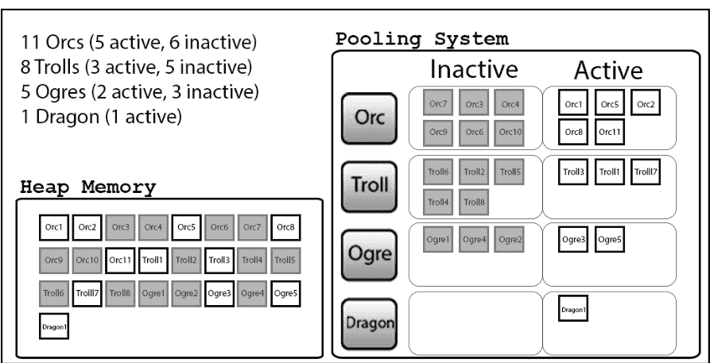
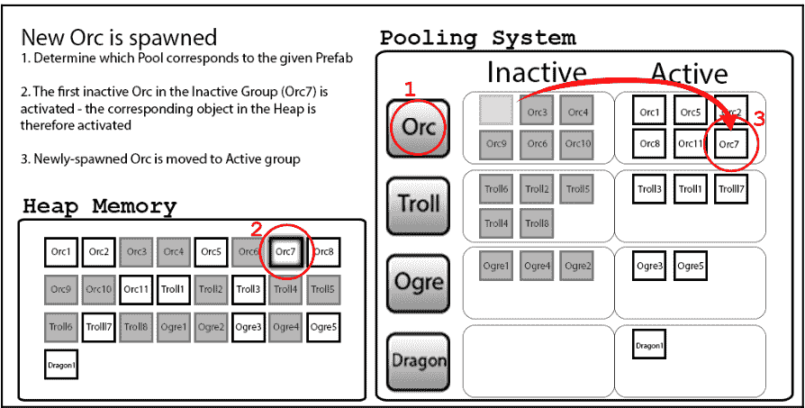
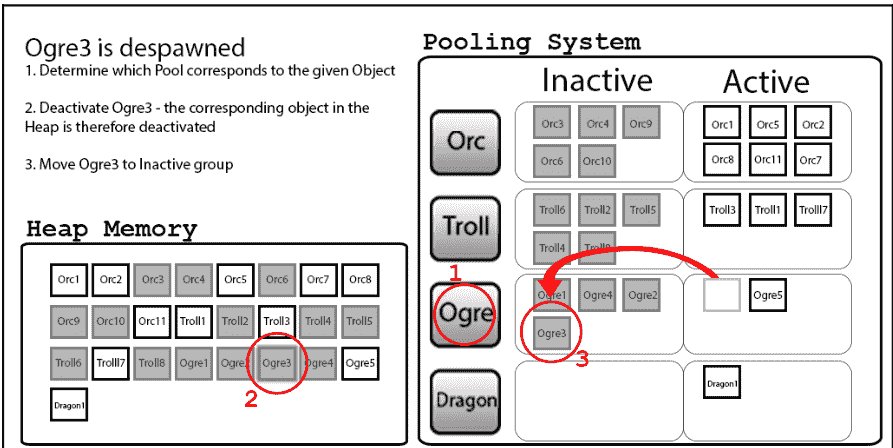
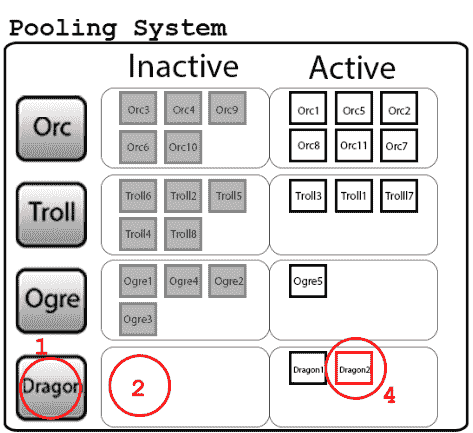

# 精通内存管理

内存效率是性能优化的重要元素。对于范围有限的游戏，例如爱好者项目和原型，可以忽略内存管理；它们往往会浪费大量资源，并可能泄漏内存，但如果将其暴露范围限制在朋友和同事之间，这不会成为问题。然而，任何我们希望专业发布的内容都需要认真对待这个主题。不必要的内存分配会导致由于过度垃圾回收（消耗宝贵的 CPU 时间）而导致糟糕的用户体验，以及会导致崩溃的内存泄漏。在现代游戏发布中，这些情况都不可接受。

在 Unity 中高效使用内存需要对底层 Unity 引擎、Mono 平台和 C# 语言有扎实的理解。另外，如果我们使用新的 IL2CPP 脚本后端，那么熟悉其内部工作原理将是明智之举。对于一些开发者来说，这可能是一个令人生畏的地方，因为许多人选择 Unity3D 作为游戏开发方案，主要是为了避免引擎开发和内存管理所带来的那种底层工作。我们更愿意专注于与游戏玩法实现、关卡设计和美术资产管理相关的高级问题，但不幸的是，现代计算机系统是复杂的工具，长期忽略底层问题可能会导致灾难。

了解内存分配和 C# 语言特性的运作方式，它们如何与 Mono 平台交互，以及 Mono 如何与底层 Unity 引擎交互，对于制作高质量、高效的脚本代码至关重要。因此，在本章中，您将了解底层 Unity 引擎的所有细节：Mono 平台、C# 语言、IL2CPP 和 .NET Framework。

幸运的是，要有效地使用 C# 语言，没有必要成为该语言的绝对大师。本章将这些复杂主题浓缩成更易于消化的形式，并分为以下主题：

- Mono 平台：
  - 原生和托管内存域
  - 垃圾回收
  - 内存碎片
- IL2CPP
- 如何分析内存问题
- 各种内存相关的性能增强：
  - 最小化垃圾回收
  - 正确使用值类型和引用类型
  - 负责任地使用字符串
  - 与 Unity 引擎相关的众多潜在增强
  - 对象和预制体池

# Mono 平台

Mono 是一种神奇的酱料，混入 Unity 配方中，赋予了其大量跨平台能力。Mono 是一个开源项目，基于来自 Microsoft 的 .NET Framework 的 API、规范和工具构建了自己的库平台。本质上，它是 .NET 库的开源重新实现，几乎没有访问原始源代码的情况下完成，并且与来自 Microsoft 的原始库完全兼容。

Mono 项目的目标是通过一个框架提供跨平台开发，该框架允许用常见编程语言编写的代码在许多不同的硬件平台上运行，包括 Linux、MacOS、Windows、ARM、PowerPC 等。Mono 甚至支持许多不同的编程语言。任何可以编译为 .NET 的 **Common Intermediate Language (CIL)** 的语言都足以与 Mono 平台集成。这包括 C# 本身，但也包括几种其他语言，例如 F#、Java、Visual Basic .NET、PythonNet 和 IronPython。当然，通过 Unity 暴露给我们的只有三种语言：C#、Boo 和 UnityScript。

请注意，Boo 语言在之前的 Unity 版本中已被弃用，UnityScript 语言将在未来版本中开始逐步淘汰。博客文章 https://blogs.unity3d.com/2017/08/11/unityscripts-long-ride-off-into-the-sunset/ 解释了这些变化背后的理由。

关于 Unity 引擎的一个常见误解是它构建在 Mono 平台之上。这是不正确的，因为其基于 Mono 的层并不处理许多重要的游戏任务，例如音频、渲染、物理和时间跟踪。Unity Technologies 构建了一个原生 C++ 后端以追求速度，并允许其用户通过 Mono 作为脚本接口来控制这个游戏引擎。因此，Mono 仅仅是底层 Unity 引擎的一个组成部分。这相当于许多其他游戏引擎，它们在底层运行 C++，处理渲染、动画和资源管理等重要任务，同时为游戏逻辑实现提供更高级别的脚本语言。因此，Unity Technologies 选择 Mono 平台来提供此功能。

原生代码是专为给定平台编写的代码的通用说法。例如，在 Windows 中编写代码以创建窗口对象或与网络子系统交互，与为 Mac、Unix、Playstation 4、XBox One 等执行任务的代码将完全不同。

脚本语言通常通过自动垃圾回收抽象掉复杂的内存管理，并提供各种安全特性，以牺牲运行时开销为代价简化编程行为。某些脚本语言还可以在运行时被解释，这意味着它们不需要在执行前编译。原始指令在运行时被动态转换为机器码并在读取时立即执行；当然，这通常使代码相对较慢。最后一个特性，也是可能最重要的一个，是它们允许更简单的编程命令语法。这通常极大地改善了开发工作流程，因为不熟悉 C++ 等语言的团队成员仍然可以为代码库做出贡献。这使他们能够以更简单的格式实现游戏逻辑等内容，以牺牲一定的控制权和运行时执行速度为代价。

请注意，此类语言通常被称为托管语言，具有托管代码。从技术上讲，这是 Microsoft 创造的一个术语，用于指任何必须在其公共语言运行时 (CLR) 环境中运行的源代码，而不是通过目标操作系统原生编译和运行的代码。

然而，由于 CLR 与其他具有自己类似设计运行时环境的语言（例如 Java）之间存在普遍性和共同特性，术语“托管”此后已被挪用。它倾向于用于指任何依赖于其自身运行时环境的语言或代码，并且可能包含或不包含自动垃圾回收。在本章的其余部分，我们将采用此定义，并使用术语“托管”来指代既依赖于单独的运行时环境才能执行，又受自动垃圾回收监控的代码。

托管语言的运行时性能开销始终大于等效的原生代码，但每年都在变得不那么重要。这部分是由于工具和运行时环境的逐步优化，部分是由于平均设备的计算能力逐渐增强。虽然，使用托管语言的主要争议点仍然是它们的自动内存管理。手动管理内存可能是一项复杂的任务，可能需要多年的困难调试才能熟练掌握，但许多开发者认为托管语言以过于不可预测的方式解决了这个问题，冒着产品质量过大的风险。此类开发者可能会引用，托管代码永远无法达到与原生代码相同的性能水平，因此用它们构建高性能应用程序是鲁莽的。

这在某种程度上是正确的，因为托管语言不可避免地会带来运行时开销，我们失去了对运行时内存分配的部分控制。这对于高性能服务器架构来说将是致命的；然而，对于游戏开发，这成为一种平衡行为，因为并非所有资源使用都必然会导致瓶颈，最好的游戏也不一定是那些充分利用每个字节的游戏。例如，想象一个用户界面，通过原生代码在 30 微秒内刷新，而通过托管代码在 60 微秒内刷新，因为额外的 100% 开销（一个极端的例子）。托管代码版本仍然足够快，用户永远无法察觉差异，那么为这种任务使用托管代码真的有什么害处吗？

在现实中，至少对于游戏开发，使用托管语言通常只是意味着开发者有一组与原生代码开发者不同的独特问题需要担心。因此，选择为游戏开发使用托管语言，部分是个人偏好问题，部分是开发速度与控制权之间的妥协。

让我们重新审视一下我们在早期章节中提到过但没有充分展开的一个话题：Unity 引擎中的内存域概念。


# 内存域

Unity 引擎中的内存空间本质上可以分为三个不同的内存域。每个域存储不同类型的数据，并处理非常不同的一组任务。

第一个内存域——托管域——应该非常熟悉。这个域是 Mono 平台执行工作的地方，我们编写的任何 `MonoBehaviour` 脚本和自定义 C# 类都会在运行时在此实例化，因此我们会通过编写的任何 C# 代码非常显式地与这个域进行交互。它被称为 _托管域_，因为这个内存空间由垃圾回收器自动管理。

第二个域——原生域——更为微妙，因为我们只能间接与其交互。Unity 具有一个用 C++ 编写的底层原生代码基础，并根据目标平台的不同以不同方式编译到我们的应用程序中。这个域负责为资产数据（例如纹理、音频文件和网格）以及各种子系统（例如渲染管线、物理系统和用户输入系统）分配内部内存空间。最后，它包括重要游戏对象（例如 `GameObjects` 和组件）的部分原生 _表示_，以便它们可以与这些内部系统进行交互。许多内置 Unity 类将其数据保存在此处，例如 `Transform` 和 `Rigidbody` 组件。

托管域还包括存储在原生域中的相同对象表示的包装器。因此，当我们与 `Transform` 等组件交互时，大多数指令会要求 Unity 深入其原生代码，在那里生成结果，然后将其复制回托管域供我们使用。托管域和原生域之间的 _原生-托管桥梁_ 就源于此，这在前面的章节中简要提及。当两个域都为同一实体拥有各自的表示时，在它们之间跨越桥梁需要进行内存上下文切换，这可能会对我们的游戏造成相当显著的性能损耗。显然，由于涉及开销，应该尽可能减少来回跨越此桥梁的次数。我们在 _第 2 章，脚本策略_ 中介绍了几种相关技术。

第三个也是最后一个内存域是外部库的域，例如 DirectX 和 OpenGL 库，以及我们在项目中包含的任何自定义库和插件。从 C# 代码引用这些库会导致类似的内存上下文切换及其后续开销。

大多数现代操作系统（OS）中的内存将运行时内存空间分为两类：栈和堆。栈是内存中一个特殊的保留空间，专门用于小型、短生命周期的数据值，这些值在超出作用域的那一刻会自动释放，因此被称为栈。它实际上像栈数据结构一样运行，从顶部压入和弹出数据。栈包含我们声明的任何局部变量，并处理函数在被调用时的加载和卸载。这些函数调用通过所谓的调用栈进行扩展和收缩。当调用栈处理完当前函数时，它会跳回调用栈上的先前点，并从中断处继续。先前内存分配的起始位置总是已知的，不需要执行任何清理操作，因为任何新分配都可以简单地覆盖旧数据。因此，栈相对快速且高效。

总栈大小通常非常小，通常在兆字节级别。有可能通过分配超过栈所能支持的空间来导致栈溢出。这可能发生在异常大的调用栈（例如无限循环）或大量局部变量的情况下，但在大多数情况下，尽管栈大小相对较小，导致栈溢出很少是一个问题。

堆代表所有剩余的内存空间，并用于绝大多数内存分配。由于我们希望大部分分配的内存能比当前函数调用持续更久，因此无法在栈上分配，因为它会在当前函数结束时被覆盖。因此，每当数据类型太大而无法放入栈中，或者必须在声明它的函数之外持续存在时，它就会在堆上分配。栈和堆之间没有物理上的区别；它们都只是包含 RAM 中字节数据的内存空间，由操作系统为我们请求并预留。唯一的区别在于它们被使用的时间、位置和方式。

在原生代码中，例如用 C++ 等语言编写的代码，这些内存分配是非常手动处理的，即我们有责任确保分配的所有内存块在不再需要时都能被正确且显式地释放。如果处理不当，我们很容易无意中引入内存泄漏，因为我们可能会不断从 RAM 中分配越来越多的内存空间，而这些空间永远不会被清理，直到没有更多空间可分配，导致应用程序崩溃。

与此同时，在托管语言中，此过程通过垃圾回收器自动化。在初始化 Unity 应用程序时，Mono 平台会从操作系统请求给定的内存块，并用它生成 C# 代码可以使用的堆内存空间（通常称为托管堆）。此堆空间初始相当小，小于 1 兆字节，但随着脚本代码需要新的内存块，它会增长。如果 Unity 确定不再需要，此空间也可以通过将其释放回操作系统来缩小。

# 垃圾回收

垃圾回收器（以下简称 GC）有一项重要工作，即确保我们不会使用超过所需的托管堆内存，并且不再需要的内存会被自动释放。例如，如果我们创建一个 GameObject，然后稍后将其销毁，GC 会将 GameObject 使用的内存空间标记为稍后最终释放。这不是一个立即的过程，因为 GC 仅在必要时才释放内存。

当提出新的内存请求，且托管堆中有足够的空闲空间来满足请求时，GC 只需分配新空间并将其交给调用者。但是，如果托管堆没有空间容纳它，则 GC 需要先扫描所有现有的内存分配，查找不再使用的内容并清理它们。只有作为最后手段，GC 才会扩展当前堆空间。

Unity 使用的 Mono 版本中的 GC 是一种追踪垃圾回收器，它使用标记-清扫策略。该算法分为两个阶段：每个分配的对象都会跟踪一个额外的位。该位标记对象是否已被标记。这些标志初始设置为 false，表示尚未被标记。

当回收过程开始时，它会将程序仍可访问的所有对象标记为 true。可访问的对象可以是直接引用，例如栈上的静态或局部变量，也可以是通过其他直接或间接可访问对象的字段（成员变量）的间接引用。本质上，它收集一组仍可被我们的应用程序引用的对象。所有不再可引用的内容对我们的应用程序来说实际上是不可见的，并可以由 GC 释放。

第二阶段涉及遍历此引用目录（GC 会在应用程序生命周期内跟踪它），并根据其 _标记_ 状态确定是否应释放。如果对象已被标记，则表示它仍被其他内容引用，因此 GC 会保持不动。但是，如果未被标记，则它是释放的候选对象。在此阶段，所有已标记的对象都会被跳过，但在跳过之前，会将其标志重新设置为 `false`，以供下一次垃圾回收扫描的第一阶段使用。

本质上，GC 维护内存中所有对象的列表，而我们的应用程序维护一个仅包含其中一部分对象的单独列表。每当我们的应用程序处理完一个对象，它就简单地 _忘记_ 它的存在，将其从列表中移除。因此，可以安全释放的对象列表将是 GC 列表与应用程序列表之间的差异。

第二阶段结束后，所有未标记的对象都会被释放以释放空间，然后重新审视创建对象的初始请求。如果 GC 已释放足够的空间供对象使用，则对象将在新释放的空间中分配并返回给调用者。但是，如果没有，则我们进入最后手段的情况，必须通过从操作系统请求来扩展托管堆，此时对象空间才能最终分配并返回给调用者。

在理想世界中，如果我们只分配和释放对象，但任何时刻只存在有限数量的对象，堆将保持大约恒定的大小，因为总有足够的空间容纳我们需要的新对象。但是，应用程序中的对象很少按分配顺序释放，甚至更少有相同的内存大小。这会导致 _内存碎片化_。

# 内存碎片化

当不同大小的对象以交替顺序分配和释放，并且先释放大量小对象，随后分配大量大对象时，就会发生碎片化。

通过示例最能解释这一点。以下显示了在典型堆内存空间中分配和释放内存的四个步骤：


内存分配按以下方式进行：

1. 我们从空闲堆空间开始。
2. 然后在堆上分配四个对象，**A**、**B**、**C** 和 **D**，每个对象大小为 64 字节。
3. 稍后，我们释放其中两个对象，**A** 和 **C**，释放了 128 字节。
4. 然后我们尝试分配一个大小为 128 字节的新对象。

释放对象 **A** 和 **C** 从技术上讲释放了 128 字节的空间，但由于这些对象在内存中不是相邻的（连接的邻居），我们无法分配比两个单独空间都大的对象。新的内存分配必须始终在内存中是连续的；因此，新对象必须分配在托管堆中下一个可用的连续 128 字节空间。我们现在内存空间中有两个 64 字节的空闲空隙，除非我们分配大小为 64 字节或更小的对象，否则这些空隙永远不会被重复使用。

随着时间的推移，随着不同大小的对象被释放，然后系统稍后尝试在能容纳的最小可用空间内分配新对象，我们的堆内存可能会出现更多更小的空闲空间，留下一些难以填充的小余量。在没有自动清理这种碎片的后台技术的情况下，这种效应几乎会发生在任何内存空间中——RAM、堆空间，甚至硬盘——它们只是更大、更慢且更永久的内存存储区域（这就是为什么我们需要不时对硬盘进行碎片整理的原因）。

内存碎片会导致两个问题。首先，它会随着时间的推移有效减少可用于新对象的总内存空间，具体取决于分配和释放的频率。这很可能导致 GC 必须扩展堆以腾出空间进行新分配。其次，由于需要花费额外时间来寻找足够大的新内存空间来容纳对象，新分配的解决速度会变慢。

当在堆中进行新的内存分配时，这变得很重要，因为可用空间的位置与可用空闲空间的大小同样重要。没有办法将对象拆分到部分内存位置，因此 GC 必须要么继续搜索直到找到足够大的空间，要么必须增加整个堆大小以容纳新对象，这在刚刚花费大量时间进行详尽搜索之后，还会花费更多时间。

# 运行时垃圾回收

因此，在最坏的情况下，当我们的游戏请求新的内存分配时，CPU 在分配最终完成之前，将不得不花费周期来完成以下任务：

- 验证是否有足够的连续空间用于新对象。
- 如果空间不足，则遍历所有已知的直接和间接引用，将它们连接的所有内容标记为可达。
- 再次遍历所有这些引用，标记未标记的对象以进行释放。
- 遍历所有标记的对象，以检查释放其中一些对象是否会为新对象创建足够的连续空间。
- 如果不行，则向操作系统请求新的内存块以扩展堆。
- 在新分配的块的前面分配新对象并将其返回给调用者。

这对 CPU 来说可能是大量工作，特别是当这个新的内存分配是一个重要对象，例如粒子效果、进入场景的新角色或过场动画过渡时。用户极有可能注意到 GC 冻结游戏来处理这种极端情况的时刻。更糟糕的是，随着分配的堆空间增长，垃圾回收工作量的扩展性很差，因为扫描几兆字节的空间比扫描几千兆字节的空间要快得多。

所有这些使得智能控制堆空间变得绝对关键。我们的内存使用策略越懒惰，GC 的表现就越糟糕，几乎呈指数级恶化，因为我们越来越可能遇到这种最坏情况。因此，尽管托管语言致力于简化内存管理问题，但托管语言开发者仍然发现自己与原生应用程序开发者一样，甚至更加关注内存消耗，这有点讽刺。主要区别在于他们试图解决的问题类型。

# 多线程垃圾回收

GC 在两个独立的线程上运行：主线程和所谓的 _Finalizer Thread_。当 GC 被调用时，它将在主线程上运行并标记堆内存块以供将来释放。这不会立即发生。由 Mono 控制的 Finalizer Thread 在内存最终释放并可重新分配之前，可能会有几秒钟的延迟。

我们可以在 **Profiler** 窗口的 **Memory Area** 中的 **Total Allocated** 块（绿色线，向那 5% 患有红绿色盲/红绿色弱的人群致歉）中观察到这种行为。在垃圾回收发生后，总分配值可能需要几秒钟才会下降。由于这种延迟，我们不应依赖内存在释放后立即可用，因此，我们绝不应该浪费时间试图榨取我们认为应该可用的每一个字节。我们必须确保始终有某种缓冲区可用于未来的分配。

被 GC 释放的块有时会在一段时间后归还给操作系统，这将减少堆占用的保留空间，并允许内存分配给其他用途，例如另一个应用程序。但是，这非常不可预测，并且取决于目标平台，所以我们不应该依赖它。唯一安全的假设是，一旦内存被分配给 Mono，它就被保留，不再可供原生域或同一系统上运行的任何其他应用程序使用。

# 代码编译

当我们对 C# 代码进行更改时，当我们从最喜欢的 IDE（通常是 MonoDevelop 或功能更丰富的 Visual Studio）切换回 Unity 编辑器时，代码会自动编译。但是，C# 代码不会直接转换为机器代码，就像我们使用 C++ 等语言时期望静态编译器所做的那样。

相反，代码被转换为一个称为 **Common Intermediate Language (CIL)** 的中间阶段，它是原生代码之上的一种抽象。这就是 .NET 可以支持多种语言的方式——每种语言使用不同的编译器，但它们都被转换为 CIL，因此无论我们选择哪种语言，输出实际上都是相同的。CIL 类似于其基于的 Java 字节码，CIL 代码本身完全无用，因为 CPU 不知道如何运行该语言中定义的指令。

在运行时，这种中间代码会通过 Mono **Virtual Machine (VM)** 运行，这是一种基础架构元素，允许相同的代码在多个平台上运行而无需更改代码本身。这是 **.NET Common Language Runtime (CLR)** 的一种实现。如果我们在 iOS 上运行，我们在基于 iOS 的虚拟机基础架构上运行，如果我们在 Linux 上运行，我们只是使用一个更适合 Linux 的不同虚拟机。这就是 Unity 允许我们一次编写代码，它就能在多个平台上神奇地工作的方式。

在 CLR 中，中间 CIL 代码实际上会按需编译为原生代码。这种即时原生编译可以由 **Ahead-Of-Time (AOT)** 或 **Just-In-Time (JIT)** 编译器完成。使用哪一种将取决于目标平台。这些编译器允许代码段被编译为原生代码，使平台架构能够完成编写的指令，而无需我们自己编写它们。两种编译器类型的主要区别在于代码编译的时间。

AOT 编译是代码编译的典型行为，并且在构建过程中或在某些情况下在应用程序初始化期间早期发生（_ahead of time_）。在任何一种情况下，代码都已预编译，由于始终有机器代码指令可供 CPU 需要时使用，因此不会因动态编译而产生进一步的运行时开销。

JIT 编译在运行时动态发生在单独的线程中，并在执行之前开始（_just in time_ 执行）。通常，这种动态编译会导致代码第一次调用运行得稍慢（或慢很多），因为代码必须先完成编译才能执行。但是，从那时起，每次执行相同的代码块时，都不需要重新编译，指令将通过之前编译的原生代码运行。


# IL2CPP

几年前，Unity Technologies 面临一个选择：要么继续支持 Mono 平台（Unity 发现该平台越来越难以跟进），要么实现自己的脚本后端。他们选择了后者，如今多个平台都支持 IL2CPP，即 **Intermediate Language to C++** 的缩写。

IL2CPP 是一种脚本后端，旨在将 Mono 的 CIL 输出直接转换为原生 C++ 代码。这带来了性能提升，因为应用程序现在将运行原生代码。这最终让 Unity Technologies 对运行时行为有了更多控制权，因为 IL2CPP 提供了自己的 AOT 编译器和 VM，允许对 GC 和编译过程等子系统进行自定义改进。IL2CPP 并不打算完全取代 Mono 平台，而是我们可以启用的一个额外工具，用于改进 Mono 提供的部分功能。

请注意，IL2CPP 对 iOS 和 WebGL 项目会自动启用。对于支持它的其他平台，可以在 **Edit | Project Settings | Player | Configure | Scripting Backend** 下启用 IL2CPP。

软件开发中有一句常见的格言：90% 的工作由仅 10% 的代码完成。这通常意味着，与直接解释 CIL 代码相比，JIT 编译对性能的净影响是积极的。然而，由于 JIT 编译器必须快速编译代码，它无法利用许多静态 AOT 编译器能够利用的优化技术。


并非所有平台都支持 JIT 编译，但使用 AOT 时，某些脚本功能不可用。Unity 在 https://docs.unity3d.com/Manual/ScriptingRestrictions.html 上提供了这些限制的完整列表。


Unity Technologies 关于 IL2CPP 的初始帖子、决策背后的理由及其长期优势可在 https://blogs.unity3d.com/2014/05/20/the-future-of-scripting-in-unity/ 上找到。


当前支持 IL2CPP 的平台列表可在 https://docs.unity3d.com/Manual/IL2CPP.html 上找到。

# Profiling memory

在内存管理方面，我们关心两个问题：消耗了多少内存，以及分配新块的频率如何。让我们分别讨论这些主题。

# Profiling memory consumption

由于我们没有 Unity 引擎源代码，因此无法直接控制 Native Domain 中发生的事情，也无法添加任何与其直接交互的代码。不过，我们可以通过各种脚本级函数间接控制它，这些函数充当 Managed 和 Native 代码之间的交互点。从技术上讲，有多种内存分配器可用，它们在内部用于 GameObjects、Graphics 对象和 Profiler 等内容，但这些分配器隐藏在 Native-Managed Bridge 之后。

不过，我们可以通过 **Profiler** 窗口的 **Memory Area** 观察此 Memory Domain 中已分配和保留了多少内存。原生内存分配显示在标记为 **Unity** 的值下，我们还可以使用 **Detailed Mode** 并对当前帧进行采样来获取更多信息：

| Used Total: 101.2 MB | Unity: 68.1 MB | Mono: 7.8 MB | GfxDriver: 15.8 MB | FMOD: 1.3 MB | Video: 224 B | Profiler: 9.5 MB |
|---|---|---|---|---|---|---|
| Reserved Total: 241.4 MB | Unity: 199.0 MB | Mono: 10.7 MB | GfxDriver: 15.8 MB | FMOD: 1.3 MB | Video: 224 B | Profiler: 16.0 MB |
| Total System Memory Usage: 0.78 GB | | | | | | |

在 **Breakdown View** 的 **Scene Memory** 部分下，我们可以观察到 `MonoBehaviour` 对象始终消耗固定量的内存，无论其成员数据如何。这是对象原生表示所消耗的内存。

请注意，**Edit Mode** 下的内存消耗与独立版本总是截然不同，因为应用了各种调试和编辑器挂钩数据。这进一步激励我们避免将 **Edit Mode** 用于基准测试和仪器化目的。

我们还可以使用 `Profiler.GetRuntimeMemorySize()` 方法获取特定对象的原生内存分配大小。

托管对象表示与其原生表示本质上相关联。尽量减少原生内存分配的最佳方法，就是简单地优化我们的托管内存使用情况。

我们可以使用 **Profiler** 窗口的 **Memory Area** 下标记为 **Mono** 的值，验证为托管堆分配和保留了多少内存，如下所示：

Used Total: 101.2 MB Unity: 68.1 MB Mono: 7.8 MB GfxDriver: 15.8 MB FMOD: 1.3 MB Video: 224 B Profiler: 9.5 MB Reserved Total: 241.4 MB Unity: 199.0 MB Mono: 10.7 MB GfxDriver: 15.8 MB FMOD: 1.3 MB Video: 224 B Profiler: 16.0 MB Total System Memory Usage: 0.78 GB

我们还可以分别使用 `Profiler.GetMonoUsedSize()` 和 `Profiler.GetMonoHeapSize()` 方法在运行时确定当前使用的和保留的堆空间。

# Profiling memory efficiency

我们可以用来衡量内存管理健康状况的最佳指标，就是简单地观察 GC 的行为。它工作得越多，我们产生的浪费就越多，应用程序的性能可能就越差。

我们可以使用 **Profiler** 窗口的 **CPU Usage Area**（**GarbageCollector** 复选框）和 **Memory Area**（**GC Allocated** 复选框）来观察 GC 正在做多少工作以及在什么时间做。对于某些情况，这相对简单，例如我们只分配了一个临时的小内存块，或者刚刚销毁了一个 `GameObject`。

然而，内存效率问题的根本原因分析可能具有挑战性且耗时。当我们观察到 GC 行为出现尖峰时，这可能是前一帧分配了过多内存，而当前帧仅再分配了一点内存的症状，这要求 GC 扫描大量碎片化内存，确定是否有足够空间，并决定是否分配新块。它清理的内存可能很久以前就已分配，我们可能只有在应用程序运行较长时间后才能观察到这些影响，甚至可能在场景相对空闲时发生，没有明显的原因导致 GC 突然触发。更糟糕的是，Profiler 只能告诉我们过去几秒钟发生了什么，而且不容易立即看出正在清理哪些数据。

我们必须保持警惕，并严格测试应用程序，在模拟典型游戏会话时观察其内存行为，以确保我们没有产生内存泄漏，也没有创建出 GC 在单帧中需要完成过多工作的情况。

# Memory management performance enhancements

在大多数游戏引擎中，如果我们遇到性能问题，我们有幸能够将低效的托管代码移植为更快的原生代码。除非我们投入大量资金获取 Unity 源代码（该源代码作为独立于 Free/Personal/Pro 许可系统的许可提供，并按案例、按项目提供），否则这不是一个选项。我们也可以购买 Unity Pro 许可证，希望使用原生插件，但这样做很少能带来性能提升，因为我们仍然需要跨越 Native-Managed Bridge 来调用其中的函数调用。原生插件通常用于与专门为 C# 构建的系统和库进行交互。这迫使绝大多数我们处于需要自己尽可能提高 C# 脚本级代码性能的地位。

考虑到这一点，我们现在应该对 Unity 引擎内部和内存空间有足够的了解，以检测和分析内存性能问题，并理解和实施针对这些问题的增强措施。那么，让我们介绍一些可以应用的性能增强措施。

# Garbage collection tactics

尽量减少垃圾回收问题的一种策略是隐藏，即在玩家肯定不会注意到的合适时机手动调用 GC。可以通过调用 `System.GC.Collect()` 手动触发垃圾回收。

调用垃圾回收的好时机可能是在关卡之间加载时、游戏暂停时、菜单界面打开后不久、过场动画转换期间，或任何玩家不会目睹或在意的游戏中断，也不会在意突然的性能下降。我们甚至可以在运行时使用 `Profiler.GetMonoUsedSize()` 和 `Profiler.GetMonoHeapSize()` 方法来确定是否需要在不久的将来调用垃圾回收。

我们还可以导致少量特定对象的释放。如果相关对象是 Unity 对象包装器之一，例如 `GameObject` 或 `MonoBehaviour` 组件，那么终结器将首先在 Native Domain 中调用 `Dispose()` 方法。此时，Native 和 Managed 域中消耗的内存都将被释放。在某些罕见情况下，如果 Mono 包装器实现了 `IDisposable` 接口类（即，它具有可从脚本代码访问的 `Dispose()` 方法），那么我们实际上可以控制此行为并强制立即释放内存。


Unity 引擎中存在多种不同的对象类型（其中大多数是在 Unity 5 或更高版本中引入的），它们实现了 `IDisposable` 接口类，如下所示：`NetworkConnection`、`WWW`、`UnityWebRequest`、`UploadHandler`、`DownloadHandler`、`VertexHelper`、`CullingGroup`、`PhotoCapture`、`VideoCapture`、`PhraseRecognizer`、`GestureRecognizer`、`DictationRecognizer`、`SurfaceObserver` 等。

这些都是用于拉取潜在大型数据集的实用程序类，我们可能希望确保立即销毁它们所获取的数据，因为它们通常涉及在原生域中分配多个缓冲区和内存块以完成其任务。如果我们长期保留所有这些内存，将是对宝贵空间的巨大浪费。因此，通过从脚本代码中调用它们的 `Dispose()` 方法，我们可以确保内存缓冲区在需要时及时且精确地被释放。

所有其他资源对象都提供某种卸载方法来清理任何未使用的资源数据，例如 `Resources.UnloadUnusedAssets()`。实际资源数据存储在原生域中，因此从技术上讲 GC 不参与其中，但基本思路是相同的。它将遍历特定类型的所有资源，检查它们是否不再被引用，如果是，则取消分配它们。但是，同样，这是一个异步过程，我们无法保证取消分配的确切发生时间。该方法在场景加载后会在内部自动调用，但这仍然不能保证立即取消分配。首选方法是使用 `Resources.UnloadAsset()`，它一次卸载一个特定资源。该方法通常更快，因为不会花费时间遍历整个资源数据集合来找出哪些是未使用的。

然而，垃圾回收的最佳策略始终是避免；如果我们尽可能少地分配堆内存并尽可能控制其使用，那么就不必担心 GC 会造成频繁且昂贵的性能开销。我们将在本章余下的内容中介绍许多此方面的策略。

# 手动 JIT 编译

如果 JIT 编译导致运行时性能损失，请注意，实际上可以通过 **反射** 在任何时候强制对方法进行 JIT 编译。反射是 C# 语言的一个有用功能，允许我们的代码库自我内省地探索类型信息、方法、值和元数据。使用反射通常是一个非常昂贵的过程。应在运行时避免使用，或者至少仅在初始化或其他加载期间使用。不这样做很容易导致显著的 CPU 峰值和游戏冻结。

我们可以使用反射手动强制对方法进行 JIT 编译，以获取指向它的函数指针：

```csharp
var method = typeof(MyComponent).GetMethod("MethodName");
if (method != null) {
    method.MethodHandle.GetFunctionPointer();
    Debug.Log("JIT compilation complete!");
}
```

前面的代码仅适用于公共方法。获取私有或受保护的方法可以通过使用 BindingFlags 来实现：

```csharp
using System.Reflection;
// ...
var method = typeof(MyComponent).GetMethod("MethodName",
    BindingFlags.NonPublic | BindingFlags.Instance);
```

这种代码只应针对非常特定的方法运行，我们确信 JIT 编译正在导致 CPU 峰值。可以通过重新启动应用程序并分析方法的首次调用与所有后续调用来验证这一点。差异将告诉我们 JIT 编译开销。

> 请注意，.NET 库中强制 JIT 编译的官方方法是 RuntimeHelpers.PrepareMethod()，但这在 Unity 随附的当前版本的 Mono（Mono 版本 2.6.5）中未正确实现。在 Unity 引入更近期版本的 Mono 项目之前，应使用上述变通方法。

# 值类型和引用类型

我们在 Mono 中进行的并非所有内存分配都会经过堆。.NET Framework（以及由此延伸的 C# 语言，它仅实现 .NET 规范）具有值类型和引用类型的概念，而只有后者在 GC 执行其标记-清除算法时需要被标记。引用类型预计（或需要）在内存中存留较长时间，因为它们的复杂性、大小或使用方式。大型数据集以及从类实例化的任何对象都是引用类型。这还包括数组（无论是值类型数组还是引用类型数组）、委托、所有类，例如 MonoBehaviour、GameObject 以及我们定义的任何自定义类。

引用类型始终分配在堆上，而值类型可以分配在堆栈或堆上。原始数据类型，例如 `bool`、`int` 和 `float`，是值类型的示例。这些值通常分配在堆栈上，但一旦值类型包含在引用类型中（例如 `class` 或数组），则意味着它要么太大而无法放在堆栈上，要么需要比当前作用域存活更长时间，因此必须与其包含的引用类型一起分配在堆上。

所有这些最好通过示例来解释。以下代码将创建一个作为值类型的整数，它仅在堆栈上临时存在：

```csharp
public class TestComponent {
    void TestFunction() {
        int data = 5; // allocated on the stack
        DoSomething(data);
    } // integer is deallocated from the stack here
}
```

一旦 `Start()` 方法结束，整数就会从堆栈中取消分配。这基本上是一个免费操作，因为如前所述，它不需要进行任何清理；它只是将堆栈指针移回调用堆栈中的先前内存位置（回到调用 `TestComponent` 对象上的 `TestFunction()` 的函数）。任何未来的堆栈分配都会简单地覆盖旧数据。更重要的是，创建数据时没有发生堆分配，因此 GC 无需跟踪其存在。

但是，如果我们将整数作为 `MonoBehaviour` 类定义的成员变量创建，那么它现在包含在引用类型（一个 `class`）中，并且必须与其容器一起分配在堆上：

```csharp
public class TestComponent : MonoBehaviour {
    private int _data = 5;
    void TestFunction() {
        DoSomething(_data);
    }
}
```

`_data` 整数现在是一个额外的数据片段，它与其包含的 `TestComponent` 对象一起占用堆空间。如果 `TestComponent` 被销毁，则整数会随之取消分配，但不会在此之前。

同样，如果我们将整数放入普通 C# 类中，则引用类型的规则仍然适用，对象被分配在堆上：

```csharp
public class TestData {
    public int data = 5;
}
```

```csharp
public class TestComponent {
    void TestFunction() {
        TestData dataObj = new TestData(); // allocated on the heap
        DoSomething(dataObj.data);
    } // dataObj is not immediately deallocated here, but it will
    // become a candidate during the next GC sweep
}
```

因此，在类方法中创建临时值类型与将长期值类型作为类的成员字段存储之间存在很大区别。在前一种情况下，我们将其存储在堆栈中，但在后一种情况下，我们将其存储在引用类型中，这意味着它可以在其他地方被引用。例如，想象一下 DoSomething() 已经将 dataObj 的引用存储在成员变量中：

```csharp
public class TestComponent {
    private TestData _testDataObj;

    void TestFunction() {
        TestData dataObj = new TestData(); // allocated on the heap
        DoSomething(dataObj.data);
    }

    void DoSomething(TestData dataObj) {
        _testDataObj = dataObj; // a new reference created! The referenced
        // object will now be marked during Mark-and-Sweep
    }
}
```

在这种情况下，我们无法在 TestFunction() 方法结束时立即取消分配 dataObj 指向的对象，因为引用该对象的事物总数将从 2 变为 1。这不是 0，因此 GC 在标记-清除期间仍会标记它。我们需要将 _testDataObj 的值设置为 null 或使其引用其他对象，然后该对象才不再可访问。


# 按值传递和按引用传递

从技术上讲，每当数据值作为参数从一个方法传递到另一个方法时，都会复制一份，无论它是值类型还是引用类型，这一点都成立。当我们传递对象的数据时，这被称为 _按值传递_。当我们只是复制对某个东西的引用时，这被称为 _按引用传递_。

值类型和引用类型之间的一个重要区别在于，引用类型仅仅是指向内存中另一个位置的指针，无论它实际指向什么，在内存中只消耗 4 或 8 个字节（32 位或 64 位，取决于架构）。当引用类型作为参数传递时，只有这个指针的值会被复制到函数中。即使引用类型指向一个巨大的数据数组，此操作也会非常快，因为被复制的数据非常小。

与此同时，值类型包含存储在具体对象中的完整数据位。因此，值类型的所有数据在方法之间传递或存储在其他值类型中时都会被复制。在某些情况下，这意味着过多地将大型值类型作为参数传递可能比直接使用引用类型并让 GC 处理它更昂贵。对于大多数值类型，这不是问题，因为它们的大小与指针相当，但当我们开始讨论下一节中的 `struct` 类型时，这变得很重要。

数据也可以使用 `ref` 关键字按引用传递，但这与值类型和引用类型的概念非常不同，当我们试图理解底层发生了什么时，在脑海中将它们区分开来非常重要。我们可以按值传递值类型，也可以按引用传递，我们可以按值传递引用类型，也可以按引用传递。这意味着，根据传递的是哪种类型以及是否使用 `ref` 关键字，可能会发生四种不同的数据传递情况。

当数据按引用传递时（即使它是值类型），对数据所做的任何更改都会更改原始数据。例如，以下代码将打印值为 10：

```csharp
void Start() {
    int myInt = 5;
    DoSomething(ref myInt);
    Debug.Log(String.Format("Value = {0}", myInt));
}

void DoSomething(ref int val) {
    val = 10;
}
```

从两个地方删除 `ref` 关键字将使其打印值 5（并且仅从其中一个地方删除会导致编译器错误，因为 `ref` 关键字需要同时出现在两个位置或都不出现）。当我们开始思考我们可以访问的一些更有趣的数据类型（即结构体、数组和字符串）时，这种理解将派上用场。

# 结构体是值类型

`struct` 类型是 C# 中一个有趣的特殊情况。`struct` 对象可以包含 `private`、`protected` 和 `public` 字段，可以有方法，并且可以在运行时实例化，就像 `class` 类型一样。然而，两者之间存在根本区别：`struct` 类型是值类型，而 `class` 类型是引用类型。因此，这导致两者之间存在一些重要区别，即，`struct` 类型不支持继承，其属性不能赋予自定义默认值（成员数据始终默认为 `0` 或 `null` 等值，因为它是值类型），并且其默认构造函数不能被重写。与类相比，这极大地限制了它们的用途，因此简单地将所有类替换为结构体（假设它只会将所有内容分配在栈上）并不像听起来那么容易。

但是，如果我们在某个场景中使用类，其唯一目的是将一堆数据发送到应用程序的其他地方，并且不需要超出当前作用域，那么我们可能可以使用 `struct` 类型，因为 `class` 类型会导致毫无充分理由的堆分配：

```csharp
public class DamageResult {
    public Character attacker;
    public Character Defender;
    public int totalDamageDealt;
    public DamageType damageType;
    public int damageBlocked;
    // etc.
}

public void DealDamage(Character _target) {
    DamageResult result = CombatSystem.Instance.CalculateDamage(this, _target);
    CreateFloatingDamageText(result);
}
```

在这个示例中，我们使用 `class` 类型将一堆数据从一个子系统（战斗系统）传递到另一个子系统（UI 系统）。这些数据的唯一目的是被各种子系统计算和读取，因此这是转换为 `struct` 类型的良好候选者。

仅仅将 `DamageResult` 定义从 `class` 类型更改为 `struct` 类型就可以为我们节省相当多不必要的垃圾回收，因为它将作为值类型在栈上分配，而不是作为引用类型在堆上分配：

```csharp
public struct DamageResult {
    // ...
}
```

这并非万能解决方案。由于结构体是值类型，无论数据大小如何，整个数据块都会被复制并提供给调用堆栈中的下一个方法。因此，如果 `struct` 对象在长链中按值在五个不同的方法之间传递，那么会同时发生五个不同的栈副本。回顾一下，栈释放实际上是免费的，但栈分配（涉及数据复制）则不是。对于小值（例如几个整数或浮点值）来说，这种数据复制几乎可以忽略不计，但反复通过结构体传递大量数据显然不是一件小事，应该避免。

我们可以通过使用 `ref` 关键字按引用传递 `struct` 对象来解决这个问题，以最大限度地减少每次复制的数据量（仅一个指针）。然而，这可能很危险，因为按引用传递允许后续方法对 `struct` 对象进行更改，在这种情况下，最好将其数据值设为 `readonly`。这意味着这些值只能在构造函数中初始化，之后绝不能再更改，即使是由其自身的成员函数也不行，这可以防止在传递链中发生意外更改。

上述所有内容在结构体包含在引用类型中时也同样适用，如下所示：

```csharp
public struct DataStruct {
    public int val;
}

public class StructHolder {
    public DataStruct _memberStruct;
    public void StoreStruct(DataStruct ds) {
        _memberStruct = ds;
    }
}
```

乍一看，前面的代码似乎试图将一个在栈上分配的结构体（`ds`）存储在引用类型（`StructHolder`）中。这是否意味着堆上的 `StructHolder` 对象现在可以引用栈上的对象？如果是这样，当 `StoreStruct()` 方法超出作用域且 `struct` 对象（实际上）被擦除时会发生什么？事实证明，这些都是错误的问题。


# 数组是引用类型

数组的用途是包含大型数据集，这使得它们很难被视为值类型，因为栈上可能没有足够的空间来支持它们。因此，它们被视为引用类型，以便整个数据集可以通过单个引用传递（如果它是值类型，我们每次传递时都需要复制整个数组）。无论数组包含值类型还是引用类型，情况都是如此。

这意味着以下代码将导致堆分配：

```
TestStruct[] dataObj = new TestStruct[1000];

for(int i = 0; i < 1000; ++i) {
    dataObj[i].data = i;
    DoSomething(dataObj[i]);
}
```

然而，以下功能等效的代码不会导致任何堆分配，因为所使用的 `struct` 对象是值类型，因此它们将在栈上创建：

```
for(int i = 0; i < 1000; ++i) {
    TestStruct dataObj = new TestStruct();
    dataObj.data = i;
    DoSomething(dataObj);
}
```

第二个示例中的微妙之处在于，栈上一次只存在一个 `TestStruct`，而第一个示例需要通过数组分配 1,000 个。显然，这些方法按原样编写有点荒谬，但它们说明了一个需要考虑的重要点。编译器不够智能，无法自动为我们找到这些情况并做出适当的更改。通过值类型替换来优化内存使用的机会，完全取决于我们检测这些情况的能力，并理解从引用类型转换为值类型将导致栈分配，而不是堆分配。

请注意，当我们分配引用类型的数组时，我们创建的是一个引用数组，每个引用都可以指向堆上的其他位置。然而，当我们分配值类型的数组时，我们在堆上创建一个值类型的紧凑列表。这些值类型中的每一个都将初始化为 `0`（或等效值），因为它们不能为 `null`，而引用类型数组中的每个引用将始终初始化为 `null`，因为尚未分配任何引用。

# 字符串是不可变的引用类型

我们在 `Chapter 2, Scripting Strategies` 中简要地讨论了字符串这个主题，但现在是时候更详细地了解为什么正确使用字符串至关重要了。

字符串本质上是字符数组，因此被视为引用类型，并遵循与其他引用类型相同的所有规则；它们将在堆上分配，从一个方法到下一个方法只复制一个指针。由于字符串实际上是一个数组，这意味着它包含的字符在内存中必须是连续的。然而，我们经常发现自己在扩展、收缩或组合字符串以创建其他字符串。这可能导致我们对字符串的工作方式做出一些错误的假设。我们可能会假设，由于字符串是如此常见、无处不在的对象，对其进行操作既快速又廉价。不幸的是，这是不正确的。字符串不是为了快速而设计的。它们只是为了方便而设计的。

`string` 对象类是不可变的，这意味着它们在分配后不能更改。因此，当我们更改字符串时，我们实际上是在堆上分配一个全新的字符串来替换它，其中原始内容将根据需要复制并修改为一个全新的字符数组，原始 `string` 对象引用现在指向一个完全新的 `string` 对象。在这种情况下，旧的 `string` 对象可能不再在任何地方被引用，在标记-清除期间不会被标记，并最终会被 GC 清除。因此，懒惰的字符串编程可能会导致大量不必要的堆分配和垃圾回收。

一个很好的例子来说明字符串与普通引用类型的不同是以下代码：

```
void TestFunction() {
    string testString = "Hello";
    DoSomething(testString);
    Debug.Log(testString);
}

void DoSomething(string localString) {
    localString = "World!";
}
```

如果我们错误地假设字符串的工作方式与其他引用类型相同，那么我们可能会原谅自己认为以下代码的日志输出是 `World!`。看起来 `testString`（一个引用类型）被传递到 `DoSomething()`，这将改变 `testString` 所引用的内容，在这种情况下，日志语句将打印字符串的新值。

然而，情况并非如此，它将简单地打印出 `Hello`。实际发生的情况是，`localString` 变量在 `DoSomething()` 的作用域内，由于引用是按值传递的，因此开始引用与 `testString` 相同的内存位置。这给我们两个指向同一内存位置的引用，这与我们处理任何其他引用类型时所期望的一样。到目前为止，一切都好。

然而，一旦我们更改 `localString` 的值，我们就会遇到一点冲突。字符串是不可变的，我们无法更改它们，因此，我们必须分配一个包含值 `World!` 的新字符串，并将其引用赋值给 `localString`；现在，指向 `Hello` 字符串的引用数量又回到了一个。因此，`testString` 的值没有更改，这仍然是 `Debug.Log()` 将打印的值。我们通过调用 `DoSomething()` 所做的一切，就是在堆上创建一个新字符串，它会被垃圾回收，并且不会改变任何东西。这就是浪费的教科书式定义。

如果我们将 `DoSomething()` 的方法定义更改为通过 `ref` 关键字按引用传递字符串，输出确实会更改为 `World!`。当然，这也是我们对值类型所期望发生的情况，这导致许多开发人员错误地假设字符串是值类型。然而，这是第四种也是最后一种数据传递情况的示例，即引用类型按引用传递，这允许我们更改原始引用所引用的内容。

那么，让我们回顾一下：

- 如果我们按值传递值类型，我们只能更改其数据副本的值
- 如果我们按引用传递值类型，我们可以更改传入的原始数据的值
- 如果我们按值传递引用类型，我们可以更改原始引用所引用的对象
- 如果我们按引用传递引用类型，我们可以更改原始引用所引用的对象或数据集

如果我们发现某些函数在被调用时似乎会产生大量的 GC 分配，那么我们可能是由于对上述规则的误解而造成了不必要的堆分配。

# 字符串连接

连接是将字符串附加到另一个字符串以形成更大字符串的行为。正如您所学到的，任何此类情况都可能导致过多的堆分配。基于字符串的内存浪费中最大的罪魁祸首是使用 `+` 运算符和 `+=` 运算符连接字符串，因为它们会引起分配链式效应。

例如，以下代码试图将一组 `string` 对象组合在一起，以打印关于战斗结果的一些信息：

```
void CreateFloatingDamageText(DamageResult result) {
    string outputText = result.attacker.GetCharacterName() + ""
        dealt " + result.totalDamageDealt.ToString() + " " +
        result.damageType.ToString() + " damage to " +
        result.defender.GetCharacterName() + " (" +
        result.damageBlocked.ToString() + " blocked)";
    // ...
}
```

该函数的示例输出可能是一个读起来如下的字符串：

Dwarf dealt 15 Slashing damage to Orc (3 blocked)


这个函数包含几个字符串字面量（在应用程序初始化期间分配的硬编码字符串），例如 " dealt "、" damage to " 和 " blocked )"，这些是编译器为我们预分配的简单结构。但是，因为我们在这个组合字符串中使用了其他局部变量，因此它无法在构建时被编译掉，因此，每次调用该函数时，完整的字符串都会在运行时动态重新生成。

每次执行 + 或 += 运算符时，都会生成一个新的堆分配；每次只会合并一对字符串，并且每次都会分配一个新的字符串对象。然后，一次合并的结果将被传入下一次合并，与下一个字符串合并，依此类推，直到构建出最终的字符串对象。

因此，前面的示例会导致在一个语句中分配九个不同的字符串。为了满足此指令，将分配以下所有字符串，并且最终都需要进行垃圾回收（请注意，运算符是从右到左解析的）：

+   "3 blocked)" 
+   " (3 blocked)" 
+   "Orc (3 blocked) " 
+   " damage to Orc (3 blocked) " 
+   "Slashing damage to Orc (3 blocked)" 
+   " Slashing damage to Orc (3 blocked)" 
+   "15 Slashing damage to Orc (3 blocked)" 
+   "dealt 15 Slashing damage to Orc (3 blocked) " 
+   "Dwarf dealt 15 Slashing damage to Orc (3 blocked)"

这使用了 262 个字符，而不是 49 个。此外，因为字符是 2 字节数据类型（用于 Unicode 字符串），所以分配了 524 字节的数据，而我们只需要 98 字节。如果代码库中存在一次这样的代码，那么很可能到处都存在；因此，对于像这样进行大量惰性字符串连接的应用程序，生成不必要的字符串浪费了大量内存。

请注意，大的常量字符串字面量可以安全地使用 + 和 += 运算符进行组合。编译器知道你最终会需要完整的字符串，并会自动预先生成字符串。这有助于在代码库中使大块文本更易读，但前提是它们会生成一个常量字符串。

生成字符串的更好方法是使用 `StringBuilder` 类或几种字符串类方法中的一种进行字符串格式化。

# StringBuilder

通常的说法是，如果我们大致知道最终字符串的大小，那么可以提前分配适当的缓冲区，从而避免不必要的分配。这就是 `StringBuilder` 类的目的。它实际上是一个可变（可更改）的基于字符串的对象，其工作方式类似于动态数组。它分配一块空间，我们可以将未来的 `string` 对象复制到其中，并且在当前大小被超出时分配额外空间。当然，应尽可能通过预测我们需要的最大大小并提前分配足够大小的缓冲区来避免扩展缓冲区。

当我们使用 `StringBuilder` 时，可以通过调用 `ToString()` 方法来检索生成的 `string` 对象。这仍然会为完成的 `string` 分配内存，但至少，我们只分配了一个大字符串，而不是如果使用 `+` 或 `+=` 运算符会分配几十个较小的字符串。

对于前面的示例，我们可能会分配一个 100 个字符的 `StringBuilder` 缓冲区，以便为长角色名称和伤害值腾出空间：

```
using System.Text;
// ...
StringBuilder sb = new StringBuilder(100);
sb.Append(result.attacker.GetCharacterName());
sb.Append(" dealt ");
sb.Append(result.totalDamageDealt.ToString());
// etc.
string result = sb.ToString();
```

# 字符串格式化

如果我们不知道最终字符串的大小，那么使用 `StringBuilder` 类不太可能生成与结果大小完全匹配的缓冲区。我们最终会得到一个太大的缓冲区（浪费空间），或者更糟的是，一个太小的缓冲区，在生成完整字符串的过程中必须不断扩展。在这种情况下，最好使用各种字符串类格式化方法之一。

有三种可用于生成字符串的字符串类方法：`string.Format()`、`string.Join()` 和 `string.Concat()`。它们的操作略有不同，但总体输出相同。会分配一个新的 `string` 对象，包含传递给它们的 `string` 对象的内容，并且这一切都在单个操作中完成，从而减少了多余的字符串分配。

不幸的是，无论我们使用哪种方法，如果我们将其他对象转换为额外的 `string` 对象（例如前面示例中生成 "Orc"、"Dwarf" 或 "Slashing" 字符串的调用），那么这将在堆上分配一个额外的 `string` 对象。对此分配我们无能为力，除非也许缓存结果，以便不需要在每次需要时都重新计算。

很难说哪种字符串生成方法在特定情况下更有益，因为涉及很多愚蠢的小细节，这些细节往往会演变成宗教辩论（只需在 Google 上搜索 _c sharp string concatenation performance_，你就明白我的意思），因此最简单的方法是根据前面描述的常规做法实现其中一种。每当我们在使用一种字符串操作方法时遇到性能不佳的情况，也应该尝试另一种方法，以检查是否能带来性能改进。确定最佳方法的方式是对两者进行性能分析以进行比较，然后从两者中选择最佳选项。

# 装箱

C# 中的一切都是对象（有例外情况），这意味着它们都派生自 `System.Object` 类。即使是 `int`、`float` 和 `bool` 等原始数据类型也隐式派生自 `System.Object`，而 `System.Object` 本身是引用类型。这是一种特殊情况，允许它们访问 `ToString()` 等辅助方法，以便自定义其字符串表示，而无需实际将它们转换为引用类型。每当这些值类型之一被隐式处理到必须表现得像对象时，CLR 会自动创建一个临时对象来存储或 _装箱_ 该值，以便它可以被视为典型的引用类型对象。正如我们所料，这会导致堆分配来创建包含容器。

请注意，装箱与将值类型用作引用类型的成员变量并不相同。装箱仅发生在值类型通过转换或强制转换被视为引用类型时。

例如，以下代码会导致整数变量 `i` 被装箱到对象 `obj` 中：

```
int i = 128;
object obj = i;
```

以下代码将使用对象表示 `obj` 来替换存储在整数中的值，并将其 _拆箱_ 回整数，存储在 `i` 中。`i` 的最终值将是 256：

```
int i = 128;
object obj = i;
obj = 256;
i = (int)obj; // i = 256
```

这些类型可以动态更改。以下是完全合法的 C# 代码，其中我们重写 `obj` 的类型，将其转换为 `float`：

```
int i = 128;
object obj = i;
obj = 512f;
float f = (float)obj; // f = 512f
```

以下也是合法的——转换为 `bool`：

```
int i = 128;
object obj = i;
obj = false;
bool b = (bool)obj; // b = false
```

请注意，尝试将 `obj` 拆箱为不是最近分配的类型会导致 `InvalidCastException`：

```
int i = 128;
object obj = i;
obj = 512f;
i = (int)obj; // InvalidCastException thrown here since most recent
conversion was to a float
```

这一切在我们意识到归根结底一切只是内存中的位，并且我们可以随意解释它们之前，可能有点难以理解。毕竟，`int`、`float` 等数据类型只是 `0` 和 `1` 的二进制列表的抽象。重要的是要知道，我们可以通过装箱将原始类型视为对象，转换它们的类型，然后在以后将其拆箱为不同的类型，但每次这样做都会导致堆内存分配。

请注意，可以使用众多 `System.Convert.To...()` 方法之一转换装箱对象的类型。


Boxing 可以是隐式的，如前面的示例所示，也可以是显式的，通过将类型转换为 `System.Object`。Unboxing 必须始终是显式的，通过将类型转换回其原始类型。每当我们将 Value type 传递给使用 `System.Object` 作为参数的方法时，都会隐式应用 boxing。

诸如 `String.Format()` 之类的方法，其参数为 `System.Object`，就是这种情况的一个示例。我们通常通过传递 Value types（例如 `int`、`float` 和 `bool`）来使用它们以生成字符串。在这些情况下，boxing 会自动发生，导致我们应当注意的额外堆分配。
`Collections.Generic.ArrayList` 是另一个此类示例，因为 `ArrayList` 始终会将其输入转换为 `System.Object` 引用，而不考虑其中存储的类型是什么。

任何时候我们使用将 `System.Object` 作为参数的函数定义，并且传递的是 Value types，我们都应该意识到我们正在由于 boxing 而隐式地导致堆分配。

# 数据布局的重要性

我们的数据在内存中是如何组织的，这一点的重要性可能出乎意料地容易被忽视，但如果处理得当，可以带来相当大的性能提升。应尽可能避免缓存未命中，这意味着在大多数情况下，应该按顺序遍历内存中连续的数据数组，而不是采用任何其他遍历方式。

这意味着数据布局对于垃圾回收也很重要，因为垃圾回收是以迭代方式执行的，如果我们能找到方法让 GC 跳过有问题的区域，那么我们可能节省大量的迭代时间。

本质上，我们希望将大量的 Reference types 与大量的 Value types 分开。如果 Value type（例如 `struct`）中包含甚至一个 Reference type，那么 GC 会将整个对象及其所有数据成员视为间接可引用的对象。在进行 Mark-and-Sweep 时，它必须在继续之前验证对象的所有字段。但是，如果我们将各种类型分离到不同的数组中，那么我们可以让 GC 跳过大部分数据。

例如，如果我们有一个如下代码所示的 `struct` 对象数组，那么 GC 将需要遍历每个 `struct` 的每个成员，这可能相当耗时：

```
public struct MyStruct {
    int myInt;
    float myFloat;
    bool myBool;
    string myString;
}

MyStruct[] arrayOfStructs = new MyStruct[1000];
```

但是，如果我们将这些数据的所有部分重新组织成每种类型的多个数组，那么 GC 将忽略所有原始数据类型，只检查 `string` 对象。以下代码将导致垃圾回收扫描速度快得多：

```
int[] myInts = new int[1000];
float[] myFloats = new float[1000];
bool[] myBools = new bool[1000];
string[] myStrings = new string[1000];
```

这样做之所以有效，是因为我们给 GC 提供了更少的间接引用需要检查。当数据被拆分为单独的数组（Reference types）时，它会找到三个 Value types 数组，标记这些数组，然后立即继续，因为没有理由标记 Value types 数组的内容。它仍然需要遍历 `myStrings` 中的所有 `string` 对象，因为每个对象都是 Reference 类型，并且它需要验证其中是否没有间接引用。从技术上讲，`string` 对象不能包含间接引用，但 GC 工作在一个只知道对象是 Reference type 还是 Value type 的层面上，因此无法区分 `string` 和 `class`。但是，我们仍然使 GC 免于需要遍历额外的 3,000 个数据片段（`myInts`、`myFloats` 和 `myBools` 中的 3,000 个值）。

# Unity API 中的数组

Unity API 中有几个指令会导致堆内存分配，我们应该意识到这一点。这基本上包括所有返回数据数组的内容。例如，以下方法会在堆上分配内存：

```
GetComponents<T>(); // (T[])
Mesh.vertices; // (Vector3[])
Camera.allCameras; // (Camera[])
```

每次调用返回数组的 Unity API 方法时，都会导致该数据的全新版本被分配。应尽可能避免此类方法，或者至少只调用一次并缓存结果，以免不必要地频繁导致内存分配。

还有其他 Unity API 调用，我们将元素数组提供给方法，它会为我们将必要的数据写入数组中。一个示例是将 `Particle[]` 数组提供给 `ParticleSystem` 以获取其 `Particle` 数据。这类 API 调用的好处是我们可以避免重新分配大型数组，而缺点是数组需要足够大以容纳所有对象。如果我们需要获取的对象数量不断增加，那么我们可能会发现自己正在重新分配更大的数组。对于 `ParticleSystem`，我们需要确保创建一个足够大的数组，以包含其在任何给定时间生成的最大 `Particle` 对象数量。

Unity Technologies 在过去曾暗示，他们可能最终会将某些返回数组的 API 调用更改为需要提供数组的形式。后一种形式的 API 对新程序员乍一看可能令人困惑；但是，与前一种形式不同，它允许负责任的程序员使用内存更加高效。

# 使用 InstanceIDs 作为字典键

如在 `Chapter 2, Scripting Strategies` 中提到的，字典用于在两个不同的对象之间建立映射，它们能够非常快速地告诉我们是否存在映射，以及如果存在，该映射是什么。将 `MonoBehaviour` 或 Scriptable Object 引用作为字典的键是常见的做法，但这会引起一些问题。当访问字典元素时，它需要调用 `UnityEngine.Object` 的几个派生方法，这两种对象类型都从 `UnityEngine.Object` 派生。这使得元素比较和映射获取相对较慢。

可以通过使用 `Object.GetInstanceID()` 来改进这一点，它返回一个整数，表示该对象的唯一标识值，该值永不更改，并且在应用程序的整个生命周期中不会在两个对象之间重复使用。如果我们以某种方式缓存此值，并将其用作字典中的键，那么元素比较将比直接使用对象引用快大约两到三倍。

但是，这种方法也有注意事项。如果未缓存实例 ID 值（我们每次需要为字典编入索引时都调用 `Object.GetInstanceID()`），并且我们使用 Mono 编译（而不是 IL2CPP），那么元素获取可能会变得缓慢。这是因为它会调用一些线程不安全的代码来获取实例 ID，在这种情况下，Mono 编译器无法优化循环，因此与缓存实例 ID 值相比会造成一些额外的开销。如果我们使用 IL2CPP 编译（不存在此问题），那么好处仍然不如我们事先缓存值那么大（仅快大约 50%）。因此，我们应该以某种方式缓存整数值，以避免过于频繁地调用 `Object.GetInstanceID()`。

# foreach 循环

`foreach` 循环关键字在 Unity 开发圈子中是一个有点争议的问题。事实证明，Unity C# 代码中实现的许多 `foreach` 循环在调用过程中会产生不必要的堆内存分配，因为它们将 `Enumerator` 对象作为 `class` 分配在堆上，而不是作为 `struct` 分配在栈上。这完全取决于给定集合对 `GetEnumerator()` 方法的实现。

事实证明，Unity 随附的 Mono 版本（Mono 版本 2.6.5）中实现的每个集合都会创建类而不是结构，从而导致堆分配。这包括但不限于 `List<T>`、`LinkedList<T>`、`Dictionary<K, V>` 和 `ArrayList`。

> 注意，在典型数组上使用 `foreach` 循环是安全的。Mono 编译器会悄悄地将数组上的 `foreach` 转换为简单的 for 循环。

成本相当可忽略，因为堆分配成本不会随迭代次数而增加。只分配一个 `Enumerator` 对象，并反复重复使用，总共只消耗几个字节的内存。因此，除非我们的 `foreach` 循环在每次更新时都被调用（这本身通常就很危险），否则在小型项目中成本大多可忽略。将所有内容转换为 `for` 循环所花费的时间可能不值得。但是，这绝对是我们在开始下一个项目时需要牢记的事情。


如果我们对 C#、Visual Studio 以及手动编译 Mono 程序集相当熟悉，那么可以让 Visual Studio 为我们执行代码编译，并将生成的程序集 DLL 复制到 `Assets` 文件夹中，这将修复泛型集合的这个错误。

请注意，对 `Transform` 组件执行 `foreach` 是遍历 `Transform` 组件子项的典型快捷方式。让我们考虑以下示例：

```csharp
foreach (Transform child in transform) {
    // do stuff with 'child'
}
```

然而，这会导致上述相同的堆分配。因此，应避免这种编码风格，而改用以下代码：

```csharp
for (int i = 0; i < transform.childCount; ++i) {
    Transform child = transform.GetChild(i);
    // do stuff with 'child'
}
```

# 协程

如前所述，启动协程起初会消耗少量内存，但请注意，当方法调用 `yield` 时不会产生进一步的开销。如果内存消耗和垃圾回收是重要问题，我们应该尽量避免拥有太多短生命周期的协程，并在运行时避免过多调用 `StartCoroutine()`。

# 闭包

闭包是有用但危险的工具。匿名方法和 Lambda 表达式不总是闭包，但它们可以是。这完全取决于该方法是否使用其自身作用域和参数列表之外的数据。

例如，以下匿名函数不是闭包，因为它是自包含的，并且在功能上等同于任何其他局部定义的函数：

```csharp
System.Func<int,int> anon = (x) => { return x; };

int result = anon(5); // result = 5
```

然而，如果匿名函数从外部获取了数据，它就变成了闭包，因为它“封闭”了所需数据周围的“环境”。以下示例会生成一个闭包：

```csharp
int i = 1024;
System.Func<int,int> anon = (x) => { return x + i; };
int result = anon(5);
```

为了完成此事务，编译器必须定义一个新的自定义类，该类可以引用数据值 `i` 可访问的“环境”。在运行时，它在堆上创建相应的对象并将其提供给匿名函数。请注意，这包括值类型（如上例所示），这些值类型原本在栈上，可能会违背它们最初被分配到栈上的目的。因此，我们应该预期第二种方法的每次调用都会导致堆分配和不可避免的垃圾回收。

# .NET 库函数

.NET 库提供了大量常见功能，可帮助解决程序员在日常实现中可能遇到的众多问题。这些类和函数中的大多数都针对通用用例进行了优化，这可能不适合特定情况。我们有可能将特定的 .NET 库类替换为更适合我们特定用例的自定义实现。

.NET 库中还有两个大功能，每当使用它们时，往往会成为巨大的性能杀手。这通常是因为它们只是作为解决给定问题的快速而粗糙的解决方案而包含的，没有投入太多精力进行优化。这些功能是 **LINQ** 和 **正则表达式**。

LINQ 提供了一种将数据数组视为微型数据库并使用类似 SQL 的语法对其进行查询的方法。其编码风格的简单性和底层系统的复杂性（通过其对闭包的使用）意味着它具有相当大的开销成本。LINQ 是一个方便的工具，但并非真正用于高性能、实时应用程序，例如游戏，并且在不支持 JIT 编译的平台（如 iOS）上甚至无法运行。

同时，通过 `Regex` 类的正则表达式允许我们执行复杂的字符串解析，以查找与特定格式匹配的子字符串、替换字符串的片段，或从各种输入构建字符串。正则表达式是另一个非常有用的工具，但往往在大多不必要的地方被过度使用，或者以所谓的“巧妙”方式用于实现文本本地化等功能，而简单的字符串替换将高效得多。

这两个功能的具体优化远远超出了本书的范围，因为它们本身就足以写一整本书。我们应该尽量减少它们的使用，用开销更小的东西替换它们的使用，请 LINQ 或 Regex 专家为我们解决问题，或者就此主题进行一些 Google 搜索，以优化我们的使用方式。

> 在网上找到正确答案的最佳方法之一，就是简单地发布错误答案。人们要么出于善意帮助我们，要么会对我们的实现感到如此愤怒，以至于他们认为纠正我们是自己的公民责任。只是请确保在事先对该主题进行一些研究。即使是最忙碌的人，只要看到我们之前付出了应有的努力，通常也很乐意提供帮助。

# 临时工作缓冲区

如果我们养成使用大型临时工作缓冲区来完成某项任务的习惯，那么我们就应该寻找重用它们的机会，而不是一遍又一遍地重新分配它们，因为这会降低分配和垃圾回收（通常称为“内存压力”）所涉及的开销。将此类功能从特定于用例的类中提取到一个包含大型工作区的通用“上帝类”中，以供多个类重用，可能是值得的。

# 对象池

说到临时工作缓冲区，对象池是一种极好的方法，既可以最大限度地减少内存使用，又可以建立对内存使用的控制，从而避免取消分配和重新分配。其理念是制定我们自己的对象创建系统，隐藏我们正在获取的对象是新分配的还是从早先的分配中回收的。描述此过程的典型术语是“生成”和“销毁”对象，而不是在内存中创建和删除它们。当对象被销毁时，我们只是将其隐藏，使其处于休眠状态，直到我们再次需要它，此时它会从之前销毁的对象之一“重新生成”，并用于替代我们可能会新分配的对象。

让我们快速介绍一下对象池系统的实现。

该系统的一个重要功能是允许池化对象决定在适当时如何回收自身。以下名为 `IPoolableObject` 的接口类将很好地满足此要求：

```csharp
public interface IPoolableObject{
    void New();
    void Respawn();
}
```

此接口类定义了两个方法：`New()` 和 `Respawn()`。这些方法应分别在对象首次创建时和对象被重新生成时调用。

以下 `ObjectPool` 类定义是对象池概念的一个相当简单的实现：

```csharp
using System.Collections.Generic;

public class ObjectPool<T> where T : IPoolableObject, new() {
    private Stack<T> _pool;
    private int _currentIndex = 0;

    public ObjectPool(int initialCapacity) {
        _pool = new Stack<T>(initialCapacity);
        for(int i = 0; i < initialCapacity; ++i) {
            Spawn(); // instantiate a pool of N objects
        }
        Reset();
    }

    public int Count {
        get { return _pool.Count; }
    }

    public void Reset() {
        _currentIndex = 0;
    }

    public T Spawn() {
        if (_currentIndex < Count) {
            T obj = _pool.Peek();
            _currentIndex++;
            IPoolableObject po = obj as IPoolableObject;
            po.Respawn();
            return obj;
        } else {
            T obj = new T();
            _pool.Push(obj);
            _currentIndex++;
            IPoolableObject po = obj as IPoolableObject;
            po.New();
            return obj;
        }
    }
}
```

此类允许 ObjectPool 与任何对象类型一起使用，只要它符合以下两个条件：它必须实现 IPoolableObject 接口类，并且派生类必须允许无参数构造函数（由类声明中的 new() 关键字指定）。

一个可池化的对象示例如下：它必须实现两个公共方法，New() 和 Respawn()，这些方法由 ObjectPool 类在适当的时间调用：

```csharp
public class TestObject : IPoolableObject {
    public void New() {
        // very first initialization here
    }
    public void Respawn() {
        // reset data which allows the object to be recycled here
    }
}
```

最后，考虑一个示例用法，用于创建 100 个 TestObject 对象的池：

```csharp
private ObjectPool<TestObject> _objectPool = new ObjectPool<TestObject>(100);
```

对 ObjectPool 进行前 100 次 Spawn() 调用将导致对象被重新生成，每次为调用者提供对象的唯一实例。如果没有更多对象可提供（我们调用 Spawn() 的次数超过 100 次），则会分配一个新的 TestObject 对象并将其推入 Stack。最后，如果对 ObjectPool 调用 Reset()，它将从头开始，回收对象并将其提供给调用者。

请注意，我们正在使用 Stack 对象的 Peek() 方法，以便不从 Stack 中删除旧实例。我们希望 ObjectPool 维护对我们创建的所有对象的引用。


# Prefab Pooling

之前的 Pooling 解决方案对于典型的 C# 对象很有用，但它不适用于专用的 Unity 对象，例如 `GameObject` 和 `MonoBehaviour`。这些对象往往会占用大量运行时内存，在创建和销毁时会消耗大量 CPU 资源，并且在运行时可能会产生大量垃圾回收。例如，在一个小型 RPG 游戏的生命周期中，我们可能会生成一千个兽人生物，但在任何给定时刻，我们最多可能只需要 10 个。如果我们能像之前一样执行类似的 Pooling 操作，但针对 Unity Prefabs，那就太好了，这样可以节省大量不必要的开销，避免创建和销毁我们不需要的 990 个兽人。

我们的目标是将绝大多数对象实例化推迟到场景初始化阶段，而不是让它们在运行时创建。这样可以节省大量运行时 CPU 资源，并避免由对象创建/销毁和垃圾回收引起的许多性能波动，代价是增加场景加载时间和运行时内存消耗。因此，Asset Store 上有许多用于处理此任务的 Pooling 解决方案，其简单性、质量和功能集各不相同。

# Masterful Memory Management

# Chapter 8

通常建议，任何打算部署到移动设备的游戏都应该实现 Pooling，因为与桌面应用程序相比，内存分配和释放涉及更大的开销成本。

然而，创建一个 Pooling 解决方案是一个有趣的话题，从头开始构建一个是掌握许多重要 Unity 引擎内部行为的好方法。此外，了解这种系统是如何构建的，可以更容易地对其进行扩展，以满足我们特定游戏的需求，而不是依赖于预构建的解决方案。

Prefab Pooling 的一般思想是创建一个系统，该系统包含活动和非活动 `GameObject` 的列表，这些对象都是从同一个 Prefab 引用实例化的。下图显示了系统在从四个不同的 Prefab（**Orc**、**Troll**、**Ogre** 和 **Dragon**）派生的各种对象经过多次生成、销毁和重新生成后可能的样子：



请注意，上一张截图中的 _Heap Memory_ 区域表示对象在内存中存在的形式，而 _Pooling System_ 区域表示 Pooling System 对这些对象的引用。

在此示例中，每个 Prefab 都实例化了多个实例（11 个 Orc，8 个 Troll，5 个 Ogre，1 个 Dragon）。目前，只有 11 个对象处于活动状态，而其他 14 个对象之前已被销毁并处于非活动状态。请注意，已销毁的对象仍然存在于内存中，尽管它们不可见，并且在重新生成之前无法与游戏世界交互。当然，这会在运行时消耗恒定的堆内存来维护非活动对象，但当需要实例化新对象时，我们可以重用现有的非活动对象之一，而不是分配更多内存来满足请求。这在对象创建和销毁期间节省了大量运行时 CPU 成本，并避免了垃圾回收。

下图显示了生成新 Orc 时需要发生的事件链：



**Inactive** Orc 池中的第一个对象（**Orc7**）被重新激活并移动到 **Active** 池中。我们现在有六个活动 Orc 和五个非活动 Orc。

下图显示了 **Ogre** 对象被销毁时的事件顺序：

这次，对象被停用并从 Active 池移动到 Inactive 池，剩下一个活动 Ogre 和四个非活动 Ogre。



最后，下图显示了当生成新对象但没有非活动对象来满足请求时会发生什么：

# New Dragon is spawned

1. 确定哪个 Pool 对应于给定的 Prefab
2. Inactive 组为空，因此必须创建一个新的 Dragon 实例
3. 从 Prefab 在堆上实例化一个新的 Dragon
4. 将新创建的 Dragon 添加到 Active 列表



在此场景中，必须分配更多内存来实例化新的 Dragon 对象，因为其 Inactive 池中没有可重用的 Dragon 对象。因此，为了避免 GameObjects 的运行时内存分配，我们必须事先知道需要多少个对象，并且有足够的内存空间一次性容纳它们。这将取决于所涉及对象的类型，并需要偶尔进行测试和合理性检查，以确保在运行时实例化了合理数量的每个 Prefab。

牢记所有这些，让我们为 Prefabs 创建一个 Pooling System。

# Poolable Components

让我们首先定义一个可用于 Pooling System 的 Component 的接口类：

```
public interface IPoolableComponent {
    void Spawned();
    void Despawned();
}
```

`IPoolableComponent` 的方法将与 `IPoolableObject` 采用的方法非常不同。这次创建的对象是 `GameObject`s，由于它们的运行时行为大部分已经通过 Unity 引擎处理，而我们对其低级访问权限很少，因此比标准对象更难处理。

`GameObject`s 不会为我们提供一个可以在对象创建时随时调用的等效 `New()` 方法，我们也不能从 `GameObject` 类派生来实现一个。`GameObject`s 是通过将其放置在 `Scene` 中或通过 `GameObject.Instantiate()` 在运行时实例化来创建的，我们可以应用的唯一输入是初始位置和旋转。当然，它们的 `Component`s 有一个我们可以定义的 `Awake()` 回调，它在 `Component` 第一次被激活时调用，但这仅仅是一个组合对象——它不是我们正在生成和销毁的实际父对象。

因此，因为我们只能控制 `GameObject` 类的 `Component`s，所以假设 `IPoolableComponent` 接口类由我们希望池化的 `GameObject` 上附加的至少一个 `Component` 实现。

每次池化的 `GameObject` 被重新生成时，`Spawned()` 方法应该在每个实现的 `Component` 上调用，而 `Despawned()` 方法在每次销毁时调用。这为我们提供了在父 `GameObject` 的创建和销毁期间控制数据变量和行为的入口点。

销毁 `GameObject` 的行为很简单：通过 `SetActive()` 将其 `active` 标志设置为 `false`。这会禁用物理计算中的 `Collider` 和 `Rigidbody`，将其从可渲染对象列表中移除，并基本上一次性处理禁用与所有内置 Unity 引擎子系统的所有交互。唯一的例外是当前在对象上调用的任何 `Coroutine`s，因为如你在 `Chapter 2, Scripting Strategies` 中所学，`Coroutine`s 的调用独立于任何 `Update()` 和 `GameObject` 活动。因此，我们需要在销毁此类对象期间调用 `StopCoroutine()` 或 `StopAllCoroutines()`。

此外，`Component`s 通常还会挂钩到我们自己的自定义游戏子系统，因此 `Despawn()` 方法为我们的 `Component`s 提供了在关闭前处理任何自定义清理的机会。例如，我们可能希望使用 `Despawn()` 从我们在 `Chapter 2, Scripting Strategies` 中定义的 Messaging System 注销 `Component`。


不幸的是，成功重生 `GameObject` 要复杂得多。当我们重生一个对象时，该对象之前处于活动状态时留下的许多设置都会被保留，并且必须重置这些设置，以避免出现冲突行为。一个常见的问题是 Rigidbody 的 `linearVelocity` 和 `angularVelocity` 属性。如果在对象重新激活之前没有显式重置这些值，那么新重生的对象将继续以旧版本在被销毁时具有的相同速度移动。

由于内置组件被密封（sealed），这意味着它们不能被继承，因此问题变得更加复杂。所以，为了避免这些问题，我们可以创建一个自定义组件，在对象被销毁时重置附加的 Rigidbody：

```csharp
public class ResetPooledRigidbodyComponent : MonoBehaviour,
IPoolableComponent {
[SerializeField] Rigidbody _body;
public void Spawned() { }
public void Despawned() {
if (_body == null) {
_body = GetComponent<Rigidbody>() ;
if (_body == null) {
// no Rigidbody!
return;
}
}
_body.velocity = Vector3.zero;
_body.angularVelocity = Vector3.zero;
}
}
```

请注意，执行清理任务的最佳位置是在销毁期间，因为我们无法确定 `GameObject` 类的 `IPoolableComponent` 接口类的 `Spawned()` 方法会以什么顺序被调用。在销毁期间，另一个 `IPoolableComponent` 改变对象速度的可能性不大，但附加到同一对象的不同 `IPoolableComponent` 可能希望在其自身的 `Spawned()` 方法期间将 Rigidbody 的初始速度设置为某个重要值。因此，在 `ResetPooledRigidbodyComponent` 类的 `Spawned()` 方法中执行速度重置可能会与其他组件发生冲突，并导致一些非常令人困惑的错误。

事实上，创建不自包含且倾向于像这样干预其他组件的可池化组件，是实现池化系统时最大的危险之一。我们应该尽量减少此类设计，并在尝试调试游戏中奇怪问题时常规验证它们。

为了说明，这里是一个简单的可池化组件的定义，它使用了我们在第 2 章“脚本策略”中定义的 MessagingSystem 类。这个组件在对象每次生成和销毁时自动处理一些基本任务：

```csharp
public class PoolableTestMessageListener : MonoBehaviour,
    IPoolableComponent {
    public void Spawned() {
        MessagingSystem.Instance.AttachListener(typeof(MyCustomMessage),
            this.HandleMyCustomMessage);
    }

    bool HandleMyCustomMessage(BaseMessage msg) {
        MyCustomMessage castMsg = msg as MyCustomMessage;
        Debug.Log(string.Format("Got the message! {0}, {1}",
            castMsg._intValue,
            castMsg._floatValue));
        return true;
    }

    public void Despawned() {
        if (MessagingSystem.IsAlive) {
            MessagingSystem.Instance.DetachListener(typeof(MyCustomMessage),
                this.HandleMyCustomMessage);
        }
    }
}
```

# 预制体池化系统

希望我们现在了解了池化系统需要具备的功能，剩下的就是实现它。要求如下：

- 它必须接受从预制体生成 `GameObject` 的请求，以及初始位置和初始旋转：
  - 如果已存在已销毁的版本，则应重生第一个可用的对象
  - 如果不存在，则应从预制体实例化一个新的 `GameObject`
  - 在任一情况下，都应在附加到 `GameObject` 的所有 `IPoolableComponent` 接口类上调用 `Spawned()` 方法

- 它必须接受销毁特定 `GameObject` 的请求：
  - 如果该对象由池化系统管理，则应使其非活动状态，并在附加到 `GameObject` 的所有 `IPoolableComponent` 接口类上调用 `Despawned()` 方法
  - 如果该对象未由池化系统管理，则应发送错误

要求相当简单，但如果我们希望使解决方案对性能友好，实现过程需要一些调查。首先，典型的单例将是主入口点的良好选择，因为我们希望该系统可以从任何地方全局访问：

```csharp
public static class PrefabPoolingSystem {}
```

对象生成的主要任务涉及接受预制体引用，并确定我们是否有任何最初从同一引用实例化的已销毁 `GameObject`。为此，我们基本上希望池化系统为任何给定的预制体引用跟踪两个不同的列表：一个活动（已生成）`GameObject` 列表，以及一个非活动（已销毁）对象列表，这些对象是从该预制体实例化的。这些信息最好抽象为一个单独的类，我们将其命名为 `PrefabPool`。

为了最大限度地提高此系统的性能（因此，相对于不断从内存中分配和释放对象，可以获得最大的收益），我们希望使用一些快速的数据结构，以便在每次生成或销毁请求到来时获取相应的 `PrefabPool` 对象。

由于生成涉及给定预制体，我们希望有一个能够快速将预制体映射到管理它们的 `PrefabPool` 的数据结构。同样，由于销毁涉及给定 GameObject，我们希望有另一个能够快速将已生成的 GameObject 映射到最初生成它们的 `PrefabPool` 的数据结构。一对字典将是这两个需求的良好选择。

让我们在 `PrefabPoolingSystem` 类中定义这些字典：

```csharp
public static class PrefabPoolingSystem {
static Dictionary<GameObject, PrefabPool> _prefabToPoolMap = new
Dictionary<GameObject, PrefabPool>();
static Dictionary<GameObject, PrefabPool> _goToPoolMap = new
Dictionary<GameObject, PrefabPool>();
}
```

接下来，我们将定义生成对象时发生的情况：

```csharp
public static GameObject Spawn(GameObject prefab, Vector3 position,
Quaternion rotation) {
if (!_prefabToPoolMap.ContainsKey (prefab)) {
_prefabToPoolMap.Add (prefab, new PrefabPool());
}
PrefabPool pool = _prefabToPoolMap[prefab];
GameObject go = pool.Spawn(prefab, position, rotation);
_goToPoolMap.Add (go, pool);
return go;
}
```

Spawn() 方法将接收一个预制体引用、一个初始位置和一个初始旋转。我们需要找出预制体属于哪个 PrefabPool（如果有），要求它使用提供的数据生成一个新的 GameObject，然后将生成的对象返回给请求者。我们首先检查预制体到池的映射，以查看是否已经为此预制体存在一个池。如果不存在，我们立即创建一个。在任一情况下，我们然后要求 PrefabPool 为我们生成一个新对象。PrefabPool 最终将重生一个之前被销毁的对象，或者实例化一个新对象（如果没有非活动实例剩余）。

这个类并不特别关心 `PrefabPool` 如何创建对象。它只想要由 `PrefabPool` 类生成的实例，以便将其放入 `GameObject` 到池的映射中并返回给请求者。

为了方便，我们还可以定义一个重载，将对象放置在世界中心。这对于不可见且只需要存在于场景中的 `GameObject` 很有用：

```csharp
public static GameObject Spawn(GameObject prefab) {
    return Spawn (prefab, Vector3.zero, Quaternion.identity);
}
```

请注意，目前还没有实际发生生成和销毁。这项任务最终将在 `PrefabPool` 类中实现。

销毁涉及给定一个 `GameObject`，然后找出哪个 `PrefabPool` 正在管理它。这可以通过遍历我们的 `PrefabPool` 对象并检查它们是否包含给定的 `GameObject` 来实现。但是，如果我们最终生成了大量的 Prefab 池，那么这个迭代过程可能需要一段时间。我们最终将拥有与拥有的预制体数量一样多的 `PrefabPool` 对象（至少，只要我们通过池化系统管理所有预制体）。大多数项目往往有几十个、几百个，甚至几千个不同的预制体。

因此，`GameObject` 到池的映射被维护，以确保我们始终能快速访问最初生成该对象的 `PrefabPool`。它还可以用于快速检查给定的 `GameObject` 是否最初就由池化系统管理。以下是销毁方法的定义，它处理这些任务：

```csharp
public static bool Despawn(GameObject obj) {
    if (!_goToPoolMap.ContainsKey(obj)) {
        Debug.LogError (string.Format ("Object {0} not managed by pool system!", obj.name));
        return false;
    }

    PrefabPool pool = _goToPoolMap[obj];
    if (pool.Despawn (obj)) {
        _goToPoolMap.Remove (obj);
        return true;
    }
    return false;
}
```


请注意，`PrefabPoolingSystem` 和 `PrefabPool` 的 `Despawn()` 方法都会返回一个布尔值，可用于检查对象是否成功被取消生成。

因此，得益于我们维护的两个映射，我们可以快速访问管理给定引用的 `PrefabPool`，并且该方案可以扩展到系统管理的任意数量的 Prefab。

# Prefab 池

既然我们已经有了一个可以自动处理多个 Prefab 池的系统，剩下要做的就是定义池的行为。如前所述，我们希望 `PrefabPool` 类维护两个数据结构：一个用于从给定 Prefab 实例化的活动（已生成）对象，另一个用于非活动（已取消生成）对象。

从技术上讲，`PrefabPoolingSystem` 类已经维护了一个映射，记录哪个 Prefab 由哪个 `PrefabPool` 管理，因此我们可以通过让 `PrefabPool` 依赖于 `PrefabPoolingSystem` 类来获取其正在管理的 Prefab 的引用，从而节省一点内存。因此，这两个数据结构将是 `PrefabPool` 需要跟踪的唯一成员变量。

然而，对于每个生成的 `GameObject`，它还必须维护所有 `IPoolableComponent` 引用的列表，以便在它们上调用 `Spawned()` 和 `Despawned()` 方法。在运行时获取这些引用是一项代价高昂的操作，因此最好将数据缓存在一个简单的结构体中：

```csharp
public struct PoolablePrefabData {
    public GameObject go;
    public IPoolableComponent[] poolableComponents;
}
```

这个 `struct` 将包含对 `GameObject` 的引用以及其所有 `IPoolableComponent` 组件的预缓存列表。

现在，我们可以定义 `PrefabPool` 类的成员数据：

```csharp
public class PrefabPool {
    Dictionary<GameObject, PoolablePrefabData> _activeList = new Dictionary<GameObject, PoolablePrefabData>();
    Queue<PoolablePrefabData> _inactiveList = new Queue<PoolablePrefabData>();
}
```

活动列表的数据结构应该是字典，以便从任何给定的 `GameObject` 引用快速查找对应的 `PoolablePrefabData`。在对象取消生成期间，这将很有用。

与此同时，非活动数据结构定义为 `Queue`，但它作为 `List`、`Stack` 或任何需要经常扩展或收缩的数据结构同样有效，因为我们只需要从组的一端弹出项目，而不关心是哪个对象。重要的是我们能检索到其中一个。在这种情况下，`Queue` 很有用，因为我们可以通过单次调用 `Dequeue()` 来检索并从数据结构中移除对象。

# 对象生成

让我们定义在我们的池系统中生成 `GameObject` 是什么意思：在某个时刻，`PrefabPool` 会收到一个请求，从给定的 Prefab 生成一个 `GameObject`，位于特定的位置和旋转。我们首先要检查是否有该 Prefab 的任何非活动实例。如果有，那么我们可以从 `Queue` 中取出下一个可用的实例并重新生成它。如果没有，那么我们需要使用 `GameObject.Instantiate()` 从 Prefab 实例化一个新的 `GameObject`。此时，我们还应该创建一个 `PoolablePrefabData` 对象来存储 `GameObject` 引用，并获取附加在其上的所有实现 `IPoolableComponent` 的 `MonoBehaviours` 列表。

无论哪种情况，我们现在都可以激活 `GameObject`，设置其位置和旋转，并在其所有 `IPoolableComponent` 引用上调用 `Spawned()` 方法。一旦对象被重新生成，我们可以将其添加到活动对象列表中，并将其返回给请求者。

以下是定义此行为的 `Spawn()` 方法的定义：

```csharp
public GameObject Spawn(GameObject prefab, Vector3 position, Quaternion rotation) {
    PoolablePrefabData data;

    if (_inactiveList.Count > 0) {
        data = _inactiveList.Dequeue();
    } else {
        // instantiate a new object
        GameObject newGO = GameObject.Instantiate(prefab, position, rotation) as GameObject;
        data = new PoolablePrefabData();
        data.go = newGO;
        data.poolableComponents = newGO.GetComponents<IPoolableComponent>();
    }

    data.go.SetActive(true);
    data.go.transform.position = position;
    data.go.transform.rotation = rotation;

    for(int i = 0; i < data.poolableComponents.Length; ++i) {
        data.poolableComponents[i].Spawned();
    }
    _activeList.Add(data.go, data);

    return data.go;
}
```

# 实例预生成

由于我们在 `PrefabPool` 用完已取消生成的实例时使用 `GameObject.Instantiate()`，因此该系统并不能完全消除运行时对象实例化，因此也无法消除堆内存分配。在当前场景的生命周期内，我们需要预生成预期会用到的实例数量，以便尽量减少或消除运行时实例化更多对象的需求。

请注意，我们不应该预生成太多对象。如果场景中任何给定时间最多只会出现三四个爆炸粒子效果，预生成 100 个爆炸粒子效果将是浪费。相反，生成太少的实例会导致过多的运行时内存分配，而该系统的目标是将大部分分配推迟到场景生命周期的开始。我们需要小心维护内存中的实例数量，以免浪费不必要的内存空间。

让我们在 `PrefabPoolingSystem` 类中定义一个方法，用于快速从 Prefab 预生成给定数量的对象。这基本上涉及生成 N 个对象，然后立即全部取消生成它们：

```csharp
public static void Prespawn(GameObject prefab, int numToSpawn) {
    List<GameObject> spawnedObjects = new List<GameObject>();

    for(int i = 0; i < numToSpawn; i++) {
        spawnedObjects.Add(Spawn(prefab));
    }

    for(int i = 0; i < numToSpawn; i++) {
        Despawn(spawnedObjects[i]);
    }
    spawnedObjects.Clear();
}
```

我们将在场景初始化期间使用此方法来预生成一组用于关卡的对象。例如，以下代码：

```csharp
public class OrcPreSpawner : MonoBehaviour
{
    [SerializeField] GameObject _orcPrefab;
    [SerializeField] int _numToSpawn = 20;
    void Start() {
        PrefabPoolingSystem.Prespawn(_orcPrefab, _numToSpawn);
    }
}
```

# 对象取消生成

最后，就是取消生成对象的操作。如前所述，这主要涉及停用对象，但我们还需要处理各种记账任务，并在其所有 `IPoolableComponent` 引用上调用 `Despawned()`。

以下是 `PrefabPool.Despawn()` 的方法定义：

```csharp
public bool Despawn(GameObject objToDespawn) {
    if (!_activeList.ContainsKey(objToDespawn)) {
        Debug.LogError("This Object is not managed by this object pool!");
        return false;
    }
    PoolablePrefabData data = _activeList[objToDespawn];
    for(int i = 0; i < data.poolableComponents.Length; ++i) {
        data.poolableComponents[i].Despawned();
    }
    data.go.SetActive(false);
    _activeList.Remove(objToDespawn);
    _inactiveList.Enqueue(data);
    return true;
}
```

首先，我们验证对象是否由池管理，然后获取相应的 `PoolablePrefabData` 以访问 `IPoolableComponent` 引用列表。在所有引用上调用 `Despawned()` 后，我们停用对象，将其从活动列表中移除，并将其推入非活动队列，以便以后可以重新生成它。

# Prefab 池测试

以下类定义允许我们对 `PrefabPoolingSystem` 类进行简单的实际测试；它将支持三个 Prefab，并在应用程序初始化期间预生成每个 Prefab 的五个实例。我们可以按 1、2、3 或 4 键生成每种类型的一个实例，然后按 Q、W、E 和 R 键分别取消生成每种类型的一个随机实例：

```csharp
public class PrefabPoolingTestInput : MonoBehaviour {
    [SerializeField] GameObject _orcPrefab;
    [SerializeField] GameObject _trollPrefab;
    [SerializeField] GameObject _ogrePrefab;
    [SerializeField] GameObject _dragonPrefab;

    List<GameObject> _orcs = new List<GameObject>();
    List<GameObject> _trolls = new List<GameObject>();
    List<GameObject> _ogres = new List<GameObject>();
    List<GameObject> _dragons = new List<GameObject>();

    void Start() {
        PrefabPoolingSystem.Prespawn(_orcPrefab, 11);
        PrefabPoolingSystem.Prespawn(_trollPrefab, 8);
        PrefabPoolingSystem.Prespawn(_ogrePrefab, 5);
        PrefabPoolingSystem.Prespawn(_dragonPrefab, 1);
    }

    void Update() {
        if (Input.GetKeyDown(KeyCode.Alpha1)) {SpawnObject(_orcPrefab, _orcs);}
        if (Input.GetKeyDown(KeyCode.Alpha2)) {SpawnObject(_trollPrefab, _trolls);}
        if (Input.GetKeyDown(KeyCode.Alpha3)) {SpawnObject(_ogrePrefab, _ogres);}
        if (Input.GetKeyDown(KeyCode.Alpha4)) {SpawnObject(_dragonPrefab, _dragons);}
        if (Input.GetKeyDown(KeyCode.Q)) { DespawnRandomObject(_orcs); }
        if (Input.GetKeyDown(KeyCode.W)) { DespawnRandomObject(_trolls); }
        if (Input.GetKeyDown(KeyCode.E)) { DespawnRandomObject(_ogres); }
        if (Input.GetKeyDown(KeyCode.R)) { DespawnRandomObject(_dragons); }
    }
}
```


void SpawnObject(GameObject prefab, List<GameObject> list) {
    GameObject obj = PrefabPoolingSystem.Spawn(prefab,
    5.0f *
    Random.insideUnitSphere,
    Quaternion.identity);
    list.Add(obj);
}

void DespawnRandomObject(List<GameObject> list) {
    if (list.Count == 0) {
    // Nothing to despawn
    return;
    }

    int i = Random.Range(0, list.Count);
    PrefabPoolingSystem.Despawn(list[i]);
    list.RemoveAt(i);
}

一旦我们生成超过五个任何预制体的实例，就需要在内存中实例化一个新的，这会带来一些内存分配开销。但是，如果我们在 **Profiler** 窗口中观察 **Memory Area**，并且只生成和销毁已经存在的实例，那么我们会注意到完全没有新的内存分配发生。

# 预制体池与场景加载

这个系统有一个尚未提及的重要注意事项：`PrefabPoolingSystem` 类会超越场景生命周期，因为它是一个静态类。这意味着当加载新场景时，池系统的字典会尝试保持对前一场景中任何池化实例的引用，但 Unity 会强制销毁这些对象，即使我们仍然持有对它们的引用（除非它们被设置为 `DontDestroyOnLoad()`），因此字典将充满 `null` 引用。这会给下一个场景带来一些严重问题。

因此，我们应该在 `PrefabPoolingSystem` 中创建一个方法，在可能发生这种情况时重置池系统。以下方法应在加载新场景之前调用，以便为下一个场景中对 `Prespawn()` 的任何早期调用做好准备：

```
public static void Reset() {
    _prefabToPoolMap.Clear();
    _goToPoolMap.Clear();
}
```

请注意，如果我们在场景转换期间也调用垃圾回收，则无需显式销毁这些字典所引用的 `PrefabPool` 对象。由于这些是对 `PrefabPool` 对象的唯一引用，它们将在下一次垃圾回收期间被释放。如果我们在场景之间不调用垃圾回收，那么 `PrefabPool` 和 `PooledPrefabData` 对象将一直保留在内存中，直到那时。

# 预制体池总结

这个池系统为 `GameObject` 和预制体的运行时内存分配问题提供了一个不错的解决方案，但作为快速提醒，我们需要注意以下注意事项：

- 我们需要小心正确重置重新生成对象中的重要数据（例如 `Rigidbody` 速度）
- 我们必须确保不会预生成太少或太多的预制体实例
- 我们需要小心 `IPoolableComponent` 上 `Spawned()` 和 `Despawned()` 方法的执行顺序，不要假设它们会按特定顺序调用
- 我们必须在加载新场景时对 `PrefabPoolingSystem` 调用 `Reset()`，以清除对可能不再存在的对象的 `null` 引用

还有几个其他功能我们可以实现。如果我们希望将来扩展这个系统，这些将作为学术练习留给读者：

- 在初始化后添加到 `GameObject` 的任何 `IPoolableComponent` 都不会调用其 `Spawned()` 或 `Despawned()` 方法，因为我们仅在 `GameObject` 首次实例化时收集此列表。我们可以通过修改 `PrefabPool` 来修复这个问题，使其在每次调用 `Spawned()` 和 `Despawned()` 时都获取 `IPoolableComponent` 引用，代价是在生成/销毁期间产生额外开销。
- 附加到预制体根对象子对象的任何 `IPoolableComponent` 也不会被计入。这可以通过修改 `PrefabPool` 来修复，使其使用 `GetComponentsInChildren<T>`，代价是如果我们使用具有深层次层次结构的预制体，则会产生额外开销。
- 场景中已经存在的预制体实例不会由池系统管理。我们可以创建一个需要附加到此类对象的组件，并在其 `Awake()` 回调中通知 `PrefabPoolingSystem` 类其存在，该回调将引用传递给相应的 `PrefabPool`。
- 我们可以实现一种方式，让 `IPoolableComponent` 在获取时设置优先级，并直接控制其 `Spawned()` 和 `Despawned()` 方法的执行顺序。
- 我们可以添加计数器，跟踪对象在非活动列表中停留的时间相对于总场景生命周期，并在关闭时打印数据。这可以告诉我们是否为给定预制体预生成了太多实例。
- 这个系统不会与将自身设置为 `DontDestroyOnLoad()` 的预制体实例友好交互。明智的做法可能是为每个 `Spawn()` 调用添加一个布尔值，以指示对象是否应持续存在，并将它们保存在一个单独的数据结构中，该结构在 `Reset()` 期间不会被清除。
- 我们可以修改 `Spawn()` 以接受一个参数，允许请求者将自定义数据传递给 `IPoolableObject` 的 `Spawned()` 函数用于初始化目的。这可以使用类似于我们在 _第 2 章，脚本策略_ 中的消息系统中将自定义消息对象派生自 `Message` 类的系统。

# IL2CPP 优化

Unity Technologies 已经发布了一些关于在某些情况下改善 IL2CPP 性能的有趣博客文章，但它们可能难以管理。如果您正在使用 IL2CPP 并需要从我们的应用程序中榨取最后一点性能，那么请查看以下链接的博客系列：

- https://blogs.unity3d.com/2016/07/26/il2cpp-optimizations-devirtualization/
- https://blogs.unity3d.com/2016/08/04/il2cpp-optimizations-faster-virtual-method-calls/
- https://blogs.unity3d.com/2016/08/11/il2cpp-optimizations-avoid-boxing/

# WebGL 优化

Unity Technologies 还发布了许多关于 WebGL 应用程序的博客文章，其中包含所有 WebGL 开发者都应该了解的关于内存管理的一些关键信息。这些可以在以下链接中找到：

- https://blogs.unity3d.com/2016/09/20/understanding-memory-in-unity-webgl/
- https://blogs.unity3d.com/2016/12/05/unity-webgl-memory-the-unity-heap/

# Unity、Mono 和 IL2CPP 的未来

当本书第一版编写时，IL2CPP 正在各种博客文章中被预告，而 Unity 仍在运行非常旧版本的 Mono。好吧，好消息是 IL2CPP 终于到来了，但坏消息是 Unity 仍在运行非常旧版本的 Mono。这是 Mono 框架各种元素的许可方式带来的不幸后果，这意味着 Unity Technologies 只能不定期地更新 Mono。

多年之后，Unity 仍然只能使用 .NET 3.5 库功能，这在目前看来大约有十年的历史。这限制了我们可以使用的 .NET 库类的类型，限制了某些 C# 语言功能，并限制了性能，因为在此期间对库进行了许多改进。然而，令许多 Unity 开发者大为欣慰的是，升级到更近期版本的 Mono 的实验性功能已经处于测试版一段时间，并且现在可以在 Unity 2017 中通过将 Edit | Project Settings | Player | Configuration | Scripting Runtime Version 选项切换到 Experimental (.NET 4.6 Equivalent) 来使用。此设置升级 Mono 运行时，并允许我们使用 .NET 4.6 功能，在撰写本文时，该功能只有几年的历史。

然而，此功能仍处于实验阶段。这可能导致晦涩的错误和崩溃，直到其被认为稳定。到那时，Mono 升级将变为永久，以便所有用户都能享受。目前，我们只有在需要它来修复无法规避的关键错误或功能时才应使用此选项。此外，永远无法保证修复您错误的版本不会引入更严重的错误。然而，至少可以看到希望在前方，Unity 似乎认真地希望尽早而不是迟迟地完成升级，因为每次更新都会围绕此领域进行定期的错误修复。


与此同时，Unity 推出 IL2CPP 的速度很快，效果也令人印象深刻。它目前支持大量现代平台，并提供了一些不错的性能提升。当然，同样，它略显不稳定，如果我们使用 Unity 最新的测试版，很可能会遇到 Bug。

事态的发展相当可预测；由于 Unity 某些平台依赖 IL2CPP，其他平台也从中获益，IL2CPP 将在每个新版本中获得更多支持、更多修复，并提供更多性能提升，而 Mono 升级最终也会在未来的某个时间点推出。

随着时间的推移和技术的进步，Unity 的一些功能已被弃用。本书中提到的几个例子包括 Animators（至少在与 UI 元素一起使用时）、Sprite Packer 工具，以及 UnityScript 和 Boo 语言（它们尚未完全消失，但尽早开始学习 C# 脚本会更明智）。其他功能也计划被移除。最迫切的是 Unity 2017.3 中将放弃对 Windows 上 DirectX 9 的所有支持（查看 `https://blogs.unity3d.com/2017/07/10/deprecating-directx-9/` 了解更多信息）。随着 Unity 2017 的开发进展，我们可以期待更多被弃用的功能。

当然，也有很多新功能。Unity 2017 中新增的大部分功能主要集中在辅助工具上，例如 Timeline、Cinemachine、Post-Processing 堆栈、Collaborate 和内置 Analytics。这些工具对游戏开发者很有帮助，也让非游戏行业的创意人士更容易上手 Unity，因此可以肯定 Unity Technologies 正试图吸引更广泛的受众，我们可以期待在这方面有更多进展。当然，游戏开发者仍在享受 Unity Technologies 所做工作的成果。自本书第一版大约 2 年前出版以来，Unity Technologies 已发布了全新的用户界面系统（包括收购 Text Mesh Pro）；渐进式光照贴图以及全局光照、Vulkan 和 Metal 支持；WebGL 平台、2D 游戏、粒子系统、物理（3D 和 2D）以及视频播放的巨大改进；当然，还有对 XR 平台和更流行的 HMD 及其控制器的大量支持。

当然，未来还会有更多内容，以功能改进（粒子、动画和 2D）、扩展 API（物理和网络）、性能增强、平台支持（WebVR、360 视频播放和 Apple Watch）的形式出现，因此请务必查看 Unity 路线图，了解 Unity Technologies 正在开展的工作以及我们何时可以期待这些功能在 `https://unity3d.com/unity/roadmap` 上可用。

# 即将推出的 C# 作业系统

Unity Technologies 一直在预告的一个巨大的性能增强功能是被称为 C# 作业系统的功能。该功能仍在积极开发中，尚未进入任何 Unity 发布版本，但尽早开始熟悉它会更明智，因为它将引入 Unity 开发者编写高性能代码方式的巨大变化。合理地认为，使用该系统良好的游戏与不使用该系统的游戏之间的质量差异可能会变得非常明显，这可能导致 Unity 开发社区出现一定程度的分化。了解并利用新作业系统的优势符合我们的最大利益，这样我们的应用程序才能拥有最大的成功潜力。

C# 作业系统的理念是能够创建在后台线程中运行的简单任务，以卸载主线程的工作。C# 作业系统非常适合于“ embarrassingly parallel”的任务，例如在场景中同时运行数十万个简单的 AI 代理，以及任何可以归结为数千个小型独立操作的问题。当然，它也可以用于典型的多线程行为，即我们在后台执行一些不需要立即完成的计算。作业系统还引入了一些编译器技术改进，以获得比仅将任务移至单独线程更大的性能提升。

编写多线程代码的一个大问题是竞态条件、死锁以及臭名昭著地难以复制和调试的 Bug 的风险。C# 作业系统旨在使这项工作比平时更容易（但绝非易事）。Unity 的创始人之一 Joachim Ante 在 Unite Europe 2017 上就即将推出的 C# 作业系统进行了演示，预览了 C# 作业系统，并带我们了解我们对编写 Unity 代码的思考方式需要如何改变。当然，这不会适用于我们编写的所有代码，但当我们了解其工作原理并能识别出它能提供帮助的合理场景时，应该将其视为一种有价值的工具，在部署时可带来巨大的性能提升。

# 总结

本章涵盖了大量的理论和语言概念，希望这些内容能揭示 Unity 引擎和 C# 语言内部工作原理的一些线索。这些工具尽力免除我们复杂内存管理的负担，但在开发游戏时，我们仍需牢记一系列问题。在编译过程、多个内存域、值类型与引用类型的复杂性、按值传递与按引用传递、装箱、对象池以及 Unity API 中的各种特性之间，你有很多事情需要担心。但是，经过足够的练习，你将学会克服它们，而无需不断参考像本书这样的巨著！

本章有效地总结了我们可以赋予的所有明确旨在提高应用程序性能的技术。但是，优化工作流程也非常有益。如前所述，性能优化工作的一个恒定成本是开发时间。但是，如果你能加快开发工作，在工作中较为枯燥的部分节省一些时间，那么希望你能节省足够的时间，以实现本书中讨论的尽可能多的优化技术。Unity 引擎中有许多不为人知或文档不清晰的小细节，只有通过使用引擎的经验或参与其社区才会显现出来。因此，下一章将充满提示和技巧，帮助你更有效地管理项目和场景，并充分利用 Unity 编辑器。

_竞态条件_是指两个或多个计算竞相完成，但实际结果取决于它们完成的顺序。想象一个线程试图给一个数字加 3，而另一个线程将其乘以 4。结果将取决于哪个操作先发生。_死锁_是一个问题，其中两个或多个线程竞争共享资源，每个线程都需要完整的资源集合才能完成其任务，但每个线程都预留了一小部分资源并拒绝将控制权让给另一个线程，在这种情况下，没有任何线程能完成任何工作，因为没有一个线程拥有它需要的完整资源集。

演示文稿可在 `https://www.youtube.com/watch?v=AXUvnk7Jws4` 上找到。


# 战术技巧和窍门

软件工程师是一群乐观的人，因此，我们常常低估完全实现新功能或对现有代码库进行更改所需的工作量。一个常见的错误是只考虑编写创建该功能所需代码需要多长时间。在这种情况下，我们忘记包括几个重要任务所需的时间。我们常常需要花时间重构其他子系统以支持我们所做的更改。这可能是因为我们当时认为不需要，或者因为我们在中途想到了更好的实现方式，如果我们没有提前充分规划，这可能会迅速演变成重新设计和重构的深渊。我们还应考虑测试和文档所需的时间。即使 QA 团队在更改实施后会进行测试，我们在实施过程中仍需要在自己的系统上运行一些场景，以确保更改确实按预期工作。

所有性能优化工作中包含的一个恒定成本是时间。因此，在我们可用的有限时间内既要实现想要实现的功能，又要保持一切正常运行，任何开发者都应学习的一项重要技能是工作流程优化。更好地理解我们使用的工具将在长期内为我们节省更多时间，并希望提供我们需要的额外时间来实现我们想要的一切，这不仅适用于 Unity 引擎，也适用于我们使用的每一种工具——IDE、构建系统、分析系统、社交媒体平台、应用商店等等。

使用 Unity 引擎有许多小细节可以帮助改善我们的项目工作流程。但是，编辑器的许多功能文档不完善、不为人知，或者只是我们在一段时间后才会想到的事情——我们意识到它本可以完美地解决我们 6 个月前遇到的特定问题。


# 编辑器热键提示

编辑器中充斥着大量可助力快速开发的热键，值得查阅相关文档。不过，我们不妨直言——没人会在需要特定功能之前去读说明书，因此以下是在使用 Unity 编辑器时最有用且相对冷门的一些热键。

# GameObjects

`GameObjects` 可通过在 **Hierarchy** 窗口中选中它们并按下 `Ctrl + D`（`Command + D`）来复制。可使用 `Ctrl + Shift + N`（`Command + Shift + N`）创建新的空 `GameObjects`。
