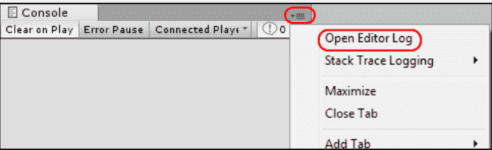
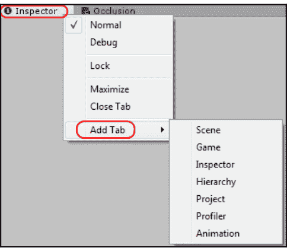
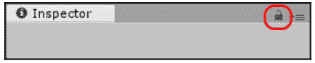
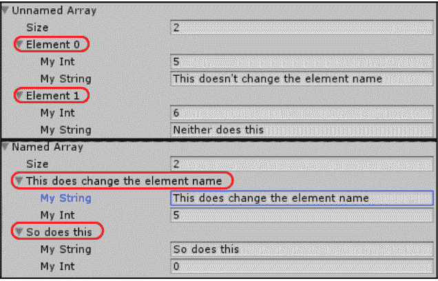
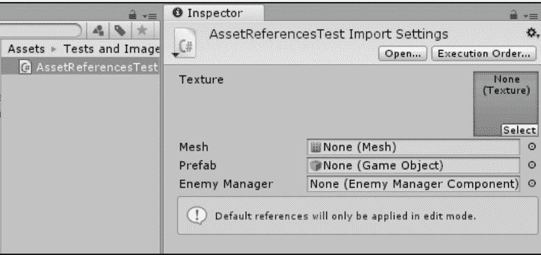
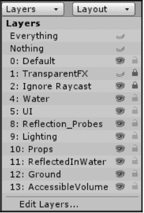

# 战术技巧与窍门

# 第 9 章

互联网上充斥着大量博客、推文和论坛帖子，试图帮助其他 Unity 开发者了解这些有用功能，但它们往往一次只关注少数几个技巧。似乎没有任何在线资源能将其中许多技巧集中在一个地方。因此，中级和高级 Unity 开发者的互联网浏览器可能已经塞满了指向这些技巧的链接，我们将其加入书签以备后用，随后便完全忘记了。

因此，由于本书主要面向此类用户，我觉得值得加入一个简短章节，将许多这些技巧和窍门汇集在一个位置。本章旨在作为参考列表，希望能在未来的开发工作中为我们节省时间。

在本章中，我们将介绍以下领域的技巧和窍门：

- 便捷的编辑器热键
- 更好、更快地使用 Unity 编辑器 UI 的方式
- 加速或简化脚本编写实践的方法
- 涉及在 Unity 外部使用外部工具的其他技巧


在所有情况下，列出的是 Windows 热键。如果 macOS 热键需要不同的按键组合，则会显示在括号中。

按下 Ctrl + Shift + A（Command + Shift + A）可快速打开 **Add Component** 菜单。
从那里，你可以输入要添加的组件名称。

# 场景窗口

按下 _Shift + F_ 或双击 _F_ 键将在 **Scene** 窗口中跟随对象（假设 **Scene** 窗口已打开且可见），这对于跟踪高速对象或弄清对象为何可能从场景中掉落非常有帮助。

在 **Scene** 窗口中按住 _Alt_ 并用鼠标左键拖动，将使 **Scene** 窗口相机围绕当前选定对象环绕（而不是环顾四周）。在 **Scene** 窗口中按住 _Alt_ 并用鼠标右键拖动，将使相机放大/缩小（_Alt + Ctrl_ + 左键拖动）。

按住 _Ctrl_ 并左键拖动会导致选定对象在移动时吸附到网格上。同样，在调整对象周围的旋转小部件时按住 _Ctrl_，也可以对旋转进行吸附。选择 **Edit | Snap Settings...** 将打开一个窗口，我们可以在其中按轴编辑对象吸附到的网格。

我们可以通过在 **Scene** 窗口中移动对象时按住 _V_ 键，强制对象通过其顶点相互吸附。这样做，选定对象会自动将其顶点吸附到鼠标光标最近对象的最近顶点上。这对于将场景元素（如地板、墙壁、平台和其他基于瓦片的系统）对齐到位非常有用，而无需进行微小的手动位置调整。

# 数组

我们可以通过选择 **Inspector** 窗口中暴露的数组元素并按下 _Ctrl + D_（_Command + D_）来复制它们。这将复制该元素并将其插入数组中当前选择的后面。

我们可以通过按下 _Shift + Delete_（_Command + Delete_）来删除引用数组中的条目（例如，`GameObjects` 数组）。这将移除该元素并压缩数组。请注意，第一次按下会清除引用，将其设置为 `null`，但第二次按下会移除该元素。对于原始类型数组（_int_、`float` 等），只需按下 _Delete_ 键而不按住 _Shift_ 键（_Command_）修饰符即可移除元素。

在 **Scene** 窗口中按住鼠标右键的同时，可以使用 _W_、_A_、_S_ 和 _D_ 键以典型的第一人称相机控制方式飞行相机。_Q_ 和 _E_ 键也可分别用于上下飞行。

# 界面

我们可以按下 _Alt_ 并单击 **Hierarchy** 窗口中的任何箭头（任何父对象名称左侧的小灰色箭头），以展开对象的整个层次结构，而不仅仅是 **Hierarchy** 窗口中的下一级。这适用于 **Hierarchy** 窗口中的 `GameObjects`、**Project** 窗口中的文件夹和预制体、**Inspector** 窗口中的列表，等等。

我们可以像典型的即时战略（RTS）游戏一样保存和恢复 **Hierarchy** 或 **Project** 窗口中的对象选择。进行选择并按下 _Ctrl_ + _Alt_ + <0-9>（_Command_ + _Alt_ + <0-9>）来保存选择。按下 _Ctrl_ + _Shift_ + <0-9>（_Command_ + _Shift_ + <0-9>）来恢复它。如果我们在进行调整时反复选择同一小批对象，这将非常有用。

按下 _Shift_ + 空格键会将当前窗口扩展到填充整个编辑器屏幕。再次按下会缩小窗口并将其恢复到之前的位置。

按下 _Ctrl_ + _Shift_ + _P_（_Command_ + _Shift_ + _P）将在 **Play Mode** 中切换 **Pause** 按钮。如果我们试图匆忙暂停，这通常是一个笨拙的按键组合，因此为暂停创建自定义热键通常很有帮助：

```
void Update() {
    if (Input.GetKeyDown(KeyCode.P)) {
        Debug.Break();
    }
}
```

# 编辑器内文档

我们可以通过在 MonoDevelop 中高亮显示任何 Unity 关键字或类并按下 _Ctrl_ + ’（_Command_ + ’）来快速访问其文档。这将打开默认浏览器，并在 Unity 文档中针对给定关键字或类执行搜索。

> 请注意，使用欧洲键盘的用户可能还需要按住 _Shift_ 键才能使用此功能。

同样，可以在 Visual Studio 中按下 Ctrl + Alt + M，然后按下 Ctrl + H 来完成此操作。

# 编辑器 UI 技巧

以下技巧集合涉及编辑器及其界面控件。

# 脚本执行顺序

我们可以通过导航到 **Edit** | **Project Settings** | **Script Execution Order** 来优先决定哪些脚本的 `Update()` 和 `FixedUpdate()` 回调会在其他脚本之前被调用。如果我们发现自己正在使用此功能来解决复杂问题（时间敏感系统，如音频处理除外），这意味着我们的组件之间存在非常脆弱和紧密的耦合。从软件设计角度来看，这可能是一个警示信号，表明我们可能需要从另一个角度来解决问题。然而，这可以作为快速修复的方法很有帮助。

# 编辑器文件

将 Unity 项目与源代码控制方案集成可能有点棘手。第一步是包含 Unity 为各种资源生成的 `.meta` 文件；如果我们不这样做，那么任何将数据拉取到其本地 Unity 项目的人都必须重新生成自己的元数据文件。这可能会导致冲突，因此每个人使用相同版本至关重要。这可以通过导航到 **Edit** | **Project Settings** | **Editor** | **Version Control** | **Mode** | **Visible Meta Files** 来启用。

将某些资源数据转换为文本格式而非二进制数据也很有帮助，以允许手动编辑数据文件。这将许多数据文件转换为更易于人类阅读的 YAML 格式。例如，如果我们使用 Scriptable Objects 来存储自定义数据，可以使用文本编辑器搜索和编辑这些文件，而无需全部通过 Unity 编辑器和序列化系统来完成。这可以节省大量时间，尤其是在搜索特定数据值或跨不同派生类型进行多重编辑时。此选项可以通过导航到 **Edit** | **Project Settings** | **Editor** | **Asset Serialization** | **Mode** | **Force Text** 来启用。


编辑器有一个日志文件，可以通过打开 **Console** 窗口（日志消息将在此打印），左键单击右上角的 _hamburger_ 图标（看起来像三条细水平线），并选择 **Open Editor Log** 来访问。这可以帮助我们获取更多关于构建失败的信息。或者，如果我们成功构建了项目，它将包含打包到可执行文件中的所有资产的压缩文件大小明细，并按大小排序。这是找出哪些资产占据了应用程序大部分空间（提示：几乎总是纹理文件）以及哪些文件占用的空间超出我们预期的一种非常有帮助的方法。



可以通过右键单击现有窗口的标题并选择 **Add Tab** 向编辑器添加其他窗口。这也允许我们添加重复窗口，例如一次打开多个 **Project** 窗口或 **Inspector** 窗口。这对于通过多个 **Project** 窗口在不同位置之间移动文件特别有用。



拥有重复的 **Inspector** 窗口可能有点多余，因为当我们单击新对象时，它们会显示完全相同的信息。但是，通过使用 _lock_ 图标，我们可以将给定的 **Inspector** 窗口锁定到当前选择。当我们选择一个对象时，所有 **Inspector** 窗口都将更新以显示对象的数据，但任何锁定的 **Inspector** 窗口除外，它们将继续显示被锁定对象的数据。



利用窗口锁定的常用技巧包括以下内容：

- 使用两个相同的窗口（**Inspector**、**Animation** 等）并排比较两个对象，或更轻松地将数据从一个对象复制到另一个对象。
- 在 **Play Mode** 期间调整对象时，观察任何依赖对象会发生什么。
- 在 **Project** 窗口中选择多个对象，然后将它们拖放到 **Inspector** 窗口中的序列化数组中，而不会丢失原始选择。

# The Inspector window

我们可以在数字 **Inspector** 窗口字段中输入计算。例如，将 `4*128` 输入 `int` 字段会将值解析为 `512`，省去了我们拿出计算器或在脑海中计算的麻烦。

可以通过右键单击根元素并选择 **Duplicate Array Element** 或 **Delete Array Element**，从列表中复制和删除数组元素（与之前提到的热键方式相同）。

组件的上下文菜单可以通过右上角的小 _cog_ 图标或右键单击组件名称来访问。每个组件的上下文菜单都包含 **Reset** 选项，该选项将所有值重置为默认值，省去了我们手动重置值的麻烦。在使用 `Transform` 组件时，这很有用，因为此选项将对象的位置和旋转设置为 `(0, 0, 0)`，缩放设置为 `(1, 1, 1)`。

众所周知，如果 `GameObject` 是从预制体生成的，则可以使用 **Inspector** 窗口顶部的 **Revert** 按钮将整个对象恢复到其初始预制体状态。但鲜为人知的是，可以通过右键单击值的名称并选择 **Revert Value to Prefab** 来恢复单个值。这将恢复所选值，而其余值保持不变。

**Inspector** 窗口有一个 **Debug Mode**，可以通过左键单击 _lock_ 图标旁边的 _hamburger_ 图标并选择 **Debug** 来访问。这将禁用编辑器脚本等的所有自定义 **Inspector** 窗口绘制，并揭示给定 `GameObject` 及其组件中的所有原始数据片段。即使是 `private` 数据字段也会变得可见。虽然它们显示为灰色且无法通过 **Inspector** 窗口修改，但这仍然为我们在 **Play Mode** 期间检查 `private` 数据和其他隐藏值提供了一种有用的方法。**Inspector** 窗口的 **Debug Mode** 还会揭示内部 ObjectIDs，如果我们正在使用 Unity 的序列化系统进行有趣的操作并希望解决冲突，这会很有用。由于编辑器脚本在此模式下也被禁用，因此可以通过将其内部数据与我们试图在编辑器脚本中揭示的内容进行比较来调试此类脚本。

如果我们在 **Inspector** 窗口中有一个序列化的数据元素数组，则它们通常标记为 **Element N**，其中 `N` 表示该元素的数组索引，从 `0` 开始。如果我们的数组元素是一系列序列化类或结构体（这些类或结构体本身往往有多个子项），则这可能使查找特定元素变得棘手。但是，如果对象中的第一个字段是 `string`，则元素将以 `string` 字段的值命名：



# The Project window

**Project** 窗口的搜索栏允许我们通过单击搜索栏右侧的小图标来筛选特定类型的对象。这将提供一个不同类型的列表，我们可以通过筛选来揭示整个项目中该类型的所有对象。但是，选择这些选项只是将 `t:<type>` 格式的字符串填充到搜索栏中，从而应用相应的筛选器。

因此，为了速度，我们可以直接将等效字符串输入搜索栏。例如，输入 `t:prefab` 将筛选所有预制体，无论它们在 **Hierarchy** 窗口中的位置如何。同样，`t:texture` 将揭示纹理，`t:scene` 将揭示场景文件，依此类推。在搜索栏中添加多个搜索筛选器将包含所有类型的对象（它不会揭示仅同时满足两个筛选器的对象）。这些筛选器是基于名称筛选的补充，因此添加纯文本字符串将导致在筛选对象中进行基于名称的搜索。例如，`t:texture normalmap` 将查找名称中包含 _normalmap_ 单词的所有纹理文件。

如果我们使用资源包和内置标签系统，**Project** 窗口的搜索栏还允许我们通过使用 `l:<label type>` 按标签查找捆绑对象。

当选择网格对象时，**Inspector** 窗口底部的 **Preview** 子部分通常相当小，这使得很难查看网格的细节以及它在场景中出现时的外观。但是，如果我们右键单击 **Preview** 子部分的顶部栏，它将分离并放大为一个单独的 **Preview** 窗口，从而更容易查看我们的网格。我们不必担心将分离窗口设置回其原始位置，因为如果关闭分离窗口，**Preview** 子部分将返回到 **Inspector** 窗口底部。

如果 `MonoBehaviour` 脚本包含对 Unity 资产（如网格和纹理）的序列化引用（使用 `[SerializeField]` 或 `public`），那么我们可以直接在脚本本身中分配默认值。在 **Project** 窗口中选择脚本文件，**Inspector** 窗口应包含一个字段，我们可以将默认分配拖放到其中。



默认情况下，**Project** 窗口将文件和文件夹分为两列并分别处理。如果我们希望 **Project** 窗口具有典型的分层文件夹和文件结构，则可以在其上下文菜单（右上角的 hamburger 图标）中将其设置为 **One Column Layout**。在某些编辑器布局中，这可以节省大量空间。

右键单击 **Project** 窗口中的任何对象并选择 **Select Dependencies** 将揭示该资产依赖于哪些对象才能存在，例如纹理、网格和 `MonoBehaviour` 脚本文件。对于场景文件，它将列出该场景中引用的所有实体。如果我们正在尝试执行资产清理，这很有帮助。

# The Hierarchy window

**Hierarchy** 窗口的一个鲜为人知的功能是它能够在当前活动场景中执行基于组件的筛选。这可以通过在 **Hierarchy** 窗口搜索栏中输入 `t:<component name>` 来完成。例如，在 **Hierarchy** 窗口搜索栏中输入 `t:light` 将揭示场景中包含 `Light` 组件的所有对象。


# 场景窗口和游戏窗口

**场景**窗口中的摄像机在**游戏**窗口中不可见，但通常更容易通过之前提到的热键进行移动和放置。编辑器允许我们将所选对象对齐到相同位置，并通过导航到**游戏对象 | 对齐到视图**或按下`Ctrl + Shift + F`（`Command + Shift + F`）来旋转**场景**窗口摄像机。这意味着我们可以使用摄像机控件将**场景**窗口摄像机放置在希望对象所在的位置，并通过将其与摄像机对齐来放置对象。

同样，我们可以通过选择**游戏对象 | 对齐视图到所选对象**来将**场景**窗口摄像机对齐到所选对象（请注意，Windows 和 MacOS 上都没有此功能的热键）。这对于检查给定对象是否指向正确方向很有用。

我们可以像在**层级**窗口中一样，在**场景**窗口中执行类似的基于组件的过滤，方法是在其搜索栏中使用`t:<component>`语法。这将导致**场景**窗口仅呈现包含给定组件（或从中派生的组件）的对象。请注意，此文本框与**层级**窗口中的同一文本框相关联，因此在其中一个输入的内容会自动影响另一个，在查找难以捉摸的对象时非常有帮助。

在 Unity 编辑器的右上角有一个名为**图层**的下拉菜单。这包含了一个基于图层的过滤和锁定系统，用于**场景**窗口。为给定图层启用_眼睛_图标将在**场景**窗口中显示/隐藏该图层的所有对象。切换锁定图标将允许或阻止给定图层的对象被选择或修改（至少通过编辑器 UI 进行）。

这对于防止某人意外选择和移动已经安置在完美位置的背景对象等情况很有帮助：



编辑器一个广为人知且有用的功能是，可以为`GameObjects`赋予特殊图标或标签，以便在场景窗口中更容易找到它们。这对于没有渲染器但我们希望轻松找到的对象特别有帮助。例如，灯光和摄像机等对象具有内置图标，可以更轻松地在场景窗口中识别它们。但是，通过单击游戏窗口右上角的 Gizmos 按钮，也可以在游戏窗口中显示相同的小部件。此选项的下拉菜单决定了启用该选项时哪些小部件将可见。

# 播放模式

由于播放模式下的更改不会自动保存，因此明智的做法是修改播放模式期间应用的色调颜色，以便清楚地知道我们当前正在使用哪种模式。此值可以通过导航到 Edit | Preferences | Colors | Playmode tint 来设置。

可以简单地使用剪贴板从播放模式中保存更改。如果我们正在播放模式下调整对象并对其设置满意，则可以使用 Ctrl + C（Command + C）将对象复制到剪贴板，并在播放模式结束后通过 Ctrl + V（Command + V）将其粘贴回场景。

# 脚本技巧

以下是在编写脚本时有用的功能。

# 常规

我们可以修改新脚本、着色器和计算着色器文件的各种模板。这有助于删除空的 Update 存根，正如我们在第 2 章“脚本策略”中所介绍的，这些存根可能会导致不必要的运行时开销。这些文件可以在以下位置找到：

- Windows: `<Unity install>\Editor\Data\Resources\ScriptTemplates\`
- MacOS: `/Applications/Unity/Editor/Data/Resources/ScriptTemplates/`

复制时对象上的所有设置都将保留。同样，可以使用组件上下文菜单中的**复制组件**和**粘贴组件**选项对整个组件的单个值执行相同操作。但是，剪贴板一次只能包含一个 GameObject、组件或值的数据。

另一种方法是在**播放模式**期间保存多个对象的数据，即在运行时将它们拖放到**项目**窗口中以创建预制体。如果原始对象是从预制体派生的，并且我们希望在所有实例中更新它，则只需通过将副本拖放到原始对象上来用新创建的预制体覆盖旧预制体即可。请注意，这在**播放模式**激活时也有效，但可能很危险，因为没有对话框弹出以确认覆盖。请非常小心不要覆盖错误的预制体。

我们可以使用**帧跳过**按钮（编辑器中**暂停**按钮右侧的按钮）一次迭代一帧。这对于逐帧观察物理或游戏玩法行为很有用。请记住，这会导致每次迭代调用一次 Fixed Update 和一次 Update，次数相等，这可能无法准确反映实际运行时行为，因为实际运行时行为中这两个回调的调用次数往往不相等。

如果**播放模式**开始时**暂停**按钮处于启用状态，那么游戏将在第一帧之后立即暂停，让我们有机会观察场景初始化期间发生的任何异常。

`Assert` 类允许基于断言的调试，一些开发者更习惯这种方式，而不是基于异常的调试。有关断言的更多信息，请查阅 Unity 文档，网址为 `http://docs.unity3d.com/ScriptReference/Assertions.Assert.html`。

# 特性

特性是非常有用的元级标签，可以赋予 C# 中的几乎任何目标。它们最常用于字段和类，允许我们用特殊属性标记它们，以便可以以不同方式处理。中级和高级 Unity 开发者会发现阅读 C# 关于特性的文档并发挥想象力，创建自己的特性来加速工作流是值得的。Unity 引擎中内置了相当多的特性，在正确的位置使用时非常有用。

高级用户会注意到，特性也可以赋予枚举、委托、方法、参数、事件、模块，甚至程序集。

# 变量特性

`[Range]` 特性可以添加到整数或浮点字段，以将其转换为**检查器**窗口中的滑块。我们可以给出最小值和最大值，从而限制值可以包含的范围。

通常，如果重命名变量，即使我们通过 IDE（无论是 MonoDevelop 还是 Visual Studio）进行重构，一旦 Unity 重新编译 `MonoBehaviour` 并对组件的任何实例进行相应更改，值就会丢失。但是，如果我们想要重命名之前已序列化的变量，`[FormerlySerializedAs]` 特性非常有帮助，因为它会在编译时将特性中命名的变量的数据复制到给定变量中。再也不用担心因重命名而丢失数据！

请注意，除非变量在包含该特性后已手动更改并重新保存到每个相关预制体中，否则在转换完成后不安全地移除 `[FormerlySerializedAs]` 特性。`.prefab` 数据文件仍将包含旧变量名，因此在下次加载文件时（例如，编辑器关闭后重新打开）仍需要 `[FormerlySerializedField]` 特性来确定数据放置位置。因此，这是一个有用的特性，但长期使用往往会使代码库变得非常混乱。

# 类特性

`[SelectionBase]` 特性将附加该组件的任何 `GameObject` 标记为**场景**窗口中的选择根。如果我们有作为其他对象子项的网格，这特别有用，因为我们可能希望用第一次点击选择父对象，而不是带有 `MeshRenderer` 组件的对象。

如果我们有强依赖关系的组件，可以使用 `[RequireComponent]` 特性强制关卡设计师将重要组件附加到同一个 `GameObject` 上。这确保了代码库依赖的任何依赖关系都会由设计师满足，而无需为他们编写大量文档。

`[ExecuteInEditMode]` 特性将强制对象的 `Update()`、`OnGUI()` 和 `OnRenderObject()` 回调即使在**编辑模式**下也会被调用。但是，有一些注意事项，如下所示：

- 仅当场景中发生变化时（例如移动摄像机或更改对象属性），才会调用 `Update()` 方法
- `OnGUI()` 仅在**游戏**窗口事件期间调用，而不适用于其他窗口，例如**场景**窗口
- `OnRenderObject()` 在**场景**和**游戏**窗口的任何重绘事件期间被调用

但是，此特性为这些对象提供了与典型编辑器脚本不同的一组事件钩子和入口点，因此它仍然有其用途。


# Logging

我们可以向调试字符串添加富文本标签。诸如 `<size>`、`<b>`（粗体）、`<i>`（斜体）和 `<color>` 等标签可用于调试字符串。这有助于区分不同类型的日志消息并突出显示特定元素，如下所示：

```
Debug.Log ("<color=red>[ERROR]</color>This is a <i>very</i>/
<size=14><b>specific</b></size> kind of log message");
```


MonoBehaviour 类有一个 print () 方法，方便使用，其功能与 Debug.Log () 相同。

创建自定义日志记录类可能会有所帮助，该类会自动在每条日志消息末尾追加 \n\n。这会将不必要的 UnityEngine.Debug::Log (Object) 杂乱信息推开，这些杂乱信息往往会填满控制台窗口。

# Useful links

Unity Technologies 提供了许多关于各种脚本功能使用的有用教程，主要面向初级和中级开发者。教程可在 https://unity3d.com/learn/tutorials/topics/scripting 找到。

Unity Answers 上有一个有用的帖子，提供了一个参考列表，涵盖了开发过程中可能遇到的许多不同的脚本和编译错误，位于 http://answers.unity3d.com/questions/723845/what-are-the-c-error-messages.html。

嵌套协程是一个有趣且有用的脚本领域，但文档不完善。然而，在使用嵌套协程时，应考虑以下第三方博客帖子，它涵盖了许多有趣的细节：

http://www.zingweb.com/blog/2013/02/05/unity-coroutine-wrapper

我们可以通过检查 http://docs.unity3d.com/ScriptReference/40_history.html 上的 API 历史页面，来了解特定功能何时添加到 Unity API 中。该页面目前仅显示到 5.0.0 版本的 API 历史。希望 Unity Technologies 将来会更新此页面，因为在尝试同时支持多个版本的 Unity 时，了解哪些功能是在何时添加的有时会很有用。

# Custom Editor scripts and menu tips

虽然众所周知，我们可以在编辑器脚本中使用 `[MenuItem]` 属性创建编辑器菜单项，但一个较少为人知的能力是能够为菜单项设置自定义快捷键。例如，我们可以通过定义以 `_k` 结尾的 `[MenuItem]` 属性，使 `K` 键触发我们的菜单项方法，如下所示：

```
`[MenuItem("My Menu/Menu Item _k")]`
```

我们还可以使用 `%`、`#` 和 `&` 字符分别包含 `Ctrl`（Command）、`Shift` 和 `Alt` 等修饰键。

`[MenuItem]` 还有两个重载，允许我们设置两个额外参数：一个布尔值，用于确定菜单项是否需要验证方法；一个整数，用于确定菜单项在 **Hierarchy** 窗口中的优先级。

查看 `[MenuItems]` 的文档，以获取可用快捷键修饰符、特殊键以及如何创建验证方法的完整列表，位于 http://docs.unity3d.com/ScriptReference/MenuItem.html。

可以通过调用 `EditorGUIUtility.PingObject()` 在 **Hierarchy** 窗口中“ping”一个对象，类似于我们在 **Inspector** 窗口中单击 `GameObject` 引用时发生的情况。

`Editor` 类的原始实现，以及大多数人学习如何编写编辑器脚本的方式，最初涉及在同一个类中编写所有逻辑和内容绘制。然而，`PropertyDrawer` 类是将 **Inspector** 窗口绘制委托给与主 `Editor` 类不同的类的有效方法。这有效地将输入和验证行为与显示行为分离，允许对每个字段的渲染进行更精细的控制，并更有效地重用代码。我们甚至可以使用 `PropertyDrawer` 来覆盖 Unity 对内置对象（如 `Vector` 和 `Quaternion`）的默认绘制。

`PropertyDrawer` 使用 SerializedProperty 类来完成单个字段的序列化，编写编辑器脚本时应优先使用它们，因为它们利用了内置的撤销、重做和多编辑功能。数据验证可能有点棘手，最佳解决方案是在 setter 属性中使用 OnValidate() 调用。Unity Technologies 开发者 Tim Cooper 在 Unite 2013 上的一次会议详细解释了各种序列化和验证方法的优缺点，地址为 https://www.youtube.com/watch?v=Ozc_hXzp_KU。

我们可以使用 [ContextMenu] 和 [ContextMenuItem] 属性将条目添加到组件上下文菜单甚至单个字段的上下文菜单中。这使得无需编写广泛的编辑器类或自定义检查器窗口，即可轻松自定义组件的检查器窗口行为。

高级用户可能会发现，通过 AssetImporter.userData 变量将自定义数据存储在 Unity 元数据文件中很有用。还有许多机会可以利用 Unity 代码库的反射。Ryan Hipple 在 Unite 2014 上的会议概述了可以在 Unity 编辑器中使用反射实现的大量巧妙的小技巧和窍门，地址为 https://www.youtube.com/watch?v=SyR4OYZpVqQ。

# External tips

以下技巧和窍门与 Unity 编辑器本身之外的主题相关，可以极大地帮助 Unity 开发工作流。

Twitter 话题标签 #unitytips 是 Unity 开发有用技巧和窍门的绝佳资源，事实上，本章中的许多技巧都源于此。然而，话题标签很难过滤出你以前没见过的技巧，而且往往被滥用于营销。一个汇总了来自 #unitytips 的每周技巧包的绝佳资源可以在 http://devdog.io/blog 找到。

如果我们以 site:unity3d.com 开头进行搜索，那么搜索与 Unity 相关的问题或疑虑会快得多，这将过滤所有结果，使只有 unity3d.com 域名下的结果出现。

如果 Unity 编辑器因任何原因崩溃，我们可以通过将以下文件重命名为包含 .unity 扩展名（用于场景文件），并将其复制到 Assets 文件夹中，来潜在地恢复我们的场景：

```
`\<project folder\>\Temp\_EditModeScene`
```

如果我们在 Windows 上开发，那么此时几乎没有理由不使用 Visual Studio。MonoDevelop 已经被拖拖拉拉了很多年，许多开发者转而使用功能更丰富的 Visual Studio Community Edition 来满足大部分开发工作流需求，特别是借助 Resharper 等非常有用的插件。

有一个关于游戏编程模式（或者更确切地说，以与游戏开发相关的方式解释的典型编程模式）的绝佳资源，并且完全免费并在线提供。以下指南包含了我们在本书中探讨的几种设计模式和游戏功能的更多信息，例如单例模式、观察者模式、游戏循环以及双重帧缓冲：

`http://gameprogrammingpatterns.com/contents.html`

关注任何来自 Unite 会议的会议视频，无论何时举行（或者更好的是，尽量参加它们）。每次会议通常都会有几个由 Unity 员工和经验丰富的开发者举办的小组讨论，他们将分享许多使用引擎和编辑器所能完成的酷炫有趣的事情。除此之外，请确保通过 `unity3d.com` 上的论坛、Twitter、Reddit、Stack Overflow、Unity Answers，或未来几年冒出来的任何社交聚会场所参与 Unity 社区。

本书中包含的每一个技巧都不是凭空捏造的。它最初是某人在某个时间、某个地点分享的一个想法或知识碎片，并不知何故最终来到了本书作者的手中。因此，跟上最佳技巧、窍门和技术的最佳方法是通过参与 Unity 社区，让我们的手指保持在 Unity 发展方向的脉搏上。

# Other tips

最后，以下部分包含不太适合其他类别的技巧。

使用空 `GameObject` 作为一组对象的父级来组织我们的场景，并为其命名为对该组有意义的名称，这始终是个好主意。这种方法的唯一缺点是，对象的 `Transform` 在位置或旋转变化时会被包含，并在重新计算时被包含，而且众所周知，将 `GameObject` 重新父级到另一个 `Transform` 有其自身的开销。正确的对象引用、`Transform` 变化缓存和/或使用 `localPosition`/`localRotation` 可以充分解决其中一些问题。在几乎所有情况下，场景组织带来的工作流程好处都远比这种微不足道的性能损失更有价值。


Animator Override Controllers 最初在 Unity v4.3 中推出，但往往被遗忘或很少被提及。它们是标准 Animation Controllers 的替代方案，允许我们引用现有的 Animation Controller，然后覆盖特定的动画状态以使用不同的动画文件。这可以大大加快工作流程，因为我们不需要多次复制和调整 Animation Controllers；我们只需更改少数几个动画状态即可。

当 Unity 启动时，它会自动打开 **Project Wizard**，允许我们打开最近的项目。但是，如果我们更喜欢 Unity 4 的默认行为，即自动打开之前的项目，我们可以通过在启动时导航到 **Edit | Preferences | General | Load Previous Project** 来编辑此行为。请注意，如果 **Project Wizard** 已启用，我们可以同时打开多个 Unity Editor 实例（尽管不能打开同一个项目）。

Unity Editor 的惊人可定制性及其不断增长的功能集意味着有大量的小机会来改进工作流程，并且每天都在发现或发明更多。Asset Store 市场充斥着各种尝试解决现代开发者遇到问题的产品，这使得它成为寻找想法的好地方，或者，如果我们愿意，花一些钱来为我们节省大量麻烦。

由于这些资产往往面向广泛的受众，这往往使价格保持低位，我们可以以惊人的低成本获得一些非常有用的工具和脚本。在几乎所有情况下，我们自己开发同样的解决方案都需要花费大量时间。如果我们认为自己的时间很宝贵，那么偶尔扫描 Asset Store 可以是一种非常具成本效益的开发方法。
