## 1 使用动画

本章解释了在 Unity 中使用动画的基本知识，并涵盖以下主题：

- 导入骨骼动画
- 配置通用和人形骨架
- 创建并分配 Animator Controller
- 在 Animator Controller 中创建动画过渡
- 使用参数控制动画流程
- 使用来自多个资源包的动画
- 循环、镜像和偏移动画
- 调整动画播放速度
- 使用覆盖 Animator Controller 为不同类型的角色制作动画
- 从 3D 软件包导入物体动画

### 引言

Unity 是一个出色的游戏引擎，实现了 *让一切动起来* 的理念，让您可以可视化甚至最具创意的游戏玩法创意。在本书的进程中，我们将学习各种配方，帮助您释放 Unity 5.x 动画工具的强大功能，让您的游戏更有趣。

在本章第一章中，我们将更熟悉在 Unity 中使用骨骼动画。它将指导您完成导入此类动画、编辑它们并将其分配给游戏内角色的过程。这些知识对于理解后续章节中描述的配方至关重要。

### 导入骨骼动画

本配方首先展示如何从 3D 软件包导入骨骼动画。它假设您已经准备好了一个动画。我们将把文件带入 Unity 并展示您可以在哪里调整导入设置。现在我们不会过多深入细节，以使导入过程尽可能快速。我们将在后续配方中涵盖所有设置。

#### 准备工作

大多数动画都是在外部 3D 软件包中创建的，例如 Maya、3ds Max、Motion Builder 或 Blender 3D。确保您已准备好带骨架的 3D 模型，模型已蒙皮，并且您已创建至少一个动画。您也可以下载提供的示例；打开 Unity 中的项目并前往此文件夹：`Chapter 01 Working with animations\Recipe 01 Importing skeletal animations\Sheep Model`。您将在那里找到一个导入的 FBX 文件，名为 `Sheep.fbx`。

#### 如何操作...

要导入骨骼动画，您需要按照以下步骤操作：


1. 将蒙皮模型及其骨架（在 Unity 中称为 **骨架**）导出为 FBX 格式。

如果您使用的是 Blender，您不必手动将文件导出为 FBX 格式。只需将文件拖放到 `Assets` 文件夹中即可。Unity 将在后台使用 Blender FBX 导出器。此外，您可以通过在 Unity 中双击它来打开文件。编辑并保存后，Unity 将再次重新导入它。这是一种非常方便的编辑动画方式，因为您每次更改时不必经过导出-导入过程。

2. 将导出的文件拖放到项目中 `Assets` 文件夹下的任何子文件夹中，或前往 **资源 | 导入新资源** 并选择您的 FBX 文件。

3. 选择导入的文件并导航到 **检视器** 选项卡。点击骨架按钮：

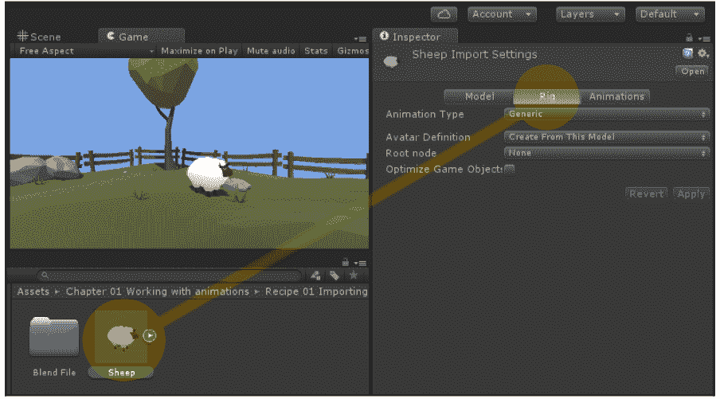

4. 在这里您可以指定要使用的骨架类型。对于双足角色，使用 **人形** 选项，对于其余所有角色选择 **通用**。我们在本示例中使用羊模型，因此需要选择 **通用** 骨架。这些选项之间的差异在 *其工作原理* 部分中描述。

5. 将所有其他输入保持为默认值。

6. 点击 **动画** 按钮。如果出现 **未应用的导入设置** 窗口，请点击 **应用**。

7. 确保已勾选 **导入动画** 复选框。

8. 点击 **检视器** 右下角的 **应用** 按钮（就在 **动画预览** 上方）。您可能需要向下滚动 **检视器**。

9. 您应该能够看到所有导入的动画剪辑作为导入 FBX 文件的子资源。

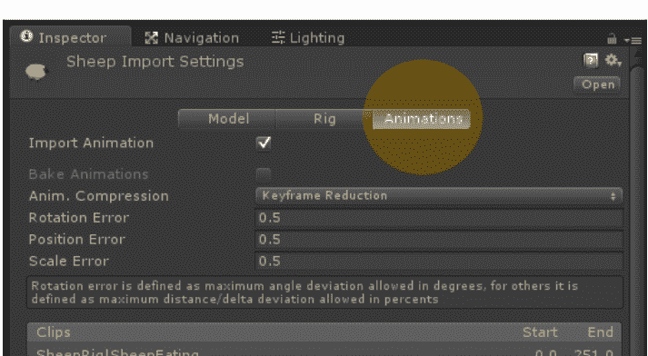

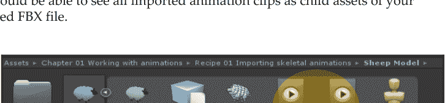

#### 其工作原理...

Unity 使用四种不同的骨架配置：

- **通用** 骨架：此骨架用于四足动物、蜘蛛和其他非人形角色。它使用 Unity 的 Mecanim 系统来控制动画流程。如果您提供 **根节点**——负责角色移动的骨骼，它可以使用根运动。
- **人形** 骨架：此骨架仅用于人形角色。它也使用 Mecanim 系统来控制动画。如果您使用 **人形** 骨架，您有更多导入动画的选项。最大的优势是自动动画重定向——您可以在各种类型的人形角色上使用相同的动画剪辑（例如，矮人和巨魔）。
- **旧版**：此选项主要用于与早期 Unity 版本的向后兼容。它类似于 **通用** 骨架，但使用脚本而不是 Mecanim 来控制动画流程。我建议改用 **通用** 骨架。
- **无**：最后一个选项关闭骨架并禁用动画导入。

我们将在下一个配方中进一步讨论通用和人形骨架之间的差异。

#### 还有更多...

- 导入的动画剪辑也在动画选项卡的剪辑部分列出。

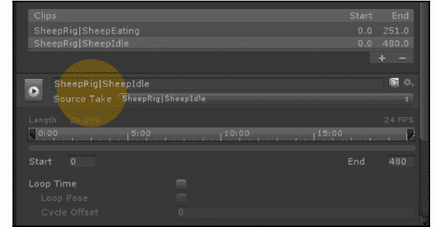

- 您可以通过点击 **剪辑** 部分下方的加号按钮添加新剪辑。您也可以通过点击减号按钮删除剪辑。
- 您可以使用 **源片段** 下拉菜单上方的输入字段重命名每个剪辑。
- 您可以使用 **源片段** 下拉菜单为每个动画剪辑选择源片段（存储在 FBX 文件中的动画）。
- 您也可以通过编辑 **开始** 和 **结束** 输入字段来修剪动画剪辑。


如果您使用 Blender，请确保将骨架在 X 轴上旋转 -90 度，在 Blender 中应用旋转，然后再次旋转 +90 度在 X 轴上。骨架在 Blender 中的旋转应为：90 X、0 Y 和 0 Z。您的模型应在 Blender 中面向 -Y 轴（当您将视图更改为 **FRONT** 时，您应该看到角色的面部）。Blender 和 Unity 使用不同的轴对齐方式：在 Blender 中，Z 向上，Y 向后；在 Unity 中，Z 向前，Y 向上。这个小技巧解决了问题。导入后您的模型应具有 0 旋转并面向 Z 轴。这对于移动对象（如角色）和骨架配置非常重要。如果您不这样做，导入后您的模型将具有 -90 X 旋转。

### 配置通用和人形骨架

本配方展示如何配置两种最常用的骨架类型：**通用** 和 **人形**。我们将介绍它们各自的所有可用选项。

#### 准备工作

如前所述，请确保您已准备好两个动画角色。其中一个应为人形，另一个为非人形，例如四足动物。您也可以下载提供的示例 Unity 项目并前往 `Chapter 01 Working with animations\Recipe 02 Configuring generic and humanoid rigs\Rigs directory.`

您将在那里找到三个 FBX 文件：

- `Generic.fbx`
- `Humanoid.fbx`
- `Quadruped.fbx`


如果从零开始创建角色，那么人形骨架的骨骼层级对于 Unity 识别该骨架为人形非常重要。它应遵循以下模式：

```
HIPS -> SPINE -> CHEST -> NECK -> HEAD
HEAD -> EYE (for left and right eyes)
HEAD -> JAW
HIPS -> UPPER LEG -> LOWER LEG -> FOOT -> TOES (for left and right legs)
CHEST -> SHOULDER -> ARM -> FOREARM -> HAND (for left and right hands)
HAND -> PROXIMAL -> INTERMEDIATE -> DISTAL (for five fingers in left and right hands)
```

髋骨是人形角色的根骨骼。手指、肩膀、胸部、颈部、眼睛、下颌和脚趾都是可选骨骼。没有它们你的角色也能正常工作。

你还应记住将角色建模为 T-POSE。它应面向 Unity 中的 Z 轴（如果你的 3D 软件使用与 Unity 不同的轴对齐方式，如 Blender，请记住 *Importing skeletal animations* 食谱中展示的 -90 和 +90 度旋转技巧）。角色的手应平放，手掌向下，并沿 X 轴与地面平行。A-POSE 角色也适用。

#### 如何操作...

配置通用骨架需要遵循以下步骤：

- 1. 按照 *Importing skeletal animations* 食谱中的方式将动画资源导入 Unity。
- 2. 选择资源并在 **Inspector** 中选择 **Rig** 选项卡。然后在 **Animation Tab** 下拉菜单中选择 **Generic** 选项。如果使用提供的示例 Unity 项目，请在 `Chapter 01 Working with animations\Recipe 02 Configuring generic and humanoid rigs\Rigs` 目录中选择 `Generic.fbx` 文件。
- 3. 从 **Avatar Definition** 下拉菜单中选择 **Create From This Model** 选项。
- 4. 将 **Root Node** 选项保持设置为 **None**。
- 5. 将 **Optimize Game Objects** 选项保持未勾选。
- 6. 点击 **Apply** 按钮完成配置。

人形骨架配置有更多选项：

- 1. 首先，按照 *Importing skeletal animations* 食谱中的方式将蒙皮人形模型导入 Unity。
- 2. 选择资源并在 **Inspector** 中选择 **Rig** 选项卡。然后在 **Animation Tab** 下拉菜单中选择 **Humanoid** 选项。如果使用提供的示例 Unity 项目，请在 `Chapter 01 Working with animations\Recipe 02 Configuring generic and humanoid rigs\Rigs` 目录中选择 `Humanoid.fbx` 文件。
- 3. 从 **Avatar Definition** 下拉菜单中选择 **Create From This Model** 选项。
- 4. 将 **Optimize Game Objects** 选项保持未勾选。
- 5. 点击 **Apply** 按钮。
- 6. 你应该会看到一个带有勾选图标的 **Configure** 按钮。

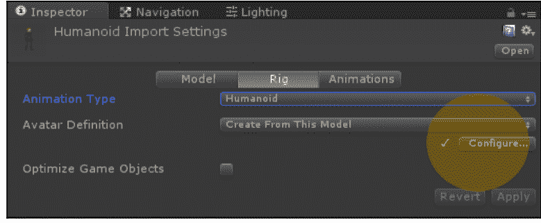

- 7. 勾选图标表示 Unity 已能自动识别骨架层级为人形。如果 Unity 无法识别，则会自动显示叉号代替勾号。如果使用提供的示例，当你尝试将 `Generic.fbx` 文件的骨架设置为 **Humanoid** 时可以观察到这种情况。

一些四足角色可能会被 Unity 误认为人形。你可以在提供的示例 Unity 项目中找到 `Quadruped.fbx` 文件。理论上，你可以将它的骨架设置为 **Humanoid**，Unity 会将其识别为有效。然而这是一个错误——所有四足角色的骨架都应设置为 **Generic**。将其设为人形可能会导致后续问题。

- 8. 点击 **Configure** 按钮进入 **Avatar Configuration Inspector**。将打开一个新场景。你应该能在 **Inspector** 选项卡的 **scene** 和骨骼 **mapping** 部分看到你的模型。

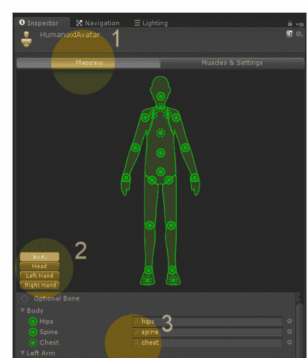

- 9. 确保你在 **Mapping** 部分（1）。所有已识别并分配的骨骼在显示的虚拟角色上显示为绿色身体部位。如果必需骨骼缺失或未分配，它会显示为红色。你可以通过点击相应的按钮（2）在 **Body**、**Head**、**Left Hand** 和 **Right Hand** 部分之间导航。每个部分的骨骼都显示在列表（3）中。必需骨骼用圆形图标标记，可选骨骼用虚线圆形图标标记。
- 10. 你可以通过从 **Hierarchy** 选项卡拖动骨骼并将其放置到 **Inspector** 选项卡中对应的骨骼槽位来更改骨骼分配。Unity 有时会漏掉一两个骨骼（尤其是手指）；因此，你应始终手动检查骨骼分配。
- 11. 如果你的角色不在 T-POSE（例如建模为 A-POSE），场景视图中会显示 **Character is not in T-POSE** 消息，并且角色的骨骼会显示为红色。Unity 需要角色处于 T-POSE 才能正确配置人形头像。你可以通过选择骨骼 **mapping** 列表下方的 **Pose | Enforce T-POSE** 选项来强制该姿势。

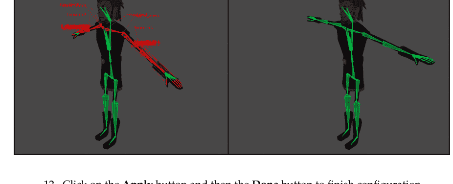

- 12. 点击 **Apply** 按钮然后点击 **Done** 按钮完成配置。

#### 工作原理...

**Humanoid** 骨架比 **Generic** 骨架使用更高级的 Mecanim 功能。你可以在下方找到这些功能的列表：

- **Automatic retargeting:** 这是两种骨架最重要的区别之一。**Humanoid** 骨架使用自动重定向，这意味着你可以在不同的人形角色上使用相同的动画。你的角色可以共享一组动画（基本移动或一些常见动作）。它使你能够从 Asset Store 购买动画资源并轻松地在你的角色上使用。**Generic** 骨架不支持此功能。你必须为特定骨架准备动画或在 3D 软件包中重定向它们。
- **Inverse kinematics:** 此功能允许你通过脚本控制角色的脚和手的位置。它对于让角色站在不平地面或抓取场景中的物体很有用。它是 Unity 中 Humanoid 骨架的内置功能。**Generic** 骨架必须使用自定义解决方案。
- **Advanced animation settings:** Humanoid 骨架在动画导入方面有更多设置，例如 **mirror** 选项。我们将在 *Looping mirroring and offsetting animations* 食谱中深入讨论它们。
- **Look at:** Unity 为人形角色看向某物提供了内置解决方案。你必须为通用角色编写自定义系统。
- **Additional bones:** 很多人认为他们不能在 **Humanoid** 骨架中使用额外骨骼。这是不正确的。例如，如果你的骨架有动画武器槽，你仍然可以与 **Humanoid** 骨架一起使用。你需要做的就是在动画导入设置中找到 **Mask** 部分，并为使用它的每个动画启用额外骨骼（你需要使用 **Transform** 折叠面板来找到你的额外骨骼）。

我强烈建议在游戏中的所有人形角色使用 **Humanoid** 骨架。

#### 还有更多...

- 在 Humanoid 骨架配置中，你可以找到 **Muscles & Settings** 部分，在那里你可以预览和调整角色的运动（肌肉）范围。

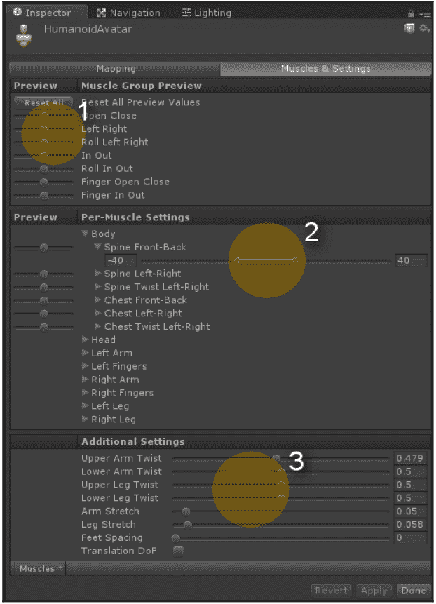

- 你可以通过调整滑块（1）在 **Muscle Group Preview** 部分预览运动范围。你可以在 **Per-Muscle Settings** 部分预览每个肌肉的运动范围。你也可以在这里通过展开指定的肌肉折叠面板并使用滑块（2）来调整范围。在 **Additional Settings** 部分，你可以调整头像的更多选项。这些主要负责你的骨架的 *flexibility*。例如，你可以设置动画过程中骨骼可以被拉伸的程度。
- **Translation DoF** 选项启用了在 **Humanoid** 骨架中动画化骨骼过渡。它默认关闭，这意味着动画中仅使用骨骼的旋转。
- 在 **model import settings** 中的 **Rig** 选项卡中，你可以找到一些附加选项：
  - **Avatar Definition**: 此选项负责创建新头像或从另一个模型复制头像。第二个选项对于将动画存储在多个文件中很有用。它将在 *Using animations from multiple assets* 食谱中进一步讨论。
  - **Optimize Game Objects**: 此选项允许你从 **Hierarchy** 视图中隐藏所有骨骼。游戏中的游戏对象数量会影响性能。你仍然可以选择要显示在 **Hierarchy** 中的骨骼数量。它对于在隐藏其他骨骼的同时暴露武器槽和类似的游戏相关骨骼很有用。
  - **Root node**: 此选项仅对 **Generic** 骨架可见。它允许你选择负责根运动计算的骨骼。我们将在 `Chapter 4, Character Movement` 中进一步讨论它。

### 创建和分配 Animator Controller

**Animator Controllers** 是状态机（图表），负责控制游戏中任何动画对象的动画流程。相同的 Animator Controller 资源可以被多个对象或角色使用。Unity 会为分配给它的每个动画对象创建独立的运行时副本。


#### 准备工作

如常，你在开始之前应准备好一个绑定并已动画化的角色。将它导入 Unity，选择合适的骨架类型，并将其放入场景中。你可以下载示例 Unity 项目并进入 `Chapter 01 Working with animations\Recipe 03 Creating and assigning an animator controller` 目录。在那里有一个名为 `Example.unity` 的场景。如果打开它，你会在 **层级** 中找到一个 Sheep 角色。它已创建并分配了 Animator Controller。你也可以使用 `Chapter 01 Working with animations\Recipe 03 Creating and assigning an animator controller\Rigs` 目录中的 `Quadruped.fbx` 文件来逐步跟随配方。

#### 如何操作...

创建并分配 Animator Controller，请按以下步骤操作：

- 1. 导航到 **项目视图**（`Assets` 文件夹中的任意目录）并按下鼠标右键。
- 2. 从菜单中选择 **创建 | Animator Controller**。将会创建一个控制器资源。你可以按需命名。
- 3. 双击创建的控制器。将会出现一个 **Animator** 选项卡。它会显示当前选中的 **Animator Controller**。
- 4. 在这里你可以添加第一个动画。导航到 **项目视图** 中的导入角色。展开它并将其中一个导入的动画拖放到 **Animator** 窗口中。将会创建一个新状态并显示为橙色，表示这是默认动画状态——你的图表从此状态开始。

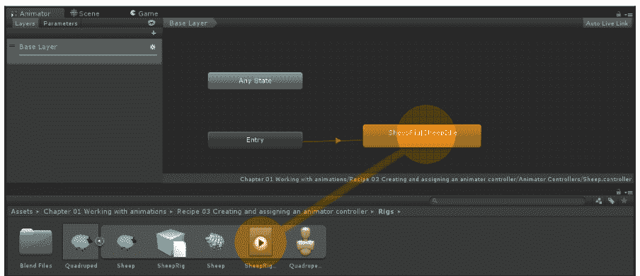

- 5. 在场景中导航到你的角色并选中它。
- 6. 在 Inspector 选项卡中找到 Animator 组件。所有动画对象都会自动添加 Animator 组件。
- 7. 在 Animator 组件检查器中找到 Controller 槽。
- 8. 将你的 Animator Controller 资源拖放到 Animator 组件的 Controller 槽中。
- 9. 运行游戏以查看你的角色播放 Animator Controller 的默认状态动画。如果动画未循环，它只会播放一次然后角色会冻结。
- 10. 你也可以在运行时选中你的角色并导航到 Animator 选项卡，以查看角色当前处于哪个动画状态。当前动画状态会显示蓝色进度条。

#### 工作原理...

Unity 中的每个动画对象都使用 Animator 组件和 Animator Controller 资源。该组件负责在运行时播放动画。它有一系列参数，我们需要设置或可用于调整组件功能：

- **Controller**：这是我们需要附加 Animator Controller 资源到的字段。它决定 Animator 组件将使用哪个动画图。

- **Avatar:** 在 Unity 中，*头像* 是骨架定义。例如，如果我们有多个包含相同 **Generic** 骨架的动画文件，我们应该为所有文件使用相同的 **Avatar**。你可以在 *使用多个资源中的动画* 配方中了解更多相关信息。
- **Apply Root Motion:** 通过此复选框，我们可以打开或关闭根运动。当我们有带根运动的动画但不想为特定角色使用根运动定义时，这可能很有用。
- **Update Mode:** 此参数告诉 Unity 在哪个更新中评估动画。**Normal** 选项使动画与正常的 `Update()` 调用同步，**Animate Physics** 选项使动画与物理 `FixedUpdate()` 调用同步，而 **Unscaled Time** 选项使动画与正常的 `Update()` 调用同步，但禁用动画时间缩放（动画以 100% 的速度播放，无论 `Time.timeScale` 变量值如何）。
- **Culling Mode:** 此参数告诉 Unity 何时在给定 Animator 上关闭动画播放。**Always Animate** 选项使 Animator 始终播放动画（即使在屏幕外），**Cull Update Transforms** 选项在 Animator 在屏幕上不可见时剔除 Retarget 和 IK 变换，而 **Cull Completely** 选项在 Animator 在屏幕上不可见时完全禁用动画。

Animator Controller 资源存储动画（动画状态）的图表并定义在它们之间切换、混合等的规则。控制器（资源）附加到组件的 **Controller** 字段（组件附加到角色预制体或放置在场景中的角色）。如果多个对象或角色使用相同的动画（具有相同的骨架或为人类角色），它们可以共享同一个 Animator Controller。

#### 另请参阅

如果你想学习如何创建动画图并控制其流程，请参阅接下来的两个配方：*在 Animator Controller 中创建动画过渡* 和 *使用参数控制动画流程*。

### Creating animation transitions in Animator Controller

如前所述，Animator Controllers 是包含动画（状态）的状态机。任何给定角色在同一时间只能处于其中一个状态（播放一个动画）。要在状态（动画）之间切换，你需要创建状态过渡。

#### 准备工作

在开始之前，你应该在场景中放置一个已分配 Animator Controller 的动画模型。你可以在提供的示例 Unity 项目中找到这样的模型。进入 Chapter 01 Working with animations\Recipe 04 Creating animation transitions in Animator Controller 目录。打开 Example.unity 文件。你会在 层级 中找到一个 Sheep 对象。它已分配了 Animator Controller。你可以通过双击 Sheep 游戏对象 Animator 组件中的 Controller 字段来打开它。

#### 如何操作...

创建 Animator Controller 中的状态过渡，请按以下步骤操作：

- 1. 打开 Animator Controller 资源。
- 2. 通过将两个动画拖放到 Animator 窗口中添加至少两个状态。你也可以将光标指向 Animator 窗口中的空白区域，按鼠标右键并选择 Create State | Empty，然后选择该状态，并在 Inspector 中将动画添加到 Motion 字段。
- 3. 在你想要过渡的源状态上点击鼠标右键并选择 Make Transition。
- 4. 将过渡拖到你想要过渡到的状态上并点击鼠标左键。

- 5. 将会创建一个默认过渡。状态将在其动画播放完毕后切换。为了能在游戏中观察到它，请确保从默认（橙色）状态过渡，因为游戏开始时只有默认状态会播放。

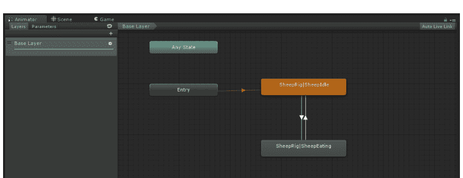

#### 工作原理...

状态过渡定义了我们如何在动画图表中移动。它们与基于 Animator Controller 参数的过渡条件结合使用；我们将在下一个配方 *使用参数控制动画流程* 中详细讨论参数。每个过渡都有一组可调整的属性。点击过渡（白色箭头）来选中它。你可以在 Inspector 选项卡中找到过渡属性（确保展开 Settings 折叠面板）：

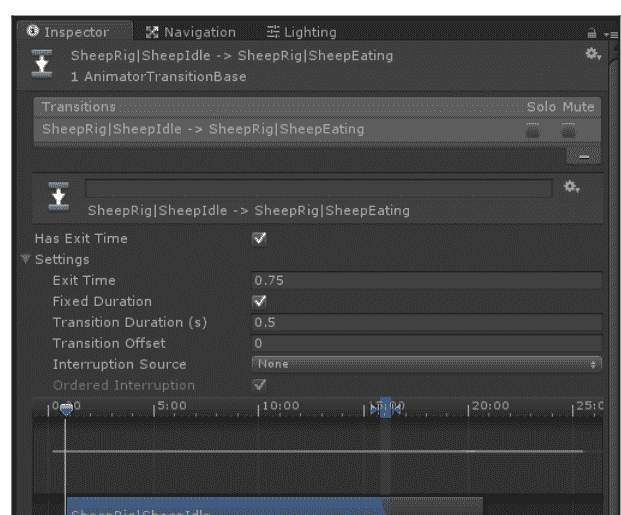

- **Has Exit Time**: 如果设为 true，则仅在动画已播放一定百分比后才启用过渡。如果禁用，过渡将在其条件满足后立即发生。如果要创建动画序列，请将其设为 true。
- **Exit Time**: 这是动画长度的百分比（0-1 范围），在此之后 **Has Exit Time** 条件被满足。例如，如果将其设为 0.5，状态将在动画播放 50% 后过渡。
- **Fixed Duration**: 此属性与下一个属性 **Transition Duration (s)** 结合使用。如果启用，**Transition Duration (s)** 以秒为单位，如果禁用，**Transition Duration (s)** 以动画时间的百分比表示。
- **Transition Duration (s)**: 状态过渡的时间。这就是动画从一个过渡到另一个所需的时间。过渡期间动画会被混合。过渡时间越长越平滑，越短越生硬。一个好的默认值约为 0.25。


- **过渡偏移**：这会在时间上偏移目标动画。值以动画的百分比表示。将其设置为 0.3 意味着目标动画将从其长度的 30% 开始，而不是从开头开始。
- **中断源**：此设置告诉 Unity 该过渡是否可以被其他过渡中断。你可以将其设置为：
  - **无**：过渡不能被任何其他过渡中断。
  - **当前状态**：过渡可以被我们尝试从中过渡的状态的过渡中断。
  - **下一个状态**：过渡可以被我们尝试过渡到的状态的过渡中断。
  - **当前状态然后下一个状态**：过渡可以被我们尝试从中过渡的状态的过渡或我们尝试过渡到的状态的过渡中断。从我们尝试从中过渡的状态的过渡具有优先级。
  - **下一个状态然后当前状态**：过渡可以被我们尝试从中过渡的状态的过渡或我们尝试过渡到的状态的过渡中断。从我们尝试过渡到的状态的过渡具有优先级。
  - **有序中断**：如果设置为 false，则允许过渡被其他过渡独立于其顺序地中断。如果设置为 true，则过渡的顺序很重要。

#### 还有更多...

当你创建 Animator Controller 时，除了动画状态外，还可以看到另外三个节点：

- **入口和出口**：此节点用于在状态机（Animator Controllers 或子状态机）之间过渡时。我们将在第 6 章《处理战斗》中的《在 Animator Controller 中使用子状态机》配方中详细介绍它。
- **任意状态**：此节点可作为辅助手段，用于从任意状态向给定状态进行过渡。当你有一个可以随时播放的动画时使用，例如受击动画。我们将在第 6 章《处理战斗》中的《使用从任意状态的过渡来播放受击反应》配方中详细介绍它。

### 使用参数控制动画流程

你可以在 Animator Controller 中定义一组参数，并使用它们来控制 Mecanim 中动画状态之间的过渡。在本配方中，我们将展示如何使用参数作为过渡条件，并使用脚本在运行时设置这些参数的值。

#### 准备工作

在开始之前，你应该准备一个 Animator Controller，其中至少有一个动画状态之间的过渡。控制器应分配给放置在场景中的角色（其 Animator 组件）。你也可以使用提供的示例 Unity 项目并进入 Chapter 01 Working with animations\Recipe 05 Using parameters to control the animation flow 目录。你将在那里找到一个 Example.unity 场景。场景的 Hierarchy 中有一个 Warrior 游戏对象。如果运行游戏并按下空格键，Warrior 将做出挥手手势。你可以选择 Warrior 并打开其 Animator Controller。如果点击 Idle | Wave 过渡，你将能够看到过渡条件。

## 如何操作...

要使用参数控制状态过渡，请按照以下步骤操作：

- 1. 打开 Animator Controller 资源。
- 2. 在 Animator 窗口左上角找到 Parameters 选项卡并点击它。
- 3. 在 Parameters 选项卡中点击加号图标以添加新参数。
- 4. 为参数选择 Trigger 类型。
- 5. 输入新创建参数的名称（在提供的示例中，参数的名称是 Wave）。
- 6. 点击你想要使用参数的状态之间的过渡。在提供的示例中，它是 Idle 和 Wave 动画状态之间的过渡。Idle 是默认状态。
- 7. 进入 Inspector 选项卡并找到 Conditions 部分。
- 8. 点击加号图标添加新条件。如果只有一个参数，它将自动被选为条件。如果有多个参数，你需要从下拉列表中选择合适的参数。
- 9. 如果你想在动画状态之间立即过渡，请确保禁用 Settings 折叠面板上方的 Has Exit Time 选项。
- 10. 只有当其条件满足时，过渡才会发生。你需要使用脚本设置参数。
- 11. 要创建新的 C# 脚本，在 Project 视图中右键单击并选择 Create | C# Script。按你喜欢的名称命名脚本（在提供的示例中，它称为 Wave，与其设置的参数相同）。
- 12. 打开脚本并写入以下内容：

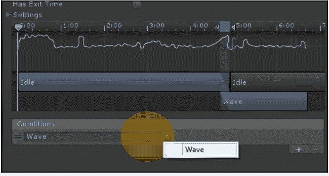

```csharp
using UnityEngine;
using System.Collections;

public class Wave : MonoBehaviour {
//The anim variable is used to store the reference
//to the Animator component of the character.
private Animator anim;
void Start () {
//We get the component and assign it to
//the anim variable when the game starts
anim = GetComponent<Animator>();
}
void Update () {
//We check if player pressed the spacebar
if (Input.GetKeyDown(KeyCode.Space))
{
/*We call the SetTrigger() function on the
Animator component stored in the anim
variable. The function requires one
parameter - the name of the trigger
parameter set in our Animator Controller
("Wave" in our example). Make sure to match
it with the name of the parameter you've
created in your Animator Controller*/
anim.SetTrigger("Wave");
}
}
}
```

- 13. 确保你的类名与脚本的文件名相同，否则无法编译。
- 14. 将脚本分配给角色，分配到具有 Animator 组件且附加了你的 Animator Controller 的同一个 Transform 上。播放游戏并按空格键；你应该看到你的角色切换到下一个动画状态。

## 工作原理...

你可以使用几种类型的参数以及相应的脚本函数来设置它们：

- **Trigger**：这是最简单的参数。它通过在 Animator 组件对象上调用 SetTrigger(string name) 函数设置为 true。它在被过渡消耗（使用）后由 Animator Controller 重置。函数的 string name 参数必须与你在 Animator Controller 中设置的触发器参数名称匹配。
- **Int**：这是一个整数参数。当你使用它时，你需要在条件中指定一个逻辑比较。过渡只有在参数的值满足与给定数字的比较条件时才会发生。你可以使用 Equal、Greater、Less 和 Not Equal 选项来比较参数的值与给定数字。整数类型参数使用 SetInteger(string name, int value) 函数设置。string name 参数需要与控制器中设置的参数名称匹配。int value 参数是设置为控制器参数的值。
- **Float**：这是一个浮点参数。它与整数类型的工作方式相同，但使用浮点数而不是整数。它使用 SetFloat(string name, float value) 函数设置。
- **Bool**：这是一个布尔参数。条件可以检查参数是否为 true 或 false。参数的值使用 `SetBool(string name, bool value)` 函数设置。

## 还有更多...

- 你可以在过渡 **Inspector** 中的 **Conditions** 部分点击加号图标为状态过渡添加多个条件。要使过渡发生，所有条件都必须满足。它对条件的工作方式相当于逻辑 *与*。
- 你也可以在同一状态之间创建多个过渡。为此，右键单击你想要从中过渡的状态并选择 **Make Transition** 选项，然后选择你已有的过渡目标状态。多重过渡用三个箭头而不是一个箭头标记。如果任一过渡的条件满足，过渡就会发生。你可以将其用作过渡条件的逻辑 *或*。
- 如果状态之间有多个过渡，你一次只能编辑其中一个。要编辑过渡，请在 **Inspector** 的 **Transitions** 部分中选择它。

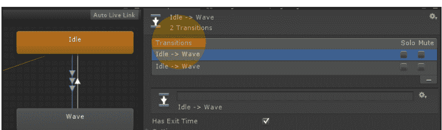

- 如果你想删除一个过渡，在 **Inspector** 中选择它并点击减号图标，或在 **Animator Controller** 中选择它并按键盘上的 *删除*。按 *删除* 会删除所有过渡。


- 如果你想从过渡中移除一个条件，请在 **检视器** 选项卡中选中它并点击减号图标。要选中一个条件，你需要点击条件下拉列表左侧的句柄（句柄看起来像一个 = 符号）。
- 如果你想从 **动画控制器** 中移除一个参数，你需要点击参数左侧的句柄并按下键盘上的 *Delete* 按钮。你也可以右键点击参数并从上下文菜单中选择 **Delete** 选项。

## 从多个资源使用动画

有时将动画分离到多个资源中非常方便。常见的情况是让绑定模型与动画分离，或让不同类型的动画彼此分离（战斗与移动分离，移动与动作分离，动作与过场分离，等等）。本教程展示了如何对 **Humanoid** 和 **Generic** 骨架都进行此操作。

### 准备工作

开始之前，你应该准备并导入至少两个包含动画的资源。如果你使用的是 **Generic** 骨架，请确保两个资源中使用的是相同的骨架。你也可以使用提供的示例 Unity 项目并前往 `Chapter 01 Working with animations\Recipe 06 Using animations from multiple assets`。那里有一个名为 `Example.unity` 的场景。在场景的 **层级** 中你可以找到一个 **Character** 游戏对象。它附带了一个 **动画控制器**，其中可以找到两个动画：**Idle** 和 **Wave**。在 **Rigs** 目录中，你会找到仅包含绑定角色的 `Character.fbx` 资源，以及包含对应动画的 `Idle.fbx` 和 `Wave.fbx` 资源。


如果你从 Blender 导出 FBX 文件，请确保在 **导出器** 中禁用 **Add Leaf Bones** 选项。如果你仅导出骨架和动画（不含网格），请在场景中添加一个空对象。如果你不这样做，导入后你的骨架可能会有点混乱。

### 如何操作...

要使用来自多个资源的动画，你需要按照以下步骤操作：

- 1. 将文件导入 Unity。
- 2. 如果你使用的是 Generic 骨架，你需要在你的角色（或参考角色，如果你计划使用相同骨架的多个角色）上将 **Avatar Definition** 设置为 **Create From This Model**。对于每个导入的动画资源，将 **Avatar Definition** 设置为 **Copy From Other Avatar** 并选择你的角色或参考角色的头像。为此，你需要展开角色资源，找到头像，然后将其拖放到 **检视器** 选项卡中的 **Source** 字段。
- 3. 如果你使用的是 **Humanoid** 骨架，你不需要复制 **Avatar Definition**（如果你骨架完全相同，仍然可以复制；这样你的项目中会有更少的头像，更容易找到你需要的）。
- 4. 创建或打开一个 **动画控制器**。
- 5. 分配来自不同文件的动画并在它们之间建立过渡。
- 6. 运行游戏以查看动画是否正常工作。

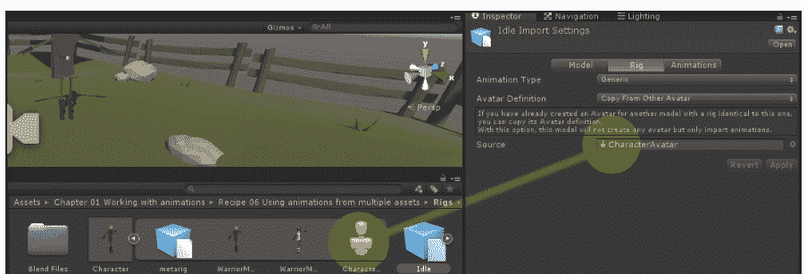

### 原理...

所有 **Generic** 骨架都可以使用共享相同 **Avatar Definition** 的多个资源的动画。要共享相同的 **Avatar Definition**，**Generic** 骨架必须具有完全相同的骨架（相同的层级、相同的骨骼名称和变换）。所有 **Humanoid** 骨架都可以使用设置为 **Humanoid** 的多个资源的动画。此外，它们不需要具有相同的骨架，因为 Unity 会自动重新定位所有人形动画。

## 循环、镜像和偏移动画

Unity 允许在导入后在一定程度上编辑动画。这可以节省大量工作并大大加快你的工作流程。

### 准备工作

开始之前，你应该准备并导入至少包含一个动画的 **Humanoid** 骨架。你也可以使用提供的示例 Unity 项目并前往 `Chapter 01 Working with animations\Recipe 07 Looping mirroring and offsetting animations` 目录。那里有一个名为 `Example.unity` 的场景。在场景的 **层级** 中，你可以找到一个 **Mirror** 游戏对象。它附带了一个 **动画控制器**，其中可以找到两个动画：**Wave** 和 **WaveMirror**。在 **Rigs** 目录中，你会找到 `Mirror.fbx` 资源。如果你选中它并前往 **检视器**，再前往 **Animations** 选项卡，你可以找到正常和镜像的动画示例，以及循环动画示例（**Idle** 和 **IdleMirror**）。

### 如何操作...

要将动画设置为 *loop*，你需要执行以下步骤：

- 1. 选择动画资源并前往 **Animations** 选项卡。
- 2. 勾选 **Loop Time** 复选框并点击 **Apply** 按钮。动画将被循环。
- 3. 如果你的动画的第一帧和最后一帧不完全匹配，你可以使用 **Loop Pose** 复选框强制它们匹配。不建议对第一帧和最后一帧已经匹配的动画使用此选项。

要 *offset* 一个动画，你需要执行以下步骤：

- 1. 选择动画资源并前往 **Animations** 选项卡。
- 2. 选择你的动画并使其循环（**Loop Time** 复选框）。
- 3. 在 **Loop Pose** 复选框下方的 **Cycle Offset** 字段中输入一个值。
- 4. 点击 **Apply** 按钮。

要 *mirror* 一个动画，你需要执行以下步骤：

- 1. 选择动画化的 **Humanoid** 资源并前往 **Animations** 选项卡。
- 2. 在动画设置的底部找到 **Mirror** 复选框。
- 3. 勾选 **Mirror** 复选框并点击 **Apply** 按钮。动画将被镜像。
- 4. 镜像动画仅适用于 **Humanoid** 骨架。

### 原理...

- **循环动画**：这是一种用于所有循环运动的常见技术（行走和奔跑循环、待机动画等等）。如果你不将动画设置为循环，它将播放一次并在最后一帧冻结。
- **偏移动画**：有时偏移循环动画的循环会很方便。它通常与 **Mirror** 选项一起用于转向动画（在移动时用于转向角色的片段）。我们将在 `Chapter 4, Character Movement` 中的 *Using root motion to steer a character* 教程中展示这一点。
- **镜像动画**：此选项仅适用于 **Humanoid** 骨架。它用于将动画左右翻转，并可与 **Offset Cycle** 选项结合使用，节省多达 50% 的转向动画。

### 还有更多...

你也可以在 **动画控制器** 中镜像和偏移动画状态。如果你选择一个动画状态并前往 **检视器** 选项卡，你可以找到 **Mirror** 和 **Cycle Offset** 选项。还有一个选项可以使用 **动画控制器** 参数来打开和关闭 **Mirror** 选项并设置 **Cycle Offset**。你需要为 **Mirror** 选项定义一个布尔参数，为 **Cycle Offset** 定义一个浮点参数。这些设置将与参数自动同步。每当你更改参数值时，设置也会随之更改。

## 调整动画播放速度

Unity 允许你在 **动画控制器** 中减慢和加快动画播放速度。你可以在运行时使用脚本来实现此目的，以实现有趣的效果，例如慢动作。

### 准备工作

开始之前，你应该准备并导入至少包含一个动画的骨架，并为其创建一个至少包含一个动画状态的 **动画控制器**。你也可以使用提供的示例 Unity 项目并前往 `Chapter 01 Working with animations\Recipe 08 Adjusting the playback speed of animations` 目录。那里有一个名为 `Example.unity` 的场景。在场景的 **层级** 中，你可以找到一个 **AdjustSpeed** 游戏对象。它附带了一个 **动画控制器**，其中可以找到两个动画状态：**WaveSpeedNormal** 和 **WaveSpeedIncreased**。场景中还有一个 **AdjustSpeedByScript** 游戏对象。你可以在运行时按下键盘上的 **Space** 按钮来增加其动画的播放速度。

### 如何操作...

要更改动画播放速度，请按照以下步骤操作：

- 1. 打开一个 **动画控制器**。
- 2. 选择一个动画状态。
- 3. 前往动画状态的检视器并在 **Motion** 字段下方找到 **Speed** 参数。
- 4. 在 **Speed** 参数中输入一个数字以更改播放速度。

### 原理...

在 **动画控制器** 中为动画状态设置的 **Speed** 参数会乘以该动画状态的播放速度。将此参数设置为零将冻结动画。


## 还有更多...

你也可以使用脚本设置参数。以下是示例脚本（它由提供的 Example.unity 中的 AdjustSpeedByScript 游戏对象使用）。你可以将它分配给具有 Animator 组件和附加 Animator Controller 的动画游戏对象：

```
using UnityEngine;
using System.Collections;

public class AdjustSpeedByScript : MonoBehaviour {
//This is a variable, in which we store the reference to the
Animator component
private Animator anim;
//We store the wanted animation speed in this variable, the
default value is 2 (200%).

public float newAnimationSpeed = 2f;
void Start () {
//At the start of the game we assign the Animator
component to our anim variable
anim = GetComponent<Animator>();
}
void Update () {
//We check if player pressed the Space button
if (Input.GetKeyDown(KeyCode.Space)) {
//And set the playback speed of the whole Animator
Controller (it multiplies all states animation
playback speed)

anim.speed = newAnimationSpeed;
}
}
}
```

如果你只想更改单个动画状态的速度，则向 Animator Controller 添加一个 float 参数，在动画状态 Inspector 中的 Multiplier 字段中使用该参数，并使用以下函数通过脚本更改参数：

```
anim.SetFloat(string name, float value);
```

这里的 name 是 Animator Controller 中参数的名称，value 是你想要设置参数和播放速度的浮点值。

## 使用覆盖 Animator Controller 来为不同类型的角色制作动画

如果你的游戏中存在多种角色类型，你可能希望能够在它们之间共享动画状态逻辑，只需替换动画剪辑即可。想象一下，你有几种类型的敌人，它们的战斗逻辑相同（它们有攻击、移动、受击反应等），但使用不同的动画剪辑。对于这种情况，**Override Animator Controllers** 就派上用场了。

### 准备工作

你应该至少准备好两个具有不同动画剪辑的角色并导入到 Unity 中。你也可以下载提供的示例 Unity 项目并进入 `Chapter 01 Working with animations\Recipe 09 Using override animator controllers to animate different types of characters` 目录。在那里有一个名为 `Example.unity` 的场景。如果你打开它，你会在 **Hierarchy** 中找到 **Warrior** 和 **Spider** 游戏对象。它们附加了 **Override Animator Controllers**，你可以检查它们。如果你运行游戏，角色将播放攻击动画。底层逻辑在 **HumanCombat** 控制器中定义（位于 **Animator Controllers** 目录中）。**Warrior** 游戏对象使用未被覆盖的 **HumanCombat** 控制器，**Spider** 游戏对象使用 **SpiderCombat** override controller。

### 如何操作...

要使用 **Override Animator Controllers**，请按照以下步骤操作：

- 1. 创建一个普通的 **Animator Controller**，它将用作包含动画状态逻辑的参考控制器。在提供的示例中，它是使用 **Warrior** 动画创建的 **HumanCombat** 控制器。
- 2. 你可以将此控制器附加到你的第一个角色（其 **Animator** 组件）上并像之前一样使用它。
- 3. 通过在 **Project View** 上右键单击并选择 **Create | Override Animator Controller** 来创建 **Override Animator Controller**。
- 4. 选择新创建的覆盖控制器并进入 **Inspector** 选项卡。
- 5. 将原始/参考 **Animator Controller** 拖放到新创建的覆盖控制器的 **Controller** 字段中。
- 6. 你将在左侧看到所有原始动画剪辑的列表以及用于覆盖这些动画剪辑的字段。
- 7. 将第二个角色的动画剪辑拖放到与第一个角色的原始动画剪辑对应的覆盖字段中。在提供的示例中，**Human** 动画被 **Spider** 动画替换。
- 8. 将 **Override Animator Controller** 分配给第二个角色的 **Animator** 组件的 **Controller** 字段。

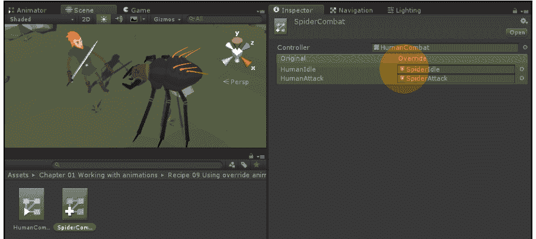

### 原理...

**Override Animator Controller** 仅替换原始 **Animator Controller** 中的动画剪辑。原始控制器的逻辑保持不变（因此你也可以使用相同的脚本来设置相同的参数等）。它在游戏中创建 NPC 角色时非常有用。你只需创建一次 **Animator Controller**，编写一次驱动控制器的脚本，然后只更改动画。


你的原始 **Animator Controller** 必须具有动画剪辑。你无法覆盖空的动画状态。

## 从 3D 软件包导入对象动画

在 Unity 中，你不仅可以导入骨骼动画，还可以导入对象变换动画。它对于创建复杂运动很有用，例如对象沿路径跟随。

### 准备工作

你需要在 3D 软件包中为对象制作平移、旋转或缩放动画，然后将对象导出为 FBX 文件。你也可以下载提供的示例 Unity 项目并进入 `Chapter 01 Working with animations\Recipe 10 Importing object animation from a 3D package` 目录。在那里有一个名为 `Example.unity` 的场景。该对象具有在 Blender 中创建并导出为 FBX 文件的跟随路径动画。它有一个普通的 Animator Controller，该动画作为默认状态（循环）。你可以运行游戏来查看对象的动画。

### 如何操作...

要导入对象动画，请按照以下步骤操作：

- 1. 在 3D 软件包中为对象制作动画（支持平移、旋转和缩放动画）。
- 2. 将对象导入 Unity 并选择 **Generic** 骨架类型。
- 3. 你可以正常调整动画设置（例如循环动画）。
- 4. 创建一个 **Animator Controller**，并将其中一个导入的动画拖放到 **Animator** 窗口中以创建默认动画状态。
- 5. 将动画对象放置到场景中，并将控制器分配给对象的 **Animator** 组件。
- 6. 如果你运行游戏，对象将被动画化。

### 原理...

Unity 从 3D 软件包导入 3D 对象的平移、旋转和缩放动画。它使创建复杂动画和使用所选 3D 软件的高级功能变得容易。在将动画导入 Unity 之前，请确保将动画烘焙为帧（Blender 默认将导出的动画烘焙为帧）。不支持导入网格动画（顶点移动）（你必须改用 **Blend Shapes**；我们将在 `Chapter 5, Character Actions and Expressions` 中的 *使用 Blend Shapes 制作面部表情动画* 食谱中详细讨论它们）。
